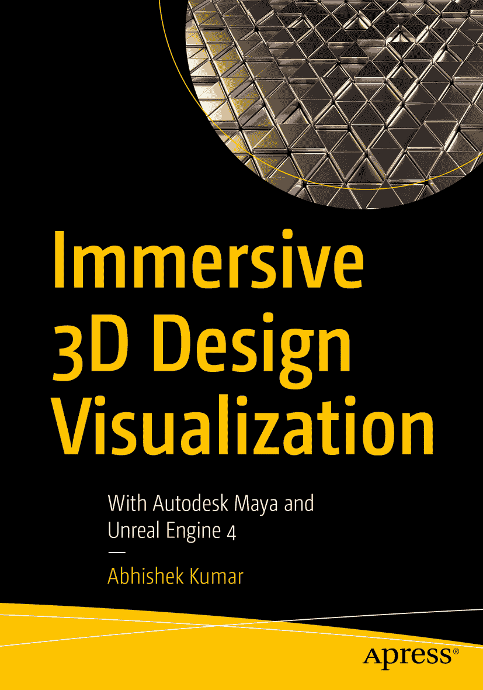
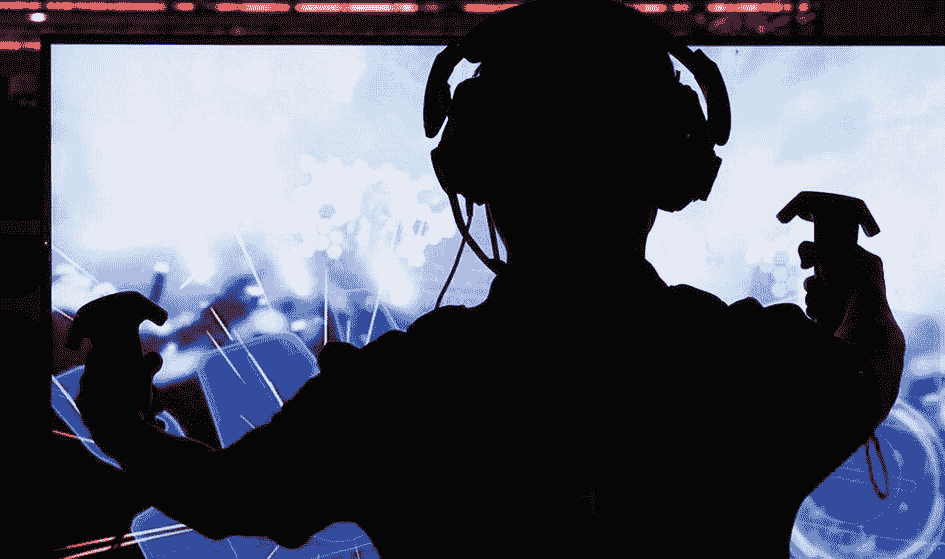
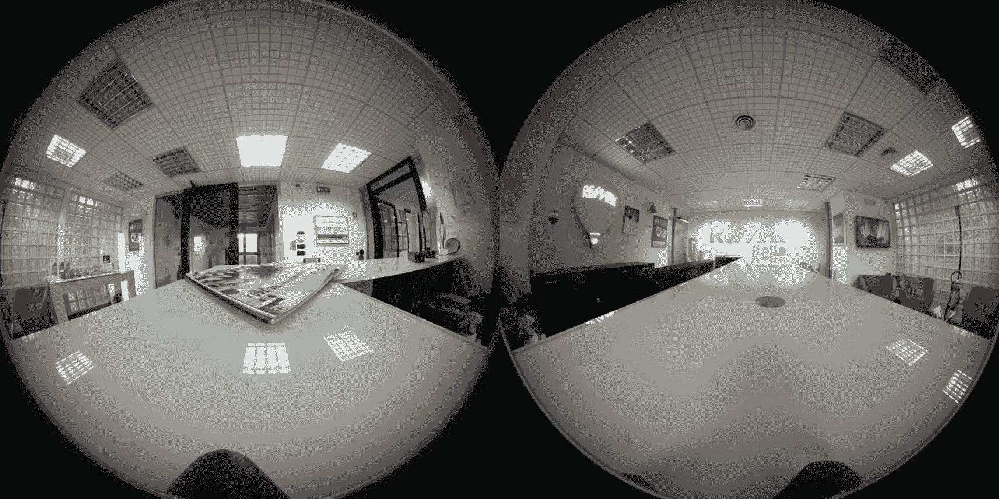
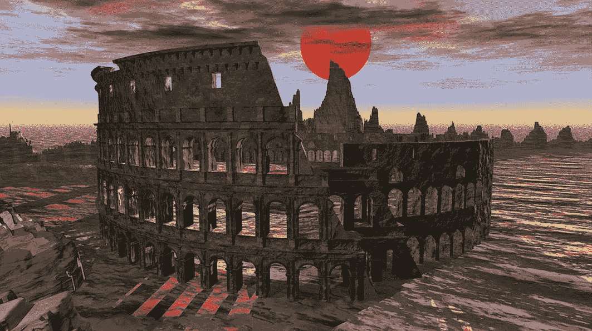
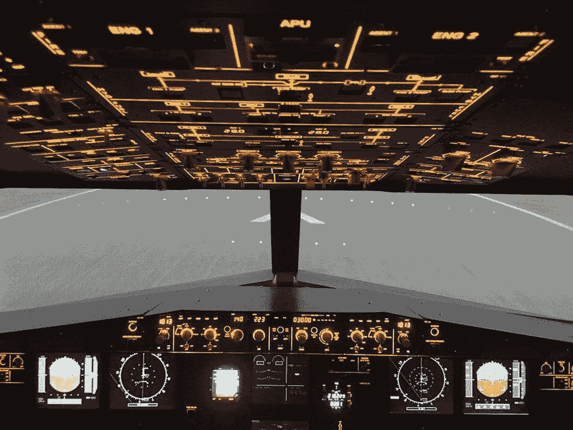

```markdown



ISBN 978-1-4842-6596-3 | e-ISBN 978-1-4842-6597-0 | [`doi.org/10.1007/978-1-4842-6597-0`](https://doi.org/10.1007/978-1-4842-6597-0)

© Abhishek Kumar 2021

标准 Apress 商标名称、徽标和图像可能出现在本书中。我们并非在每次出现商标名称、徽标或图像时都使用商标符号，而是仅在编辑性场合使用这些名称、徽标和图像，以维护商标所有者的利益，且无意侵犯商标。本书中使用的商品名称、商标、服务标记和类似术语，即使未明确标明，也不应被视为对其是否受专有权利保护的意见表达。

出版商、作者和编辑可以安全地假定，本书中的建议和信息在出版之日是真实和准确的。出版商、作者或编辑均不对本书所含材料或可能存在的任何错误或遗漏提供明示或暗示的担保。对于已出版地图中的管辖权主张和机构隶属关系，出版商保持中立。

本书由 Springer Science+Business Media New York 向全球图书贸易分销，地址：1 New York Plaza, Suite 4600, New York, NY 10004-1562, USA。电话：1-800-SPRINGER，传真：(201) 348-4505，电子邮件：orders-ny@springer-sbm.com，或访问 www.springeronline.com。Apress Media, LLC 是一家加利福尼亚有限责任公司，其唯一成员（所有者）是 Springer Science + Business Media Finance Inc (SSBM Finance Inc)。SSBM Finance Inc 是一家特拉华州公司。

*献给我的母亲 Usha Sinha、父亲 Prof. B. K. Prasad，以及我挚爱的妻子 Alka，感谢我们 11 年精彩的婚姻以及未来更多的岁月。献给我的女儿 Rishika Ryan 和我的儿子 Shivay Singh Ryan。我爱你们所有人。*

# 致谢

我无比荣幸地向我的导师 Prof. Saket Kushwaha 和 Prof. Alok Kumar Rai 表达深深的谢意。他们是我此番努力的灵感源泉。

特别感谢我的博士生导师、巴纳拉斯印度大学的副教授 Dr. Achintya Singhal；没有他的鼓励、支持和指导，这本书不可能完成。

我还要感谢 Simon Peter Hanson、Spandana Chatterjee、Divya Modi 和 Matthew Moodie 对于出版本书的发起。他们富有帮助的评论和建议带来了许多改进和修正，提升了本书的质量。

特别感谢澳大利亚新南威尔士大学的教授 Dr. Vijayakumar Varadarajan、韩国庆北大学的教授 Dr. Kalyana C. Veluvolu，以及马来西亚博特拉大学的副教授 Dr. Thinagaran Perumal 提供的无条件支持。

# 关于作者

# 关于技术审校者

# 1. 面向创意与沉浸式技术的设计

欢迎踏上创意与沉浸式技术设计的旅程。本书将带你经历在 `Maya` 中创建可视化资产、在 `Substance Painter` 中制作纹理、在 `Unreal Engine 4`（`UE4`）中设置场景、创建材质以及最终渲染场景的全过程。

本书面向对 3D 工具有非常基础了解，并希望深入了解高级主题的初学者和业余爱好者。我们将逐步讲解资产创建流程的每一个步骤，包括建模、拆解 UV 和导入。

最后，你将创建一个简单的建筑场景，可以用作你的作品集。目标是展示你创建的资产。

## AR、VR 与新兴技术

随着价格亲民的 GPU 以及利用这些技术强大功能和沉浸感的应用程序的激增，增强现实（AR）和虚拟现实（VR）变得非常流行。AR 和 VR 在医学、军事模拟、教育、建筑可视化和游戏等领域都有应用。AR 和 VR 是两种不同类型的技术。增强现实通过使用智能手机等设备，将数字元素投射到现实世界中。虚拟现实则是一种完全沉浸式的体验，通过使用 VR 头戴设备，将用户完全包围在一个数字世界中。图 1-1 显示了一个视觉示例。


**图 1-1** 沉浸式技术的视觉呈现（来源：[*https://pixabay.com/*](https://pixabay.com/)）

## 用于娱乐的 VR

VR 不仅限于电子游戏，还在我们日常生活的其他领域崭露头角。虽然目前其应用步伐和范围可能有限，但不可否认的是，VR 很快将成为一种非常实用和有用的设备——用于虚拟导览和教育。图 1-2 是一个数字元素如何融入娱乐领域的视觉示例。



**图 1-2** VR 融入娱乐领域的呈现（来源：[*https://pixabay.com/*](https://pixabay.com/)）

## 用于数字建筑的 VR

随着技术的快速进步，企业有机会利用其潜力。许多公司正在投资开发 VR 应用和设备。这涵盖了从广告到购物等日常活动的新体验方式。VR 将人们带入一个数字世界，如图 1-3 所示。



**图 1-3** VR 让人们沉浸在数字世界中（来源：[*https://pixabay.com/*](https://pixabay.com/)）

它允许用户在一栋房子尚未建成或一个大型主题公园尚未到访之前进行探索。这有许多潜在的好处。在房子建造前进行可视化，对买家来说是一个巨大的优势。它能让客户很好地了解他们正在购买什么，使他们能够在设计师和建筑商建造房屋之前，在规划阶段决定添加或移除哪些内容。这在建造涉及大量工作的大型房屋时尤其有用，并且有巨大的改进空间。图 1-4 展示了历史建筑的数字化建造。



**图 1-4** 历史建筑的数字化重建（来源：[*https://pixabay.com/*](https://pixabay.com/)）

## 用于模拟和训练的 VR

VR 还有其他有用的功能，例如在军事模拟中训练士兵应对不同的战斗场景，以及在航空训练中提供沉浸式的飞行模拟体验。你可以理解为什么有抱负的 CGI 程序员必须在 AR 和 VR 技术上做大量的研究。这不仅为职业打开了大门，还能让你及时了解最新的技术发展。

军方使用 VR 来训练士兵应对那些难以通过传统方法构建的场景。通过使用沉浸式技术，军队可以有效地训练士兵处理战场上的各种情况。具有逼真爆炸效果和武器模拟的战斗场景可以产生类似于真实遭遇的压力，这有助于为真实的战斗场景做好准备。图 1-5 展示了一个军事模拟场景。



**图 1-5** 军事模拟训练的呈现（来源：[*https://pixabay.com/*](https://pixabay.com/)）

```


## 用于产品可视化的 VR

企业正投入越来越多的资源，开发用于 VR 和 AR 支持的工具、应用和设备。尽管目前使用的人还不多，但如果以炫酷的方式呈现产品，人们就会对其产生兴趣。这能表明一家公司具有进取精神，并且重视产品质量与现代化进程。企业可以极具吸引力地展示其产品系列。

这能够吸引到那些可能之前忽略该产品的潜在客户，这在汽车行业尤其有用，因为用户需要看清他们购买的车辆类型。潜在客户可以虚拟预览他们有意购买的汽车，从而帮助他们做出决定。客户可以在舒适的家中，以数字方式浏览产品目录，然后轻松选择心仪的车辆。图 1-6 展示了汽车的数字化构建过程。


图 1-6

产品可视化（来源：[*https://pixabay.com/*](https://pixabay.com/)）

## 用于太空探索模拟的 VR

虚拟现实在太空和行星探索中得到了广泛应用。科学家们利用它来训练飞行员，通过模拟驾驶航天器或探测器（这些设备难以操控，且一次失误代价高昂）在其它行星上驾驶探测器。航天组织必须让他们的飞行员接受良好的训练。图 1-7 展示了太空探索模拟。


图 1-7

太空探索模拟示意图（来源：[*https://pixabay.com/*](https://pixabay.com/)）

了解了这些之后，让我们进入下一章，讨论我们的专业工具——即我们将在本书中用来创建设计可视化产品和沉浸式 3D 场景的软件。

