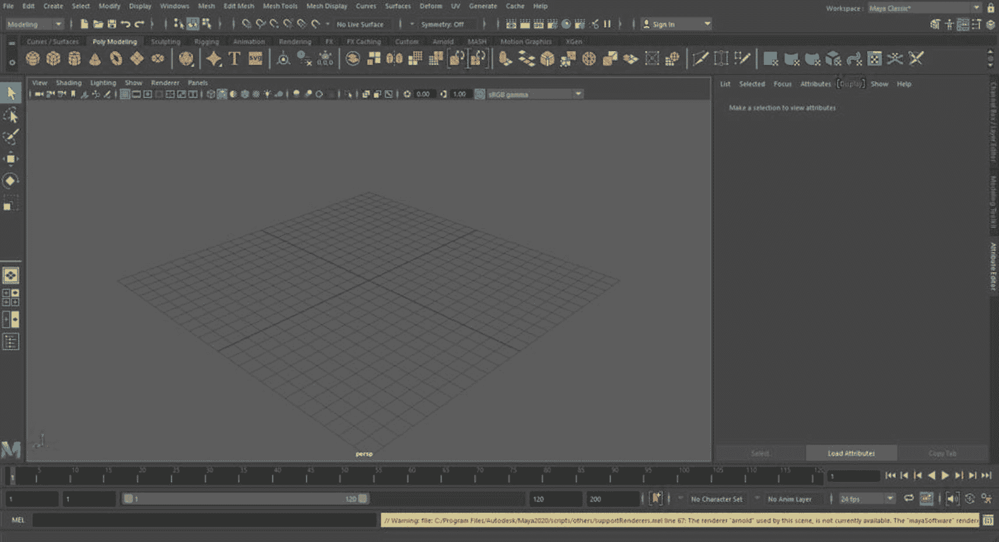
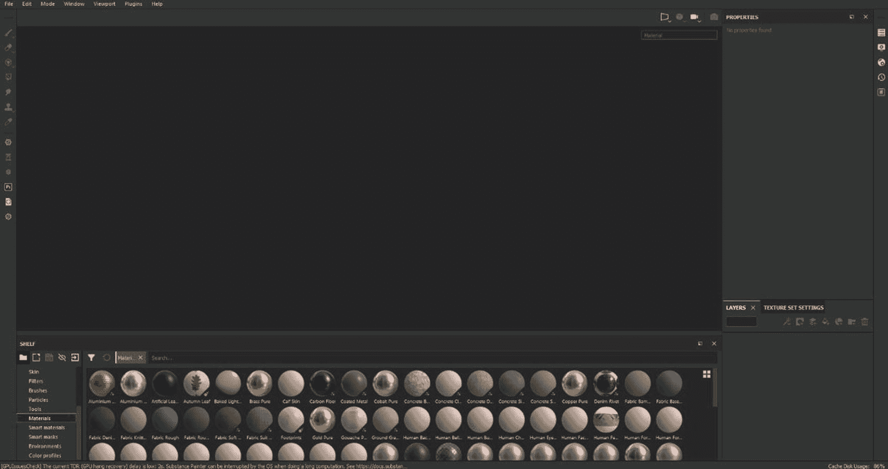
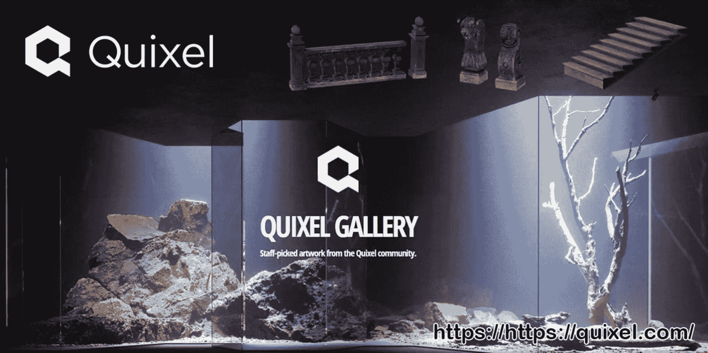
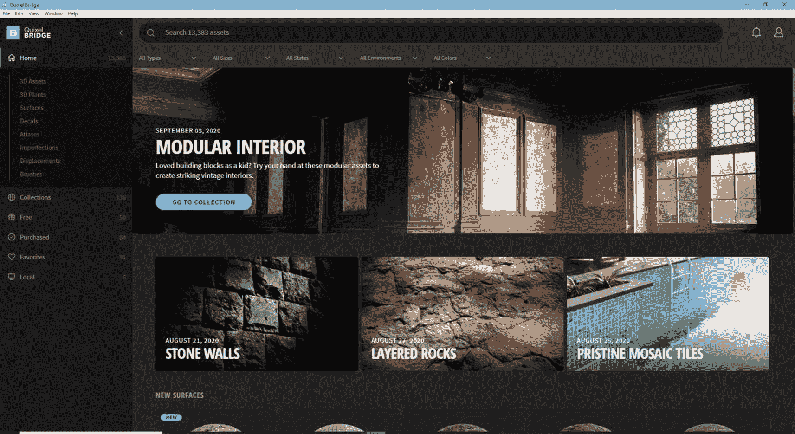
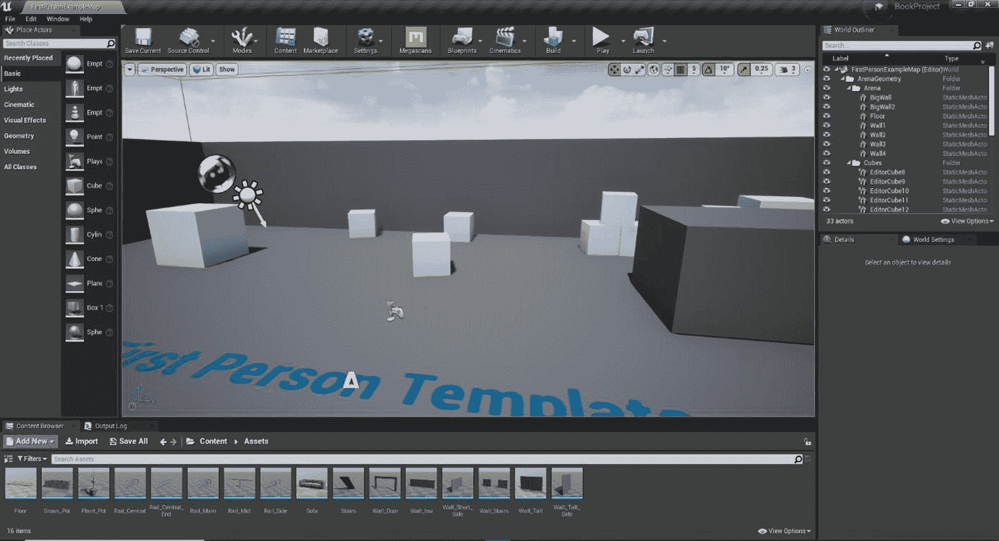
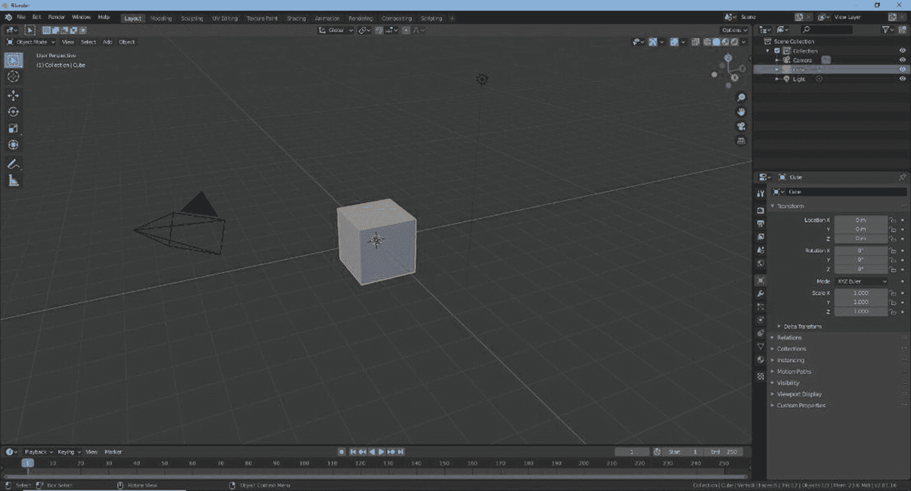
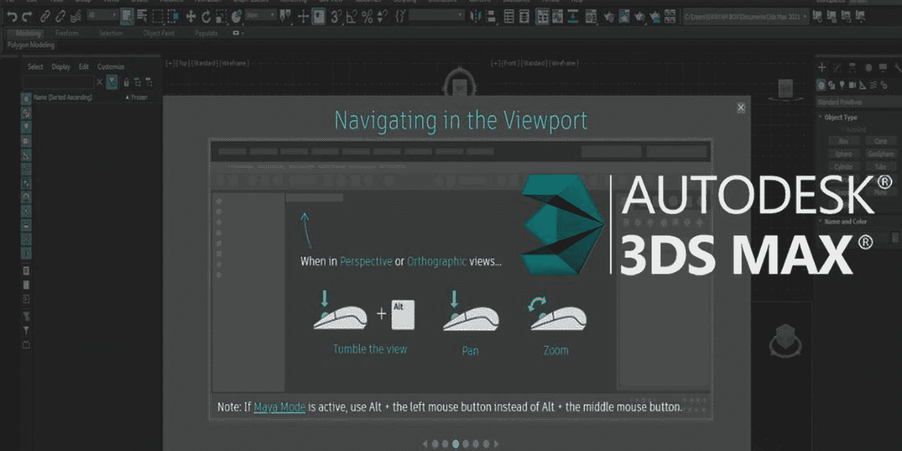
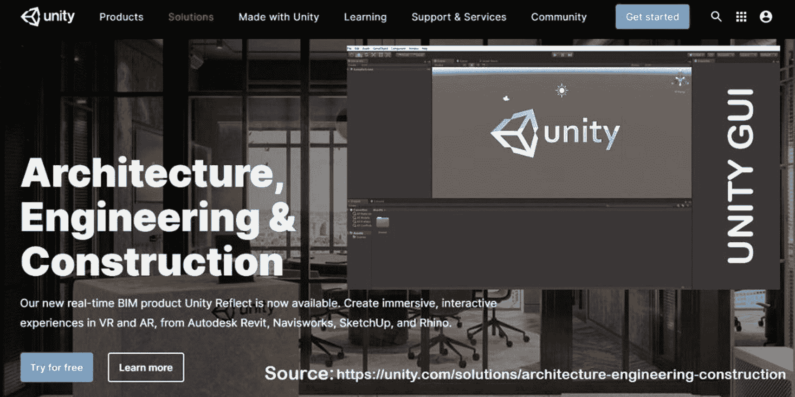

# 2. 建筑可视化工具

欢迎来到第 2 章。本章将介绍本书中所使用的软件和工具，以便您熟悉它们。当然，这些工具并不是您能使用的唯一软件。您学到的技能可以迁移到任何 DCC（数字内容创作）应用中，无论是免费还是付费的。例如，您可以轻松地将用于建模的 `Blender` 或 `3DS Max`、用于贴图的 `Quixel Mixer`，或用作游戏引擎的 `Unity3D` 中使用的相同原理，应用于类似的软件。

## 用于设计可视化的 Maya

`Maya` 是一款行业标准的建模和内容创作软件应用，广泛应用于各个领域。如果您想在 CGI 或游戏行业的建模、展 UV 或动画领域工作，拥有 `Maya` 经验会是加分项。它最初由 `Wavefront Technologies` 开发，1.0 版本于 1998 年 2 月发布。`Autodesk` 于 2005 年收购了它。

在本书中，我们使用 `Maya` 进行建模和展 UV。`Maya` 拥有强大的建模工具，通过快捷键和便捷的饼状菜单简化了您的工作。

图 2-1 展示了默认的 `Maya` 界面。

图 2-1

默认的 Maya 界面

## 用于 PBR 贴图的 Substance Painter

`Substance Painter` 是一款带有实时视口的 3D 物理基础渲染（PBR）贴图软件。在 `Substance Painter` 中为资产贴图非常直观。能在 3D 中绘制并立即看到实时效果非常方便，但这还不是 `Substance Painter` 如此出色的全部原因；它那令人难以置信的程序化效果、智能材质、智能蒙版和生成器库才是关键。图 2-2 展示了 `Substance Painter` 启动时的默认界面。

图 2-2

Substance Painter 界面

订阅 `Substance` 套件后，通过 `Substance Source` 形式提供的大量精心制作的材质选择，对任何项目都是极好的资源。此外，`Substance Share` 是一个平台，`Substance` 社区可以在上面免费分享他们的创作，这进一步使得 `Substance Painter` 成为如此出色的 3D 贴图工具。

## Quixel Mixer

`Quixel Mixer` 是一款免费的 3D 贴图和材质创作工具，用于为资产贴图或利用 `Quixel Megascans` 生成新材质。`Quixel Megascans` 是一个庞大的库，在您贴图时可以随意使用。图 2-3 展示了 `Quixel Mixer` 的界面。

图 2-3

Quixel Mixer

## 从 Quixel Megascans 获取材质

`Quixel Megascans` 是一个优质的摄影测量资产库，包含材质、纹理、贴花、污渍、缺陷图、3D 资产等等。这是一个高质量库，被大型 AAA 级公司用于开发游戏和电影。它是一个很好的材质和纹理资源，不仅逼真，而且具有完美的可平铺性和游戏就绪性。这使您可以轻松地、几乎不费力气地创建模块化设计——让您能够尽情发挥创造力。它还拥有出色的 3D 资产，例如模型和植被，让您只需点击一下即可用逼真的资产填充场景。

`Quixel Megascans` 提供了即用型资产，可以轻松导入任何 DCC 工具。`Quixel Megascans` 最大的优点是它与 `Unreal Engine 4` 一起使用时完全免费。图 2-4 展示了默认的 `Quixel Bridge` 界面。

图 2-4

Quixel Bridge

## 使用 UE4 进行沉浸式设计可视化

现在让我们来看最后一个软件——游戏引擎。我们将使用 `Unreal Engine 4`，它在独立工作室和许多 AAA 级工作室中都非常受欢迎。`UE4` 非常易于使用，并附带许多模板和工具，可帮助您加快工作流程。图 2-5 展示了 `UE4` 第一人称射击模板的默认界面。

图 2-5

UE4 第一人称模板

## 用于设计的备选应用

### Blender

`Blender` 是一款免费的 DCC 应用程序，可以创建模型、UV、纹理、动画、视觉效果（VFX）等。这个工具是初学者的良好入门选择，因为它没有入门费用。`Blender` 拥有庞大的社区和 YouTube 上良好的新手指南。新版本的 `Blender` 易于使用，并且拥有非常用户友好且极简的界面。`Blender` 在 AAA 级行业中可能不太流行，但独立工作室经常使用它，因为它完全免费且开源。图 2-6 展示了 `Blender` 的默认界面。

图 2-6

Blender 界面

### 3DS Max

`3DS Max` 是 `Autodesk` 出品的一款 DCC 应用。它在形式和功能上与 `Maya` 相似，但在布局和工作方法上却大相径庭。它有略微不同的控件和用于功能的其他快捷键。与 `Maya` 一样，`3DS Max` 在游戏工作室中很受欢迎，并广泛用于制作建筑资产。图 2-7 展示了 `3DS Max` 的界面。

图 2-7

3DS Max 界面

### Unity3D

Unity3D 是一款免费的游戏引擎，也是 `Unreal Engine 4` 的替代品。Unity3D 非常易于使用，因此在独立游戏工作室和小型游戏工作室中非常受欢迎。Unity3D 是一款非常轻量级的引擎，常用于制作手机游戏。独立游戏工作室广泛使用它来制作简约的平台游戏、街机游戏以及类似类型的游戏。但这并不意味着 Unity3D 无法制作出画面精美的、令人印象深刻的游戏。许多工作室利用 Unity3D 的简易性和出色的图形能力来制作画面精美的游戏。图 2-8 展示了 Unity3D 的界面。

图 2-8

Unity3D

选择使用哪种软件完全由您自己决定。本书中展示的方法并非针对特定软件。同样的技术可以轻松应用到其他工具上。您熟悉的软件越多，您的作品集就越有分量，因为这展示了您技能的灵活性。您知道得越多，就越好。

不过，有些事情您需要注意。

本章简要介绍了我们在本书中将要使用的软件。在下一章中，我们将进入 Maya 并开始建模我们的第一个资源。

