# 5. 创建虚拟世界

在本章中，你将使用在 Maya 中创建的一些非常基本的形状来创建一个关卡。这将作为我们的白盒关卡，为你试图创建的内容奠定基础。

## 创建资源库

既然你已经完成了建模工作，这里便不再提供关于简单白盒形状的分步教程。图 5-1 展示了你将用于此项目的资源库。

*图 5-1：资源库*

好的，作为一名高级文档工程师和翻译员，我将遵循您提供的注意事项和示例，精准地完成这篇英文文档的翻译工作。

## 创建基础关卡布局

如图 5-1 所示，这个场景中没有什么特别之处；它只包含非常简单的几何形状。

以下是您拥有的资源清单，所有资源均已导出为 FBX 格式。

*   `Floor`
*   `Grass_Pot`
*   `Plant_Pot`
*   `Rail_Central`
*   `Rail_Mid`
*   `Rail_Main`
*   `Rail_Central_End`
*   `Rail_Side`
*   `Sofa`
*   `Stairs`
*   `Wall_Door`
*   `Wall_Short`
*   `Wall_Short_Side`
*   `Wall_Split`
*   `Wall_High`
*   `Wall_High_Side`

### 创建新关卡

让我们先在 UE4 中创建一个新的空白场景。首先，点击 `File`，然后点击 `New Level`（见图 5-2）。

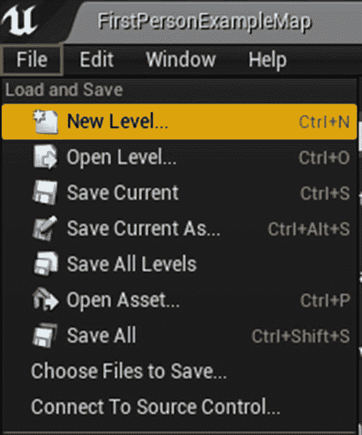

*图 5-2：创建新关卡*

在 `New Level` 窗口中，选择 `Default`（见图 5-3）。

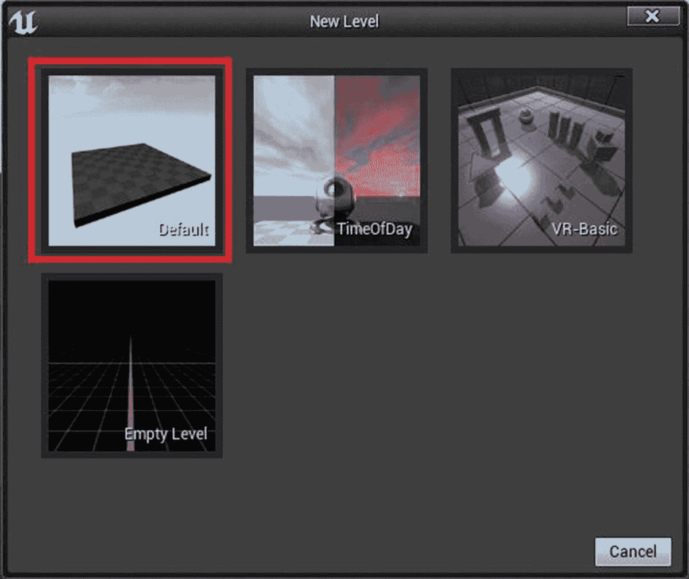

*图 5-3：创建一个默认关卡*

您的新基础关卡应该看起来像图 5-4。

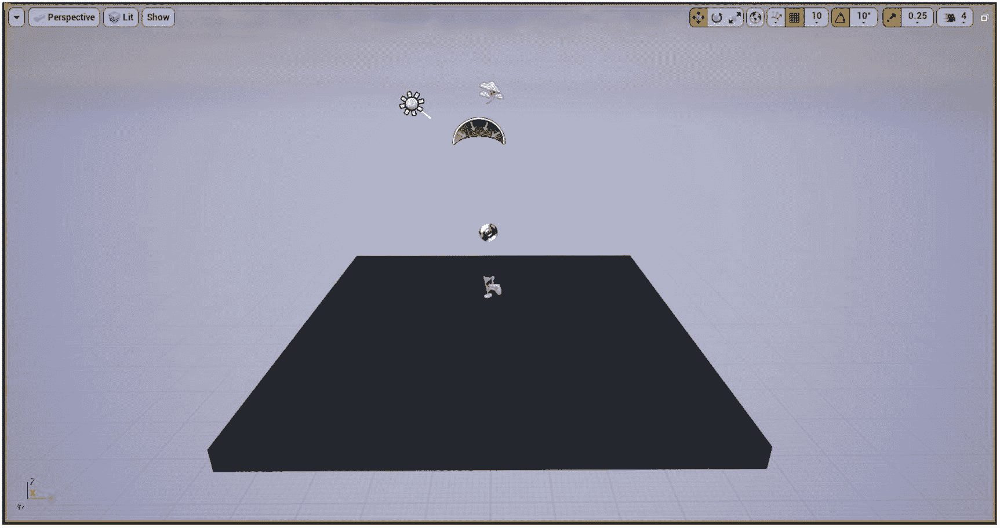

*图 5-4：新的默认关卡*

这个关卡只设置了基本元素，例如灯光和雾。

### 导入与配置资源

现在，让我们导入资源并开始工作。要导入资源，只需在 `Explorer` 中选择它，然后将其拖放到 UE4 的 `Content Browser` 中。执行此操作时，会打开一个导入窗口，为您提供许多文件导入选项（见图 5-5）。

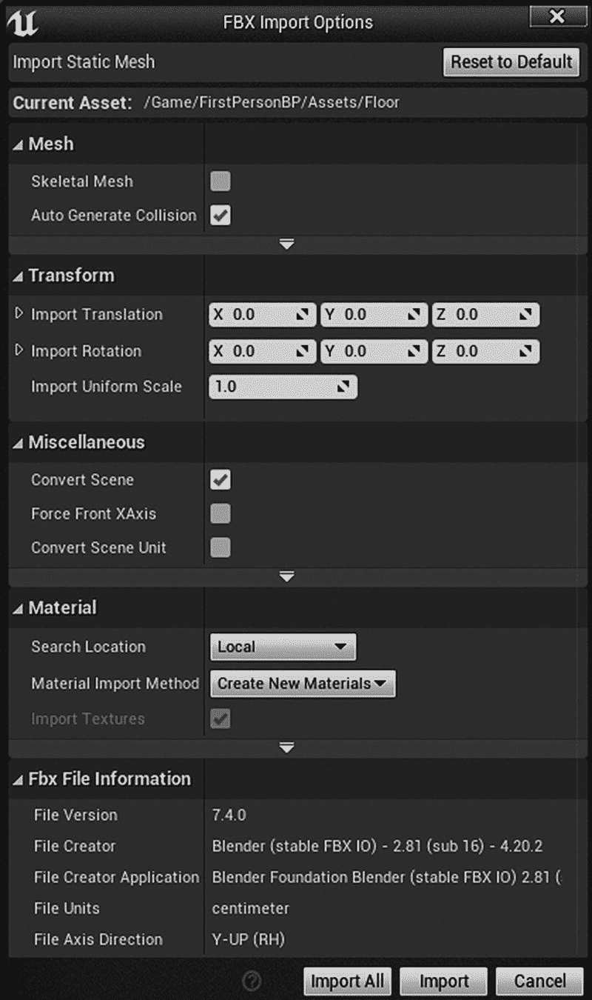

*图 5-5：资源的导入选项*

您现在不做任何更改，因此将所有选项保留为默认值。点击 `Import All` 按钮。导入资源后，将它们放在一个名为 `Assets` 的文件夹中，以保持所有内容井井有条。路径应为 `Content ➤ FirstPersonBP ➤ Assets`。现在，您就在 UE4 中拥有了这些资源（见图 5-6）。

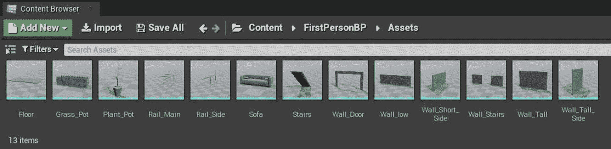

*图 5-6：`Content Browser` 中的资源*

接下来，您需要保存此关卡。按下 `Ctrl+S` 启动保存。在 `Save Level As` 窗口中，为您的地图命名，然后点击 `Save`（见图 5-7）。

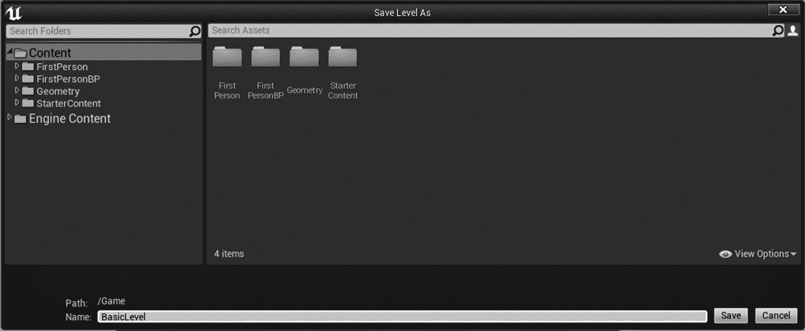

*图 5-7：保存窗口*

### 搭建基础几何体

接下来，让我们从 `Content Browser` 中将 `Floor` 资源拖放到场景中。在 `Details` 窗口中，将其 `Location` 的所有轴设置为 `0.0`（见图 5-8）。这将使我们的资源在三维空间中的位置为 `0,0,0`，即世界的中心。

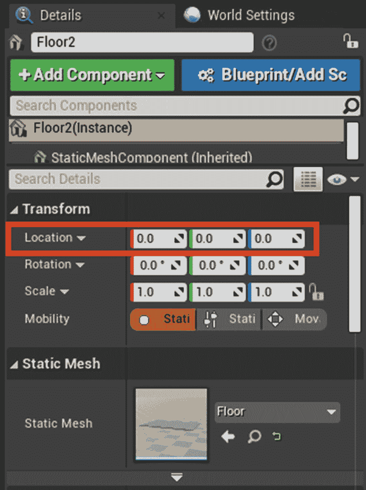

*图 5-8：设置资源位置*

在编辑任何参数的输入字段值时，您可以按 `Tab` 键在不同属性字段之间快速切换。这使您可以快速编辑数值。

接下来，删除场景中现有的默认地板。然后，在 `0,0,0` 位置将 `Floor` 资源添加到场景中。现在，您的场景应该类似于图 5-9。

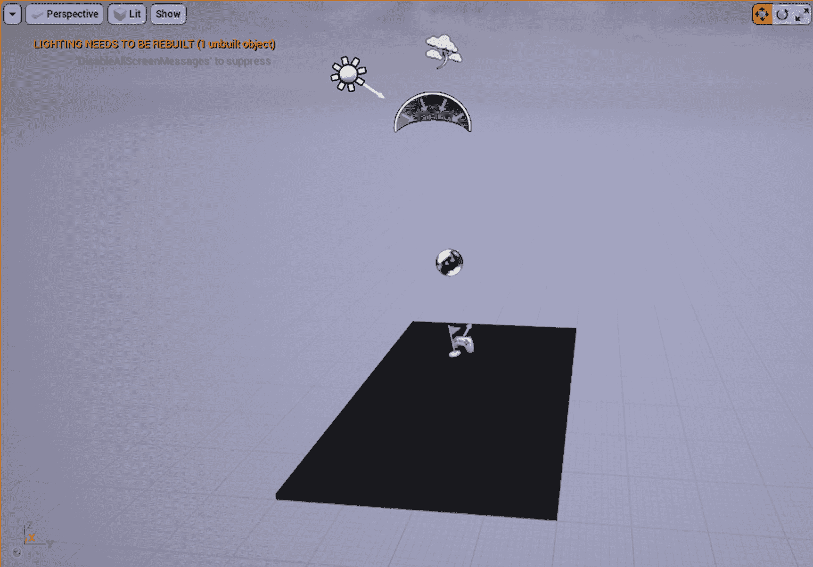

*图 5-9：目前的场景*

### 使用网格吸附

现在，当您拖动资源时，您会注意到网格会以 UU（Unreal Units，等于 1 厘米）为单位吸附到地板上。您可以通过单击视口右上角的 `Grid Snap Value` 选项来更改此默认吸附值（见图 5-10）。网格吸附非常重要，因为它允许您将资源精确地放置到所需位置。

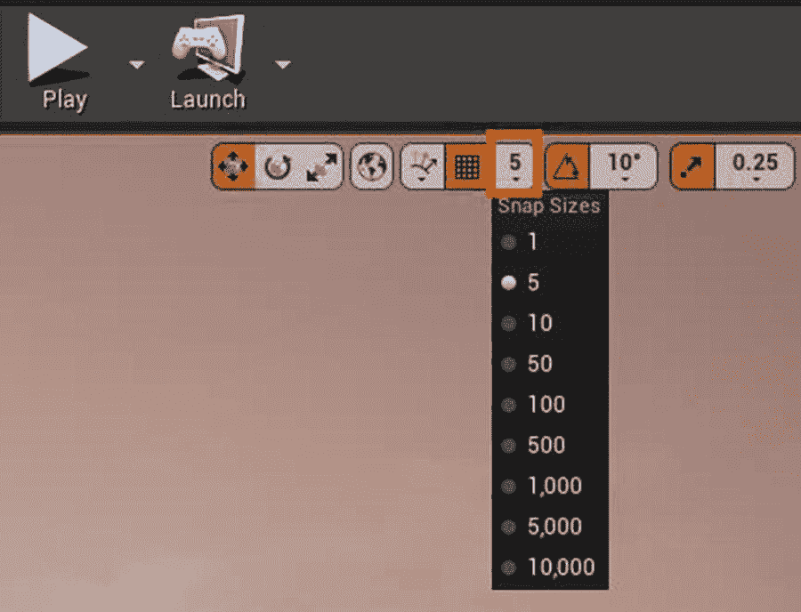

*图 5-10：网格吸附值选项*

有了这个功能，您可以轻松地移动模块化资源，并将它们精确地放置在您想要的位置。

### 复制与拼接

接下来，让我们通过按住 `Alt` 键并沿任意轴拖动地板来复制它。如图 5-11 所示放置复制的副本。

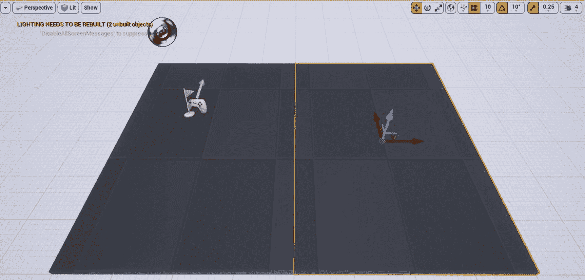

*图 5-11：放置复制的副本*

使用这种方法，您可以多次复制地板，并创建一个类似于图 5-12 的场景。

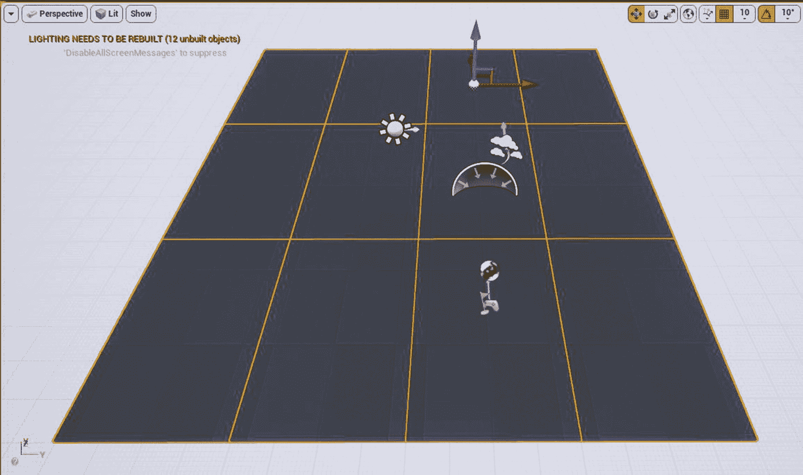

*图 5-12：创建地板布局*

接下来，拖放 `Wall_Low` 和 `Wall_Short_Side` 资源，并按图 5-13 所示进行设置。

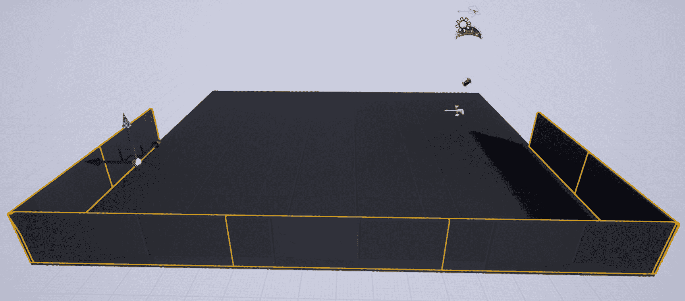

*图 5-13：墙壁布局*

接下来，拖放 `Wall_Tall` 和 `Wall_Tall_Side` 资源，并按图 5-14 所示进行设置。

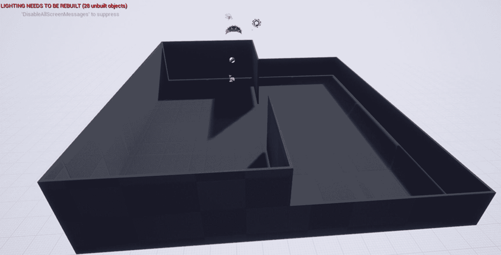

*图 5-14：高墙的布局*

接下来，复制地板以创建屋顶，如图 5-15 所示。

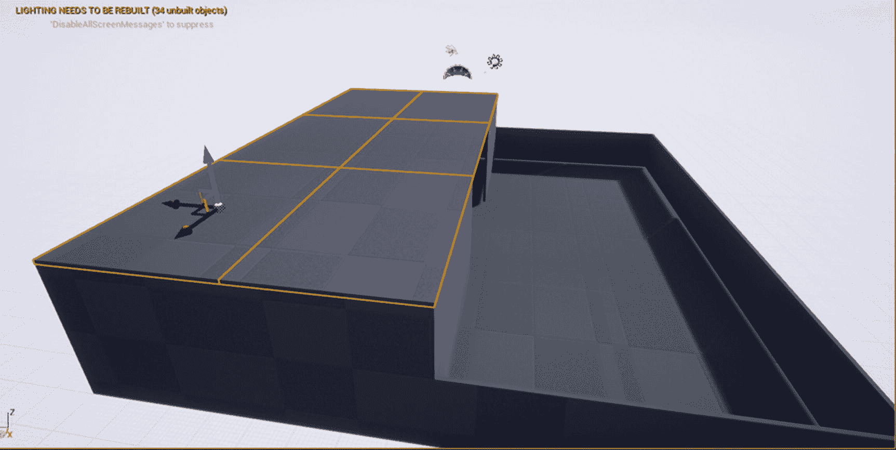

*图 5-15：通过复制地板创建屋顶*

接下来，复制矮墙并创建屋顶布局，如图 5-16 所示。

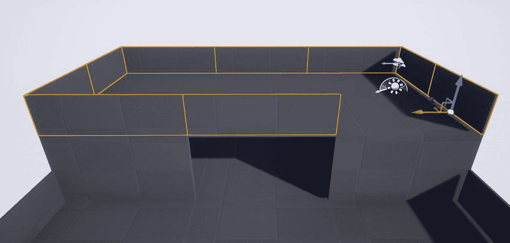

*图 5-16：目前的场景*

这个场景可以根据您的意愿进行修改。正如您所见，所有部件都是模块化的，您可以轻松地根据需要重新利用它们。这就是白盒关卡的目的：灵活性是关键。

完成基础布局后，按图 5-17 所示放置 `Stairs` 和 `Wall_Stairs` 资源。您可以将楼梯在 Y 轴上的位置设为 `660 UU`，以使其精确出现在图像所示的位置。

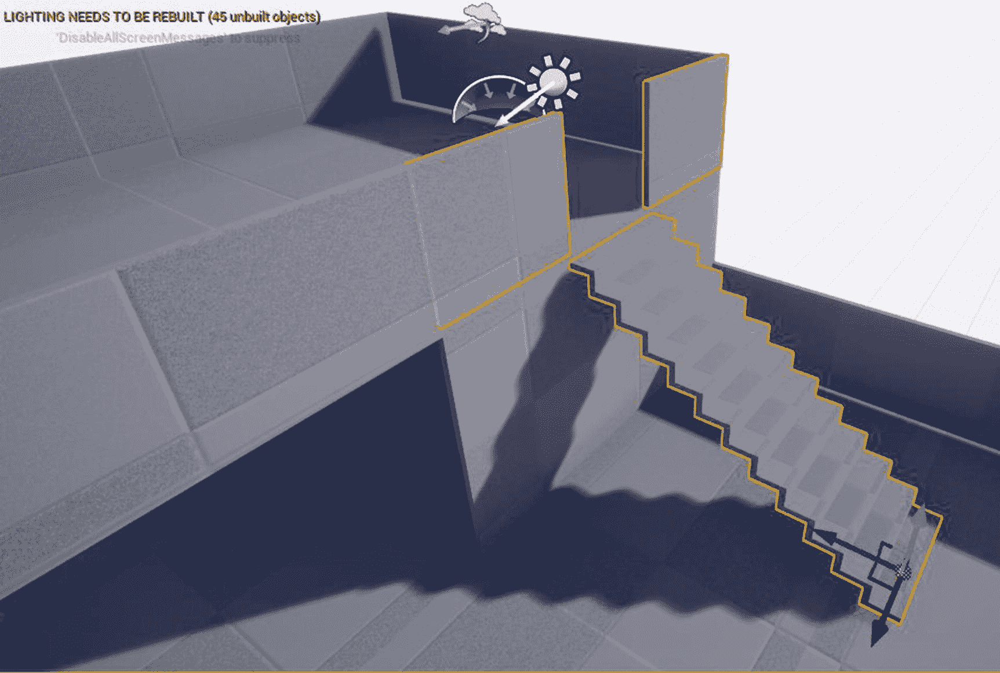

*图 5-17：目前的场景*

这是一个非常基础的关卡布局。在您开始用细节资源填充场景之前，随时都可以轻松更改它。

### 添加细节

现在，让我们添加一些资源来勾勒场景的详细外观。首先，放置 `Wall_Door`，如图 5-18 所示。

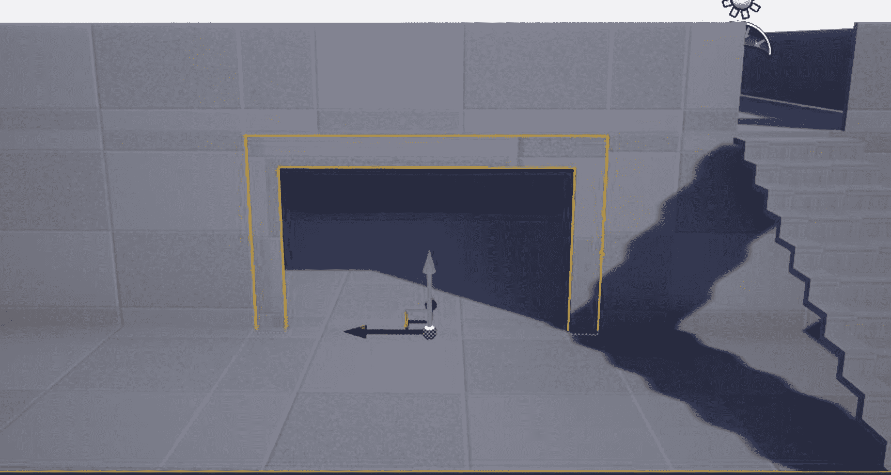
图 5-18 放置`Wall_Door`资源

接下来，放置`Sofa`资源，如图 5-19 所示。
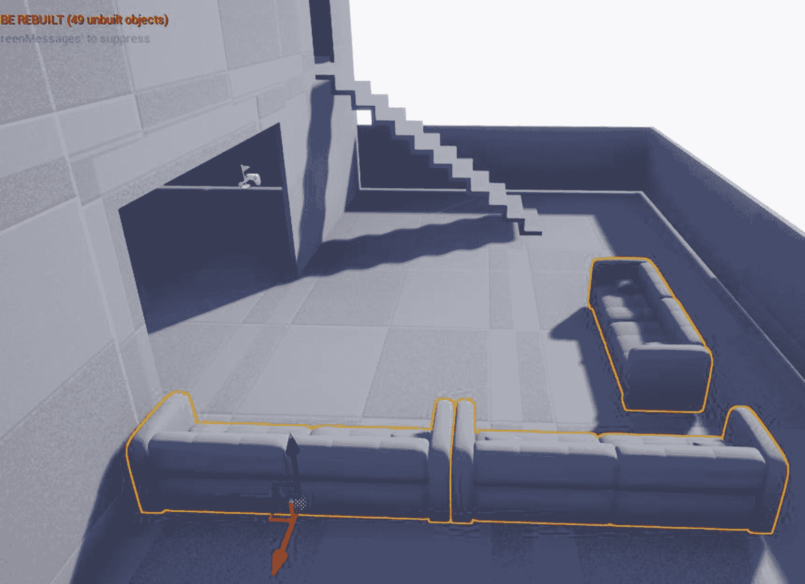
图 5-19 放置沙发

现在，放置植物盆栽，如图 5-20 所示。
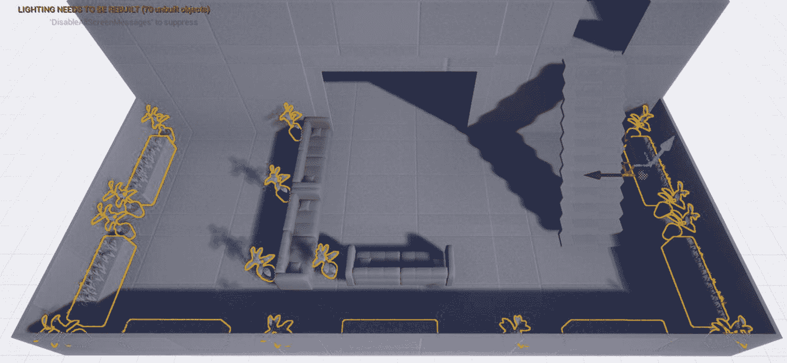
图 5-20 放置植物和草丛花盆

最后，放置金属栏杆，如图 5-21 所示。
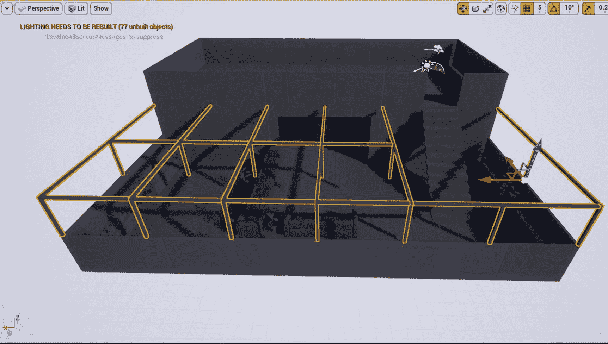
图 5-21 放置栏杆资源

按下`Alt+P`以第一人称视角模式播放并探索你的关卡。你可能会在环境中导航时遇到一些问题，因为某些网格（如`Wall_Door`、`Stairs`和`Wall_Stairs`）存在不正确的碰撞。要解决此问题，请在内容浏览器中双击要修正的资源。系统会打开一个新的资源详细信息窗口。在`属性`选项卡中，向下滚动直到看到`碰撞`选项。点击下拉菜单，选择`将复杂碰撞用作简单碰撞`，然后保存（见图 5-22）。

请注意，复杂碰撞仅在你处理非常小的场景或建筑可视化场景时才有用。由于会占用大量内存，因此游戏环境中从不使用。复杂碰撞会计算网格中每个顶点的碰撞。一个包含大量顶点的复杂模型很容易占用内存并使场景未优化，因此即使在个人项目中也要谨慎使用复杂碰撞。

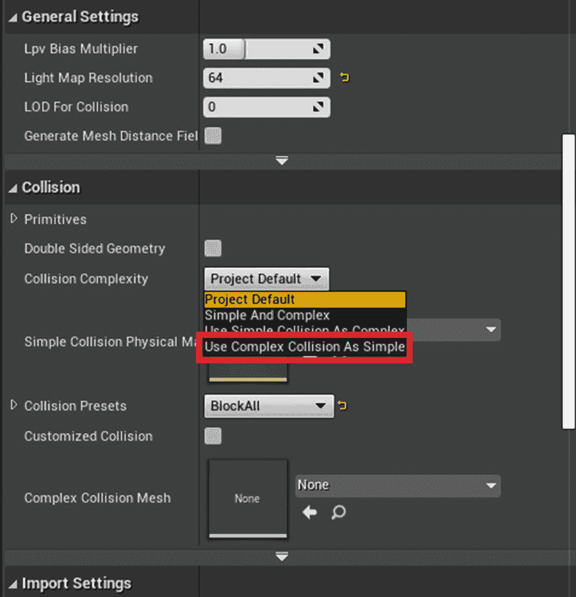
图 5-22 修改资源的碰撞设置

完成关卡的布局后，你可以按照自己的意愿调整关卡布局。基于目前所学内容自行创作是一个很好的实践。在下一章中，你将展开我们的 3D 资源。