# 9. 材质设计与集成

你已经创建了一些材质，现在让我们看看如何在 UE4 中导入和集成它们。在本章中，你将导出 Substance Painter 中的材质，并学习如何为 UE4 设置导出器。然后，将纹理导入 UE4 并设置主材质。之后，你将使用 Quixel Bridge 从 Quixel Megascans 导入材质，并见证 Quixel Bridge 的速度和强大功能。

## 从 Substance Painter 导出

首先，打开你在 Substance Painter 中创建的文件。然后前往 `文件 ➤ 导出纹理`（见图 9-1）。

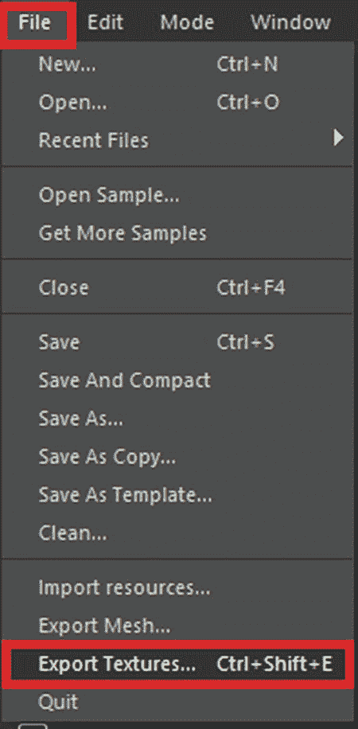

图 9-1

导出纹理

在 `导出文档` 窗口中，将 `配置` 设置为 `Unreal Engine 4 (Packed)`，如图 9-2 所示。这可确保纹理以 UE4 能够正确使用的方式导出。

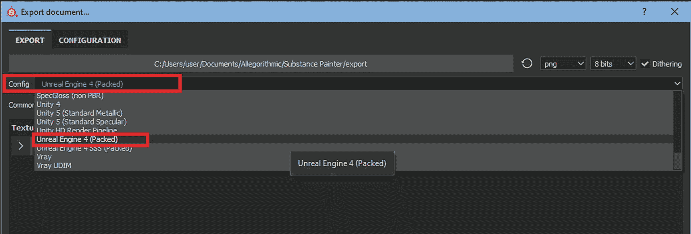

图 9-2

更改导出配置

要查看纹理是如何设置的，请前往 `配置 ➤ Unreal Engine 4 (Packed)`（见图 9-3）。

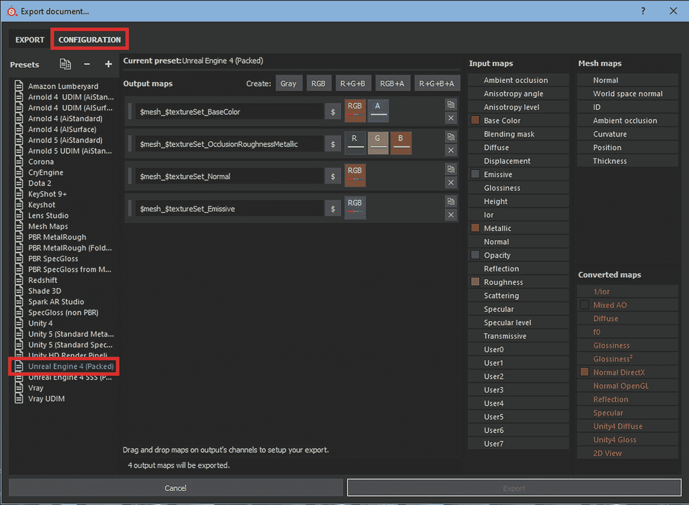

图 9-3

导出的纹理配置

在 `配置` 窗口的 `输出贴图` 下，我们的纹理贴图已准备好导出。请注意各项设置。名为 `BaseColor` 的贴图有一个 RGB（红、绿、蓝）输入和一个 A 输入；每个输入都连接了一张输入贴图。根据输出贴图中的颜色和输入贴图中对应的颜色，你可以看出连接了哪张贴图。

`OcclusionRoughnessMetallic` 贴图有三个输入连接到一张输出纹理贴图。为了简便，这张贴图有时被称为 ORM（环境光遮蔽、粗糙度、金属度）贴图。环境光遮蔽贴图、粗糙度贴图和金属度贴图都是灰度图。当三个不同通道被连接到一张纹理上时，可以节省内存和空间，并优化你的项目。

这些预设由 Substance Painter 团队设置，以便你可以快速导出纹理贴图并将其发送到你选择的数字内容创作（DCC）应用程序中。

现在，让我们切换回 `导出` 选项卡，更改更多设置。将文档分辨率提高到 `2048×2048`，并将图像格式设置为 `targa`，如图 9-4 所示。

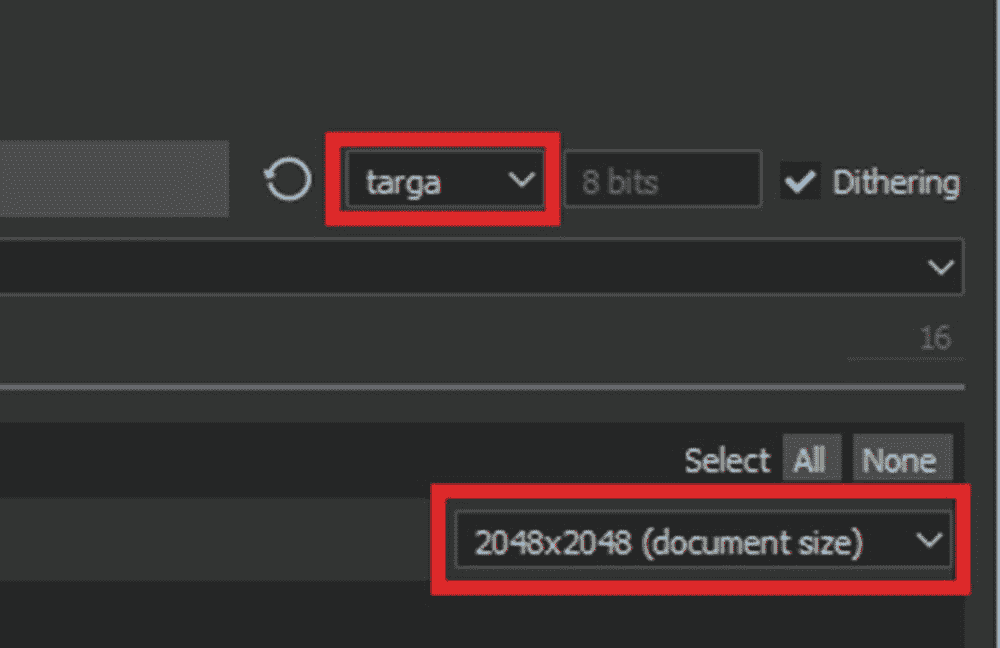

图 9-4

导出设置

现在，你可以导出贴图了。将导出目标设置到所需的文件夹，然后点击 `导出`（见图 9-5）。

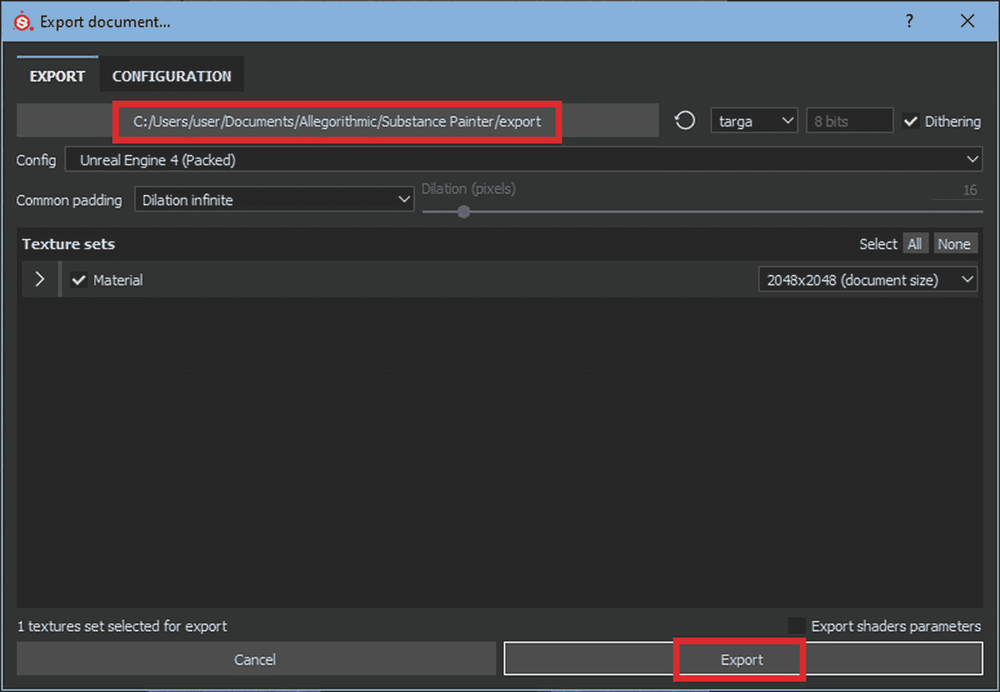

图 9-5

设置导出目标并导出纹理

## 在 UE4 中处理材质

材质导出后，打开 UE4。但在将这些材质放入 UE4 之前，请遵循纹理的命名约定。在你保存纹理的任何位置打开它们，然后将它们分别重命名为 `T_Sofa_BaseColor`、`T_Sofa_OcclusionRoughnessMetallic` 和 `T_Sofa_Normal`。

创建一个用于存储纹理贴图的文件夹。将此文件夹命名为 `Textures`。将你的纹理拖放到此文件夹中。你应该会在内容浏览器中看到你的材质（见图 9-6）。

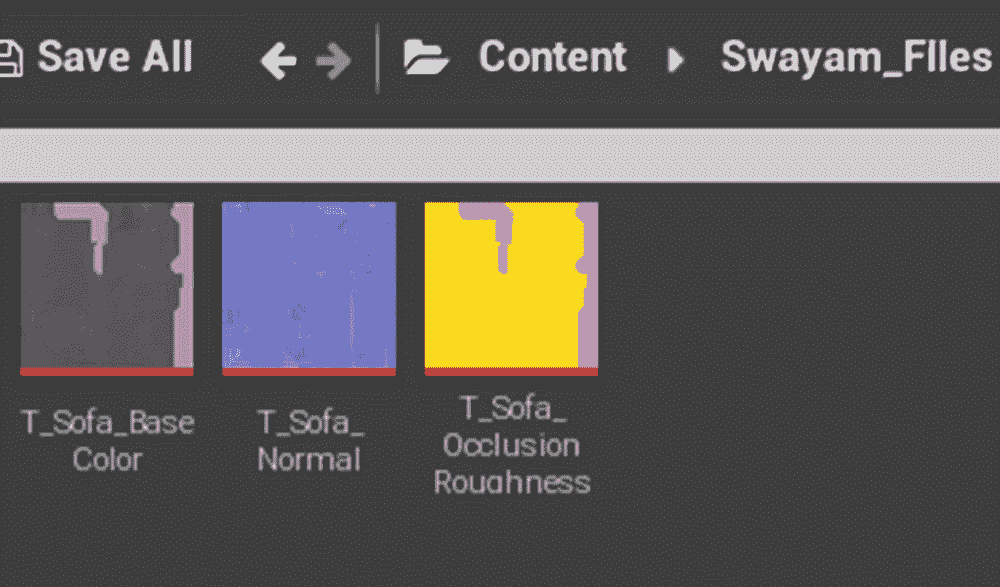

图 9-6

导入 UE4 的纹理贴图

现在，让我们使用这些纹理贴图创建一个材质。双击 `T_Sofa_ORM`，在 `纹理` 下，确保 `sRGB` 已禁用（UE4 应该已经自动完成了此操作）。在内容浏览器的空白处右键单击，在 `创建基本资产` 下，选择 `材质`（见图 9-7）。

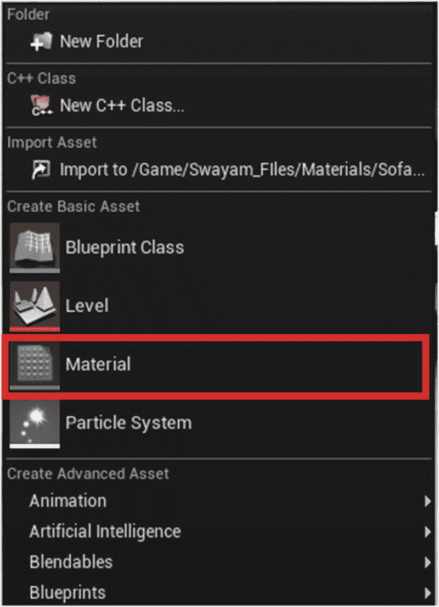

图 9-7

创建材质资产

以与你的资产对应的方式命名此材质。我将其命名为 `MM_Sofa`。接下来，双击它以启动材质编辑器窗口。你的窗口应该类似于图 9-8。你可以通过前往 `窗口 ➤ 内容浏览器 ➤ 内容浏览器 1` 来打开内容浏览器。

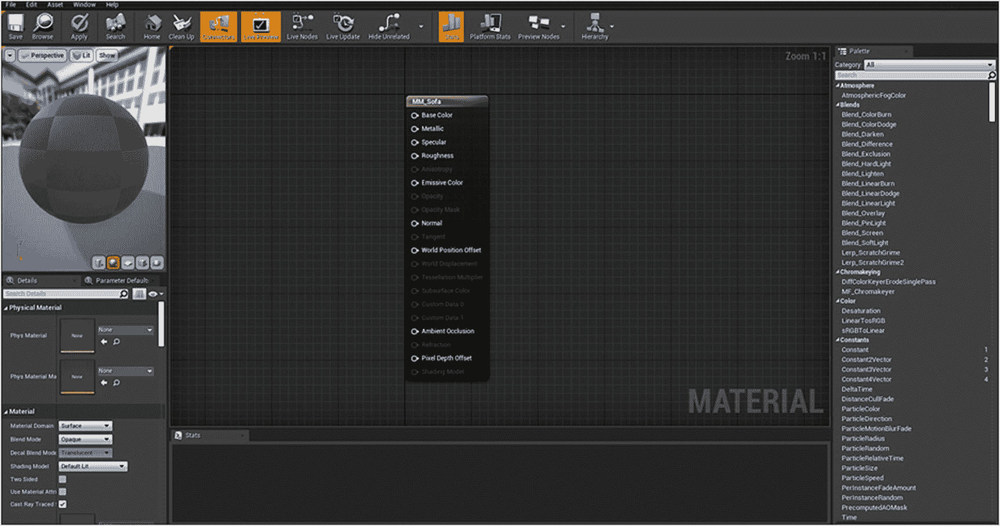

图 9-8

材质编辑器窗口

这是一个基于节点的材质编辑器，你可以使用各种节点和函数来创建材质。

首先，从内容浏览器中拖拽我们的纹理并将它们放入材质编辑器窗口。按图 9-9 所示排列纹理。这是你对蓝图系统的初步了解。你正在使用基于节点的编程来创建材质。通过连接节点，你为整体节点树分配不同的功能，执行后即可生成材质。

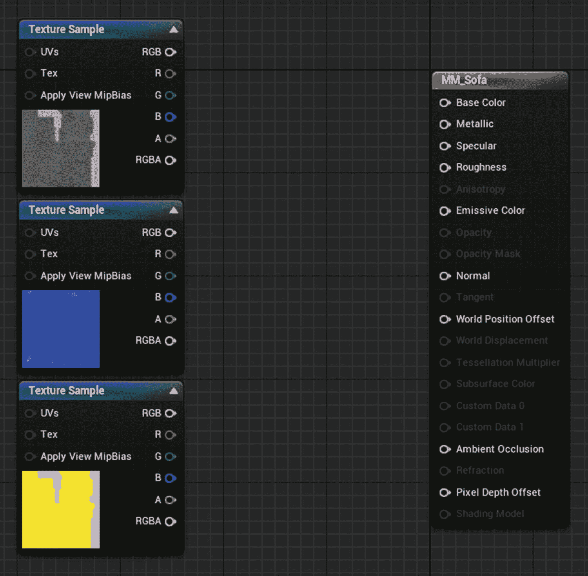

图 9-9

在材质编辑器中引入并排列材质

现在，让我们添加一些材质函数来编辑我们的材质。在空白处右键单击，搜索 `CheapContrast_RGB`，并将其添加到编辑器中。接下来，搜索 `Multiply` 并将其也添加进来。将 `Base Color` 节点的 `RGB` 输出引脚连接到 `CheapContrast_RGB` 的输入引脚。接着，将 `CheapContrast_RGB` 的输出连接到 `Multiply` 的输入。最后，将 `Multiply` 连接到 `MM_Sofa` 的 `Base Color` 输入。你的设置应该类似于图 9-10。

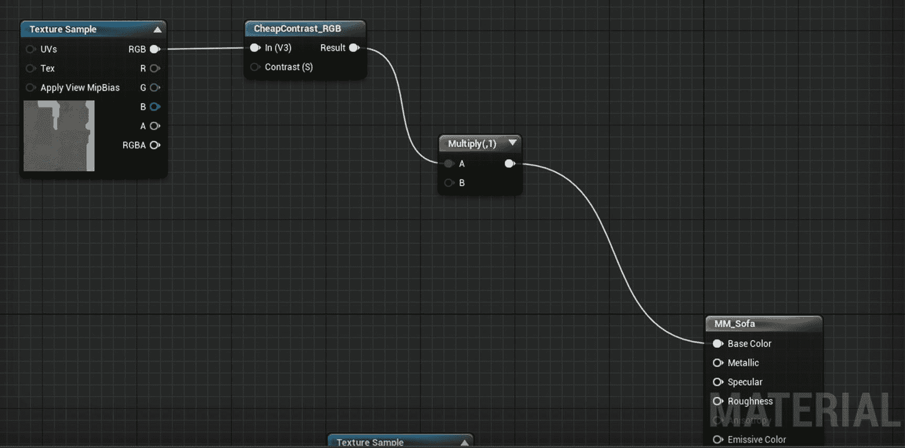

图 9-10

目前的设置

接下来，按住键盘上的字母数字键 `1` 并左键单击任意位置以添加一个 `常量` 节点。右键单击此常量，并选择 `转换为参数`（见图 9-11）。或者，你可以按下 `S` 并单击以添加一个 `参数` 节点。

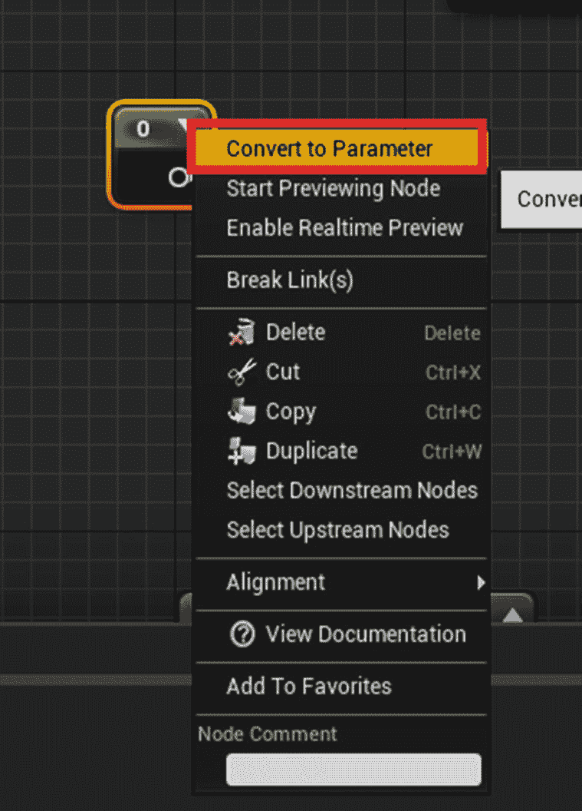

图 9-11

将常量转换为参数

在左侧的细节面板中，将此参数命名为 `Contrast`（见图 9-12）。

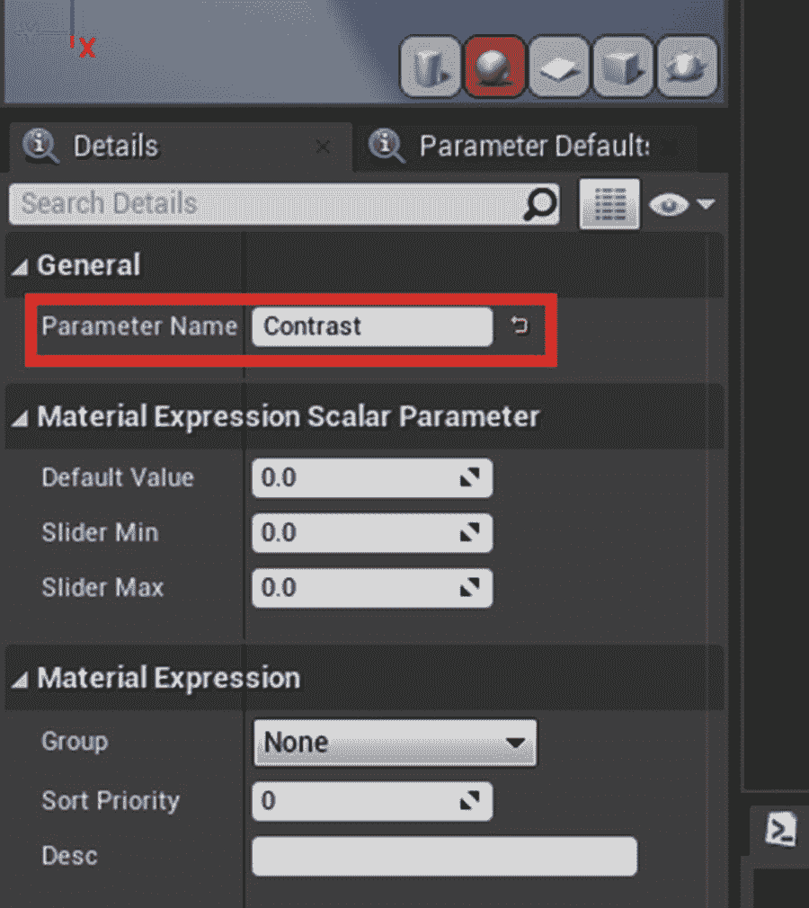

图 9-12

命名参数

将参数连接到 `CheapContrast_RGB` 的 `Contrast (S)` 引脚。

接下来，右键添加 `Constant3Vector`，并将其同样转换为参数。命名为 `Tint`。将其连接到 `Multiply` 节点的底部输入引脚。你的设置应类似于图 9-13。

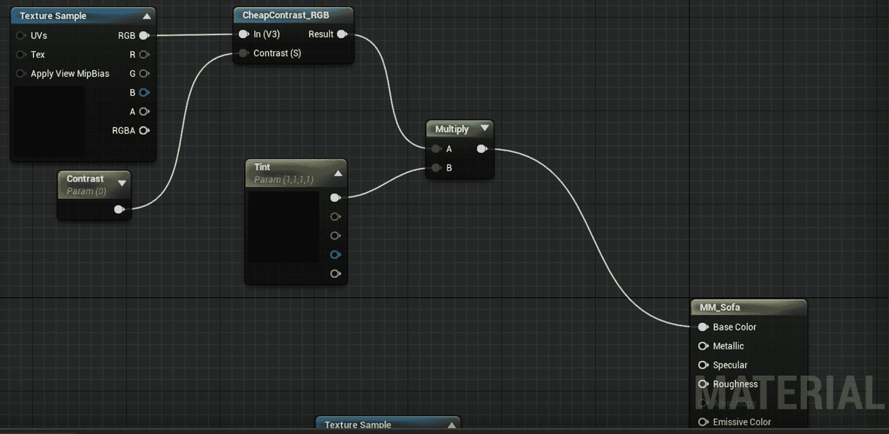

图 9-13 当前设置

点击 `Tint` 参数节点。在**细节**面板中，将其默认值设置为纯白色（见图 9-14）。

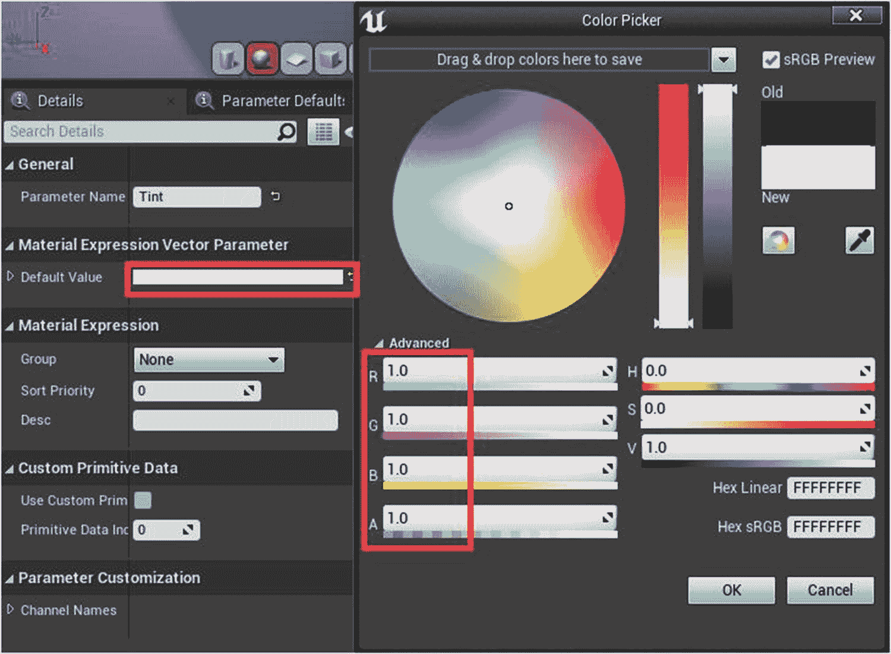

图 9-14 设置色调参数的默认值

将法线贴图连接到主材质，如图 9-15 所示。

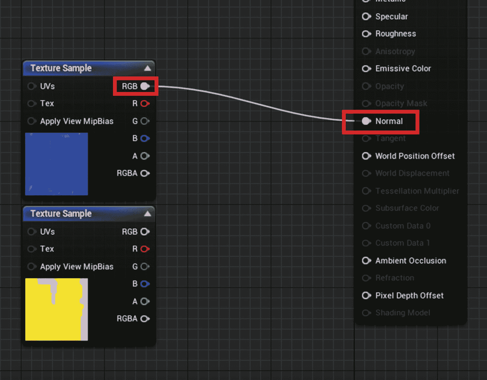

图 9-15 连接法线贴图

对于图 9-15 中的两张贴图，你需要使用纹理贴图中所有三个通道存储的数据。但对于下一张 ORM 贴图，你需要使用各个纹理通道（即**红色**、**绿色**和**蓝色**通道）中存储的数据。为此，连接方式如下：

1.  将红色（`R`）引脚连接到材质节点的**环境光遮蔽**引脚。
2.  将绿色（`G`）引脚连接到材质节点的**粗糙度**引脚。
3.  将蓝色（`B`）引脚连接到材质节点的**金属感**引脚。

你的设置应类似于图 9-16。

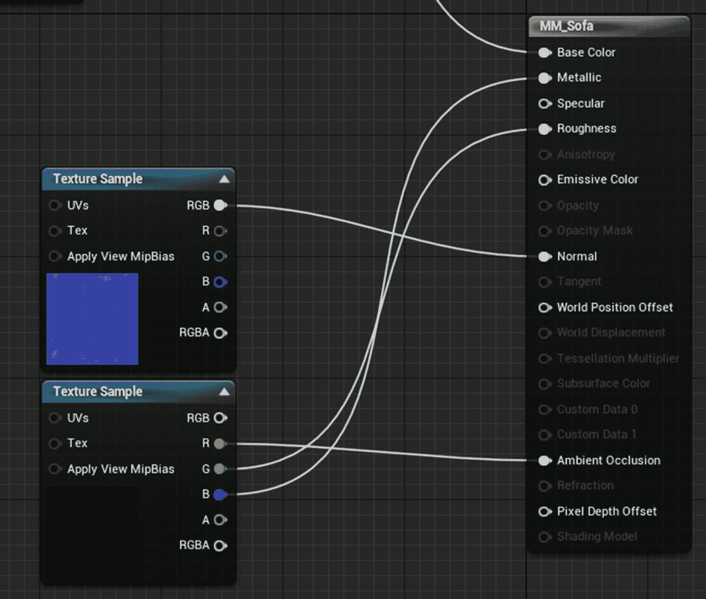

图 9-16 ORM 纹理的设置

你可以将 ORM 纹理的绿色通道乘以一个参数，以控制材质的粗糙度。只需创建一个名为 `Roughness` 的参数，并添加一个 `Multiply` 节点。按照图 9-17 所示的方式连接它们。操作方法是：从新 `Multiply` 节点上的 `B` 节点拖出连线并搜索 `param`，然后选择**标量**参数并将其重命名为 `Roughness`。

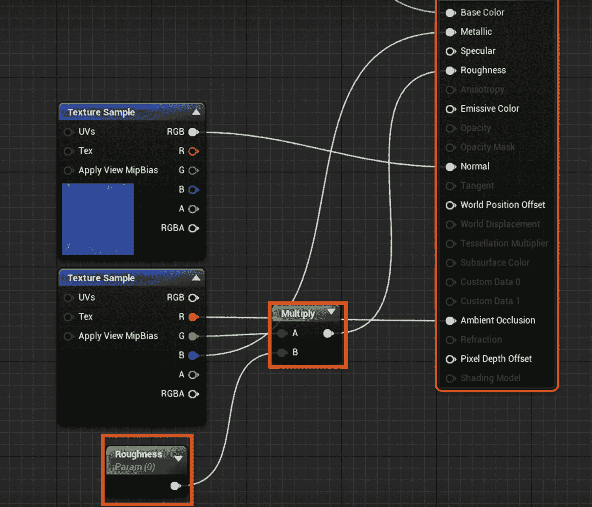

图 9-17 控制粗糙度的设置

### 将材质应用于网格体

保存材质后，即可将其应用于网格体。将材质从**内容浏览器**拖放到场景中的资源上。材质应该会像你在 **Substance Painter** 中制作的那样带有纹理。最终结果取决于你创建的内容，但图 9-18 显示了我的场景结果。

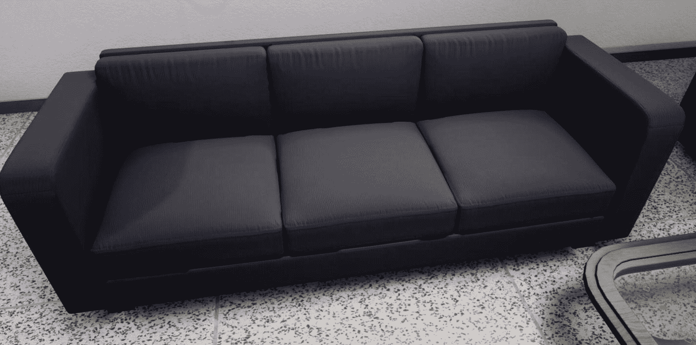

图 9-18 应用材质的结果

在进行建筑设计可视化时，你可能需要使用一个资源与其他资源协同作用，以创建完整的场景。图 9-19 至 9-22 是使用放置在可视化室内设计场景中的三个沙发副本进行渲染的预览图。

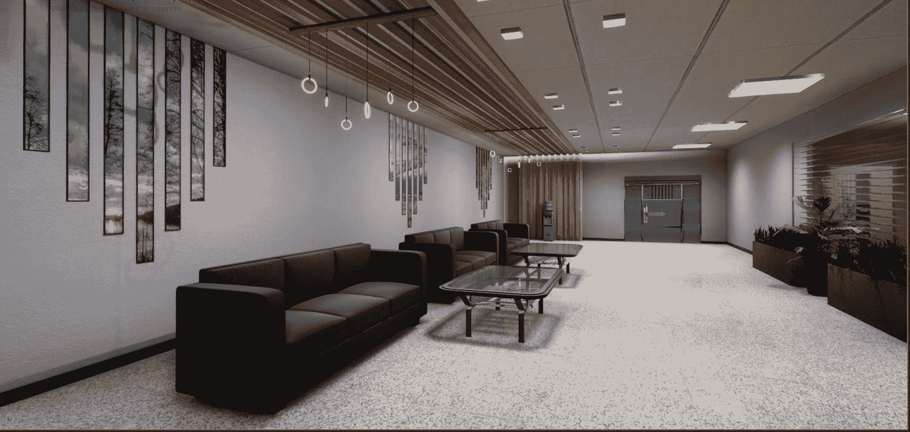

图 9-22 远景 4 场景

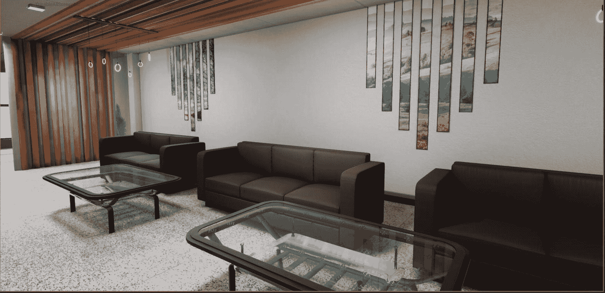

图 9-21 远景 3 场景

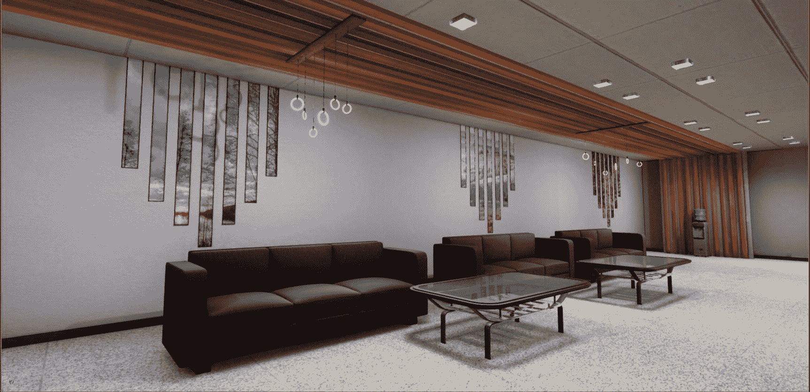

图 9-20 远景 2 场景

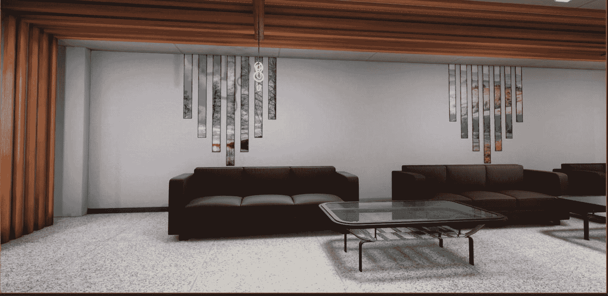

图 9-19 远景 1 场景

本章以这些结果作为结尾。

在下一章中，你将创建更多材质，并处理主材质和实例化材质。

