# 10. 实时自发光材质

你已经创建了标准材质。现在让我们学习如何创建实时自发光材质。在本章中，你还会创建实例化材质并了解其重要性。

## 主材质与实例化材质

回顾上一章中创建的沙发材质，你将其命名为`MM_Safe`。其中`MM`代表*主材质*（master material）。`主材质`是父级材质，包含构建材质所需的所有贴图与计算逻辑。`实例化材质`通过使用你在关联主材质中暴露的参数，对主材质进行细微的变体调整。实例化材质是主材质的子级，它允许你快速调整主材质，而无需重新编译整个材质。你可以从同一主材质创建多个子级实例，且每个实例拥有不同的外观。

下面通过实例来展示实例化材质的必要性。假设你想改变沙发的颜色，打开沙发主材质，使用`Tint`（色调）节点，选择一种颜色（见图 10-1）。

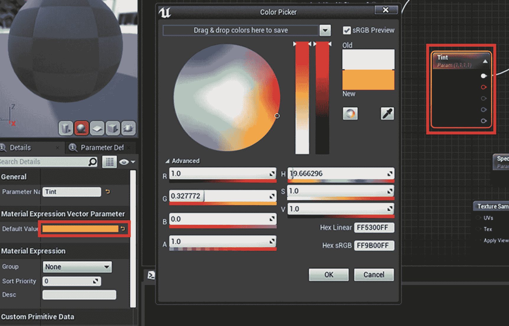

图 10-1 更改材质颜色

点击`Save`（保存）按钮（见图 10-2）。

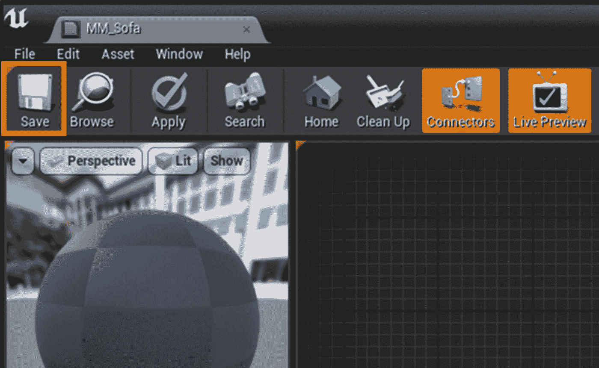

图 10-2 保存资源更改

保存需要时间，具体取决于材质的复杂度。在主材质中进行此类更改*绝不推荐*，因为编译耗时较长。你可以从单个主材质衍生出多个实例化材质，但任何更改都可能对每个实例化材质产生负面影响。这样做并不方便，不过有更好的方法来进行细微调整：即创建实例化材质。

在`内容浏览器`中右键点击`MM_Sofa`，从列表中选择`创建材质实例`（见图 10-3）。将此材质命名为`M_Sofa`。

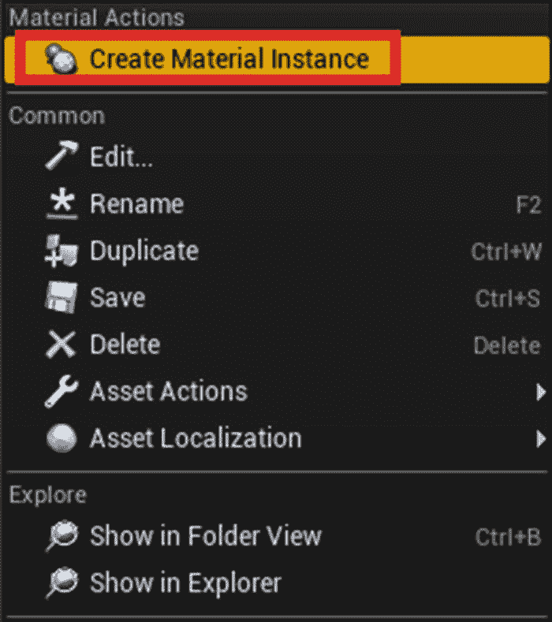

图 10-3 创建材质实例

创建材质实例后，将其从`内容浏览器`拖放到沙发网格体上。之后双击它，打开其设置面板。上一章中创建的参数节点会以可编辑设置的形式出现在这里（见图 10-4）。

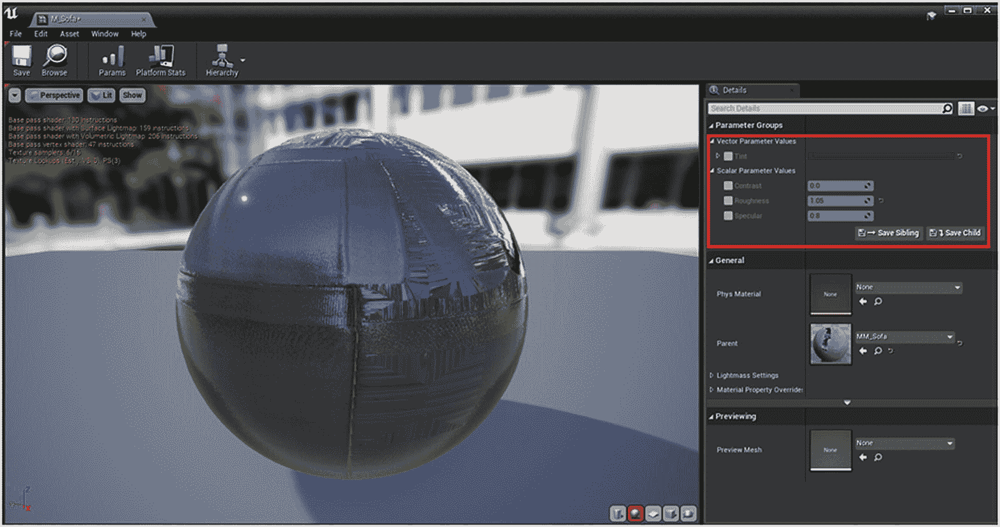

图 10-4 材质实例窗口

若要对参数进行任何更改，需勾选每个参数名称旁的复选框来启用它们，然后设置所需数值。现在我们就来操作：启用`Tint`（色调）和`Roughness`（粗糙度），并按图 10-5 所示设置数值。

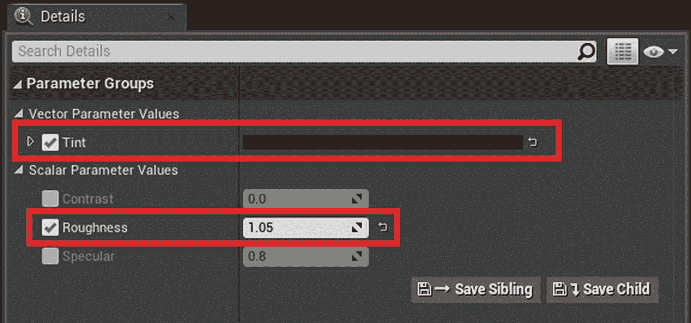

图 10-5 编辑实例化材质

你可以立即看到所做的更改，无需任何加载或编译时间。图 10-6 展示了调整后沙发外观的变化效果。

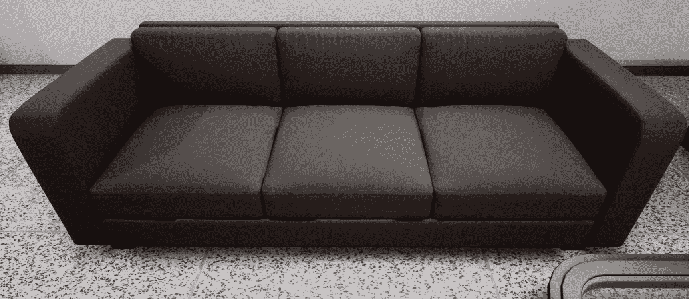

图 10-6 最终效果

如果你的场景中需要多个不同颜色的沙发，只需为沙发主材质创建多个实例即可。请务必仅创建主材质的实例，这点非常重要；否则可能产生非预期效果。如果你创建的是另一个实例化材质的实例，那么对上一级材质所做的任何更改都会影响其子级材质。保持主材质固定不变，你就可以根据它创建出任意数量的变体。将不同变体的实例化材质拖放到场景中的资源上即可。

## 创建自发光材质

让我们来创建一种自发光材质。这是一种能够自身发光或发出光线的材质类型。它能令环境呈现出良好的视觉效果。在我们的案例中，它将使灯光网格体看起来像是处于开启状态。在 UE4 中创建自发光材质非常简单。你只需要一张图像来告诉 UE4 网格体的哪些部分需要具有自发光效果。这被称为*自发光贴图*；它通常是一张灰度图像。白色部分代表发光区域，黑色部分代表网格体上非自发光的区域（参见图 10-7）。

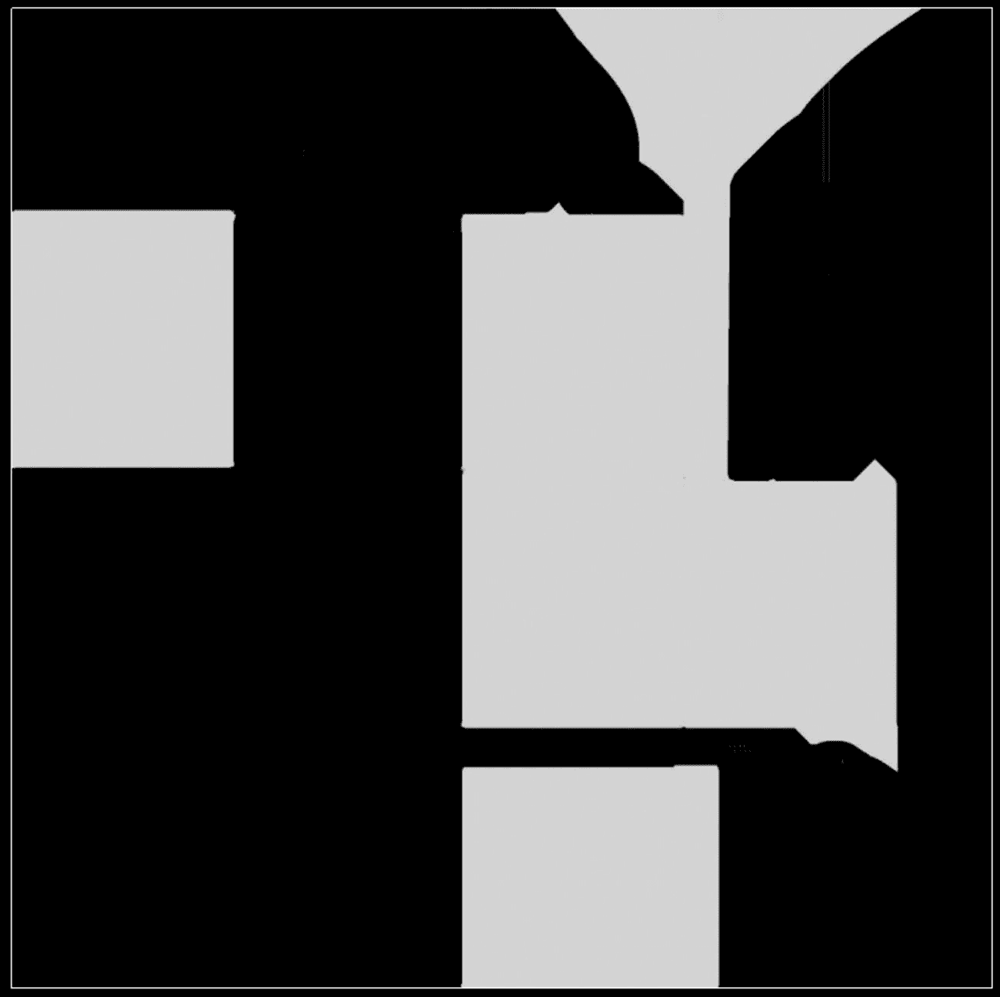

图 10-7 一个非常简单的自发光贴图

创建它非常容易。你只需要一款图像编辑软件，比如 Photoshop 或 GIMP，甚至 Windows 自带的默认画图应用程序也行。你可能已经猜到了，你只需要将 UV 贴图的一些区域涂成白色，其余区域保持黑色即可。对于这个示例，我们使用一个简单的 UV 展开的灯罩形状（参见图 10-8）。让我们使用 Maya 来创建网格体和 UV。

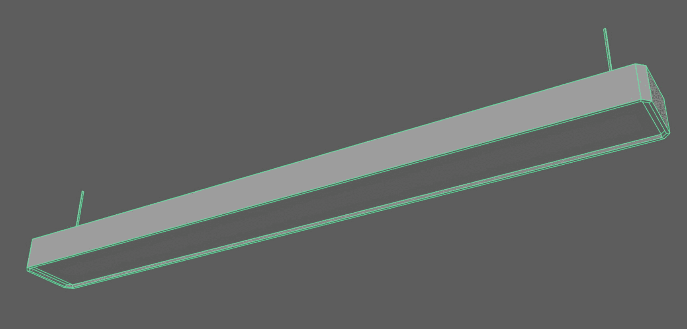

图 10-8 简单的灯罩形状

你希望朝下的面发出光线，就像你在这类扁平灯具中看到的那样。选择 UV 壳并将其移动，如图 10-9 所示。

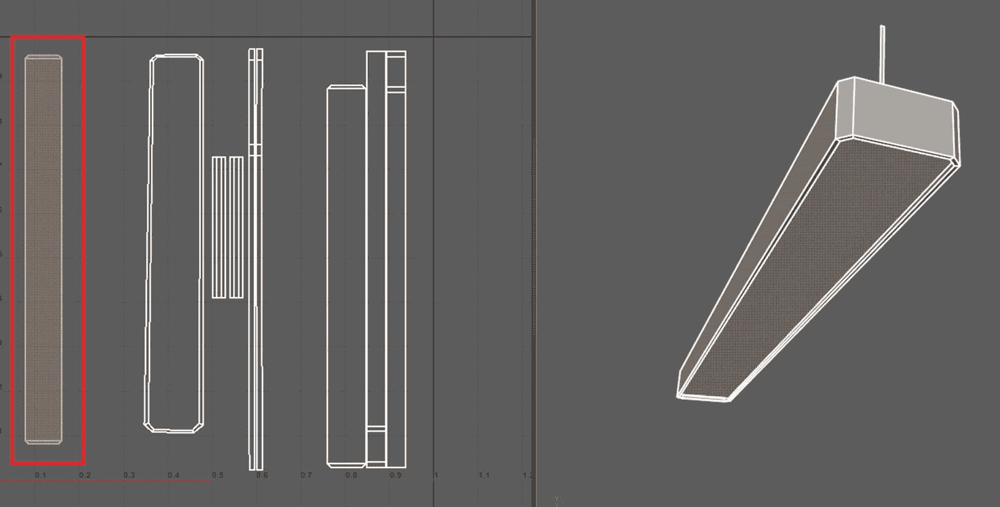

图 10-9 放置发光面

通过点击“图像” ➤ “UV 快照”来导出此 UV（参见图 10-10）。

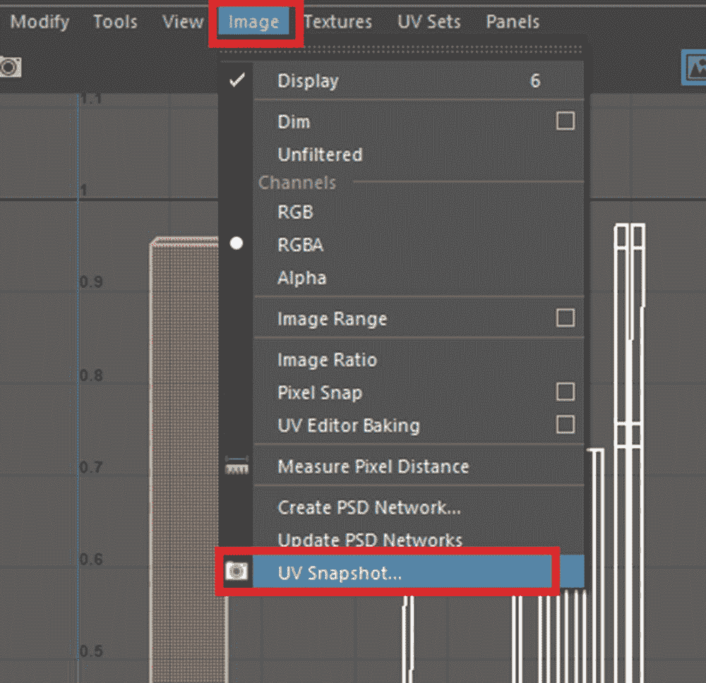

图 10-10 UV 快照

在“UV 快照选项”面板中，将“图像格式”设置为“PNG”，“大小”设置为“1024”，然后保存（放在方便的位置）（参见图 10-11）。

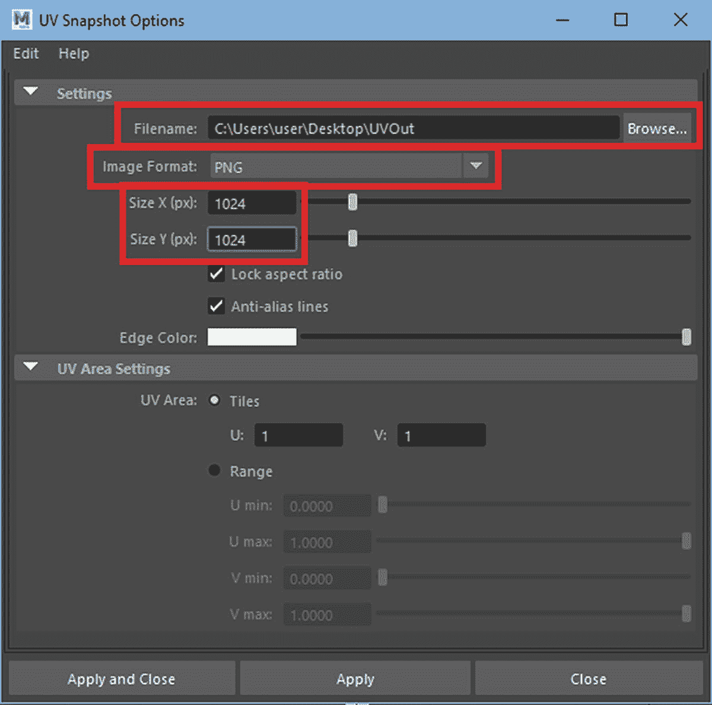

图 10-11 图像快照设置

在你选择的图像编辑应用程序中打开它。由于这几乎花不了一分钟，你可以使用 Windows 画图软件来绘制图像，如图 10-12 所示。

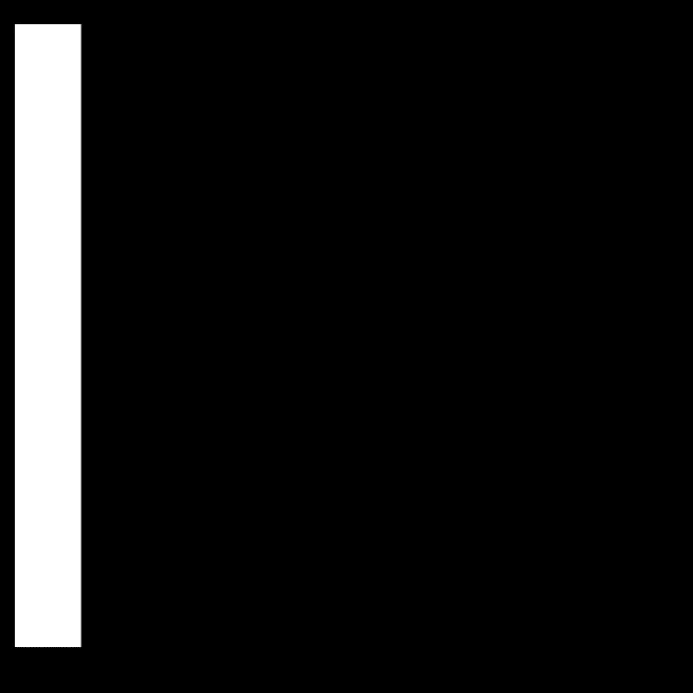

图 10-12 手绘自发光贴图

图 10-12 显示了整张贴图被涂成黑色，而需要发光的面的 UV 壳所在的大致区域被涂成了白色。稍后在 UE4 中你会用到这张贴图，因此将它保存为 TGA 文件，放在方便的位置。从 Maya 中将灯罩模型以 FBX 格式导出，命名为 `SM_Lamp_S`（SM 代表*静态网格体*）。接着，使用 Substance Painter 在此网格体上应用一个通用金属材质（参考第 8 章）。然后，返回 UE4。将你的网格体导入到 `Lamp_S` 文件夹中。右键点击并复制沙发主材质，将其移动到 `Lamp_S` 文件夹。

将复制的沙发主材质重命名为 `MM_Lamps`。双击将其打开。将沙发材质替换为灯具材质。将你创建的自发光贴图拖放到内容浏览器中，然后拖入材质编辑器。将其连接到“自发光颜色”通道，如图 10-13 所示。

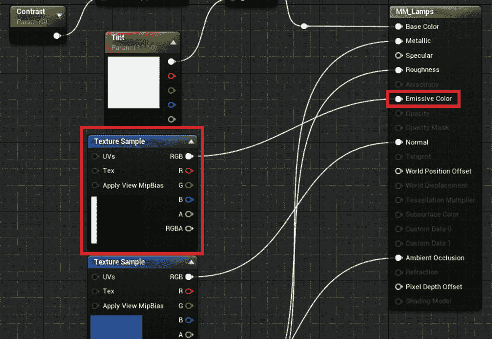

图 10-13 将自发光贴图连接到自发光颜色输入

保存并将此材质应用到你的网格体上，看看会发生什么。你的结果应该与图 10-14 有些相似。

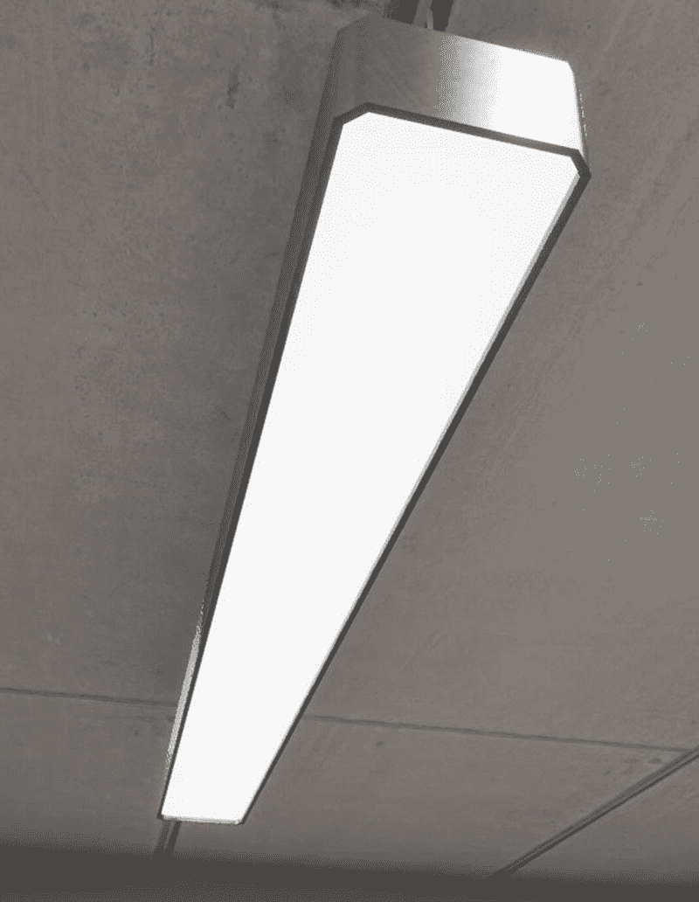

图 10-14 目前的结果

如图 10-14 所示，我们的灯几乎不发光。让我们来修复这个问题。添加一个“乘法”节点和一个“常量”节点。将常量转换成一个参数，并将其命名为 `Emissive_Intensity`。按图 10-15 所示连接它们。

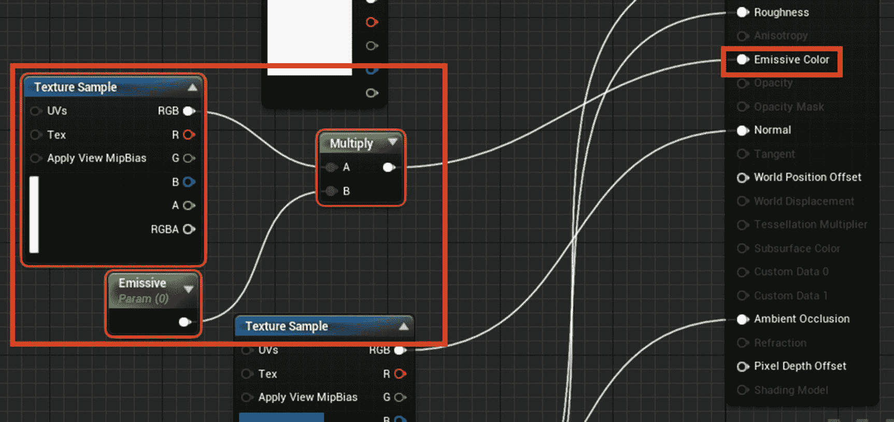

图 10-15 连接设置

保存并由此创建一个材质，命名为 `M_Lamps`。接下来，将其拖放到网格体上。双击打开 `M_Lamps` 设置，并启用 `Emissive_Intensity` 参数。将其值设置为一个较高的数字，例如 10（参见图 10-16）。

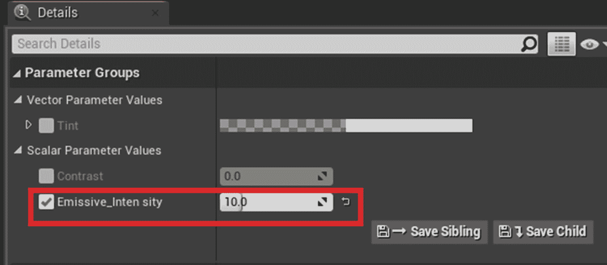

图 10-16

增加自发光亮度

现在你的灯应该会产生明亮的辉光，类似于图 10-17 所示的效果。

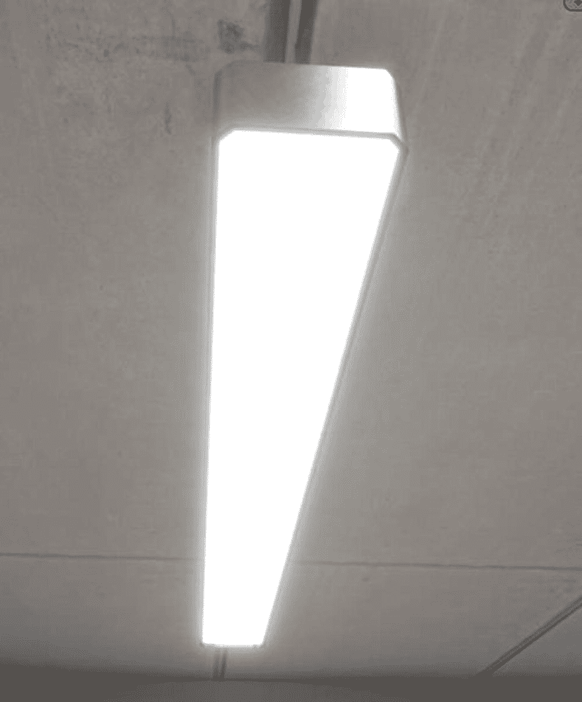

图 10-17

网格体发出的自发光辉光

下一章将深入探讨对象属性编辑器。