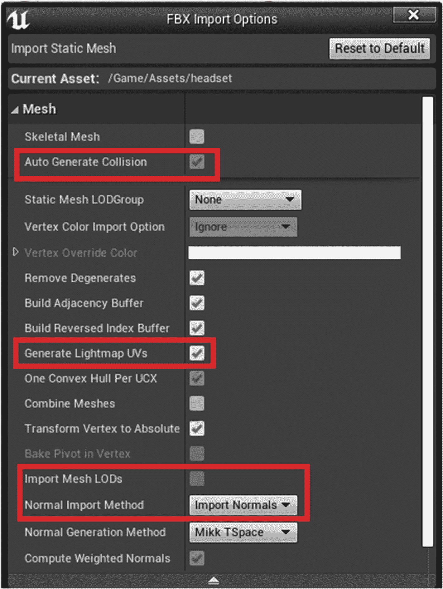
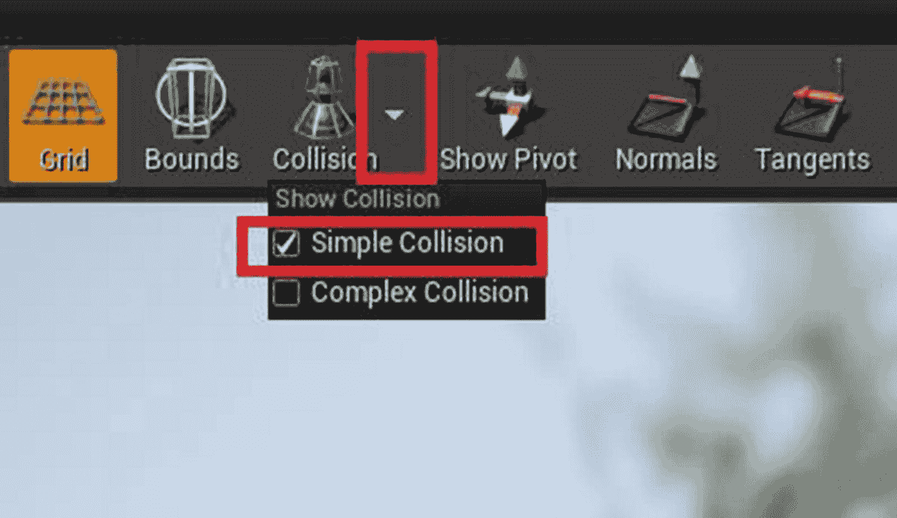
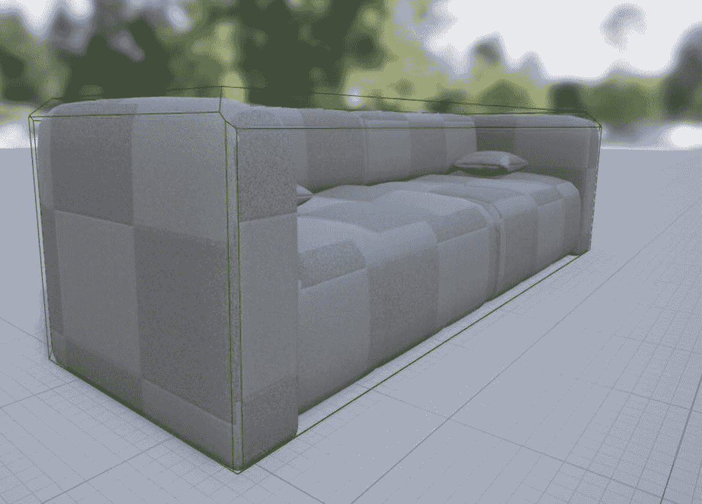
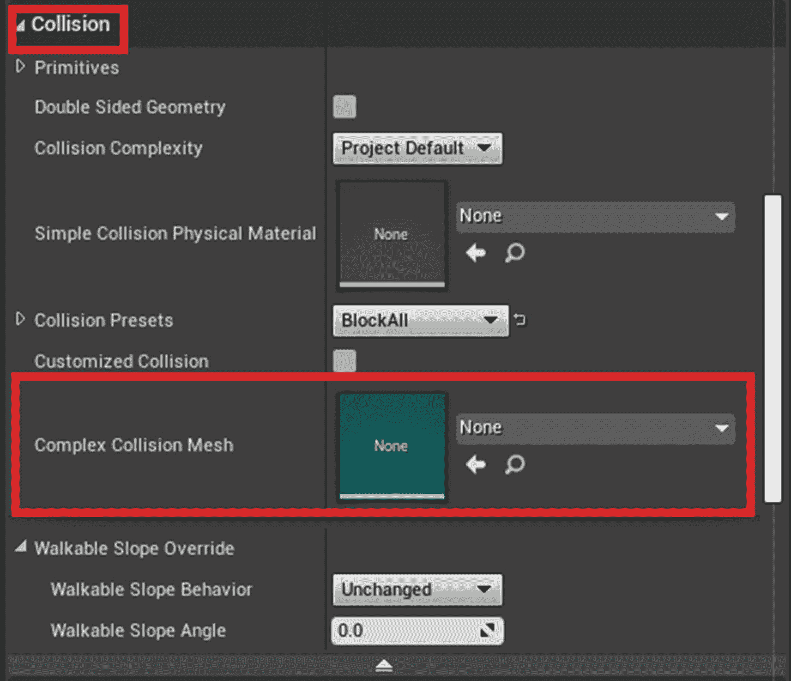
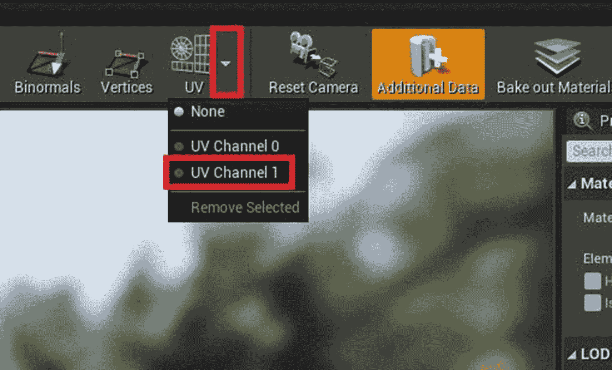
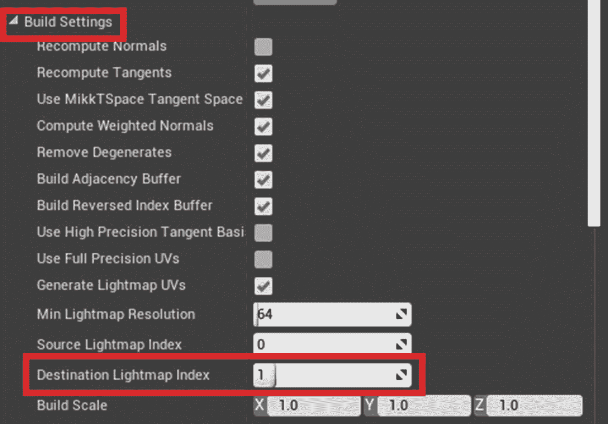
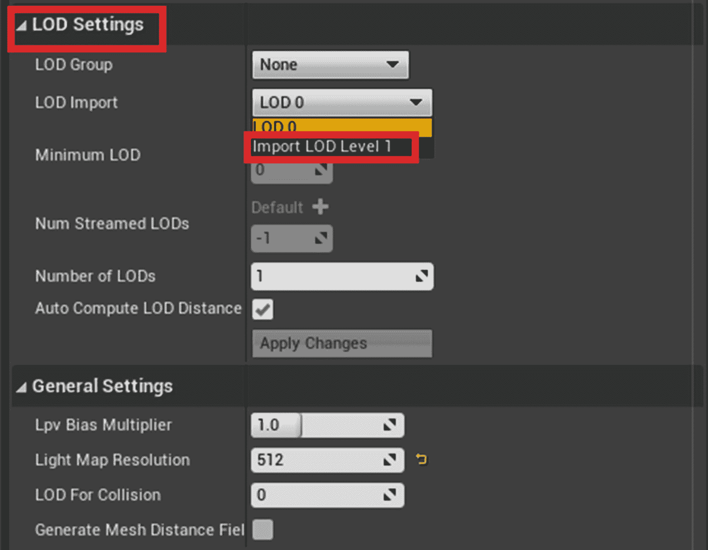
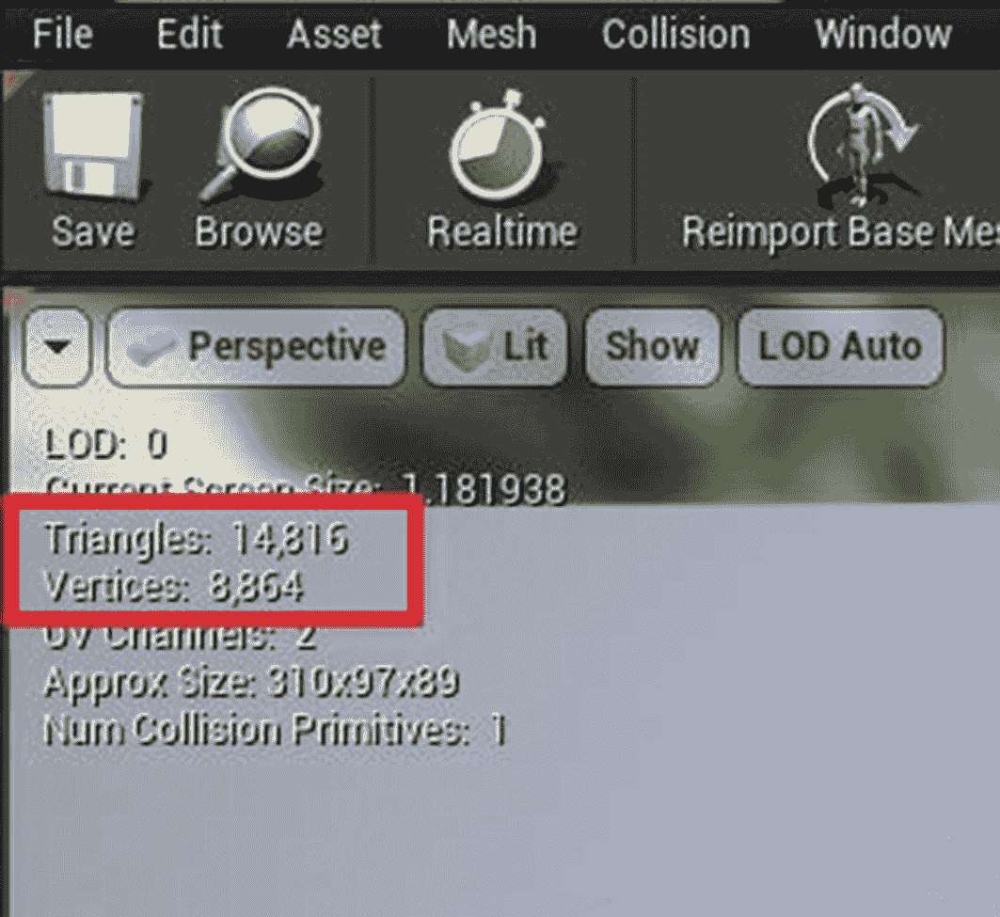
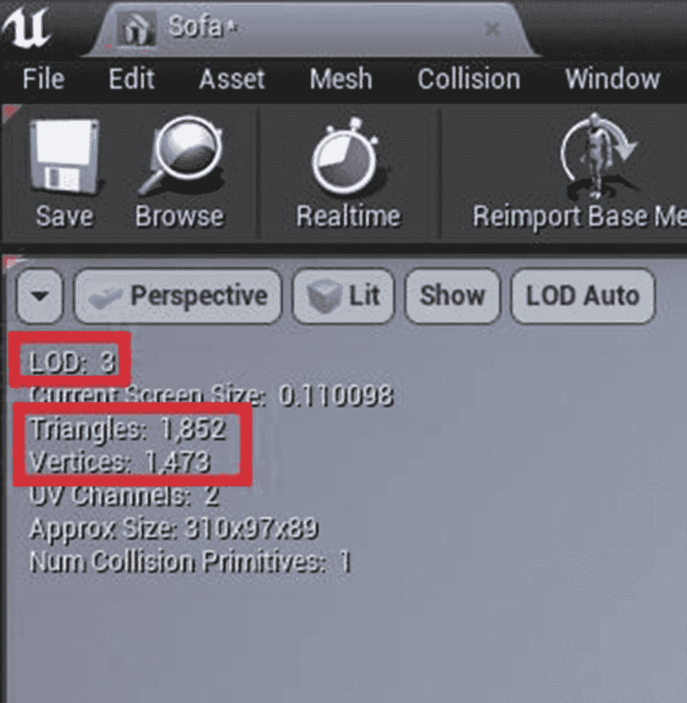
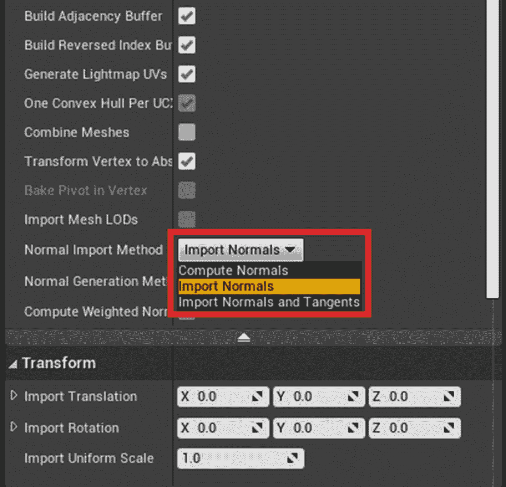

# 11. 详细导入资源

你已经将资源导入到 UE4 中了，但还没有深入探索所有工具。本章将专门介绍在导入资源以及导入后修改资源属性时可用的重要设置和功能。

## 资源导入设置

导入资源时，“导入选项”面板会提供几个重要设置。将`Headset`资源拖放至 UE4 内容浏览器中。接下来，我们来看一下导入设置。图 11-1 高亮显示了本章将要讨论的一些重要设置。

图 11-1：一些重要的导入设置

让我们逐一讨论它们。在搭建第一个关卡时，你已经间接体验过`自动生成碰撞体`这个设置的效果了。如果你尚未自行创建碰撞体，或者只是在测试资源，自动碰撞体会为你导入到 UE4 中的网格体生成粗略的碰撞数据。它能快速完成粗略工作，但通常无法为复杂网格体生成良好的碰撞。你可以通过在内容浏览器中双击网格体来观察其碰撞。在资源详情窗口中，点击`碰撞`并启用`简单碰撞`（见图 11-2）。

图 11-2：启用碰撞显示

你应该能在网格体上看到碰撞体的轮廓，如图 11-3 所示。

图 11-3：碰撞体的轮廓

如你所见，这个碰撞体存在问题。自动生成的简单碰撞体只覆盖了网格体的大致范围，而非精确地贴合物体形状。它只在测试资源或处理诸如墙壁、地板等没有“孔洞”的简单资源时才有用。如果你想为自定义网格体导入另一个碰撞网格体，可以点击`碰撞`下的`复杂碰撞网格体`来导入（见图 11-4）。

图 11-4：分配自定义碰撞网格体

### 生成自动光照贴图 UV 及其他设置

接下来看`生成光照贴图 UV`。资源的光照贴图通常都是在数字内容创作（DCC）应用程序中生成的。导入资源时这个选项默认是禁用的，因为大部分时候它都是多余的。但在你处理白盒关卡或测试关卡时，它就会很有用，因为你不太关心质量。当你想要快速构建地图原型或开发简单的关卡设计时，它能够自动创建光照贴图。你可以通过点击`UV`并（通常）选择`UV 通道 1`来检查你的光照贴图 UV（见图 11-5）。

图 11-5：检查我们的 UV 通道

要确定你的光照贴图 UV 通道，请检查“构建设置”下的`目标光照贴图索引`（见图 11-6）。

图 11-6：目标光照贴图索引

光照贴图索引从 0 开始递增。你看到的索引值加 1 就是你的光照贴图所在的 UV 通道编号。

接下来，我们看看`导入网格体 LOD`。LOD，即细节层次，是游戏资源的一个重要方面。当玩家靠近一个游戏资源时，它可以以全细节渲染。但当玩家远离该资源，使其几乎不可见时，就没有必要让它保持与玩家近处时相同的细节量了。

当你创建资源时，你也可以创建它的一个类似但低细节的版本来作为 LOD。一个资源可以有多个 LOD 模型，每个模型的多边形数量和细节依次递减。导入到 UE4 后，你可以设置资源的淡出距离。这决定了当玩家远离资源时，资源开始淡出为其低细节版本的距离。

你可以通过进入 LOD 设置并点击`LOD 导入`（见图 11-7）来导入 LOD 资源。

图 11-7：导入 LOD

一旦导入了 LOD，它会有一个默认的加载距离设置。保存你的资源并拉远视角，就能看到你选择加载的 LOD 网格体。如果你没有 LOD 模型，UE4 内置了一个 LOD 生成工具，你可以用它来自动简化模型中的细节。首先，检查屏幕右上角网格体的多边形数量（见图 11-8）。

图 11-8：当前资源的多边形数量

在 LOD 设置下，进入 LOD 组并从列表中选择`装饰`。这意味着我们的资源被归类为装饰资源，并且 UE4 为其预设了一个 LOD。现在保存资源，并尝试飞离它。你会看到 LOD 编号和多边形数量会根据你与网格体的距离而变化（见图 11-9）。

图 11-9：LOD 编号和多边形数量的变化

现在来看`法线导入方法`。点击其下拉菜单，你会看到三个子选项（见图 11-10）。

图 11-10：法线导入方法

每个选项都有不同的效果。默认是`导入法线`，它会导入网格体中存储的法线数据，并仅在 UE4 中生成切线信息。法线和光滑组是你需要在 DCC 应用程序中创建的内容。`导入法线`选项只是简单导入你的网格体已经存储的所有内容。

`计算法线`会覆盖网格体上存储的法线信息，并在 UE4 中生成新的信息。这包括光滑组和切线信息。

`导入法线和切线`选项会导入导入的网格体中直接存储的所有光滑组和切线数据，内部不会进行任何计算。

这些选项各有用途。通常来说，最好保持默认的`导入法线`方法。

本章内容到此结束。在下一章中，你将运用到目前为止学到的所有信息，使用所有资源创建一个小场景。