# 14. 设计可视化综合项目：美学提升

你已经创建了一个简单关卡，设置了基础照明，并修复了此类项目中常见的一些错误。在本章中，你将扩展关卡并应用最终的光照设置。让我们开始吧。

## 扩展关卡

到目前为止，我们的关卡还非常基础。我们将对其进行进一步扩展。首先，从俯视角度观察地图的大致布局（见图 14-1）。

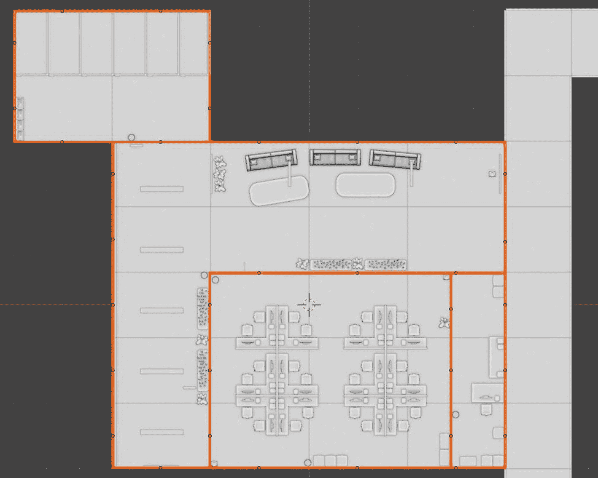

图 14-1

房间布局

如你所见，这是一个类似办公室的环境，并且使用了一些额外的资源。我们再次使用 `UE4` 的吸附系统。将吸附设置为 10 个单位，然后扩展之前创建的房间以形成一条走廊，如图 14-2 所示。

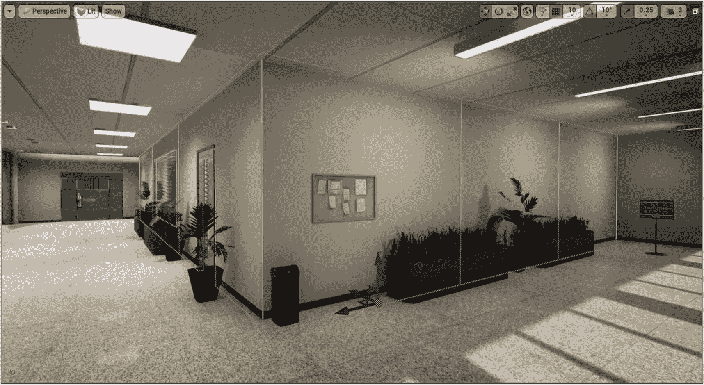

图 14-2

放置墙壁

让我们为扩展出的走廊添加一些窗户，如图 14-3 所示。

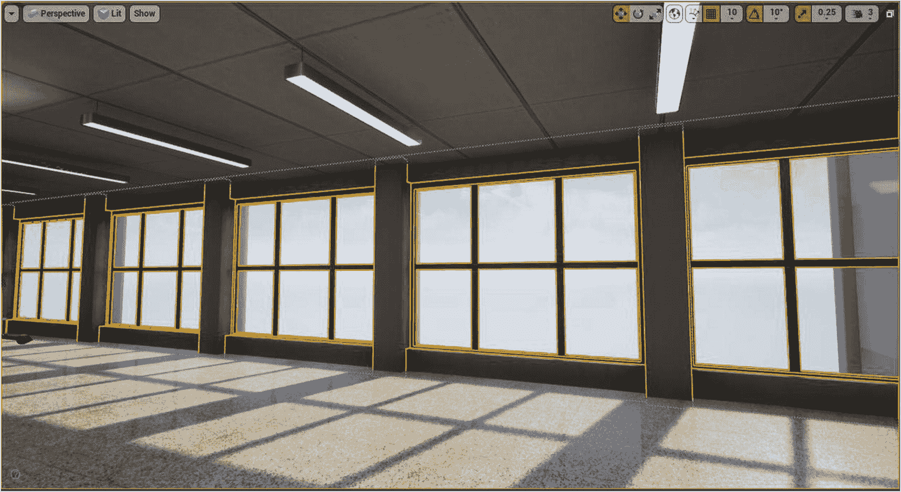

图 14-3

为走廊添加窗户

接下来，添加其他区域的墙壁，如图 14-1 所示。然后，添加装饰物品。我们场景的内部区域因为没有照明而显得昏暗。为了在这些场景中工作，请点击图 14-4 中所示的“无光照”选项，切换到无光照模式。

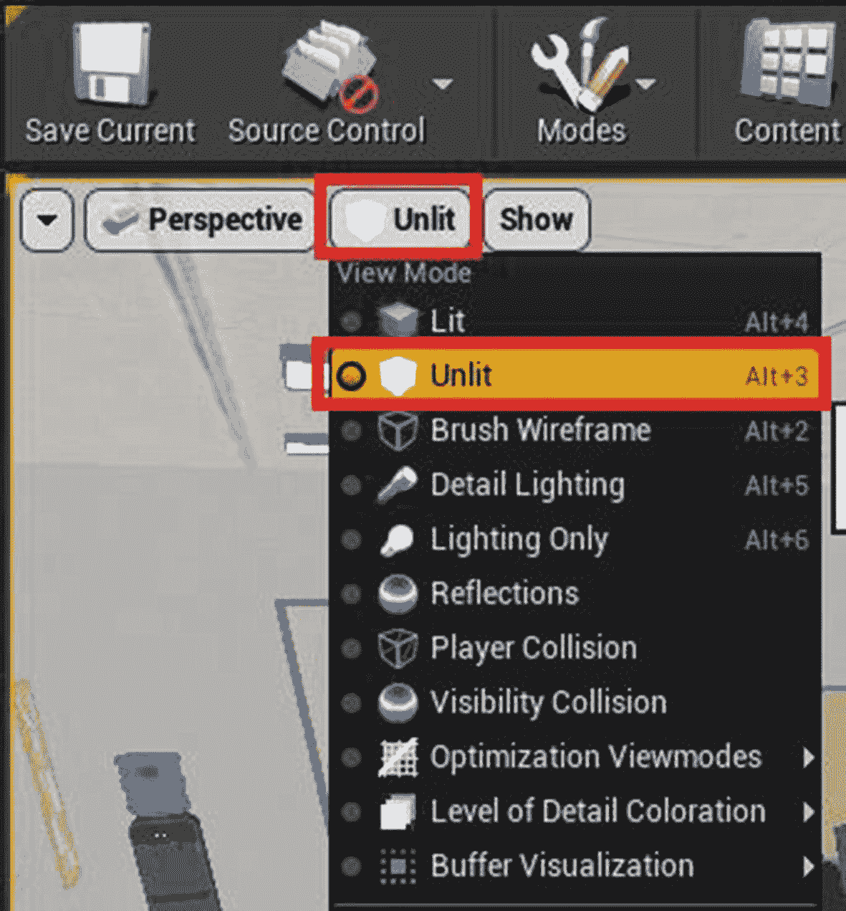

图 14-4

切换到无光照模式

在无光照模式下，开始为场景添加一些灯光。按住`Alt`键并沿任意轴拖动之前创建的光源以复制它。复制光源后，将其放置在每一个灯光模型下方，如图 14-5 所示。

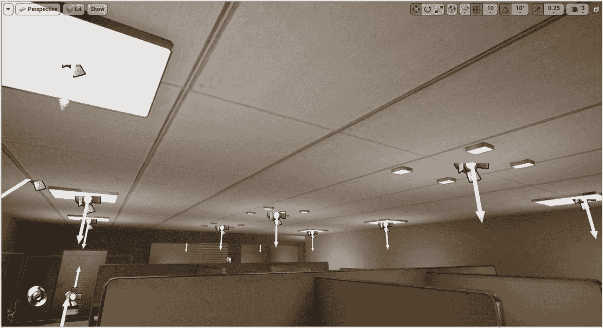

图 14-5

放置灯光 Actor

之后，烘焙光照以查看结果。如果某些地方过暗，则添加更多灯光以达到你想要的亮度。我的结果如图 14-6 和图 14-7 所示。

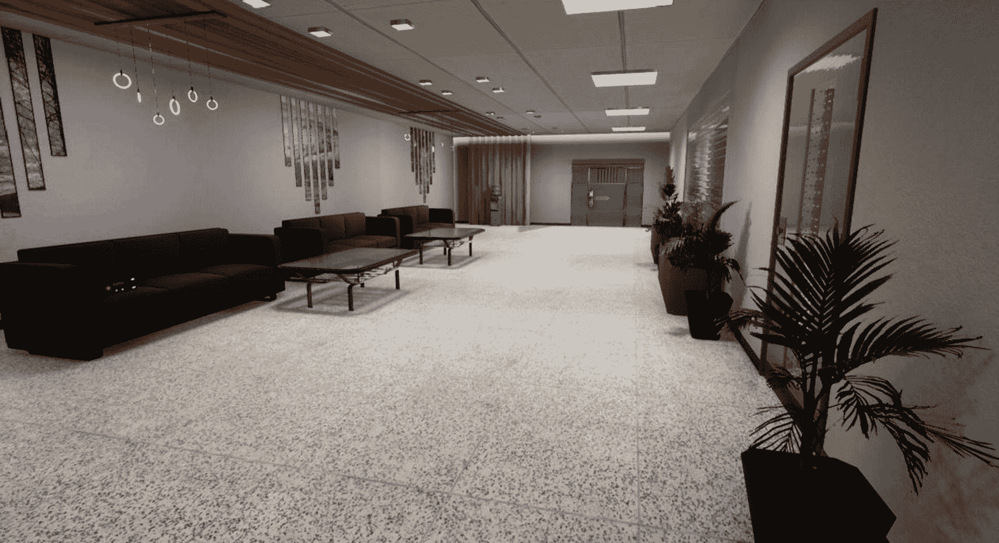

图 14-6

接待区视图

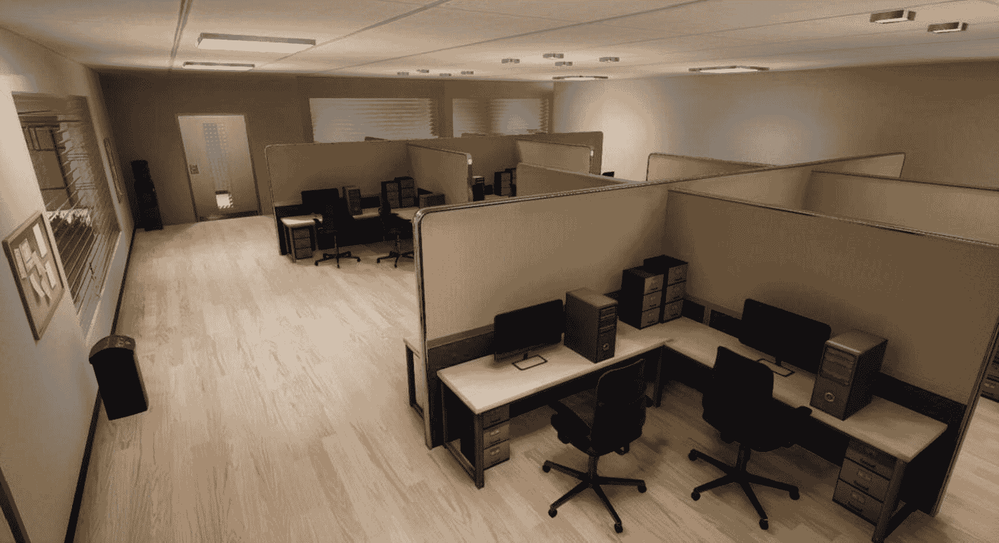

图 14-7

办公工作区

如果你的电脑难以处理如此多的灯光，还有替代方案。尝试增加灯光强度并进一步提高`衰减半径`值。你还可以禁用`使用平方反比衰减`，这样灯光可以在更远距离保持强度。这需要一些试错和参数调整。作为最后的手段，如果你遇到严重的性能问题，可以尝试此方法。

## 添加最后的润色

现在让我们为关卡添加一些最后的润色。当场景中需要反射表面时，你需要添加一个*反射捕获*。前往`放置 Actor`，使用搜索栏搜索`reflection`（参见图 14-8）。

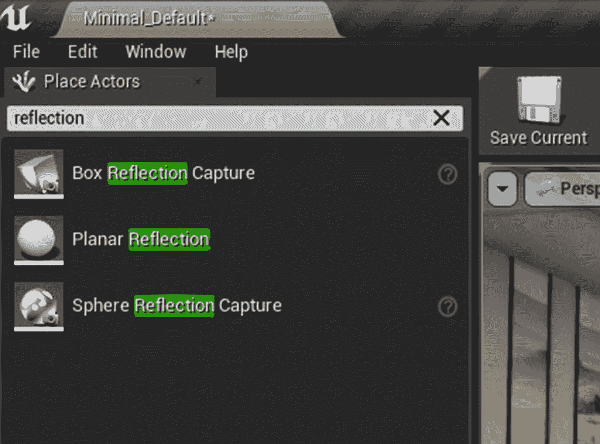

图 14-8：搜索反射捕获

将`球体反射捕获`拖放到你的场景中。你可以在场景中看到该 Actor 的边界（参见图 14-9）。

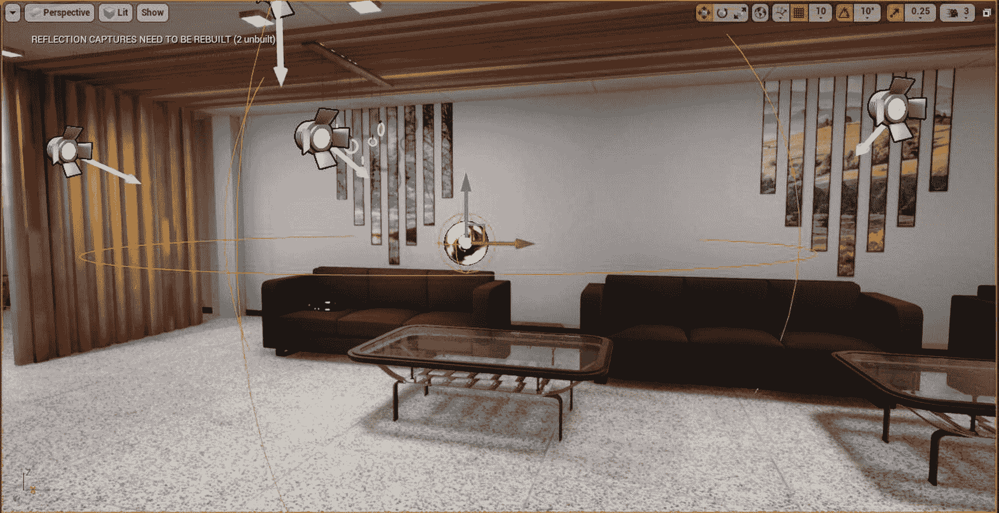

图 14-9：反射捕获的边界

你可以缩放该 Actor 来增大边界球体的大小。这将决定它在场景中影响的网格体数量。一个常规场景需要分散放置几个这样的 Actor，如图 14-10 所示。

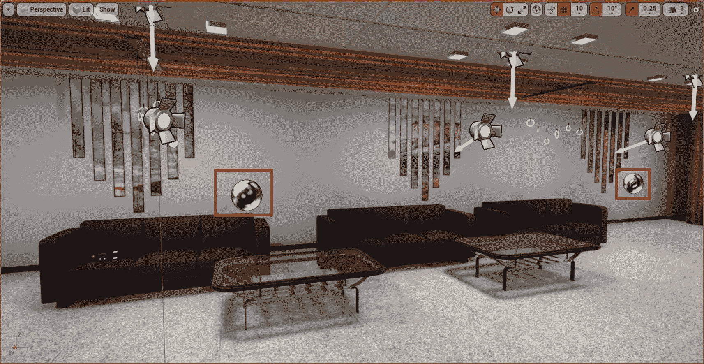

图 14-10：场景中的球体反射捕获

你可以使用相同的方式，通过平面反射来创建镜子。将`平面反射`拖放到你的场景中并进行缩放，使其覆盖镜面的大致表面区域（参见图 14-11）。

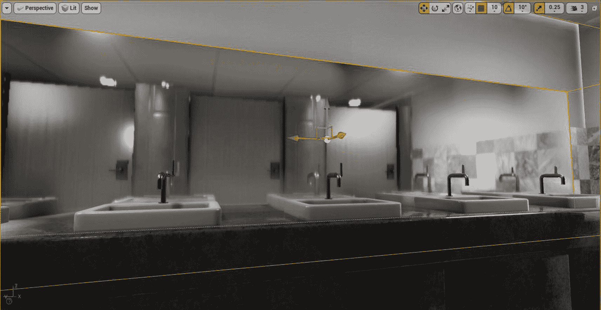

图 14-11：添加平面反射

添加一个玻璃透视视图，如图 14-12 所示。

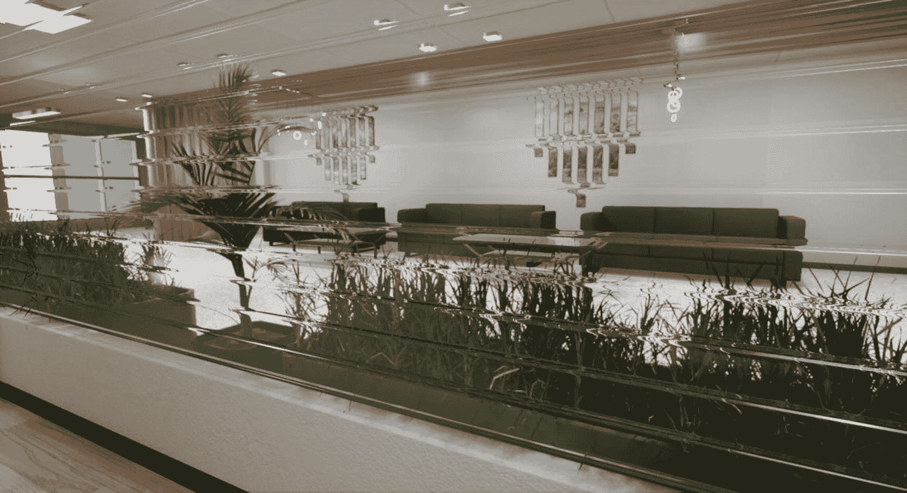

图 14-12：玻璃透视视图

最后，图 14-13 展示了一个画廊视图。

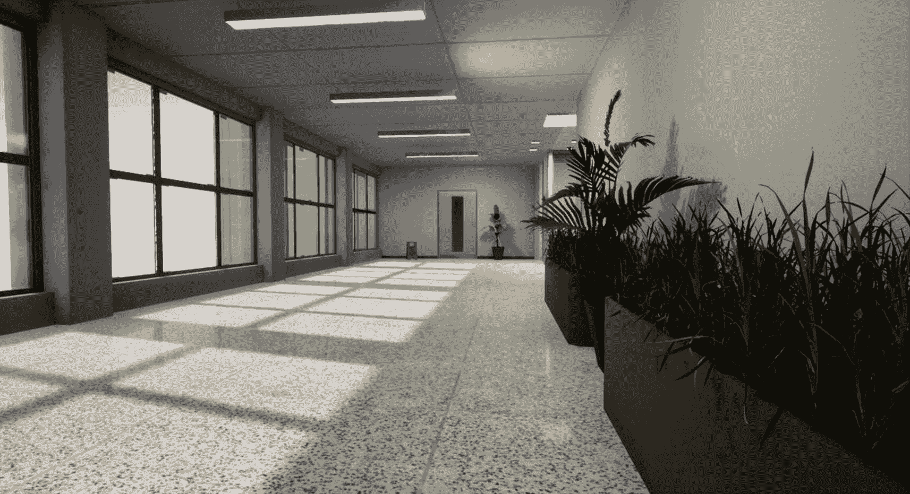

图 14-13：画廊视图

本章关于设计可视化的内容到此结束。在下一章中，你将通过一些最后的提示和建议以及作品集展示来结束本书。