# 15. 沉浸式设计作品集

你已经设置好了关卡和光照。在本章中，你将进行清理和最终定稿。最后，我会为你提供一些关于如何在这个领域继续前行的最终建议。

## 清理和预览场景

浏览你的`内容浏览器`，找到已导入但未使用的资产。通常，导入商城包时会包含大量你最终用不到的额外资产。你可以逐一检查并将其从项目中删除，以减小项目体积。如果有任何不需要的入门内容文件，直接删除即可（参见图 15-1）。

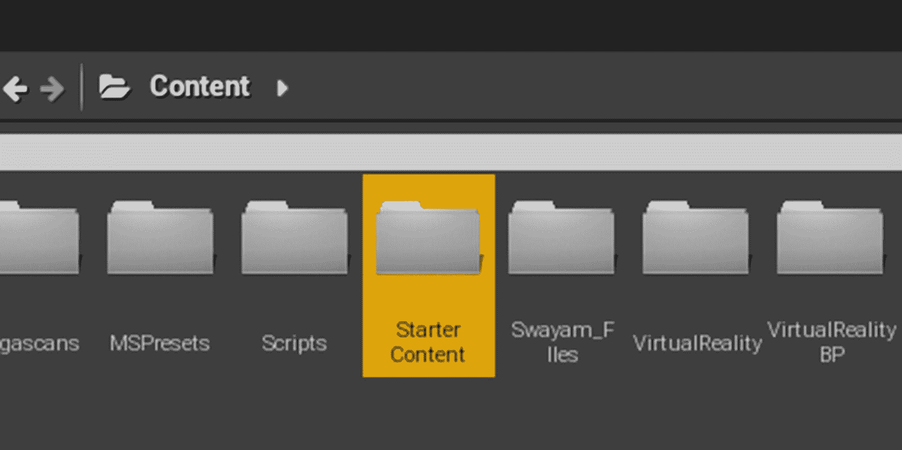

图 15-1：删除不需要的文件

现在，让我们以第一人称视角预览场景。你可以点击`播放`（参见图 15-2）或按 `Alt+P` 开始播放场景。

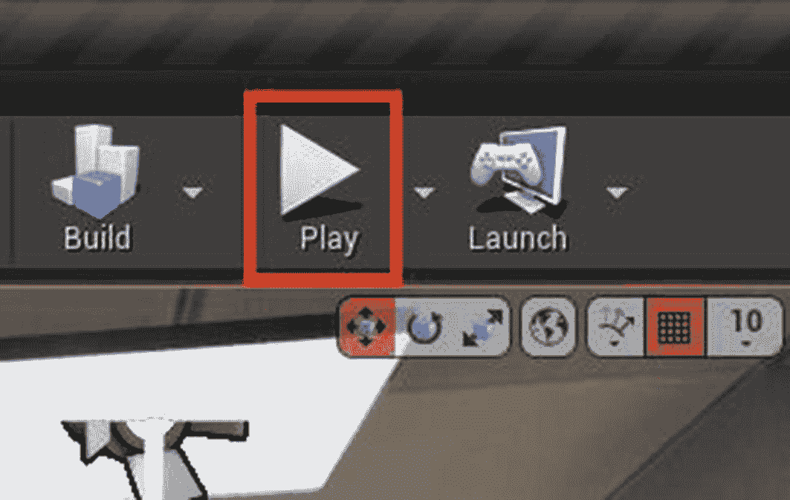

图 15-2：播放场景

你可以像玩家体验一样在场景中四处移动。要在 VR 中播放场景，你需要将 VR 头显连接到电脑。点击`播放`旁的箭头，你应该能看到`VR 预览`选项，如图 15-3 所示。

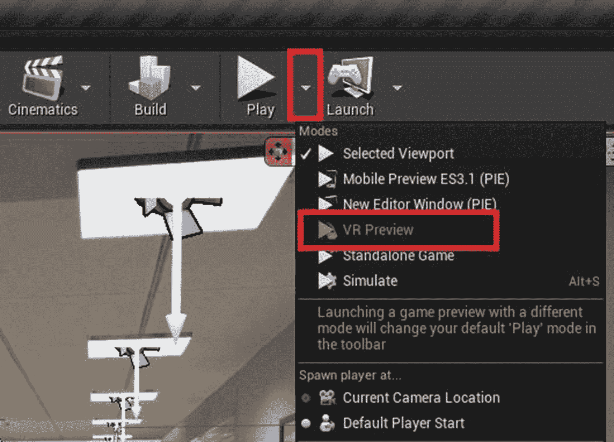

图 15-3：VR 预览选项

## 交互式模拟

场景中有几扇门，你可以在图片中看到。在本节中，你将创建用于开关门的交互系统。这是一个非常简单的设置，需要两个关键组件。首先，需要两个名为`门框`和`门`本身的网格体（如果你没有自己的网格体，可以在 UE4 的入门内容中找到）。其次，需要一个带有约束的简单物理设置来控制运动。

让我们先在一个合适的位置添加一个门框，如图 15-4 所示。

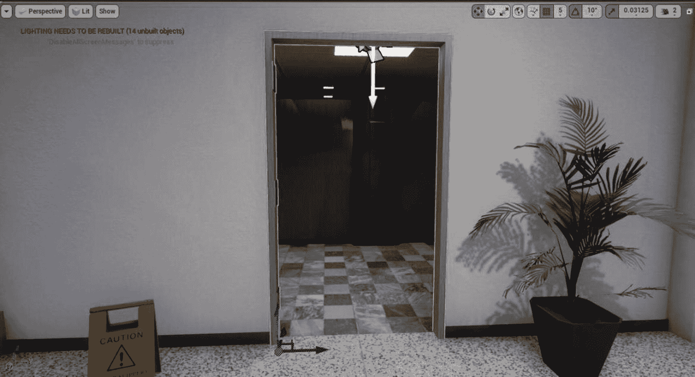

图 15-4：添加门框

接下来，将门网格体添加到门框中，如图 15-5 所示。

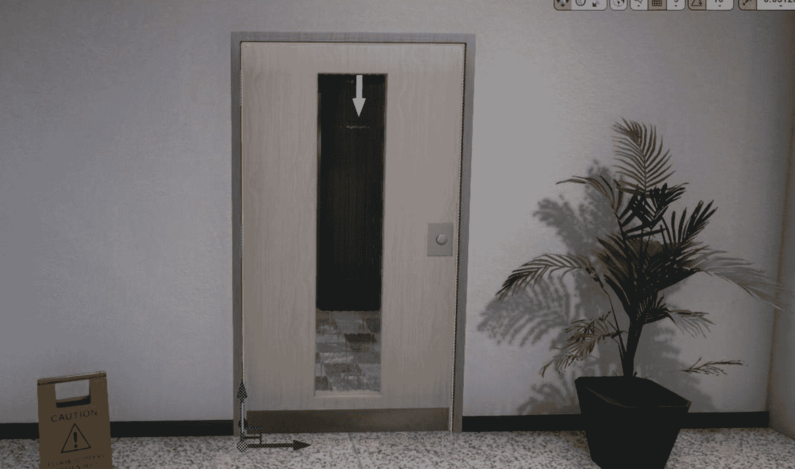

图 15-5：添加门网格体

接下来，在`内容浏览器`中双击门网格体，打开`资产详情`窗口。在此处，点击`碰撞`并启用`简单碰撞`以可视化碰撞边界。选择并删除你拥有的任何默认碰撞（参见图 15-6）。它应该显示为一个绿色方框。

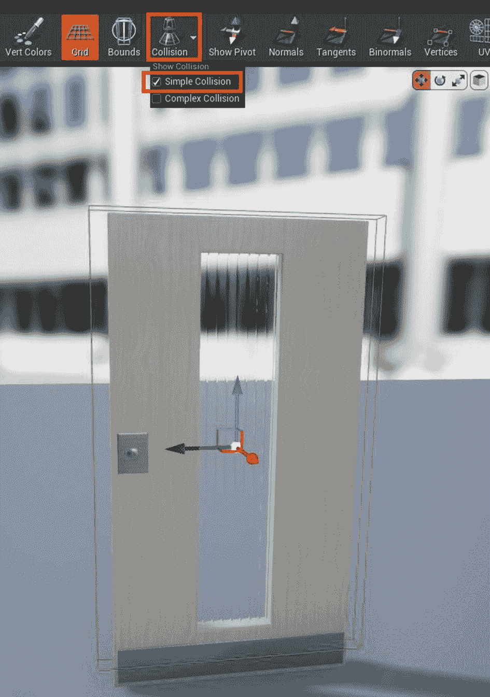

图 15-6：可视化并删除默认碰撞。

接下来，通过点击`碰撞 > 添加盒体简单碰撞`来添加`简化盒体碰撞`（参见图 15-7）。

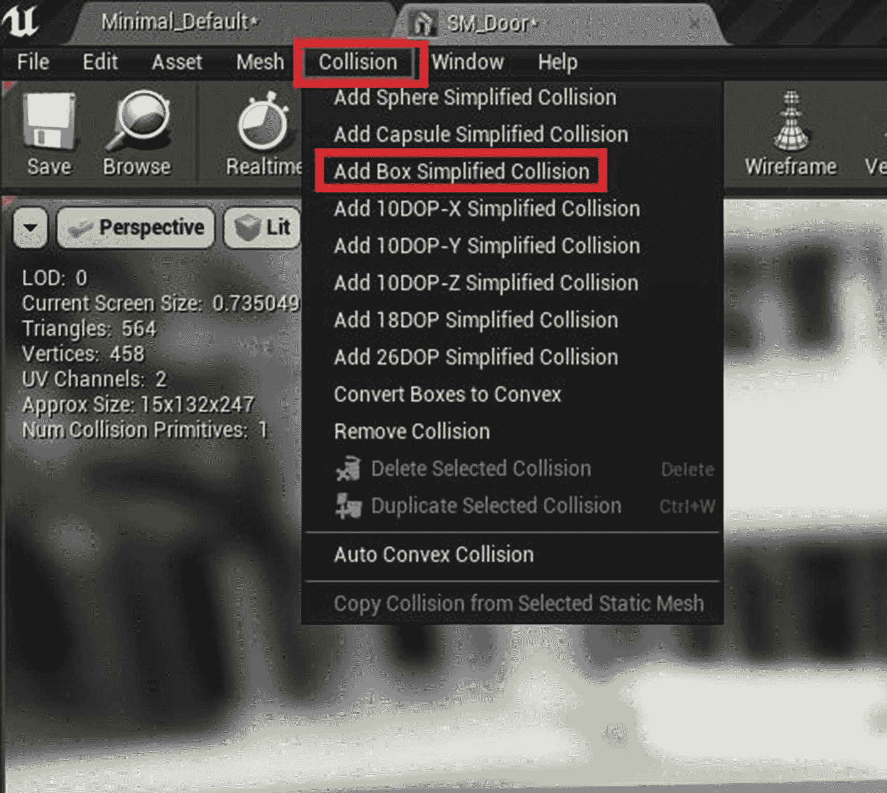

图 15-7：向网格体添加简单盒体碰撞。

选择该简单盒体碰撞，按 `R` 键并缩放它，如图 15-8 所示。将其缩放到足够小，以确保墙壁和周围门框的碰撞不会干扰它。

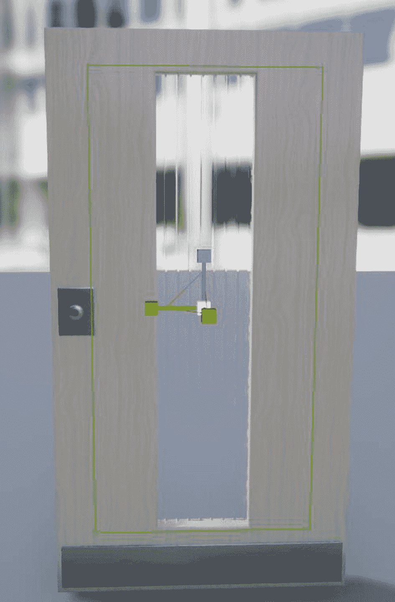

图 15-8：缩放碰撞

在右侧的`细节`面板中，向下滚动直到看到`碰撞`选项卡。在其下方，确保`碰撞复杂度`设置为`项目默认值`。接下来，将`碰撞预设`设置为`自定义`（参见图 15-9）。

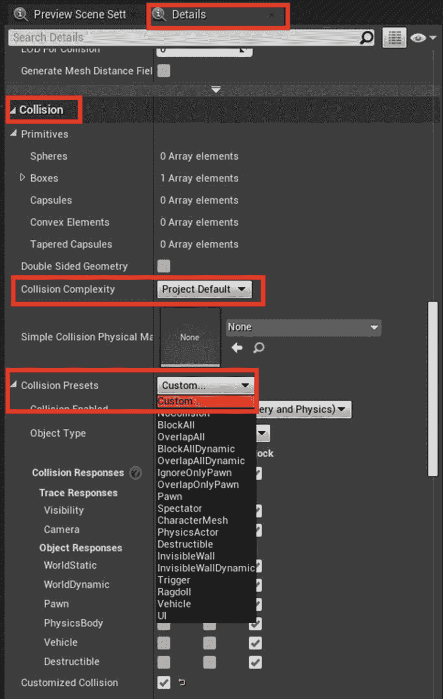

图 15-9：碰撞设置

在`碰撞响应`下，通过点击复选框，将`PhysicsBody`设置为`忽略`，如图 15-10 所示。

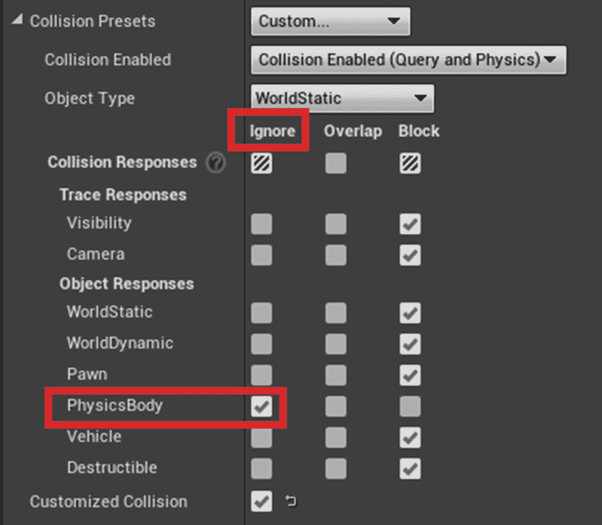

图 15-10：设置 PhysicsBody 的碰撞响应

到此你就完成了所有设置，点击左上角的`保存`来保存所有设置。

选择你添加到场景中的那扇门。在`细节`面板中，将`移动性`设置为`可移动`，这允许门投射动态阴影，并防止光照从固定位置烘焙到门上（参见图 15-11）。这与物理无关；纯粹是为了光照目的。如果你不想要动态阴影，并且更看重性能而非视觉效果，完全可以忽略此步骤。或者，你也可以将其设置为`固定`，作为静态和动态之间的折衷方案。

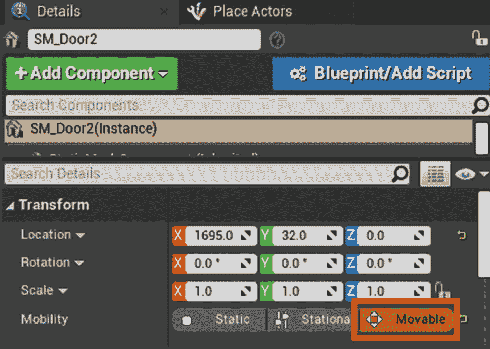

图 15-11：将网格体设置为可移动

向下滚动。在“`Physics`”选项卡下，启用`Simulate Physics`和`MassInKg`，并取消勾选`Enable Gravity`复选框以禁用重力（见图 15-12）。顾名思义，`Simulate Physics`使我们的对象模拟物理效果。`MassInKg`允许你设置体重。禁用重力是因为我们不希望网格体受到重力影响，否则会产生不良效果。

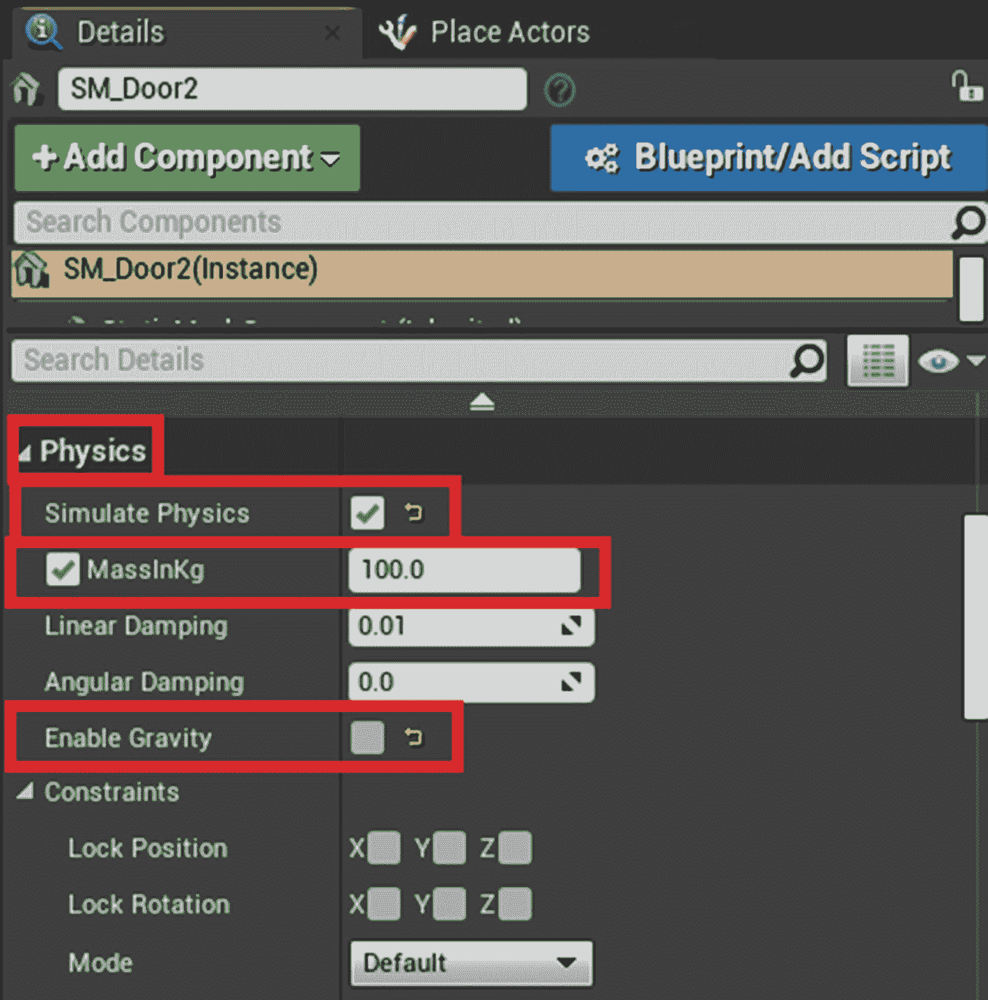

图 15-12

物理设置-1

我们将`MassInKg`提高到一个较大的数值，比如 300，因为你希望门感觉很重。不过，按照现实世界的标准，这对门来说可能是一个荒谬的重量，但在 UE4 中，这却是正常的感觉。接下来，将`Angular Damping`增加到 6 或 7 这样的数值。这会增加门旋转时的阻力，仿佛存在来自现实世界的摩擦力、空气阻力以及其他因素（见图 15-13）。

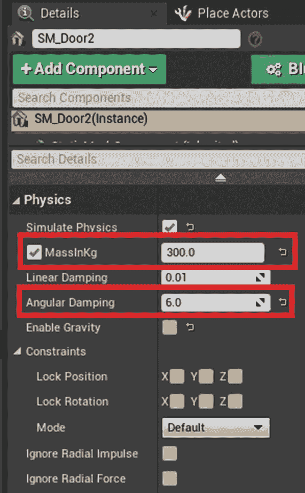

图 15-13

设置 MassInKg 和 Angular Damping

当我们的玩家与门发生碰撞时，我们希望门旋转，但根据当前设置，当你触碰门时，门会直接向后飞出去。现在播放你的关卡来测试一下。你需要约束这个物体，使其在触碰时仅能沿 Z 轴旋转。为什么是 Z 轴？按下`E`键，在所有三个轴上选择并旋转你的门。注意，沿 Z 轴的旋转感觉是门最自然的旋转方式。

现在，让我们在门上激活相关的约束。首先，锁定门在 X、Y、Z 轴上的位置，这些轴是门的铰链所在，使其无法移动。在“`Physics`”选项卡下，找到“`Constraints`”。点击“`Lock Position`”旁边所有 X、Y、Z 的复选框。此外，你希望旋转仅沿 Z 轴发生，因此点击“`Lock Rotation`”旁边的 X 和 Y 复选框。你的设置应类似于图 15-14。

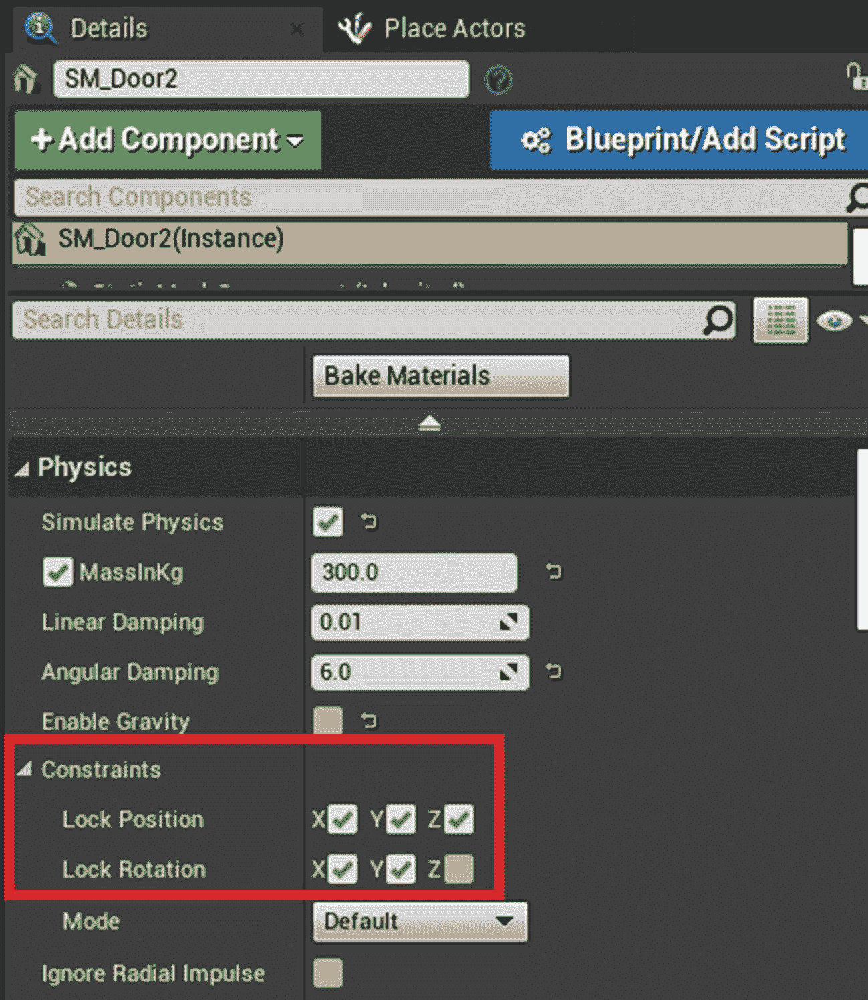

图 15-14

约束设置

现在播放你的关卡，并尝试推门。你会看到你的门现在可以像真门一样被推开并自然打开，如图 15-15 所示。

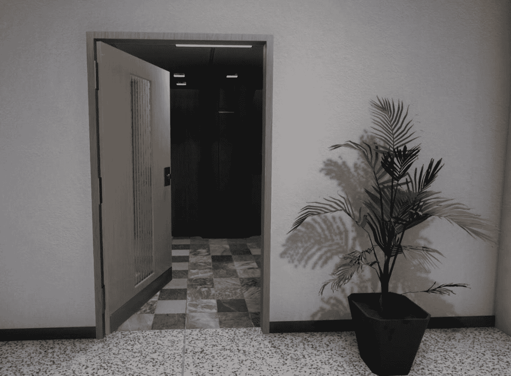

图 15-15

启用了物理效果的门

## 作品集展示

让我们来看一些渲染图并进行分析。图 15-16 展示了来自 Quixel Megascans 的植物素材。它们是现成的 3D 资源，可以直接导入并使用，无需太多麻烦。

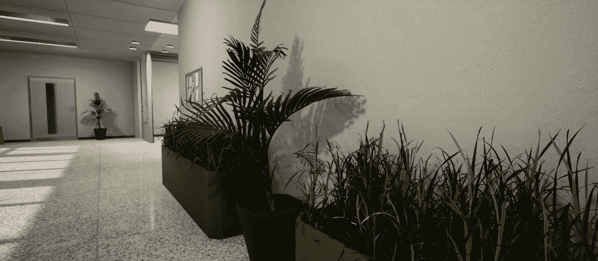

图 15-16

来自 Quixel Megascans 的植物资源

接下来，我们来看看场景中的玻璃材质。它叫做“`Advanced Glass Material Pack`”，是 UE4 市场上一款免费资源包的一部分（见图 15-17）。

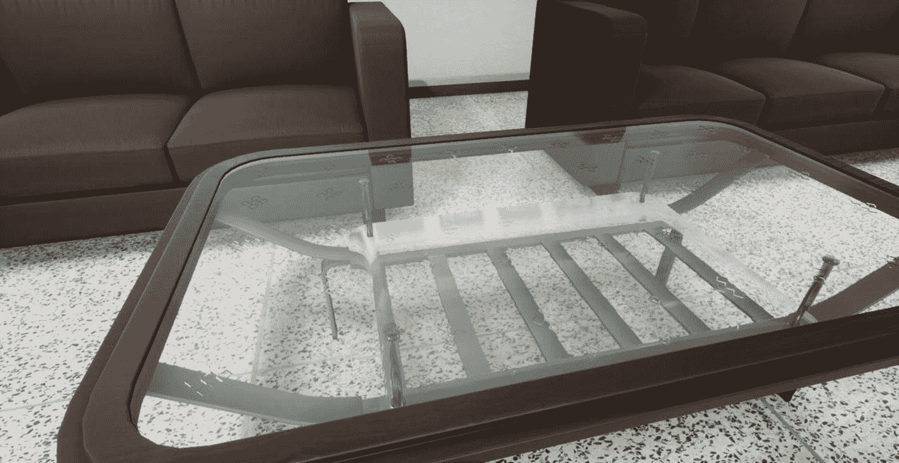

图 15-17

玻璃材质

同样的玻璃材质也出现在图 15-18 中。

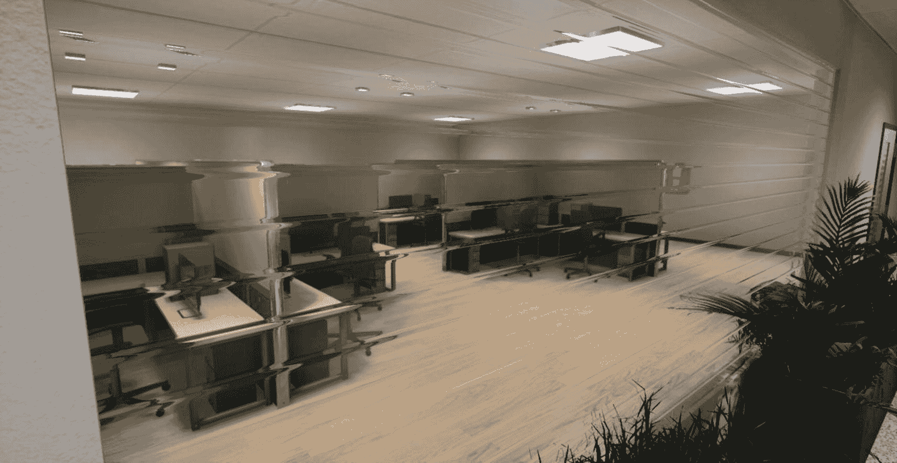

图 15-18

大型窗户的玻璃材质

图 15-19 和 15-20 展示了一个浴室的全景镜头。目的是捕捉其中放置的所有物品。

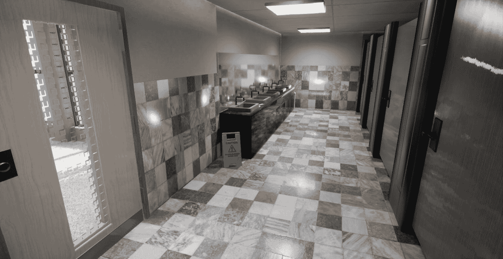

图 15-20

浴室的俯视角

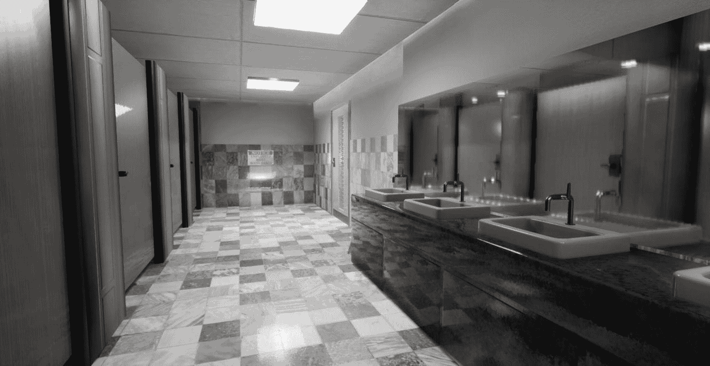

图 15-19

浴室全景镜头

接下来是配备了所有电脑和家具的办公室房间。如你所见，这里有很多重复的对象。这就是模块化设计的优势。你可以用较少的资源填充整个场景（见图 15-21 和 15-22）。

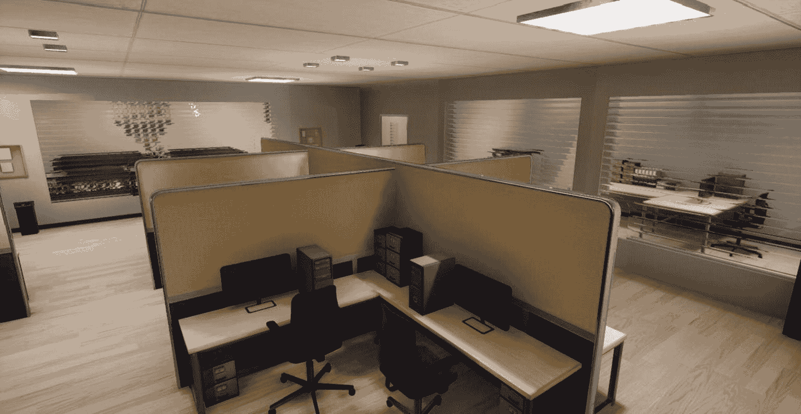

图 15-22

办公室全景镜头 2

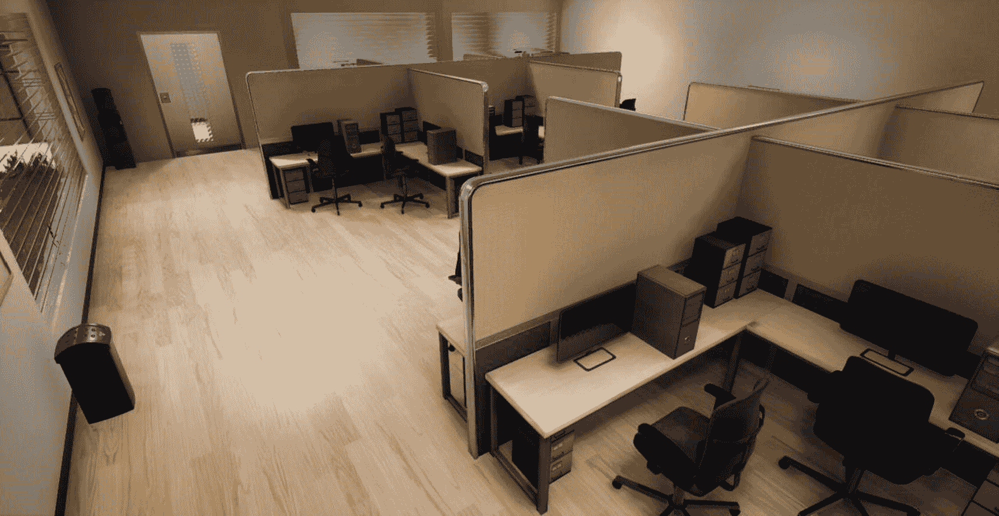

图 15-21

办公室全景镜头 1

图 15-23 展示了从小办公室内部望向大办公室的另一个角度。

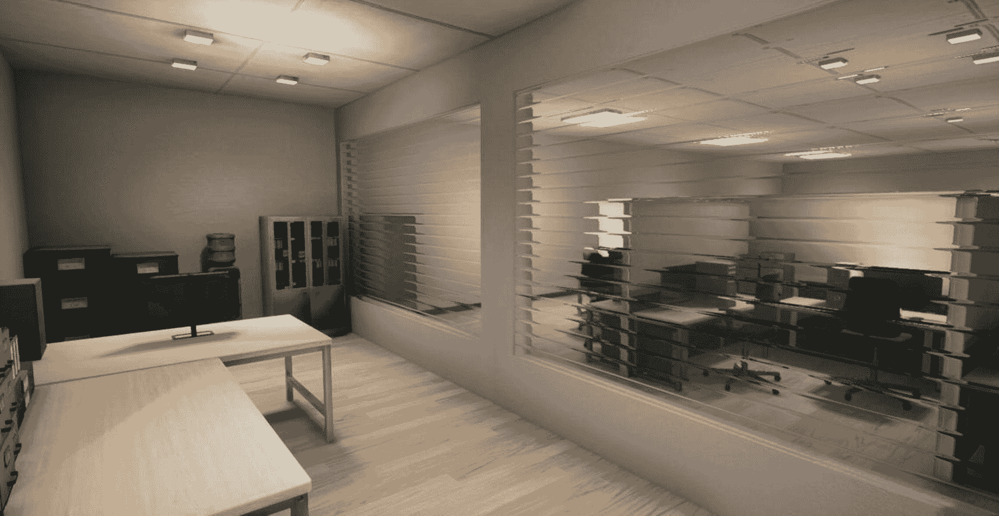

图 15-23

小办公室镜头

图 15-24 展示了带有所有灯光的办公室走廊全景镜头。

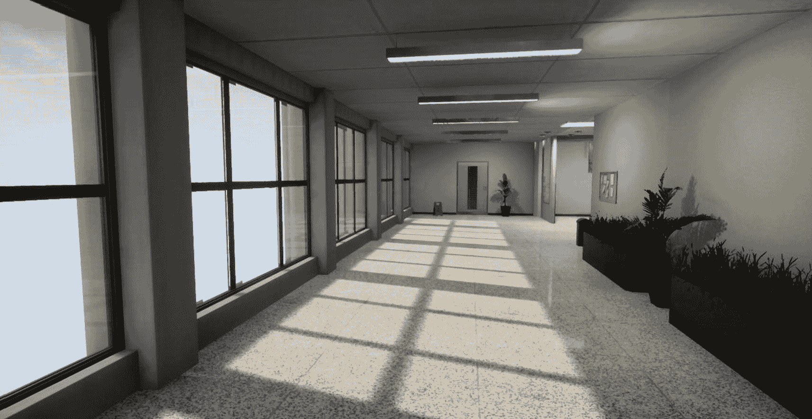

图 15-24

走廊全景镜头

最后，图 15-25 展示了配有沙发和一些植物的接待区。

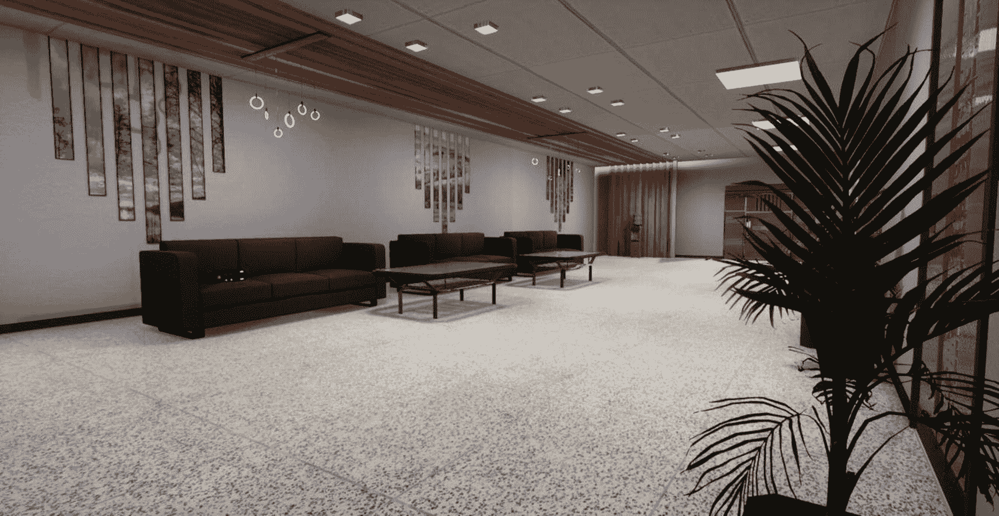

图 15-25

办公室接待区镜头 1

从不同角度拍摄的同一地点的另一个镜头如图 15-26 所示。

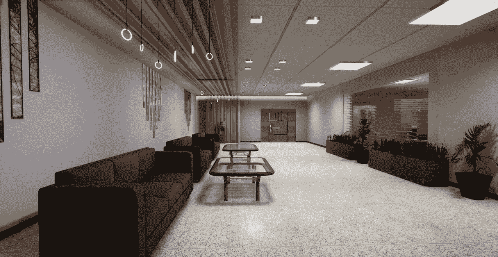

图 15-26

接待区全景镜头 2

## 结论

至此，您已完成本书。希望您从中获取的信息有所助益。从头创建一个完整场景是一项相当庞大的工程，需要投入大量时间和耐心才能完成。

以下是处理类似项目时的一些额外实用技巧。

- **收集参考图。** 参考图对于创作任何事物都非常有用且重要。请确保所有内容都有参考图像。
- **始终正确命名资源。** `UE4` 使用特定的命名规范来标识资源及其类型，这在多人协作同一项目时非常方便。`SM_` 用于静态网格体，后跟资源名称。`M_` 或 `MM_` 用于主材质。`MI_` 或 `_Inst` 用于材质实例。`MF_` 用于材质函数。`BP_` 用于蓝图类和对象。请将这些规范作为您资源的命名约定。
- **制定计划/布局。** 切勿盲目行事。先在 `Photoshop` 等软件应用程序中为您的关卡创建粗略布局。甚至手绘也可以。
- **从简单开始。** 从简单的墙壁和地板开始，以检验您的布局是否可行。在深入细节之前，先进行白模布局非常重要。
- **分层添加细节。** 添加细节时，请逐层进行。从简单的布局开始，然后添加较大的细节，例如家具。之后，再添加较小的细节，例如装饰品。
- **始终为存储资源创建文件夹结构。** 当您开始一个新项目时，请立即创建以下文件夹：`Assets`、`Blueprints` 和 `Maps`。在 `Assets` 文件夹内，添加 `Master_Materials`、`Material_Instances`、`Material_Functions`、`Meshes` 和 `Textures`。在 `Blueprints` 文件夹内，添加类似 `Tools`、`Gameplay` 等子文件夹。这将使您能够妥善管理和组织项目。

资源可以在作品集中以多种方式使用。在建筑可视化中，通常对多边形数量或性能没有限制，因为场景完全是为了以最高视觉保真度展示您的资源而设计的。在这些情况下，您可以自由创建任何您想要的内容，无需担心光照烘焙或多边形问题。

当然，也存在一些限制。您不应将完全细分的模型导入 `UE4`，因为这会使引擎完全过载。但是，如果您拥有性能相当强大的系统，`UE4` 可以轻松处理场景中数十万个多边形，具体取决于您所使用的材质的复杂度。

最好对您的资源进行优化，因为这能使您的技能迁移到内存预算严格的游戏开发和 VR 领域。请确保您的技能具有可扩展性。

这些场景可以轻松用作 Archviz（建筑可视化）场景的作品集，但要想创建更多交互，充分了解 `Blueprints` 至关重要。`Blueprints` 是一个完全不同的主题，需要专门的书籍来讲解。

游戏关卡设计是一个很好的环境，可以用作展示您所有技能的作品集。如果规划得当，您可以使用非常少量的可平铺资源来创建令人惊叹的场景。

---

**索引**

A  
`高级玻璃材质包`  
`角度问题`  
`建筑可视化` 设计应用  
`Blender` `3DS Max` `Unity3D` `Maya`，设计  
`Quixel Megascans` `Quixel Mixer` `Substance Painter` `UE4`  
`增强现实`

B, C  
`白模布局`  
添加细节  
添加对称  
角度问题  
更改参数  
细节处理阶段  
重复面  
挤出边  
展平对象  
隔离内部对象  
合并对象  
进行最终调整  
多切割工具  
多边形数量  
移除不需要的面  
缩放对象  
`着色器测试`

D  
`脏迹活动通道`  
添加滤镜  
Alpha 贴图槽  
`模糊滤镜`  
`模糊强度`  
控制数量  
禁用所有通道  
启用对称  
硬表面  
图层不透明度  
法线通道  
法线贴图槽  
法线绘制  
绘制细节  
绘制图层  
程序化效果，网格体

E  
`耳罩结果`  
`边`  
`编辑模式`  
`扩展关卡`  
添加窗户  
布局  
光照 Actor  
放置墙壁  
接待区  
`无光照模式`  
工作区

F, G, H  
`最终润色`  
画廊视图  
平面反射  
反射捕获  
`植被资源`

I, J, K  
`导入资源，细节`  
自动光照贴图 UV  
设置  
`插入循环边工具`  
`交互系统`  
添加门框  
添加门网格体  
角度阻尼  
碰撞约束  
`MassInKg`  
缩放  
`隔离选择` 按钮

L  
`关卡`  
`Quixel Megascans，导入`  
选择材质  
装饰  
导出设置  
最终渲染  
材质设置  
网格体插件  
定位灯光  
房间设置  
聚光灯 Actor  
`UE4`  
`光照问题`  
网格体之间的缝隙  
漏光  
无可见缝隙  
重叠  
`光照贴图分析`  
资源细节窗口  
烘焙错误  
`间接光照平滑度`  
`光照质量设置`  
`天空光照反弹次数`  
世界设置  
烘焙场景  
光照质量  
结果  
仅构建光照  
自定义材质  
编辑后的墙壁  
生成光照  
构建结果  
光照质量  
`光照贴图 UV`  
`光照质量重要体积`  
光照设置  
分辨率  
保存更改  
`UV 通道`

M, N, O  
`材质设计与集成` 网格体  
`Substance Painter` `UE4`  
`Maya` 工具/选项卡  
编辑/打开菜单  
`热盒` 菜单  
快捷键/热键  
饼图菜单  
多边形建模  
顶点/边/面图元  
`合并/塌陷边`  
`镜像工具`

P  
`PBR 集成纹理`  
`环境光遮蔽/自遮蔽`  
应用材质  
添加黑色遮罩  
添加生成器  
覆盖网格体  
脏迹生成器  
织物材质  
填充设置  
金属色  
`塑料哑光纯色`  
重命名设置  
资源  
`平均法线` 烘焙  
网格体贴图烘焙  
烘焙设置  
创建项目  
高多边形网格体  
按网格体名称匹配  
`最大前向/后向距离`  
法线贴图细节  
项目设置  
脏迹  
`SeeDirt` 头戴设备  
烘焙结果  
烘焙设置  
导出导入  
重叠  
`Quixel Megascans`  
`SeeQuixel Megascans`  
沙发  
更改材质颜色  
`织物` 应用网格体  
`织物粗糙对齐`  
增加 `缩放`  
`三平面` 投影  
`Substance Painter`  
快捷键  
界面  
图层面板  
高级资源库  
属性窗口  
纹理集

Q  
`Quixel Megascans` 插件  
下载/安装设置，`UE4`  
`Quixel Bridge`  
导出设置  
界面  
`虚幻引擎 4`  
`Quixel Mixer`

R  
`实时自发光材质`  
连接设置  
手绘自发光贴图  
图像编辑软件  
主材质和实例化材质  
网格体  
`UV 壳`  
`UV 快照`

S  
`缩放工具`  
`着色器测试`  
`阴影接缝问题`  
`光照质量设置`  
合并 Actor  
移除  
选择墙壁  
`简单盒体碰撞`  
`Substance Painter`  
`对称`

T  
`3DS Max`

U  
`UE4 关卡编辑器`  
`输出日志` 面板  
`虚幻引擎 4`  
`展开` 定义  
头戴设备资源  
调整视口  
圆形区域  
删除历史  
前部区域  
内部区域  
隔离 `UV 壳`  
基于法线的平面贴图  
`平面投影`  
投影轴  
结果  
分离 `UV` 菜单  
分割视口  
切换面板  
`UVs` 测试  
检查器节点  
高亮图标  
结果  
`UV 检查器`  
`UV 平铺`  
`UV`  
`参见 展开`

V, W, X, Y, Z  
`虚拟现实`  
数字建筑  
娱乐示例  
产品可视化  
模拟/培训  
太空探索模拟  
`创建虚拟世界`  
添加细节  
资源库  
基础关卡布局  
`视觉效果`  
`VR 预览` 选项
