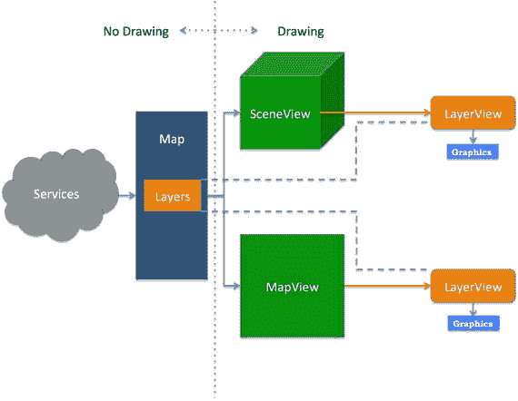
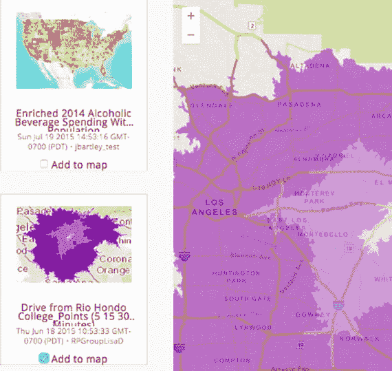
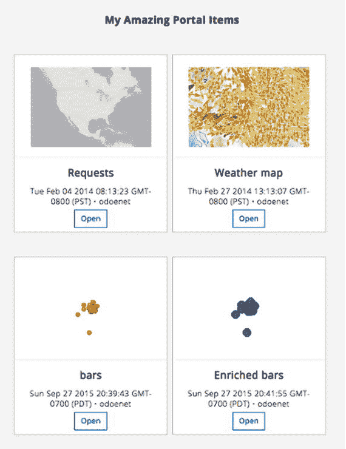

# 3. 地图与视图

最新版本的 ArcGIS API 创建地图的方式与 3.x 版本有所不同。

```
1   import Map from "esri/Map";
2   import SceneView from "esri/views/SceneView";

4   const map = new Map({ basemap: "topo" });
5   const view = new SceneView({
6     container: "mainDiv",
7     map,
8     center: [-118.182, 33.913],
9     scale: 836023
10   });
```

现在，地图（以及构成地图的图层）与地图数据的显示方式之间存在着明显的区别。你可以将地图视为数据源，而将视图视为地图的视觉表现。

你可以在图 3-1 中看到这种关系。



图 3-1

地图-视图关系

在图 3-1 中，你可以看到地图是各种空间服务的容器。同一张地图现在可以显示在 `MapView`（数据的二维表示）或 `SceneView`（数据的三维表示）中。每个视图负责数据的视觉显示方式。

这意味着在 3.x API 中你可能认为理所当然的一些功能，例如直接在 `FeatureLayer` 上访问图形，将不再可用。这是因为一个视图可能显示一个图层中的 10 个要素，而另一个视图可能显示同一图层中的 100 个要素。正如你在图 3-1 中所见，视图中的每个图层都表示为一个 `LayerView`。你可以通过使用 `view.whenLayerView(sourceLayer)` 来获取视图的 `LayerView`。当 `LayerView` 完成时，这将返回一个 `LayerView` 的 Promise。通过这样做，你可以访问视图中显示的实际图形。

地图与视图的分离是 ArcGIS API for JavaScript 4 中引入的一个强大的新概念。借助此功能，你可以创建十几个使用不同服务的地图，而无需在将地图附加到视图之前预先加载所有数据。这允许你将地图视为应用程序中的纯数据源，即使不显示地图也能访问图层。

## WebMap

在 API 的第 4 版中使用 `WebMap` 对象从未如此简单。你可以在 ArcGIS 图库中搜索各种 `WebMap`。¹

要创建一个 `WebMap`，你只需要拥有门户中该项的 `id` 值。

```
1   import MapView from "esri/views/MapView";
2   import WebMap from "esri/WebMap";

4   const webmap = new WebMap({
5     portalItem: {
6       id: "2dfaf8bdb45a4dcf8511a849e4583873"
7     }
8   });

10   const view = new MapView({
11     map: webmap,
12     container: "viewDiv"
13   });
```

就是这样。将 `WebMap` 对象加载到应用程序中只需这些步骤。但由于地图只是一个数据容器，你可以在将其显示在页面上之前访问 `WebMap` 数据。

例如，假设你想在显示 `WebMap` 对象中的某个图层之前调整其 `definitionExpression`。你可以这样做：

```
1   // http://jsbin.com/lodihu/4/edit?html,output
2   const webmap = new WebMap({
3     portalItem: {
4       id: "2dfaf8bdb45a4dcf8511a849e4583873"
5     }
6   });

8   webmap.load().then(() => {
9     const layer = webmap.layers.find({ id } => {
10       return id.indexOf("CensusTractPoliticalAffiliationTotals") > -1;
11     });
12     layer.definitionExpression = "TOTPOP_CY > 10000"
13     const view = new MapView({
14       map: webmap,
15       container: "viewDiv"
16     });
17   });
```

这相当酷。请注意，你必须调用 `WebMap` 对象的 `load()` 方法。这是因为当 `WebMap` 被初始化时，数据不会被预取。只有当 `WebMap` 被添加到视图时，它才会加载显示所需的数据。通过调用 `load()` 方法，你是在请求 `WebMap` 加载你的数据，因为你出于某种原因需要使用它。这还有一个额外的好处，即允许你创建多个 `WebMap` 对象，并根据需要将它们传递给视图。

```
1   const webmapids = [
2     "e691172598f04ea8881cd2a4adaa45ba",
3     "2dfaf8bdb45a4dcf8511a849e4583873"
4   ];

6   // 创建一个 WebMap 数组
7   const webmaps = webmapids.map(webmapid => {
8     return new WebMap({
9       portalItem: {
10         id: webmapid
11       }
12     });
13   });
```

然后，你可以将这些 `WebMap` 对象保留在内存中，直到你实际需要它们并在视图中使用它们。也可以在运行时切换视图的地图。

需要注意的是，在 4 的初始版本中，`WebMap` 尚不支持所有图层和渲染器，但完全支持的工作正在进行中。任何不支持的图层都将被定义为 `UnsupportedLayer`。还有一种图层类型叫做 `UnknownLayer`，当无法确定图层类型时使用。引入此图层是为了应对未来可能添加的新图层类型。

## LayerView

由于地图仅仅是数据和图层的容器，而视图负责显示这些数据，因此你与数据交互的方式发生了变化。在 ArcGIS API for JavaScript 的 3.x 版本中，你可以直接从图层访问 `FeatureLayer` 中的图形。在 API 的第 4 版中，图形包含在视图中，更确切地说，包含在 `LayerView` 对象中，该对象是图层在视图中的表示。

你可以像这样访问图层：

```
1   view.whenLayerView(layer).then((layerView)=>{
2     // 对 LayerView 执行某些操作
3   });
```

一旦你拥有了 `LayerView` 并希望与 `FeatureLayer` 显示的要素进行交互，你可以通过一个名为 `queryFeatures` 的方法来访问它们。

```
1   view.whenLayerView(layer).then((layerView)=>{
2     // 确保 layerView 已完成图形的绘制
3     watchUtils.whenTrueOnce(layerView, "updating", ()=>{
4       layerView.queryFeatures().then((graphics)=>{
5         // 对 Graphics 执行某些操作
6       });
7     });
8   });
```

你可以在 `FeatureLayer LayerView` 上使用其他一些有用的查询方法。

*   `queryExtent`：返回 `LayerView` 中要素的范围
*   `queryFeatureCount`：返回 `LayerView` 中要素的计数
*   `queryObjectIds`：返回一个 `ObjectId` 数组，这对于针对 REST API 执行更多查询任务非常有用

如果你想创建一个能够与显示的要素进行交互的自定义微件，这些方法都非常有用。


## 图层

在 `WebMap` 中检索图层非常简单。要访问地图上的图层，只需从 `map.layers` 属性中获取即可。该属性会提供地图的操作图层，这意味着不包含底图。如果你想要包括底图在内的所有图层，可以使用 `map.allLayers` 属性。相比 3.x 版本，这是一个更简单的 API。

如果你只关心底图，可以通过 `map.basemap` 属性获取。

重申一下，视图和 `LayerView` 才是实际绘制地图数据的部分。它们控制着图形的显示、范围以及任何其他视觉属性。而地图和图层则是这些数据的容器。它们是地图的模型，这意味着在应用程序开发中，你可以将它们视为模型来处理。地图和图层可以作为图表、表格或任何其他可能甚至没有地图显示的自定义组件的数据源。这是该 API 的一个强大特性。

API 中提供了多种图层，每种图层都有不同的用途。你可以在 API 文档中阅读每种图层类型的更多详细信息，但以下是一些常见的图层：

*   `GraphicsLayer`
*   `FeatureLayer`
*   `MapImageLayer`
*   `SceneLayer`
*   `VectorTileLayer`

### GraphicsLayer

`GraphicsLayer` 可能是你能用到的最简单的图层。顾名思义，它只包含显示在地图上的图形。

注意

如果你熟悉 ArcGIS API for JavaScript 3.x 版本的 `GraphicsLayer`，那么 4 版本中 `GraphicsLayer` 的一个主要区别是它不支持渲染器。你需要在每个图形上定义符号，而不是在图层上定义。这是因为 `GraphicsLayer` 可以支持具有不同几何类型的图形。这大大简化了创建要显示在地图上的基本图形的过程。

初始化一个 `GraphicsLayer` 相当简单。

```
1   const graphicsLayer = new GraphicsLayer({
2     graphics: [graphic1, graphic2, graphic3]
3   });
```

你可以通过几种方法向 `GraphicsLayer` 添加图形。

```
1   // 添加单个图形
2   graphicsLayer.add(graphic);
3   // 添加图形数组
4   graphicsLayer.addMany([graphic1, graphic2, graphic3]);
```

由于无法为 `GraphicsLayer` 设置渲染器或弹出模板，你需要为每个图形单独定义符号和弹出窗口。

```
1   // 创建一个图形
2   let graphic = new Graphic({
3     attributes: {
4       id: 1,
5       city: "Los Angeles"
6     },
7     geometry: { type: "point", x: xValue, y: yValue },
8     symbol: { type: "simple-marker",
9       style: 'circle',
10       color: 'red',
11       size: 10,
12       outline: {
13         color: 'rgba(255, 255, 255, 0.5)'
14         width: 4
15       }
16     },
17     popupTemplate: {
18       title: "我的超棒图形！",
19       content: "{*}" // 显示所有字段
20     }
21   });

23   // 将其添加到 graphicsLayer
24   graphicsLayer.add(graphic);
```

弹出窗口将在后续章节中更详细地介绍。

如果你需要更强大的图形支持，特别是使用渲染器和弹出窗口，那么你应该使用 `FeatureLayer`。`GraphicsLayer` 最适合作为简单的杂项图形容器。

### FeatureLayer

`FeatureLayer` 可能是 ArcGIS 平台中用途最广泛、使用最广泛的图层类型。有几种不同的方法可以初始化一个 `FeatureLayer`。

```
1   // 通过 URL 创建
2   const featureLayer = new FeatureLayer({
3     url: "http://services6.arcgis.com/m3L8QUZ93HeaQzKv/arcgis/rest/services/BeerAn\
4   dBurgerJoints/FeatureServer/0"
5   });

7   // 通过 Portal 项目创建
8   const featureLayer = new FeatureLayer({
9     portalItem: {
10       id: "b126510e440744169943fd8ccc9b0c4e"
11     }
12   });
```

通过这两种方法之一初始化 `FeatureLayer` 后，该图层就绑定到了一个远程服务。就像你可以查询 `FeatureLayer` 的 `LayerView` 一样，你也可以直接查询 `FeatureLayer` 来查找要素、`ObjectId` 或 `FeatureLayer` 的范围。

你也可以通过 `FeatureCollection` 创建 `FeatureLayer`，尽管与 API 的 3.x 版本相比，这个过程已经简化了。

```
1   const featureLayer = new FeatureLayer({
2     objectIdField: "item_id",
3     geometryType: "point",
4     // 定义 FeatureLayer 中图形的字段
5     fields: [{
6       name: "item_id",
7       alias: "项目 ID",
8       type: "oid"
9     }, {
10       name: "description",
11       alias: "描述",
12       type: "string"
13     }, {
14       name: "title",
15       alias: "标题",
16       type: "string"
17     }],
18     // 为图层定义渲染器
19     renderer: {
20       type: "simple",
21       symbol: {
type: "simple-marker",
22         style: 'circle',
23         color: 'red',
24         size: 10,
25         outline: {
26           color: 'rgba(255, 255, 255, 0.5)'
27           width: 4
28         }
29       }
30     },
31     popupTemplate: {
32       title: "{title}",
33       content: "{description}"
34     },
35     // 这是一个图形集合
36     source: [graphic1, graphic2, graphic3]
37   });
```

这里你正在做的是手动定义 `FeatureLayer` 的数据源。这基本上传递了一个图形集合，并为这些图形定义了渲染器，以及字段和弹出窗口。这样做的好处是能够为多个图形使用单个渲染器以及单个弹出窗口。你还可以像查询绑定到远程服务的 `FeatureLayer` 一样，查询这个 `FeatureLayer`。

现在，也许你想更新 `FeatureLayer` 中的源要素。你可以通过以下方式实现：

```
1   const graphicOfInterest = featureLayer.source.find(x => x.attributes.OBJECTID ==\
2   = oid);
3   const target = graphicOfInterest.clone();
4   const target.geometry = updatedGeometry;
5   featureLayer.source.remove(graphicOfInterest);
6   featureLayer.source.add(target);
```

这允许你更新 `FeatureLayer` 源中的单个图形。如果你想显示更新的 GPS 数据或更改单个要素的符号，这会非常有用。


#### MapImageLayer

`MapImageLayer` 以前被称为 `ArcGISDynamicMapServiceLayer`。它允许你将动态地图服务加载到应用程序中，与切片图像服务不同，它会为整个地图范围加载单个图像，而不是许多切片。

这是一个相当简单的图层。你甚至可以在 `MapImageLayer` 中定义哪些子图层可见，这在以前是一项繁琐的任务。现在处理子图层要容易得多。

```
1   const layer = new MapImageLayer({
2     url: "https://sampleserver6.arcgisonline.com/arcgis/rest/services/USA/MapServe\
3   r",
4     sublayers: [{
5       id: 0,
6       visible: true
7     }, {
8       id: 1,
9       visible: true
10     }, {
11       id: 2,
12       visible: true
13     }, {
14       id: 3,
15       visible: false
16     }]
17   });
```

你可以简单地在 `MapImageLayer` 的 `sublayers` 属性中定义每个子图层的可见性。你甚至可以更进一步，为单个子图层提供 `definitionExpression`。

```
1   let layer = new MapImageLayer({
2     url: "https://sampleserver6.arcgisonline.com/arcgis/rest/services/USA/MapServe\
3   r",
4     sublayers: [{
5       id: 0,
6       visible: true
7     }, {
8       id: 1,
9       visible: true
10     }, {
11       id: 2,
12       visible: true,
13       // provide a definitionExpression
14       definitionExpression: "pop2000 > 1000000"
15     }, {
16       id: 3,
17       visible: false
18     }]
19   });
```

现在，当请求图像时，这将为动态地图服务的子图层传递一个 `definitionExpression`。这遵循了 ArcGIS API for JavaScript 整个第 4 版的主题，即提供更简单的 API。我完全期望人们会利用这个更易用的 API，在他们的应用程序中实现 `MapImageLayer` 的实用功能。

在 ArcGIS API 4 for JavaScript 的第 4 版中，你定义的子图层将是 `MapImageLayer` 中唯一使用的子图层。如果你正在处理一个包含数百个图层的地图服务，这将非常有用，我个人见过太多这样的情况。

你还可以为每个子图层定义一个 `popupTemplate`² 和一个 `renderer`³。

```
1   const layer = new MapImageLayer({
2     url: "https://sampleserver6.arcgisonline.com/arcgis/rest/services/Census/MapSe\
3   rver",
4     sublayers: [
5     {
6       id: 3,
7       visible: true,
8       renderer: {type: "simple",
9         symbol: { type: "simple-fill",
10           style: "solid",
11           color: "dodgerblue",
12           outline: {
13             width: 0.5,
14             color: "white"
15           }
16         },
17         label: "State boundaries"
18       },
19       opacity: 0.5
20     },
21     {
22       id: 2,
23       visible: true,
24       popupTemplate: {
25           title: "{NAME}",
26           content: [
27           {
28             fieldInfos: [
29               {
30                 fieldName: "POP2000",
31                 visible: true,
32                 label: "Population for year 2000",
33                 format: {
34                   places: 0,
35                   digitSeparator: true
36                 }
37               },
38               {
39                 fieldName: "POP2007",
40                 visible: true,
41                 label: "Population for year 2007",
42                 format: {
43                   places: 0,
44                   digitSeparator: true
45                 }
46               }
47             ]
48           },
49           {
50             type: "media",
51             mediaInfos: [
52               {
53                 title: "Population",
54                 type: "column-chart",
55                 caption: "",
56                 value: {
57                   theme: "Grasshopper",
58                   fields: [ "POP2000", "POP2007" ],
59                   normalizeField: null,
60                   tooltipField: null
61                 }
62               }
63             ]
64           }
65           ]
66         }
67     },
68     {
69       id: 0,
70       visible: true,
71       definitionExpression: "POP2000 > 100000"
72     }]
73   });
```

这非常强大，因为你现在可以像使用 `FeatureService` 一样轻松地处理地图服务。在 API 的 3.x 版本中，为动态地图服务定义自定义渲染器的功能已经存在了一段时间，并且作为 ArcGIS Server 地图服务的一部分也已经存在了一段时间。从 ArcGIS API for JavaScript 的第 4 版开始，新特性是它简化了 API，使开发人员更容易利用这一功能。能够为每个子图层定义弹出窗口的功能增加了 `MapImageLayer` 的实用性，我毫不避讳地说，我认为这是我现在个人最喜欢的 API 图层。

你还可以通过查询表和表连接对 `MapImageLayer` 做更多事情，前提是你的服务中有这些数据。请查看文档⁴了解这些细节，并尽情享受 `MapImageLayer` 的强大功能。

#### CSVLayer

`CSVLayer`⁵ 在 ArcGIS API 4 for JavaScript 中非常有用，用于在空间上表示表格数据。

只要 CSV 文件具有以下名称的坐标字段，它就可以为你转换文件：

*   经度字段名称：`lon`、`lng`、`long`、`longitude`、`x`、`xcenter`、`longitude83`、`longdecdeg`、`POINT-X`
*   纬度字段名称：`lat`、`latitude`、`y`、`ycenter`、`latitude83`、`latdecdeg`、`POINT-Y`

如果你的 CSV 文件不符合该格式，你可以使用 `CSVLayer` 的 `latitudeField` 和 `longitudeField` 属性指定自定义的纬度和经度字段名称。

```
1   let csvLayer = new CSVLayer({
2    url: "http://ontheinternet/mydata.csv",
3    copyright: "Please provide a copyright for the data"
4   });
```

请注意，根据 CSV 文件的来源，你可能需要在应用程序中提供一个 `proxyRule`。

```
1   urlUtils.addProxyRule({
2    urlPrefix: "ontheinternet",
3    proxyUrl: "/proxy/"
4   });
```

#### SceneLayer

处理 3D 地图的一个关键组件是 `SceneLayer`。`SceneLayer` 允许你将场景服务⁶ 加载到你的 3D 地图应用程序中。一旦你有了 `SceneLayer`，通过 `SceneView` 将其添加到你的 3D 地图中就相当简单了。

```
1   const sceneLayer = new SceneLayer({
2     url: "http://scene.arcgis.com/arcgis/rest/services/Hosted/Building_Boston/Scen\
3   eServer/layers/0";
4   });

6   const map = new Map({
7     basemap: "streets",
8     ground: "world-elevation",
9     layers: [sceneLayer]
10   });

12   const view = new SceneView({
13     container: "viewDiv",
14     map: map,
15     scale: 50000000,
16     center: [-101.17, 21.78]
17   });
```

我将在后面的章节中介绍 3D 可视化和 `SceneView`，但你真正需要知道的是，将 `SceneLayer` 添加到你的地图中与添加其他图层的方式完全相同。


#### `VectorTileLayer`

矢量切片非常有趣。Mapbox 不久前发布了矢量切片规范⁷，事实证明它的用途极其广泛。矢量切片的文件体积很小，这使得我们可以构建高分辨率底图并高效缓存数据。矢量切片本质上是以一种紧凑的格式存储矢量数据，从而允许在浏览器中灵活地设置这些矢量要素的样式。这与创建无法在浏览器中设置样式的切片图像数据形成了对比。

通常，你会有一个单一的服务来为你的应用程序提供所有矢量切片。不过，你可以为这些服务加载不同的样式，这样就能加载相同的数据，但呈现不同的外观。

当你初始化一个 `VectorTileLayer` 时，其方式与其他图层相同。

```
1   const tileLyr = new VectorTileLayer({
2     url: "https://www.arcgis.com/sharing/rest/content/items/f96366254a564adda1dc46\
3   38b447ed956/resources/styles/root.json"
4   });
```

如果你查看用于初始化 `VectorTileLayer` 的 URL，你会发现它实际上指向的是一个样式文件，而不是特定的图层 ID。你指向的 URL 是 `resources/styles/root.json`。这实际上只是一个样式文件，它定义了 `VectorTileLayer` 在地图上渲染时应采用的样式。

你实际上可以在运行时通过使用 `loadStyle()` 方法来切换 `VectorTileLayer` 的样式，例如 `vectorTileLayer.loadStyle(myNewStyleObject)`。

矢量切片对制图师来说是一份礼物，因为矢量切片提供了灵活性，可以设计出非常时尚且富有影响力的底图。你可以通过这个矢量切片样式编辑器来测试 ArcGIS 矢量切片底图的样式：[`https://github.com/Esri/arcgis-vectortile-style-editor`](https://github.com/Esri/arcgis-vectortile-style-editor)。

最近，ArcGIS API 4 for JavaScript 开始使用其自身的矢量切片实现。这种新的实现允许 API 渲染不同投影的矢量切片，并使其能够在 3D 环境中使用；但是，当前的实现不支持 Mapbox 切片。

矢量切片能提供极其清晰且美观的地图。重要的是要知道矢量切片使用了 WebGL⁸，这依赖于你的显卡和浏览器支持。如果你看到一些图形异常，或者注意到你的笔记本电脑冒烟，你可能需要考虑升级你的显卡驱动程序。

#### `GroupLayer`

`GroupLayer`⁹ 是一个有趣的图层。它不从网络服务拉取数据；但是，它允许你将多个图层组合在一起。这些图层不必是同一类型；你可以将一个 `GraphicsLayer` 与一个 `TiledLayer` 组合在一起，一切都能正常工作。一个有用的场景是控制多个相似或相关的 `FeatureLayer` 的可见性。让我们看看下面的示例：

```
1   import Map from "esri/Map";
2   import MapView from "esri/views/MapView";
3   import FeatureLayer from "esri/layers/FeatureLayer";
4   import GroupLayer from "esri/layers/GroupLayer";

6   const URL = "http://tmservices1.esri.com/arcgis/rest/services/LiveFeeds/NOAA_sto\
7   rm_reports/MapServer";
8   const titles = [
9     "NOAA 冰雹风暴报告 (24 小时)",
10     "NOAA 龙卷风风暴报告 (24 小时)",
11     "NOAA 大风风暴报告 (24 小时)",
12     "NOAA 龙卷风风暴报告 (过去一周)"
13   ];
14   const layers = [0, 1, 2, 3].map((index, idx) => {
15     return new FeatureLayer({
16       url: `${URL}/${index}`,
17       outFields: ["*"],
18       popupTemplate: {
19         title: titles[idx],
20         content: "{*}"
21       }
22     });
23   });
24   const groupLayer = new GroupLayer({ layers });
25   const map = new Map({
26     basemap: "streets",
27     layers: [groupLayer]
28   });
29   const view = new MapView({
30     container: "viewDiv",
31     map,
32     center: [-98.648, 36.374],
33     zoom: 5,
34     ui: {
35       components: ["zoom", "attribution", "compass"]
36     }
37   });
38   view.then(() => {
39     const btn = document.createElement("div");
40     btn.className = "esri-button esri-widget-button esri-interactive esri-icon-fea\
41   ture-layer";
42     btn.title = "切换风暴数据";
43     view.ui.add(btn, "top-right");
44     // 切换 GroupLayer 的图层可见性
45     btn.addEventListener("click", () => {
46       groupLayer.visible = !groupLayer.visible;
47     });
48   });
```

这里你可以做的是切换 `GroupLayer` 的可见性。当你这样做时，被分组的图层的可见性也会随之切换。


## Portal API

在使用 ArcGIS API 4 for JavaScript 时，`WebMap`、`WebScene` 乃至图层，其底层驱动大部分功能的 API 都是 Portal API。Portal API 由一系列模块组成，从 `Portal` 类本身到 `PortalItem`。你可以利用 Portal API 为你的门户构建一个强大的数据浏览器，同时它也在整个 API 中以更微妙的方式被使用。

```
1   const webmap = new WebMap({
2     portalItem: {
3       id: webmapid
4     }
5   });

7   const webscene = new WebScene({
8     portalItem: {
9       id: sceneid
10     }
11   });
```

这些示例使用了自动转换（autocasting），相关内容将在第 4 章中介绍。

`WebMap` 和 `WebScene` 都在底层利用 Portal API 来构建各自的地图和场景。例如，一个 `WebMap` 可能包含来自门户的三个图层。每个图层通过其自身的门户项目 ID 进行引用。当你通过 ID 加载一个 `WebMap` 时，Portal API 会用于加载该 `WebMap`，然后递归加载每个由 ID 或可能只是 URL 引用的图层项目。其美妙之处在于，即使创建了地图甚至图层，这些资源也不会立即加载。这对你作为开发者意味着，你可以初始化一组 `WebMap` 或图层，而无需加载它们所有必需的资源，仅在需要时才加载这些数据。这对于开发目的来说效率极高。

让我们看看加载门户项目的应用程序可能是什么样子（图 3-2）。



图 3-2

通过门户项目添加图层

你将使用 `calcite-bootstrap` 来帮助设计此应用的样式，因为它已经内置了美观的门户项目卡片样式。你可以修改一个现有示例，使其更明确地展示门户项目及其生成的图层。

```
7     门户项目乐趣多

9       html,
10       body {
11         font-family: sans-serif;
12         padding: 0;
13         margin: 0 !important;
14         height: 100%;
15         width: 100%;
16       }
17       #viewDiv {
18         position: absolute;
19         right: 0;
20         left: 300px;
21         top: 0;
22         bottom: 0;
23       }
24       #itemDiv {
25         position: absolute;
26         left: 0;
27         top: 0;
28         bottom: 0;
29         width: 300px;
30         overflow-y: auto;
31       }
32       .description {
33         margin: 0 auto;
34         width: 100%;
35         padding: 20px;
36       }
37       .card h6 {
38         margin: 0 !important;
39       }

45       window.dojoConfig = {
46         deps: ['app/main'],
47         packages: [{
48           name: 'app',
49           location: window.location.pathname.replace(/\/[^\/]+$/, ''); + 'app',
50           main: 'main'
51         }]
52       };

58       将图层项目添加到地图
```

这是 `app/main.js` 文件的代码。

```
1   import Map from 'esri/Map';
2   import MapView from 'esri/views/MapView';
3   import Layer from  "esri/layers/Layer";
4   import PortalItem from "esri/portal/PortalItem";
5   import esriLang from "esri/core/lang";
6   import all from "dojo/promise/all";
7   import on from "dojo/on";

9   // 创建一个卡片模板来显示门户项目信息
10   const template = `

14       {title}

16         {created}
17         {owner}

21            添加到地图

26   `;
27   // 用于图层的门户项目数组
28   const layerItems = [
29     "a88018dc6c8045378f65b7abeb1d5a30",
30     "6df6df711e8f4b09bf7c1fcbae2afdd3",
31     "f1fca09035074e95a64c49548e79e625",
32     "d816e92c10bd4505bfcfbb761d5ac97d",
33     "ea7ff2ac9b4d49cdbe63dbf4ba2f21cd"
34   ];
35   const map = new Map({
36     basemap: "streets-navigation-vector"
37   });
38   const view = new MapView({
39     map,
40     container: "viewDiv",
41     zoom: 12,
42     center: [-118.1670, 34.0224]
43   });
44   // 用于存放卡片的容器
45   const $cardsList = document.querySelector(".cards-list");
46   view.then(() => {
47     // 从我们的列表中创建新的 PortalItem 实例
48     const portalItems = layerItems.map(id => (new PortalItem({ id }).load()));
49     // 使用 dojo/promise/all 等待所有
50     // PortalItem 的 Promise 完成。
51     all(portalItems).then(items => {
52       let docFrag = document.createDocumentFragment();
53       // 遍历每个项目为其创建卡片
54       items.forEach(item => {
55         // esri/lang::substitute 将使用 PortalItem 创建一个新字符串。
56         const card = esriLang.substitute(item, template);
57         const elem = document.createElement("div");
58         elem.innerHTML = card;
59         let layer;
60         // 添加监听器，用于复选框被选中时
61         on(elem, "input:click", ({ target }) => {
62           if (target.checked && !layer) {
63             if (item.isLayer) {
64               // 这个静态方法从门户项目创建图层
65               Layer.fromPortalItem({
66                 portalItem: item
67               }).then(function (lyr) {
68                 // 现在你可以将图层添加到地图
69                 layer = lyr;
70                 map.add(lyr);
71                 view.extent = item.extent;
72               });
73             }
74           }
75           else if (target.checked && layer) {
76             // 图层已创建，直接添加
77             map.add(layer);
78             view.extent = item.extent;
79           }
80           else {
81             // 如果取消选中则移除图层
82             map.remove(layer);
83           }
84         });
85         docFrag.appendChild(elem);
86       });
87       // 将完成的列表附加到页面。
88       $cardsList.appendChild(docFrag);
89       docFrag = undefined;
90     });
91   });
```

要通过门户 ID 加载图层，你可以使用静态属性 `Layer.fromPortalItem()`。你只需传入一个 `PortalItem` 或类似 `PortalItem` 的对象，剩下的工作将由它处理。需要注意的是，`Layer.fromPortalItem()` 返回一个包含生成图层的 promise，因此你需要等待 promise 完成，然后才能将图层添加到地图。

```
1   Layer.fromPortalItem({
2     portalItem: {
3       id: layerPortalId
4     }
5   });
```

`Layer` 类将验证门户项目是否为图层，然后确定它需要成为哪种类型的图层，例如 `TileLayer` 或 `FeatureLayer`。

也许你想为你的门户项目在应用程序中构建一个简单的浏览器。你可以使用 Portal API 查询你的门户项目，并在应用程序中显示项目信息（见图 3-3）。



图 3-3

示例门户浏览器

以下是此应用程序的基本 HTML 页面：

```
7     门户项目乐趣多
```


```css
html,
body {
  font-family: sans-serif;
  padding: 0;
  margin: 0 !important;
  height: 100%;
  width: 100%;
}
#viewDiv {
  position: absolute;
  right: 0;
  left: 300px;
  top: 0;
  bottom: 0;
}
#itemDiv {
  padding: 25px;
  display: flex;
  flex-direction: row;
  flex-wrap: wrap;
}
.portal-item {
  flex-grow: 4;
}
.item-link {
  margin: 5px;
}
.description {
  text-align: center;
  margin: 0 auto;
  width: 100%;
  padding: 20px;
}
.card h6 {
  height: 3rem !important;
  margin: 0 !important;
  padding: 0 !important;
}
```

```javascript
window.dojoConfig = {
  deps: ['app/main'],
  packages: [{
    name: 'app',
    location: window.location.pathname.replace(/\/[^\/]+$/, '') + 'app',
    main: 'main'
  }]
};
```

### 我的精彩门户项目

您可以编写自己的应用程序来加载您的门户信息。

```javascript
import Portal from "esri/portal/Portal";
import PortalItem from "esri/portal/PortalItem";
import OAuthInfo from "esri/identity/OAuthInfo";
import esriId from "esri/identity/IdentityManager";
import PortalQueryParams from "esri/portal/PortalQueryParams";
import esriLang from "esri/core/lang";
import on from "dojo/on";

// 创建一个卡片模板来显示门户项目信息
const template = `

      {title}

        {created}
        {owner}

        打开

`;

// 用于存放卡片的容器
const $cardsList = document.querySelector(".cards-list");
const info = new OAuthInfo({
  appId: "zppZ53G093yZV7tG",
  popup: false
});
// 将 OAuthInfo 添加到 IdentityManager
esriId.registerOAuthInfos([info]);
// 现在设置门户
const portal = new Portal({
  // https://developers.arcgis.com/javascript/latest/api-reference/esri-portal-Portal.html#authMode
  authMode: "immediate"
});
// 如果用户尚未通过此应用程序登录，将触发登录
portal.load().then(() => {
  const queryParams = new PortalQueryParams({
    query: `owner:${portal.user.username}`,
    sortField: "numViews",
    sortOrder: "desc",
    num: 20
  });
  return portal.queryItems(queryParams);
}).then(({ results }) => {
  let docFrag = document.createDocumentFragment();
  // 遍历每个项目，为其创建卡片
  results.forEach(item => {
    // esri/lang::substitute 将使用 PortalItem 创建一个新字符串。
    const card = esriLang.substitute(item, template);
    const elem = document.createElement("div");
    elem.className = "portal-item";
    elem.innerHTML = card;
    docFrag.appendChild(elem);
  });
  // 将完成的列表附加到页面。
  $cardsList.appendChild(docFrag);
  docFrag = undefined;
});
```

您在这里可以做到的是使用 `Portal` 模块来访问您的门户项目。然后，您可以简单地遍历这些门户项目，并添加带有描述和缩略图的精美小卡片，以及打开实际项目的链接。如果您想在应用程序中使用门户项目，这是一种快速访问它们的好方法。

## 总结

在本章中，我介绍了地图和视图之间的关系，以及让视图管理地图中数据渲染管线的优势。我还介绍了 `LayerView` 如何让您访问视图中当前显示的要素，以及查询这些要素的优势。您了解了 API 支持的各种图层类型，以及它们提供的一些新功能和特性。我还介绍了 Portal API 的新功能，以及它为从门户加载图层和搜索各种门户项目所提供的简便性。这些是 API 中的核心概念，您可以在此基础上构建出色的应用程序！在下一章中，我将介绍 API 的核心基础——本质上是 API 设计的基本构建块——这将使您的技能更上一层楼。

## 脚注

1.  [`www.arcgis.com/home/gallery.html`](http://www.arcgis.com/home/gallery.html)
2.  [`https://developers.arcgis.com/javascript/latest/api-reference/esri-PopupTemplate.html`](https://developers.arcgis.com/javascript/latest/api-reference/esri-PopupTemplate.html)
3.  [`https://developers.arcgis.com/javascript/latest/api-reference/esri-renderers-Renderer.html`](https://developers.arcgis.com/javascript/latest/api-reference/esri-renderers-Renderer.html)
4.  [`https://developers.arcgis.com/javascript/latest/api-reference/esri-layers-MapImageLayer.html`](https://developers.arcgis.com/javascript/latest/api-reference/esri-layers-MapImageLayer.html)
5.  [`https://developers.arcgis.com/javascript/latest/api-reference/esri-layers-CSVLayer.html`](https://developers.arcgis.com/javascript/latest/api-reference/esri-layers-CSVLayer.html)
6.  [`http://server.arcgis.com/en/server/latest/publish-services/windows/scene-services.htm`](http://server.arcgis.com/en/server/latest/publish-services/windows/scene-services.htm)
7.  [`https://github.com/mapbox/vector-tile-spec`](https://github.com/mapbox/vector-tile-spec)
8.  [`https://developer.mozilla.org/en-US/docs/Web/API/WebGL_API`](https://developer.mozilla.org/en-US/docs/Web/API/WebGL_API)
9.  [`https://developers.arcgis.com/javascript/latest/api-reference/esri-layers-GroupLayer.html`](https://developers.arcgis.com/javascript/latest/api-reference/esri-layers-GroupLayer.html)
10. [`https://developers.arcgis.com/javascript/latest/api-reference/esri-portal-Portal.html`](https://developers.arcgis.com/javascript/latest/api-reference/esri-portal-Portal.html)
11. [`https://developers.arcgis.com/javascript/latest/api-reference/esri-portal-PortalItem.html`](https://developers.arcgis.com/javascript/latest/api-reference/esri-portal-PortalItem.html)
12. [`https://github.com/Esri/calcite-bootstrap`](https://github.com/Esri/calcite-bootstrap)
13. [`https://developers.arcgis.com/javascript/latest/sample-code/portalitem-dragndrop/index.html`](https://developers.arcgis.com/javascript/latest/sample-code/portalitem-dragndrop/index.html)
14. [`https://developers.arcgis.com/javascript/latest/api-reference/esri-portal-Portal.html`](https://developers.arcgis.com/javascript/latest/api-reference/esri-portal-Portal.html)

