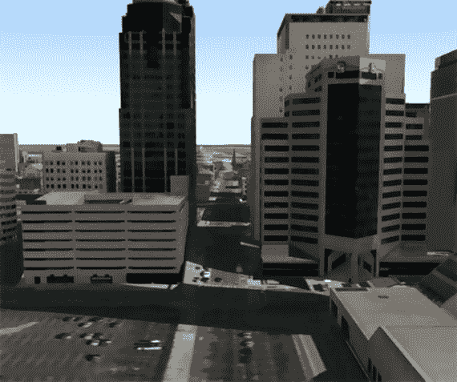
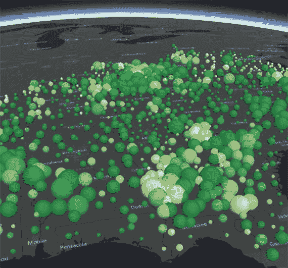
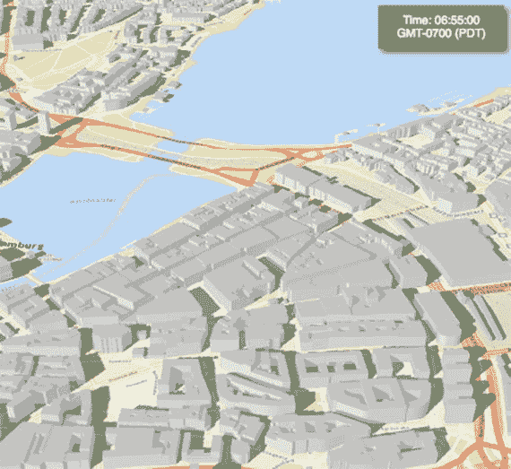
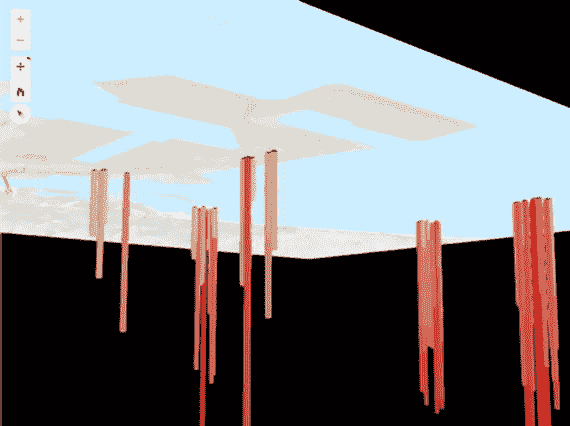

# 5. 场景

迄今为止，`ArcGIS API 4 for JavaScript` 最令人兴奋的功能之一便是引入了 3D 场景。3D 场景是一种可视化数据的非凡新方式（见图 5-1）。


图 5-1
使用 Pictometry 影像的示例场景

您可以使用场景查看器¹（`Scene Viewer`）创建和发布场景，该查看器是 `ArcGIS Online` 平台²的一部分。当您在场景查看器中创作场景时，它们会保存到您的帐户中，您可以与他人共享。然后，您可以使用场景的项目 ID，将这些场景与您的 `ArcGIS API 4 for JavaScript` 应用程序结合使用。

场景本身是在 `ArcGIS Pro`³中创建和发布的。您可以在场景查看器中更新场景，并修改或创建新的幻灯片⁴。您在场景查看器中更新和修改的场景，随后便可在您的 `ArcGIS API 4 for JavaScript` 应用程序中查看。

加载 `WebScene` ⁵ 非常简单；就像加载 `WebMap` 一样。

```
1   import WebScene from "esri/WebScene";
2   import SceneView from "esri/views/SceneView";
4   const scene = new WebScene({
5     portalItem: {
6       id: "082c4fd545104f159db39da11ea1e675"
7     }
8   });
10  const view = new SceneView({
11    map: scene,
12    container: "viewDiv"
13  });
```

这就是使用 `ArcGIS JavaScript API` 显示场景所需的全部操作。

场景与常规地图有何不同？简单来说：3D。

场景包含高程数据，这意味着您可以处理地形和建筑物。当您在地图上放置要素时，可以像在床上铺床单一样将它们覆盖。您也可以像广告牌一样将符号立牌显示（见图 5-2）。


图 5-2
场景中的示例 3D 符号

## SceneView

`SceneView` 与 `MapView` 共享相似的 API，因为它们都基于 `View` ⁶ 模块。正如您已经了解到的，视图负责渲染 `Map`、`WebMap` 或 `WebScene` 中的数据。

要理解 `SceneView`，您需要了解几个可以使用的独特属性。

*   `camera` ⁷
*   `environment` ⁸

### `camera` 属性

你可以将相机想象为一台真实的摄像机，它位于特定位置，指向特定方向，并以特定视角和倾斜角度进行拍摄。这些恰好也是相机所具备的属性。在应用程序运行期间，你可以随时更新相机。如果你确实想要更新相机，建议使用视图的 `goTo` 方法，让视图平滑过渡到新的相机设置。如果直接使用 `view.camera = updatedCamera`，则无法实现平滑过渡。

```
const view = new SceneView({
  map,
  container: "viewDiv",
  camera: {
    position: [7.654, 45.919, 5183],
    tilt: 80
  }
});
// 在应用程序的某个时刻，你可以更新相机。
view.goTo({
  position: [7.654, 45.919, 7500],
  tilt: 65
});
```

你可以在 [`https://jsbin.com/sodeda/3`](https://jsbin.com/sodeda/3) 的演示中查看更新相机的示例。

还需要注意的是，视图不会反映对相机所做的任何直接更新。

```
view.camera.position = updatedPosition; // 无效
```

不过，你可以克隆相机以保留当前相机设置，并仅更新单个属性。

```
const camera = view.camera.clone();
camera.tilt = 120;
view.camera = camera;
// 或者
view.goTo(camera);
```

现在，我将向你展示一个有趣的示例，演示如何在每次场景变化时克隆相机，并回放这些相机设置，从而为你的视图创建平滑的动画效果。

让我们看看这个示例的代码：

```
4.x 3D Camera Recorder
```

我们需要为这个小应用程序定义一些样式。

```
html, body, #viewDiv {
  padding: 0;
  margin: 0;
  width: 100%;
  height: 100%;
}
#recorder {
  position: absolute;
  z-index: 999;
  bottom: 1em;
  left: 1em;
  padding: 1em;
  width: 50%;
  margin-left: 100px;
}
#reverse {
  position: absolute;
  z-index: 999;
  bottom: 50px;
  left: 150px;
}
#recorder > input[type=range] {
  width: 168px;
}
input[type=range] {
  -webkit-appearance: none;
  margin: 18px 0;
  width: 100%;
}
input[type=range]:focus {
  outline: none;
}
input[type=range]::-webkit-slider-runnable-track {
  width: 100%;
  height: 8.4px;
  cursor: pointer;
  animate: 0.2s;
  box-shadow: 1px 1px 1px #000000, 0px 0px 1px #0d0d0d;
  background: #3071a9;
  border-radius: 1.3px;
  border: 0.2px solid #010101;
}
input[type=range]::-webkit-slider-thumb {
  box-shadow: 1px 1px 1px #000000, 0px 0px 1px #0d0d0d;
  border: 1px solid #000000;
  height: 20px;
  width: 20px;
  border-radius: 10px;
  background: #ffffff;
  cursor: pointer;
  -webkit-appearance: none;
  margin-top: -5px;
}
input[type=range]:focus::-webkit-slider-runnable-track {
  background: #367ebd;
}
input[type=range]::-moz-range-track {
  width: 100%;
  height: 8.4px;
  cursor: pointer;
  animate: 0.2s;
  box-shadow: 1px 1px 1px #000000, 0px 0px 1px #0d0d0d;
  background: #3071a9;
  border-radius: 1.3px;
  border: 0.2px solid #010101;
}
input[type=range]::-moz-range-thumb {
  box-shadow: 1px 1px 1px #000000, 0px 0px 1px #0d0d0d;
  border: 1px solid #000000;
  height: 20px;
  width: 20px;
  border-radius: 10px;
  background: #ffffff;
  cursor: pointer;
}
input[type=range]::-ms-track {
  width: 100%;
  height: 8.4px;
  cursor: pointer;
  animate: 0.2s;
  background: transparent;
  border-color: transparent;
  border-width: 16px 0;
  color: transparent;
}
input[type=range]::-ms-fill-lower {
  background: #2a6495;
  border: 0.2px solid #010101;
  border-radius: 2.6px;
  box-shadow: 1px 1px 1px #000000, 0px 0px 1px #0d0d0d;
}
input[type=range]::-ms-fill-upper {
  background: #3071a9;
  border: 0.2px solid #010101;
  border-radius: 2.6px;
  box-shadow: 1px 1px 1px #000000, 0px 0px 1px #0d0d0d;
}
input[type=range]::-ms-thumb {
  box-shadow: 1px 1px 1px #000000, 0px 0px 1px #0d0d0d;
  border: 1px solid #000000;
  height: 20px;
  width: 20px;
  border-radius: 10px;
  background: #ffffff;
  cursor: pointer;
}
input[type=range]:focus::-ms-fill-lower {
  background: #3071a9;
}
input[type=range]:focus::-ms-fill-upper {
  background: #367ebd;
}
```

现在，我们可以为示例应用程序编写代码了。

```javascript
require([
    'esri/Map',
    'esri/views/SceneView',
    'esri/core/watchUtils',
    'esri/core/Scheduler',
    'dojo/on'
], function(Map, SceneView, watchUtils, Scheduler, on) {
    class CameraRecorder {
        constructor(params) {
            this.view = params.view;
            this.cameras = [null];
            this.timer = null;
            this.watcher = null;
            this.handler = null;
            this.intervalID = null;
            this.isPlaying = false;
            this.slider = document.getElementById('slider');
            this.reverseBtn = document.getElementById('reverseBtn');
            this.reverseBtn.addEventListener('click', this.playReverse.bind(this));
            this.playBtn = document.getElementById('playBtn');
            this.playBtn.addEventListener('click', this.play.bind(this));
            this.stopBtn = document.getElementById('stopBtn');
            this.stopBtn.addEventListener('click', this.stop.bind(this));
        }
        clear() {
            if (this.watcher) {
                this.watcher.remove();
            }
            if (this.handler) {
                this.handler.remove();
            }
            if (this.timer) {
                this.timer.remove();
            }
            this.recordStart();
        }
        recordStart() {
            if (this.isPlaying || this.isPaused) {
                return;
            }
            this.timer = Scheduler.schedule(() => {
                this._cameraWatch();
                this._sliderWatch();
            });
        }
        play() {
            if (this.isPlaying) {
                return;
            }
            this.playBtn.classList.toggle('btn-info');
            this.playBtn.classList.toggle('btn-success');
            this._play(false);
        }
        stop() {
            this.isPaused = !this.isPaused;
            this.stopBtn.classList.toggle('btn-info');
            this.stopBtn.classList.toggle('btn-danger');
            if (!this.isPaused) {
                this.recordStart();
            }
        }
        playReverse() {
            if (this.isPlaying) {
                return;
            }
            this.reverseBtn.classList.toggle('btn-info');
            this.reverseBtn.classList.toggle('btn-success');
            this._play(true);
        }
        _cameraWatch() {
            const view = this.view;
            const cameras = this.cameras;
            const slider = this.slider;
            this.watcher = view.watch('camera', (val) => {
                cameras.push(val.clone());
                slider.max = slider.value = cameras.length;
                this.clear();
            });
        }
        _sliderWatch() {
            const view = this.view;
            const cameras = this.cameras;
            this.handler = on(this.slider, 'input', (e) => {
                const val = Number(e.target.value);
                view.goTo(cameras[val] || view.camera.clone());
                this.clear();
            });
        }
        _play(inReverse) {
            this.isPlaying = true;
            let intervalID = this.intervalID;
            const slider = this.slider;
            const view = this.view;
            const cameras = this.cameras;
            let len = cameras.length;
            let i = 0;
            intervalID = setInterval(() => {
                if (!inReverse) {
                    slider.value = i;
                    view.goTo(cameras[i++] || view.camera.clone());
                    if (i === len) {
                        clearInterval(intervalID);
                        this.playBtn.classList.toggle('btn-info');
                        this.playBtn.classList.toggle('btn-success');
                        this.isPlaying = false;
                        this.recordStart();
                    }
                } else {
                    slider.value = len;
                    view.camera = cameras[len--] || view.camera.clone();
                    if (len < 0) {
                        clearInterval(intervalID);
                        this.reverseBtn.classList.toggle('btn-info');
                        this.reverseBtn.classList.toggle('btn-success');
                        this.isPlaying = false;
                        this.recordStart();
                    }
                }
            }, 100);
        }
    }
    const map = new Map({
        basemap: 'streets'
    });
    const view = new SceneView({
        container: 'viewDiv',
        map: map,
        camera: {
            position: [-122.4194, 37.7749, 1000],
            heading: 0,
            tilt: 0
        }
    });
    const camRecorder = new CameraRecorder({
        view: view
    });
    view.watch('stationary', (val) => {
        if (val) {
            camRecorder.recordStart();
        }
    });
});
```

# `CameraRecorder` 类

`CameraRecorder` 类创建了一个 `CameraRecorder` 小部件。该类会监视 `SceneView` 的 `camera` 属性是否发生变化，一旦变化，就会克隆相机并将克隆的相机保存到一个数组中，以供后续使用。它提供了用于重放相机、反向重放或暂停监视器以停止保存相机变化的按钮。此外，它还提供了一个滑块，以便你可以回放到某个特定的 `Camera` 点。这个小应用程序展示了在 `SceneView` 中访问 `Camera` 的实用性，这样你不仅可以保存 `SceneView` 的快照，还可以根据需要操作 `Camera`。

# `environment` 属性

`environment` 属性有什么作用？注意到 3D 场景中建筑物和物体投射出的那些非常酷的阴影了吗？这些就是通过 `environment` 属性控制的。更具体地说，是通过环境的 `lighting` 属性来处理的。
本质上，这允许你控制场景中太阳的位置。不仅如此，你还可以通过日期和一天中的时间来定义它。你知道吗，场景中星星的位置是与日期精确对应的？这是一个相当强大的细节。
`lighting` 的大部分属性都相当直观；`date` 和 `displayUTCOffset` 不言自明。`directShadowsEnabled` 属性只是打开或关闭阴影。可能会让你感到困惑的是 `ambientOcclusionEnabled`。这基本上是指光线如何从表面反射。出于性能考虑，在低功耗设备（如手机）上，`ambientOcclusionEnabled` 属性是禁用的（见图 5-3）。



**图 5-3** 场景中更新后的环境设置

# 局部场景

局部场景是三维可视化中极为实用的工具。通过局部场景，您可以在三维环境中查看地下数据。创建局部场景需要完成两项设置：配置 `SceneView#viewingMode` 属性，并提供 `SceneView#clippingArea` 属性。

```javascript
const view = new SceneView({
  container: "viewDiv",
  map: map,
  viewingMode: "local",
  clippingArea: myClippingArea
});
```
局部场景允许您将三维表面展平并裁剪至特定范围，从而查看地下元素。目前，该功能可用于查看钻井、地震数据、压裂数据，以及任何可映射至地下的数据。不过，目前尚无直接的方法来显示管道数据。
以下示例展示了如何创建局部场景以查看特定区域的钻井。您可以在此处查看在线演示：¹³

## 图 5-4

局部场景演示

在此示例中，我们大量利用了自动类型转换功能，但让我们重点看看其中使用的几个三维专用模块。本演示将向您介绍几个新符号：`PointSymbol3D`、`IconSymbol3DLayer` 和 `ObjectSymbol3DLayer`。

`PointSymbol3D` 符号的功能如其名称所示：允许您在三维 `SceneView` 中显示点数据。单独使用时，它功能有限，但另外两个符号正是为此而设计的。

`IconSymbol3DLayer` 符号允许您定义可在三维环境中使用并覆盖在地表上的符号。每个符号都包含可在应用程序中使用的原始类型。`IconSymbol3DLayer` 的原始类型列表如下。您也可以向 `href` 属性提供 URL，以链接到您自己的符号。

```javascript
require([
  "esri/Map",
  "esri/views/SceneView",
  "esri/layers/FeatureLayer",
  "esri/widgets/Home"
], function(Map, SceneView, FeatureLayer, Home) {

  const wellsUrl = "http://services.arcgis.com/jDGuO8tYggdCCnUJ/arcgis/rest/services/CA%20Class%20II%20Injection%20Wells/FeatureServer/6";

  const wellsSurfaceRenderer = {
    type: "simple",
    symbol: {
      type: "point-3d",
      symbolLayers: [{
        type: "icon",
        material: {
          color: "#0D2644"
        },
        resource: {
          primitive: "circle"
        },
        size: 4
      }]
    }
  };

  const wellsDepthRenderer = {
    type: "simple",
    symbol: {
      type: "point-3d",
      symbolLayers: [{
        type: "object",
        resource: {
          primitive: "cylinder"
        },
        width: 50
      }]
    },
    visualVariables: [
      {
        type: "size",
        field: "WellDepthA",
        axis: "height",
        stops: [
          {
            value: 1,
            size: -0.3048 // meters!
          },
          {
            value: 10000,
            size: -3048 // meters!
          }
        ]
      },
      {
        type: "size",
        axis: "width",
        useSymbolValue: true // sets the width to 50m
      },
      {
        type: "color",
        field: "WellDepthA",
        stops: [
          {
            value: 0,
            color: "#FFFCD4",
          },
          {
            value: 10000,
            color: "#FF0000"
          }
        ]
      }
    ]
  };

  // 地下钻井
  const wellsLyr = new FeatureLayer({
    url: wellsUrl,
    definitionExpression: "WellDepthA > 0",
    outFields: ["*"],
    popupTemplate: {
      title: "Well",
      content: "{*}"
    },
    renderer: wellsDepthRenderer,
    // 防止圆柱体突出地表
    elevationInfo: {
      mode: "relative-to-ground",
      offset: -10
    }
  });

  // 地表显示的钻井
  const wellsSurfaceLyr = new FeatureLayer({
    url: wellsUrl,
    definitionExpression: "WellDepthA > 0",
    outFields: ["*"],
    popupTemplate: {
      title: "Well",
      content: "{*}"
    },
    renderer: wellsSurfaceRenderer,
    elevationInfo: {
      mode: "on-the-ground"
    }
  });

  const losAngelesExtent = {
    xmax: -13151509,
    xmin: -13160242,
    ymax: 3999804,
    ymin: 3992447,
    spatialReference: {
      wkid: 102100
    }
  };

  const map = new Map({
    basemap: "topo",
    layers: [
      wellsLyr,
      wellsSurfaceLyr
    ]
  });

  const view = new SceneView({
    container: "viewDiv",
    map: map,
    viewingMode: "local",
    clippingArea: losAngelesExtent,
    extent: losAngelesExtent,
    constraints: {
      collision: {
        enabled: false
      },
      tilt: {
        max: 360
      }
    },
    environment: {
      atmosphere: null,
      starsEnabled : false
    }
  });

  const homeBtn = new Home({
    view: view
  }, "homeDiv");
  homeBtn.startup();
});
```



您将得到一个与图 5-4 相似的应用程序。

`ObjectSymbol3DLayer`符号在三维环境中更进一步，允许您定义球体、圆柱体、立方体等形状。`ObjectSymbol3DLayer`符号的原始类型已列出。¹⁸ 请注意，ArcGIS API for JavaScript文档指出，如果您想使用自定义对象，需要通过教程在ArcGIS Pro中创建并导出它们。¹⁹

## 摘要

本章介绍了在ArcGIS API for JavaScript中使用场景的基础知识。3D可视化是ArcGIS API 4 for JavaScript中最新的、也是最令人兴奋的功能之一。它们为用户提供了以全新方式探索数据的机会，并且其用途在未来的版本中只会不断增加。现在，您应该熟悉以下内容：

- 创建`SceneView`并使用`WebScene`
- 在场景中操作相机
- 为应用程序中的场景自定义环境
- 创建用于聚焦可视化和查看地下要素的局部场景

### 脚注

1. [https://www.arcgis.com/home/webscene/viewer.html](https://www.arcgis.com/home/webscene/viewer.html)
2. [https://www.arcgis.com/home/](https://www.arcgis.com/home/)
3. [http://pro.arcgis.com/en/pro-app/help/mapping/map-authoring/author-a-web-scene.htm](http://pro.arcgis.com/en/pro-app/help/mapping/map-authoring/author-a-web-scene.htm)
4. [https://developers.arcgis.com/javascript/latest/api-reference/esri-webscene-Slide.html](https://developers.arcgis.com/javascript/latest/api-reference/esri-webscene-Slide.html)
5. [https://developers.arcgis.com/javascript/latest/api-reference/esri-WebScene.html](https://developers.arcgis.com/javascript/latest/api-reference/esri-WebScene.html)
6. [https://developers.arcgis.com/javascript/latest/api-reference/esri-views-View.html](https://developers.arcgis.com/javascript/latest/api-reference/esri-views-View.html)
7. [https://developers.arcgis.com/javascript/latest/api-reference/esri-views-SceneView.html#camera](https://developers.arcgis.com/javascript/latest/api-reference/esri-views-SceneView.html#camera)
8. [https://developers.arcgis.com/javascript/latest/api-reference/esri-views-SceneView.html#environment](https://developers.arcgis.com/javascript/latest/api-reference/esri-views-SceneView.html#environment)
9. [https://developers.arcgis.com/javascript/latest/api-reference/esri-Camera.html#properties](https://developers.arcgis.com/javascript/latest/api-reference/esri-Camera.html#properties)
10. [https://jsbin.com/sodeda/4/edit?js,output](https://jsbin.com/sodeda/4/edit?js,output)
11. [https://developers.arcgis.com/javascript/latest/api-reference/esri-webscene-Lighting.html](https://developers.arcgis.com/javascript/latest/api-reference/esri-webscene-Lighting.html)
12. [https://developers.arcgis.com/javascript/latest/api-reference/esri-webscene-Lighting.html#ambientOcclusionEnabled](https://developers.arcgis.com/javascript/latest/api-reference/esri-webscene-Lighting.html#ambientOcclusionEnabled)
13. [http://jsbin.com/boqehodozu/4/edit?js,output](http://jsbin.com/boqehodozu/4/edit?js,output)
14. [https://developers.arcgis.com/javascript/latest/api-reference/esri-symbols-PointSymbol3D.html](https://developers.arcgis.com/javascript/latest/api-reference/esri-symbols-PointSymbol3D.html)
15. [https://developers.arcgis.com/javascript/latest/api-reference/esri-symbols-IconSymbol3DLayer.html](https://developers.arcgis.com/javascript/latest/api-reference/esri-symbols-IconSymbol3DLayer.html)
16. [https://developers.arcgis.com/javascript/latest/api-reference/esri-symbols-ObjectSymbol3DLayer.html](https://developers.arcgis.com/javascript/latest/api-reference/esri-symbols-ObjectSymbol3DLayer.html)
17. [https://developers.arcgis.com/javascript/latest/api-reference/esri-symbols-IconSymbol3DLayer.html#resource](https://developers.arcgis.com/javascript/latest/api-reference/esri-symbols-IconSymbol3DLayer.html#resource)
18. [https://developers.arcgis.com/javascript/latest/api-reference/esri-symbols-ObjectSymbol3DLayer.html#resource](https://developers.arcgis.com/javascript/latest/api-reference/esri-symbols-ObjectSymbol3DLayer.html#resource)
19. [https://github.com/Esri/arcgis-pro-sdk-community-samples/tree/master/Map-Authoring/ExportWeb3DObjectResource#exportweb3dobjectresource](https://github.com/Esri/arcgis-pro-sdk-community-samples/tree/master/Map-Authoring/ExportWeb3DObjectResource#exportweb3dobjectresource)