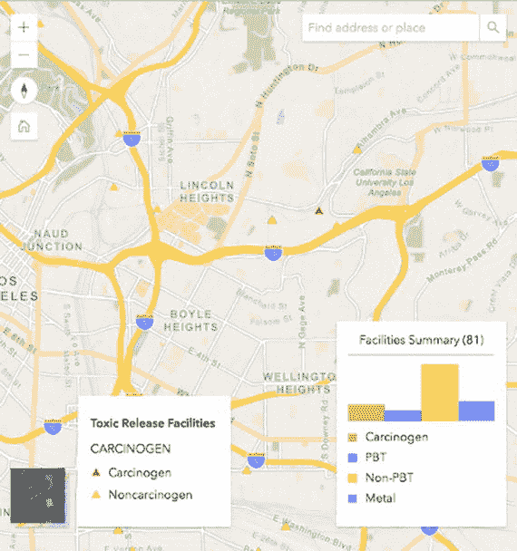

# 6. 弹出窗口

自 ArcGIS API for JavaScript 1.0 版本以来，用户点击地图时的首次交互通常都是获取弹出窗口。`Popup` ¹ 微件通常是访问地图上可视化效果背后原始数据的第一个入口点。地图上定义良好的数据可视化可能会根据色带颜色或显示点的大小，告诉您一个城市与相邻城市的人口密度对比。但您首次查看这些原始数据时，很可能需要点击该要素并在弹出窗口中查看数据。

由于弹出窗口对于探索地图中的数据至关重要，因此有多种选项可用于配置数据的显示方式。


## 字段与别名

你可以通过为图层定义 `popupTemplate` 来快速开始配置弹出窗口，示例如下：

```
1   const featureLayer = new FeatureLayer({
2     url: "https://sampleserver6.arcgisonline.com/arcgis/rest/services/Census/MapSe\
3   rver/3",
4     outFields: ["*"],
5     popupTemplate: {
6       title: "名称: {STATE_NAME}",
7       content: "{*}"
8     }
9   });
```

如果该要素的 `NAME` 字段值为 `Foghorn Leghorn`，则会创建一个标题为“名称: Foghorn Leghorn”的弹出窗口。通过将 `content` 定义为 `"{*}"`，弹出窗口将显示一个简单的表格，列出所有字段名称及其值。

这几乎是最简单的 `Popup` 组件定义方式了。但你还可以更进一步。

为图层和地图配置弹出窗口最简单的方法，可能是在 ArcGIS Online 地图查看器中配置 `Popup` ²。如果你通过 `WebMap` 或 `PortalItem` 加载地图（如前面章节所述），你在弹出窗口中进行的配置将反映在应用程序中。

如果需要，你可以配置 `Popup` 显示别名而非实际字段名称。你可以在 `popupTemplate` 的 `content` 属性中进行配置。

```
1   const featureLayer = new FeatureLayer({
2     url: "https://sampleserver6.arcgisonline.com/arcgis/rest/services/Census/MapSe\
3   rver/3",
4     outFields: ["*"],
5     popupTemplate: {
6       title: "名称: {STATE_NAME}",
7       content: [
8         {
9           type: "fields",
10           fieldInfos: [
11             {
12               fieldName: "POP2000",
13               visible: true,
14               label: "2000 年人口",
15               format: {
16                 places: 0,
17                 digitSeparator: true
18               }
19             },
20             {
21               fieldName: "POP2007",
22               visible: true,
23               label: "2007 年人口",
24               format: {
25                 places: 0,
26                 digitSeparator: true
27               }
28             }
29           ]
30         }
31       ]
32     }
33   });
```

上述示例将显示两个字段：`POP2000` 和 `POP2007`。不过，你可以为每个字段提供与实际字段名称不同的 `label` 属性。由于处理的是包含数值的字段，你还可以定义这些数值的显示方式。在此例中，你希望不显示小数位，并且不使用数字分隔符（这取决于区域设置）。

如果你的数据包含日期字段，你还可以定义日期格式。

```
1   {
2     fieldName: "FAKEDATE",
3     visible: true,
4     label: "假日期字段",
5     format: {
6       dateFormat: "short-date"
7     }
8   }
```

这很简单，对吧？

如果你想要真正自定义输出，甚至可以在内容中使用纯 HTML。

```
1   const featureLayer = new FeatureLayer({
2     url: "https://sampleserver6.arcgisonline.com/arcgis/rest/services/Census/MapSe\
3   rver/2",
4     outFields: ["*"],
5     popupTemplate: {
6       title: "名称: {STATE_NAME}",
7       content: `

9           {STATE_ABBR}

12             2000 年人口: {POP2000}
13             2007 年人口: {POP2007}
14             总户数: {HOUSEHOLDS}

17       `
18     }
19   });
```

你甚至可以使用函数对内容进行进一步处理。假设你的应用程序中有一个已知的几何图形，比如某个围栏区域。当用户点击某个要素时，你想通知他们该位置是否在此围栏区域内。

```
1   const featureLayer = new FeatureLayer({
2     url: URL,
3     outFields: ["*"],
4     popupTemplate: {
5       title: "名称: {name}",
6       content({ graphic }) {
7         const isWithin = geometryEngine.contains(fencedGeometry, graphic.geometry);
8         return `
9           该位置当前${isWithin ? "位于" : "不位于"}围栏区域内。
10         `;
11       }
12     }
13   });
```

这只是自定义弹出窗口内容的另一种方式。

你还可以更进一步，基于视图的点击事件查询多个图层。

```
1   view.on("click", ({ mapPoint }) => {
2     const screenPoint = view.toScreen(mapPoint);
3     view.hitTest(screenPoint).then(({ results }) => {
4       if (results[0].graphic) {
5         view.popup.open({
6           location: mapPoint,
7           promises: [() => {
8             query.geometry = results[0].graphic.geometry;
9             return qTask.execute(query).then(({ features }) => {
10               var names = features.map((feature) => {
11                 return feature.attributes.state_name;
12               }).join(", ");
13               return "{route} 穿越以下州: " + names;
14             });
15           }]
16         });
17       }
18     });
19   });
```

这个特定示例将查询一个服务，以查看图形是否与该服务的要素相交。当添加到弹出窗口参数中 `promises` 属性的查询完成时，弹出窗口将打开并显示你的自定义结果。

你甚至可以在弹出窗口中使用 Arcade³ 表达式。

```
1   const featureLayer = new FeatureLayer({
2     url: "https://sampleserver6.arcgisonline.com/arcgis/rest/services/Census/MapSe\
3   rver/2",
4     outFields: ["*"],
5     popupTemplate: {
6       title: "名称: {STATE_NAME}",
7       expressionInfos: [
8         {
9           name: "percent-change",
10           title: "2000 年至 2007 年变化百分比",
11           expression: "Abs((($feature.POP2000 - $feature.POP2007) / $feature.POP20\
12   00) * 100) + '%'"
13         }
14       ],
15       content: "2000 年至 2007 年的变化百分比为 {expression/percent-change}"
16     }
17   });
```

如你所见，自定义弹出窗口显示数据的方式并不困难。

## MediaInfos

弹出窗口的内容还可以包含基于要素数据的图表。你可以采用与配置 `PopupTemplate` 的 `fieldInfos` 类似的方式来定义。

```
1   {
2     type: "media",
3     mediaInfos: [
4       {
5         title: "人口",
6         type: "column-chart",
7         caption: "",
8         value: {
9           theme: "BlueDusk",
10           fields: [ "POP2000", "POP2007" ]
11         }
12       }
13     ]
14   }
```

这将为字段 `POP2000` 和 `POP2007` 中提供的人口数据显示一个柱状图。其他可选的媒体类型包括 `image`（图片）、`pie-chart`（饼图）、`bar-chart`（条形图）或 `line-chart`（折线图）。如果类型是 `image`，则需要提供 `sourceURL` 属性，而不是 `fields` 属性。可用的主题基于 Dojox 图表库主题。⁴ 你可以在文档中阅读更多关于 `mediaInfos` 选项的信息。⁵


## 自定义操作

ArcGIS API 4 for JavaScript 最有趣的补充功能之一就是添加自定义操作。自定义操作允许您在弹出窗口中添加可用于各种任务的小按钮。您可以使用它来打开新的网页、执行查询或执行其他任务。

在本示例中，您将根据城市名称搜索该城市中与啤酒相关的活动。

```
1   require([
2     "esri/views/MapView",
3     "esri/Map",
4     "esri/layers/Layer"
5   ], function(
6           MapView, Map, Layer
7           ) {

9     const map = new Map({
10       basemap: "streets-navigation-vector"
11     });

13     const view = new MapView({
14       map: map,
15       container: "viewDiv",
16       center: [-117.24, 34.05],
17       zoom: 8
18     });

20     view.popup.on("trigger-action", ({ action }) => {
21       if (action.id === "alcohol-details") {
22         var attributes = view.popup.viewModel.selectedFeature.attributes;
23         var name = attributes.NAME;
24         window.open(`https://www.google.com/search?q=${name} Beer events`);
25       }
26     });

28     Layer.fromPortalItem({
29       portalItem: {
30         id: "c531f67a12254c27af9479d436e23850"
31       }
32     })
33     .then((layer) => {
34       layer.popupTemplate = {
35         title: '{Name}',
36         content: '{*}',
37         actions: [{
38             id: 'alcohol-details',
39             className: 'esri-icon-description',
40             title: 'Events'
41         }]
42       };
43       map.add(layer);
44     })
45     .otherwise(err => console.log(err));
46   });
```

您可以在 [`http://jsbin.com/namufut/2/edit?js,output`](http://jsbin.com/namufut/2/edit?js,output) 找到此应用程序的演示。

需要记住的主要一点是，当您定义 `PopupTemplate` 时，您需要定义一个 `actions` 属性，该属性包含一个包含您可能想要使用的各种自定义操作的数组。

```
1   {
2     title: '{Name}',
3     content: '{*}',
4     actions: [{
5         id: 'alcohol-details',
6         className: 'esri-icon-description',
7         title: 'Events'
8     }]
9   }
```

`className` 属性用于定义自定义图标。这可以是您在 CSS 代码中定义的图标，也可以是 API 提供的图标之一。您还可以提供一个 `image` 属性，该属性是您要使用的图像的 URL。如果您没有定义 `className` 或 `image`，则会提供一个默认图标。您可以在文档中阅读有关自定义操作的更多信息。

如果您想向第三方 Web 服务（例如用于提供客户详细信息的自定义 API）发出请求，自定义操作也会派上用场。

```
1   view.popup.on("trigger-action", ({ action }) => {
2     if (action.id === "customer-details") {
3       var attributes = view.popup.viewModel.selectedFeature.attributes;
4       var customerGroup = attributes.CUSTOMER_GROUP;
5       esriRequest(customAPIURL, {
6         query: {
7           group: customerGroup
8         },
9         responseType: "json"
10       })
11       .then({ data } => {
12         // 解析数据并更新弹出窗口内容
13       })
14       .otherwise(error => console.log(error));
15     }
16   });
```

## 总结

在本章中，您学习了如何定义 `PopupTemplate`。您还学习了如何设置可在 `PopupTemplate` 中使用的字段和字段别名，从而更精细地控制数据的显示方式。`PopupTemplate` 甚至可以包含自定义 HTML 或媒体元素（如图表），以提供对数据的更深入理解。您还了解了如何在 `PopupTemplate` 中使用自定义操作来执行一些自定义任务，例如搜索 Web 或访问第三方 Web 服务，从而为您的数据增加更多价值。

`Popup` 通常是用户了解地图上数据详细信息的第一个入口点。它被广泛使用并且功能强大。任何使用 ArcGIS API for JavaScript 进行开发的人都应该学习如何充分利用它的功能。

在下一章中，您将了解如何使用 ArcGIS API for JavaScript 中的新微件框架来创建自定义微件！

脚注

[`https://developers.arcgis.com/javascript/latest/api-reference/esri-widgets-Popup.html`](https://developers.arcgis.com/javascript/latest/api-reference/esri-widgets-Popup.html)

[`https://doc.arcgis.com/en/arcgis-online/create-maps/configure-pop-ups.htm`](https://doc.arcgis.com/en/arcgis-online/create-maps/configure-pop-ups.htm)

[`https://developers.arcgis.com/arcade/`](https://developers.arcgis.com/arcade/)

[`https://download.dojotoolkit.org/release-1.10.0/dojo-release-1.10.0/dojox/charting/tests/theme_preview.html`](https://download.dojotoolkit.org/release-1.10.0/dojo-release-1.10.0/dojox/charting/tests/theme_preview.html)

[`https://developers.arcgis.com/javascript/latest/api-reference/esri-PopupTemplate.html#media`](https://developers.arcgis.com/javascript/latest/api-reference/esri-PopupTemplate.html#media)

[`https://developers.arcgis.com/javascript/latest/guide/esri-icon-font/index.html`](https://developers.arcgis.com/javascript/latest/guide/esri-icon-font/index.html)

[`https://developers.arcgis.com/javascript/latest/api-reference/esri-PopupTemplate.html#actions`](https://developers.arcgis.com/javascript/latest/api-reference/esri-PopupTemplate.html#actions)

[`https://developers.arcgis.com/javascript/latest/api-reference/esri-PopupTemplate.html`](https://developers.arcgis.com/javascript/latest/api-reference/esri-PopupTemplate.html)

## 微件

ArcGIS API for JavaScript 的版本 4 引入了自己的微件框架来构建自定义微件。自定义微件开发由名为 MaquetteJS 的虚拟 DOM 库提供支持。这取代了以前用于构建微件的旧版 Dojo Dijit 框架。尽管 Dijit 是一个完全稳定且久经考验的微件框架，但虚拟 DOM 库允许您使用 DOM 的抽象版本，从而可以高效地发现更改并更新 DOM。

### 先决条件

然而，自定义微件开发有一个您应该注意的先决条件：TypeScript。用于自定义微件开发的许多工具（例如前面章节中讨论的 Accessor 装饰器）都需要使用 TypeScript。

我强烈建议您学习 TypeScript 教程。我还强烈推荐 Egghead.io 上的以下课程：

- 快速上手 TypeScript
- 在 TypeScript 中有效使用类型


#### 类型定义

你可以在 GitHub 上阅读更多关于安装 ArcGIS API 或 JavaScript 类型定义的信息。¹⁰ 关键在于，你可以通过 `npm install --save @types/arcgis-js-api` 轻松安装类型定义。

需要注意的是，这并不会安装 Dojo 的类型定义。如果你想在 TypeScript 开发中使用一些 Dojo 模块，你可以获取 `dojo-typings`¹¹ 并在 `tsconfig.json` 文件中进行如下配置：

```
1     "types": [ "arcgis-js-api" ],
2     "include": [
3       "./src/app/**/*"
4     ],
5     "exclude": [
6       "node_modules"
7     ],
8     "files": [
9       "node_modules/dojo-typings/dojo/1.11/modules.d.ts",
10       "node_modules/dojo-typings/dijit/1.11/modules.d.ts",
11       "node_modules/dojo-typings/dojox/1.11/modules.d.ts",
12       "node_modules/dojo-typings/custom/dgrid/1.1/dgrid.d.ts",
13       "node_modules/dojo-typings/custom/dstore/1.1/dstore.d.ts",
14       "node_modules/intern/typings/intern/intern.d.ts"
15     ]
```

你可以阅读更多关于 `tsconfig.json` 文件的信息。¹² `tsconfig.json` 文件用于配置 TypeScript 编译器。

#### JSX

这个更新的微件框架还引入了 JSX¹³ 的使用，该语法由 React¹⁴ 推广开来。JSX 在 JavaScript 中看起来非常像 HTML，只是其语法需要一个编译步骤来将 JSX 转换为 JavaScript 函数。

例如，JSX `<h1>hello!</h1>` 会被编译成一个看起来像 `h('h1', 'hello!')` 的函数。这种创建 DOM 元素的方法被称为 HyperScript。¹⁵ 在使用 ArcGIS API for JavaScript 进行自定义微件开发时，如果你使用了 JSX，则无需关心 HyperScript。

### 构建自定义微件

在深入构建自定义微件之前，你可以在 GitHub 上找到演示应用程序的源代码（见图 7-1）。¹⁶



图 7-1

自定义微件开发

在此示例中，你将构建的微件将显示一个图表，该图表代表地图视图中可见的数据。关键在于确保图表仅基于可见数据，以便在平移地图时图表能够随之更新。

#### 存储与 ViewModel

第一步是构建一个应用程序存储。这个应用程序存储将包含用于描述应用程序状态的属性。在此应用程序中，你需要关注 `View` 和 `WebMap`。你可以参考前面的章节，了解如何为此类任务使用 `Accessor` 模块。¹⁷

对于每个继承自 `Accessor` 的 TypeScript 文件，你需要添加以下 `amd-dependency` 行：

```
1   /// 
3   /// 
```

在后续示例中我将省略它们，但请注意它们是必需的。

```
1   // app/stores/app.ts
2   import EsriMap = require("esri/Map");
3   import MapView = require("esri/views/MapView");
4   import Accessor = require("esri/core/Accessor");

6   import {
7     subclass,
8     declared,
9     property
10     } from "esri/core/accessorSupport/decorators";

12   type UIParams = {
13     element: any,
14     position?: string
15   };

17   interface Store {
18     webmap: EsriMap;
19     view: MapView;

21     addToUI(params: UIParams): void;
22   }

24   @subclass("app.stores.AppStore")
25   class AppStore extends declared(Accessor) implements Store {

27     @property()
28     webmap: EsriMap;

30     @property()
31     view: MapView;

33     addToUI({ element, position }: UIParams) {
34       this.view.ui.add(element, position);
35     }

37   }

39   export default new AppStore();
```

你在存储中有两个可观察的属性：`webmap` 和 `view`。你还添加了一个方法 `addToUI()`，它充当代理，为你将组件添加到 UI 中。另外，请注意你导出模块的方式：`export default new AppStore();`。这将创建你的存储的单例，这样每次模块导入它时就不会创建新的存储。

接下来你要做的是为你的自定义微件构建一个 `ViewModel`。`ViewModel` 的行为与应用程序存储非常相似。`ViewModel` 的职责是监视应用程序存储的变化，并根据这些变化更新自身状态。`ViewModel` 的另一个职责是管理微件的业务逻辑，即根据应用程序存储对数据执行任何查询或操作。

```
1   // app/widgets/viewmodels/summaryviewmodel.ts

3   import Accessor = require("esri/core/Accessor");
4   import watchUtils = require("esri/core/watchUtils");

6   import FeatureLayerView = require("esri/views/layers/FeatureLayerView");
7   import Graphic = require("esri/Graphic");

9   import Query = require("esri/tasks/support/Query");

11   import {
12     subclass,
13     declared,
14     property
15     } from "esri/core/accessorSupport/decorators";

17   import store from "../../stores/app";

19   const { init, whenOnce, whenFalse } = watchUtils;

21   export type Stats = {
22     "Carcinogen": number,
23     "PBT": number,
24     "Non-PBT": number,
25     "Metal": number
26   };

28   const stats: Stats = {
29     "Carcinogen": 0, // CARCINOGEN == "Yes"
30     "PBT": 0,        // CLASS == "PBT"
31     "Non-PBT": 0,    // CLASS == "Non-PBT"
32     "Metal": 0       // METAL == "Yes"
33   };

35   function errorHandler (error: Error) {
36     console.log("LayerView Query Error", error);
37   }

39   @subclass("app.widgets.viewmodels.summaryviewmodel")
40   class SummaryViewModel extends declared(Accessor) {

42     @property()
43     count: number = 0;

45     @property()
46     stats: Stats = stats;

48     constructor() {
49       super();
50       whenOnce(store, "view").then(_ => {
51         return store.webmap.findLayerById("tri");
52       })
53       .then(layer => {
54         return store.view.whenLayerView(layer);
55       })
56       .then(this.watchLayerView.bind(this))
57       .otherwise(errorHandler);
58     }
```


```typescript
private watchLayerView(layerView: FeatureLayerView) {
  const queryFeatures = this.queryLayerView(layerView);
  init(store, "view.stationary", _ => {
    if (layerView.updating) {
      whenFalse(layerView, "updating", queryFeatures.bind(this));
    }
    else {
      queryFeatures();
    }
  });
}

private queryLayerView(layerView: FeatureLayerView) {
  return () => layerView.queryFeatures(
    new Query({
        geometry: store.view.extent
      })).then(this.parseResults.bind(this)
    );
}

private parseResults(results: Graphic[]) {
  const _stats = (Object).assign({}, stats);
  results.forEach(({ attributes: attr }) => {
    if (attr.CARCINOGEN === "Yes") {
      _stats["Carcinogen"]++;
    }
    if (attr.CLASS === "PBT") {
      _stats["PBT"]++;
    }
    else if (attr.CLASS === "Non-PBT") {
      _stats["Non-PBT"]++;
    }
    if (attr.METAL === "Yes") {
      _stats["Metal"]++;
    }
  });
  this.set({
    count: results.length,
    stats: _stats
  });
}

export default SummaryViewModel;
```

为你的 `ViewModel` 导入所有依赖项后，你需要创建一个类型，用于图表中使用的数据。该类型将保存 `FeatureLayer` 中各值的计数。

```typescript
export type Stats = {
  "Carcinogen": number,
  "PBT": number,
  "Non-PBT": number,
  "Metal": number
};
```

这四个值将显示在你的图表中。然后，你基于该类型创建一个数据对象，其初始值为 `0`。

```typescript
const stats: Stats = {
  "Carcinogen": 0, // CARCINOGEN == "Yes"
  "PBT": 0,        // CLASS == "PBT"
  "Non-PBT": 0,    // CLASS == "Non-PBT"
  "Metal": 0       // METAL == "Yes"
};
```

这里你可以看到一些注释，用于说明数据中的字符串值对应每个类别的含义。`ViewModel` 上有两个可观察的属性：`count` 和 `stats`。

初始化 `ViewModel` 时，你将监听视图何时更新，然后找到你感兴趣的 `FeatureLayerView` 用于图表。

```typescript
constructor() {
  super();
  whenOnce(store, "view").then(_ => {
    return store.webmap.findLayerById("tri");
  })
  .then(layer => {
    return store.view.whenLayerView(layer);
  })
  .then(this.watchLayerView.bind(this))
  .otherwise(errorHandler);
}
```

接下来，你将监听 `view.stationary` 的变化，以便查询 `FeatureLayerView` 获取数据，并使用视图的范围将结果限制为可见数据。

```typescript
private watchLayerView(layerView: FeatureLayerView) {
  const queryFeatures = this.queryLayerView(layerView);
  init(store, "view.stationary", _ => {
    if (layerView.updating) {
      whenFalse(layerView, "updating", queryFeatures.bind(this));
    }
    else {
      queryFeatures();
    }
  });
}

private queryLayerView(layerView: FeatureLayerView) {
  return () => layerView.queryFeatures(
    new Query({
        geometry: store.view.extent
      })).then(this.parseResults.bind(this)
    );
}
```

找到可见数据后，你需要转换结果，使其与图表使用的数据对象匹配。

```typescript
private parseResults(results: Graphic[]) {
  const _stats = (Object).assign({}, stats);
  results.forEach(({ attributes: attr }) => {
    if (attr.CARCINOGEN === "Yes") {
      _stats["Carcinogen"]++;
    }
    if (attr.CLASS === "PBT") {
      _stats["PBT"]++;
    }
    else if (attr.CLASS === "Non-PBT") {
      _stats["Non-PBT"]++;
    }
    if (attr.METAL === "Yes") {
      _stats["Metal"]++;
    }
  });
  // 一次性更新 ViewModel 的值。
  this.set({
    count: results.length,
    stats: _stats
  });
}
```

然后，你可以使用结果中的序列化值更新 `ViewModel`。


#### 自定义微件

在准备好 `ViewModel` 后，你现在可以创建自定义微件了。

```typescript
1   // app/widgets/summary.tsx
2   import Widget = require("esri/widgets/Widget");

4   import SummaryViewModel, { Stats } from "./viewmodels/summaryviewmodel";

6   import {
7     aliasOf,
8     subclass,
9     declared,
10     property
11     } from "esri/core/accessorSupport/decorators";
12   import {
13     renderable,
14     join,
15     tsx
16     } from "esri/widgets/support/widget";

18   const CSS = {
19     base: "esri-widget esri-component summary-widget",
20     container: "chart-container",
21     column: "summary-column",
22     red: "red",
23     yellow: "yellow",
24     blue: "blue",
25     purple: "purple",
26     keybox: "keybox",
27     keysection: "keysection"
28   };

30   type Style = {
31     target: Stats,
32     multi: number
33   };

35   function allValues(x: any) {
36     return Math.max(...(Object.keys(x).map((k) => x[k])));
37   }

39   function roundToInt(num: number, target: number) {
40     return Math.round(num / target) * 10;
41   }

43   function inlineStyle({ target, multi }: Style) {
44     return Object.keys(target).map(k => {
45       return {
46         height: `${target[k] * multi}px`
47       };
48     });
49   }

51   @subclass("app.widgets.summary")
52   class Summary extends declared(Widget) {

54     @aliasOf("viewModel.count")
55     @renderable()
56     count: number;

58     @aliasOf("viewModel.stats")
59     @renderable()
60     stats: Stats;

62     @property({
63       type: SummaryViewModel
64     })
65     viewModel: SummaryViewModel = new SummaryViewModel();

67     render() {
68       const max = roundToInt(allValues(this.stats), 10);
69       const multi = 1;
70       const chartHeight = { height: `${(max * multi)}px` };
71       const styles = inlineStyle({ target: this.stats, multi });
72       return (

75             Facilities Summary ({this.count})

80               \

89              Carcinogen
90              PBT
91              Non-PBT
92              Metal

95       );
96     }

98   }

100   export default Summary;
```

导入此模块的依赖项后，你可以创建一个对象，用于表示微件样式所使用的 CSS。

```typescript
1   ...
2   const CSS = {
3     base: "esri-widget esri-component summary-widget",
4     container: "chart-container",
5     column: "summary-column",
6     red: "red",
7     yellow: "yellow",
8     blue: "blue",
9     purple: "purple",
10     keybox: "keybox",
11     keysection: "keysection"
12   };
13   ...
```

这是在微件开发过程中用于轻松引用 CSS 样式的一个便捷辅助工具。在讨论 `render()` 方法时，你将看到这些样式如何发挥作用。

你还需要创建一个名为 `Style` 的类型，用于自定义微件中。

```typescript
1   ...
2   type Style = {
3     target: Stats,
4     multi: number
5   };
6   ...
```

如你所见，这将使用来自 `ViewModel` 的 `Stats` 类型。

然后，你提供一些在微件中使用的辅助方法。

```typescript
1   ...
2   function allValues(x: any) {
3     return Math.max(...(Object.keys(x).map((k) => x[k])));
4   }

6   function roundToInt(num: number, target: number) {
7     return Math.round(num / target) * 10;
8   }

10   function inlineStyle({ target, multi }: Style) {
11     return Object.keys(target).map(k => {
12       return {
13         height: `${target[k] * multi}px`
14       };
15     });
16   }
17   ...
```

前两个方法将帮助你找到图表数据中的最大值，以便确定条形图的最大高度。第三个方法用于创建样式，以设置每个图表条形的高度。你将在 `render()` 方法中看到这些方法的使用方式。

自定义微件的 `class` 具有一些与之相关的有趣属性。

```typescript
1     ...
2     @aliasOf("viewModel.count")
3     @renderable()
4     count: number;

6     @aliasOf("viewModel.stats")
7     @renderable()
8     stats: Stats;

10     @property({
11       type: SummaryViewModel
12     })
13     viewModel: SummaryViewModel = new SummaryViewModel();
14     ...
```

你有一个基于 `viewModel.count` 的属性 `count`，以及一个基于 `viewModel.stats` 的属性 `stats`。你可以使用 `aliasOf` 装饰器来帮助定义这种关系。你还必须为每个属性使用 `renderable` 装饰器，这会让微件知道，当这些值发生变化时，应使用新值重新初始化 `render()` 方法。

然后，你有一个属性 `viewModel`，将其定义为 `SummaryViewModel` 类型，即你之前定义的自定义 `ViewModel`。

最后，是你的 `render()` 方法。

```typescript
1     ...
2     render() {
3       const max = roundToInt(allValues(this.stats), 10);
4       const multi = 1;
5       const chartHeight = { height: `${(max * multi)}px` };
6       const styles = inlineStyle({ target: this.stats, multi });
7       return (

10             Facilities Summary ({this.count})

15               \

24              Carcinogen
25              PBT
26              Non-PBT
27              Metal

30       );
31     }
32     ...
```

`render()` 方法是定义实际微件的地方。如你所见，它看起来像是将常规 HTML 放入了 JavaScript 中，但有一些细微差别。你可以将渲染的数据绑定到微件的属性。例如，如果 `count` 属性为 `81`，`<label>Facilities Summary ({this.count})</label>` 将显示为 `<label>Facilities Summary (81)</label>`。当 `count` 属性发生变化时，`render` 方法将再次被调用，但会使用 `count` 的新值更新 DOM。

你首先初始化一些值，以便使用你创建的辅助方法。

```typescript
1       ...
2       const max = roundToInt(allValues(this.stats), 10);
3       const multi = 1;
4       const chartHeight = { height: `${(max * multi)}px` };
5       const styles = inlineStyle({ target: this.stats, multi });
6       ...
```

这些值将用于确定图表中每个类别的 CSS 高度和颜色，以便在自定义微件中显示。

我之前提到过，你使用 `CSS` 对象来帮助定义微件的 CSS。如果你想组合 `CSS` 对象的样式，`esri/widgets/support/widget` 中有一个名为 `join` 的辅助方法。

```typescript
1    Carcinogen
```

这将在构建微件 DOM 时，将不同的 CSS 类组合成一个字符串。

现在，你已经将微件与 `ViewModel` 连接起来，并将 `ViewModel` 与应用程序存储连接起来。`ViewModel` 将处理随着地图平移而更新图表数据的业务逻辑。微件将处理创建和适当显示图表数据的逻辑。在这种情况下，你的应用程序实现了良好的关注点分离。

你可以参考完整的演示应用程序¹⁹来了解如何实现自定义微件并编译 TypeScript。


## 总结

在本章中，你学习了如何使用 ArcGIS API for JavaScript 中的新微件框架来创建 `ViewModel` 和 `Widget`，使它们能够清晰地处理各自的任务。现在，你已经很好地掌握了如何使用一些辅助装饰器来简化属性与可渲染属性的绑定。同时，你也深入理解了如何将属性值绑定到 JSX 中以进行显示。

关于自定义微件开发的更多详细信息，你可以在文档中找到，此外还有一个 Hello World 示例和一个更复杂的示例。请记住，自定义微件开发确实需要对 `Accessor` 有一定的了解。不过，与常规 JavaScript 相比，这些装饰器使得实现 `Accessor` 变得更加简单。

## 脚注

1. [`https://developers.arcgis.com/javascript/latest/guide/custom-widget/index.html`](https://developers.arcgis.com/javascript/latest/guide/custom-widget/index.html)
2. [`https://medium.com/cardlife-app/what-is-virtual-dom-c0ec6d6a925c#.j4jqazh5j`](https://medium.com/cardlife-app/what-is-virtual-dom-c0ec6d6a925c#.j4jqazh5j)
3. [`http://maquettejs.org/`](http://maquettejs.org/)
4. [`https://dojotoolkit.org/reference-guide/1.10/dijit/`](https://dojotoolkit.org/reference-guide/1.10/dijit/)
5. [`www.typescriptlang.org/`](http://www.typescriptlang.org/)
6. [`www.typescriptlang.org/docs/tutorial.html`](http://www.typescriptlang.org/docs/tutorial.html)
7. [`https://egghead.io`](https://egghead.io)
8. [`https://egghead.io/courses/up-and-running-with-typescript`](https://egghead.io/courses/up-and-running-with-typescript)
9. [`https://egghead.io/courses/use-types-effectively-in-typescript`](https://egghead.io/courses/use-types-effectively-in-typescript)
10. [`https://github.com/Esri/jsapi-resources/tree/master/4.x/typescript`](https://github.com/Esri/jsapi-resources/tree/master/4.x/typescript)
11. [`https://github.com/dojo/typings`](https://github.com/dojo/typings)
12. [`https://www.typescriptlang.org/docs/handbook/tsconfig-json.html`](https://www.typescriptlang.org/docs/handbook/tsconfig-json.html)
13. [`https://facebook.github.io/react/docs/introducing-jsx.html`](https://facebook.github.io/react/docs/introducing-jsx.html)
14. [`https://facebook.github.io/react/`](https://facebook.github.io/react/)
15. [`https://github.com/dominictarr/hyperscript`](https://github.com/dominictarr/hyperscript)
16. [`https://github.com/odoe/esrijs4-ts-demo`](https://github.com/odoe/esrijs4-ts-demo)
17. [`https://developers.arcgis.com/javascript/latest/guide/implementing-accessor/index.html`](https://developers.arcgis.com/javascript/latest/guide/implementing-accessor/index.html)
18. [`https://developers.arcgis.com/javascript/latest/api-reference/esri-views-layers-FeatureLayerView.html`](https://developers.arcgis.com/javascript/latest/api-reference/esri-views-layers-FeatureLayerView.html)
19. [`https://github.com/odoe/esrijs4-ts-demo`](https://github.com/odoe/esrijs4-ts-demo)
20. [`https://developers.arcgis.com/javascript/latest/guide/custom-widget/index.html`](https://developers.arcgis.com/javascript/latest/guide/custom-widget/index.html)
21. [`https://developers.arcgis.com/javascript/latest/sample-code/widgets-custom-helloworld/index.html`](https://developers.arcgis.com/javascript/latest/sample-code/widgets-custom-helloworld/index.html)
22. [`https://developers.arcgis.com/javascript/latest/sample-code/widgets-custom-recenter/index.html`](https://developers.arcgis.com/javascript/latest/sample-code/widgets-custom-recenter/index.html)
23. [`https://developers.arcgis.com/javascript/latest/guide/implementing-accessor/index.html`](https://developers.arcgis.com/javascript/latest/guide/implementing-accessor/index.html)

## 索引

A
- `Accessor.createSubclass()`
- `Accessors`
- ArcGIS API for JavaScript
- `Object.defineProperty` 方法
- 属性变化
- `watchUtils`
- `addToUI()` 方法
- `ambientOcclusionEnabled` 属性
- API 核心基础
- 自动转换
- 集合
- 扩展访问器
- 承诺
- TypeScript 集成
- ArcGIS API
- ArcGIS API 4
- ArcGIS Online
- ArcGIS Server
- 异步模块定义 (AMD)
- 地理信息系统 (GIS)
- 自动转换

B
- 与啤酒相关的事件

C
- `className` 属性
- `Collection.prototype.getItemAt()` 方法
- 内容分发网络 (CDN)
- `CSVLayer`

D, E
- `directShadowsEnabled` 属性
- `displayUTCOffset` 属性
- 3D 场景
- ArcGIS JavaScript API
- `camera` 属性
- `environment` 属性
- 局部场景
- Pictometry 影像
- Scene Viewer
- `WebMap`
- `WebScene`

F
- `FeatureLayers`
- `FeatureLayerView` 方法

G, H
- GitHub
- `GraphicsLayer`
- `GroupLayer`

I
- `IconSymbol3DLayer` 符号

J, K
- JavaScript

L
- `Label` 属性
- 图层
- `CSVLayer`
- `FeatureLayers`
- `GraphicsLayer`
- `GroupLayer`
- `map.allLayers` 属性
- `map.basemap` 属性
- `MapImageLayer`
- `map.layers` 属性
- `SceneLayer`
- `VectorTileLayer`
- `LayerViews`

M, N
- `MapImageLayer`
- `MaquetteJS`

O
- `ObjectSymbol3DLayer` 符号

P, Q
- 包
- `PointSymbol3D` 符号
- 弹出窗口
- 自定义操作
- 字段和别名
- `mediaInfos`
- `popupTemplate`
- Portal API
- 应用程序
- ArcGIS API 4
- calcite-bootstrap
- `FeatureLayer`
- HTML 页面
- JavaScript
- `Layer.fromPortalItem()`
- 门户资源管理器
- `TileLayer`
- `WebMap` 和 `WebScene`
- 承诺
- `promises` 属性

R
- `render()` 方法
- `resourceTags` 属性

S
- `SceneLayer`
- `SceneView#clippingArea` 属性
- `SummaryViewModel`

T
- `TiledLayer`
- `trees` 属性

U
- 通用模块定义 (UMD)

V
- `VectorTileLayer`
- `ViewModel`

W, X, Y, Z
- `WebMaps`
- 微件
- 自定义微件
- GitHub
- JSX
- `MaquetteJS`
- 存储和 `ViewModel`
- TypeScript
- 类型定义
