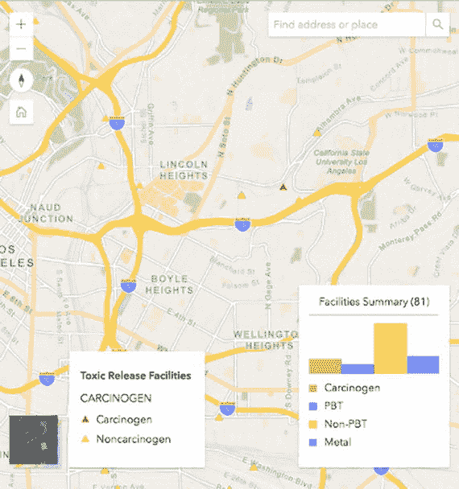

# 6. 弹出窗口

自 ArcGIS API for JavaScript 1.0 版本以来，用户点击地图时的首次交互通常都是获取弹出窗口。`Popup` 微件通常是访问地图上可视化效果背后原始数据的第一个入口点。地图上定义良好的数据可视化可能会根据色带颜色或显示点的大小，告诉您一个城市与相邻城市的人口密度对比。但您首次查看这些原始数据时，很可能需要点击该要素并在弹出窗口中查看数据。

由于弹出窗口对于探索地图中的数据至关重要，因此有多种选项可用于配置数据的显示方式。

## 字段与别名

你可以通过为图层定义 `popupTemplate` 来快速开始配置弹出窗口，示例如下：

```javascript
const featureLayer = new FeatureLayer({
  url: "https://sampleserver6.arcgisonline.com/arcgis/rest/services/Census/MapServer/3",
  outFields: ["*"],
  popupTemplate: {
    title: "名称: {STATE_NAME}",
    content: "{*}"
  }
});
```

如果该要素的 `NAME` 字段值为 `Foghorn Leghorn`，则会创建一个标题为“名称: Foghorn Leghorn”的弹出窗口。通过将 `content` 定义为 `"{*}"`，弹出窗口将显示一个简单的表格，列出所有字段名称及其值。

这几乎是最简单的 `Popup` 组件定义方式了。但你还可以更进一步。

为图层和地图配置弹出窗口最简单的方法，可能是在 ArcGIS Online 地图查看器中配置 `Popup`。如果你通过 `WebMap` 或 `PortalItem` 加载地图（如前面章节所述），你在弹出窗口中进行的配置将反映在应用程序中。

如果需要，你可以配置 `Popup` 显示别名而非实际字段名称。你可以在 `popupTemplate` 的 `content` 属性中进行配置。

```javascript
const featureLayer = new FeatureLayer({
  url: "https://sampleserver6.arcgisonline.com/arcgis/rest/services/Census/MapServer/3",
  outFields: ["*"],
  popupTemplate: {
    title: "名称: {STATE_NAME}",
    content: [
      {
        type: "fields",
        fieldInfos: [
          {
            fieldName: "POP2000",
            visible: true,
            label: "2000 年人口",
            format: {
              places: 0,
              digitSeparator: true
            }
          },
          {
            fieldName: "POP2007",
            visible: true,
            label: "2007 年人口",
            format: {
              places: 0,
              digitSeparator: true
            }
          }
        ]
      }
    ]
  }
});
```

上述示例将显示两个字段：`POP2000` 和 `POP2007`。不过，你可以为每个字段提供与实际字段名称不同的 `label` 属性。由于处理的是包含数值的字段，你还可以定义这些数值的显示方式。在此例中，你希望不显示小数位，并且不使用数字分隔符（这取决于区域设置）。

如果你的数据包含日期字段，你还可以定义日期格式。

```json
{
  fieldName: "FAKEDATE",
  visible: true,
  label: "假日期字段",
  format: {
    dateFormat: "short-date"
  }
}
```

这很简单，对吧？

如果你想要真正自定义输出，甚至可以在内容中使用纯 HTML。

```javascript
const featureLayer = new FeatureLayer({
  url: "https://sampleserver6.arcgisonline.com/arcgis/rest/services/Census/MapServer/2",
  outFields: ["*"],
  popupTemplate: {
    title: "名称: {STATE_NAME}",
    content: `
      {STATE_ABBR}
      <div>
        2000 年人口: {POP2000}
        2007 年人口: {POP2007}
        总户数: {HOUSEHOLDS}
      </div>
    `
  }
});
```

你甚至可以使用函数对内容进行进一步处理。假设你的应用程序中有一个已知的几何图形，比如某个围栏区域。当用户点击某个要素时，你想通知他们该位置是否在此围栏区域内。

```javascript
const featureLayer = new FeatureLayer({
  url: URL,
  outFields: ["*"],
  popupTemplate: {
    title: "名称: {name}",
    content({ graphic }) {
      const isWithin = geometryEngine.contains(fencedGeometry, graphic.geometry);
      return `
        该位置当前${isWithin ? "位于" : "不位于"}围栏区域内。
      `;
    }
  }
});
```

这只是自定义弹出窗口内容的另一种方式。

## 基于视图点击事件查询多个图层

你还可以更进一步，基于视图的点击事件查询多个图层。

```javascript
view.on("click", ({ mapPoint }) => {
  const screenPoint = view.toScreen(mapPoint);
  view.hitTest(screenPoint).then(({ results }) => {
    if (results[0].graphic) {
      view.popup.open({
        location: mapPoint,
        promises: [() => {
          query.geometry = results[0].graphic.geometry;
          return qTask.execute(query).then(({ features }) => {
            var names = features.map((feature) => {
              return feature.attributes.state_name;
            }).join(", ");
            return "{route} 穿越以下州: " + names;
          });
        }]
      });
    }
  });
});
```

这个特定示例将查询一个服务，以查看图形是否与该服务的要素相交。当添加到弹出窗口参数中 `promises` 属性的查询完成时，弹出窗口将打开并显示你的自定义结果。

## Arcade 表达式

你甚至可以在弹出窗口中使用 Arcade 表达式。

## 基本用法

```javascript
const featureLayer = new FeatureLayer({
    url: "https://sampleserver6.arcgisonline.com/arcgis/rest/services/Census/MapServer/2",
    outFields: ["*"],
    popupTemplate: {
        title: "名称: {STATE_NAME}",
        expressionInfos: [
            {
                name: "percent-change",
                title: "2000 年至 2007 年变化百分比",
                expression: "Abs((($feature.POP2000 - $feature.POP2007) / $feature.POP2000) * 100) + '%'"
            }
        ],
        content: "2000 年至 2007 年的变化百分比为 {expression/percent-change}"
    }
});
```

如你所见，自定义弹出窗口显示数据的方式并不困难。

## MediaInfos

弹出窗口的内容还可以包含基于要素数据的图表。你可以采用与配置 `PopupTemplate` 的 `fieldInfos` 类似的方式来定义。

```json
{
    type: "media",
    mediaInfos: [
        {
            title: "人口",
            type: "column-chart",
            caption: "",
            value: {
                theme: "BlueDusk",
                fields: [ "POP2000", "POP2007" ]
            }
        }
    ]
}
```

这将为字段 `POP2000` 和 `POP2007` 中提供的人口数据显示一个柱状图。其他可选的媒体类型包括 `image`（图片）、`pie-chart`（饼图）、`bar-chart`（条形图）或 `line-chart`（折线图）。如果类型是 `image`，则需要提供 `sourceURL` 属性，而不是 `fields` 属性。可用的主题基于 Dojox 图表库主题。⁴ 你可以在文档中阅读更多关于 `mediaInfos` 选项的信息。⁵

## 自定义操作

ArcGIS API 4 for JavaScript 最有趣的补充功能之一就是添加自定义操作。自定义操作允许您在弹出窗口中添加可用于各种任务的小按钮。您可以使用它来打开新的网页、执行查询或执行其他任务。

在本示例中，您将根据城市名称搜索该城市中与啤酒相关的活动。

```javascript
require([
    "esri/views/MapView",
    "esri/Map",
    "esri/layers/Layer"
], function(MapView, Map, Layer) {

    const map = new Map({
        basemap: "streets-navigation-vector"
    });

    const view = new MapView({
        map: map,
        container: "viewDiv",
        center: [-117.24, 34.05],
        zoom: 8
    });

    view.popup.on("trigger-action", ({ action }) => {
        if (action.id === "alcohol-details") {
            var attributes = view.popup.viewModel.selectedFeature.attributes;
            var name = attributes.NAME;
            window.open(`https://www.google.com/search?q=${name} Beer events`);
        }
    });

    Layer.fromPortalItem({
        portalItem: {
            id: "c531f67a12254c27af9479d436e23850"
        }
    })
    .then((layer) => {
        layer.popupTemplate = {
            title: '{Name}',
            content: '{*}',
            actions: [{
                id: 'alcohol-details',
                className: 'esri-icon-description',
                title: 'Events'
            }]
        };
        map.add(layer);
    })
    .otherwise(err => console.log(err));
});
```

您可以在 [`http://jsbin.com/namufut/2/edit?js,output`](http://jsbin.com/namufut/2/edit?js,output) 找到此应用程序的演示。

需要记住的主要一点是，当您定义 `PopupTemplate` 时，您需要定义一个 `actions` 属性，该属性包含一个包含您可能想要使用的各种自定义操作的数组。

```json
{
    title: '{Name}',
    content: '{*}',
    actions: [{
        id: 'alcohol-details',
        className: 'esri-icon-description',
        title: 'Events'
    }]
}
```

`className` 属性用于定义自定义图标。这可以是您在 CSS 代码中定义的图标，也可以是 API 提供的图标之一。您还可以提供一个 `image` 属性，该属性是您要使用的图像的 URL。如果您没有定义 `className` 或 `image`，则会提供一个默认图标。您可以在文档中阅读有关自定义操作的更多信息。

如果您想向第三方 Web 服务（例如用于提供客户详细信息的自定义 API）发出请求，自定义操作也会派上用场。

```javascript
view.popup.on("trigger-action", ({ action }) => {
    if (action.id === "customer-details") {
        var attributes = view.popup.viewModel.selectedFeature.attributes;
        var customerGroup = attributes.CUSTOMER_GROUP;
        esriRequest(customAPIURL, {
            query: {
                group: customerGroup
            },
            responseType: "json"
        })
        .then({ data } => {
            // 解析数据并更新弹出窗口内容
        })
        .otherwise(error => console.log(error));
    }
});
```

## 总结

在本章中，您学习了如何定义 `PopupTemplate`。您还学习了如何设置可在 `PopupTemplate` 中使用的字段和字段别名，从而更精细地控制数据的显示方式。`PopupTemplate` 甚至可以包含自定义 HTML 或媒体元素（如图表），以提供对数据的更深入理解。您还了解了如何在 `PopupTemplate` 中使用自定义操作来执行一些自定义任务，例如搜索 Web 或访问第三方 Web 服务，从而为您的数据增加更多价值。

# Popup 概述

`Popup` 通常是用户了解地图上数据详细信息的第一个入口点。它被广泛使用并且功能强大。任何使用 `ArcGIS API for JavaScript` 进行开发的人都应该学习如何充分利用它的功能。

在下一章中，您将了解如何使用 `ArcGIS API for JavaScript` 中的新微件框架来创建自定义微件！

### 参考链接

- [ArcGIS API for JavaScript Popup 小部件](https://developers.arcgis.com/javascript/latest/api-reference/esri-widgets-Popup.html)
- [ArcGIS Online 配置弹出窗口](https://doc.arcgis.com/en/arcgis-online/create-maps/configure-pop-ups.htm)
- [ArcGIS Arcade](https://developers.arcgis.com/arcade/)
- [Dojo Toolkit 图表主题预览](https://download.dojotoolkit.org/release-1.10.0/dojo-release-1.10.0/dojox/charting/tests/theme_preview.html)
- [PopupTemplate 媒体](https://developers.arcgis.com/javascript/latest/api-reference/esri-PopupTemplate.html#media)
- [ArcGIS 图标字体](https://developers.arcgis.com/javascript/latest/guide/esri-icon-font/index.html)
- [PopupTemplate 操作](https://developers.arcgis.com/javascript/latest/api-reference/esri-PopupTemplate.html#actions)
- [PopupTemplate API 参考](https://developers.arcgis.com/javascript/latest/api-reference/esri-PopupTemplate.html)

# 微件

`ArcGIS API for JavaScript` 的版本 4 引入了自己的微件框架来构建自定义微件。自定义微件开发由名为 `MaquetteJS` 的虚拟 DOM 库提供支持。这取代了以前用于构建微件的旧版 `Dojo Dijit` 框架。尽管 `Dijit` 是一个完全稳定且久经考验的微件框架，但虚拟 DOM 库允许您使用 DOM 的抽象版本，从而可以高效地发现更改并更新 DOM。

## 先决条件

然而，自定义微件开发有一个您应该注意的先决条件：`TypeScript`。用于自定义微件开发的许多工具（例如前面章节中讨论的 `Accessor` 装饰器）都需要使用 `TypeScript`。

我强烈建议您学习 `TypeScript` 教程。我还强烈推荐 `Egghead.io` 上的以下课程：

- 快速上手 `TypeScript`
- 在 `TypeScript` 中有效使用类型

### 类型定义

你可以在 `GitHub` 上阅读更多关于安装 `ArcGIS API` 或 `JavaScript` 类型定义的信息。¹⁰ 关键在于，你可以通过 `npm install --save @types/arcgis-js-api` 轻松安装类型定义。

需要注意的是，这并不会安装 `Dojo` 的类型定义。如果你想在 `TypeScript` 开发中使用一些 `Dojo` 模块，你可以获取 `dojo-typings`¹¹ 并在 `tsconfig.json` 文件中进行如下配置：

```
"types": [ "arcgis-js-api" ],
"include": [
  "./src/app/**/*"
],
"exclude": [
  "node_modules"
],
"files": [
  "node_modules/dojo-typings/dojo/1.11/modules.d.ts",
  "node_modules/dojo-typings/dijit/1.11/modules.d.ts",
  "node_modules/dojo-typings/dojox/1.11/modules.d.ts",
  "node_modules/dojo-typings/custom/dgrid/1.1/dgrid.d.ts",
  "node_modules/dojo-typings/custom/dstore/1.1/dstore.d.ts",
  "node_modules/intern/typings/intern/intern.d.ts"
]
```

你可以阅读更多关于 `tsconfig.json` 文件的信息。¹² `tsconfig.json` 文件用于配置 `TypeScript` 编译器。

### JSX

这个更新的微件框架还引入了 `JSX`¹³ 的使用，该语法由 `React`¹⁴ 推广开来。`JSX` 在 `JavaScript` 中看起来非常像 HTML，只是其语法需要一个编译步骤来将 `JSX` 转换为 `JavaScript` 函数。

例如，`JSX` `<h1>hello!</h1>` 会被编译成一个看起来像 `h('h1', 'hello!')` 的函数。这种创建 DOM 元素的方法被称为 HyperScript。¹⁵ 在使用 `ArcGIS API for JavaScript` 进行自定义微件开发时，如果你使用了 `JSX`，则无需关心 HyperScript。

## 构建自定义微件

在深入构建自定义微件之前，你可以在 `GitHub` 上找到演示应用程序的源代码（见图 7-1）。¹⁶



在此示例中，你将构建的微件将显示一个图表，该图表代表地图视图中可见的数据。关键在于确保图表仅基于可见数据，以便在平移地图时图表能够随之更新。

### 存储与 ViewModel

第一步是构建一个应用程序存储。这个应用程序存储将包含用于描述应用程序状态的属性。在此应用程序中，你需要关注 `View` 和 `WebMap`。你可以参考前面的章节，了解如何为此类任务使用 `Accessor` 模块。¹⁷

对于每个继承自 `Accessor` 的 `TypeScript` 文件，你需要添加以下 `amd-dependency` 行：

```
/// <amd-dependency path="esri/Accessor" />
```

在后续示例中我将省略它们，但请注意它们是必需的。

# 构建存储和视图模型

## 应用存储

`app/stores/app.ts` 代码示例：

```typescript
// app/stores/app.ts
import EsriMap = require("esri/Map");
import MapView = require("esri/views/MapView");
import Accessor = require("esri/core/Accessor");

import {
  subclass,
  declared,
  property
} from "esri/core/accessorSupport/decorators";

type UIParams = {
  element: any,
  position?: string
};

interface Store {
  webmap: EsriMap;
  view: MapView;

  addToUI(params: UIParams): void;
}

@subclass("app.stores.AppStore")
class AppStore extends declared(Accessor) implements Store {

  @property()
  webmap: EsriMap;

  @property()
  view: MapView;

  addToUI({ element, position }: UIParams) {
    this.view.ui.add(element, position);
  }

}

export default new AppStore();
```

你在存储中有两个可观察的属性：`webmap` 和 `view`。你还添加了一个方法 `addToUI()`，它充当代理，为你将组件添加到 UI 中。另外，请注意你导出模块的方式：`export default new AppStore();`。这将创建你的存储的单例，这样每次模块导入它时就不会创建新的存储。

## 视图模型概述

接下来你要做的是为你的自定义微件构建一个 `ViewModel`。`ViewModel` 的行为与应用程序存储非常相似。`ViewModel` 的职责是监视应用程序存储的变化，并根据这些变化更新自身状态。`ViewModel` 的另一个职责是管理微件的业务逻辑，即根据应用程序存储对数据执行任何查询或操作。

## 视图模型实现

`app/widgets/viewmodels/summaryviewmodel.ts` 代码示例：

```typescript
// app/widgets/viewmodels/summaryviewmodel.ts
import Accessor = require("esri/core/Accessor");
import watchUtils = require("esri/core/watchUtils");

import FeatureLayerView = require("esri/views/layers/FeatureLayerView");
import Graphic = require("esri/Graphic");

import Query = require("esri/tasks/support/Query");

import {
  subclass,
  declared,
  property
} from "esri/core/accessorSupport/decorators";

import store from "../../stores/app";

const { init, whenOnce, whenFalse } = watchUtils;

export type Stats = {
  "Carcinogen": number,
  "PBT": number,
  "Non-PBT": number,
  "Metal": number
};

const stats: Stats = {
  "Carcinogen": 0, // CARCINOGEN == "Yes"
  "PBT": 0,        // CLASS == "PBT"
  "Non-PBT": 0,    // CLASS == "Non-PBT"
  "Metal": 0       // METAL == "Yes"
};

function errorHandler (error: Error) {
  console.log("LayerView Query Error", error);
}

@subclass("app.widgets.viewmodels.summaryviewmodel")
class SummaryViewModel extends declared(Accessor) {

  @property()
  count: number = 0;

  @property()
  stats: Stats = stats;

  constructor() {
    super();
    whenOnce(store, "view").then(_ => {
      return store.webmap.findLayerById("tri");
    })
    .then(layer => {
      return store.view.whenLayerView(layer);
    })
    .then(this.watchLayerView.bind(this))
    .otherwise(errorHandler);
  }

  private watchLayerView(layerView: FeatureLayerView) {
    const queryFeatures = this.queryLayerView(layerView);
    init(store, "view.stationary", _ => {
      if (layerView.updating) {
        whenFalse(layerView, "updating", queryFeatures.bind(this));
      }
      else {
        queryFeatures();
      }
    });
  }

  private queryLayerView(layerView: FeatureLayerView) {
    return () => layerView.queryFeatures(
      new Query({
          geometry: store.view.extent
        })).then(this.parseResults.bind(this)
      );
  }

  private parseResults(results: Graphic[]) {
    const _stats = (Object).assign({}, stats);
    results.forEach(({ attributes: attr }) => {
      if (attr.CARCINOGEN === "Yes") {
        _stats["Carcinogen"]++;
      }
      if (attr.CLASS === "PBT") {
        _stats["PBT"]++;
      }
      else if (attr.CLASS === "Non-PBT") {
        _stats["Non-PBT"]++;
      }
      if (attr.METAL === "Yes") {
        _stats["Metal"]++;
      }
    });
    this.set({
      count: results.length,
      stats: _stats
    });
  }

export default SummaryViewModel;
```

为你的 `ViewModel` 导入所有依赖项后，你需要创建一个类型，用于图表中使用的数据。该类型将保存 `FeatureLayer` 中各值的计数。

## 数据类型定义

```typescript
export type Stats = {
  "Carcinogen": number,
  "PBT": number,
  "Non-PBT": number,
  "Metal": number
};
```

这四个值将显示在你的图表中。然后，你基于该类型创建一个数据对象，其初始值为 `0`。

```markdown
初始化 `ViewModel` 时，你将监听视图何时更新，然后找到你感兴趣的 `FeatureLayerView` 用于图表。

```typescript
const stats: Stats = {
  "Carcinogen": 0, // CARCINOGEN == "Yes"
  "PBT": 0,        // CLASS == "PBT"
  "Non-PBT": 0,    // CLASS == "Non-PBT"
  "Metal": 0       // METAL == "Yes"
};
```

这里你可以看到一些注释，用于说明数据中的字符串值对应每个类别的含义。`ViewModel` 上有两个可观察的属性：`count` 和 `stats`。

```typescript
constructor() {
  super();
  whenOnce(store, "view").then(_ => {
    return store.webmap.findLayerById("tri");
  })
  .then(layer => {
    return store.view.whenLayerView(layer);
  })
  .then(this.watchLayerView.bind(this))
  .otherwise(errorHandler);
}
```

接下来，你将监听 `view.stationary` 的变化，以便查询 `FeatureLayerView` 获取数据，并使用视图的范围将结果限制为可见数据。

```typescript
private watchLayerView(layerView: FeatureLayerView) {
  const queryFeatures = this.queryLayerView(layerView);
  init(store, "view.stationary", _ => {
    if (layerView.updating) {
      whenFalse(layerView, "updating", queryFeatures.bind(this));
    }
    else {
      queryFeatures();
    }
  });
}

private queryLayerView(layerView: FeatureLayerView) {
  return () => layerView.queryFeatures(
    new Query({
        geometry: store.view.extent
      })).then(this.parseResults.bind(this)
    );
}
```

找到可见数据后，你需要转换结果，使其与图表使用的数据对象匹配。

```typescript
private parseResults(results: Graphic[]) {
  const _stats = (Object).assign({}, stats);
  results.forEach(({ attributes: attr }) => {
    if (attr.CARCINOGEN === "Yes") {
      _stats["Carcinogen"]++;
    }
    if (attr.CLASS === "PBT") {
      _stats["PBT"]++;
    }
    else if (attr.CLASS === "Non-PBT") {
      _stats["Non-PBT"]++;
    }
    if (attr.METAL === "Yes") {
      _stats["Metal"]++;
    }
  });
  // 一次性更新 ViewModel 的值。
  this.set({
    count: results.length,
    stats: _stats
  });
}
```

然后，你可以使用结果中的序列化值更新 `ViewModel`。

### 自定义微件

在准备好 `ViewModel` 后，你现在可以创建自定义微件了。

```typescript
import Widget = require("esri/widgets/Widget");

import SummaryViewModel, { Stats } from "./viewmodels/summaryviewmodel";

import {
    aliasOf,
    subclass,
    declared,
    property
} from "esri/core/accessorSupport/decorators";
import {
    renderable,
    join,
    tsx
} from "esri/widgets/support/widget";

const CSS = {
    base: "esri-widget esri-component summary-widget",
    container: "chart-container",
    column: "summary-column",
    red: "red",
    yellow: "yellow",
    blue: "blue",
    purple: "purple",
    keybox: "keybox",
    keysection: "keysection"
};

type Style = {
    target: Stats,
    multi: number
};

function allValues(x: any) {
    return Math.max(...(Object.keys(x).map((k) => x[k])));
}

function roundToInt(num: number, target: number) {
    return Math.round(num / target) * 10;
}

function inlineStyle({ target, multi }: Style) {
    return Object.keys(target).map(k => {
        return {
            height: `${target[k] * multi}px`
        };
    });
}

@subclass("app.widgets.summary")
class Summary extends declared(Widget) {

    @aliasOf("viewModel.count")
    @renderable()
    count: number;

    @aliasOf("viewModel.stats")
    @renderable()
    stats: Stats;

    @property({
        type: SummaryViewModel
    })
    viewModel: SummaryViewModel = new SummaryViewModel();

    render() {
        const max = roundToInt(allValues(this.stats), 10);
        const multi = 1;
        const chartHeight = { height: `${(max * multi)}px` };
        const styles = inlineStyle({ target: this.stats, multi });
        return (

            <div class={CSS.base}>
                <div class={CSS.container} styles={chartHeight}>
                    <div class={CSS.column}>
                        <Facilities Summary ({this.count})
                        <div styles={styles[0]}>
                            <div class={CSS.red} />
                            <div class={CSS.yellow} />
                            <div class={CSS.blue} />
                            <div class={CSS.purple} />
                        </div>
                        <div class={CSS.keybox}>
                            <div class={CSS.keysection}>Carcinogen</div>
                            <div class={CSS.keysection}>PBT</div>
                            <div class={CSS.keysection}>Non-PBT</div>
                            <div class={CSS.keysection}>Metal</div>
                        </div>
                    </div>
                </div>
            </div>
        );
    }

}

export default Summary;
```

导入此模块的依赖项后，你可以创建一个对象，用于表示微件样式所使用的 CSS。
```

## 引言

本文档旨在指导开发者如何使用 ArcGIS API for JavaScript 中的微件框架创建自定义微件。我们将逐步构建一个名为 `Summary` 的微件，用于展示设施数据的分类统计图表。

## CSS 对象与类型定义

在微件开发过程中，定义一个 CSS 对象可以方便地引用样式。例如：

```typescript
const CSS = {
  base: "esri-widget esri-component summary-widget",
  container: "chart-container",
  column: "summary-column",
  red: "red",
  yellow: "yellow",
  blue: "blue",
  purple: "purple",
  keybox: "keybox",
  keysection: "keysection"
};
```

你还需要创建一个名为 `Style` 的类型，用于配置微件的样式参数：

```typescript
type Style = {
  target: Stats,
  multi: number
};
```

`Style` 类型中使用了来自 `ViewModel` 的 `Stats` 类型。

## 辅助方法

接下来，我们创建一些在微件中使用的辅助函数：

```typescript
function allValues(x: any) {
  return Math.max(...(Object.keys(x).map((k) => x[k])));
}

function roundToInt(num: number, target: number) {
  return Math.round(num / target) * 10;
}

function inlineStyle({ target, multi }: Style) {
  return Object.keys(target).map(k => {
    return {
      height: `${target[k] * multi}px`
    };
  });
}
```

*   `allValues()` 函数用于计算对象所有值中的最大值，以确定条形图的最大高度。
*   `roundToInt()` 函数用于将数值四舍五入到最接近的目标倍数。
*   `inlineStyle()` 函数用于生成内联样式对象，以设置每个图表条形的高度。这些方法将在 `render()` 方法中被调用。

## 微件类与属性

自定义微件的 `class` 具有一些关键属性：

```typescript
@aliasOf("viewModel.count")
@renderable()
count: number;

@aliasOf("viewModel.stats")
@renderable()
stats: Stats;

@property({
  type: SummaryViewModel
})
viewModel: SummaryViewModel = new SummaryViewModel();
```

*   `count` 和 `stats` 是基于 `viewModel.count` 和 `viewModel.stats` 的属性。`@aliasOf` 装饰器定义了这种关系，而 `@renderable` 装饰器确保当这些值发生变化时，`render()` 方法会被调用。
*   `viewModel` 是类型为 `SummaryViewModel` 的属性，它连接了微件的数据逻辑与展示逻辑。

## `render()` 方法

`render()` 方法定义了微件的实际输出结构：

```typescript
render() {
  const max = roundToInt(allValues(this.stats), 10);
  const multi = 1;
  const chartHeight = { height: `${(max * multi)}px` };
  const styles = inlineStyle({ target: this.stats, multi });
  return (
    <div class={CSS.base}>
      <div class={CSS.container}>
        <div class={CSS.keybox}>
          <span class={CSS.keysection}>Facilities Summary ({this.count})</span>
          <div style={chartHeight}>
            <div class={CSS.column}>
              <div style={styles[0]}></div>
              <div style={styles[1]}></div>
              <div style={styles[2]}></div>
              <div style={styles[3]}></div>
            </div>
          </div>
          <div class={CSS.keysection}>
            <div class={CSS.column}>
              <span>Carcinogen</span>
              <span>PBT</span>
              <span>Non-PBT</span>
              <span>Metal</span>
            </div>
          </div>
        </div>
      </div>
    </div>
  );
}
```

该方法首先使用辅助函数初始化变量：

```typescript
const max = roundToInt(allValues(this.stats), 10);
const multi = 1;
const chartHeight = { height: `${(max * multi)}px` };
const styles = inlineStyle({ target: this.stats, multi });
```

这些变量用于计算图表的高度和样式。方法的返回值使用 JSX 语法描述微件的 DOM 结构。数据通过 `{this.count}` 和 `styles` 等表达式绑定到视图，实现了数据与视图的同步。

在构建 DOM 时，可以使用来自 `esri/widgets/support/widget` 模块的 `join` 辅助方法组合 CSS 类字符串，例如：

```typescript
class={join("one", "two", "three")}
```

## 架构总结

至此，我们完成了微件的构建。`SummaryViewModel` 负责处理业务逻辑，如根据地图范围更新统计数据。`Summary` 微件则专注于将数据渲染成可视化的图表。这种设计实现了良好的关注点分离。

完整的示例代码可以在官方文档¹⁹中找到。

## 本章小结

通过本章的学习，你已经掌握了如何使用 ArcGIS API for JavaScript 的微件框架创建自定义 `ViewModel` 和 `Widget`。你了解了如何使用 `@aliasOf`、`@renderable` 等装饰器来简化属性绑定，并能够将数据动态渲染到 JSX 视图中。

自定义微件开发需要对 `Accessor` 类有一定了解，但这些装饰器极大地简化了其使用方式。更多详情和示例请参考相关文档。

## 脚注

1.  https://developers.arcgis.com/javascript/latest/guide/custom-widget/index.html
2.  https://medium.com/cardlife-app/what-is-virtual-dom-c0ec6d6a925c#.j4jqazh5j
3.  http://maquettejs.org/
4.  https://dojotoolkit.org/reference-guide/1.10/dijit/

## 资源链接

1. [`www.typescriptlang.org/`](http://www.typescriptlang.org/)
2. [`www.typescriptlang.org/docs/tutorial.html`](http://www.typescriptlang.org/docs/tutorial.html)
3. [`https://egghead.io`](https://egghead.io)
4. [`https://egghead.io/courses/up-and-running-with-typescript`](https://egghead.io/courses/up-and-running-with-typescript)
5. [`https://egghead.io/courses/use-types-effectively-in-typescript`](https://egghead.io/courses/use-types-effectively-in-typescript)
6. [`https://github.com/Esri/jsapi-resources/tree/master/4.x/typescript`](https://github.com/Esri/jsapi-resources/tree/master/4.x/typescript)
7. [`https://github.com/dojo/typings`](https://github.com/dojo/typings)
8. [`https://www.typescriptlang.org/docs/handbook/tsconfig-json.html`](https://www.typescriptlang.org/docs/handbook/tsconfig-json.html)
9. [`https://facebook.github.io/react/docs/introducing-jsx.html`](https://facebook.github.io/react/docs/introducing-jsx.html)
10. [`https://facebook.github.io/react/`](https://facebook.github.io/react/)
11. [`https://github.com/dominictarr/hyperscript`](https://github.com/dominictarr/hyperscript)
12. [`https://github.com/odoe/esrijs4-ts-demo`](https://github.com/odoe/esrijs4-ts-demo)
13. [`https://developers.arcgis.com/javascript/latest/guide/implementing-accessor/index.html`](https://developers.arcgis.com/javascript/latest/guide/implementing-accessor/index.html)
14. [`https://developers.arcgis.com/javascript/latest/api-reference/esri-views-layers-FeatureLayerView.html`](https://developers.arcgis.com/javascript/latest/api-reference/esri-views-layers-FeatureLayerView.html)
15. [`https://github.com/odoe/esrijs4-ts-demo`](https://github.com/odoe/esrijs4-ts-demo)
16. [`https://developers.arcgis.com/javascript/latest/guide/custom-widget/index.html`](https://developers.arcgis.com/javascript/latest/guide/custom-widget/index.html)
17. [`https://developers.arcgis.com/javascript/latest/sample-code/widgets-custom-helloworld/index.html`](https://developers.arcgis.com/javascript/latest/sample-code/widgets-custom-helloworld/index.html)
18. [`https://developers.arcgis.com/javascript/latest/sample-code/widgets-custom-recenter/index.html`](https://developers.arcgis.com/javascript/latest/sample-code/widgets-custom-recenter/index.html)
19. [`https://developers.arcgis.com/javascript/latest/guide/implementing-accessor/index.html`](https://developers.arcgis.com/javascript/latest/guide/implementing-accessor/index.html)

## 索引

### A

- `Accessor.createSubclass()`
- `Accessors`
- ArcGIS API for JavaScript
- `Object.defineProperty` 方法
- 属性变化
- `watchUtils`
- `addToUI()` 方法
- `ambientOcclusionEnabled` 属性
- API 核心基础
- 自动转换
- 集合
- 扩展访问器
- 承诺
- TypeScript 集成
- ArcGIS API
- ArcGIS API 4
- ArcGIS Online
- ArcGIS Server
- 异步模块定义 (AMD)
- 地理信息系统 (GIS)
- 自动转换

### B

- 与啤酒相关的事件

### C

- `className` 属性
- `Collection.prototype.getItemAt()` 方法
- 内容分发网络 (CDN)
- `CSVLayer`

### D, E

- `directShadowsEnabled` 属性
- `displayUTCOffset` 属性
- 3D 场景
- ArcGIS JavaScript API
- `camera` 属性
- `environment` 属性
- 局部场景
- Pictometry 影像
- Scene Viewer
- `WebMap`
- `WebScene`

### F

- `FeatureLayers`
- `FeatureLayerView` 方法

### G, H

- GitHub
- `GraphicsLayer`
- `GroupLayer`

### I

- `IconSymbol3DLayer` 符号

### J, K

- JavaScript

### L

- `Label` 属性
- 图层
- `CSVLayer`
- `FeatureLayers`
- `GraphicsLayer`
- `GroupLayer`
- `map.allLayers` 属性
- `map.basemap` 属性
- `MapImageLayer`
- `map.layers` 属性
- `SceneLayer`
- `VectorTileLayer`
- `LayerViews`

### M, N

- `MapImageLayer`
- `MaquetteJS`

### O

- `ObjectSymbol3DLayer` 符号

### P, Q

- 包
- `PointSymbol3D` 符号
- 弹出窗口
- 自定义操作
- 字段和别名
- `mediaInfos`
- `popupTemplate`
- Portal API
- 应用程序
- ArcGIS API 4
- calcite-bootstrap
- `FeatureLayer`
- HTML 页面
- JavaScript
- `Layer.fromPortalItem()`
- 门户资源管理器
- `TileLayer`
- `WebMap` 和 `WebScene`
- 承诺
- `promises` 属性

### R

- `render()` 方法
- `resourceTags` 属性

### S

- `SceneLayer`
- `SceneView#clippingArea` 属性
- `SummaryViewModel`

### T

- `TiledLayer`

## U
- 通用模块定义 (UMD)

## V
- `VectorTileLayer`
- `ViewModel`

## W, X, Y, Z
- `WebMaps`
- 微件
- 自定义微件
- GitHub
- JSX
- `MaquetteJS`
- 存储和 `ViewModel`
- TypeScript
- 类型定义

- `trees` 属性