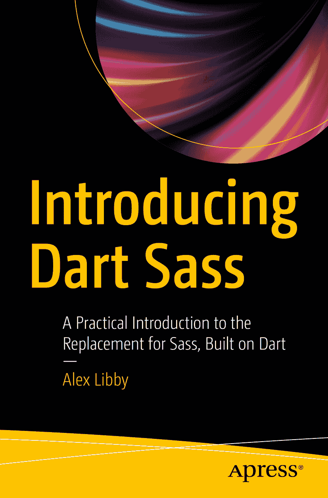

ISBN 978-1-4842-4371-8  
e-ISBN 978-1-4842-4372-5  
[`doi.org/10.1007/978-1-4842-4372-5`](https://doi.org/10.1007/978-1-4842-4372-5)  
美国国会图书馆控制号：2019932808  
© Alex Libby 2019  
本作品受版权保护。出版者保留所有权利，无论是涉及材料的全部还是部分内容，具体包括翻译权、重印权、插图再利用权、朗诵权、广播权、缩微胶片复制权或任何其他物理形式的复制权，以及信息存储与检索、电子改编、计算机软件或目前已知或未来开发的类似或不同方法的传输权。本书中可能出现商标名称、标识和图像。我们没有在每个商标名称、标识或图像出现处使用商标符号，而仅以编辑方式使用这些名称、标识和图像，以维护商标所有者的利益，无意侵犯其商标权。本出版物中对商业名称、商标、服务标记及类似术语的使用（即使未明确标识为商标）不应被视为对它们是否受专有权利限制的意见表达。尽管本书中的建议和信息在出版时被认为是真实准确的，但作者、编辑和出版商均不对可能出现的任何错误或遗漏承担法律责任。出版商对本书所包含的内容不作任何明示或暗示的保证。本书通过 Springer Science+Business Media New York 在全球图书贸易中发行，地址：233 Spring Street, 6th Floor, New York, NY 10013。电话：1-800-SPRINGER，传真：(201) 348-4505，电子邮件：orders-ny@springer-sbm.com，或访问 www.springeronline.com。Apress Media, LLC 是一家加利福尼亚州有限责任公司，其唯一成员（所有者）是 Springer Science + Business Media Finance Inc (SSBM Finance Inc)，SSBM Finance Inc 是一家特拉华州公司。

*谨以此书献给我的家人，感谢他们在本书写作过程中给予的爱与支持。*

## 引言

《**Dart Sass 入门**》面向希望快速为网站创建有效 CSS 样式的读者。这个新版本最初于 2006 年用 Ruby 编写发布，现已从头重写，使其更快速、更易用，同时仍保留了 Sass 用户所熟悉和喜爱的所有功能。

在本书中，我将带领您踏上使用该库的旅程，向您展示如何以最少的麻烦快速创建可重用的样式——我们将涵盖诸如运算、字符串插值、使用函数创建和操作内容等多种主题，并通过大量简单练习帮助您掌握使用 Sass 这一工具的技能。

《**Dart Sass 入门**》适合那些渴望快速学习如何利用 Sass 的强大功能生成有效样式表代码的网站开发者，尤其是那些面临快速交付压力的场景。它非常适合时间紧迫的敏捷团队成员，或希望为当前和未来项目构建可重用样式以节省开发时间和资源的开发者。

### 致谢

写书是一个漫长但富有回报的过程；没有他人的帮助无法完成。我要向我的编辑们表示衷心的感谢——特别是 Nancy Chen 和 Louise Corrigan；还要感谢技术审稿人 Ferit Topcu，以及 James Markham 在整个过程中给予的帮助。这四位让本书的写作过程变得轻松愉快，即使面对编辑修改也是如此。

我还要感谢我的家人在写作期间的理解与支持——我经常独自熬夜写作，他们的鼓励之词对于我克服写作中的障碍、完成你们手中这本成品书起到了真正的帮助。

### 关于作者与关于技术审稿人

### 关于作者

### 关于技术审稿人

