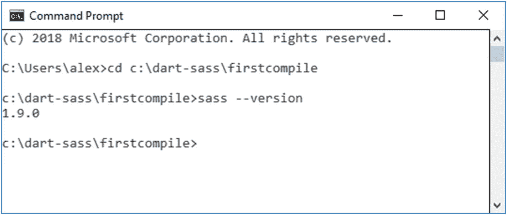
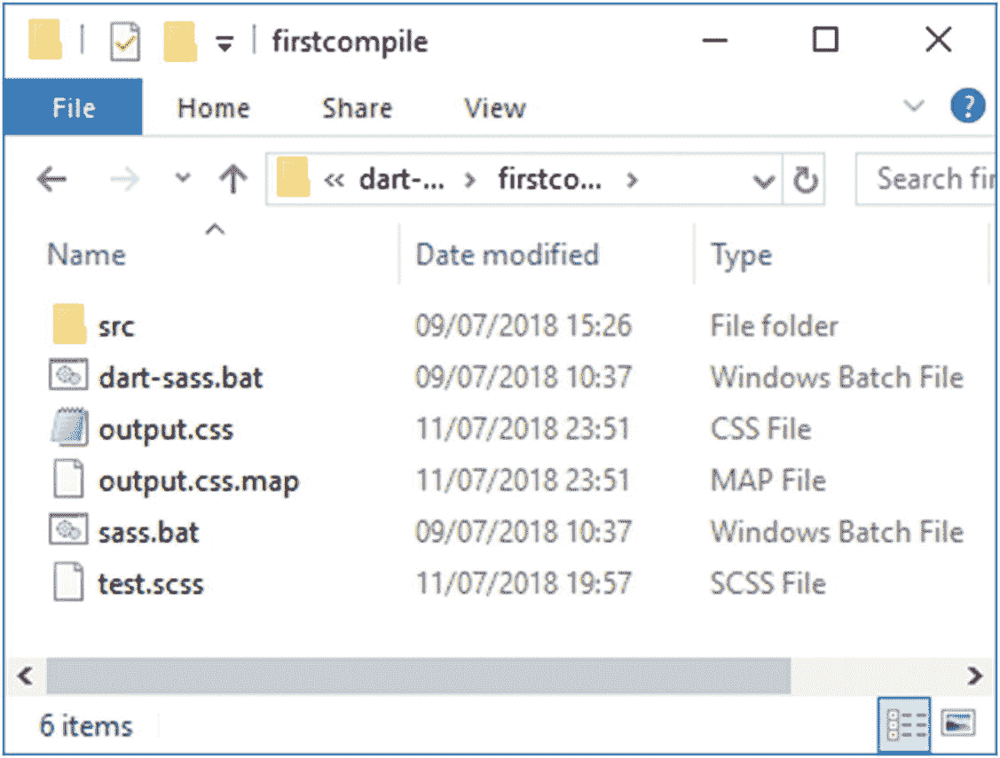
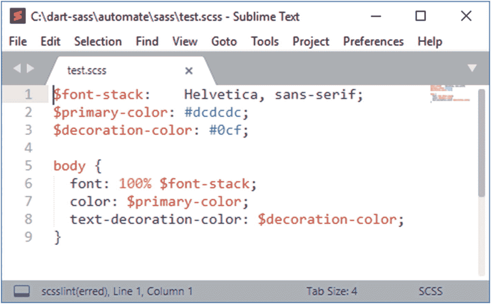
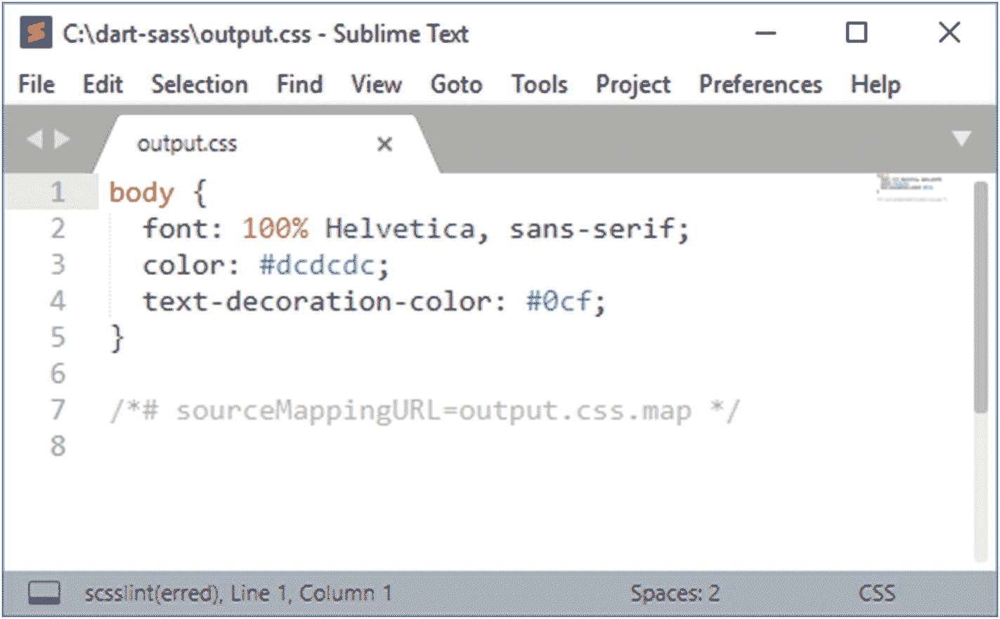
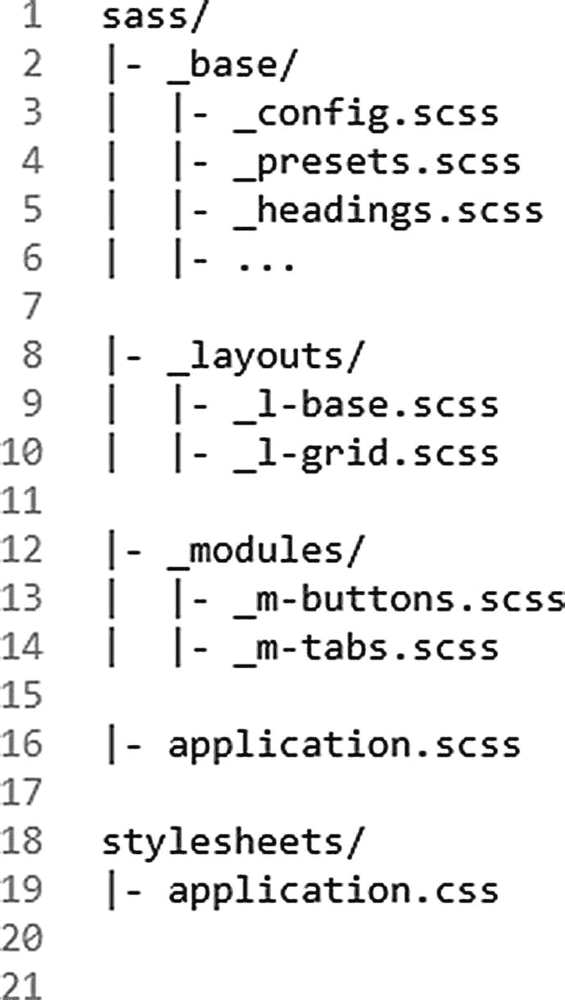
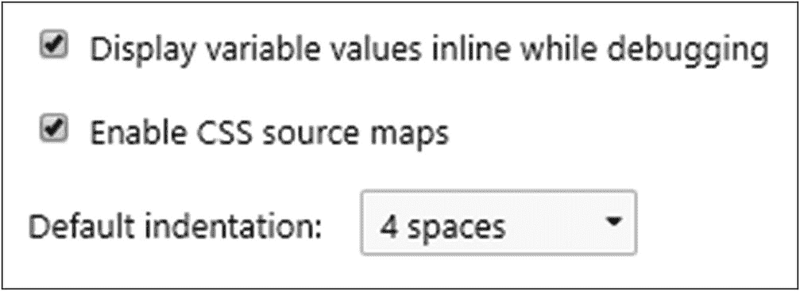
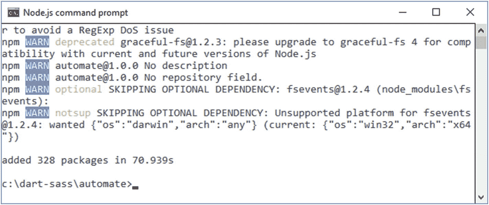
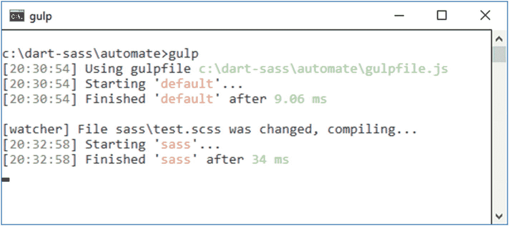

# 1. 认识 Sass

> *想象一下这个场景：周五夜晚，你正准备下班回家。偏偏老板走到你桌前，说最新项目的按钮样式需要做最后一刻的修改。唉——准时下班的美梦破碎了……*

听起来很熟悉？通常情况下，我们可能不得不花上几个小时埋头研究样式表，找出需要修改的样式及其位置，并希望查找过程中没有遗漏任何东西。这真是令人沮丧，特别是当你原本还盼着晚上出去浪的时候——但只要使用 Sass，这都不是问题！

"Sass"这个术语已经流传了好几年，一些知名人士也倡导这项技术。不过我敢打赌，你真正想问的问题是：这些炒作到底是怎么回事？它对我的开发工作有何帮助？

## 什么是 Sass？

为了真正理解 Sass 的本质，这两个问题问得非常好；然而，我们必须首先回答一个问题：什么是 CSS 预处理器？

简单来说，预处理器是一种我们可以用来扩展 CSS 的脚本语言；我们用它以一种语言编写代码，然后编译成 CSS。Sass 可以说是其中最流行的，尽管也有其他预处理器存在，例如 Less 或 Stylus。Sass 允许我们创建各种快捷方式：从简单的占位符来更新单个值的多个实例，到创建继承现有基础样式的新样式。

既然我们已经了解了预处理器，那么是时候回答那两个问题了：Sass 到底是什么？它将对我的开发工作有何帮助？

Sass 最早于 2006 年出现，由 Hampton Catlin 创建，全称是 Syntactically Awesome Stylesheets（是的，名字有点长），它被标榜为 CSS 的扩展。它引入了基本脚本工具（如变量和循环）的强大功能，帮助你的代码保持更好的组织性，并比普通 CSS 更快地创建样式表。如果创建变量或循环的想法让你感到害怕，不用担心——它们实际上比这些术语所暗示的要容易使用得多！在本书中，我们将逐一介绍 Sass 的所有核心功能；到本书结束时，你将更自如地使用 Sass，并会奇怪自己为什么没有早点改用 Sass。

好了——让我们继续：既然已经正式介绍过，那么让我们来回答第二个问题：在开发样式表时，Sass 将如何帮助我？


### 理解使用 Sass 的优势

长期使用 Sass 后，你很容易理解为什么有些人将其视为工具箱中的瑞士军刀。尽管它包含了一系列实用的工具，但其真正的力量只受限于使用者的想象力！不过，退一步来看，使用这个库也有一些关键优势，让我们来详细了解一下：

- Sass 允许我们将庞大的样式表文件拆分为更小、更易于管理的文件；我们可以分别编辑各个文件，然后让 Sass 将它们编译成一个更大的文件。以 WordPress 为例——它冗长的样式表（超过 4500 行）就利用了 Sass 来帮助将这个庞然大物分解成更小、更容易编辑的文件。
- 传统开发中，我们可能需要创建多个样式表，尤其是在需要针对特定浏览器（如 IE9 或更低版本）时。虽然这种方法可行，但它会导致 HTTP 请求增加，而每个请求都需要消耗资源。Sass 允许我们使用 `@import` 语句，不仅可以将样式表拆分成更小的文件，还有助于减少对服务器的 HTTP 请求次数。
- 不过，Sass 最重要的好处之一是减少重复。简单来说，我们可以创建现有样式的扩展；新样式包含基础样式的相同属性，而无需我们重复书写。
- 我们可以随心所欲地在样式表中加入少量或大量 Sass 风格的代码；Sass 会忽略所有标准的 CSS 规则，因此只要文件结构正确，我们就可以逐步更新规则，而无需一次性进行大规模修改。
- 使用 Sass 的另一个好处是能够为值创建变量或占位符。这些占位符可以在整个项目中重复使用——如果我们需要修改某个值，只需修改一次，编译时该修改就会自动传递到整个样式表。一个很好的例子是处理颜色时——例如，如果需要修改某种红色调，我们只需修改一次；Sass 会自动在整个样式表中更新该色调的每个实例。

好了，闲话少说：是时候深入细节了！我们已经探讨了使用 Sass 的若干关键优势；这些优势将在本书的阅读过程中逐渐显现。但正如他们所说，我们必须有个起点，最佳起点就是了解使用 Sass 时可用的不同语法和实现方式，以及为什么在编写 Sass 代码时细心处理真的很重要……

## Sass 的不同语法

等等——你刚才是说不同的……*语法*吗？是的，你没听错：Sass 确实有两种语法，但在你惊慌失措之前，别担心。我们并不需要学习两种！不过，了解一下有哪些选择还是值得的，让我来解释一下：

- 原始语法（缩进语法）使用类似于 Haml 脚本语言的方式——它使用缩进来分隔代码块，使用换行符来分隔规则。这种语法使用 `.sass` 文件扩展名。
- 较新的语法“SCSS”（即 Sassy CSS）使用类似 CSS 的块格式；它使用花括号来表示代码块，使用分号来分隔块内的行。这种语法使用 `.scss` 文件扩展名。

更复杂的是，Sass 还有不同的实现版本，包括用 C、PHP 和 Java 编写的版本——难怪事情看起来有点令人困惑！

在本书中，我们将使用最新版本的 Sass，它已用 Dart 重写；你可能会看到对 Ruby Sass 的引用，但它已被弃用，转而支持 Dart Sass，并且将停止支持。同时，我们将使用较新的语法——它更接近原生 CSS，因此更容易学习。

Sass 的原始语法仍然可用——它需要使用缩进和换行符来格式化代码，这使得初学者学习 Sass 时更加困难。

好了——希望这已经澄清了关于 Sass 各种实现的一些困惑；是时候继续前进，投入到更实际的问题中了！最好的起点莫过于先安装好 Sass；不过在此之前，我们还有一项小小的整理工作要做。

## 一些项目整理工作

当你第一次开始一个项目时，几乎总是需要做一些整理工作，对吧？

好吧，我们这次也不例外——我们有一项简单的任务要做：创建一个名为 `dart-sass` 的文件夹，我们将用它来存储本书中每个练习的代码。它存储在什么地方并不重要，但为了方便，我假设它存储在 PC 或笔记本电脑的根目录下；在本书中，我们将它称为项目文件夹。完成这一步后，让我们开始第一个练习：安装和配置 Sass。

## 设置 Sass

虽然我们说的是“设置”Sass，但并没有什么复杂的事要做——涉及的步骤非常少！那些需要安装诸如 Ruby 等大型依赖项的日子已经一去不复返了（如果你曾使用过旧版本 Sass 的话）；Dart 版本的 Sass 完全基于 JavaScript，因此安装起来非常简单。

在接下来的几页中，我们将逐步完成整个过程——在本章结束时，你将拥有一个可以轻松扩展的基本系统，并了解使用 Sass 所需的必要知识。

### 安装 Sass

让我们开始安装 Sass：

1. 暂时保持终端节点会话打开——我们将在下一个练习中很快再次用到它。
1. 我们准备测试 Sass 是否正确安装——为此，打开一个终端会话，并将工作文件夹切换到我们在步骤 1 中创建的 `firstcompile` 文件夹。
2. 在提示符下，输入 `sass --version` 并按回车键——如果一切正常，我们应该会看到一个返回的数字，指示已安装的版本，类似于图 1-1 所示。

   

   图 1-1
   检查 Sass 是否已安装

1. 首先，从 [`https://github.com/sass/dart-sass/releases/`](https://github.com/sass/dart-sass/releases/) 下载 Sass；请确保为你的平台选择合适的版本。将压缩文件保存到项目区域根目录下一个名为 `firstcompile` 的新文件夹中。
2. 接下来，打开压缩文件，并将内容解压到同一个 `firstcompile` 文件夹中。
3. 现在，我们需要为你的平台将路径添加到 `Path` 变量中。

   如果你不确定如何操作，请查看本书末尾的附录，其中详细介绍了 Mac、Windows 和 Linux 平台的操作步骤。

这真的非常简单——如果你期待更复杂的内容，那么抱歉让你失望了！我们不需要安装任何依赖项（与使用 Ruby Sass 时需要安装 Ruby 的日子不同）；相反，只需将压缩文件解压到我们选择的文件夹中即可。

这一切都很好，但正如他们所说，实践是检验真理的唯一标准——只有能将 Sass 文件编译成有效的 CSS 才算好用！不过这应该只是形式上的步骤：为了证明这一点，让我们更详细地测试编译过程。


### 首次编译

在这个阶段，即使 Sass 代码看起来不易理解也不必担心——我们当前的目标只是确保编译过程能生成一个有效的样式表。我们需要完成几个步骤，现在就开始吧：



**图 1-2** 首次编译

1.  首先，在常用文本编辑器中打开一个新文档，并添加以下几行。暂时不必理解它们的具体含义，我们将在练习末尾详细解释：

    ```
    $font-stack: Helvetica, sans-serif;
    $primary-color: #ccc;
    $decoration-color: #0cf;
    body { font: 100% $font-stack; color: $primary-color; text-decoration-color: $decoration-color}
    ```

2.  将此文件以 `test.scss` 名称保存到 `dart-sass` 文件夹的根目录下，然后启动一个终端会话。
3.  将工作目录切换到 `dart-sass` 文件夹，输入以下命令并按下回车键：

    ```
    sass test.scss output.css
    ```

4.  此时，我们不会看到任何确认成功的提示信息——要查看结果，需要回到 `dart-sass` 文件夹中，此时会发现除了 `test.scss` 文件之外，还新增了两个文件（如图 1-2 所示）。

您看，是不是很简单？诚然，我们的演示使用了终端会话，这可能会让一些人感到畏惧；不过有办法可以绕过这一环节，我们将在本章后面部分介绍。现在，我们的演示已经触及了一些需要探索的关键点，下面让我们更详细地剖析编译过程，了解最终样式表是如何生成的。

### 理解发生了什么

乍一看，这个演示似乎很简单（至少从代码量上看如此），尽管我们可能还不清楚具体发生了什么！让我来揭示一切——我们的演示涵盖了将在本书后面详细阐述的两个关键步骤。现阶段，可以将其概括如下：

-   将 Sass 代码编译为 CSS 代码。
-   创建并复用变量（或称占位符）。

先来看看编译过程——在最基本的层面上，我们只需要指定源文件（此处为 `test.scss`）和想要创建的输出文件名（`output.css`）。在哪里执行编译过程并不重要，关键在于务必正确指定文件名，并且 Sass 编译器会自动覆盖目标文件夹中的现有文件。

我们提到的第二个关键点是变量的创建——对于不熟悉编程技术的读者来说，这可能有些吓人，但请相信我：它们用起来比听起来要简单！如果查看 `test.scss` 的内容，会看到图 1-3 中列出的代码。



**图 1-3** 检查我们的 Sass 源文件

Sass 不会尝试编译 Sass 文件中已有的 CSS 规则；这些规则原封不动地会被复制到目标文件中。这是一个值得记住的要点——我们将在本书后面探讨其原因。

让我们逐行分析：

-   随后，我们为 `body` 开启了一条规则——在其中指定了字体、字体颜色和文本装饰的属性。我们没有使用固定值，而是插入了与代码第 1 到第 3 行列出的变量相对应的占位符。
-   前三行指定了占位值，即变量——一个用于字体族名称，两个用于颜色（一个作为字体颜色，另一个作为文本装饰颜色）。Sass 在命名约定方面相当灵活；只要不占用现有的关键字，可以使用任何合适的名称；但任何变量都必须以 `$` 符号开头，以此表明它是变量。

可以将变量视为桶或占位符——它们告诉 Sass 在编译时在哪里插入实际值。为了验证这一点，请打开 `output.css` 文件；您会看到三个属性现在都有了易于理解的值，如图 1-4 所示。



**图 1-4** ……以及输出文件

编译过程会执行多项任务，其中之一就是用实际值替换变量。我们的示例只有三个变量，但想象一下，如果在一个很长的样式表（例如 WordPress 的样式表）中多次重复使用变量会怎样？只需一次性更新一个变量的实例并重新编译文件——就能消除遗漏变量的风险，因为 Sass 会自动更新它找到的每一个实例。

我们将在第 2 章“变量与混入入门”中重新讨论变量的概念。

好了——让我们换个话题：我们的流程虽然可行，但如果总是需要手动编译代码，会变得有些乏味。此外，我们的文件夹结构也肯定可以改进；是时候考虑如何建立一个合适的工作流程来辅助编译过程了。

## 设置工作流程

在使用 Sass 时，有条理地进行组织会大有裨益——如果只处理几个文件，我们目前这样的设置或许还能应付。但如果需要处理更庞大的项目，这种方式显然就行不通了：是时候让自己井井有条了。

我坚信保持简单——毕竟，把本不需要复杂的事情变得复杂毫无益处！我们可以做一些改进，这对我们肯定有帮助，让我们来看看：

-   建立合适的文件夹结构来存放资源文件。
-   启用 CSS 源映射支持。
-   自动化编译过程。
-   调整代码的输出格式。
-   确保拥有一个得心应手的文本编辑器。

在本书后续内容中，我们还将探索如何生成可复用的代码，或提供一些有助于开发流程的额外技巧。不过，需要理解的关键一点是，虽然刚开始我们可能不需要什么复杂的东西，但正确配置它们至关重要；让我们深入探讨，详细了解这些内容。

### 设置文件夹结构

我强烈建议创建一个文件夹结构来存放你的资源文件；作为起点，我建议创建一个 Sass 源文件文件夹和一个已编译的 CSS 样式表文件夹。Sass 的主要优势之一就是能够将较大的样式表拆分成更小的文件；随着时间的推移，我们可以建立一个类似于图 1-5 所示的文件夹结构。



**图 1-5** Sass 开发的典型文件夹结构

当然，这需要时间来逐步形成，所以如果我们从一个简单的源文件文件夹（本例中为 `sass`）和一个单独的目标文件夹（比如本例中的 `stylesheets`）开始，这将为我们后续开发 Sass 代码打下良好基础。


### 启用源映射支持

再看一眼我们编译后的 `test.css` 文件底部——你是否注意到这一行的存在？

```
/*# sourceMappingURL=maps/test.css.map */
```

这是一个指向 CSS 源映射的链接——在处理 Sass 时，这是一个不可或缺的工具。简单来说，它能将样式表中的每条编译规则回溯到原始的 Sass 代码；我们可以用它来精确定位代码中可能出现问题的具体位置。

通过命令行（或终端会话）编译时，会自动生成源映射。要使用它们，我们需要启用浏览器支持——让我们以 Chrome 为例，演示如何操作：



*图 1-6 启用 CSS 源映射选项*

-   启动浏览器，然后按下 `Ctrl + Shift + I`（或 Mac 上的 `Command + Apple + I`），调出开发者控制台。
-   点击控制台右上角的三个点，然后选择设置。
-   在“来源”下，找到“启用 CSS 源映射”条目（图 1-6）。

如果你再回头看一下图 1-2，你会看到一个 `output.css.map` 文件——这是我们在命令行编译第一个文件时自动创建的。用文本编辑器打开这个文件，我们会看到类似这样的内容：

```
{"version":3,"sourceRoot":"","sources":["../sass/test.scss"],"names":[],"mappings":"AAIA;EACE;EACA,OALc;EAMd,uBALiB","file":"output.css"}
```

它看起来可能像无意义的代码，但它包含了从编译后的 CSS 文件 (`output.css`) 到原始源文件 `test.scss` 中相关代码的映射关系。可以说，我们无需担心这个文件里生成了什么——编译过程会替我们处理这一切。只要存在这个文件，并且在我们的浏览器中启用了支持，我们就能够将编译后的代码关联回其原始源文件。

### 自动化编译过程

在*初次编译*演示中，我们使用了这行命令来编译代码：

```
sass test.scss output.css
```

这是一个简单的命令——它能毫不花哨地完成任务，当然前提是我们编写了有效的 Sass 代码！然而，每次运行时很快会变得繁琐；我们可以通过使用 `--watch` 参数来彻底改善这一点。

这只需要对我们的命令做一个简单的修改——在终端会话中运行编译时，几乎值得养成包含它的习惯！我们可以使用以下命令，替代之前使用的命令：

```
sass --watch test.scss output.css
```

这将监视文件变化并自动重新编译我们的源文件——不过有件事我们需要注意，但我会在第 2 章中说明。

### 调整输出格式

如果你查看一个编译后的 CSS 文件，可能会注意到 Sass 生成了易于阅读但占用大量空间的代码。这显然不适用于生产环境——我们希望文件尽可能小！幸运的是，我们可以对编译过程做一个简单的更改——还记得我们的第一个编译命令吗？它看起来是这样的：

```
sass test.scss output.css
```

如果我们加入下面加粗的命令：

```
sass test.scss output.css --style=compressed
```

... 这将压缩编译后的样式表，使其非常适合在生产环境中使用。

默认情况下，如果你省略此命令，Sass 将以展开格式生成代码——如果你希望明确指定这一点，则使用 `--style=expanded` 代替。

### 编辑 Sass 代码

现在——这看起来可能有点奇怪，但你一会儿就会明白为什么：虽然有很多不错的工具可以用来编辑 Sass 代码，但我们并不一定需要它们！让我解释一下我的意思：

在基本层面上，Sass 只不过是 CSS 的扩展——这意味着几乎任何文本编辑器都可以用来编辑 Sass 代码。我想你们中的许多人已经有一个最喜欢的编辑器，并且它完全适用于 Sass。我个人使用 Sublime Text 3，这是一个商业软件，但 80 美元的价格绝对物有所值！

为了本书的目的，我将假设你已经有一个适合你的编辑器。如果没有，那么有一个支持 Sass 语法并能打开和格式化多个文件的编辑器会很有帮助（这其实不是问题，因为大多数编辑器都支持）。如果你还没有合适的工具，以下这些可能是一个不错的起点：

-   Atom（跨平台）——可从 [`https://atom.io/`](https://atom.io/) 获取
-   TextMate（仅限 Mac OS）——[`https://macromates.com`](https://macromates.com)
-   Sublime Text（跨平台，商业）——可从 [`https://www.sublimetext.com`](https://www.sublimetext.com) 下载
-   Visual Studio Code（跨平台，免费）——可从 [`https://code.visualstudio.com/`](https://code.visualstudio.com/) 获取

然而，还有另一个选择会彻底改变局面：如果你想使用一个专门的独立工具来编译 Sass，也有一些开源和商业软件可供选择。有些可以跨多个平台使用，而另一些则仅针对特定平台。让我们看看其中一些可选方案：

-   CodeKit – 这款商业软件可从 [`https://codekitapp.com/`](https://codekitapp.com/) 获取，但仅适用于 Mac
-   GhostLab – 作为 Mac 或 Windows 的商业应用，可从 [`http://www.vanamco.com/ghostlab/`](http://www.vanamco.com/ghostlab/) 获取
-   Hammer – 一款仅限 Mac 的商业编辑器，可从 [`https://hammerformac.com/`](https://hammerformac.com/) 获取
-   Koala – 可从 [`http://koala-app.com/`](http://koala-app.com/) 下载，Koala 是一款跨平台的开源编辑器，尽管自 2017 年底以来没有更新过
-   Prepros – 这款共享软件编辑器可从 [`https://prepros.io/`](https://prepros.io/) 获取，并提供适用于 Mac、Windows 和 Linux 的版本
-   Scout-App – 一款适用于 Mac、Windows 和 Linux 的开源编辑器，可从 [`http://scout-app.io/`](http://scout-app.io/) 下载

*注意：上表中的“全部”指的是支持 Mac、Windows 和 Linux。*

哦——你猜怎么着？还有一种编译 Sass 的途径供我们选择！如果你更倾向于不在开发工作流中安装另一个工具，那么你总是可以选择在线编译你的代码。

有几个选项可用于此目的，但其中一个推荐的是 SassMeister，托管在 [`https://www.sassmeister.com`](https://www.sassmeister.com)。它提供与离线编译完全相同的 Sass 编译体验；它可能不太适合编译冗长、复杂的代码块，但如果你想在将更改提交到源代码之前尝试一些想法，它是理想的选择。


### 做出选择

我相信大家心中都有这样一个问题：面对这么多选项，我该如何选择使用哪一个？

简短而直接的答案是：视情况而定。我知道这听起来可能像是在推脱，但 Sass 的编译方式没有绝对的对错。这完全取决于你已经安装了哪些工具、你习惯使用什么，以及（在较小程度上）你使用哪个平台。

例如，如果你喜欢直观的操作方式，那么使用带有专属支持功能的编辑器（如 Prepos）会是不错的选择。不过，如果你恰好在使用 Node.js，那么考虑调整你的工作流程，加入编译 Sass 的步骤就很有意义。同样，你可能根本不想额外安装任何东西——在这种情况下，使用终端方法是最简单的途径（而且无需安装！）。关键在于，编辑 Sass 的方法有很多种——不要害怕尝试不同的应用程序，直到找到你喜欢且适合你的那一款。

为了本书的编写目的，我将使用终端方法来保持简洁，并将重点放在 Sass 代码上，而不是编译过程——如果你更喜欢使用可视化编辑器，请随意切换。

好了——我们继续吧；流程中还有另一个部分需要考虑。还记得我说过每次都手动重新编译代码会很麻烦吗？我们可以使用像 Gulp 这样的任务运行器来自动化这个过程——让我们来更详细地了解一下具体内容。

### 自动化流程

虽然手动编译 Sass 代码适合轻量级开发，但对于规模稍大的项目很快就会变得令人头疼！当然必须有更好的方法……绝对有——我们可以使用像 Koala 或 Prepos 这样的专用应用程序，甚至可以直接在浏览器中使用 SassMeister 进行编译。然而，在应用程序之间来回切换会变得繁琐，而且还会增加代码出错的风险！

还有另一种选择：为什么不*自动化*编译过程呢？当然，这对于开发 Sass 代码来说并非必需，但创建能够处理编译这类低价值任务的东西，有几个好处：

* 我们可以将其设置为在后台运行——我们对代码所做的任何更改都会自动编译；
* 我们可以在流程中关联其他任务，例如压缩 JavaScript 文件或为样式规则添加供应商前缀；
* 它免去了我们参与低价值任务的需要，让我们有更多时间处理重要事务。

考虑到这一点，我们的下一个练习将使用 Gulp 和`gulp-dart-sass`包来设置一个自动编译流程，后者是 Dart Sass 库的包装器。安装并运行后，它将愉快地在后台运行；一旦检测到 Sass 文件发生更改，它就会自动将其编译成有效的 CSS 样式表文件。让我们更详细地了解一下具体内容。

### 自动化流程

像 Gulp 这样的任务运行器需要使用 Node.js 运行时环境来安装——该环境适用于 Windows、Mac 和 Linux 平台，其他平台也有可用的二进制文件。我们需要执行几个步骤，让我们开始吧：



图 1-7

安装我们的包

1. 第一步是安装 Node.js——为此，请前往[`https://nodejs.org`](https://nodejs.org)，下载适合你平台的版本。如果出现提示，请接受所有默认设置；这对于本练习的目的来说已经足够了。

2. 安装完成后，启动一个终端会话，输入以下命令以确认 Node 和 NPM 已成功安装：

   ```
   node –v && npm –v
   ```

   如果一切顺利，Node 将返回`v8.11.3`或更高版本，而 NPM（Node 的包管理器）将显示`5.6.0`或更高版本。

3. 接下来，在提示符处运行以下命令——它会关闭`package-lock.json`文件的创建，这是 NPM 5 或更高版本的新功能，但在本书的演示中并不需要：

   ```
   npm config set package-lock false
   ```

4. 现在，将`automate`文件夹的副本解压到你的项目区域。

5. 我们还有一些东西要安装，为此，启动终端会话，首先运行以下命令——这将安装 Gulp 的依赖项：

   ```
   npm install –g gulp-cli
   ```

6. 完成后，继续在提示符处运行以下命令——这将安装我们在`automate`文件夹中复制过来的`package.json`文件中列出的其余包（Sass、Gulp、Sourcemap 支持和用于 Gulp 的 Autoprefixer——一个 PostCSS 工具，但能与标准 CSS 很好地配合），如图 1-7 所示。

   ```
   npm install
   ```

   关于`fsevents`和废弃包的警告可以忽略，这对本练习没有影响。

至此，我们的自动化流程已经设置完毕；让我们通过编辑测试文件并观察其编译过程来测试一下。在下一步中，我建议在屏幕上打开`sass`和`css`文件夹以及终端会话：

1. 查看一下`css`文件夹——你现在会看到一个新编译的样式表和`map`文件夹，其中包含我们的源映射文件。

2. 在提示符处输入`gulp`，然后按回车键。

3. 初始默认任务会运行——这可以忽略。打开`sass`文件夹中的`test.scss`，将分配给`$primary-color`的十六进制代码更改为`#dcdcdc`（一种浅灰色）。

4. 保存更改——如果一切顺利，Gulp 的监视功能就会启动并自动重新编译我们的代码，如图 1-8 所示。

   

   图 1-8

   自动重新编译我们的代码

希望这不会太痛苦——步骤可能看起来不少，但它为后续开发打开了众多可能性。除此之外，我们的流程涵盖了多个我们应该注意的关键点，所以让我们深入探讨并分解一下具体发生了什么。


### 拆解流程详解

在过去的几页中，我们利用 Node.js（及其包管理器 NPM）的强大功能，创建了一个能自动编译 Sass 的基础系统。为了实现这一目标，我们借助了一些预配置指令文件来安装 Node 及若干 NPM 包。现在，让我们从 `package.json` 开始，详细审视这些指令文件。

`package.json` 文件包含我们将使用的所有包的详细信息——在本例中，我们指定了 Gulp 作为任务运行器，以及 `gulp-sourcemaps`（提供源码映射）、必不可少的 `gulp-dart-sass`（用于 Sass 支持）和 `gulp-autoprefixer`（根据需要添加或移除浏览器前缀）。你可能会注意到，练习中并没有单独为每个包执行安装命令：这是有意为之。运行 `npm install` 效率更高，因为它默认会在同一文件夹中查找 `package.json` 文件，并安装其中列出的所有包。虽然这需要事先做好准备工作来创建 `package.json` 文件，但能简化安装流程。

深入探讨 `package.json` 的具体设置已超出本书范围——如果你有兴趣了解更多，建议前往 [`https://docs.npmjs.com/getting-started/using-a-package.json`](https://docs.npmjs.com/getting-started/using-a-package.json) 查阅详情。

安装完成包之后，我们便利用 `gulpfile.js` 文件来执行编译操作。该文件包含一组指令，每当检测到目标文件夹中有文件发生变更时就会执行这些指令。让我们看看这段代码，首先从一些声明开始——第一行是强制启用严格错误检查：

```
'use strict';
```

接着，我们设置了一些针对不同包的 require 声明，这些包会根据需要被调用：

```
var gulp = require('gulp');
var sass = require('gulp-dart-sass');
var sourcemaps = require('gulp-sourcemaps');
var autoprefixer = require('gulp-autoprefixer');
```

下一个代码块是我们的 sass 任务——它负责将源文件编译为有效的 CSS 样式表文件：

```
gulp.task('sass', function () {
return gulp.src('sass/*.scss')
.pipe(autoprefixer({ browsers: ['last 2 versions'] }))
.pipe(sourcemaps.init('/maps'))
.pipe(sass().on('error', sass.logError))
.pipe(sourcemaps.write('./maps'))
.pipe(gulp.dest('./css')) ;
});
```

它首先定位 `sass` 文件夹中扩展名为 `scss` 的文件；这是为了防止编译器尝试处理并非有效 Sass 源文件的文件！下一步是为尚未标准化的 CSS 属性添加浏览器前缀；在本例中，我们支持每个浏览器最新的两个版本。

接下来的步骤至关重要——它负责编译过程：要么成功编译文件，要么在屏幕上显示遇到的任何错误。我们最后会创建相应的源映射文件（方式类似于之前在终端会话中编译），然后将文件写入磁盘（存放到 `css` 子文件夹中）。

顺便提一下——默认情况下，输出格式是展开的；如果我们想改变输出格式，可以按如下方式修改代码：`sass({outputStyle: 'compressed'})`。

如果没有最后一个任务——`default` 任务，上述所有操作都无法生效。当我们在终端提示符下输入 `gulp` 时，该任务就会立即运行。它会监视 `sass` 文件夹中的任何 Sass 文件；任何更改都会触发 sass 任务：

```
gulp.task('default', function () {
gulp.watch('sass/*.scss', ['sass'])
.on('change', function(evt) {
console.log(
'\n[watcher] File ' + evt.path.replace(/.*(?=sass)/,") +
' was ' + evt.type + ', compiling...'
);
});
});
```

一旦发生更改，我们就会调用一个小函数来显示一条消息，确认哪个文件被修改了；然后代码会重新编译，并作为新的样式表和映射文件保存到磁盘。

归根结底，搭建这套系统似乎需要不少工作量，但重要的是要意识到，你可能已经具备了部分基础。这只是实现编译流程自动化的一种方式；你或许更喜欢使用 Grunt 或 Webpack 之类的工具。然而，目标在于评估你已具备或不具备的条件、你是否有任何偏好（如果你之前用过任务运行器），以及判断你的项目性质是否意味着你能从流程自动化中受益。

顺便说一下，除非另有说明，整本书的练习都将使用这一流程。这纯属个人偏好；请随意使用最适合你的编译流程。

好了，闲话少说——换换方向吧！希望你已尝试了几种方案，并找到了适合自己（或至少能正常运行）的方法。是时候更专注于 Sass 本身了，那么事不宜迟，让我们开始介绍使用 Sass 时将会遇到的一些关键术语吧。


## 熟悉关键术语

在本书的课程中，我们将接触到大量与 Sass 搭配使用的不同技术和关键术语——有些很容易上手，而另一些则可能需要花更多时间！

我们已经遇到了最重要的一个——编译过程。对我们来说，这与其说是理解其内部运行机制（可以说它就像一个神奇的黑匣子），不如说是要了解我们能做什么——例如，如果我们要创建一组按钮，我们可以编写代码来自动完成大部分工作，然后由 Sass 将其编译（或转换）为有效的 CSS 代码。

然而，编译并非我们涉及的唯一概念——Sass 有许多关键术语，我们将在本书中逐一探索。尽管目前这些术语可能还毫无意义，但我想在此总结其中一些关键术语，以便你能对书中后续内容有所期待。我还会附上相关的章节编号，这样如果你遇到困难，就知道应查阅哪一章寻求帮助：

*   **注释**——这是 Sass 中最简单的技术之一；它的使用方式与普通 CSS 完全相同。使用注释的关键在于你所用的注释类型——例如，单行注释在编译时会被移除，而多行注释则会保留。我们将在第 2 章“添加注释”一节中更详细地介绍这一点。

*   **变量**——可以将其视为值的占位符；Sass 会查找特定变量的每个实例，并将其替换为我们最初设置的真实值。无论我们在代码中有多少个特定变量的实例，Sass 都会将它们全部替换！我们将在第 2 章“在实际环境中创建变量”一节中深入讨论这个主题。

*   **混合**——变量是一个好的开始，但如果我们想以同样的方式定义更大的代码块呢？混合（mixins）应运而生——它们充当预定义的代码块，我们可以直接将其“混合”到代码中。我们可以定义一次，然后在多个项目中重复使用——请参阅第 2 章，了解更多关于这项实用技术的信息。

*   **导入与局部文件**——如果你曾经处理过大型电子表格（比如像 WordPress 那样超过 4500 行的庞然大物），那么你一定会深切体会到管理这么多行代码有多么痛苦。Sass 有一个 `@import` 函数，类似于 CSS；我们可以用它创建 CSS 代码的局部文件或片段，然后将其导入到主样式表中。我们将在第 2 章及后续章节介绍这一点。

*   **嵌套**——你曾有多少次为菜单系统之类的东西编写 CSS 代码，结果发现自己重复编写了多个样式？有了 Sass，我们可以将样式嵌套在另一个样式之内——可以将其视为将样式分组在一起，放在一个所有样式都通用的基础样式内部。从某种意义来说，这是一种简写形式，使得代码更易于阅读——我们将在第 3 章“创建嵌套样式”中介绍这一点。

*   **继承**——这稍微有点棘手：与其多次重写具有相似属性的代码块，不如让一个代码块继承另一个？一个完美的例子是创建按钮——我们可以编写基础样式规则来涵盖尺寸和字体等属性。我们创建的任何按钮都可以继承这个基础样式，再加上我们为每个按钮指定的特定样式（比如颜色）。这是一项值得学习的好技术，但需要时间才能真正掌握——我们将在第 3 章“创建嵌套样式”中开启这段学习之旅。

*   **运算符**——我猜想在很多情况下，你可能会在电子表格中指定固定值，比如为 `font-size` 属性指定 `16px`，对吧？如果我们能仅使用加、减等简单运算来动态计算出值呢？例如，我们不再需要指定一整组调色板值——只要我们有一个，就可以使用一点数学运算来自动计算出互补色。我将在第 4 章“使用运算计算值”中揭示其原理以及更多内容。

*   **指令**——这才是真正有趣的地方！CSS 已经有一些 `@-` 规则；Sass 在此基础上增加了一些，如 `@extend` 或 `@media`。可以将这些视为帮助控制 Sass 代码中流程和逻辑的规则——`@media` 就是一个很好的例子，我们用它来指定在响应式网站开发中应应用哪些规则。我们将深入探讨第 4 章“使用运算计算值”中的指令世界。

呼——我们即将面对一系列激动人心的技术！当然，我们不必一次性掌握所有内容——Sass 的妙处在于我们可以从简单的技术（比如设置变量）开始，然后在开发样式表的过程中逐步利用更多的工具。不过，在我们踏上这段旅程之前，有一个主题我知道对 Sass 新手来说将是最有益处的——如果某些东西不起作用或者我卡住了，我可以在哪里获得帮助？


## 获取帮助

*“救命！为什么我的混合宏没有按预期运行……？”*

尽管 Sass 相对容易学习，但总会有需要帮助的时候——当然，网上有很多人写过关于 Sass 的文章，但有时有人帮你解决棘手问题会更有帮助！别担心——有几种获取帮助的方式；其中包括：

*   如果你在某件事上卡住了，努力让它运行起来，那么你的首选应该是 StackOverflow 网站，地址是 [`https://stackoverflow.com`](https://stackoverflow.com)。该网站由志愿者社区管理，任何人都可以在此提问；我强烈建议阅读 [`https://stackoverflow.com/help/`](https://stackoverflow.com/help/) 上的指南，以提高获得有助于解决问题的回复的可能性。

另外，值得快速搜索一下，看看是否有其他人遇到过同样的问题——试试 [`https://stackoverflow.com/search?q=Dart+Sass`](https://stackoverflow.com/search?q=Dart+Sass)；说不定已经有人知道答案了！不过请耐心等待：这是一个志愿者运营的平台，因此你可能不会很快得到回复。

*   然而，如果你认为自己发现了一个 Bug，即某个行为无法按预期工作或核心功能明显出错，那么 GitHub 是一个很好的报告地点。Dart Sass 的 GitHub 仓库地址是 [`https://github.com/sass/dart-sass`](https://github.com/sass/dart-sass)——但请确保找对地方，因为 Sass 团队为不同版本的 Sass 运行着多个 GitHub 仓库。

如果你确实需要提交一个问题，而此前从未做过，可能会觉得有些令人生畏。值得注意的是，GitHub 仓库通常由志愿者维护，他们之前见过类似问题，并且总是愿意提供帮助。你可以遵循一些有用的建议来帮助完成记录问题的流程：
    *   务必仔细查阅过往的问题——有可能（尽管并非总是如此）已经有人记录了类似的问题，这可能对你有帮助，而无需你自己再提交一个问题。

*   务必添加标题和描述，并尽可能详细地描述问题——包括截图、重现步骤、你迄今为止尝试过的方法以及结果，但不要写成长篇大论！GitHub 志愿者的时间很宝贵，因此详细但简洁至关重要。

*   发帖时请彬彬有礼——GitHub 仓库由志愿者运营，他们有自己的家庭和有偿工作，如果你态度粗暴，他们不太可能提供帮助。如果你尊重他们，他们会非常乐意为你提供指导。

*   如果你发现了一个你认为的 Bug，但回复说这是“设计如此”，那么请尊重他们的决定。然而，如果你强烈反对，请礼貌地陈述你的情况，附带细节，并愿意讨论你观点的合理性。维护者无法满足所有情况，他们会始终考虑新的证据，但如果你辱骂或无礼，他们就不愿意提供帮助。同样，如果维护者审查了你的请求但决定不做任何更改，请尊重他们的决定。

*   在催促回复之前，请留出合理的时间——人们可能有其他承诺，或者时差可能会造成阻碍；你在提交问题时需要考虑这一点。

*   如果有人提出了帮助你解决问题的建议，请务必尽快回复；没有人喜欢回复一个问题，却发现你懒得尝试！

我可以继续列举，但这些指南大部分都可以概括为三个关键点：始终保持礼貌和尊重，确保问题描述足够详细，并在适当的时候及时回复。只要你遵循这些指南，就会有很多人愿意将自己的知识传授给刚刚踏入 Sass 世界的人。

顺便提一下，你可以在 Sass 官网看到类似的指南，地址是 [`http://sass-lang.com/community-guidelines`](http://sass-lang.com/community-guidelines)。

### 总结

初次发现和探索一项技术可以打开一些真正的可能性——这尤其适用于 Sass 的世界！在本次 Sass 之旅的第一部分，我们介绍了一些有用的技巧和诀窍，那么让我们花点时间回顾一下所学的内容。

我们从介绍 Sass 这项技术开始，探讨了它是什么，以及我们为何要将其用于项目中的原因。然后我们介绍了与 Sass 相关的一些不同版本和语法，并确保我们清楚本书将使用哪一种。

接下来是 Sass 的初始安装；我们看到了编译第一个文件是多么简单，然后探讨了编译过程中会发生什么。接着我们讨论了如何设置合适的工作流程以充分利用 Sass，然后介绍了如何自动化编译过程，以便我们可以将时间花在更重要的任务上。最后，我们快速浏览了本书将涉及的一些关键术语以及如何获取帮助，以防我们遇到困难。

呼——这是个不错的开始，但还有更多内容要介绍！在下一章中，我们将真正开始深入使用 Sass；我们的第一站将是学习如何创建变量和混合宏，以帮助减少代码量并简化保持值更新的过程。各位朋友们，请上车——船即将起航……

