# 2. 介绍变量和混合宏

> *星期五晚上，你度过了忙碌的一周，期待着结束一天的工作。在你的脑海里，你能看到一杯诱人的冷饮，上面还印着你的名字，正在家里等着你……但你的老板走进了办公室，从他脸上的表情来看，任何准时下班的念头都迅速从窗外消失了……*

我敢打赌这个场景听起来太熟悉了：那些——我们该说很有挑战性的？——客户对设计不满意，想要尝试改变配色方案。然而，他们的网站非常复杂，样式表中使用了不同的颜色。当然，你可以进行搜索和替换，但你真的想翻阅数千行代码来确保已经更改了所有颜色吗……？

## 在实际场景中创建变量

绝非如此！实际上有更好的方法——请进入 Sass 的领域。Sass 的关键特性之一就是变量；它们的工作原理与许多脚本语言（如 JavaScript）类似。现在，在你惊慌失措之前：别担心——它并没有听起来那么复杂。让我以颜色为例，解释一下它是如何工作的。

在样式表中工作时，通常的做法是在整个样式表中根据需要分配颜色——如果需要修改，我们可能会执行查找和替换操作。这本身并无不妥，前提是我们始终使用相同的大小写——显然，用 `#000` 替换 `#fff` 不会捕捉到任何我们使用了 `white` 的地方！

相反，我们可以为每种颜色的实例简单地设置占位符名称，比如 `darkGrey` 或 `antiqueWhite`——目前，使用什么名称并不重要（尽管我稍后会再次讨论这个问题）。

真正的魔法发生在样式表的开头——我们为每个占位符指定值，就像图表的图例一样。在编译代码时，Sass 只需对每个占位符变量实例进行查找和替换，并用“图例”列表中的相应值替换它们。这意味着如果我们遇到苛刻的客户，那么我们每种颜色只需要修改一次——我们可以在样式表的开头修改它，而 Sass 将在编译期间自动更新。

为了看看它有多简单，让我们看一个简单的例子——在下一个练习中，我们将向页面添加一些简单的元素，但使用变量通过 Sass 应用颜色。我使用了在黑白环境（用于打印）中效果更好的颜色，但这适用于你选择的任何颜色。

### 分配变量

让我们开始编写代码：

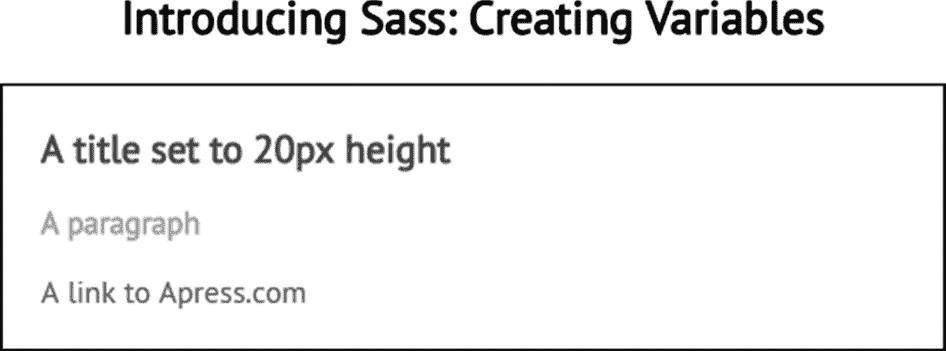

图 2-1

创建基本变量

1. 首先，从本书附带的代码下载中下载并解压 `variables` 文件夹的副本——继续将此文件夹保存到我们的项目区域中。

2. 接下来，启动你的文本编辑器——我们现在可以添加样式，所以请创建一个新文件，并将其保存为 `variables` 文件夹的 `scss` 子文件夹中的 `variables.scss`。

3. 我们将在样式表中添加许多样式——第一组是我们将在本演示中用于定义颜色的变量集合：

```scss
$color-gainsboro: #c0c0c0;
$color-dimgrey: #696969;
$color-slategrey: #708090;
```

4. 留一个空行，然后添加以下基础样式：

```scss
@font-face {  font-family: 'pt_sansregular'; src: url('../font/pt_sansregular.woff') format('woff'); font-weight: normal; font-style: normal; }
body {  font-family: 'pt_sansregular', sans-serif; padding: 20px; }
h2 { text-align: center; }
section { border: 1px solid #000; width: 450px; padding: 20px; margin-left: auto; margin-right: auto; }
```

5. 再留一个空行，然后在其下方立即添加以下将使用 Sass 的样式：

```scss
section span { color: $color-dimgrey; font-size: 20px; font-weight: bold; }
p { color: $color-gainsboro; font-size: 16px; font-weight: bold;}
a { color: $color-slategrey; text-decoration: none; }
a:hover { text-decoration: underline; background-color: antiquewhite; font-weight: bold; }
```

6. 将文件保存为 `scss` 文件夹中的 `variables.scss`。

7. 接下来，启动一个终端会话，并将工作文件夹更改为项目区域下的 `variables` 文件夹。

8. 在提示符下，键入以下命令并按 Enter：

```bash
sass sass\variables.scss css\variables.css
```

9. 如果一切顺利，我们应该会在 `css` 文件夹中看到一个 `variables.css` 文件，以及一个源映射——预览结果将显示一个包含样式化元素的简单框，如图 2-1 所示。

看到了吧，是多么简单？诚然，我们的示例非常简单，但这没关系——我们可以在各种不同的场景中使用它。这是一个需要掌握的重要功能，所以让我们花点时间更详细地了解它是如何工作的。

### 探索发生了什么

尽管使用变量的想法可能会吓到一些人，但创建和使用变量并没有看起来那么难。我们在第一章 1 的第一个演示中已经接触过这一点，当时我们编译了一个使用了三个变量的单一样式规则。

实际上，使用变量不过就是查找和替换——我们的演示使用了三个变量，即 `$color-gainsboro`、`$color-dimgrey` 和 `$color-slategrey`。我们为每个变量分配了相应的颜色代码（如果需要，我们可以使用 `RGB`，甚至 `RGBA`）。然后，我们在代码中的适当位置添加了相应的变量——例如，`$color-gainsboro` 出现在第 22 行的颜色属性处。在编译时，Sass 会查找每个使用的变量，并用相应的值替换它们——在此例中，我们的值将在编译后的样式表中变为 `color: #c0c0c0;`。

为了证明这一点，请通过浏览器的 DOM 检查器查看编译后的样式表——如果我们启用了源映射支持，我们将看到最终编译的结果，以及指向原始源文件的链接，如图 2-2 所示。

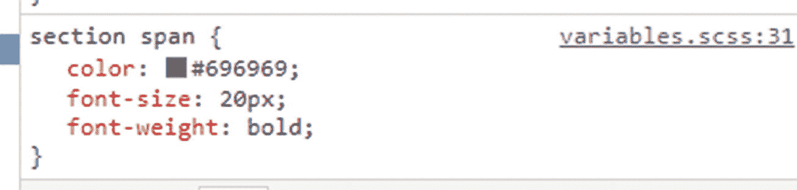

图 2-2

在浏览器中查看编译后的 CSS

如果我们点击图 2-2 中显示的 `variables.scss` 名称，我们将看到原始的 Sass 代码，如图 2-3 所示。

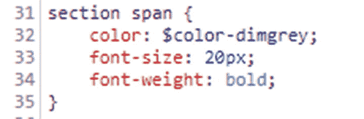

图 2-3

将编译后的 CSS 转换为原始 SCSS

此时，有几点需要注意：我们的命名约定，以及确保使用正确的名称！这很容易让你出错，所以让我们花点时间更详细地讨论一下这一点。

## 谨慎对待变量命名

名称，名称——我们需要的不过是用来标识某个值的符号，对吧……？

嗯，既对也不对。诚然，我们给出的任何名称都应表明其关联内容，但在使用 Sass 时，需要考虑的远不止于此。让我解释一下我的意思：

在我们的示例中，我们使用 `$color-XXXXX` 格式为三种颜色命名。单独看，这些名称似乎合理：存在某种命名约定，且格式保持一致。

但是——我敢肯定我们都知道 `dimgrey` 是什么颜色：但你能说出 `gainsboro` 是什么颜色吗？这三种颜色都是灰色的不同深浅；然而，我们有什么依据表明它们确实如此？没有——为了解决这个问题，我们可以考虑进行一些调整：

*   创建颜色变量时，考虑调整名称的顺序，例如用 `$grey-dim` 或 `$grey-dark` 来代替 `$color-dimgrey`。这样命名更具模块化——我们共享通用术语，并通过描述其功能，实现从通用到具体的过渡，这很像 CSS 处理特异性的方式。

*   我们还可以更进一步——与其将颜色直接放入 Sass 规则中，不如根据颜色在代码中的功能来创建描述性变量。在编辑时，大多数编辑器会根据我们在变量列表中定义的内容，自动显示建议的颜色。因此，重写前面的示例，结果如下：

```scss
$grey-dim: #696969;
$color-title: $grey-dim;
section span { color: $color-title; font-size: 20px; font-weight: bold; }
```

*   这样做还有一个额外好处：如果我们决定更改 `$color-title` 的颜色深浅，可以一次性完成：只需修改一个条目，而无需修改代码中的多个条目。

变量的写法没有绝对的对错之分，尤其是涉及颜色时；不过，确保使用一致的命名约定是明智之举。像我们这样使其模块化，意味着我们甚至可以定义一个小的调色板，并使用函数创建完全不同的颜色！

要了解我的意思，可以查看 Jackie Balzer 在 [`http://jackiebalzer.com/color`](http://jackiebalzer.com/color) 上的示例——所有这些颜色都仅由一种颜色 `#f8af1e`（一种深黄色）创建而成。我们将在第 4 章“使用观察结果计算值”中再次探讨这个想法。

然而，使用变量还有更严肃的一面——在编写本书代码时，我遇到了如图 2-4 所示的编译错误。

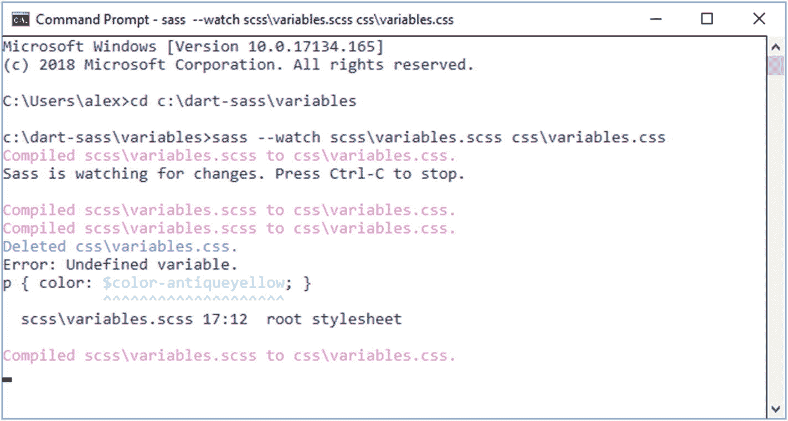

图 2-4 处理编译错误

乍一看有点突兀，但实际上原因很简单。

在此示例中，我使用了 `--watch` 参数，以便在更改时自动编译代码。但演示中使用的颜色并不合适；我必须更改它们。我移除了 `$color-antiqueyellow` 变量，但没有更新仍引用此变量的规则。Sass 理所当然地报错了——解决方法当然是确保更新样式规则。

在这种情况下，如果我们使用了本节开头介绍的示例，那么只要我们不删除其他变量，就很有可能避免出现此错误！变量使代码管理变得容易得多，但在使用命名约定以及开发过程中如何更新代码方面，确实需要多加注意。

## 添加注释

到目前为止，我们编写的 CSS 规则都非常简单——规则名称应该能合理地说明其用法。问题是，如果我们开始添加越来越多的规则，尤其是一些规则不那么直观时，会发生什么情况？

显然，我们需要注释——幸运的是，Sass 对注释的支持方式与我们在 CSS 中使用注释的方式大致相同。不过，有几件事需要注意：

- 如果使用单行注释，编译时默认会将其移除；
- 如果使用多行注释，当输出样式设置为 `compressed` 时，注释会被移除，但当设置为 `expanded` 时，注释会保留。

为了说明我的意思，让我们深入实践一下。

### 编译注释

1. 尝试运行编译命令，但这次稍作修改：

    ```
    sass --style=compressed sass\variables.scss css\variables.css
    ```

    如果查看编译后的文件，注意到注释是如何消失的吗？

2. 这次，尝试将多行注释替换为以下单行注释：

    ```
    // 这是一个测试注释
    @font-face {
    ```

3. 现在尝试编译代码——注意注释被移除了，并且如果再次使用 `style=compressed` 属性运行编译，注释仍然会被移除。

4. 打开之前演示中的一个 Sass 文件——我使用的是 `variables` 文件夹中的文件。

5. 添加以下高亮显示的代码，然后保存文件：

    ```
    /* 这是一个测试注释
    * 跨越几行，使用了
    * 标准 CSS 注释
    * 语法，并会出现在
    * 编译后的输出中 */
    $color-gainsboro: #c0c0c0;
    ```

6. 接下来，启动终端会话，将工作文件夹切换到项目目录下的 `variables` 文件夹。

7. 在提示符下，键入以下命令并按 Enter 键：

    ```
    sass sass\variables.scss css\variables.css
    ```

8. 如果一切顺利，我们应该会像之前一样看到 `variables.css` 和源映射文件出现在 `css` 文件夹中——但这次如果你打开它，会看到注释出现在样式表的开头（图 2-5）。

    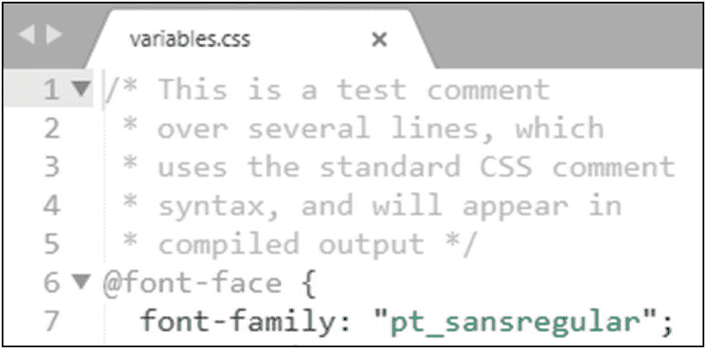

    图 2-5 编译结果（含注释）

看到管理注释有多容易了吗？添加注释是编写样式表的重要组成部分；但关键在于，我们应该谨慎选择使用哪种注释风格，以便在向源代码中添加注释和保留编译后样式表中的注释之间取得适当平衡。好了——是时候改变策略了：让我们看看 Sass 的下一个特性。有多少次你编写的代码可以直接复用，或者稍加调整就能复用？

## 使用标准混合宏

如果你花时间编写 CSS，我敢肯定你遇到过一些略显繁琐的场景——创建字体样式、使用 `transform` 制作动画、处理可缩放元素（如视频）、处理供应商前缀（在仍然需要的地方）等等。

为了减少这种繁琐，我们可以利用 Sass 的一个强大特性：混合宏。它允许我们将 CSS 声明分组到代码块中，以便在项目中复用。我们可以使用两种类型之一——基本混合宏只是简单地嵌入到代码中，而参数化混合宏允许我们传入值，但仍使用相同的核心样式。我们稍后将介绍它们的工作原理，但首先让我们看看如何使用基本混合宏实现可复用代码。

### 创建可复用代码

我们在引言中提到了几个非常适合使用 mixin 的用例场景——其中一个典型场景是让响应式内容在页面上居中，无论其如何缩放。

在创建响应式内容时，我们通常使用百分比值——[CSS-Tricks.com](http://css-tricks.com) 的 Chris Coyier 编写了一个优秀的 mixin，可以让我们将任何内容居中，从而自由地按需设置样式。我将以此为基础进行下一个演示，该演示将在屏幕上居中显示一个标准的 `<div>` 元素。

你可以通过 [`https://codepen.io/chriscoyier/pen/BvdgL`](https://codepen.io/chriscoyier/pen/BvdgL) 查看 Chris 的原始示例。

### 创建 Mixin

让我们开始编写这段代码：

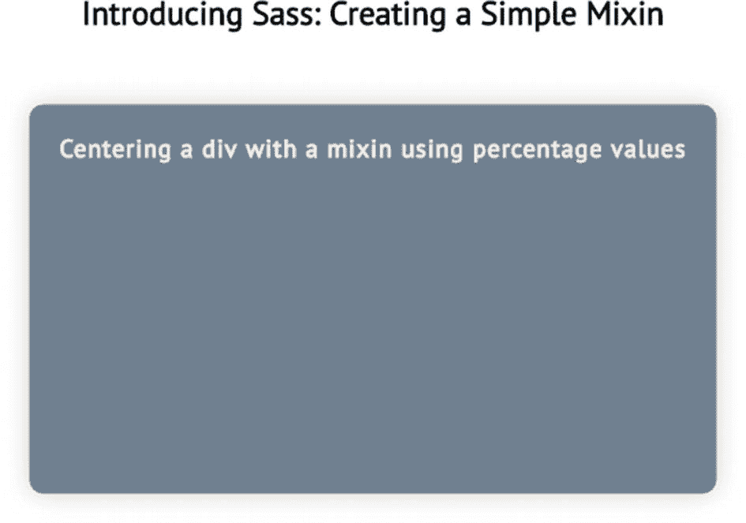

图 2-6：使用 mixin 居中 div

1. 首先，下载 `centerdiv` 文件夹并将其解压到我们的项目目录中。

2. 在你常用的文本编辑器中，新建一个文档，然后添加以下几行代码——我们首先定义一个变量，然后是我们的 mixin：

    ```
    $color-slategrey: #708090;
    @mixin centerdiv { position: absolute; left: 50%; top: 50%; transform: translate(-50%, -50%); }
    ```

3. 留一个空行，然后为演示添加以下基础样式：

    ```
    @font-face { font-family: 'pt_sansregular'; src: url('../font/pt_sansregular.woff') format('woff'); font-weight: normal; font-style: normal; }
    body { font-family: 'pt_sansregular', sans-serif; background: #fff; }
    h2 { text-align: center; }
    ```

4. 我们已经添加了 mixin，但如果不调用它，它就不会生效——为此，请在上一组规则下方添加以下样式规则：

    ```
    div {
    @include centerdiv ;
    width: 40%; height: 50%; padding: 20px; background: $color-slategrey; color: antiquewhite; text-align: center; box-shadow: 0 0 30px rgba(0, 0, 0, 0.2); border-radius: 10px; font-size: 18px; font-weight: bold; letter-spacing: 1px;
    }
    ```

5. 将此文件保存为 `centerdiv.scss`，并放在步骤 1 中保存的 `centerdiv` 文件夹内的 `scss` 子文件夹中。

6. 接下来，启动终端会话，将工作目录切换到项目目录下的 `centerdiv` 文件夹。在提示符下，输入以下命令并按 Enter：

    ```
    sass sass\centerdiv.scss css\centerdiv.css
    ```

7. 如果一切顺利，我们应该会在 `css` 文件夹中看到生成的 `centerdiv.css` 文件以及一个 source map——预览结果将显示一个始终在屏幕中居中的简单方框，如图 2-6 所示。

尝试调整浏览器窗口大小——请注意，无论窗口缩小或放大多少，div 元素是否始终在屏幕中居中？虽然我们在代码中为 left 和 top 设置了适当的值，但它们本身无法生效——我们来快速了解一下真正让这个演示成功的关键。

## 详细解析代码

这个演示的关键在于 Sass 代码是如何被编译的——我们可以在图 2-7 中看到其第一部分。

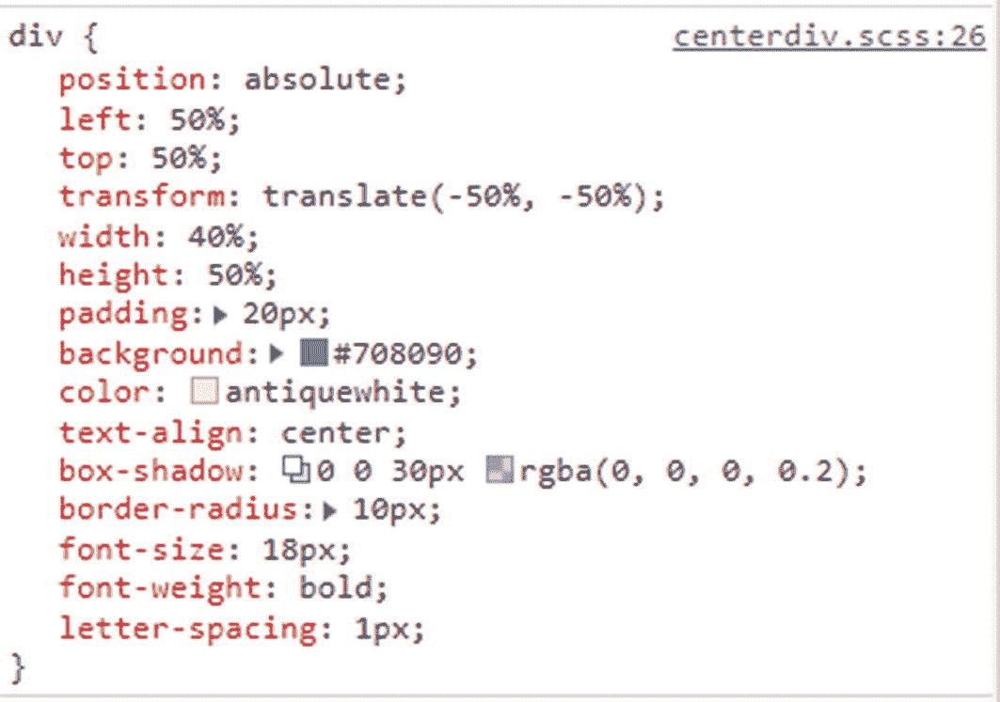

图 2-7：我们的 mixin，编译为 CSS

我们的演示在编译过程中包含了 `centerdiv` mixin 的内容——mixin 是作为 CSS 规则编写的，但必须使用关键字 `@mixin` 进行定义，并使用关键字 `@include` 加上 mixin 名称来引用。

需要注意的关键点是，mixin 本身不会被编译，但其内部的规则会被包含到任何调用该 mixin 的规则集中。这确实意味着我们的源文件可能比编译后的版本要大，但这无关紧要：只要我们创建合适的 mixin，它们只会被包含到调用它们的规则集中，而不会在样式表中被单独编译。

## 使用预构建的 Mixin

掌握了创建 mixin 的新知识后，我们可以继续为项目创建新的 mixin。不过，在重新发明轮子之前，不妨先上网看看？

在谷歌上搜索一下，你会看到很多人编写并发布了可用的 mixin；很多时候，我们可能会发现有人已经编写了一个满足我们需求的 mixin。使用现有的 mixin 可以节省时间和开发精力——当然，我们可能需要对代码进行微调，但这省去了从头开发的麻烦。

网上有大量可用的 mixin，既有独立的，也有作为库一部分的——如果你在谷歌上搜索“sass mixin libraries”，会看到像 Bourbon、Scotch 和 Compass 等库的引用。其中一些已经存在了一段时间；随着 CSS 的进步，它们的使用价值逐渐降低（尤其是那些包含不再必要的厂商前缀代码的库）。

一个 mixin 库的例子是 CSSgram，由 Una Kravets 创建——它借鉴了流行应用 Instagram 中使用的滤镜效果。可以从 [`https://una.im/CSSgram/`](https://una.im/CSSgram/) 获取，我们将使用其中一个滤镜来为一张复古风格图片制作前后对比效果。

在此演示中，我们将使用来自 [`https://www.pexels.com/photo/camera-photography-vintage-old-36732/`](https://www.pexels.com/photo/camera-photography-vintage-old-36732/) 的相机图片；如果你想使用其他图片，请随意调整。

让我们开始创建演示：

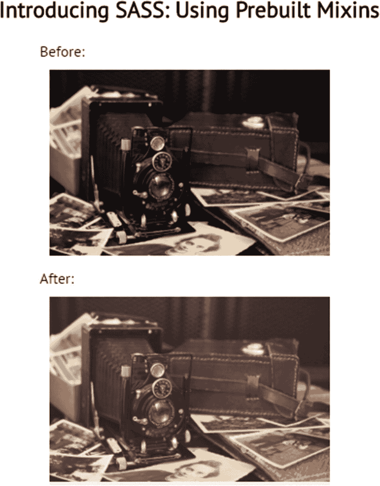

图 2-8：使用 mixin 库应用滤镜

1.  首先，下载 `prebuilt` 文件夹并将其解压到我们的项目目录中。

2.  在你常用的文本编辑器中，新建一个文档，然后添加以下几行代码——我们将为演示添加一些基础样式：

    ```scss
    @import "cssgram.scss";
    @font-face { font-family: 'pt_sansregular'; src: url('../font/pt_sansregular.woff') format('woff'); font-weight: normal; font-style: normal; }
    body { font-family: 'pt_sansregular', sans-serif; background: #fff; }
    h2 { text-align: center; }
    ```

3.  现在我们需要添加将图片放置到页面上的样式：

    ```scss
    p { width: 100px; display: inline-block; margin: 0; padding: 0; }
    section { width: 320px; margin-left: auto; margin-right: auto; }
    div.filter, div.nofilter { width: 300px; display: inline-block; margin: 10px; }
    ```

4.  最后但同样重要的是，实现演示中使用的滤镜所需的样式：

    ```scss
    div.filter { @extend %stinson; }
    div.nofilter img { width: 100%; z-index: 1; }
    ```

5.  将此文件保存为 `prebuilt.scss`，并放在步骤 1 中保存的 `prebuilt` 文件夹内的 `scss` 子文件夹中。

6.  接下来，启动终端会话，将工作目录切换到项目目录下的 `prebuilt` 文件夹。在提示符下，输入以下命令并按 Enter：

    ```bash
    sass sass\prebuilt.scss css\prebuilt.css
    ```

7.  如果一切顺利，我们应该会在 `css` 文件夹中看到生成的 `prebuilt.css` 文件以及一个 source map——预览结果将显示两张图片，一张未应用滤镜，另一张应用了滤镜，如图 2-8 所示。

尽管我们的演示创建起来相对简单，但有一个关键点值得进一步关注。如果你查看下载的 CSSgram 文件，会发现它非常庞大。其中包含大量不同的滤镜效果——如果你担心我们使用了过多的代码，这是可以理解的！幸运的是，我们实际使用的代码量远比看起来要少——让我们深入探讨，更详细地了解一下。

## 理解代码的工作原理

那么，尽管我们使用了 CSSgram 混合宏库，为什么我们的 CSS 样式表并没有变得比预期更大呢？

实现这一效果的诀窍在于样式表开头使用了 `@import` 语句——默认情况下，Sass 只会导入代码中*有直接引用*的混合宏。在这个例子中，我们只调用了 `stinson` 混合宏，因此 Sass 在编译期间会直接忽略 `scss` 文件夹中所有其他的滤镜混合宏文件。

导入文件时，文件扩展名并非必须包含：在本例中，我们同样可以在演示中使用 `@import "cssgram";`。我们将在本章后面部分提到这一点。

然而，这里有一个转折：眼尖的你应该会发现，我们的代码中没有包含 `@mixin` 关键字！这是怎么回事？其实，我们使用了另一个特性：`@extend`。我们将在第 3 章“创建嵌套样式”中详细讨论这一点，但现在，只需知道它的工作方式与混合宏类似，但可以生成更高效的代码即可。

不过，如果你查看一下 `stinson.scss` 文件，确实会看到使用中的 `@include` 关键字；它调用了一个基础滤镜混合宏，该混合宏被用于 CSSgram 库中的所有滤镜。然而，混合宏和 `@extend` 关键字的工作方式存在一些关键区别；我们将在下一章探讨 `@extend` 的使用时，更详细地研究这一点。

好吧，我们继续：创建或导入基础混合宏是编写更高效代码的绝佳方式，但有一个小小的限制。有时，你可能会遇到多个代码块本可由同一个混合宏处理，但所需的值却不同。通常我们可能会认为无能为力，但既然我们使用的是 Sass，那就有办法——是时候了解一下带参数混合宏了。

## 向混合宏传递值

到目前为止，我们已经探讨了如何创建和使用混合宏——这些宏非常适合包含可重用的静态规则组，但如果我们遇到本可以使用混合宏，却因值不完全相同而无法使用的情况，该怎么办呢？

有时我们或许可以微调值来达到目的，但这不太可能——更好的方法是使用带参数混合宏。它们的工作方式与标准混合宏非常相似，但有一个区别：不是包含一组静态值，而是可以向混合宏传递不同的值，并让 Sass 将其渲染为标准 CSS。

带参数混合宏的语法非常相似——开头同样是 `@mixin` 关键字，但这次我们会在其中包含要传递给混合宏的值：

```scss
@mixin button-bg($bg, $fg) {
...值在混合宏中使用...
}
```

在编译时，Sass 会将不同的值插入到混合宏中的占位符，并将其编译为有效的 CSS，以便在项目中使用。我们可以通过创建一个围绕普通按钮的演示来更详细地了解其工作原理——网站中经常使用不同的颜色，因此这非常适合使用混合宏。

### 创建带参数混合宏

让我们开始创建演示：

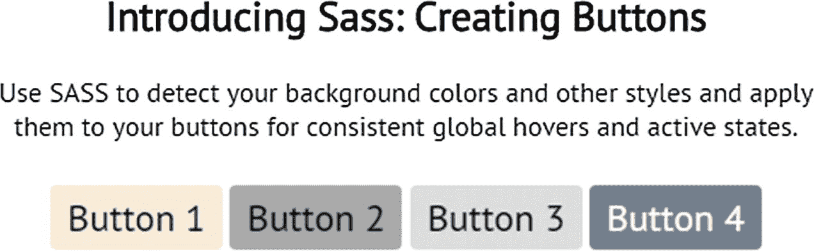

图 2-9：使用带参数混合宏创建按钮

1. 首先，我们将 `parametric` 文件夹的副本下载并解压到项目区域。

### 剖析我们的代码

那么，我们的演示是如何成功创建四个形状相同、但颜色各异的按钮的呢？使演示生效的诀窍在于这个混合宏：

```scss
@mixin button-bg($bg, $fg) {
    background: $bg;
    color: $fg;
    &:hover {
        background: darken($bg, 8%);
        transition: all 0.3s ease;
    }
    &:active {
        background: darken($bg, 30%);
    }
}
```

它本身不会做任何事情，但一旦我们在代码中调用它，它就会编译成每个按钮所需的样式。以第一次调用为例：

```scss
.btn-antiquewhite { @include button-bg(#faebd7, #000); }
```

...我们看到传入的第一个值是 `#faebd7`；这代表一种米白色（或古董白）。传入混合宏的第二个值是黑色——这将用于设置按钮中文本的样式。

当我们查看悬停函数时，情况变得有趣起来——这里使用了几个新关键字。首先是 `&:` 的使用——这是对父选择器的引用，因此在编译后，它变成了 `.btn-antiquewhite:hover`。然后我们使用 `$bg` 变量（代表传入混合宏的第一个值）和 Sass 的 `darken()` 函数来生成两种新颜色：用于悬停状态的 `#f5d9b3` 和用于按钮激活状态的 `#e9a74f`。

我们将在下一章中作为嵌套的一部分，重新讨论父选择器的引用。

好吧，我们继续：我们差不多准备好开始学习 Sass 的新内容了，但在那之前，我们需要重新回顾一下本章前面提到的一个特性。管理 Sass 样式表可能会变得棘手，尤其是在它们变得越来越大时。问题在于，在它们变得过于庞大笨重之前，如何最好地管理它们呢？

## 跨多个文件工作

在本章中，我们创建了简单的样式表——这些方法效果不错，但正如我们刚才提到的，如果它们变得过于庞大，就会引发真正的问题！

幸运的是，我们可以利用 Sass 的 `@import` 选项，将样式表拆分成更小、更易于管理的模块。这个功能在标准 CSS 中已经存在，但 Sass 扩展了其功能。我们在“使用预构建混合宏”演示中简单介绍过它的用法；快速提醒一下，我们可以创建任意数量的 Sass 文件，其中包含变量、混合宏等内容：

```scss
// _reset.scss
html, body, ul, ol { margin: 0; padding: 0; }
```

然后根据需要将它们导入到样式表中，如下例所示：

```scss
// base.scss
@import 'reset';
body { font: 100% Helvetica, sans-serif; background-color: #efefef; }
```

请注意，在我们的 `base.scss` 示例文件中，我们没有指定文件扩展名？这些并非强制要求；Sass 会查找以 `.sass`（旧格式）或 `.scss`（当前格式）结尾的文件，并进行相应导入。在这种情况下，我们的代码示例将编译为：

```css
html, body, ul, ol { margin: 0; padding: 0; }
body { font: 100% Helvetica, sans-serif; background-color: #efefef; }
```

这为我们提供了一个绝佳的理由，将样式分组到单独的文件中，例如变量、字体混合宏、重置样式等——然后我们可以根据需要将它们导入到项目中。

要了解有关导入的更多信息，请参考 Dart Sass 网站上的文档：[`http://sass-lang.com/documentation/file.SASS_REFERENCE.html#import`](http://sass-lang.com/documentation/file.SASS_REFERENCE.html#import)。

在下一个演示中，我们将通过将之前的按钮演示转换为使用导入文件来验证这一点——您将看到切换起来是多么简单！

### 导入文件

让我们开始更新之前的演示：

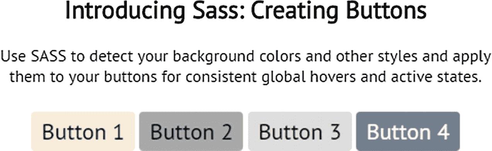

图 2-10 – 我们（更新后的）样式化按钮

1.  我们首先下载并解压 `import` 文件夹的副本，并将其保存到我们的项目区域。
2.  我们需要从主 Sass 文件中提取混合宏，并将其移动到一个新文件中——为此，请继续创建一个名为 `mixins.scss` 的新文件；将其存储在 `import` 文件夹下的 `scss` 子文件夹中。暂时保持打开状态，因为我们将在下一步中使用它。
3.  在文本编辑器中打开 `importfile.scss`，然后将第 1 到 11 行复制并粘贴到 `mixins.scss` 中。保存文件并关闭它。
4.  回到 `importfile.scss`，然后删除第 1 到 11 行。添加以下代码行（如高亮所示）：

    ```scss
    @import "mixins";
    @font-face {
        font-family: 'pt_sansregular';
        src: url('../font/pt_sansregular.woff') format('woff');
    ```

5.  保存 `importfile.scss` 并关闭它——我们现在可以编译该文件以生成样式表。

---

2. 在你常用的文本编辑器中，创建一个新文档，然后添加以下几行代码——我们将为演示添加一些基础样式：

    ```scss
    @mixin button-bg($bg, $fg) {
        background: $bg;
        color: $fg;
        &:hover {
            background: darken($bg, 8%);
            transition: all 0.3s ease;
        }
        &:active {
            background: darken($bg, 30%);
        }
    }
    @font-face { font-family: 'pt_sansregular'; src: url('../font/pt_sansregular.woff') format('woff'); font-weight: normal; font-style: normal; }
    body { font-family: 'pt_sansregular', sans-serif; padding: 20px;}
    h2 { text-align: center; }
    p { margin: 0; padding: 0; margin-bottom: 30px; width: 480px; margin-left: auto; margin-right: auto; }
    ```

3. 现在，我们需要添加将按钮放置到页面上的样式：

    ```scss
    .wrap { margin: 0 auto; width: 800px; text-align: center; }
    .btn { text-decoration: none; padding: 5px 10px; border-radius: 4px; font-size: 22px; }
    ```

4. 我们已经为按钮添加了基础样式，但要让它们看起来像样，我们需要提供一些颜色。以下规则将实现这一点：

    ```scss
    .btn-antiquewhite { @include button-bg(#faebd7, #000); }
    .btn-darkgrey { @include button-bg(#a9a9a9, #000); }
    .btn-gainsboro{ @include button-bg(#dcdcdc, #000); }
    .btn-slategrey { @include button-bg(#708090, #fff); }
    ```

5. 将此文件保存为 `parametric.scss`，放在我们在步骤 1 中保存的 `parametric` 文件夹下的 `scss` 子文件夹中。

6. 接下来，打开一个终端会话，将工作目录切换到项目区域下的 `parametric` 文件夹。在提示符下，输入以下命令并按回车键：

    ```bash
    sass sass\parametric.scss css\parametric.css
    ```

7. 如果一切顺利，我们应该会在 `css` 文件夹中看到一个 `parametric.css` 文件（与之前的练习一样），以及一个源映射——预览结果将显示一系列样式化的按钮，如图 2-9 所示。

这个演示可能很简单，但它是说明使用带参数混合宏有效性的绝佳方式。我们使用相同的基础代码创建了四个不同的按钮，但传入了不同的值——让我们看看这在实践中是如何工作的。

6.  接下来，启动一个终端会话，并将工作文件夹切换到项目区域下的 `import` 文件夹。在提示符处，键入以下命令并按 Enter：

    ```
    sass sass\importfile.scss css\importfile.css
    ```

7.  如果一切顺利，我们将在 `css` 文件夹中看到 `importfile.css` 文件出现（与之前的练习方式相同），以及一个源映射——预览结果将显示与之前相同的样式化按钮集，如图 2-10 所示。

这是改进样式表管理的一种简单方法——但诀窍在于学习如何最好地将文件拆分成更小的文件，这样我们就不会不必要地导入文件！关于导入文件，有几个有用的提示需要我们了解，所以让我们更详细地看看它们。

### 探索代码如何工作

尽管我们对代码做了一些更改，但这个相对简单的更改可能成为真正的救星！以 WordPress 等 CMS 应用程序的标准样式表为例——其样式表大约有 4500 多行，因此能够将样式拆分成更小的文件是一个真正的福音。

聚焦我们的演示，我们已将现有的 `button-bg` 混合宏移动到一个新文件中，并将其从原始主文件中删除。主文件中的原始行被一个适当命名的 `@import` 语句替换，该语句在编译期间调用该文件。然后 Sass 将内容合并到一个文件中，并在编译过程结束时生成一个完整的样式表。如果我们愿意，我们可以验证代码确实来自两个独立的文件，如图 2-11 所示。

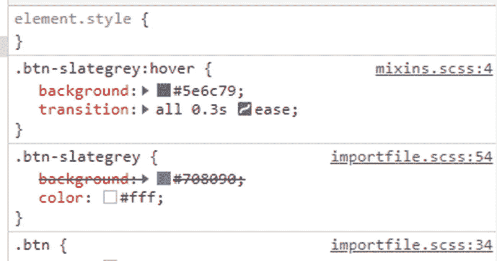

图 2-11 – 证明我们的混合宏文件正在被使用……

然而，这确实引发了一些关于管理导入文件的重要问题——前面提到的 WordPress 文件不是一个长样式表，而是由多个导入的文件组成。这意味着我们可以用一个文件存储变量，另一个文件处理页眉，第三个文件处理文章，也许第四个文件处理响应式媒体查询，等等。真正的诀窍是确保我们在每个文件中存储正确的内容，以免导入那些又会导入其他文件的文件——如果我们不小心，这可能会变得非常混乱！

此外，在某些情况下，导入的文件不会编译为 Sass 文件，而是编译为 CSS 文件——这些情况包括：

*   如果文件扩展名是 `.css`

*   如果文件名以 `http://` 开头

*   如果文件名是一个 `url()`

*   如果 `@import` 包含任何媒体查询

只要扩展名以 `.scss`（或 `.sass`）结尾，Sass 就会在编译过程中尝试将该文件导入到主样式表中。

### 总结

呼——这是一次关于 Sass 变量和混合宏的快速浏览之旅！我们在本章中涵盖了一些有用的关键主题，所以让我们花点时间回顾一下我们学到的内容。

我们通过首先了解创建变量开启了 Sass 世界的旅程；我们介绍了这些变量在实现时如何非常有用，特别是在处理颜色等值时。我们探讨了在选择名称时多加注意的好处，这样如果需要进行更改，就可以减少这些更改对代码的影响。

接下来，我们简要探讨了添加注释——我们看到这些注释主要与标准 CSS 类似，但在编译 Sass 代码时存在一些差异。

然后，我们学习了混合宏——我们从创建一个基本的混合宏开始，然后学习了如何整合他人创建的混合宏，并研究了那些可以根据传递给混合宏的值生成不同代码的混合宏。最后，我们通过重新审视将独立文件导入到 Sass 开发中的主题来结束本章，以便我们能够在开发过程中更好地管理代码。

我们不会停留太久——我们还有很多内容要覆盖！我们已经创建了单条规则，但经常会出现我们创建的某些规则部分重复的情况（因为它们涉及相同的元素、类或选择器 ID）。这可能会使样式开发变得重复——如果我们能够嵌套样式，或者更高效地重用现有样式呢？我们可以——您将在下一章中学习到开始所需的所有知识。