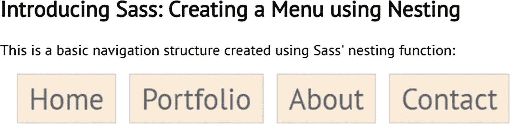
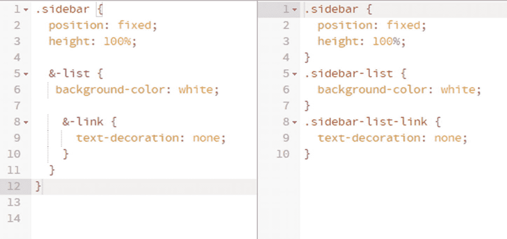
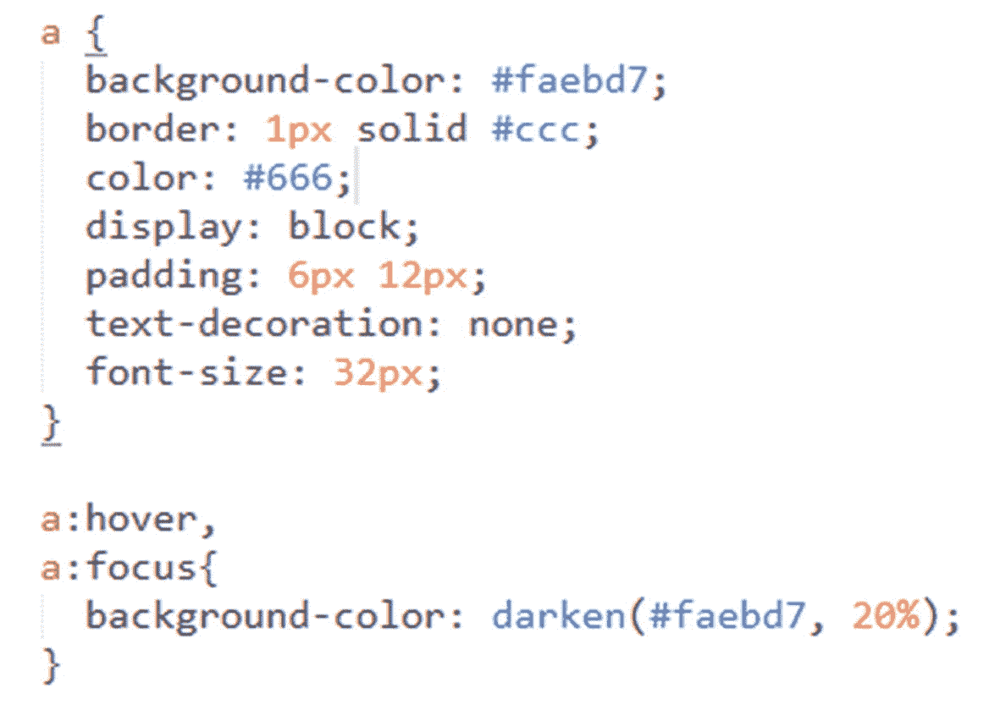
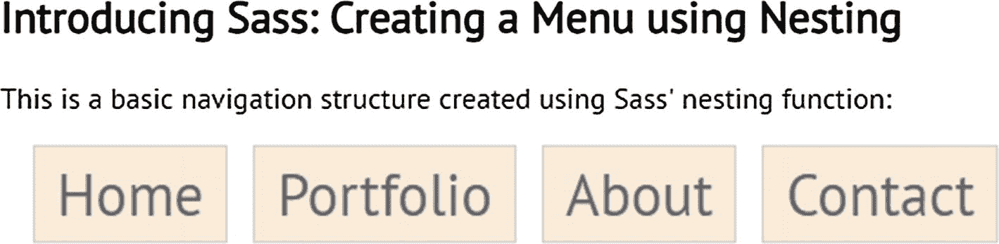
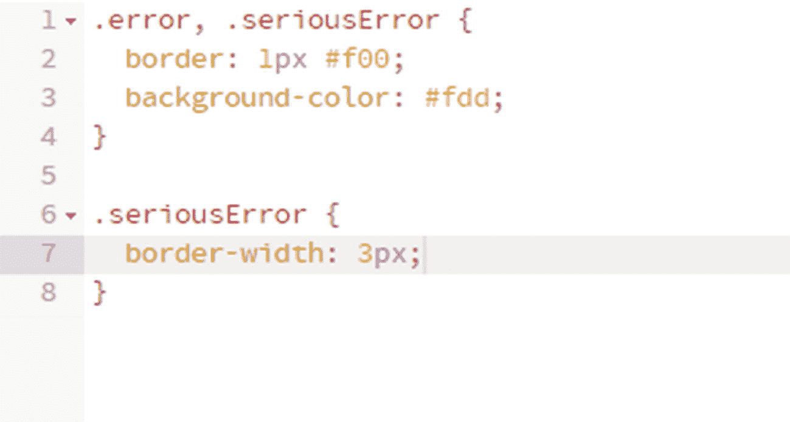
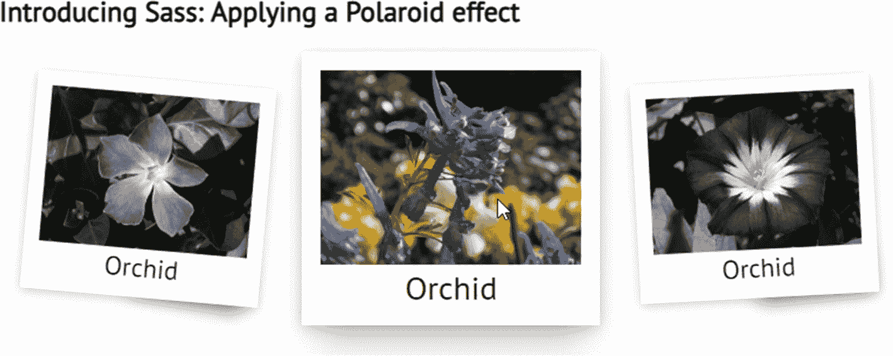
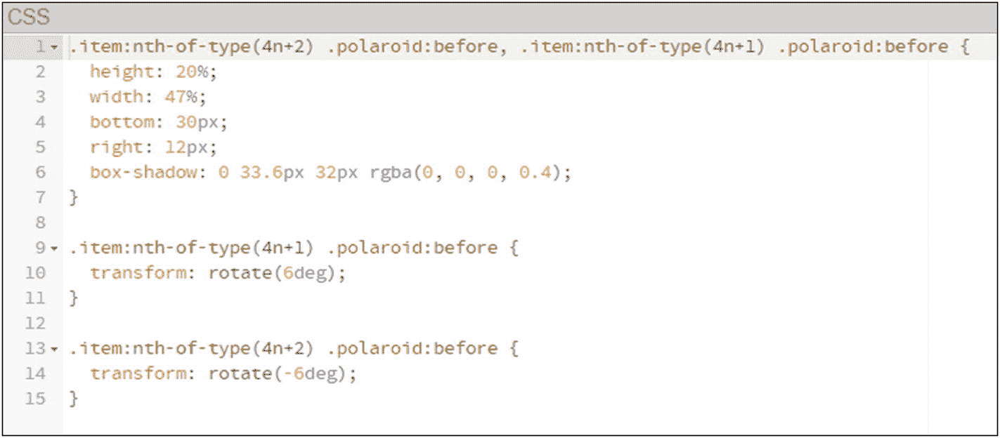

# 3. 创建嵌套样式

如果你花时间编写过 CSS 样式，我毫不怀疑你迟早会遇到代码中包含多层级选择器或类的情况。这是什么意思呢？好吧，让我来解释一下。

以导航栏为例。导航栏已经存在多年——它是网站的基本组成部分，尽管我们决定如何美化它的方式在不同网站上会有所差异。然而，其基本原理是使用可以多层级嵌套的无序列表：

```
标题 1

测试链接
测试链接
测试链接
测试链接

标题 2

标题 3

测试链接
测试链接
测试链接
测试链接
```

诚然，我们的例子有点过于简单，但希望你明白了其中的意思！要为我们的示例添加样式，我们会使用以下类：

```
nav {...}
nav li a {...}
nav li ul {...}
nav li ul li a {...}
```

注意到每个样式之间的相似之处了吗？比如说，一些元素名称是不是重复出现了……？

我们使用的元素名称相当简短，但如果我们决定引用更长的类名（例如 `ul.navigation li a.about ul li a`），那么我们的代码很快就会变得难以阅读。这会造成一个真正的问题——有没有更好的方法呢？值得庆幸的是，借助 Sass 的强大功能，我们确实有——让我向你介绍嵌套的概念。

## 解析嵌套概念

简单来说，当元素之间存在清晰的共性时，嵌套允许我们在其他样式中存储（或嵌套）样式。这意味着我们不必为每条规则完整写出类或选择器，而只需包含嵌套规则特有的部分。在编译时，Sass 会通过引用父选择器或类，将每条声明转换为有效的规则。为了让你明白我的意思，让我们用我们的简单示例并将其转换为 Sass：

```
nav {
...
li {
a {...}
ul {...}
li a {...}
}
}
```

你看——这样读起来是不是更容易了？嵌套是一个很好的省时工具，因为它有助于减少我们重复相同选择器的次数；并且在阅读代码时，它也感觉更自然、更容易理解。

让我们付诸实践，创建——是的，你可能已经猜到接下来要做什么了：一个基本的导航！在开发 Sass 时，任何时候都可以使用嵌套——只要我们有多个引用相同父元素或类的样式，就可以应用嵌套。巧合的是，导航非常适合嵌套，所以让我们深入探讨，看看它在实践中是如何运作的。

### 创建一个简单的菜单栏

让我们开始创建我们的演示：



图 3-1

使用嵌套创建基本菜单

1. 我们首先从本书附带的代码下载中下载并解压 `nesting` 文件夹的副本——将其保存到我们的项目区域。

2. 接下来，启动你的文本编辑器——我们将添加演示所需的样式。

3. 我们将分块添加所需的代码——继续为我们的演示添加以下基本样式：

    ```
    @font-face {
    font-family: 'pt_sansregular';
    src: url('../font/pt_sansregular.woff') format('woff');
    font-weight: normal;
    font-style: normal;
    }
    body {
    font-family: 'pt_sansregular', sans-serif;
    padding: 20px;
    }
    h1 {
    font-size: 20px;
    }
    ```

4. 我们演示的核心是我们正在创建的导航栏——为此，在前面的 `<h1>` 标签下方添加以下样式规则，并在该标签后留一行空行：

    ```
    nav {
    width: 600px;
    }
    ```

5. 接下来，我们需要为构成导航的无序列表添加样式规则——为此，在 `width: 600px` 声明后面留一个空行，然后添加：

    ```
    ul {
    list-style: none;
    margin: 0 3%;
    padding: 0;
    }
    ```

6. 有了无序列表容器之后，我们现在可以设置每个菜单项的样式——为此，在上一步的右花括号后留一个空行，然后添加：

    ```
    li {
    display: inline-block;
    padding-right: 10px;
    }
    ```

7. 为了使我们的导航生效，我们需要为每个条目添加链接——继续在第 6 步的右花括号后留一个空行，然后添加这些样式：

    ```
    a {
    background-color: #faebd7;
    border: 1px solid #ccc;
    color: #666;
    display: block;
    padding: 6px 12px;
    text-decoration: none;
    font-size: 32px;
    }
    a:hover, a:focus{
    background-color: darken(#faebd7, 20%);
    }
    a:active {
    background-color: #666;
    border-color: #666;
    color: #efefef;
    }
    ```

8. 将文件另存为 `scss` 文件夹中的 `nesting.scss`。

9. 接下来，启动终端会话，并将工作文件夹更改为项目区域下的 `nesting` 文件夹。

10. 在提示符下，键入以下命令并按回车：

    ```
    sass sass/nesting.scss css/nesting.css
    ```

11. 如果一切顺利，我们应该会在 `css` 文件夹中看到一个 `nesting.css` 文件，以及一个源映射文件。

12. 如果在浏览器中预览结果，我们会看到一个包含样式化元素的简单框，如图 3-1 所示：

看到嵌套代码有多么简单了吗？嵌套的基本原理很直接，但应用嵌套的真正考验在于确保使用正确的父选择器，以便任何嵌套的样式名称尽可能短，并将重复降到最低。为了让你明白我的意思，让我们花一点时间更详细地探讨我们的演示代码，这样你就可以看到我们是如何得出代码中所用结构的。

### 解析我们的代码

好吧，我承认，上一段开头的说法可能有点武断，但实际上，嵌套并不是一种难以理解的技术。技巧在于确保我们选择正确的选择器来构成嵌套的基础。让我们更详细地分析一下我们的例子：

我们开始这个演示时设置了一些样式来辅助演示的呈现——演示的核心从第 17 行的初始 `<nav>` 声明开始。我们需要应用于 `<nav>` 元素的任何样式都直接位于其下；子规则的样式则简单地缩进在这个初始声明下方。在我们的案例中，这意味着 `ul`、`li` 和 `a`（及其伪类）都只缩进到第一级。它们会变成 `nav ul`、`nav li`、`nav a` 等等——Sass 会理解 `nav` 在这个实例中是公共元素，因此充当父元素。

## 处理更复杂的示例

上一个示例中的代码位于第一层级（或缩进）—— 在许多情况下，这对于你的项目可能适用，但如果我们需要深入一层（因为我们有更多子类需要处理）该怎么办呢？

我们可以使用 Sass 进行更深层次的嵌套，不过有一点需要提醒——一个好的经验法则是嵌套层级不要超过两到三层。更深层的嵌套在技术上是可行的，但我不推荐这样做——这样会导致 CSS 的特指度（specificity）过深，这也是一个明显的信号，说明我们需要重新审视样式类名的结构。

假设我们将嵌套控制在合理层级内，以下是一个嵌套到三层代码块的示例：

```
.sidebar {
  position: fixed;
  height: 100%;
  &-list {
    background-color: white;
    &-link {
      text-decoration: none;
    }
  }
}
```

在这个例子中，公共元素是 `.sidebar`；所有三个样式都使用了这个名称。不过，我注意到其中两个名称的开头有一个 `&` 符号和连字符——这代表什么呢？这些是占位符——在这种情况下，第二层和第三层的类名将分别被编译为 `.sidebar-list` 和 `.sidebar-list-link`。

关于这种上下文中的占位符，我们将在本章稍后的“引用父选择器”部分进行更详细的介绍。

好了——借用一句常见的开车用语，是时候变道了：嵌套是一项值得学习的好技术，但它并非没有一些古怪之处。让我们看几个例子来理解我的意思——现在，你在刚开始使用 Sass 时可能还不会遇到它们，但迟早它们会露出它们丑陋的一面，可以这么说……

## 探索嵌套的陷阱

再看一下上一节中的代码示例——我们在上一节中提到，它会创建三条规则，而图 3-2 确实证实了这一点。



# 图 3-2

我们的编译示例，使用 Sassmeister

我们的代码已编译为有效的 CSS，从嵌套三层深的代码中产出了三条规则示例。这效果很好，但可能会让我们产生一种错误的安全感！如果我们不小心，使用嵌套既有优点也有缺点，所以让我们先看看缺点，因为这些最容易解释。

### 嵌套是坏事吗？

假设我们使用以下代码：

```
Some text
```

这会生成特指度极高的 CSS 代码——要引用此代码块中的 `a` 标签，我们必须使用 `main.one.two.a` 作为 CSS 规则：

```
main {
  .one {
    .two {
      a {color: red}
    }
  }
}
```

这种级别的特指度不推荐使用，应该避免，因为它会使我们的 CSS 与 HTML 结构紧密耦合。要覆盖这段代码，我们就得创建更特指的 CSS 来修改它；这只会让原始问题雪上加霜！更麻烦的是，如果你使用 Sass 嵌套了这段代码，它看起来就像是你仅仅给一个简单的链接设置了样式。而现实是，Sass 只是隐藏了问题，在编译期间仍然会生成同样特指度极高的代码。

归根结底，如果谨慎使用，嵌套是一项很棒的功能——作为一个通用经验法则，我建议嵌套层数不要超过三层。这样能保持代码简单易读，并且不会生成特指度极高的代码，从而避免在后续开发中造成问题。

### 探索嵌套的优势

哎——经过刚才的警告，有人可能会认为嵌套没那么好，这也是情有可原的！但事实是，就像任何被负责任地使用的工具一样，它也能对你的代码产生非常积极的影响。

在这种情况，使用嵌套的主要优势在于生成更易读、更易维护的代码。嵌套允许我们将所有继承自父选择器的子选择器分组在一起；同时还能节省打字量，因为我们不必在每个子选择器前重复编写父选择器。当然，诀窍在于确保我们不会嵌套得太深——极端嵌套可能很诱人，但请记住：嵌套并不能修复糟糕的代码——如果你输入的是垃圾，那么你只会得到垃圾输出！

好了——让我们快速推进：如果使用 Sass 嵌套代码，你可能会认为这同样适用于伪选择器，比如 `:hover` 和 `:focus`，对吗？不幸的是，不行——如果你尝试以这种方式嵌套它们，将会抛出错误。幸运的是，有一个解决方案——我们需要调整在代码嵌套时引用它们的方式。让我们更详细地了解一下具体内容。

### 引用父选择器

在嵌套 Sass 语句时，很多语句可以放在代码中已有重复项的位置。但是，你无疑会在代码中使用某种伪选择器——那么这些伪选择器怎么办呢？

好吧，Sass 也可以嵌套它们——我们不是像普通语句那样简单地缩进它们，而是需要在冒号前立即放置一个占位符字符。以图 3-3 中显示的代码片段为例。



**图 3-3**

更新前的代码……

这里完整写出了三种样式（`a`、`a:hover` 和 `a:focus`）——这是完全有效的代码，但有点浪费空间，并且重复了选择器名称。相反，我们可以简单地嵌套每个样式——为了向你展示其工作原理，我们可以通过一个快速演示来更新上一个菜单练习中的代码。

### 引用父选择器

让我们看看修改代码是多么简单：



**图 3-4 – 更新导航演示**

1.  首先，从本书的代码下载中下载并解压 `parent` 文件夹的副本，并将其保存到我们的项目文件夹中。

2.  接着，打开 `parent.scss` 文件，在第 29 行附近找到以下代码行：

    ```
    a {
    background-color: #faebd7;
    border: 1px solid #ccc;
    color: #666;
    ```

3.  继续编辑 `a` 规则——我们将 `hover` 和 `focus` 声明嵌套在其中，如粗体所示：

    ```
    a {
    background-color: #faebd7;
    border: 1px solid #ccc;
    color: #666;
    display: block;
    padding: 6px 12px;
    text-decoration: none;
    font-size: 32px;
    &:hover, &:focus {
    background-color: darken(#faebd7, 20%);
    }
    &:active{ background-color: #666; border-color: #666; color: #efefef;   }
    }
    ```

4.  接着，继续删除独立的 `active`、`hover` 和 `focus` 规则——我们应该只剩下嵌套在父 `a` 规则中的那些规则，并且最后一行代码将是 `nav` 规则的右花括号。

5.  将文件保存为 `scss` 文件夹中的 `parent.scss`。

6.  接下来，启动一个终端会话，并将工作文件夹切换到项目目录下的 `parent` 文件夹。

7.  在提示符下，输入以下命令并按 Enter：

    ```
    sass sass\parent.scss css\parent.css
    ```

8.  如果一切顺利，我们应该会在 `css` 文件夹中看到一个 `parent.css` 文件，以及一个源映射文件。

9.  尝试在浏览器中预览结果——如果一切正常，它会显示一个包含样式化元素的简单框，如图 3-4 所示。

在嵌套时，这是一个需要理解的重要概念——如果处理不当或遗漏了与号，最好的情况是代码被破坏（但不太可能显示任何错误），最坏的情况则是编译失败。

关键是要记住包含占位符——我们可能无法立即获得正确的嵌套层级，但有了占位符，代码至少应该能正确编译！同时，让我们更详细地快速查看一下代码——你会看到它与之前的原则相同，只是新增了与号作为占位符。

### 深入探索我们的代码

如果我们运行这个演示的完成版本，而没有看到我们所做的更改，那么你可能会认为它看起来与原始版本没有区别，这也是情有可原的！别担心——这是有意为之：这表明尽管我们对一些使用的类进行了嵌套修改，但测试显示我们的演示仍然能正确运行。

那么，我们更改了什么呢？实际上，这次的更改很小——我们将 `hover`、`focus` 和 `active` 伪选择器移到了父 `a` 规则内部。在每个实例中，我们都插入了一个与号，告诉 Sass 在编译此规则时引用父类；这会将其转换为与我们在原始嵌套演示中使用的相同有效的 CSS。

## 应用 `@extend` 指令

在开发过程中，经常会遇到这样的情况：我们决定先创建一个基类来样式化某个元素，然后添加后续类来涵盖基类的变体。设计警告消息就是一个很好的例子——我们的基类将包含创建外壳所需的样式，而变体（在样式、图标方面）则通过继承自基类的后续类来覆盖。

问题是，这种方法并非没有问题——这意味着我们至少要使用两个类，而不仅仅是一个；这会造成维护负担，并且在以后调试时可能会很棘手。问题是：我们能否解决这个问题？

当然可以——让我向你介绍 `extend` 关键字！该关键字的语法如下：

```
@extend .类名;
```

……它允许类与其他类共享一组属性。要使用它，我们需要在 CSS 规则中将扩展类的名称指定为声明，如下所示：

```
.类名 {
border: 1px solid black;
font-weight: bold;
}
.foo {
@extend .类名;
color: #fcc;
...
}
```

在这个例子中，我们将得到两个类——`.foo` 和 `.类名`——它们共享相同的 `font-weight` 和 `border` 属性。`.foo` 类还会有一个单独的 `color` 属性声明。

### 通过示例实践

如果我们想减少对多个类的依赖，使用 `@extend` 是非常完美的选择；我们可以创建一个规则，让其他规则在编译期间继承它。

为了理解我的意思，请看这段示例代码：

```
.error {
border: 1px #f00;
background-color: #fdd;
}
.seriousError {
@extend .error;
border-width: 3px;
}
```

当编译时（使用诸如 Sassmeister 之类的工具），我们得到如图 3-5 所示的 CSS。



**图 3-5 – 编译 `@extend` 的结果**

看到第二个规则（`.seriousError`）是如何继承了第一个规则中定义的属性，同时又保留了自己规则中指定的属性了吗？这对于样式化共享相同属性的元素非常完美——我们为基类声明编写一个规则，然后在每个需要继承此规则并指定该规则特有附加属性的类中使用 `@extend`。

这个特性可能有点难以理解其全部用途，所以让我们从一个演示开始，更详细地展示它的工作原理。

### 一个实际示例

回想一下——还有人记得宝丽来相机吗？是的，在数码图像出现之前，宝丽来风靡一时：无需等待胶卷冲洗，拍摄后只需几分钟就能得到最终照片！

宝丽来相机可能没有以前那么流行了，但这种效果依然存在——重现宝丽来效果（图像外观，而非显影过程！）非常容易。让我们看看如何利用 Sass 的强大功能及其 `@extend` 函数来实现这一点。

### 扩展 Sass 类

让我们开始编写演示代码：



**图 3-6**

使用 `@extend` 显示图片

1. 首先，从本书附带的代码下载中下载并解压 `extend` 文件夹——继续将该文件夹保存到我们的项目文件夹中。

2. 接下来，打开你的文本编辑器——我们有一大堆样式要添加到演示中！我们将逐块添加它们，首先从演示的一些基础样式开始：

    ```
    %imgeffect {
    height: 20%;
    width: 47%;
    bottom: 30px;
    right: 12px;
    box-shadow: 0 33.6px 32px rgba(0,0,0,0.4);
    }
    @font-face {
    font-family: 'pt_sansregular';
    src: url('../font/pt_sansregular.woff') format('woff');
    font-weight: normal;
    font-style: normal;
    }
    * {
    box-sizing: border-box;
    }
    body {
    font-family: 'pt_sansregular', sans-serif;
    margin: 32px;
    }
    ```

3. 接下来这个代码块为每张宝丽来效果图片添加了一组通用样式：

    ```
    .polaroid {
    background: #fff;
    padding: 16px;
    box-shadow: 0 3.2px 19.2px rgba(0,0,0,0.2);
    }
    .polaroid > img {
    max-width: 100%;
    height: auto;
    }
    .caption {
    font-size: 28px;
    text-align: center;
    line-height: 32px;
    }
    ```

4. 现在我们需要为每张应用了宝丽来效果的图片设置样式——这将添加初始灰度效果，并旋转图片使其偏离水平位置：

    ```
    .item {
    width: 30%;
    display: inline-block;
    filter: grayscale(100%);
    }
    .item .polaroid:before {
    content: "";
    position: absolute;
    z-index: -1;
    transition: all 0.35s;
    }
    .item:nth-of-type(4n+1) {
    transform: scale(0.8, 0.8) rotate(5deg);
    }
    .item:nth-of-type(4n+1) .polaroid:before {
    @extend %imgeffect;
    transform: rotate(6deg);
    }
    .item:nth-of-type(4n+2) {
    transform: scale(0.8, 0.8) rotate(-5deg);
    }
    .item:nth-of-type(4n+2) .polaroid:before {
    @extend %imgeffect;
    transform: rotate(-6deg);
    }
    .item:nth-of-type(4n+3) {
    transform: scale(0.8, 0.8) rotate(-3deg);
    }
    .item:nth-of-type(4n+3) .polaroid:before {
    @extend %imgeffect;
    transform: rotate(-4deg);
    }
    ```

5. 最后一组规则在我们将鼠标悬停在每张图片上时应用旋转和缩放效果；同时我们还调整了尺寸和阴影效果：

    ```
    .item:hover {
    filter: none;
    transform: scale(1, 1) rotate(0deg);
    transition: all 0.35s;
    }
    .item:hover .polaroid:before {
    z-index: -1;
    transform: rotate(0deg);
    height: 90%;
    width: 90%;
    bottom: 0%;
    right: 5%;
    box-shadow: 0 16px 48px rgba(0,0,0,0.2);
    transition: all 0.35s;
    }
    ```

6. 将文件保存为 `scss` 文件夹中的 `extend.scss`。

7. 接下来，启动一个终端会话，并将工作文件夹切换到项目区域下的 `extend` 文件夹。

8. 在提示符下，输入以下命令并按回车：

    ```
    sass sass\extend.scss css\extend.css
    ```

9. 如果一切顺利，我们应该会在 `css` 文件夹中看到一个 `extend.css` 文件，以及一个源映射文件——预览结果将显示三张图片被样式化为宝丽来相片，中间那张处于悬停中态（图 3-6）。

这个演示算是一次回忆之旅——这种 CSS 样式效果已经存在好几年了。不过，这个故事里还有一点小波折：在我们发现它是什么之前，先来更详细地了解一下我们的代码是如何工作的。

### 详细剖析代码

我们这个宝丽来风格演示中的代码乍看之下似乎有不少样式代码，但实际上，大部分代码都用于为每张图片设置样式。不过，有两个关键声明值得我们探索，它们使用了 Sass 并让我们的演示栩栩如生。它们分别是扩展块：

```
%imgeffect {
height: 20%;
width: 47%;
bottom: 30px;
right: 12px;
box-shadow: 0 33.6px 32px rgba(0,0,0,0.4);
}
```

...以及我们使用这个扩展的三个声明：

```
.item:nth-of-type(4n+1) .polaroid:before {
@extend %imgeffect;
transform: rotate(6deg);
}
.item:nth-of-type(4n+2) .polaroid:before {
@extend %imgeffect;
transform: rotate(-6deg);
}
.item:nth-of-type(4n+3) .polaroid:before {
@extend %imgeffect;
transform: rotate(-4deg);
}
```

如果我们将它编译成有效的 CSS，最终会得到如图 3-7 所示的代码。



**图 3-7**

从 `@extend` 演示中编译代码

在我们的演示中，我们在第 1 到第 7 行指定了初始扩展；它包含一组标准的 CSS 属性，这些属性在每个宝丽来效果中都会用到。在定义三个 `.item:nth-of-type()` 声明时分别调用了这个扩展，每个声明对应一个宝丽来效果实例。图 3-7 展示了在 Sassmeister 中编译的两个 `item:nth-of-type()` 声明实例的截图，以此展示其效果外观，我们确实可以看到在附加变体之前显示了通用类。

你可以使用 [Sassmeister.com](http://sassmeister.com) 上的在线工具亲自尝试——我没有包含第三个实例，因为两个就足以展示使用扩展函数的效果了。

你们中的一些人可能已经注意到了本章前面提到的一点，我们讨论了`基础类`和`扩展类`都会出现。我并没有看到基础类的存在，尽管理论上它应该被显示——为什么没有呢？

### 使用 Extends 还是 Mixins？

啊哈——这背后有充分的理由：我们有意阻止 Sass 显示它。但这不仅仅是隐藏代码那么简单——它与 extends 的工作方式、与 mixins 的相似性，以及在编写代码时选择正确函数的重要性密切相关。

尽管 mixins 和 extends 非常相似，但有两个关键区别值得我们注意：

- `extend` 规则不接受参数——而 mixins 接受。

- `extend` 规则可以合并选择器，而 mixins 则不能。

简而言之，extends 比 mixins 更高效，但它们在值的灵活性方面不如 mixins——我们无法像向 mixins 传递参数那样灵活地传递值。通过一个例子可以最好地说明这一点；以下是前面演示代码中重写为 mixin 的 Sass 部分：

```scss
@mixin imgeffect {
  height: 20%;
  width: 47%;
  bottom: 30px;
  right: 12px;
  box-shadow: 0 33.6px 32px rgba(0,0,0,0.4);
}
.item:nth-of-type(4n+1) .polaroid:before {
  @include imgeffect;
  transform: rotate(6deg);
}
.item:nth-of-type(4n+2) .polaroid:before {
  @include imgeffect;
  transform: rotate(-6deg);
}
.item:nth-of-type(4n+3) .polaroid:before {
  @include imgeffect;
  transform: rotate(-4deg);
}
```

尝试将其放入 Sassmeister 会话中——请注意，虽然它可以正确编译（生成 26 行代码），但其中包含大量重复内容？

显然这并不理想——它能运行，但以这种方式编译代码很快就会给样式表增加大量不必要的臃肿，并拖慢网站速度。正因如此，我们需要谨慎选择使用 mixin 还是 extend——在选择使用时，还应考虑其他一些因素：

- 由于 `extends` 不能接受参数，因此它们不如 mixins 灵活——它们最适合在多个元素之间复制相同的样式，并通过例外情况设置不同的属性。

- 在创建响应式媒体指令时不能使用 `extends`；这种情况下只能使用 mixins。

- 当使用包含扩展代码的类时，我们随后指定的任何子类也会自动包含该扩展代码。如果不小心，这可能会产生一些奇怪的效果！

- 从更技术性的角度来说——许多人声称 extends 比 mixins 更快。然而，在现代服务器技术（如文件压缩）下，情况并非总是如此；事实上，mixins 可能更有效，因为字符串会频繁重复，这更有利于压缩。

那么——回到我们的代码：在我们的实例中，既可以使用 `extend` 也可以使用 mixin。我选择使用 `extend` 规则来说明它们的工作原理，但如果你启用了基于服务器的压缩（许多服务器都是如此），那么你可能会决定使用 mixin。归根结底，这都需要谨慎处理；具体采用 mixin 还是 `extend`，取决于代码的设置方式以及样式设置的层级数量。

### 总结

在 Sass 中嵌套和继承样式是一门关键课题——它的基础知识可能容易学习，但掌握它却需要真正的技巧！在本章中，我们了解了嵌套和 `extend` 规则的使用，现在让我们花点时间回顾一下所学内容。

我们首先探讨了如何嵌套代码——我们理解了这有助于避免重复，并减少需要编写的代码量。紧接着，我们审视了嵌套代码时可能遇到的一些陷阱；同时，我们讨论了嵌套是否是一种不良实践，或者只是在使用时需要一定程度的谨慎。

接着，我们转而讨论了父选择器的使用；我们考察了这对于嵌套伪元素等情况的重要性。然后，我们深入研究了 `@extend` 指令的基础知识——包括通过一个详细的示例来进行实践，然后根据 Sass 中二者的相似性，权衡使用 `extends` 或 mixins 的利弊。

好了——让我们继续：我们经常需要编写仅在满足条件后才会确定结果的代码。这在编写脚本时是一种非常常见的技术，但如果我们要创建样式呢？普通的 CSS 不允许这样做，因此样式必须静态地编写。但这种情况已经改变：是时候扭转局面，开始使用脚本技术来控制我们的 CSS 样式了……