# 使用运算计算值

使用 Sass 的关键优势之一是能够动态计算值——我指的不只是使用像百分比这样的值，而是使用加、减等运算符来计算值。

是的，你没看错——使用数学运算！不过，在您退缩之前，这并没有看上去那么疯狂：我们可以在代码中编写诸如 `font: 10px/8px;` 这样的语句。由于 Sass 是 CSS 的扩展，它不仅支持这一点，而且将其提升到了一个全新的水平。不过，它的好处在于涉及的数学运算根本不必复杂——可以简单到将两个数字相加，或者对一个数字进行除法。

考虑到这一点，让我们来看看可以使用 Sass 执行的不同类型的运算，从一些基于数字的运算开始。

## 基于数字的运算

所有标准运算（如加法或除法）都受支持（包括关系运算符，如 `>=`）；这意味着我们可以编写如下声明：

```scss
p {
  $width: 780px;
  width: $width/2;
}
```

……它将编译为：

```scss
p { width: 390px; }
```

### 字符串内容的运算符

在处理字符串时，运算符主要有两种用途：我们可以将文本拼接在一起，或者使用字符串插值执行内联计算。后者并不复杂——它要求我们将计算放在花括号内，并在前面加上一个 `#`，这告诉 Sass 计算总数，如以下示例所示：

```scss
p:before {
  content: "我吃了 #{5 + 10} 个大型" + 苹果;
}
```

### 基于布尔值的运算符

有时，根据条件为真或假来包含声明可能会很有用；如果条件为真，则包含该声明，否则将省略它。我们的第三种运算类型允许使用布尔值来控制显示的内容：

```scss
p:before {
  $count: 5;
  $yes: 1;
  @if ($count > 3 and $yes == 1) {
    content: "我吃了 #{5 + 10} 个大型" + 苹果;
  }
}
```

编译后，我们得到以下结果：

```scss
p:before {
  content: "我吃了 15 个大型苹果";
}
```

## 基于列表的运算符

最后一类涵盖了我们可以对 Sass 中使用的数据列表执行的所有操作类型。列表是将我们可能在代码中稍后使用的相似属性（如颜色或边框类型）组合在一起的有效方法，以便我们可以控制代码中使用的内容：

```scss
$colors: red green blue;
$padding: 10px, 20px, 30px;
$border: solid, dotted;
```

定义列表后，我们可以使用 `nth` 等函数从该列表中选择一个项目，在本例中选择 `green`：

```scss
div {
  background: nth($colours, 2);
  padding: nth($padding, 2); // "20px"
  border: 2px nth($border, 2);
}
```

编译后，这段代码会产生以下结果：

```scss
div {
  background: green;
  padding: 20px;
  border: 2px dotted;
}
```

列表项可以使用逗号或空格分隔，但如果您使用后者，则属性应用引号括起来，并在代码中使用 `unquote()` 函数来移除引号。

我们只是浅尝辄止地了解了使用 Sass 可以进行的各种不同类型的操作——主要网站记录了所有可用的函数，网址为 [`http://sass-lang.com/documentation/Sass/Script/Functions.html`](http://sass-lang.com/documentation/Sass/Script/Functions.html)。

好了——我们继续：我们使用的示例有些理论化；要真正了解它们的工作原理，我们应该创建一些能展示其工作方式的东西。一个很好的例子是创建一个基于网格的页面模板，所以事不宜迟，让我们深入探究并看看它如何在实践中运作。

### 付诸实践

在下一个演示中，我们将利用 Sass 的操作来创建一个基本的页面骨架，其中主内容块等元素的宽度值将自动为我们计算出来。在这个演示中，我们将额外使用一种资源，即一种手写字体——Homemade Apple，它可以从 [`https://www.fontsquirrel.com/fonts/homemade-apple`](https://www.fontsquirrel.com/fonts/homemade-apple) 以 WOFF 格式下载（该格式应覆盖大多数现代浏览器）。

## 创建框架

让我们开始构建我们的演示：

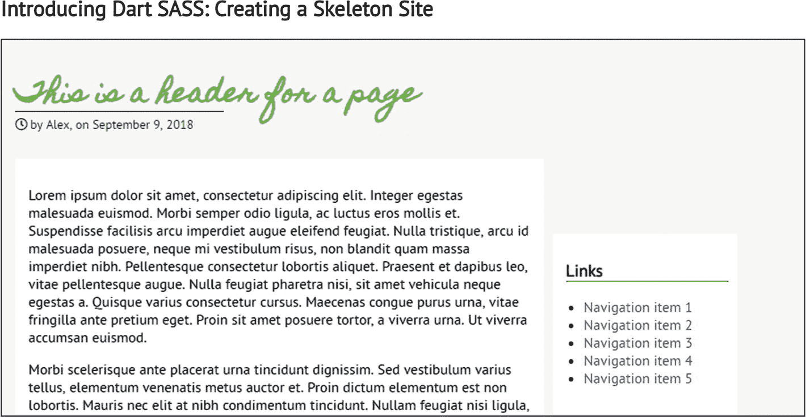

**图 4-1** 创建页面骨架模板

1.  首先，从本书附带的代码下载中提取 `skeleton` 文件夹的副本——继续并将其保存到我们项目文件夹的根目录。
2.  我们的演示包含所有相关标记，但如果现在运行它，看起来会很糟糕！此时我们需要添加样式——为此，我们有相当多的规则要添加，让我们从站点中使用的字体和链接的一些基本样式开始：

```scss
@font-face { font-family: 'pt_sansregular'; src: url('../font/pt_sansregular.woff') format('woff'); font-weight: normal; font-style: normal; }
@font-face { font-family: 'homemade_appleregular'; src: url('../font/HomemadeApple-webfont.woff') format('woff'); font-weight: normal; font-style: normal; }
body { font-family: 'pt_sansregular', sans-serif; margin: 32px; width: 900px; }
a {
  text-decoration: none;
  &:hover {
    color: #6db046;
  }
}
#container {
  width: 100%;
  border: 1px solid black;
  min-height: 100px;
  background-color: #f5f5f5;
  > p > i {
    padding-right: 3px;
  }
}
```

3.  接下来是这个演示的关键——我们添加页面主体部分、页眉、页脚和侧边栏的样式：

```scss
article[role="main"], header {
  float: left;
  width: 600px / 960px * 100%;
  margin: 15px 0px 15px 15px;
  padding: 10px;
}
article[role="main"] {
  min-height: 500px;
  background-color: #fff;
  padding: 15px;
}
header {
  height: 55px; padding: 10px 10px 0 0px; margin: 15px 0 0 15px;
  h2 {
    font-family: 'homemade_appleregular'; font-size: 30px;
    margin-top: 5px; color: #6db046;
  }
}
aside {
  float: right;
  width: 200px / 960px * 100%;
  margin: 100px 15px 15px 10px;
  float: left;
  padding: 10px;
  min-height: 200px;
  background-color: #fff;
  ul {
    padding-left: 25px;
    h3 {
      border-bottom: 1px solid green;
      margin-left: -20px;
    }
  }
}
footer { clear: both; background-color: #6db046; padding: 10px; width: 880px; }
```

4.  我们现在需要添加一些细节的样式——接下来的三条规则分别涵盖了页面底部显示的图像、评论标签和发布日期：

# 5. 添加图像与样式

在页面底部的 `<section>` 块中，我们添加了图像——这些图像需要使用以下样式进行调整：

```css
.subimage { width: 275px / 960px * 100%; border: 1px solid brown; height: 175px; clear: both; display: inline-block; margin-right: 15px; }
img { width: 100%; height: auto; }
```

# 6. 添加图像标签样式

最后但同样重要的是，我们将添加最后一条规则来处理每个图像标签的样式：

```css
.tileText { width: 100%; height: 30px; padding: 0px 5px 0px 5px; display: block; font-weight: bold; }
```

# 7. 保存文件

将文件保存为 `scss` 文件夹中的 `skeleton.scss`。

# 8. 更改目录

接下来，启动一个终端会话，并将工作文件夹更改为我们项目区域下的 `skeleton` 文件夹。

# 9. 编译 Sass

在提示符下，键入以下命令并按回车：

```
sass sass\skeleton.scss css\skeleton.css
```

# 10. 检查结果

如果一切顺利，我们应该会看到 `css` 文件夹中出现一个 `skeleton.css` 文件，以及一个源代码映射——预览结果将显示一个包含样式化元素的简单模板页面，如图 4-1 所示。

我们的演示展示了使用 Sass 创建模板是多么容易——事实上，我们在此使用的基本原则可以轻松地构成当今许多可用网格系统的基础。然而，有几个关键点需要注意；在介绍它们之前，让我们更详细地看看我们创建的代码。

## 理解发生了什么

虽然我们使用的代码看起来很冗长，但实际上，大部分代码都用于给字体大小或颜色等已有元素设置样式。不过，我们确实使用了标准的 Sass 嵌套来在样式表中布局每条规则——Sass 在编译过程中会将其重新编译为有效的 CSS。

不过，我们感兴趣的关键部分位于第 40、65、101 和 110 行附近，那里有类似下面的代码：

```css
width: 200px / 960px * 100%;
```

Sass 会在编译期间自动计算这个等式；如果我们把为 `article[role="main"]` 和 `header`（其中指定了 `width: 600px / 960px * 100%`）创建的规则粘贴到 Sassmeister 中，它会给我们编译后的代码（图 4-2）。

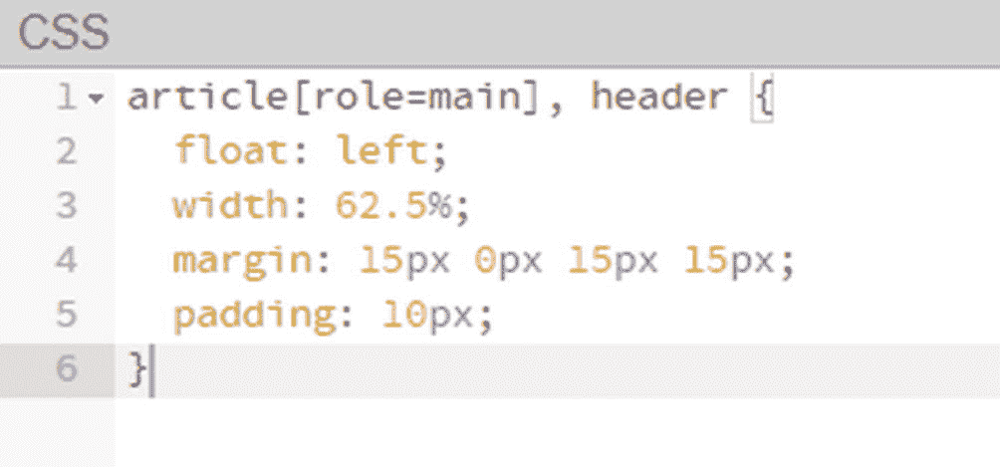

图 4-2：查看计算的结果

虽然这一点并非显而易见，但这个计算是基于 **黄金比例** 原理的。这个比例有助于量化为什么某些设计比其他设计更令人赏心悦目——这都关乎确保较大元素的比例是较小元素的两倍。不过，在我们的例子中，数字还不太精准——`960px`（我们的基础测量值）的 `62.5%` 等于 `600px`，然而如果我们严格遵循该比例，它应该接近 `594px`。嘿——在一个演示设计中，6 像素算什么？

如果你想了解更多关于这个原理的信息，谷歌上有大量在线文章的参考资料，例如 [`https://www.interaction-design.org/literature/article/the-golden-ratio-principles-of-form-and-layout`](https://www.interaction-design.org/literature/article/the-golden-ratio-principles-of-form-and-layout)。

在 Sass 中执行简单的数学运算只是冰山一角，关于其可能性还有很多：我们还可以使用许多其他函数！它们包括操作字符串、数字，甚至改变颜色——我们可以计算字符串的长度，将其切成更小的块，甚至可以基于现有值创建新的调色板。这是一个非常值得熟悉的方向，所以让我们深入探讨，更详细地看一些例子。

## 定义函数

如果你花时间编写网站样式，那么我相信你会理解需要为 `background-color()` 或 `font-size()` 等属性指定绝对值的必要性。这确实很麻烦，但如果我告诉你，你可能不必这样做呢……？

是的——没错：一旦你开始使用 Sass，有时你将不必手动计算值：你可以让 Sass 替你完成繁重的工作。Sass 的许多函数原理借鉴了诸如 JavaScript 等脚本语言——事实上，很多人会说，这正是 JavaScript 和 CSS 之间的界限开始真正模糊的一个领域！

除此之外，Sass 中的函数可以分为几类，总结在表 4-1 中。

表 4-1：Sass 中可用的函数类型

| 组别 | 描述（附示例） |
| --- | --- |
| 颜色（包含透明度） | 这分为三类——RGB、HSL 和透明度；此分组涵盖了诸如 `saturation()` 或 `hsl()` 等函数，这些函数旨在获取或操作颜色。 |
| 字符串 | 这组函数允许我们使用 Sass 操作字符串——执行诸如更改文本大小写、在字符串中插入字符以及获取字符串长度等任务。 |
| 数字 | 我们已经看到了如何在 Sass 中使用基本运算符，例如加法——这个组通过 `round()`、`abs()` 和 `random()` 等函数将其提升了一个层次。 |
| 列表 | 这组函数允许我们操作 Sass 列表，例如使用 `length()` 或 `nth()` 等操作从列表中获取特定项。**注意：** 列表在 Sass 中是不可变的，因此会返回一个新列表，而不是就地更新现有列表。 |
| 映射 | 映射是 Sass 中相对较新的特性——它们允许我们创建一个配置区域，而不必创建多个单独的变量。这组函数允许我们使用 `map-get()` 或 `map-values()` 等函数获取和操作映射中的内容。 |
| 选择器 | 如果我们需要在我们的 Sass 代码中执行诸如连接选择器或用一个选择器替换另一个选择器等任务——这组函数允许我们使用诸如 `selector-append()` 或 `selector-unify()` 等命令来执行此操作。 |
| 内省 | 这组函数有助于确定某些函数、变量或混合宏在我们的代码的当前作用域内是否存在，或者可以返回与值关联的类型。 |
| 其他 | 这包含两个不属于其他任何组的函数——`if()` 和 `unique-id()`。注意：在此上下文中，`if()` 函数是一个 *三元运算符*，而不是我们将在本章后面看到的条件函数。 |

完整的函数列表可在 Sass 主网站上找到，网址是 [`http://sass-lang.com/documentation/Sass/Script/Functions.html`](http://sass-lang.com/documentation/Sass/Script/Functions.html)。

要完全理解这些函数的工作原理，将超出本书的范围——事实上，我们很可能会就这个主题本身写出一本大部头！

尽管如此，花点时间探索 Sass 函数世界中至少一部分可用功能是值得的。在接下来的几页中，我们将深入探索操作 Sass 颜色作为一个小型案例研究；毋庸置疑，颜色非常重要，而 Sass 正是能够在我们开发过程中帮助生成代码的一个领域。

### 处理颜色——一个微型案例研究

没有颜色的网站就像没有激情的生活——非常枯燥！事实上，颜色不仅为网站增添了额外的光彩，还有助于传达信息：例如，在中国，红色传达了一种幸福感。

过去，我们可能已经在调色板中指定了一组颜色——这不仅耗时才能调对，而且要保持更新也很痛苦，特别是如果客户在最后一刻改变主意的话！

为了帮助解决这个问题，Sass 包含了许多不同的函数，允许我们以多种不同的方式操作颜色。例如，我们可以调整饱和度级别、更改亮度或改变颜色的色调——功能列表不胜枚举。要了解这在实践中的效果，可以看看 [`http://jackiebalzer.com/color`](http://jackiebalzer.com/color)：这个网站只指定了两种颜色，却包含了超过 30 种不同的色调，都是使用 Sass 函数创建的。这只是一个例子：快速在线搜索会显示其他类似的例子，例如：

# 操作颜色

### 介绍资源

*   [`http://scg.ar-ch.org/`](http://scg.ar-ch.org/) – 输入一种颜色以获取各种色调的十六进制代码，例如变亮或降低饱和度；
*   [`http://jim-nielsen.com/sassme/`](http://jim-nielsen.com/sassme/) – 使用滑块生成一种新颜色，并抓取代码以用于样式表；
*   [`https://codepen.io/KatieK2/pen/hbqsB`](https://codepen.io/KatieK2/pen/hbqsB) – 更多使用颜色函数的实验；
*   [`https://css-tricks.com/snippets/sass/tint-shade-functions/`](https://css-tricks.com/snippets/sass/tint-shade-functions/) – 由 Hugo Giraudel 创建的两个自定义函数，用于获取稍微更亮或更暗的颜色色调。

让我们一起使用其中一个函数，调整用于填充 SVG 图像的颜色——基础颜色是一种浅灰色调；我们将使用 `lighten()` 函数使其变得更亮。

### 创建第一个演示示例

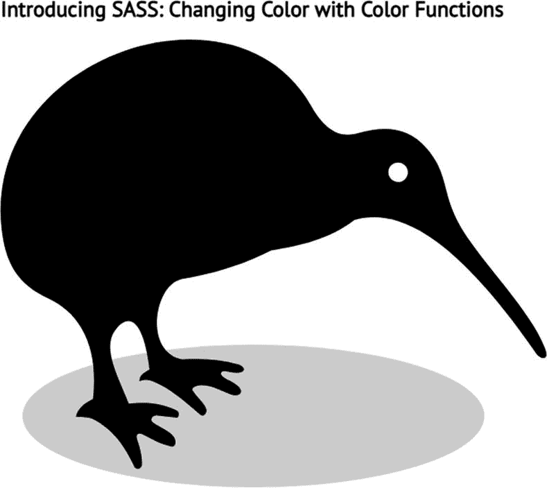

图 4-3 – 在 SVG 图像中调整颜色

1.  首先，从本书附带的代码下载中获取`colorfunctions`文件夹的副本，将其保存到我们的项目文件夹中。

2.  接着，新建一个文档并添加以下规则：

    ```
    @font-face { font-family: 'pt_sansregular'; src: url('../font/pt_sansregular.woff') format('woff'); font-weight: normal; font-style: normal; }
    body { font-family: 'pt_sansregular', sans-serif; margin: 32px; width: 850px; }
    ellipse { fill: lighten(#c6c6c6, 8); }
    ```

3.  将文件保存为`scss`文件夹中的`colorfunctions.scss`。

4.  接下来，启动一个终端会话，将工作目录切换到项目区域下的`colorfunctions`文件夹。

5.  在提示符下，输入以下命令并按回车键：

    ```
    sass sass\colorfunctions.scss css\colorfunctions.css
    ```

6.  如果一切顺利，我们应该会在`css`文件夹中看到`colorfunctions.css`文件以及一个源映射文件——预览结果会显示一个带有样式元素的简单模板页面，如图 4-3 所示。

这是一个非常基础的演示，旨在展示使用 Sass 颜色函数是多么简单。在这个例子中，我们使用了`fill:`属性，因为这是在处理 SVG 图像时的必要操作；如果是针对标准 HTML 元素，我们完全可以改用`background-color`或`color`属性。我们的演示将初始值的亮度提高了 8%，从`#c6c6c6`变为了`#dadada`——我们可以轻松将其指定为其他元素的新颜色，而无需创建会消耗资源的新变量。

现在让我们更进一步，创建一个更实用的例子——比如为网站生成一个配色方案？是的，你没听错——这正是 Sass 大显身手的好机会；我们只需指定一种颜色，然后让 Sass 自动为我们生成其他所有颜色。

更棒的是，我们甚至不需要自己计算目标颜色的数学公式——我们可以使用托管在[`http://razorltd.github.io/sasscolourfunctioncalculator/`](http://razorltd.github.io/sasscolourfunctioncalculator/)上的工具来帮我们完成转换。为了演示其工作原理，我们将使用 Color Palettes 网站（[`http://colorpalettes.net/`](http://colorpalettes.net/)）上的一个示例调色板，然后让 Sass 在编译过程中为我们生成颜色。

## 创建调色板

### 创建第二个演示示例

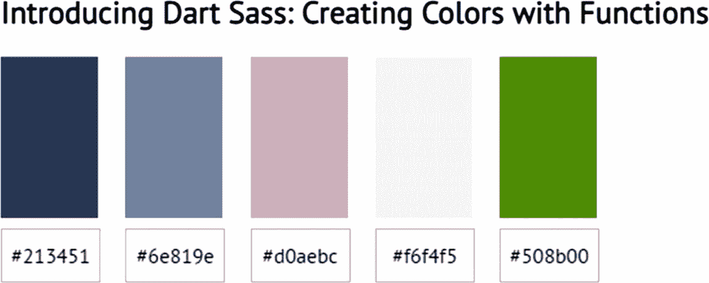

图 4-4 – 使用 Sass 创建调色板

1.  首先，从本书附带的代码下载中获取并解压`palette`文件夹的副本，将其保存到我们的项目文件夹中。

2.  接下来，我们需要添加样式；为此，请新建一个文档。由于规则较多，我们将逐个代码块添加，先从一些基础样式开始：

    ```
    $basecolor: #213451;
    @font-face { font-family: 'pt_sansregular'; src: url('../font/pt_sansregular.woff') format('woff'); font-weight: normal; font-style: normal; }
    body { font-family: 'pt_sansregular', sans-serif; margin: 32px; width: 850px; }
    #palette { margin-bottom: 15px; }
    ```

3.  基础样式设置完毕后，现在可以添加规则来设计每个色样：

    ```
    .swatch { height: 125px; width: 75px; display: inline-block;   margin-right: 17px; }
    .swlabel { border: 1px solid #bfbfbf; width: 75px; display: inline-block; margin-right: 15px; margin-top: -15px; text-align: center; padding: 10px 0px 10px 0;}
    ```

4.  为了给每个色样赋予颜色，我们需要在样式表中添加以下规则：

    ```
    .swatch:nth-child(1) { background-color: $basecolor; }
    .swatch:nth-child(2) {
    background-color: lighten(desaturate($basecolor, 22.27), 30.20);
    }
    .swatch:nth-child(3) {
    background-color: lighten(desaturate(adjust-hue($basecolor, 119), 15.54), 52.55);
    }
    .swatch:nth-child(4) {
    background-color: lighten(desaturate(adjust-hue($basecolor, 114), 32.11), 73.73);
    }
    .swatch:nth-child(5) {
    background-color: lighten(saturate(adjust-hue(#213451, -131), 57.89), 4.90);
    }
    ```

5.  将文件保存为`scss`文件夹中的`palette.scss`。

6.  接下来，启动一个终端会话，将工作目录切换到项目区域下的`palette`文件夹。

7.  在提示符下，输入以下命令并按回车键：

    ```
    sass sass\palette.scss css\palette.css
    ```

8.  如果一切顺利，我们应该会在`css`文件夹中看到`palette.css`文件以及一个源映射文件——预览结果会显示一个带有样式元素的简单模板页面，如图 4-4 所示。

尽管此演示中的 Sass 代码看起来可能很复杂，但实际上我们无需担心具体细节，因为大部分繁重的工作都是由我们在演示中使用的 Sass 颜色函数工具完成的。不过，以这种方式创建调色板确实有一些非常实用的好处，所以让我们深入探讨，更详细地分析一下代码。

### 代码详解

传统创建调色板的方法通常包括选择颜色，然后决定哪些该用于何处，并希望在开发过程中能保持一致！（我敢肯定这听起来比实际情况更糟糕，但它确实是一种手动的、具有一定风险的方法。）

然而，当你刚开始使用 Sass 时，可能会倾向于将不同的颜色赋值给变量——比如用`$white`代表白色，用`$desaturatedblue`代表`#213451`。创建变量很繁琐——我们必须确保所有颜色都能相互协调，并且整体调色板看起来合理（同时符合品牌指南）。

相反，我们可以彻底颠覆这一思路——尽管有一大段代码用于设置每个色样，但我们在第 16 行只指定了一种基础颜色。虽然这看起来可能有些疯狂，但理由充分——我们对基础颜色进行变换，使其变成此演示中选定的每个调色板颜色。我们来看中间那个色样，它的颜色是这样设置的：

```scss
background-color: lighten(desaturate(adjust-hue($basecolor, 119), 15.54), 52.55);
```

……我们可以将其分解为以下几个部分：

*   `adjust-hue($basecolor, 119)` – 这给了我们第一个中间色（或称为`color1`）；
*   `desaturate(color1, 15.54)` – 这得到了第二种颜色（或称为`color2`）；
*   `lighten(color2, 52.55)` – 这产生了我们最终的第三种颜色。

在这个例子中，我们创建了 3 种可以独立使用的新颜色；但我们采用的是让 Sass 一步到位地根据基础颜色自动计算出`color3`。同样的原理也适用于我们为调色板创建的每一种颜色——经过计算，我们从仅仅 1 种颜色中总共衍生出了 11 种颜色！

要查看拆分这个计算过程的效果，请参阅 [`https://gist.github.com/alexlibby/6fd1492781a08757c0112bb85c7a832a`](https://gist.github.com/alexlibby/6fd1492781a08757c0112bb85c7a832a)。该链接展示了将大型计算拆分成独立条目的结果。注意`p:nth-child(3)`如何等于`p:nth-child(4)`——我们的代码逐步执行每个计算，将前一次颜色变换的结果作为新变换的基础。

### 评估使用此方法的好处

创建颜色的方法看似复杂，但采用此方法有一些充分的理由：

-   我们总是可以执行查找和替换，但如果代码中对颜色或变量的拼写略有不同，会发生什么？查找和替换可能无法识别，从而导致代码中出现意外效果。
-   如果客户在最后一刻要求更改，那么你只需要更新一个值；其他一切都会在编译过程中自动计算出来。
-   我们不需要为每种颜色创建变量——虽然像我们这样的计算编译可能需要多花几秒钟，但我们并不是“即时”编译代码，所以我们可以接受所需的额外编译时间。

当然，如果我们最终得到一个巨大的样式表（我指的是数万行代码），那么这些额外的编译时间可能会开始累积——如果是这种情况，我们可能更倾向于使用变量。

好了，让我们继续：我们已经接触了一些可用的函数，并探讨了如何在代码中实际使用它们。尽管这为代码引入了一定的动态性，但我们仍然受到限制，因为我们的函数只会产生一个值（就像上一个演示中的情况一样）。

如果我们需要根据满足特定条件来指定不同的值，该怎么办？嗯，Sass 可以提供帮助——它借鉴了诸如 JavaScript 等脚本语言的技术来实现循环等功能。这是该库中一个非常重要的部分，非常值得探索，所以让我们更详细地看看可用于评估 Sass 代码中条件的功能。

## 评估条件

> *决策，决策——我们用这种颜色，还是另一种……？把内容放在页面顶部怎么样……？*

我们的生活充满了必须做出的决定——在大多数情况下，我们会做出正确的选择，但有时也可能出错！样式化内容也是如此：我们选择的颜色可能会与网站上使用的其他颜色冲突，或者我们应用的背景颜色最终可能导致文本难以辨认。

不过，使用 Sass 的一个关键好处是，我们可以构建一定程度的控制来减少这些问题——如果某个元素的颜色特别暗，那么可以指示 Sass 选择较浅的颜色，以便我们的内容保持清晰易读。

我们如何实现这一点？好吧，是时候认识一下 Sass 的控制指令和表达式了！这个冗长的名称代表了一组函数，它们允许我们控制使用哪些样式以及何时使用——值得注意的是，它们更常用于 mixin 中，但也可以在需要时用于日常样式编写。让我们逐一看看它们，从 `@if` 函数开始。

### 应用 `@if` 和 `@if()`

假设我们遇到了颜色冲突的问题，这是由于对比度不足造成的——我们该如何解决这个问题？嗯，一种解决方法当然是替换有问题的颜色，但这需要手动操作，比较费力。不如让 Sass 替我们选择？

没问题——Sass 有两个函数可以提供帮助：讽刺的是，它们都叫 `@if`，但各有不同的用途！第一个是 `@if()`，格式如下：`if(true, 1px, 2px) => 1px`——用于决定我们是应该应用第一个值 (`1px`)，还是在该变量不存在或可能导致错误（例如除以零）时选择 `2px`。

第二个更直接——我们可以使用 `@if` 来决定是否包含某个值，例如这个例子：`@if 1 + 1 == 2 { border: 1px solid; }`，它会被判定为真。如果判定为假，那么 border 属性根本不会被设置。这两个函数可能都有点难以完全理解，所以让我们创建一个演示来更详细地探索它们的工作原理。

### 使用 If 语句

第一步是获取本书附带的示例文件——有了它之后，请按照以下步骤操作：

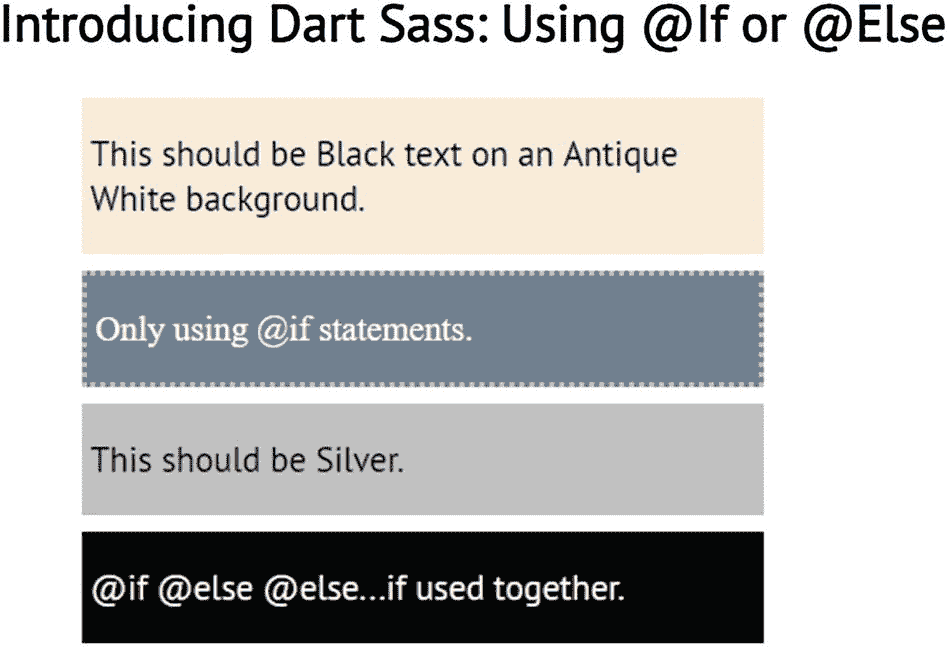
**图 4-5**
使用 `@if...@else` 语句

1.  首先，从本书附带的代码示例中下载并解压 `condition` 文件夹的副本——继续将其保存到我们的项目文件夹中。
2.  我们的演示不包含使其正常运行所需的 Sass 样式——为此，继续创建一个新文件，并将其保存为我们第 1 步中保存的 `condition` 文件夹下的 `sass` 子文件夹中的 `condition.scss`。
3.  我们需要添加一些样式规则，我们将逐块添加，从设置演示所需的一些基本样式开始：

```scss
@font-face { font-family: 'pt_sansregular'; src: url('../font/pt_sansregular.woff') format('woff'); font-weight: normal; font-style: normal; }
body { font-family: 'pt_sansregular', sans-serif; margin: 32px; font-size: 20px; }
li { padding: 20px 5px; margin: 10px; color: white; width: 400px; list-style: none; }
```

4.  接下来是演示的核心——我们首先指定三种颜色，它们由三个 `if` 语句的结果定义：

```scss
$first-color: if(true, antiquewhite, black);
$second-color: if(false, black, slategrey);
$third-color: if(4 > 2, silver, black);
```

5.  现在，我们需要添加一些条件，这些条件决定了四个列表项中每个项所使用的某些属性：

## 使用条件语句

```scss
li:nth-of-type(1) {
    background: $first-color;
    @if (lightness($first-color) > 75%) {
    color: black;
    } @else {
    color: white;
    }
    }
    li:nth-of-type(2) {
    @if 1 + 1 == 2 { background: $second-color;  }
    @if 5 > 3 { border: 3px dotted $third-color; width: 394px; }
    @if true { font-family: 'sans-serif'; }
    }
    li:nth-of-type(3) {
    background: $third-color;
    @if (lightness($third-color) > 75%) {
    color: black;
    } @else {
    color: white;
    }
    }
    li:nth-of-type(4) {
    @if 1 + 1 == 2 { background: darken($second-color, 50%); }
    @else if 1 + 2 == 3 { background: $second-color; }
    @else if 5 > 3{ border: 2px dotted $third-color; }
    }
```

6.  继续保存文件——接下来，启动一个终端会话，并将工作文件夹更改为项目区域下的 `condition` 文件夹。

7.  在提示符下，输入以下命令并按 Enter：

    ```
    sass sass\condition.scss css\condition.css
    ```

8.  如果一切顺利，我们应该会在 `css` 文件夹中看到一个 `colorfunctions.css` 文件以及一个 source map——预览结果将显示一个带有样式元素的简单模板页面，如图 4-5 所示。

乍一看，我们的演示非常简单，每个列表项都有简单的样式。然而，在表面之下，它隐藏了大量的决策过程，这些过程决定了每个列表项应该使用哪种颜色！我们在本演示中使用了两个关键函数，理解它们很重要，所以让我们花几分钟时间更详细地探讨它们的工作原理。

### 理解发生了什么

我们演示样式表的第一部分包含一些标准规则，用于定义演示和每个列表项的基本样式。不过，演示的关键从第 22 行开始，我们使用了三个 `@if()` 语句来创建颜色。

理解这些语句工作原理的最简单方法是：“如果条件为 X，则使用第一个值（真），否则使用第二个值（假）。”对于第一个语句，我们将“复古白”指定为真值颜色；由于我们的条件设置为真，这就是样式表中将使用的颜色。

对于第二种类型的 `@if` 语句（我们为第二个列表项设置了三个属性），只需要满足每个条件即可。如果答案正确（即为真），则应用方括号中显示的属性；如果不正确，则丢弃该属性。

剩下的两个示例与前两个的工作方式相同——第三个列表项遵循与第一个列表项相同的原理，第四个则采用与第二个列表项相同的技术。

## 循环遍历样式

Sass 的关键能力之一是接管生成样式的工作——例如，我们可以使用函数创建整个调色板，或者让 Sass 选择应用于背景的颜色，使其不与前景色冲突。

但这只是 Sass 所能实现的一小部分——Sass 真正的强项在于遍历多个元素，从一组指令中为每个元素应用样式。例如，为电商网站创建一组支付卡图标——我们可以创建一组通用样式，但利用 Sass 从单个名称列表中为每个图像生成独特的样式。

Sass 有许多适合这类任务的函数——它们各有独特特性，但都遵循遍历一组元素的类似原理。让我们逐一了解，从 `@for` 函数开始。

### 使用 `@for`

我们的第一个函数 `@for` 用于重复创建一组样式——它使用一个计数器来遍历该样式的每个实例，并根据指令中的指定内容调整每个实例。该指令的语法非常简单：`@for $var from <start> through <end>`，更改内容用花括号括起来。

还有第二种格式可用——将单词 `through` 替换为 `to`，效果同样良好。

让我们通过一个快速演示详细了解这个函数的工作原理。

### 使用 `@for` 应用样式

让我们开始设置我们的演示：

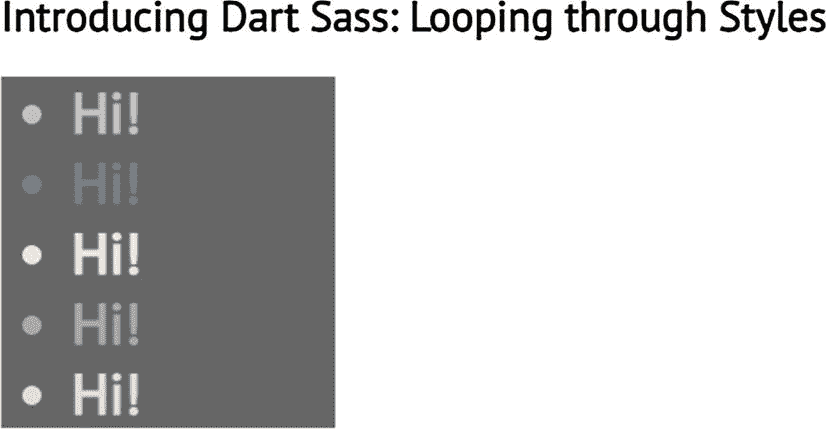

图 4-6

使用 `@for` 循环遍历样式

1.  我们首先从本书附带的代码下载中下载并解压 `forloop` 文件夹的副本；继续将其保存到我们的项目文件夹中。

2.  下载内容包含所有标记，但如果没有样式，这些将毫无用处，所以让我们创建一个新文件，将其保存为 `sass` 文件夹中的 `forloop.scss`，用于此演示。

3.  在文件中，依次添加以下代码块，从一些设置演示的基本样式开始：

    ```scss
    $basecolor: #213451;
    @font-face {
    font-family: 'pt_sansregular';
    src: url('../font/pt_sansregular.woff') format('woff');
    font-weight: normal;
    font-style: normal;
    }
    body { font-family: 'pt_sansregular', sans-serif; margin: 32px;}
    ul { width: 150px; background-color: rgba(0,0,0,0.6) }
    ```

4.  其余规则构成了我们演示的关键——这些规则负责为每个列表项设置样式：

    ```scss
    $rainbow: silver slategrey antiquewhite darkgrey gainsboro;
    @for $i from 1 through 5 {
    li:nth-child(#{$i}) {
    color: nth($rainbow, $i);
    font-size: 32px;
    font-weight: bold;
    }
    }
    ```

5.  继续保存文件——接下来，启动一个终端会话，并将工作文件夹更改为项目区域下的 `forloop` 文件夹。

6.  在提示符下，输入以下命令并按回车键：

    ```
    sass sass\forloop.scss css\forloop.css
    ```

7.  如果一切顺利，我们应该会看到 `css` 文件夹中出现一个 `forloop.css` 文件，以及一个源映射——预览结果将显示一个包含样式元素的简单模板页面，如图 4-6 所示。

嘿嘿——我打赌你没想到一个演示可以这么友好！好吧——是的，这是个很糟糕的笑话，但抛开内容不谈，我们的演示展示了一个有用的概念，在使用 Sass 进行开发时值得掌握。让我们更详细地看看这个概念。

### 理解代码如何工作

那么——我们说的这个概念是什么？是重复——我们有五个项目组成了一个简单的列表：所有这些都需要样式，但并非所有值都相同！

我们的演示包含一个简单无序列表中的五个列表项——由于大多数样式相似，我们只需编写一个实例，并使用 Sass 的 for 循环依次遍历每个项目，以应用适当的样式：

```scss
$rainbow: silver slategrey antiquewhite darkgrey gainsboro;
@for $i from 1 through 5 {
li:nth-child(#{$i}) {
color: nth($rainbow, $i);
font-size: 32px;
font-weight: bold;
}
}
```

但关键在于颜色属性——因为我们想应用不同的颜色，所以创建了一个列表，并将其赋值给变量 `$rainbow`。在 for 循环中，我们遍历这个列表并为每个项目依次应用颜色，颜色值使用字符串插值（将 `(#{$i})` 替换为适当的数字）进行格式化。编译后，每个列表项的代码将类似于图 4-7 中所示的示例。

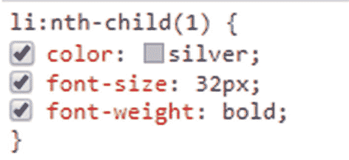

图 4-7

为列表项添加样式

这是一种很好的应用样式的方式，但需要记住的关键点是重复——我们定位的项目必须是同一类型。在这个例子中，我们定位的是列表项；其他类型的元素必须单独设置样式。

### 使用 `@each` 进行循环

下一个循环函数稍微复杂一些——它本身不是一个循环函数，但我们却在循环遍历多个项目！让我解释一下我的意思：

`@each` 函数允许我们将一个变量设置为列表或 Sass 映射中的每个项目——列表只是一组逗号分隔的值。映射则将这一点提升到一个层次——它允许我们为单个项目分配多个值，这些值都关联到同一个项目。例如，我们可能正在讨论一组汽车——属性可能包括颜色、品牌、型号：这些属性分别适用于每辆汽车。

我们将在本章后面更详细地重新讨论 Sass 映射的主题。

为了理解这在实践中意味着什么，我们将创建一个简单的演示，使用 `@each` 函数设置多个按钮——对于每个按钮，我们将使用 Sass 列表指定颜色和按钮功能，然后遍历每个按钮以创建最终的样式规则。

### 为每个项目设置样式

让我们开始演示：


图 4-8 使用 `@each` 创建按钮样式

1.  首先，从本书附带的代码下载中获取 `eachitem` 文件夹的副本，并将其保存到项目文件夹的根目录下。

2.  接下来，我们需要添加 Sass 样式——为此，请创建一个新文件，将其命名为 `eachitem.scss`，并保存在步骤 1 中创建的 `condition` 文件夹下的 `sass` 子文件夹中。

3.  我们需要添加几条样式规则，我们将逐块添加，首先从设置演示所需的一些基本样式开始：

    ```
    @import url(https://fonts.googleapis.com/css?family=Poiret+One);
    @font-face {
    font-family: 'pt_sansregular';
    src: url('../font/pt_sansregular.woff') format('woff');
    font-weight: normal;
    font-style: normal;
    }
    body {
    font-family: 'pt_sansregular', sans-serif;
    margin: 32px;
    }
    ```

4.  接下来是一些我们创建的初始值，以及一个用于成对存储值的 Sass 列表（每对包含按钮类型和指向其颜色的变量）：

    ```
    $publish: gainsboro;
    $postpone: antiquewhite;
    $delete: silver;
    $states: (publish, $publish),
    (postpone, $postpone),
    (delete, $delete);
    ```

5.  基础值设置好后，我们现在可以设置按钮的样式——为此，请继续添加以下代码：

    ```
    @each $buttonstate, $color in $states {
    button { color: #000; text-decoration: none; padding: 5px 10px; border-radius: 3px; font-family: 'Poiret One', cursive; font-size: 32px; font-weight: bold; outline: 0; }
    .#{$buttonstate} {
    padding: 10px 20px;
    border: none;
    background-color: $color;
    &:hover { background-color: darken( $color, 10% );      transition: all 0.3s ease; }
    &:active { background: darken($color,25%); }
    }
    }
    ```

6.  保存文件——接下来，打开一个终端会话，将工作目录切换到项目区域下的 `eachitem` 文件夹。

7.  在提示符下，输入以下命令并按回车键：

    ```
    sass sass\eachitem.scss css\eachitem.css
    ```

8.  如果一切顺利，我们应该会在 `css` 文件夹中看到一个 `colorfunctions.css` 文件，以及一个源映射文件——预览结果将显示一个带有样式元素的简单模板页面，如图 4-8 所示。

到目前为止，我们讨论了在迭代过程中为项目应用样式——无论组中有多少个项目，每个项目都会应用相同的样式集。本演示展示了一种遍历项目的不同方式；它有一个关键区别，所以让我们暂停片刻，更详细地回顾一下我们演示中的代码。

### 剖析演示

`@each` 函数有所不同——首先，它不强调数字；`@each` 会遍历目标列表中的所有内容。然而，`@each` 的好处在于，它能够为列表中的每个项目将属性分组在一起；Sass 会依次将每个属性应用于该项目。

以我们的演示为例——我们创建了一组三个按钮，它们成对地应用了按钮类型和颜色：

```
$states: (publish, $publish),
(postpone, $postpone),
(delete, $delete);
@each $buttonstate, $color in $states {
...
.#{$buttonstate} {
...
&:hover { background-color: darken( $color, 10% );      transition: all 0.3s ease; }
&:active { background: darken($color,25%); }
}
}
```

我们首先为每个按钮创建一个项目列表——列表项是成对的，每个按钮都分配了 `$buttonstate` 和 `$color` 值。然后，我们遍历每一对，使用字符串插值根据按钮类型创建样式。同时，我们为每个按钮创建悬停和激活状态，使用提供的 `$color` 值，悬停时颜色变深 `10%`，激活时颜色变深 `25%`。

## 在条件为真时循环

有时，我们可能没有定义要遍历的项目数量，或者这个数量可能会变化——在这些情况下，使用 `@for` 循环或数组中的 `@each` 将不起作用。相反，我们必须使用另一个函数——`@while`。

那么——我听到你在问：有什么区别？答案很简单——它基于“只要满足给定条件就继续循环”的原则。一旦我们无法满足这个条件，循环就会停止，Sass 将继续编译样式表中的下一组规则。在许多情况下，`@while` 循环的工作方式与其他语言（如 JavaScript）非常相似——为了理解我的意思，让我们看一个简单的示例，其中我们遍历十个列表项，并为每个项应用更深的颜色阴影。

### 循环 `@while` 真

我们的演示非常容易搭建，让我们开始：

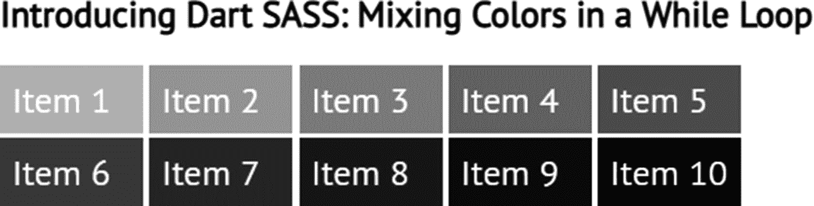

图 4-9 使用 while 循环设置列表项样式

1.  首先，从本书附带的代码下载中获取 `whileloop` 文件夹的副本，并将其保存到项目文件夹的根目录下。

2.  接下来，我们需要添加 Sass 样式——为此，请创建一个新文件，将其命名为 `whileloop.scss`，并保存在步骤 1 中创建的 `condition` 文件夹下的 `sass` 子文件夹中。

3.  我们需要添加几条样式规则，我们将逐块添加，首先从设置演示所需的一些基本样式开始：

    ```
    $start-color: gainsboro;
    $end-color: black;
    $white: #ffffff;
    $step: 1; // 设置初始步骤值
    @font-face {
    font-family: 'pt_sansregular';
    src: url('../font/pt_sansregular.woff') format('woff');
    font-weight: normal;
    font-style: normal;
    }
    body { font-family: 'pt_sansregular', sans-serif; margin: 32px; padding: 32px 80px; width: 550px; }
    ```

4.  我们正在创建一组列表项，因此需要应用一些每个列表项共有的基本样式，例如字体大小：

    ```
    ul { margin: 0; padding: 0; }
    li {
    color: $white;
    display: inline-block;
    font-size: 24px;
    list-style-type: none;
    margin-bottom: 3.2px;
    padding: 8px;
    width: 80px;
    }
    ```

## 5. Sass 样式的最后一部分负责为每个列表项应用逐渐加深的颜色阴影：

```scss
@while $step <=10  {
// 从一种颜色渐变到另一种颜色
.mix li:nth-child(#{$step}) {
background-color: mix($end-color, $start-color, ($step * 10));
}
$step: $step + 1;
}
```

## 6. 保存文件——接下来，打开一个终端会话，将工作目录切换到项目区域下的 `whileloop` 文件夹。

## 7. 在提示符下，输入以下命令并按回车键：

```bash
sass sass\whileloop.scss css\whileloop.css
```

## 8. 如果一切顺利，我们应该会在 `css` 文件夹中看到一个 `whileloop.css` 文件，以及一个源映射文件——预览结果将显示一个带有样式元素的简单模板页面，如图 4-9 所示。

当处理多个相同类型的项目时，使用循环是一种以迭代方式应用样式的好方法，无需为每个项目单独编写样式声明。这是一项值得学习的有用技术，即使你在刚开始使用 Sass 时可能不会立即用到它——让我们花点时间更详细地探讨我们的代码是如何工作的。

## 深入探究代码细节

那么，我们的代码是如何工作的呢？其实，大部分样式声明都是标准的 CSS – 让演示生效的关键在于这个函数：

```scss
@while $step <=10  {
// changes from one color to another
.mix li:nth-child(#{$step}) {
background-color: mix($end-color, $start-color, ($step * 10));
}
$step: $step + 1;
}
```

在这段代码中，我们创建了一个循环，变量 `$step` 的（隐式）初始值设为零。然后我们用这个值替换粗体高亮部分（一个插值字符串），来创建我们的规则——这条规则包含一个 `background-color` 声明，它是由两种颜色（浅灰色和黑色）混合而成。我们通过将 `$step` 的值增加 1 来结束循环——这使我们移动到组中的下一个列表项。我们可以在图 4-10 所示的示例代码中看到这个函数的效果。

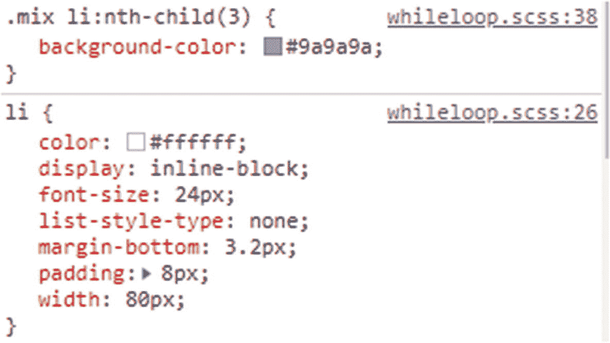

**图 4-10** 从 `@while` 循环编译生成的代码

看，为每个列表项设置样式是多么简单？诚然，我们的代码可能过于简化了，但可重复性的原则同样适用——只要我们有一个合适的元素组（例如列表项），我们就可以使用 Sass 自动为它们应用样式。

好了，让我们继续：现在是将注意力转向 Sass 中一个较新功能的时候了。当为元素设置样式时，我们可能会创建一组样式“调色板”，用于某些特定元素，如标题或表格。与其创建一堆不同的变量，我们可以使用一种更高效的方法：创建一个映射。注意，我不是指要复制制图师多年来的做法，而是指别的东西：一种引用已分组特定属性的方式。让我们深入探讨一下，看看这在实际中意味着什么。

### 为属性列表或映射应用样式

尽管 Sass 映射对 Sass 来说是一个相对较新的概念（在 Dart Sass 的前身 Ruby Sass 3.3 版本中引入），但它价值连城——为什么？好吧，让我解释一下它们是如何工作的：

在过去，我们可能会创建多个变量来存储值——这虽然可行，但是一种非常手动、低效的存储值的方式：此外，除了它们在样式表中可能出现的位置之外，我们实际上无法对每个项进行分组。

相反，我们可以使用映射——它至少由两部分组成：初始映射变量和调用每个引用的代码块。在单个变量中，我们可以使用以下语法分配多个键值对：

```scss
$map: (key1: value1, key2: value2, key3: value3);
```

……其中 `key` 是映射的引用，`value` 是我们在编译时希望在样式表中显示的值。当我们需要调用一个值时，我们会使用类似这样的语法：

```scss
text-align: map-get(<map>, <key>)
```

让我们通过重温我最喜欢的效果之一来实践一下——我们将使用经典的宝丽来效果来设置一张老式相机图片的样式。

### 创建和使用 Sass 映射

对于下一个演示，我们将使用一个已预先使用 Sass 但可以轻松转换为使用 Sass 映射的演示。我们的老式相机图片来源于 Pexels 网站，网址是 [`https://www.pexels.com/photo/antique-camera-classic-lens-242433/`](https://www.pexels.com/photo/antique-camera-classic-lens-242433/)。

让我们更新演示以使用 Sass 映射：

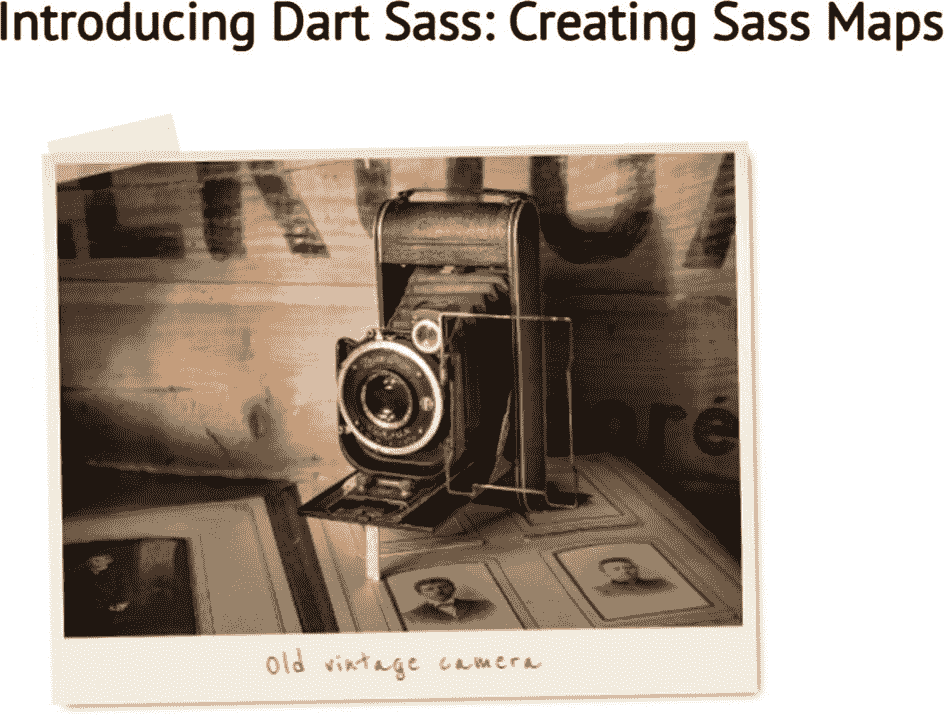

**图 4-11** 使用映射创建宝丽来图片

1.  首先，从本书附带的代码下载中下载 `sassmap` 文件夹的副本——将其保存到项目文件夹的根目录。

2.  这次，我们的演示已经包含了 Sass 样式，但我们打算对其进行修改——为此，请打开我们在步骤 1 中保存的 `sassmap` 文件夹中 `sass` 子文件夹下的 `sassmap.scss` 文件。

3.  在文件的顶部，在 `@font-face` 声明之前，插入如下代码：

    ```scss
    $styling-figcaption: (
    'text-align': center,
    'font-family': Reenie Beanie,
    'font-size': 20.8px,
    'color': #454f40,
    'letter-spacing': 1.44px,
    );
    ```

4.  向下滚动，直到找到 `figcaption{`，大约在第 69 行。

5.  替换这个样式规则的内容，使其看起来像这样：

    ```scss
    figcaption {
    text-align: map-get($styling-figcaption, 'text-align');
    font-family: map-get($styling-figcaption, 'font-family');
    font-size: map-get($styling-figcaption, 'font-size');
    color: map-get($styling-figcaption, 'color');
    letter-spacing: map-get($styling-figcaption, 'letter-spacing');
    }
    ```

6.  保存文件——接下来，打开一个终端会话，将工作目录切换到项目区域下的 `sassmap` 文件夹。

7.  在提示符下，输入以下命令并按 Enter：

    ```bash
    sass sass\sassmap.scss css\sassmap.css
    ```

8.  如果一切顺利，我们应该会看到 `css` 文件夹中出现一个 `sassmap.css` 文件以及一个源映射文件——预览结果将显示一个带有样式元素的简单模板页面，如图 4-11 所示。

这是一个非常简单的修改，但它使我们的代码管理起来轻松了无数倍——现在，我们不仅可以从单个变量中访问每个属性，还可以在代码中多次这样做。然而，我们仅仅触及了 Sass 映射工作原理的表面：我们还能做更多！尽管如此，花点时间仔细梳理一下我们的代码，看看映射在 Sass 开发中究竟有多强大，是值得的。

### 解析我们的代码

乍一看，我们更新后的代码可能看起来更“冗长”（即，代码比以前多了）。但请记住，Sass 经常会有这种情况——在这种情况下，一切旨在让我们更容易了解代码中使用的是哪个值。

我们的代码首先添加了一个映射，它是一组成对的属性；这被赋值给一个变量。如果你熟悉这种技术，可以把它想象成一个数组；其工作方式非常相似。映射非常适合将页面上特定元素（如标题或 `<h2>` 标签）的通用样式分组在一起。

然后，当我们创建 `figcaption` 规则时，我们引用了这个映射——我们没有直接将值输入到规则中，而是简单地用对 `$styling-figcaption` 映射的调用替换它们，并传入我们想要获取的属性的适当引用。

这种分组方式使得识别属性关联的内容变得更加容易，并消除了在代码中使用多个变量的需要。所以——例如，如果我们调用 `map-get($styling-figcaption, 'text-align')`，我们会得到 `center` 这个值。我们最初可能会将其设置为标题的多个属性之一（如前所述），但我们可以在代码中的任何示例中调用这个 `map-get()` 函数并使用它，而不仅仅是用于标题！

## 使用 @media 创建断点

在本章中，我们已经探讨了使用 Sass 函数执行各种任务（例如生成颜色）的不同方式，以及如何使用其控制指令来决定样式表中应写入的内容。

不过，还有一个控制指令我们尚未介绍——对于任何从事响应式网站开发的开发者来说，这个指令应该一眼就能认出来。是的，我指的是 `@media`——它的工作方式与标准 CSS 中的 `@media` 基本相同，但有一个额外的功能：媒体指令可以嵌套在 Sass 内容中。

简而言之，这意味着任何出现在 CSS 规则中的 `@media` 都会提升到样式表的顶层——这使得添加特定于媒体的样式变得容易，而无需重复选择器或破坏样式表的流程。让我们通过一个简单的概念验证，看看这在实践中意味着什么，展示如何使用 Sass 实现媒体指令。

### 创建断点

为了演示的目的，我们将在元素方面保持非常简单——只有一个 `<div>`，当屏幕宽度调整时它会改变颜色。让我们开始设置练习：

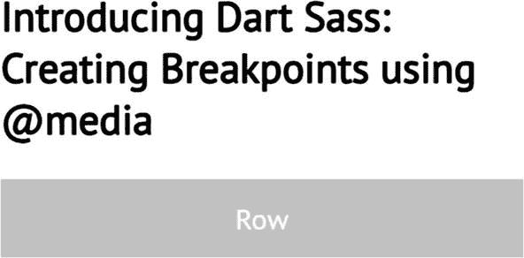

图 4-12
我们完成的断点示例，处于平板宽度

1.  首先，从本书附带的代码下载中下载 `breakpoints` 文件夹的副本——将其保存到我们项目文件夹的根目录。

2.  下载内容包含所有标记，但如果没有样式，这些标记将毫无用处，因此让我们创建一个新文件，将其保存为 `sass` 文件夹中的 `breakpoints.scss` 用于此演示。

3.  我们需要添加一些样式规则，我们将逐块添加，首先从设置演示所需的一些基本样式开始：

```
@font-face {
    font-family: 'pt_sansregular';
    src: url('../font/pt_sansregular.woff') format('woff');
    font-weight: normal;
    font-style: normal;
}
body { font-family: 'pt_sansregular', sans-serif; margin: 32px; font-size: 20.8px; }
```

4.  接下来是设置断点所需的样式——我们首先设置一个 Sass 映射来存储我们的断点：

```
$media-queries: (
    tablet: (
        breakpoint: '(min-width: 480px) and (max-width: 768px)',
    ),
    mobile: (
        breakpoint: '(max-width: 480px)'
    )
);
```

5.  然后我们需要添加一个混入（mixin），它将被调用来创建样式：

```
@mixin media-query ($size) {
    @each $item, $value in $media-queries {
        @if $item == $size {
            @if map-get($value, breakpoint) != null {
                @media only screen and #{map-get($value, breakpoint)} {
                    @content;
                }
            }
        }
    }
}
```

6.  样式部分快要完成了——最后但同样重要的是，为我们的响应式 `<div>` 元素添加基本样式，以及调用混入来添加响应式颜色：

```
.row { display: inline-block; width: 100%; font-size: 22.4px;
    text-align: center; color: #FFF; padding: 4% 10%; box-sizing: border-box; }
.row {
    background: darkgrey;
    @include media-query(mobile) {
        background: lightgrey;
    }
    @include media-query(tablet) {
        background: darkgrey;
    }
}
```

7.  保存文件——接下来，启动一个终端会话，并将工作文件夹切换到项目区域下的 `breakpoints` 文件夹。

8.  在提示符下，输入以下命令并按 Enter：

```
sass sass\breakpoints.scss css\breakpoints.css
```

9.  如果一切顺利，我们应该会看到 `css` 文件夹中出现一个 `breakpoints.css` 文件，以及一个源映射——预览结果将显示一个包含样式元素的简单模板页面，如图 4-12 所示。

尽管我们的演示只包含一个元素，但我们仍然需要添加相当数量的代码来使其具有响应性！我们的代码展示了一些值得掌握的关键技术；其中大多数你已经在本书前面遇到过，但不是在使元素具有响应性的上下文中。让我们花几分钟重新审视代码，更详细地了解其工作方式。

### 理解发生了什么

尽管我们之前已经见过此演示中使用的大多数技术，但乍一看，你可能会觉得它看起来比实际复杂。实际上，这是相当直接的代码，让我们一步步地过一遍：

我们代码的核心从步骤 4 开始，在那里我们创建了一个媒体断点映射——我们指定了两个典型的断点（平板和移动端），但同样可以根据需要包含桌面和其他设备的断点。在这个映射中，我们指定了一个介于 `480px` 和 `768px` 之间的断点，以及另一个用于适应宽度不超过 `480px` 的设备的断点。

接下来是一个混入——我们将断点大小作为文本名称传入，这里可能是 mobile 或 tablet。然后我们遍历映射中的每个条目；如果映射包含一个正确大小的条目，我们使用 `map-get` 获取其断点 `$value`，前提是映射中存在合适的值。假设存在这样的值，那么我们使用特殊关键字 `content` 将此媒体查询应用于所有声明，直到该选择器的顶层。这将得到类似于图 4-13 所示的结果。

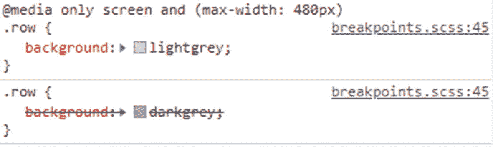

图 4-13
我们编译后的媒体查询

我们的代码看起来很复杂，但实际上，我们只需要关心的部分是 Sass 映射和对混入的调用——混入本身不会改变，并且同样可以使用 `@include` 命令从单独的样式表中导入。这让我们可以专注于为媒体查询映射提供正确的断点（也可以导入），并确保在样式表中的适当位置放置调用。

### 总结

呼——真是精彩纷呈！我们在本章中涵盖了大量的内容，所以在进入下一章创建演示之前，让我们花点时间回顾一下本章学到的内容。

我们首先了解了如何在 Sass 中使用函数——我们看到了这些函数如何用于各种目的，但特别适用于诸如创建颜色之类的任务。我们还探讨了以这种方式使用函数的好处，以及它如何使创建代码更加容易。

接下来，我们研究了如何在编译时根据评估某些条件来分配样式——这包括查看 Sass 的控制指令和表达式，以及通过循环遍历元素组来自动创建样式的各种方法。我们还了解了如何指定循环中已知数量的项目，或者使用仅在代码中满足特定条件时才会运行的循环。

然后，我们继续探索 Sass 映射的使用，并看到将值分配给单个占位符是多么容易，而以前我们可能需要使用多个变量来执行相同的任务。最后，我们通过简要介绍 `@media` 指令来结束本章，了解 Sass 如何帮助为响应式网站或在线应用程序创建媒体查询。

好了——我们几乎到了本书的结尾，但在离开之前，我们必须将所学的一些内容付诸实践！为了帮助实现这一点，我们将进行一个微型案例研究，看看如何在更实际的示例中使用我们学到的一些技术——是时候准备好那些模拟信用卡了，因为我们要创建一个购物车的用户界面。如果我是你，我会先去喝杯咖啡或饮料，因为在接下来的几页中我们要涵盖很多内容……！