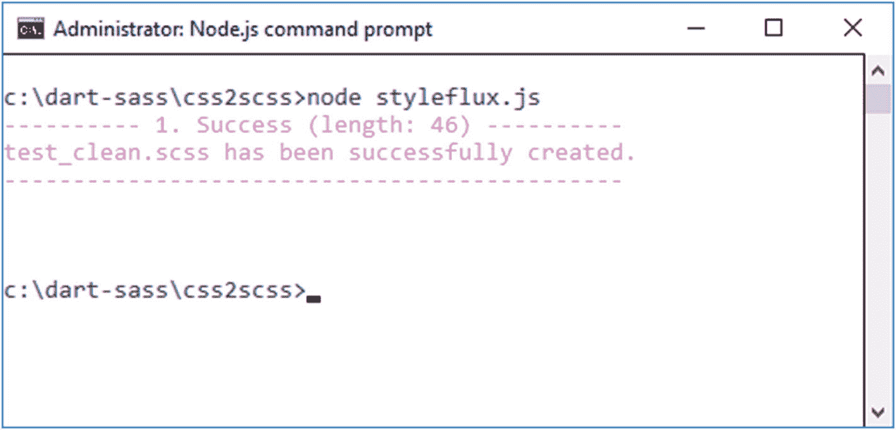
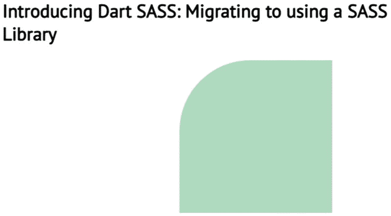
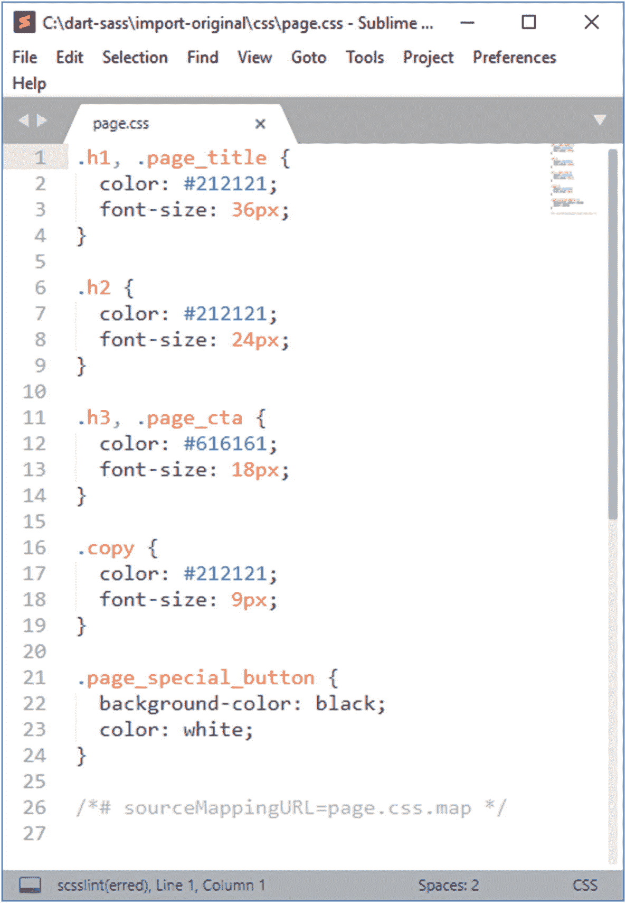
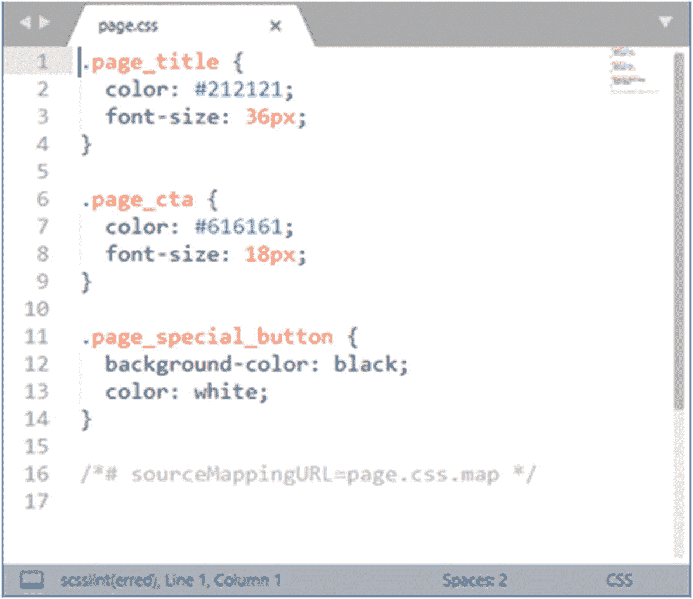

# 5. 开始使用 Sass 进行转换

在本书中，我们第一次接触了 Sass，并了解了多种用于编写有效 CSS 代码的新技术。我们编写的大部分代码都是从头开始的；我猜想很多人会问——如何将现有项目转换为使用 Sass 呢？

这是一个很好的问题：我们所学的很多内容都假设在一个理想世界中，我们会从头编写代码，这也是充分发挥 Sass 优势的最佳方式。显然，这种理想情况并不总是发生，因此我们在开发中必须考虑到这一点。将庞大的样式表转换为有效的 Sass 代码可能看起来令人生畏，但只要有一点耐心和周密的计划，这是可以实现的。为此，需要牢记三个关键因素：

- Sass 仅仅是 CSS 的一个超集——不要认为你必须一次性转换所有内容！相反，分阶段进行更改：可能需要更长的时间，但从长远来看会更有效。
- 规划和有条不紊绝对是最关键的——确保你的代码格式一致：例如，颜色代码应使用相同的表示法（白色用 `#fff` 或 `#ffffff`，但不要混用）。
- 尽可能实现自动化——有可用的工具可以提供帮助，例如使用 Autoprefixer 在编译期间处理所有浏览器前缀。

样式表的长度并不重要——我们可以使用相同的技巧将其分解并转换为对应的 Sass 代码。事实上，你可能会发现样式表越长越好：以 WordPress 自己的样式表为例，它超过 4,500 行，并且本身就是用 Sass 编写的。

我们可以使用一些小技巧来帮助过渡到使用 Sass，所以无论项目是什么，让我们看看如何让转换过程变得更容易。

## 简化流程

乍一看，转换一个庞大的样式表确实会令人生畏——在本章中，我将向你展示一些可以开始转换过程的技巧和技术，并将其分解为更易于管理的步骤。

当然，首要任务是设置好我们的 Sass 开发工作流——我们已经使用过手动编译器来生成 CSS 代码，但我们很可能还需要更多；是时候更进一步了！此时我们需要自动化我们的流程：我建议使用 Node.js 以及以下一些工具：

- Autoprefixer 用于在需要时添加浏览器前缀：[`https://github.com/postcss/autoprefixer`](https://github.com/postcss/autoprefixer)；
- 图片精灵/压缩工具——尝试这个用于创建精灵图的插件：[`https://www.npmjs.com/package/spritesmith`](https://www.npmjs.com/package/spritesmith)，或使用 [`https://www.npmjs.com/package/imagemin`](https://www.npmjs.com/package/imagemin) 作为图片压缩插件；
- Live-Reload：前往 [`https://www.npmjs.com/package/livereload`](https://www.npmjs.com/package/livereload) 获取与 Node.js 配合使用的版本；
- 任务运行器——一个额外的可选工具；你可以使用任何此类工具，例如 Gulp ([`https://gulpjs.com`](https://gulpjs.com)) 或 Grunt ([`https://gruntjs.com`](https://gruntjs.com))，或者如果愿意，也可以只使用纯 Node.js；
- 文本编辑器的语法检查器——我个人最喜欢的是 Sublime Text ([`https://www.sublimetext.com/3`](https://www.sublimetext.com/3))；它有一个可从 [`https://packagecontrol.io/packages/Sass`](https://packagecontrol.io/packages/Sass) 获取的 Sass 语法检查插件。

当然，使用哪些工具很大程度上取决于你是否有现有的工作流程；Sass 是一种无需大量额外工具即可入门的库之一。假设我们已经设置了开发环境，这里有一个要点清单，可以帮助你进行使用 Sass 的初步更改：

- 在进行任何更改之前，我建议阅读 [`https://sass-guidelin.es/`](https://sass-guidelin.es/) 上的内容——由 Hugo Giraudel 编写，提供了一些关于如何组织 Sass 样式表和代码的有用技巧。
- 我们能做的最简单的更改是将样式表重命名为 `.scss` 扩展名——Sass 只是 CSS 的一个超集，因此其中的任何样式都可以正常编译（实际上，编译器会原封不动地保留它们！）。
- 考虑删除代码中所有带浏览器前缀的声明；这将简化你的代码，并且稍后可以使用 Autoprefixer 工具自动添加这些前缀。
- 确保你的所有值格式一致。这将使我们在开始添加变量时，能够更容易地使用文本编辑器中的查找和替换功能来替换代码。
- 我建议检查并尽可能将代码重组为可识别的部分——这将使其更容易转换为在编译期间可以导入的局部文件。
- 开始*仔细*阅读你的代码——你是否在代码中发现了重复的地方，即在多个位置指定了相同的值？

至此，绝对值得花时间规划你的样式表在转换为 Sass 后的样子。我们应该充分利用 Sass 在编译过程中导入多个文件的能力，这样常见的元素就可以轻松地分组并存储在各个文件中。

如何组织这些文件没有绝对的对错之分；这在很大程度上取决于个人需求，但随着时间的推移，你会发现自己形成一种适合在使用 Sass 时处理的大多数项目的结构。


然而，最终成功的关键在于你如何组织局部文件——目标是**将代码分离到不同的文件中**，从而将多次导入文件的需求降到最低。为了让您了解文件夹结构的一种组织方式，可以查看 Danny Huang 提供的示例——对于较小的项目，他使用一个基础文件（存放大部分代码，包括重置样式）、一个组件文件（存放可复用的代码，如按钮），以及一个布局文件来处理内容的整体布局。这些文件在编译时都会被合并到他的主文件中。

您可以在 [`https://medium.com/@dannyhuang_75970/sass-project-structure-for-big-projects-8c4a740846ee`](https://medium.com/@dannyhuang_75970/sass-project-structure-for-big-projects-8c4a740846ee) 阅读 Danny 关于组织 Sass 代码结构的文章。

不过，对于大型项目来说，这可能还不够——相反，我们可以采用类似他为大型项目设计的模型：

- `base/` - 用于动画、排版和工具类
- `components/` - 每个组件存储为单独的 Sass 文件
- `layout/` - 用于存储头部、网格、页脚和导航样式
- `pages/` - 根据结构，可能每个页面都有一个单独的 Sass 文件
- `abstracts/` - 用于函数、混合宏和变量
- `vendors/` - 第三方 CSS
- `main.scss`

一切都关乎规划——现在做得越多，将来就越轻松！但要记住：结构不一定是僵化的——我们完全可以开发出适应项目需求的结构，并在情况变化时进行修改。

好了，让我们回到那个清单：

- 假设你看到了重复的情况——多个样式之间有多少共同点？理想情况下，你要找的是 3-4 条声明完全相同（或非常接近）的情况：这些可以转化为混合宏，并在相关规则内调用。
- 检查像按钮这样的项目，其样式可能由一些通用的基础规则组成，仅有细微差别（如颜色）。如果是这种情况，那么考虑使用 `extend` 函数来减少内容重复。
- 如果你通读代码，是否发现有 CSS 规则嵌套了好几层的情况？一个典型的例子可能出现在导航中，你使用多个 `<li>` 元素来样式化无序列表的每个部分。考虑将这些转换为嵌套样式——这将使你的代码更易读，并有助于减少代码重复。
- 一个可以做的长期改变是考虑使用预构建的库，其他人已经开发了诸如混合宏或颜色变量之类的代码，你可以直接在代码中复用。
- 图片——如果尚未使用，能否将它们转换为精灵图？Sass 让精灵图的使用变得非常容易——它不适用于一些较大的图片，但对较小的图片来说非常完美。或者，考虑使用 SVG 图片作为图标——由于它们由 HTML 和 CSS 组成，可以轻松地使用 Sass 设置样式，并且（取决于你如何调用它们），还可以减少我们对服务器的请求次数！

看到了吗？只需做一些改动，开始使用 Sass 是多么容易！诚然，随着时间的推移，我们还可以做其他改动，但当你最初改用 Sass 作为开发工具时，这些改动会让你领先一步。

说到做改动——我们可以手动进行（因为这能让我们很好地体会到在哪里做改动），或者也可以利用一些转换工具替我们完成一些繁重的工作。虽然这些工具可能不会给我们最终成品，但至少会让我们有一个好的开端——在接下来的几页中，我们将更详细地了解其中一个工具，看看它们究竟是如何工作的。

## 开始转换

好了，我们已经讨论了如何进行转换过程——现在是行动的时候了！

在转换 Sass 时，应始终将其视为一个随时间演进的迭代过程；我们拥有一份极其简单的样式表的可能性可能几乎为零。当然，我们可以尝试手动转换，但这将是一个耗时的过程。

相反，为什么不使用几种现成的工具呢？这些工具可以替你完成一些繁重的工作。有几个现成的例子，包括 `css2scss` ( [`https://www.css2scss.com/`](https://www.css2scss.com/) )，或者 [`http://css2sass.herokuapp.com/`](http://css2sass.herokuapp.com/) 上的 `css2sass` 应用。

不过，我个人最喜欢的是 `Styleflux` 工具，你可以通过 `Node.js` 从 [`https://www.npmjs.com/package/styleflux`](https://www.npmjs.com/package/styleflux) 安装它。诚然，它可能不会产生完美的结果，但由于使用它的唯一成本是初始设置（只需一次），何不试一试呢？最坏的情况也就是它彻底失败，产生垃圾输出；在很多情况下，你会得到一些像样的结果，可能只需要稍作调整和整理。让我们在下一个演示中测试一下这个理论，看看它实际效果如何。

### 使用 Styleflux 转换为 Sass

在这个练习中，我们假设你已经安装了第 1 章的 `Node.js`——如果没有，我建议你再回顾一下那一章！

假设我们已经安装了 `Node.js`，那么我们需要遵循以下步骤：

1.  首先，在我们的项目区域创建一个新文件夹——命名为 `css2scss`。
2.  接下来，启动一个 `Node.js` 终端会话（不是标准终端！），并导航到我们的项目区域。
3.  我们现在需要创建一个 `package.json` 文件，`Node.js` 用它来告知使用哪些包——为此，在提示符下输入以下内容，然后按 Enter 键：

    ```
    npm init –y
    ```

4.  当它确认 `package.json` 文件已创建后，在提示符下输入以下内容并按 Enter 键：

    ```
    npm install styleflux –save
    ```

    如果 Node 提示创建了 `package-lock.json` 文件，你可以阻止这种情况发生——将代码下载中的 `.npmrc` 和 `.gitignore` 文件复制到 `css2scss` 文件夹的根目录。

5.  接下来，我们需要创建转换脚本——为此，将以下代码添加到一个新文件中，并将其保存为项目区域中的 `styleflux.js`：

    ```
    const cssConverter = require('styleflux');
    cssConverter.processCSSFile("test.css");
    ```

6.  我们现在可以测试文件转换了——为此，切换回终端会话，确保工作文件夹是 `css2scss` 文件夹。
7.  在提示符下，输入此命令并按 Enter 键：

    ```
    node styleflux.js
    ```

8.  如果一切顺利，我们应该会看到创建了一个包含我们 Sass 代码的新文件名，如图 5-1 所示。

    

    图 5-1

    CSS 文件转换成功

    顺便提一下——如果你想尝试不同的样式表，请在步骤 5 中更改高亮的文件名，然后在保存文件并从步骤 6 开始运行之前进行修改。

此时，我敢打赌你会问以下两个问题之一：这个工具处理大文件的效率如何？以及为什么我们不直接使用它……？这些都是非常相关的问题：第一个问题的答案可能会让你吃惊，而不直接使用这个工具有一个很好的理由。好奇吗？让我们深入了解并看看原因……


### 使用 `css2scss` 工具——补充说明

凡是我认识的人都会说我奉行“KISS”原则——不了解的朋友可以搜一下，意思是“保持简单，傻瓜……”好吧，剩下的你自己去猜！

不过说真的：我们生活在一个时间无比宝贵的时代，我完全支持把那些耗时又没什么价值的任务自动化。不过，我也说过，我们绝对应该通读代码，以便了解哪些地方可以修改。这似乎与之前的观点相矛盾，那到底是怎么回事呢？

我们之所以应该采取这两种方法，有以下几方面原因：转换工具不可能做到 100%完美；它依赖于我们编写的代码使用一致的符号规则，比如只使用 6 位十六进制颜色码，或者混用颜色名称。先通读一遍代码，我们就能检查其一致性；同时也能大致判断哪些部分可以转换成 Sass 代码。完成这一步后，我们就可以用 `css2scss` 工具运行代码，最后在文本编辑器中检查结果。

至于这个工具的效果如何——可能会让你意外：在创作本书的过程中，我曾在 WordPress 自带的 `twentyseventeen` 主题的一个庞大样式表上测试过它。这个文件的代码量高达约 4300 行——绝对是个庞然大物。不过它似乎没遇到什么问题：该工具轻松完成了转换，生成的 Sass 样式表还不到 2000 行！需要说明的是，转换结果还需要检查，但绝对值得一试，哪怕只是为了更好地理解如何手动进行修改。

好吧——我们换个话题：在将样式表转换为 Sass 时，我们或许会决定将其拆分成更小、更易管理的片段（即局部文件）。这完全没问题，是一种完全可以接受的方法。

不过，我猜你可能会发现自己正在编写与其他开发者在网上发布过的代码相似的代码——为什么不看看呢？与其重复造轮子，不如看看别人已经创造了什么：网上有几十个现成的库供我们使用。我强烈建议花点时间研究一下可用的选项——谁知道你会发现什么！使用预建库并非毫无问题——为了解其中缘由，让我们深入探讨一下其中的细节。

#### 使用预建库

回想一下本章前面“简化流程”部分的讨论：还记得我们如何讨论使用 `@import` 函数将大型样式表拆分成更易管理的片段吗？

这就是我们创建 Sass 库的基本原理——它们不过是一些包含混合宏、循环、变量等代码的小文件，甚至包含与网站特定部分（如导航）相关的组件。关键在于，如果我们把文件导入到样式表中，Sass 只会调用主样式表直接引用的代码。

我们还可以更进一步——当然可以创建自己的库。但在某些情况下，可能没有这个必要：别人可能已经为我们做了一些工作，我们可以直接在代码中复用。与其试图重复造轮子，不如直接导入他们的文件——Sass 只会使用主样式表调用到的那些混合宏、函数等内容，其余部分则原封不动。

为了真正理解其工作原理，让我们深入一个演示——它可能本身比较简单，但使用 `@import` 时，*过程*才是关键，而不是最终结果。

#### 探索预建选项

> *过程、过程——我猜你会问，难道最终结果不是更重要吗？*

是的——显然我们应该得到正确的结果。不过，实现结果的方法可以说更为重要。让我解释一下我的意思。

如果我们选择使用预建库，几乎可以肯定能找到包含项目所需的所有混合宏、变量或函数的库。诀窍在于找到那些在可用功能和与我们无关的选项（至少对当前项目而言）之间取得恰当平衡的库。

当然，我们可以简单地导入多个库，但这并不高效——如果只用到其中很小一部分功能，导入一个库就没什么意义。日后我们可能还会发现包含更好版本的混合宏或更多功能的库——到时我们可以决定重构代码，淘汰冗余的库，以便使用更好的选项。

这只是我们在使用 `@import` 时需要考虑的问题的冰山一角——我们稍后会再讨论这个问题；但首先，让我们通过一个简单示例来展示如何在 Sass 中使用 `@import` 引用库。

#### 使用预建库

本演示假设你已经从第 1 章安装了 Node.js，我们需要用它来下载 Bourbon——如果还没安装，请先确保完成安装，然后再继续练习。

假设已经安装并正常运行，请按以下步骤操作：



*图 5-2 切换为使用预建库*

1. 首先，从本书附带的代码下载中提取 `library-prebuilt` 文件夹的副本：将其存储到项目文件夹中。

2. 现在需要下载 Bourbon 库，因此启动一个 Node.js 终端会话，并将工作文件夹切换到项目目录下的 `library-prebuilt` 文件夹。

3. 在终端提示符下，输入以下命令并按 Enter 键：

   ```
   npm install bourbon --save
   ```

4. 下载完成后，将 `node_modules\bourbon\core` 中的 `_bourbon.scss` 文件和 bourbon 文件夹复制到 `library-prebuilt` 文件夹下的 sass 文件夹中。

   现在 Bourbon 已就位——如果你做到了这一步：干得漂亮！这确实引发了一些关于如何使用库的问题，但暂时先不管，我们开始更新代码以使用 Bourbon：

5. 打开 `library-prebuilt.scss`，然后在文件最顶部添加以下代码行：

   ```
   @import "_bourbon.scss";
   ```

6. 在稍微靠下的位置，用以下代码替换第 10 行的注释：

   ```
   $size: 200px;
   ```

7. 在第 36 行附近，将背景颜色的声明改为以下代码：

   ```
   background-color: tint(#6ecaa6, 40%);
   ```

8. 保存文件，然后启动终端会话，将工作文件夹切换到项目目录下的 `library-prebuilt` 文件夹。

9. 在提示符下，输入以下命令并按 Enter 键：

   ```
   sass sass\skeleton.scss css\skeleton.css
   ```

10. 如果一切顺利，我们应该会在 `css` 文件夹中看到一个 `library-prebuilt.css` 文件以及一个 source map——预览结果将显示一个包含样式元素的简单模板页面，如图 5-2 所示。

表面上看，本演示中我们完成的步骤相对简单——它们说明了如果我们决定改用某种类型的预建库，可能需要对现有 Sass 代码进行的修改。然而，我之前提到这只是整个流程中的一小部分——在使用 `@import` 时，我们需要注意一些关键点，那么让我们深入了解一下这些点会如何影响我们的开发。


## 评估陷阱——后记

如果在浏览器中搜索"sass 代码库"这个短语，你会得到数十个结果——有些是代码库的评测，也可能看到诸如 Bourbon（`https://bourbon.io`）和 Saffron（`http://colindresj.github.io/saffron/`）等独立网站的链接，或是 Sassmatic（`http://sassmatic.com/`）和 Scut（`http://davidtheclark.github.io/scut/`）等相对小众的代码库。

问题在于——如何决定使用哪一个？这是个好问题：找到正确答案需要时间、耐心和大量测试！为了帮助你做出选择，我推荐几个小技巧：

*   在网上仔细查找那些有人挑选代码库进行评测的文章——你可能会发现某些名字重复出现，这很好地说明了它们的受欢迎程度。或者寻找类似`https://github.com/Famolus/awesome-sass`这样的精选列表——其中会包含一些有用的入门链接，尽管有些可能已经过时！
*   许多代码库是开源的——这意味着虽然可能有人贡献了修复和改进，但很可能没有正式的技术支持。这意味着你要依赖他人的善意来帮助解决问题，而且如果你遇到时间紧迫的问题，无法保证修复能快速实施！这可能不是问题，但需要牢记。
*   更严肃地说，由于 Dart Sass 仍相对较新，你会发现许多代码库仍沿用旧的 Ruby 安装方法。这并非必要，但确实意味着你在选择代码库或安装方式上可能受限——并非每个代码库都有适用于 NPM、Yarn 等的版本。
*   你可能会发现有人创建了提供满足你需求的混入的代码库，但实现相同结果的方式略有不同——请记住，在切换到使用预制版本**之前**，你可能需要先调整代码以匹配它。
*   尽管 Sass 只会导入代码中直接引用的混入，但为了少量代码（例如只使用一两个混入）而引用一个大型代码库几乎毫无益处！在这种情况下，更好的做法是将它们复制到你自己的代码库中——这样更易于管理，也能缩短编译时间。
*   许多代码库包含仅用于提供厂商支持的混入，这对于除最新 CSS 属性之外的所有属性都是不必要的。我们可以在编译过程中使用 Autoprefixer 等工具（尽管这需要 Node.js）——该工具会自动处理厂商前缀。一个很好的例子是 Compass 代码库（`http://www.compass-style.org`）为`background-clip`等属性提供的混入；现在该属性已获得支持，无需厂商前缀。
*   将其视为一个不断演进的过程——很少能在预制代码库中找到所有需要的混入、函数、变量等。你可能需要经历多次代码库迭代，才能找到最适合项目需求的最佳组合。

以上只是我们在选择预制代码库时可能需要牢记的一些考量——希望你能看到，选择的过程即使不比最终结果更重要，也至少同样重要！

无论你在项目中选择使用哪个（或多个）代码库，有一件事我们必须做到：确保导入过程已优化。优化意味着编译出简洁代码与含有数百行多余冗余代码之间的区别——显然我们不需要后者。这是导入的关键环节，让我们深入探讨，看看这对我们实际意味着什么。

### 优化导入过程

在之前的章节中，我们讨论了导入文件，以及这个强大工具如何真正帮助你管理样式表——无需试图将巨无霸文件当作一个整体来管理，我们可以将其拆分成更小、更易于管理的块，使维护更加容易。

不过，使用`@import`函数存在一个风险——如果我们不注意如何组织它，最终可能会创建出比预期更多的样式！对于小型项目，这问题不大；但对于大型项目，这可能会对速度产生实质性影响，特别是当浏览器需要处理数百行冗余代码时。

为了理解这可能产生的影响，我们将注意力转向一个小型演示——主样式表中只有三条样式规则，但很快你就会看到，这并非文件编译后得到的结果。

#### 粗心导入

我要坦白一个事实——我确信这个演示的标题并不适用于你，但一旦你看到演示结果，我确信你会明白其重要性！有了这个前提，让我们开始演示：

1.  我们首先从本书附带的代码下载中提取一份`import-original`文件的副本——继续将其保存到我们的项目目录中。
2.  接下来，打开文本编辑器，将以下代码添加到一个新文件中，并将其保存为项目文件夹中的`font-sizes.scss`：

```
$h1-size: 36px;
$h2-size: 24px;
$h3-size: 18px;
$grey: #212121;
$lightgrey: #616161;
.h1 {
color: $grey;
font-size: $h1-size ;
}
.h2 {
color: $grey;
font-size: $h2-size;
}
.h3 {
color: $lightgrey;
font-size: $h3-size;
}
.copy {
color: $grey;
font-size: $h3-size * 0.5;
}
```

3.  我们还需要再添加一个文件——为此，将以下样式添加到一个新文件中，并将其保存为项目文件夹中的`page.scss`：

```
@import "font-sizes";
.page_title { @extend .h1; }
.page_cta { @extend .h3; }
.page_special_button { background-color: black; color: white; }
```

4.  打开终端会话，然后将工作目录更改为我们在步骤 1 中创建的`import-original`文件夹。
5.  在提示符下输入以下命令，然后按回车：

```
sass page.scss css\page.css
```

6.  查看`css`文件夹，我们应该会看到两个文件——`page.css`和`page.css.map`；它们包含我们编译后的样式。先不要打开文件——我们稍后再做！

此时，我们应该在`css`文件夹中有一个编译好的样式表——在你打开文件之前，猜测一下会看到多少条规则？如果答案是三条，那么很抱歉让你失望了——实际答案是五条，其中两条共享规则，如图 5-3 所示。



图 5-3

未正确导入文件的结果

哎呀——我们的样式表几乎翻倍了！我们原本想要三条编译后的样式，但得益于我们设置样式表的方式，Sass 将额外代码视为附加样式规则，并在编译期间将它们添加了进来。

但真正具有讽刺意味的是，导致这些额外样式出现的原因，竟然是在这个样式表中多次重复的一个字符，它迫使 Sass 在编译期间添加这些额外样式。没错——就是不起眼的点号；就像普通标点符号一样，它的位置至关重要！


#### 演示 – 优化导入

幸运的是，我们可以对代码做一个简单的改动来解决这个问题——让我们开始更新演示：

1.  首先，从本书附带的代码下载中提取一份优化导入后的文件副本——将其保存到我们的项目目录中。
2.  接下来，在文本编辑器中打开 `font-sizes.scss` – 将第 7、12、17 和 22 行的句点改为 `%` 符号，这样代码的开头看起来类似这个示例：

    ```scss
    %h1 {
    color: $grey;
    ...
    ```

3.  我们还需要更新 `page.scss` 以使用重命名后的占位符——为此，请将第 4 行和第 8 行的句点改为 `%` 符号，类似于这样：

    ```scss
    .page_title {
    @extend %h1;
    }
    ```

4.  启动一个终端会话，然后将工作文件夹更改为我们在步骤 1 中创建的 `import-original` 文件夹。
5.  在提示符下，输入以下命令并按 Enter 键：

    ```sh
    sass page.scss css\page.css
    ```

6.  如果我们查看 `css` 文件夹内部，应该会看到两个新文件 – `page.css` 和 `page.css.map`；这些文件包含我们更新后的样式。

现在——还记得我们上一个练习结束时做了什么吗？这次，我们不会有之前那六个相同的规则——相反，我们只会得到三个规则，这正是我们在最终成品中期望看到的。

此时，打开您将在 `css` 子文件夹中看到的最终样式表 `page.css` – 在里面我们确实只看到三个规则，如图 5-4 所示。



**图 5-4** 我们优化文件的结果

看到单个字符能带来多大差别了吗？这引出了关于优化代码的两个要点，有助于减少重复和臃肿——让我们更详细地了解一下。

#### 理解这些改动

如果我们回顾一下编译后代码的原始版本，我们期望看到三个规则，但实际得到了五个（其中两个共享相同的规则）。

其原因在于 `font-sizes.scss` 文件中使用了句点（以及后续在 `page.scss` 文件中对这些样式的引用）。这会迫使 Sass 将它们视为应该被导入的新样式——例如，请注意，`page.scss` 中没有对 `.copy` 的引用，但它仍然被导入了最终结果中吗？

当我们在 `font-sizes.scss` 文件中将句点改为百分号时，我们告诉 Sass，这些样式不应作为独立样式被导入，而仅在调用文件中通过 `@extend` 语句*直接引用*时，才导入每个样式的内容。这就是为什么当我们查看优化版本的编译结果时，只看到对 `.page_cta`、`.page_title` 和 `.page_special_button` 的引用——例如，`.copy` 规则没有在 `@extend` 中被引用，因此不会出现在这个版本的样式表中。

使用百分号是我们减少代码臃肿的一种方法——另一种方法在于我们导入局部文件的顺序，以及每个局部文件中存储的内容。再次查看 `font-sizes.scss`：注意到我们在同一个文件中同时声明了变量和样式规则了吗？

在我们的简单示例中，这没有问题，但在更复杂的样式表中可能会导致重复。更好的选择是将所有变量只放在一个文件中——尽早导入这个文件将使变量全局可用，如下例所示：

```scss
@import 'base/reset';
@import 'helpers/variables';
@import 'helpers/mixins';
@import 'helpers/functions';
@import 'helpers/helpers';
@import 'helpers/placeholders';
@import 'base/typography';
@import 'pages/versions';
@import 'pages/recording';
@import 'pages/lists';
@import 'pages/global';
@import 'forms/buttons';
@import 'forms/inputs';
@import 'forms/validators' ;
@import 'forms/fieldsets';
@import 'sections/header';
@import 'sections/navigation';
@import 'sections/sidebar-a';
@import 'sections/sidebar-b';
@import 'sections/footer';
@import 'vendors/ui-grid';
@import 'components/modals';
@import 'components/tooltip';
@import 'components/tables';
@import 'components/datepickers';
```

看起来文件很多，但重要的是要记住，只要保持合适的顺序，将内容拆分到更小的文件中会使管理更容易。上述列表可以存储在主样式表中，同时您可以按需处理每个局部文件——Sass 会在编译期间导入所有文件以生成最终版本。

您可能看到其他开发人员使用下划线来表示 Sass 局部文件——这不是必须的，因为即使没有下划线，Sass 也能正常工作。

好了——我们该继续了：我们已经讨论了很多关于导入内容的重要性；我想，是时候行动一下了！为了真正理解如何使用导入，我们将以一个大型 CSS 样式表作为真实示例，并将其内容转换为更适合未来开发的形式。

## 通过一个示例进行练习

还记得我之前说过，在小样式表中使用 `@import` 不太可能获得太多好处，样式表越大效果越好吗？样式表的大小并不重要——我们讨论过的相同原则仍然适用，尽管转换大型样式表会比转换小型样式表获得更多好处。

一个大型样式表的绝佳示例来自 WordPress 自托管版本自带的 TwentySeventeen 主题。这个主题的样式表是一个真正的庞然大物：它超过 4000 行！

转换这样一个大小的文件似乎是一项艰巨的任务，但我会向您展示，通过仔细的规划和准备，我们将能够驯服这个庞然大物，使其更易于管理。不过，选择 WordPress 的样式表作为我们下一个练习的基础有两个很好的理由：

*   WordPress 的样式表最初是使用 Sass 创建的——这使其成为一个自然的选择。
*   大小不重要：WordPress 的样式表已经有注释块来拆分内容。这使得一次一个块地转换文件变得轻而易举。这只是一个规划更改内容和更改时机的问题。
*   如果我们仔细查看其中的代码，WordPress 的样式表包含大量可以转换的声明示例。一个很好的例子包括字体名称、颜色和大小，它们都可以转换成命名恰当的变量。

为了证明无论大小如何，我们都可以控制大型样式表，我们将直接进入下一个练习，并正是这样做：我们将使用前面提到的 TwentySeventeen 主题，并开始将其转换成更易于我们管理的形式。


### 重构 WordPress

在本练习中，我们需要一份自托管版本的 WordPress 副本——你可以从 WordPress 官网下载：Windows 版本请访问[`https://wordpress.org/latest.zip`](https://wordpress.org/latest.zip)，Linux 和 macOS 版本请访问[`https://wordpress.org/latest.tar.gz`](https://wordpress.org/latest.tar.gz)。撰写本文时的当前版本是 4.9.8，不过同样的原理适用于任何 WordPress 主题。

让我们开始吧：

1.  首先，我们需要为转换过程创建一个工作文件夹——将其保存为项目目录下的 `theme` 文件夹。
2.  接着，解压一份样式表副本——你会在 `/wordpress/wp-content/themes` 下的 `twentyseventeen` 主题文件夹中找到它。我建议保留两份副本：一份保存在名为 `original` 的新文件夹中（位于 `wordpress` 目录下），另一份保存在 `wordpress` 文件夹的根目录下；将第二份重命名为 `style.scss`。
3.  浏览一番后，选择一个章节来处理——我假设你选择了 `18.0 SVGs Fallbacks`，因为它内容简洁明了；如果你决定选择其他章节，请相应调整。
4.  在我们的 `wordpress` 文件夹中，创建一个名为 `fallback` 的新文件夹。在其中创建一个新文件，并将其保存为 `fallback.scss`。
5.  接着，打开 `style.scss` 的副本，找到第 18 节——它大约从第 3149 行开始。将该节中的所有行复制并粘贴到 `fallback.scss` 文件中，然后保存。
6.  回到 `style.scss`，删除本节中的原始行（大约第 3149 行到第 3206 行）。
7.  在原来的位置（第 3149 行）添加以下代码：
    ```
    @import "fallback/svg.scss"
    ```
8.  继续保存 `style.scss` 和 `fallback.scss` 两个文件。
9.  启动一个终端会话，然后将工作文件夹切换为我们在步骤 1 中创建的 `wordpress` 文件夹。
10. 在提示符下输入以下命令并按回车键：
    ```
    sass style.scss css\style.css
    ```
11. 如果我们查看 `css` 文件夹内部，应该会看到两个新文件——`style.css` 和 `style.css.map`；它们包含了更新后的样式。
12. 打开编译后的文件，按 Ctrl+F 搜索“18.0 SVGs Fallbacks”；你应该会看到我们的回退代码块已被重新编译到主样式表中。

注意到代码看起来没什么不同，但你现在可以用更小的文件来管理它了吗？真正的考验在于，如果我们在激活了该主题的 WordPress 环境中运行它，成功的测试结果将是：即使主题已通过 Sass 编译，我们也看不到任何明显变化。

如果你将原始样式表副本（我希望你已经在步骤 2 中创建的 `original` 文件夹中）与重新编译后的版本进行比较，可能会发现注释已被移除，但除此之外 CSS 应该是一致的。这是转换过程成功的良好指标，表明我们的主题将继续像改动前一样正常运行。

假设首次改动能成功，这只是我们文件转换之旅的开端——我们还可以做更多事情！为了让你领略一下可能实现的效果，让我们深入探讨一下首次改动的细节，并就如何将主题转换为使用 Sass 提出一些建议。

### 深入探索改动与更多细节

看起来我们经历了不少步骤，但实际上，我们可以通过让编译过程自动化来简化操作——在步骤 10 的代码末尾添加 `--watch` 参数即可。不过，只要逐节操作（每节之后添加相应的 import 语句），我们的大部分工作只是简单的剪切粘贴。关键在于有条不紊并保持专注——在转换代码时很容易分心！

那么——继续这些改动如何？我们可以自己逐一处理，但恰好有一个已经转换为使用 Sass 的在线版本可供参考。

代码托管在 GitHub 上，由开发者 Jim Frenette 创建；你可以在这里看到：[`https://github.com/jimfrenette/twentyseventeen-sass`](https://github.com/jimfrenette/twentyseventeen-sass)。

但我绝对鼓励你先亲自尝试转换样式表——不尝试就直接拿到答案可没什么乐趣！考虑到这一点，我将挑选几个示例，说明哪些内容可以轻松改动：

*   我建议添加一个 `variables.scss` 文件——可以将其保存到名为 `base` 的文件夹中，然后在样式表顶部用 `@import "base/variables.scss"` 导入。这个文件用于存储所有初始变量，比如颜色、字体系列或字体大小。
*   然后我们可以利用这个变量文件——例如，查看第 10 节，这部分负责链接的样式。开头的几行代码如下：
    ```
    a {
    color: #222;
    text-decoration: none;
    }
    a:focus {
    outline: thin dotted;
    }
    a:hover,
    a:active {
    color: #000;
    outline: 0 ;
    }
    ```
    我们可以将其转换为以下形式——它使用了嵌套和变量（所以得先创建好 `variables.scss` 文件！）：
    ```
    a {
    color: $black2;
    text-decoration: none;
    &:focus {
    outline: thin dotted;
    }
    &:hover, &:active {
    color: $black1;
    outline: 0;
    }
    }
    ```
*   再比如第 11 节——特色图片悬停效果；这可以很容易地转换为如下形式：
    ```
    /*-----------------------------------------------------
    11.0 Featured Image Hover
    -----------------------------------------------------*/
    .post-thumbnail {
    margin-bottom: 1em ;
    a {
    img {
    -webkit-backface-visibility: hidden;
    transition: opacity 0.2s;
    }
    &:hover img, &:focus img {
    opacity: 0.7;
    }
    }
    }
    ```
*   稍微复杂一点，但值得一试：创建一个 mixin 来将字体大小转换为对应的 rem 单位？WordPress 同时使用了像素值和 rem 值——像这样的 mixin 就能处理这个问题：
    ```
    // 用法：x 是所需的像素尺寸：@include font-size(x);
    @mixin font-size($sizeValue: 15) {
    font-size: $sizeValue + px;
    font-size: ($sizeValue / 16) + rem;
    }
    ```
*   那么——当样式表中可能有这样的代码时：
    ```
    .pagination, .comments-pagination {
    border-top: 1px solid $silver2;
    font-size: 14px;
    font-size: 0.875rem;
    font-weight: 800;
    padding: 2em 0 3em;
    text-align: center ;
    }
    ```
    ...我们可以更新它，使用 mixin 自动提供字体大小，从而避免手动计算相关尺寸：
    ```
    .pagination, .comments-pagination {
    @include font-size(14);
    border-top: 1px solid $silver2;
    font-weight: 800;
    padding: 2em 0 3em;
    text-align: center;
    }
    ```

这些只是我们可以对样式表进行改动的几个示例——在每种情况下，我都尽量保持简单，但随着你越来越熟悉这些改动，我相信你会发现更多更复杂、需要更多工作的改动！但诀窍在于始终有条不紊——将其视为一个逐步演进的过程，在得到最终解决方案之前需要多次迭代。


好的，作为高级文档工程师和翻译员，我将严格按照您提供的注意事项和示例，将给定的英文文本翻译成中文。


### 总结

管理样式显然是构建任何在线项目的重要部分——我们不太可能一直只做非常小的网站；更有可能的是，我们会有一个冗长的样式表，如果不加小心管理，它很快就会陷入混乱！在本章中，我们介绍了一些有用的技巧，帮助使基于 Sass 的样式表更易于管理——让我们花点时间回顾一下本章的内容。

我们从介绍如何开始将现有项目转换为使用 Sass 开始——在开始第一轮类型转换（使用在线提供的转换工具之一）之前，我们探讨了一些需要牢记的关键点。

接下来，我们讨论了如何开始将代码分解成更小、更易于管理的块，并作为其中的一部分，可以利用外部库来帮助缩短开发时间。我们探讨了使用这种方法时可能遇到的一些陷阱，以及如何通过精细的管理，开始将代码转变成更易于管理的形式。

然后，我们继续介绍了导入库的一个重要部分——优化过程，我们学习了两个关键技巧，以帮助开始习惯优化我们的代码。最后，我们通过一个实际案例结束了本章，该案例将一个大型样式表转换为可以在 Sass 中使用的形式，并了解到无论样式表有多大，我们仍然可以利用一些基本原则将其转换为使用 Sass。

我们快要读完这本书了，但在那之前，是时候投入一个真正的项目了！Sass 的用途数不胜数——几乎在任何有 CSS 的地方，都可以使用 Sass。在下一章中，我们将把本书中介绍的一些技能整合起来，并用它们来创建一个在任何电子商务网站上都能看到的东西——一个购物车。准备好开始了吗……？

