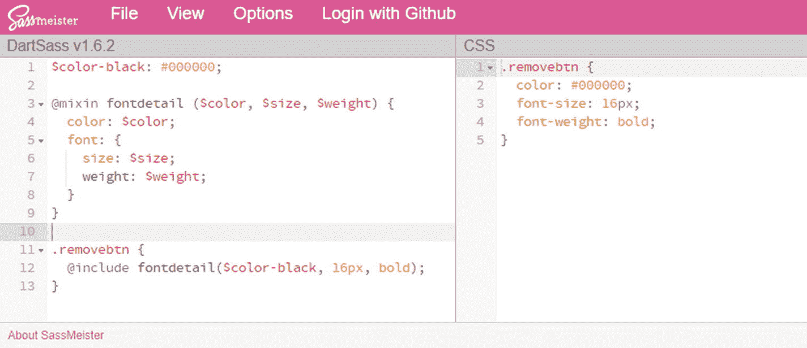
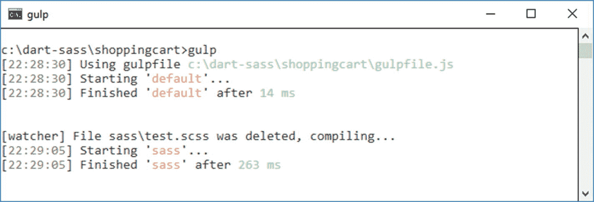
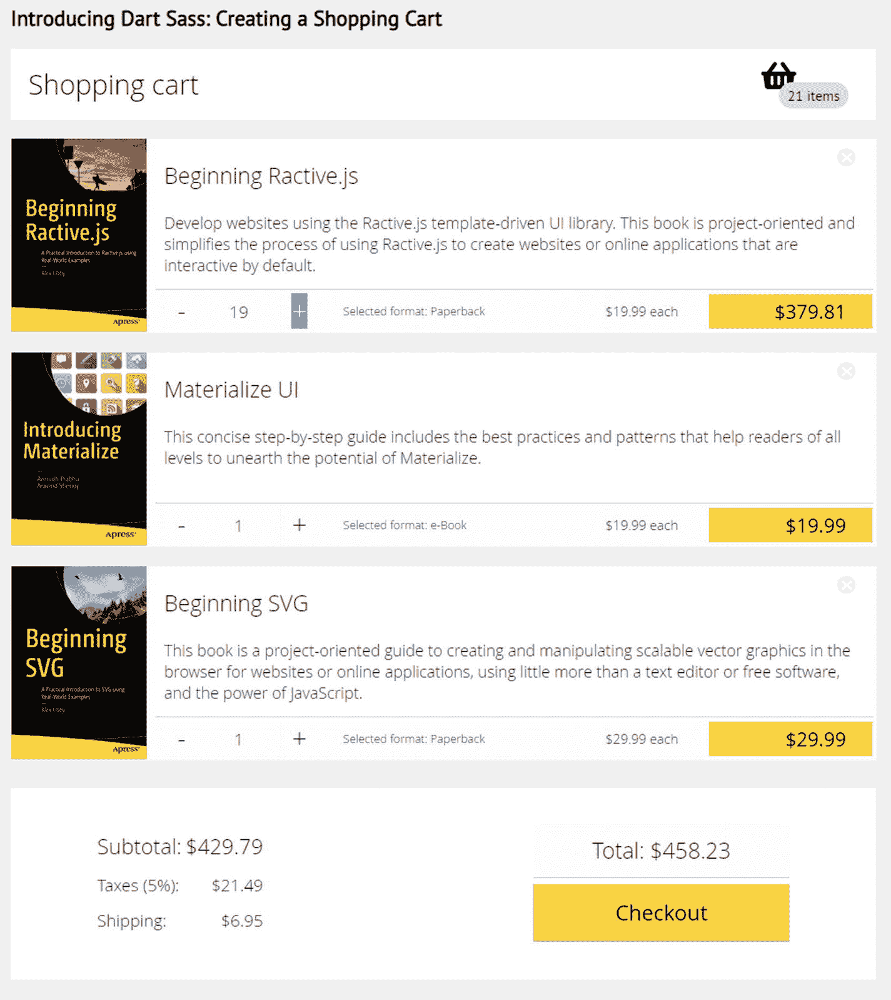

# 6. 项目介绍

在本书中，我们介绍了 Sass 的许多不同特性，并开始探索如何在项目中利用它们。然而，真正的考验来自于我们开始将所有内容整合在一起并构建一些更实用的东西时。问题是——我们应该构建什么？

嗯，考虑到我有着电子商务的背景，研究构建与电子商务相关的东西是有意义的，对吧？毕竟，根据 eMarketeer 在 2016 年的一项研究，电子商务预计将经历两位数的增长，直到 2020 年——销售额预计将达到 27 万亿美元！我想到了“无需动脑”这个词……

如果您想了解更多信息，该报告可在 eMarkeeter 网站上找到，网址为 [`https://bit.ly/2b9RZHd`](https://bit.ly/2b9RZHd)。

除此之外，在接下来的几页中，我们确实将专注于一个与电子商务相关的主题——我们将制作一个演示版购物车。由于篇幅原因，我们将更多地关注 Sass 样式（因为它当然是本书的主题）；我们还会涉及一些用于驱动网站的 HTML 标记和 JavaScript。考虑到这一点，让我们开始设置我们的购物车——我们首先来看看如何设置开发环境并放置 HTML 标记。

## 设置初始购物车

在互联网时代，试图重新发明轮子似乎并不明智，对吧？网上有几十种购物车示例，它们各有特色，并使用各种技术来驱动。

出于此演示的目的，我选择基于 Žiga Miklič 创建的一个购物车，它使用纯 HTML 标记以及标准 CSS 和 jQuery 来驱动网站。我们的版本将转换为使用 Sass；我还简化了外观，并更新了 CSS，移除了一些过时的厂商前缀。这将带来额外的好处，向您展示如何将现有网站转换为使用 Sass，而不是从头开始构建解决方案。

您可以在 [`https://codepen.io/ziga-miklic/pen/xhpob`](https://codepen.io/ziga-miklic/pen/xhpob) 查看此购物车的原始版本。

好的——第一步是放置好我们的标记并设置编译过程。对于此演示，我们将使用 Node.js——这不仅是为了编译 Sass，也是为了添加源映射（将编译后的 CSS 转换为 Sass 代码中对应的源代码位置）。我们还将利用 Autoprefixer 自动添加任何厂商前缀——现在应该没有了，但这在使用 Sass 时仍然是推荐做法。

### 准备工作

假设 Node.js 已安装，让我们开始：

1.  首先，解压 `shoppingcart` 文件夹的副本——将其保存在我们的项目文件夹中。它包含了我们的标记（`shoppingcart.html`），以及演示所需的字体、图像和 JavaScript 文件。

2.  接下来，以管理员身份启动一个 Node.js 终端会话，并将工作目录更改为我们在步骤 1 中保存的 `shoppingcart` 文件夹。

3.  启动一个 Node.js 终端会话，然后在提示符下输入此命令并按 Enter 键：`npm install`——这将使用提供的 `package.json` 文件安装一些包：
    -   Gulp – 用于自动化任务，
    -   Autoprefixer（用于 Gulp）– 用于处理任何厂商前缀，
    -   Dart Sass，
    -   用于 Gulp 的 Sourcemaps – 用于提供源映射，将编译后的 CSS 转换为相关的源 Sass 代码。
    
    可能需要重新安装——它可能会显示一些警告，但为了此演示的目的，可以忽略这些警告。

4.  安装完成后，在提示符下输入 `gulp` 并按 Enter 键。

5.  如果没有显示错误，那么您可以暂时关闭终端会话。

此时，Gulp 任务将运行，但 `css` 文件夹中不会出现任何内容——别担心：这样做看起来可能有点奇怪，但这纯粹是为了证明我们的编译过程正在工作！不过，这里有几个需要注意的地方，所以在继续设置样式表之前，让我们先暂停一下，更详细地了解一下初始设置。


### 理解已发生之事

在本书的编写过程中，我们主要使用命令行来编译 Sass；在很多情况下，这已经足够完美了。然而，当我们必须手动运行编译过程时，这就会变得繁琐——我们可以使用 `--watch` 功能来自动化编译，但它仍然是一个独立的进程！

正是由于这个原因，我们选择使用 Node.js 和 Gulp（作为任务运行器）——后者可以用来自动化数十种不同的任务，让我们可以专注于开发代码。在我们的案例中，我们使用了一个 `package.json` 文件来告知 Node.js 安装 Gulp、Autoprefixer（用于提供供应商前缀支持）、源地图支持，当然还有 Dart Sass。值得注意的是，我们也可以使用其他任务运行器，例如 Grunt 甚至 Broccoli——这仅仅是个人偏好问题；它们各自都会以类似的方式工作。

注意——在此演示中，Gulp 默认安装在项目文件夹内以供使用；你可能更倾向于全局安装它，特别是如果你之前已经使用过它的话。有关如何执行此操作的详细信息，请参阅本书第 1 章中的“自动化流程”演示。

目前，我们的项目只有几个与编译过程绑定的包——这是为了保持现状的简单性，但我们很容易将其发展成更全面的东西。例如，我们可能会安装一个 CSS 检查工具，如 Stylelint（[`stylelint.io`](https://stylelint.io)），或者一个图片精灵工具（如 Spritesmith，可从 [`github.com/twolfson/gulp.spritesmith`](https://github.com/twolfson/gulp.spritesmith) 获取）。但关键在于，只要我们考虑好各个步骤的顺序，就可以开始自动化那些价值较低、但显然是开发项目中必要组成部分的任务。

好了，我们继续吧：希望你在上一个练习结束时没有看到任何错误？假设没有，那么我们就可以继续演示的下一部分：为我们的购物车添加至关重要的样式。

## 准备样式表

是的：是时候让我们的演示看起来像样了！我们将这部分分为三个步骤——第一步处理一些简单的字体声明，第二步专注于变量声明，最后一步创建主样式表。

我们将从设置字体声明开始：它们对于演示并非必须，但包含它们是一种展示如何在 Sass 中将此类样式导入项目的有用方式。

我们将使用的字体是 PT Sans 和 Open Sans——它们包含在本书附带的代码下载中，或者你也可以分别从 FontSquirrel 网站 [`www.fontsquirrel.com/fonts/pt-sans`](https://www.fontsquirrel.com/fonts/pt-sans) 和 [`www.fontsquirrel.com/fonts/open-sans`](https://www.fontsquirrel.com/fonts/open-sans) 下载。让我们继续演示吧。

### 准备字体

我们从 Sass 样式表中最简单的部分开始——设置字体声明。我们将把它作为一个单独的文件或部分文件，在编译时将其导入主样式表：

1.  在一个新文件中，继续添加以下 PT Sans 字体的声明——这主要用于练习标题：

    ```
    @font-face {
    font-family: 'pt_sansregular';
    src: url('../font/pt_sansregular.woff') format('woff');
    font-weight: normal;
    font-style: normal;
    }
    ```

2.  接下来，留一行，然后添加以下三个 Open Sans 字体的声明——它们将在购物车的各个地方使用：

    ```
    @font-face {
    font-family: 'open_sanslight';
    src: url('../font/openSans-light-webfont.woff') format('woff');
    font-weight: normal;
    font-style: normal;
    }
    @font-face {
    font-family: 'open_sansregular ';
    src: url('../font/openSans-regular-webfont.woff') format('woff');
    font-weight: normal;
    font-style: normal;
    }
    @font-face {
    font-family: 'open_sansbold';
    src: url('../font/openSans-bold-webfont.woff') format('woff');
    font-weight: normal;
    font-style: normal;
    }
    ```

3.  将文件保存为 sass 文件夹中的 `_fonts.scss`——你现在可以关闭该文件，但我们稍后会在编译阶段再次用到它。

现在我们有了第一个导入文件——但我们还没有完成导入！我们还有第二个文件要设置，它将包含声明为变量的值，这些值将用在我们的主样式表中。此外，这个导入文件将使用多个 Sass 函数——我们稍后会详细介绍，但现在，让我们直接开始设置变量。

你可能已经注意到 `fonts.scss` 文件名中使用了下划线——这是可选的；这是一种判断你处理的是部分文件还是主样式表的好方法。如果你更喜欢使用更传统的命名格式，可以省略它。

### 分配变量

在本演示中，这个文件可能是我们创建的三个样式表文件中最重要的一——它包含我们使用的所有值，这些值都被分配为变量。没有它，我们的演示在代码编译后显然会看起来很糟糕！这个导入文件包含为我们的演示定义的所有颜色，以及字体属性的声明。


### 初始化变量

我们开始设置文件：

1.  在新文件中，添加以下变量块——这负责定义我们将在演示中使用的一些基础颜色：

    ```
    $color-black: #000000;
    $color-yellow: #ffdb4d;
    $color-pure-red: #ff0000;
    ```

2.  接下来，空一行，然后添加以下代码行——这些颜色用于书籍上的删除悬停链接和主要结算按钮：

    ```
    // 青色系
    $color-dark-cyan: #429188;
    $color-moderate-cyan: lighten(saturate($color-dark-cyan, 2.40), 10.39);
    ```

3.  空一行，然后添加以下代码行——它们负责处理每本书籍文章内的背景颜色：

    ```
    // 白色系
    $color-white: #ffffff;
    $color-almost-white: darken($color-white, 1.18);
    ```

4.  最后一组颜色将主要用于边框和总值的背景颜色：

    ```
    // 灰色系
    $color-light-grey: #eeeeee;
    $color-description-grey: darken($color-light-grey, 13.33);
    $color-very-light-grey: darken($color-light-grey, 7.06);
    $color-dark-grey: darken($color-light-grey, 33.33) ;
    ```

5.  我们可以使用普通字体，如无衬线字体，但那看起来会很无聊——为了让我们的演示更出彩，我们为变量分配了四种不同的字体系列：

    ```
    // 字体系列
    $pt-sans-family: 'pt_sansregular', sans-serif;
    $open-sans-light-family: 'open_sanslight', sans-serif;
    $open-sans-regular-family: 'open_sansregular', sans-serif;
    $open-sans-bold-family: 'open_sansbold', sans-serif;
    ```

6.  我们的演示使用了一个单一的混入——它负责根据给定的字体粗细，分配正确的字体系列、大小和颜色：

    ```
    @mixin fontdetail ($color, $size, $weight) {
    @if $weight == 300 {
    font-family: $open-sans-light-family;
    } @else if $weight == 400 {
    font-family: $open-sans-regular-family;
    } @else {
    font-family: $open-sans-bold-family ;
    }
    color: $color;
    font: {
    size: $size;
    weight: $weight;
    }
    }
    ```

7.  继续，将文件保存为 `sass` 文件夹下的 `_variables.scss`——你可以暂时关闭该文件，但我们在编译过程中还会用到它。

虽然这个导入文件不算长，但它确实开始使用 Sass 的功能——例如，我们使用颜色函数来定义调色板中用到的一些颜色。花点时间更深入地理解这一点是值得的；当我们查看主样式表时，这些内容就会开始串起来。现在，我们先详细分解一下我们使用的代码。

#### 深入了解导入的代码

在我们创建的第一个局部文件中，我们声明了一些 `@font-face` 规则——这些规则会根据分配给特定元素的字体粗细来使用。每个声明都使用 `@font-face` 的标准格式；我们只是利用 Sass 在编译时将其导入主样式表的能力。

相比之下，第二个局部文件使用了更多的 Sass 函数：我们首先为演示中使用的颜色定义了许多变量。我们混合使用了静态值和动态值；需要注意的是，顺序至关重要，因为我们使用静态变量来创建后续的颜色。

理解这些函数如何工作的诀窍，我们在第 4 章中已经讲过——提醒一下，要从内向外阅读函数。例如，用于中等青色（moderate cyan）的颜色，首先被饱和了 `2.4%`，然后被提亮了 `10.39%`。

为什么百分比值如此精确？这些值是通过 `http://razorltd.github.io/sasscolourfunctioncalculator/` 上的 Sass 颜色工具生成的——在创建颜色时，这个工具的价值堪比黄金！

接着，我们根据在第一个局部文件中设置的字体，为变量分配了四种不同的字体系列——我们使用了 PT Sans 和 Open Sans，其中 Open Sans 包含细体、粗体和常规体。然后，样式表以一个单一的混入结束，该混入根据主样式表中的调用声明来分配正确的字体颜色、粗细和大小。它使用一个 `@if...@else` 语句来判断：当字体粗细值为 `300` 时使用细体家族，`400` 时使用常规体家族，`700` 或更高时使用粗体家族。

此时，我们应该指出这个混入中使用的一个特定功能——我们有一个嵌套属性。这是一种将多个样式分组到单个名称（或命名空间）下的简单方法：嵌套块中的每个属性都会自动以父级名称开头。请看图 6-1，我们将两个字体属性分组在一起——在我们的 Sassmeister 示例中，它们被编译成我们在 CSS 中熟知的 `font-*` 属性。



**图 6-1** 一个带命名空间的嵌套属性

（如果你好奇的话——在 Sass 中，你可以对许多属性做类似的事情，比如 `border`、`padding` 或 `margin`！）

好了，各位，是时候了：我们已经可以创建主样式表了！如果你已经提前阅读过，并为我们将要介绍的代码量感到震惊，那么别担心——代码看起来可能很多，但我们会一点一点地讲解。大部分代码都是嵌套的，后代选择器位于它们各自的父元素内部——让我们开始看看我们需要设置什么才能使我们的演示工作。

### 设置主样式表

这就是所有魔法发生的地方——代码量相当大，不过如果你通读代码，希望你能发现其中大部分都是嵌套的。这使得阅读和理清每个父元素或后代元素被分配了什么变得更容易。

根据你使用的文本编辑器，你可能会发现可以折叠代码块——这也有助于更容易地识别演示中使用的主要元素。


### 整合主样式表

我们开始吧：

1.  首先创建一个新文件 - 将其保存到 `shoppingcart` 文件夹下的 `sass` 子文件夹中，文件名为 `shoppingcart.scss`。

2.  虽然需要大量代码，但我们会逐块处理 - 首先在文件顶部添加以下几行，以引入我们在本章前面创建的导入部分文件：

```
@import "fonts.scss";
@import "variables.scss";
```

3.  我们的演示需要一些基础样式来铺垫 - 空一行，然后添加以下四条规则：

```
/* base styles */
body {
  font-family: $pt-sans-family;
  margin: 32px;
  background: $color-light-grey;
  margin: 0;
  padding: 0;
  overflow-x: hidden;
  margin: 32px;
}
.container { margin: 0 auto; width: 980px; }
.clearfix { content: ""; display: table; clear: both; }
h2.exercise { margin-left: auto; margin-right: auto; width: 980px; }
```

4.  基础规则设置完毕后，我们现在可以覆盖购物车的每个主要区域 - 首先添加购物车头部规则：

```
/* header */
#site-header {
  margin: 0 auto;
  padding-left: 20px;
  background: $color-white;
  h1 {
    @include fontdetail($color-black, 31px, 300);
    padding: 20px 0;
    position: relative;
    margin: 0;
  }
}
```

5.  接下来是购物车主区域的嵌套规则，包括商品详情：

```
/* shopping cart */
#cart {
  width: 100%;
  h1 { @include fontdetail($color-black, 25px, 300); }
  p { @include fontdetail($color-black, 18px, 300); }
}
.product {
  border: 1px solid $color-light-grey;
  margin: 20px 0;
  width: 100%;
  position: relative;
  transition: margin .2s linear, opacity .2s linear;
  clear: both;
  & img { width: 100%; height: 100%; }
  .content {
    background-color: $color-white;
    border-bottom: 1px solid $color-description-grey;
    float: left;
    box-sizing: border-box;
    height: 171px;
    padding: 0 20px 0 10px;
    width: 83%;
  }
}
.product header {
  background-color: $color-white ;
  border-bottom: 1px solid $color-description-grey;
  float: left;
  margin: 0 1% 20px 0;
  overflow: hidden;
  padding: 0;
  position: relative;
  width: 153px;
  height: 218px;
  h3 {
    @include fontdetail($color-white, 22px, 300);
    background: $color-moderate-cyan;
    line-height: 49px;
    margin: 0;
    padding: 0 30px;
    position: absolute;
    bottom: -100px;
    right: 0;
    left: 0;
  }
  &:hover img { opacity: .7; }
  &:hover h3 { bottom: 73px; }
}
```

6.  在每个商品描述中，我们都有一个详情块 - 包含所选书籍类型、单价、数量和总价。请继续添加以下代码块：

```
article footer {
  margin: 0;
  padding: 0;
  background-color: $color-almost-white;
  .price {
    @include fontdetail($color-black, 15px, 300);
    background: #fcfcfc;
    float: right;
    line-height: 49px ;
    margin: 0;
    padding: 0 30px;
    &:before { content: "$"; }
  }
  .full-price {
    @include fontdetail($color-black, 22px, 400);
    background: $color-yellow;
    float: right;
    line-height: 39px;
    margin: 5px;
    padding: 0 30px;
    transition: margin .15s linear;
    width: 125px;
    text-align: right;
    &:before { content: "$"; }
  }
}
```

7.  下一部分负责设置购物篮中商品数量更新按钮的样式。在上一部分之后添加以下代码，并确保先空一行：

```
.qt {
  @include fontdetail($color-black, 19px, 300);
  line-height: 50px;
  width: 70px;
  text-align: center;
  display: block;
  float: left;
}
.qt-plus, .qt-minus {
  @include fontdetail($color-black, 30px, 300);
  display: block;
  float: left;
  background: $color-almost-white;
  border: none;
  height: 100%;
  padding: 0 20px ;
  transition: background .2s linear;
  line-height: 39px;
  margin: 5px;
  &:hover { background: $color-moderate-cyan; color: $color-white; cursor: pointer; }
}
```

8.  购物车的下一部分是底部页脚 - 空一行，然后添加以下样式来处理小计、税费和运费：

```
/* shopping cart footer */
#site-footer {
  background: $color-white;
  margin: 30px 0 0 0;
  padding: 40px 0px;
  width: 100%;
  margin-left: auto;
  margin-right: auto;
  clear: both;
  h1 {
    @include fontdetail($color-black, 25px, 300);
    background: $color-almost-white;
    border-bottom: 1px solid $color-description-grey;
    margin: 0 0 7px 0;
    padding: 14px 40px;
    text-align: center;
    span:before { content: "$"; }
  }
  h2 {
    @include fontdetail($color-black, 24px, 300);
    margin: 10px 0 0 0;
  }
  h3 {
    @include fontdetail($color-black, 19px, 300);
    margin: 15px 0;
  }
  .left { float: left; }
  .right { float: right; }
}
```

9.  还有一些杂项样式，不适合放到已有嵌套样式中；在上一样式块后添加以下内容：

```
button {
  @include fontdetail($color-black, 24px, 400) ;
  background: $color-yellow;
  border: 1px solid $color-dark-grey;
  border-style: none none solid none;
  cursor: pointer;
  display: block;
  padding: 16px 0;
  width: 290px;
  text-align: center;
  transition: all .2s linear;
  &:hover { color: $color-white; background: $color-dark-cyan; }
}
.small {
  @include fontdetail($color-black, 13px, 300);
  background: $color-almost-white;
  padding: 10px 16px;
  line-height: 28px;
  border: none;
  display: inline-block ;
  line-height: 29px;
}
.contain { width: 80%; margin-left: auto; margin-right: auto; }
/* plus and minus buttons in details */
.minus { margin: 0 50px 0 0; }
.added { margin: 0 -50px 0 0; }
```

10. 我们快完成了 - 下一个块设置网站上删除链接和按钮的样式：

```
/* Remove link over books & remove button in description */
a {
  color: $color-black;
  text-decoration: none;
  transition: color .2s linear ;
  &:hover { color: $color-moderate-cyan; cursor: pointer; }
}
.removebtn {
  @include fontdetail($color-black, 16px, bold);
  width: 21px;
  float: right;
  margin-top: -72px;
  background-color: $color-light-grey;
  color: $color-white;
  border-radius: 148px;
  text-align: center;
  height: 20px;
  line-height: 20px;
  &:hover {
    cursor: pointer;
    background-color: $color-pure-red;
    transition: background-color 0.3s linear ;
  }
}
```

11. 最后一个块负责格式化购物车中总计、运费和税费显示的文本：

```
/* cart totals */
.carttotal {
  margin: 20px;
  display: inline-block;
  float: right;
  width: 110px;
  margin-top: 13px;
  & > img { width: 40px; height: auto; }
  & > span {
    background-color: $color-very-light-grey;
    padding: 5px 10px;
    border-radius: 20px;
    position: absolute;
    margin-top: 25px;
    margin-left: -20px ;
  }
}
.tax, .shipping, .subtotal {
  span {
    float: right;
    &:before { content: "$"; }
  }
  div { width: 100px; display: inline-block; }
}
```

12. 保存文件 - 暂时可以关闭它，稍后在编译过程中我们会用到它。


唷——这真是一大堆代码！如果你能坚持到这里，那真是太棒了：我们已经完成了演示中最难、最重要的部分。

不过，在编译代码并欣赏我们的杰作之前，我们还有几件事要做。首先——让我们稍作喘息，更详细地探索一下样式表代码：它阐述了在未来的项目中使用 Sass 创建样式表时，你应该注意的几个关键点。

### 分解代码

我们可以直接一头扎进代码，但在此之前，我建议你先做一件事：休息一下！去给自己倒杯饮料，呼吸点新鲜空气——做什么都行：目的是让自己离开屏幕几分钟。

这样做有个很好的理由：虽然我们示例中使用的大部分代码都是标准的 CSS，但乍一看会显得有些复杂。但它能工作的关键在于使用了嵌套（nesting）——该项目中的许多代码都采用了嵌套，以提高可读性。带着这个想法，让我们仔细看看代码。

我们从两条 `@import` 语句开始——一条用于导入字体声明，另一条用于处理样式表中使用的变量。然后，我们为页面设置了一些基础样式，包括购物车背景和练习标题。

接下来是一组针对 `#site-header` 的样式——从这里开始我们使用嵌套，为子元素 `h1` 包含后代规则。然后我们对 `.product` 遵循同样的原则——它包含大量的子规则，用于设置网站产品描述和价格部分的元素样式。注意，我们还使用了颜色变量——这些变量是在 `_variables.scss` 文件中定义的，但会在编译过程中合并进来。

然后，我们处理每个产品描述页脚部分的一组声明；父元素是 `article footer`，在其下方我们有针对 `.price` 和 `.full-price` 类的规则。紧接着是数量按钮的嵌套块——注意这里还包含了一个混入（mixin），用于应用 Open Sans Light 字体族（样式表中多次出现此情况）。

样式表中的下一个嵌套块是针对 `#site-footer` 元素；它包括针对 `h1`、`h2` 和 `h3` 元素的声明，以及 `.left` 和 `.right` 类，用于定义内容在页脚中的位置。样式表的最后一部分涵盖了一组杂项样式，之后我们以购物车页脚中的总金额以及税金、运费和小计金额的嵌套块作为收尾。

## 整合所有内容

我们即将运行至关重要的编译过程，但在此之前，还有一个重要的部分需要介绍：用于让购物车运行的脚本代码。

我们使用的代码与购物车原始版本相同，只做了一些微小的调整和添加——它看起来复杂，但可以分解为几个清晰的部分。

第一部分（大约第 5 行到第 20 行）是 `changeVal()` 函数，我们用它来根据所选产品的数量更新价格；当购物车中选定产品的数量发生变化（或被移除）时，会在代码的不同位置调用这个函数。我们使用的第二个函数是 `changeTotal()` 函数——它会更新总金额（包括小计和最终金额）以及运费和税费，然后在屏幕上呈现更新后的数值。

接着，我们设置了五个事件处理器：前两个负责响应“移除此横幅”（出现在书籍上）和每个产品描述右上角的红色“移除”叉号的点击事件。接下来的两个负责响应加号或减号按钮的点击，以添加或移除产品；它们会调整选中的数量，然后调用 `changeVal()` 函数来更新所选书籍对应数量的总价。最后一个事件处理器简单地调用移除函数，要么显示结账流程的占位符，要么指示购物车为空；因此，我们无法完成结账流程。

好了——闲话少说，朋友们，是时候了……是时候看看我们的演示是否真的有效了！所有代码都已就位，那么，闲话少叙，让我们直接进入并运行编译过程吧。

## 编译我们的代码

这可能是本章中最简单的部分之一，但也是最令人紧张的部分——我们的演示能成功吗？希望可以，但在揭晓答案之前，最好检查一遍代码，确保一切就绪。

如果你查看 `sass` 子文件夹，应该会看到三个文件名中包含“finished version”的文件。这些是已完成版本——你可以将自己的版本与之比较，看看一切是否确实就绪，可以编译了。

### 示例——编译我们的代码

好了——让我们开始编译代码吧。为此，我们将回到本章开始时创建的 Node.js 环境中；让我们开始：

1.  启动一个 Node.js 终端会话，或者如果之前的会话还开着，切换回去——确保工作文件夹是我们本章开始时创建的 `shoppingcart` 文件夹。

2.  在提示符下，输入 `gulp`，然后按回车键；你应该会看到显示 `Starting 'default'...`，接着是 `Finished 'default'` 和一个时间戳。

3.  如果你现在尝试保存主样式表，它会自动触发并重新编译——如图 6-2 所示。

    

    图 6-2

    编译我们的代码

假设没有显示错误，那么恭喜你！你已经使用 Sass 完成了第一个项目；当然，我们还可以进行改进，但这没关系，因为每个项目都应该随着时间的推移而发展和成熟。不过，还有最后一件事……

## 最终成果

嘿嘿——如果你期待什么重大事件，别担心！那个“最后一件事”实际上是整章中最棒的部分；这是我们终于能够一睹最终成果辉煌全貌的时刻。假设你没有遇到任何问题，那么图 6-3 展示了在浏览器中预览的最终文章。



图 6-3

我们完成的购物车

这证明了我们总能在代码中使用 Sass——具体使用量当然取决于项目的性质，但随着时间的推移，我们能够开始构建可重用的代码，这些代码可以添加到任何将来使用 Sass 的项目中。


## 未来变化

随着我们的项目正式启动，接下来要回答的问题是：下一步该往哪走……？

我们可以考虑一系列变化——唯一限制我们的只有想象力和项目需求！由于 Sass 是 CSS 的超集，这意味着我们可以随心所欲地将 CSS 代码部分或全部转换为 Sass 代码。一旦完成初期繁重的转换工作，我们就可以根据需要添加新样式——以下这些想法可以作为起步参考：

*   我们可以考虑使用更多带命名空间的属性——看看下面这段从 `fontdetail` 混入中摘取的代码：

    ```
    font: {
    size: $size;
    weight: $weight;
    }
    ```

    我们已经在整个演示中使用了 `padding` 和 `margin`，或许在命名空间方面还有进一步发挥的空间？

*   一种更高效的色彩写法是使用 Sass 的映射（map）——这样我们可以将同一颜色的不同色调分组编码，使代码编写更高效。不过我们应该更进一步：当为颜色变量命名时，采用通用格式，例如 `$border-blue-light`（从通用到具体）。这样更便于分组、便于编辑器智能提示颜色名、也便于理解这些颜色在代码中的使用位置。

*   我们可以研究如何添加诸如信用卡或安全标志之类的图片——有多个工具可集成到我们的 `Gulpfile.js` 脚本中，为图片生成对应的 Sass 代码。

*   在这个演示中，我们并没有真正使用外部库——但这并不意味着我们不应该使用；例如使用 Scut 库（[`https://davidtheclark.github.io/scut/font-face.html`](https://davidtheclark.github.io/scut/font-face.html)）来处理 `variables.scss` 局部文件中用到的 `@font-face` 代码？

*   有人还记得使用 `rem` 单位代替像素吗？为了方便，我们全程使用了像素值，但如果您对 `rem` 单位情有独钟，Sass 可以轻松通过混入来添加这些单位。在 [Google.com](http://google.com) 上搜索“sass mixin for rem units”——会有大量示例！

*   我们甚至可以添加媒体断点来让页面更具响应性——Sass 原生支持 `@media` 查询（甚至可以嵌套使用）；[Medium.com](http://medium.com) 上有一篇很有用的文章，介绍了如何使用 Sass 实现断点，链接为 [`https://medium.com/codeartisan/breakpoints-and-media-queries-in-scss-46e8f551e2f2`](https://medium.com/codeartisan/breakpoints-and-media-queries-in-scss-46e8f551e2f2)。

*   我们为数量按钮定义了基础样式 `.qt`——这虽然效果不错，但迫使我们分配两种样式。不妨考虑使用 `@extend` 函数创建一个基础样式，然后将其扩展为我们所需的加号或减号按钮样式？

以上仅是使用 Sass 时可能出现的一些想法——当然，我们的想象力才是唯一的限制！希望这能让你了解在大型真实项目中使用 Sass 的体验；只要你认真规划、采用迭代方式转换代码、做出明智的选择，那么在将现有项目改造为使用 Sass 的过程中应该不会遇到太多问题。

### 总结

在本书中，我们涵盖了 Sass 中大量不同的特性——从简单的变量到构建混入、再到使用条件逻辑控制输出。在本章中，我们通过一个真实项目将这些特性融会贯通——我们的购物车或许拿不了任何奖项，但总得有个起点！全书我们分享了大量实用技巧，现在让我们花点时间回顾一下本章所学内容。

我们首先概述了本章项目的具体细节，随后快速转向开发环境的搭建和 HTML 标记的安装。

接下来，我们探索了为项目创建样式的过程——我们逐步完成了两个导入局部文件，然后组装了主样式表。最后，我们通过简要介绍使购物车生效所需的 jQuery 代码将所有内容整合在一起，接着运行编译过程，并在浏览器中查看成果。

呼——真是段激动人心的旅程！我们在本书中涵盖了很多内容；希望你觉得它有用，并且能像我享受写作此书一样享受使用 Sass 的过程！

## 索引

### A

变量赋值，Sass

### B

布尔运算符 盒阴影效果

### C, D

`centerdiv` 混入 `changeTotal()` 函数 `changeVal()` 函数 配色方案网站 颜色，案例研究 优势 创建 操作 调色板 Sass 函数 SVG 图像 `$color` 值 转换 Sass 转换代码 CSS 文件 `css2scss` 工具 导入文件 修改代码 演示 更新 预建库 styleflux WordPress `css2scss` 工具

### E

`@each` 函数 `@extend` 指令 CSS 示例 扩展块 混入 差异 媒体指令 参数 Sass 宝丽来效果 Sass 类 `.seriousError` 语法

### F

`focus` 声明 `@for` 函数 函数，Sass 颜色（*见* 颜色，案例研究） JavaScript 类型

### G

黄金比例

### H

自制苹果 `hover` 声明

### I, J, K

`@if` 和 `@if()` 函数 `@import` 函数 `@include` 命令

### L

`lighten()` 函数 Linux 列表运算符

### M

Mac OS X 主样式表，设置 `map-get()` 函数 `@media` 指令 断点 创建 混入 菜单栏创建，嵌套样式 混入 居中 div 编译为 CSS 创建 导入文件 库 多个文件 传递值 预建 可复用代码 用法

### N, O

嵌套样式 优势 概念 `<nav>` 元素 导航栏 陷阱 属性 Sass 三级代码 嵌套 `nth-of-type()` 声明 数字运算

### P, Q, R

`package.json` 文件 参数化混入 创建 解析代码 父选择器，嵌套 占位符 宝丽来相机效果 预建库 探索混入 陷阱评估 Sass 库 属性列表/映射，样式 `figcaption` 规则 键 Sass 映射 伪选择器

### S

Sass 优势 自动化流程 分解流程 按钮 编译流程 转换流程（*见* 转换 Sass） 定义 文件夹结构 安装 关键因素 关键术语 输出格式 参数化混入 属性 设置 简化流程 骨架页面 源映射支持 styleflux 语法 工作流（*见* 设置工作流，Sass） Sass 代码库 Sassmeister Sassy CSS 设置字体 设置工作流，Sass 选择选项 代码编辑 编译流程 文件夹结构 输出格式 源映射 购物车 变量赋值 代码 中断 编译代码 完成 未来变化 导入代码 初始购物车 初始化变量 Node.js 设置 标准混入 `@import` 语句 `@include` 关键字 预建混入 可复用代码 Stinson 混入 字符串运算符 Stylelint 工具 样式表准备 样式循环 颜色属性 `@each` 函数 `@for` 函数 Sublime Text

### T, U

TwentySeventeen 主题

### V

变量创建，Sass 添加注释 编译错误 编译后的 CSS 编译注释 混入（*见* 混入） 命名

### W, X, Y, Z

`@while` 循环 CSS 演示 `@while true` 循环 Windows WordPress 样式表
