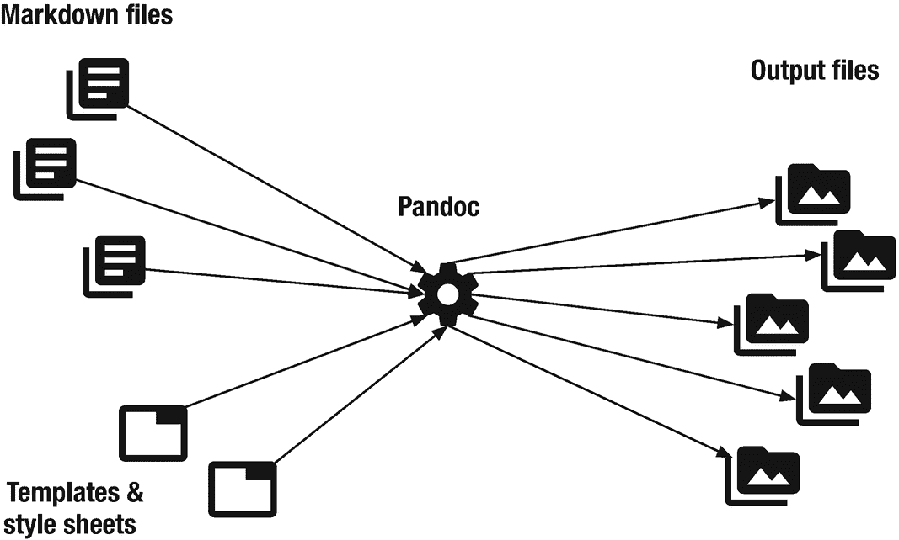

# 1. Markdown 与 Pandoc 入门指南

Markdown 是一种标记语言。这个名称是个双关语，但即便其幽默之处可能略显拙劣，这种语言本身却毫不逊色。Markdown 语言允许你编写纯文本文档，并添加少量轻量级注释来指定文档的格式要求。这些注释正是标记语言的显著特征。标记语言将文档的语义或内容部分与文档的格式分离开来。文档的内容包括文本本身、哪些应为标题、哪些应被强调等等。格式则指定字体和字号、标题是否编号等。

相比 WYSIWYG（所见即所得）格式中的直接格式化方式，标记语言更注重语义信息。通过标记语言，你可以在文本中添加注释，指明章节和节次从哪里开始，但不会指定章节标题的格式。将文本的结构与其可视化方式解耦，能让你更容易地生成不同类型的输出。借助理解标记注释的工具，同一文本可以轻松转换为 HTML、PDF 或 Word 文档。由于编写文本和格式化文本是分开的步骤，你可以将一个或多个文本文档应用于同一个转换程序，从而为相关文档获得一致的外观；或者，你也可以将同一文档转换为多种输出格式，例如使同一文档既能用于网页，也能用于印刷书籍。大多数 WYSIWYG 编辑器都可以导出为不同格式，但它们通常无法让你以不同的格式输出到同一文档类型，例如，输出 PDF 文件时，分别采用 A4、6 英寸×9 英寸和 7 英寸×10 英寸三种尺寸，前两种使用 11 磅字号，最后一种使用 12 磅字号。使用标记语言，这相对容易实现。

在各类标记语言中，Markdown 即使不是最简单的，也是其中之一。你添加到文本中的注释极少，而且如果你偶尔使用纯文本文件，很可能已经见过其中大部分注释。例如，在 Word 中你会使用斜体或粗体，而在 Markdown 中你会写成 `*斜体*` 和 `**粗体**`，你很可能之前就见过这种表示法。在我误入歧途的青年时代，我曾频繁使用 TeX/LaTeX 和 HTML/SGML/XML。我认识一些人，如果文本中充满了标记信息，他们就无法集中注意力。而在 Markdown 中，标记注释几乎不可见，因此他们使用起来毫无问题。借助 Markdown，你可以生成其他标记语言的文档，因此你无需了解这些语言。如果你希望完全按照自己的想法来格式化文档，我仍然建议你学习其他语言。你可以利用这些知识来创建模板（见第 `9` 章），然后在编写模板时只需要使用，例如，`LaTeX` 或 `HTML`。之后，你仍然可以将文档保留在 Markdown 中。一个例外情况是，如果你需要在文档中编写数学公式，你仍然需要使用 `LaTeX`；具体请参见第 `6` 章。

你需要一个程序将 Markdown 转换为其他文件格式。本书将使用的工具是 `Pandoc`。`Pandoc` 支持基础 Markdown 以及多种扩展。它还允许你定义模板和样式表，以自定义转换后的文件。`Pandoc` 的功能远不止将 Markdown 文件转换为不同的输出文件。它还可以在多种格式之间进行相互转换。本书仅介绍如何从 Markdown 转换为其他格式。例如，如果你有一个现成的 Word 文档，并希望通过编辑该文档来尝试 Markdown，那么你应该能够从 Word 文件生成 Markdown 文件，然后编辑 Markdown 格式，最后再将 Markdown 文档转换回 Word。

## 为什么要使用 Markdown 和 Pandoc

如果你习惯了使用 Microsoft Word 这类所见即所得（WYSIWYG）编辑器，你很可能会问，为什么要使用 Markdown 文件。你可以按自己喜欢的方式编写文档并设置格式，也可以根据需要将文档导出为不同的文件格式。对于只需格式化一次、输出一种文件格式的短文档，你确实不需要 Markdown。但我认为，即便对于这类文档，Markdown 仍然是一个绝佳的选择，只是它在更高级的应用中才能真正大放异彩。

对于那些用 WYSIWYG 编辑器处理起来同样简单的文档，在你需要与他人共享文档时，纯文本可能是更好的选择。Word 文件是这类场景的事实标准格式，但并非所有人都有 Word——我就没有。我确实有 Pages，可以导入 Word 文件，再导出为 Word 格式，但我不清楚这种转换会对格式产生什么影响。每个人都拥有能处理纯文件的编辑器，而使用纯文本文件时，你清楚知道自己在编辑什么。如果文本和格式分离，那么擅长排版的人可以处理格式，而我只负责撰写内容。Word 的一个优势可能是修订追踪功能，这确实很重要。但对于纯文本文件，你可以将其纳入真正的版本控制系统（例如 GitHub），这比版本追踪功能要强大得多。

如果你需要以不同格式呈现文档——例如，既要将文本内容放入打印版的进度报告，又要发布在网站上——那么你可以将文档导出为所需的各种文件格式。如果不同文件格式需要不同的排版样式，你可能需要进行大量手动操作。你可能需要手动修改所有文档样式，而当你需要对文本进行多次修改时，你可能需要不止一次地为每种文件格式调整样式。如果你将样式与文本分离，就能完全避免这个问题。

使用标记语言来注释文本，可以让你更轻松地分辨文档的语义结构与其格式化方式。在 Markdown 文档中，你标记出标题和列表的位置，但并不指定它们在最终输出中应如何格式化。格式化样式保存在不同的文件中，你可以轻松地将 Markdown 输入转换为你需要的所有输出文件格式和样式。此外，其他人可以专注于样式规范，而你则专注于文本内容。你的 Markdown 也不必局限于单个文件。你可以将其拆分成任意多个文件，然后不同的作者可以各自处理不同的文本部分，而无需担心之后如何合并文件。结合版本控制，你甚至可以在一定程度上并行处理同一个文件。

### 将语义与格式化分离开来

大多数文档都具有语义结构。文本由章节、段落与强调文本、图表与引用、引文与列表组成。当我们阅读文档时，这些语义元素通过不同的字体、粗体和斜体文本、不同的字号来呈现，我们并不直接看到语义结构。正因为我们无法直接看到结构，所以很容易忽略它的存在。

大多数文字处理器都能将语义与格式化分离开来。如果在处理 Word 文档时注意使用格式设置功能，那么修改样式所需的语义信息（即所有语义单元，如标题的视觉呈现方式）就唾手可得。将文档的语义与其格式化方式分离开来，并非标记语言的独有特性。然而，当文本与语义的分离不是强制性的时，就可能出现错误。例如，如果你决定修改二级章节标题的字体大小，你可以轻松做到，但你同样可以轻易地选中某一个标题并单独重新格式化它，从而只修改这一个标题。这会使这个特定的标题与其他所有标题不同，如果你之后修改二级标题的格式，这个标题并不会随之改变。如果这是有意为之，那很好；但如果这不是你的本意，那就糟糕了。

使用 WYSIWYG 编辑器，你可以将语义与格式化分开，但很容易破坏这种分离。使用标记语言，你也可以将某些文本元素定义为特殊元素，并使其格式与其他同类元素不同，但你必须明确地这样做，因此你不会轻易误操作。在许多情况下，保持核心文本由语义元素构成、并与格式化方式分离至关重要。如果你希望将文本同时转换为纸质文档和网页，你通常希望这两种输出文档的格式有所不同。如果核心文本仅包含语义结构，那么只需为语义元素到格式化信息建立不同的映射（通常称为 `模板` 或 `样式表`，参见第 9 章）即可快速实现。通过为不同输出格式使用不同的样式表，格式与输出文本绑定，而非与输入文本绑定（参见图 2-1）。



图 2-1

你可以翻译多个文档中的文本，或翻译多个应合并到单个文档中的章节。将这些文本与文档格式化模板相结合，并使用 `Pandoc` 将它们整合在一起，以生成你想要的文档。

在文本中明确表示语义元素，而非通过文本的格式化方式来隐式表示，这对于自动生成目录、图表列表也至关重要。如果所有章节都明确标记为章节，并带有不同层级的标题，那么任何工具都可以扫描你的文档并识别它们。如果这些工具必须根据文本的格式化方式来猜测文本元素的语义含义，那将是一项艰巨得多的任务。

使用 WYSIWYG 文字处理器并不会阻止你将文档组织成语义单元——它们通常支持这一点——但使用显式的标记语言能更容易地强制执行这一点。

### 预处理文档

如果你的文档是纯文本格式，在将其格式化为最终输出之前，你还有许多预处理选项。有大量工具可以很好地处理纯文本，并允许你对文档进行预处理。

预处理文档通常需要一些编程技能，所以如果你只对写作感兴趣，这可能不是你首先要担心的事情。但既然有这个选项，你可以先专注于写作，稍后再添加预处理步骤。

我写了很多关于 R 编程的文章，在这些书中，我使用了大量代码示例。这里我用了另一个预处理器，它允许我在处理文档时执行代码，这样我就能确保所有代码示例都能运行，并且可以在创建输出格式之前，将代码运行结果自动插入到文档中。

预处理文档会为你格式化文本的方式增加一些复杂性，但这些复杂性只在你需要时才存在。如果你不需要预处理器，那么完全可以忽略它们的存在。如果你*确实*需要预处理，请阅读第 10 章。

## 为什么选择 Markdown？

有许多不同的标记语言可供您使用。`HTML`（超文本标记语言）用于网页。`TeX` 和 `LaTeX` 用于多种文本文档，但在数学排版方面尤为强大。而 `Markdown` 则是我们在本书中使用的语言。

Markdown 之所以特别适合用来写作，在于它的简洁性。例如，在 `HTML` 中，你需要使用标签来包裹每一个段落、每一个标题、每一个列表等，以此构建文本结构。当你编辑一份 `HTML` 文档时，很难将注释与你真正想要撰写的文本区分开来。`LaTeX` 也存在同样的问题。当你想专注于写作时，文本的注释很难被忽略。

更糟的是，如果你用 `HTML` 或 `LaTeX` 编写文档，大量的文本都是用于指定格式的标记代码。具体数量当然取决于你的文档，但任何你添加的标记指令都会让文本变得难以阅读。

看看这份 Markdown 文档：

```
## 这是一级标题
这是一个段落
### 这是二级标题
下面是一个段落，后跟
* 一个无序
* 列表
1. 和一个有序
2. 列表，共有
3. 三个项目
```

我希望你会同意，这里的标记非常少，并且它们不会妨碍文本的阅读或写作。

作为对比，同一段文本的 `HTML` 版本看起来像这样：

```
这是一级标题
这是一个段落
这是二级标题
下面是一个段落，后跟

一个无序
列表

和一个有序
列表，共有
三个项目

```

这并不复杂，多看几眼之后，你肯定能理解文档的结构。但它远没有 Markdown 文件那样清晰。

`LaTeX` 版本比 `HTML` 文件稍微易读一些，但仍然有不少格式指令妨碍纯粹的写作。

```
\section{这是一级标题}
这是一个段落
\subsection{这是二级标题}
下面是一个段落，后跟
\begin{itemize}
\item 一个无序
\item 列表
\end{itemize}
\begin{enumerate}
\item 和一个有序
\item 列表，共有
\item 三个项目
\end{enumerate}
```

Markdown 的设计旨在让你能用尽可能少的标记混乱来为文本添加语义信息。它的设计初衷是让阅读原始文本几乎和阅读格式化后的文本一样容易。使用 Markdown，你在格式控制方面的能力比不上 `LaTeX` 这类语言，但 Markdown 的简洁性足以弥补这一点。

## 为什么选择 Pandoc？

由于 Markdown 只是一种为文本添加结构的语言，它并不绑定任何特定的工具。当你需要处理文档时，可以使用任何支持 Markdown 的软件。许多博客平台允许你用 Markdown 编写文本，并自动为你格式化。将 Markdown 转换为 `HTML` 毕竟是这门语言最初的主要动机之一。现在，许多文本编辑器也支持 Markdown，能够处理 Markdown 格式并导出为各种文件格式，通常还能通过各种格式和样式选项决定输出文件的外观。

如果你的编辑器可以导出为不同文件格式和不同样式，那么这显然是你导出 Markdown 文本最便捷的方式。然而，使用 `Pandoc`，你在文档处理上拥有更大的控制权。`Pandoc` 比我所知的任何支持 Markdown 的文本编辑器都要强大得多。

如果你想创建一个简单、无冗余的文档，用 `Pandoc` 很容易做到，但直接从编辑器内操作会更简单。不过，建议你在简单场景下尝试使用 `Pandoc`，以便熟悉这个工具。等你需要认真写作，并且希望完全控制最终文档的外观时，你就需要 `Pandoc` 的强大功能了。学习曲线可能比较陡峭，但如果你熟悉了用 `Pandoc` 处理简单文档，那么当你探索高级功能时，就有了一个坚实的基础。


