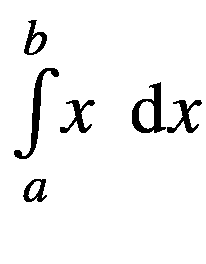
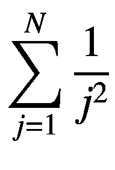

# 6. 数学和计算机编程语言

你可能没有编写技术或科学文本的习惯，但如果你有，那么 Pandoc 支持数学和计算机编程代码格式。

## 书写数学公式

只要你的输出文件格式支持，Pandoc 就能出色地处理数学公式的写入。Word 文件内置了对数学公式的支持，如果输出文件是 Word 文档，Pandoc 会使用该功能。对于 PDF，Pandoc 使用 LaTeX 作为中间格式，而 LaTeX 处理数学公式的效果堪称完美。对于 HTML 和 EPUB，根据你用于显示数学公式的版本和库，你也能获得一定的数学公式支持。

对于 HTML 和 EPUB，针对输出如何处理数学公式，你有不同的选择。当我的 HTML 或 EPUB 文档中包含数学公式时，我通常使用 MathML（⁴）或 MathJax（⁵）。对于 MathML，你可以使用 `--mathml` 选项：

```
pandoc --mathml -o document.epub document.md
```

对于 MathJax，你需要生成 EPUB3 文档才能使其正常工作，因此你还需要指定输出格式：

```
pandoc --to=epub3 --mathjax \
-o document.epub document.md
```

使用任一选项，你都能得到一个能良好显示数学公式的 EPUB 文档。虽然不像由 LaTeX 处理数学公式的 PDF 文档那样精美，但效果已相当不错。

在文档中书写数学公式的方式是使用 TeX 语法。只有在你输出 LaTeX 文件或通过 LaTeX 构建 PDF 文件时，输出文档中的数学公式才会是 TeX 格式；但在纯文本中书写数学公式的事实标准就是 TeX，Pandoc 正是采用这一标准。

你使用美元符号来开始和结束数学公式。使用一个美元符号会得到行内公式，使用两个则会得到“展示”模式公式，这意味着数学公式会单独占一行并居中显示。这是一个行内公式：`$\int_aˆb x\,\mathrm{d}x$` 显示为 。在双美元符号之间书写展示模式公式，如下所示：

```
$$\sum_{j=1}^N \frac{1}{j²}$$
```

结果会是这样：



Pandoc 支持用 LaTeX 书写的绝大部分数学公式。例如，下面是一个更复杂的方程：


其 LaTeX 代码如下所示：

```
$$
d(i,j) = \begin{cases}
\,i & j = 0 \\
\,j & i = 0 \\
\,\min\begin{cases}
d(i-1,j-1) + \mathrm{1}(i\neq j) \\
d(i,j-1) + 1 \\
d(i-1,j) + 1
\end{cases} & i>0,j>0
\end{cases}
$$
```

如果你书写了 Pandoc 无法处理的数学公式（例如，使用了 Pandoc 不认识的 LaTeX 包），你仍然可以直接写下该 LaTeX 代码。Pandoc 不理解的内容会直接传递到输出中。因此，只要你的输出格式需要经过 LaTeX 处理，这就能正常工作。

如果你的输出是 HTML 或 EPUB，并且使用了 MathML 或 MathJax，你也可以书写一个需要原样传递到输出的公式。

如果你只有一个文档，但需要为不同的输出格式提供不同的公式，就不能仅仅让文本直接传递到输出。这种情况下，你需要为一个输出格式输出一个版本，为另一个格式输出另一个版本。对此，Pandoc 允许你书写仅针对特定输出格式包含的原样文本。你可以这样写：


```{=latex}

$$\sum_{j=1}^N \frac{1}{j²}$$

```

来表示一个仅当输出为 LaTeX 时才包含的文本块，以及这样写：

`` `$f(x)=x²$`{=latex} ``

来表示行内文本。

## 书写代码块

Markdown 经常被程序员用来撰写关于程序的文档，因此它自然支持显示代码示例，通常还会带有语法高亮格式。不同工具对此的支持程度不同，但 Pandoc 对许多编程语言都有出色的支持。

书写代码块的语法可以使用波浪线“~”或反引号“`”。其中，反引号更可能被其他工具支持；因此，我在这里会使用反引号。下文给出的每个示例中，如果你用 `~` 代替反引号也同样有效。

用三个反引号开始一个代码块，然后写入你的代码，最后再用三个反引号结束该代码块。

```

for (int i = 0; i < n; i++) {

printf("%d\n", i);

}

```

你也可以使用波浪线代替反引号，但本章我将使用反引号。

```
~~~
for (int i = 0; i < n; i++) {
printf("%d\n", i);
}
~~~
```

如果你只使用反引号或 `~`，你会得到一个原样文本块，就像你缩进了文本一样。为了获得语法高亮，你还必须告知 Pandoc 你正在使用哪种编程语言。你可以通过在反引号的第一行之后写上该语言的名称来实现。为了对前面用 C 编程语言编写的代码进行语法高亮，你应该写成：

```c

for (int i = 0; i < n; i++) {

printf("%d\n", i);

}

```

结果会像这样：

```
for (int i = 0; i < n; i++) {
printf("%d\n", i);
}
```

一个 Python 代码块会像这样：


```python

for i in range(n):

print(i)


```

结果会像这样：

```
for i in range(n):
print(i)
```

要获取支持的编程语言的完整列表，你可以运行以下命令：

```
pandoc --list-highlight-languages
```

### 代码块选项

这种显示代码的语法被许多网站支持，例如在 GitHub 上，人们经常在其中编写文本代码。你可以为代码显示方式提供更高级的指令，但这时需要采用一种略有不同的、更特定于 Pandoc 的语法。具体来说，你需要在前三个反引号后的花括号内放置指令。你必须指定编程语言，并在名称前加一个点，例如，对于 Python 应写为 `.python`。然后，你可以使用指令 `.numberLines` 为代码行编号：


```{.python .numberLines}

for i in range(n):

print(i)

```


结果将如下所示：

```
1   for i in range(n):
2       print(i)
```

你可以使用选项 `startFrom` 指定起始行号。要从第 100 行开始，我们可以这样写：

```{.python .numberLines startFrom=100}

for i in range(n):

print(i)

```

结果将如下所示：

```
100  for i in range(n):
101      print(i)
```

你可以为代码块指定一个标识符：

```{#my-code .python .numberLines}

for i in range(n):

print(i)

```

这将使代码块成为一个超文本目标（即 HTML 中的锚点），因此你可以创建指向它的超文本引用。锚点 id 与标识符相同（不包括井号）。也就是说，在前面的示例中，它是 `my-code`。你可以像在 Markdown 文档中引用其他引用一样引用该目标，例如：

```{#my-code .python}

for i in range(n):

print(i)


请参见我的代码
```

在 HTML 输出中，你也可以使用 `.lineAnchors` 选项使每一行都成为一个锚点。

## 代码块

```{#my-code .python .numberLines .lineAnchors}

for i in range(n):

print(i)

```

行标识符由代码块 id 后跟行号组成。在这个例子中，两行分别为 `my-code-1` 和 `my-code-2`。

在 HTML 输出中，所有以 `.` 开头的选项都将被添加到包含代码的 `<pre>` 块的 class 属性中。通过样式表，你可以轻松地让代码块的格式与众不同。在过滤器（见第 11 章）中，你可以使用这些选项进行任意转换或计算。如果你开始大量使用代码块选项，需要牢记的一个关键点是：所有不带参数的选项

```
.python
.numberLines
```

*必须*以点开头，而所有带参数的选项

```
startsFrom=100
```

*不能*以点开头。如果你违反了这些规则，Pandoc 将不会按你期望的方式工作。

### 语法高亮样式

语法高亮方案由样式表的变体控制：HTML 输出使用层叠样式表 (CSS)，而 LaTeX（以及 PDF）输出使用一组 `\newcommand` 选项。这些高亮指令会直接放入输出文件中（生成独立文档时），因此不易覆盖。不过，你可以从预定义的高亮样式列表中选择。你可以通过运行以下命令查看完整列表：

```
pandoc --list-highlight-styles
```

你使用 `--highlight-style` 选项来选择样式。当我构建书籍的打印版本时，我需要黑白输出，因此我使用以下选项：

```
pandoc --highlight-style=monochrome
```

这会产生黑白高亮效果，使用斜体和粗体来显示不同的语言组件。你也可以在使用代码块时完全禁用语法高亮，使用 `--no-highlight` 选项即可。

## 练习

### 代码块

编写 Markdown 来显示以下 Python 代码：

```
print("hello, world")
for i in range(10):
print(i)
```

### 代码块选项

现在给它添加行号

### 语法高亮

使用至少三种不同的高亮格式对代码进行格式化，并检查结果。

脚注 1   2

# 交叉引用

标准 Markdown 不直接支持交叉引用。Markdown 主要是为网页编写超文本文档而发明的，因此引用章节编号、图表或表格并非其功能的一部分。我们可以使用链接语法创建指向章节的超文本引用，但无法获取章节编号等信息。

Pandoc 本身不支持其他类型交叉引用的扩展，但有一个名为`pandoc-crossref`的“过滤器”可以添加此支持。过滤器（见第 11 章）是在 Pandoc 解析文档之后、生成输出格式之前运行的脚本，用于修改文档。过滤器超出了本书的讨论范围，但本章和下一章我们将使用其中的两个。

`pandoc-crossref`过滤器不一定会随 Pandoc 自动安装，因此你可能需要手动安装它。具体安装方式取决于你的平台。我在 MacOS 上工作，使用的是 Homebrew^(⁶) 包管理器，因此我通过以下命令安装：

```
brew install pandoc-crossref
```

该过滤器是一个 Haskell 包，因此如果你安装了 Haskell 系统，也可以使用`cabal`包管理器来安装。

```
cabal update
cabal install pandoc-crossref
```

这可能需要一些时间。

如果你使用 Pandoc 发布页面的任何包^(⁷) 安装了 Pandoc，则该过滤器应该已经包含在内。如果以上方法都失败了，你可以从 pandoc-crossref 主页^(⁸) 下载源代码并自行编译。

要使用 Pandoc 处理文档时调用该过滤器，需使用`--filter`选项（或更短的选项`-F`）。要启用`pandoc-crossref`过滤器，请以如下方式运行 Pandoc：

```
pandoc --filter pandoc-crossref
```

使用`pandoc-crossref`进行交叉引用的语法与超文本链接类似，但略有不同。你需要使用花括号指定标签，并使用方括号插入对它们的引用。不过，你需要将交叉引用类型作为标签的一部分。要插入一个标签，请使用语法`{#type:label}`；要引用它，请使用语法`[@type:label]`。此处的类型指定了你引用的是章节、表格、图形还是公式。

### 引用章节

通过链接进行交叉引用在超文本的 HTML 或 EPUB 文档中效果良好，但在没有超链接的印刷媒体中则不太适用。在印刷文档中，我们通常使用章节编号来引用，但标准 Markdown 并不支持这一功能。

使用`pandoc-crossref`，我们可以通过章节编号来引用章节。首先需要为想要引用的标题定义标签，这些标签必须以`sec:`作为前缀（还需加上所有标题标签必须使用的井号`#`）。然后，我们可以使用`[@sec:label]`语法插入对章节编号的交叉引用。示例如下：

```
### 这是一个章节 {#sec:chapter}
#### 这是一个小节 {#sec:section}
请参见 [@sec:chapter] 和 [@sec:section]。
```

Pandoc 默认不会对章节进行编号。虽然在使用`pandoc-crossref`时，它在某些格式下会对章节编号，但为了确保万无一失，我们应使用`--number-sections`选项。例如，如果生成 PDF 输出时省略此选项，章节将不会被编号，因此通过章节编号进行引用也就失去了意义。

```
pandoc --number-sections \
--filter pandoc-crossref \
-o output.pdf \
input.md
```

这种方法在生成 PDF 输出时会采用 LaTeX 的章节编号系统，同时也适用于 HTML 等其他输出格式。

你可以通过元变量`secnumdepth`设置章节编号的深度。例如，要对章节和小节进行编号（取决于顶级标题类型，也可能是小节和子小节），可以在元数据头部添加以下内容：

```
secnumdepth: 2
```

但请注意，这仅会影响 LaTeX 和 PDF 输出，不会作用于其他输出格式。

另一种方法是将章节编号完全交由过滤器处理：将元数据变量`numberSections`设为`true`，并通过元数据变量`sectionsDepth`设定需要编号的章节深度。例如，在文档头部添加以下内容，可使章节和小节（假设顶级标题为章节；否则将是小节和子小节）获得编号：

```
numberSections: true
sectionsDepth: 2
```

这种方法会在指定深度插入章节和小节编号，并允许你在 HTML 和 EPUB 格式中交叉引用它们。但遗憾的是，交叉引用在 LaTeX 和 PDF 中不起作用。在 PDF 中，你只会得到章节编号，而不会插入交叉引用。

对于 PDF 和 EPUB 输出，上述两种章节编号方案都不是完美之选。使用`--number-sections`会在两种输出格式中都插入章节编号，但只能控制 PDF 输出的编号深度。使用`numberSections`则能在两种输出格式中按指定深度插入章节编号，但无法在 PDF 输出中插入引用。也不能同时使用`--number-sections`和`numberSections`，因为 Pandoc 过滤器和 LaTeX 都会插入章节编号，最终每个标题下会出现两个编号。

我采用的解决方案是：在生成 EPUB 和 PDF 时，使用不同的选项调用 Pandoc。对于 EPUB 输出，我使用：

```
pandoc --metadata numberSections=true \
--filter pandoc-crossref ...
```

对于 PDF 输出，我使用：

```
pandoc --number-sections \
--filter pandoc-crossref ...
```

我在 YAML 头部中设置编号深度，并同时使用这两个选项来控制：

```
sectionsDepth: 2
secnumdepth: 2
```

### 引用前缀

当需要引用某个章节时，使用语法`[@sec:label]`。以这种方式引用章节时，过滤器会同时插入章节编号和默认前缀——单个章节使用“sec.”，多个章节使用“secs.”。你可以通过在方括号内用分号分隔标签来引用多个章节：

```
[@sec:label1; @sec:label2]
```

对于同时包含章和节的文档，这可能不符合需求。你可能希望为章使用“Chapter”前缀，为节使用“Section”前缀。但遗憾的是，你无法创建取决于标题深度的前缀，但可以通过覆盖前缀来禁用它们。

你可以为每个引用单独修改前缀，或通过元数据全局修改。如果需要像本例所示将章引用为“Chapter”而不是“sec.”，最合适的解决方案可能是在引用时显式设置前缀。不过，我们将同时了解两种方法的运作方式。

要使用针对单个引用的特定前缀，需要在起始方括号和标签之间插入所需的前缀。因此，若要将引用章的前缀设为“Chapter”，我们可以写成`[Chapter @sec:chapter]`。

要全局修改前缀，需要设置一个元数据变量。控制章节引用前缀的元数据变量是`secPrefix`。如果将其设为空字符串，即可移除所有前缀。

```
secPrefix: ""
```

然后，你可以在 Markdown 文本中手动插入所需前缀：

```
请参见 Chapter[@sec:chapter]
和 Section[@sec:section]。
```

请注意，这里前缀和引用之间没有空格。这对于 PDF 输出是必要的：Pandoc 生成的 LaTeX 引用文档包含一个硬空格，因此如果在前缀和引用之间留一个空格，生成的 PDF 文本中就会出现多余的空格。对于 HTML 和 EPUB，则没有影响。

也可以针对单个引用完全禁用前缀。只需在起始方括号和标签之间添加一个“-”。如果写成`[-@sec:chapter]`，你只会得到章节编号，而不会得到前缀。通常很少需要将默认前缀显式设为空字符串，但以此为例正好可以介绍这个变量。

你可以将`secPrefix`元数据设置为一个列表。第一个元素用于单个引用，第二个元素用于复数引用。例如，要使用“Sect.”作为单个节引用的前缀，并使用“Sects.”作为多个节引用的前缀，可以指定如下元数据：

```
secPrefix: ["Sect.", "Sects."]
```

前缀列表可以包含任意数量的元素，系统会根据引用数量选择对应的前缀。因此，如果希望在引用三个节时使用特殊前缀，可以在列表中添加第三个元素。当引用数量超过前缀数量时，系统会使用列表中的最后一个元素。因此，如果在列表中指定两个元素，第一个用于单数引用，第二个用于复数引用。

当在句子中间引用节时，你可能希望使用小写的“sect.”，而在句首则使用大写的“Sect.”。使用`pandoc-crossref`，可以轻松地在大小写标签前缀之间切换。如果插入的标签以大写字母开头，前缀也会变成大写。因此，如果写成`[@Sec:label]`，默认前缀将是“Sec.”；如果写成`[@sec:label]`，默认前缀将是“sec.”。这也适用于对图、表、公式等的引用。

# 引用图表、表格和公式

要引用图表，使用与引用章节相同的语法，只需注意图表标签的定义位置以及标签的前缀。要定义图表的标签，必须为其添加`#fig:`前缀，并将标签紧跟在插入图表的标记之后，因此使用如下语法：

```
标题文字{#fig:标签}
```

图表插入标记与标签定义之间不能有空格。引用图表标签的方式与引用章节标签相同。

对于表格，标签必须以`#tbl:`开头，并放置在表格标题之后：

```
a   b   c
--- --- ---
1   2   3
4   5   6
: 标题文字 {#tbl:标签}
```

对于表格，标题与标签之间必须有一个空格。

对于显示风格的数学公式，即独占一行并使用两个美元符号书写的公式，如果标签以`#eq:`开头，并且标签与结尾的双美元符号之间有一个空格且写在同一行上，则可以为其添加标签：

```
$$ f(x) = x² + a x $$ {#eq:标签}
```

你可以像更改章节的默认前缀一样，通过`figPrefix`、`tblPrefix`和`eqnPrefix`元数据，分别更改图表、表格和公式的默认前缀。

有关如何使用交叉引用过滤器的更多详细信息，请参考其在线手册。^(⁹)

## 参考文献

如果你的文本需要引文和参考文献，可以通过使用`--bibliography`选项运行 Pandoc，或使用`--filter pandoc-citeproc`来启用`pandoc-citeproc`过滤器。

如果你同时使用`pandoc-crossref`和`pandoc-citeproc`过滤器，必须始终先使用`pandoc-crossref`：

```
pandoc --filter pandoc-crossref \
--filter pandoc-citeproc ...
```

这两个过滤器使用类似的引文语法，这意味着运行过滤器的顺序很重要。如果`citeproc`过滤器遇到交叉引用标签，它就会混淆。但如果先运行交叉引用过滤器，则不会发生同样的问题；它会保留引文代码，以便引文过滤器可以处理它们。

使用`--bibliography`选项时，你需要指定包含参考文献的文件。使用`--filter pandoc-citeproc`时，你可以改为在 YAML 头信息中将参考文献文件指定为元数据，例如：

```
---
bibliography: citations.bib
---
```

`pandoc-citeproc`过滤器可以读取多种文件格式的参考文献，并根据文件后缀名选择格式。对于`.bib`文件，它将使用 BibTeX。对于 EndNote 文件，应使用`.enl`，对于 ISI 文件，则使用`.wos`。请查看在线文档^(¹⁰)以获取完整列表。

要控制引文和参考文献的格式，你可以使用元数据变量`csl`或 Pandoc 选项`--csl`指定一个 CSL^(¹¹)文件。大多数期刊样式的 CSL 文件都可以从 GitHub 下载。^(¹²)

例如，如果`smith12`是你参考文献中的一个键，你可以使用`[@smith12]`插入一条引文。即使`@`不是参考键的一部分，你也需要包含它；过滤器（以及 Pandoc）使用它来识别引文。你可以通过用分号分隔参考文献来引用多个参考文献：`[@smith12; @smith14]`。

根据引文样式，插入的引用可能包含作者姓名。如果你在文本中已经提到了作者，这可能会影响阅读体验，你可以通过在参考文献前加上一个减号来禁用作者姓名：`[-@smith12]`。省略方括号直接写`@smith12`也能达到同样的效果。

更一般地，你可以在引文中插入文本以添加例如页码或其他注释，如 `[see @smith12, chap1; also @smith14, chap 12]`。如果你省略方括号以获得内嵌引文，则可以在参考文献后的方括号中写入注释，使其显示在括号内（同样，取决于你的引文样式）：`see @smith12 [chapter 11]`。

参考文献将被放在文档的末尾。如果你想为参考文献添加一个章节标题，应在你的 Markdown 文档末尾以该标题结束。

## 练习题

### 引用章节

编写三个章节。在第二个和第三个章节中，分别引用第一章和第二章。

### 图表、表格和公式

编写一个文档，其中包含一个图表、一个表格和一个公式。分别对它们进行引用。

### 参考文献

如果你有参考文献，则编写一个引用其中条目的文档。

脚注 1 2 3 4 5 6 7
