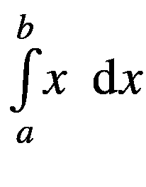
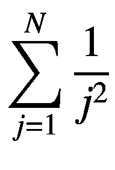

# 6. 数学和计算机编程语言

你可能没有编写技术或科学文本的习惯，但如果你有，那么 Pandoc 支持数学和计算机编程代码格式。

## 书写数学公式

只要你的输出文件格式支持，Pandoc 就能出色地处理数学公式的写入。Word 文件内置了对数学公式的支持，如果输出文件是 Word 文档，Pandoc 会使用该功能。对于 PDF，Pandoc 使用 LaTeX 作为中间格式，而 LaTeX 处理数学公式的效果堪称完美。对于 HTML 和 EPUB，根据你用于显示数学公式的版本和库，你也能获得一定的数学公式支持。

对于 HTML 和 EPUB，针对输出如何处理数学公式，你有不同的选择。当我的 HTML 或 EPUB 文档中包含数学公式时，我通常使用 MathML（⁴）或 MathJax（⁵）。对于 MathML，你可以使用 `--mathml` 选项：

```
pandoc --mathml -o document.epub document.md
```

对于 MathJax，你需要生成 EPUB3 文档才能使其正常工作，因此你还需要指定输出格式：

```
pandoc --to=epub3 --mathjax \
-o document.epub document.md
```

使用任一选项，你都能得到一个能良好显示数学公式的 EPUB 文档。虽然不像由 LaTeX 处理数学公式的 PDF 文档那样精美，但效果已相当不错。

在文档中书写数学公式的方式是使用 TeX 语法。只有在你输出 LaTeX 文件或通过 LaTeX 构建 PDF 文件时，输出文档中的数学公式才会是 TeX 格式；但在纯文本中书写数学公式的事实标准就是 TeX，Pandoc 正是采用这一标准。

你使用美元符号来开始和结束数学公式。使用一个美元符号会得到行内公式，使用两个则会得到“展示”模式公式，这意味着数学公式会单独占一行并居中显示。这是一个行内公式：`$\int_aˆb x\,\mathrm{d}x$` 显示为 。在双美元符号之间书写展示模式公式，如下所示：

```
$$\sum_{j=1}^N \frac{1}{j²}$$
```

结果会是这样：



Pandoc 支持用 LaTeX 书写的绝大部分数学公式。例如，下面是一个更复杂的方程：


其 LaTeX 代码如下所示：

```
$$
d(i,j) = \begin{cases}
\,i & j = 0 \\
\,j & i = 0 \\
\,\min\begin{cases}
d(i-1,j-1) + \mathrm{1}(i\neq j) \\
d(i,j-1) + 1 \\
d(i-1,j) + 1
\end{cases} & i>0,j>0
\end{cases}
$$
```

如果你书写了 Pandoc 无法处理的数学公式（例如，使用了 Pandoc 不认识的 LaTeX 包），你仍然可以直接写下该 LaTeX 代码。Pandoc 不理解的内容会直接传递到输出中。因此，只要你的输出格式需要经过 LaTeX 处理，这就能正常工作。

如果你的输出是 HTML 或 EPUB，并且使用了 MathML 或 MathJax，你也可以书写一个需要原样传递到输出的公式。

如果你只有一个文档，但需要为不同的输出格式提供不同的公式，就不能仅仅让文本直接传递到输出。这种情况下，你需要为一个输出格式输出一个版本，为另一个格式输出另一个版本。对此，Pandoc 允许你书写仅针对特定输出格式包含的原样文本。你可以这样写：

```
```{=latex}

$$\sum_{j=1}^N \frac{1}{j²}$$

```
```

来表示一个仅当输出为 LaTeX 时才包含的文本块，以及这样写：

`` `$f(x)=x²$`{=latex} ``

来表示行内文本。

## 书写代码块

Markdown 经常被程序员用来撰写关于程序的文档，因此它自然支持显示代码示例，通常还会带有语法高亮格式。不同工具对此的支持程度不同，但 Pandoc 对许多编程语言都有出色的支持。

书写代码块的语法可以使用波浪线“~”或反引号“`”。其中，反引号更可能被其他工具支持；因此，我在这里会使用反引号。下文给出的每个示例中，如果你用 `~` 代替反引号也同样有效。

用三个反引号开始一个代码块，然后写入你的代码，最后再用三个反引号结束该代码块。

```
```

for (int i = 0; i < n; i++) {

printf("%d\n", i);

}

```
```

你也可以使用波浪线代替反引号，但本章我将使用反引号。

```
~~~
for (int i = 0; i < n; i++) {
printf("%d\n", i);
}
~~~
```

如果你只使用反引号或 `~`，你会得到一个原样文本块，就像你缩进了文本一样。为了获得语法高亮，你还必须告知 Pandoc 你正在使用哪种编程语言。你可以通过在反引号的第一行之后写上该语言的名称来实现。为了对前面用 C 编程语言编写的代码进行语法高亮，你应该写成：

```
```c

for (int i = 0; i < n; i++) {

printf("%d\n", i);

}

```
```

结果会像这样：

```
for (int i = 0; i < n; i++) {
printf("%d\n", i);
}
```

一个 Python 代码块会像这样：

```
```python

for i in range(n):

print(i)

```
```

结果会像这样：

```
for i in range(n):
print(i)
```

要获取支持的编程语言的完整列表，你可以运行以下命令：

```
pandoc --list-highlight-languages
```

### 代码块选项

这种显示代码的语法被许多网站支持，例如在 GitHub 上，人们经常在其中编写文本代码。你可以为代码显示方式提供更高级的指令，但这时需要采用一种略有不同的、更特定于 Pandoc 的语法。具体来说，你需要在前三个反引号后的花括号内放置指令。你必须指定编程语言，并在名称前加一个点，例如，对于 Python 应写为 `.python`。然后，你可以使用指令 `.numberLines` 为代码行编号：

```
```{.python .numberLines}

for i in range(n):

print(i)

```
```

结果将如下所示：

```
1   for i in range(n):
2       print(i)
```

你可以使用选项 `startFrom` 指定起始行号。要从第 100 行开始，我们可以这样写：

```
```{.python .numberLines startFrom=100}

for i in range(n):

print(i)

```
```

结果将如下所示：

```
100  for i in range(n):
101      print(i)
```

你可以为代码块指定一个标识符：

```
```{#my-code .python .numberLines}

for i in range(n):

print(i)

```
```

这将使代码块成为一个超文本目标（即 HTML 中的锚点），因此你可以创建指向它的超文本引用。锚点 id 与标识符相同（不包括井号）。也就是说，在前面的示例中，它是 `my-code`。你可以像在 Markdown 文档中引用其他引用一样引用该目标，例如：

```
```{#my-code .python}

for i in range(n):

print(i)

```
请参见我的代码
```

在 HTML 输出中，你也可以使用 `.lineAnchors` 选项使每一行都成为一个锚点。

## 代码块

```
```{#my-code .python .numberLines .lineAnchors}

for i in range(n):

print(i)

```
```

行标识符由代码块 id 后跟行号组成。在这个例子中，两行分别为 `my-code-1` 和 `my-code-2`。

在 HTML 输出中，所有以 `.` 开头的选项都将被添加到包含代码的 `<pre>` 块的 class 属性中。通过样式表，你可以轻松地让代码块的格式与众不同。在过滤器（见第 11 章）中，你可以使用这些选项进行任意转换或计算。如果你开始大量使用代码块选项，需要牢记的一个关键点是：所有不带参数的选项

```
.python
.numberLines
```

*必须*以点开头，而所有带参数的选项

```
startsFrom=100
```

*不能*以点开头。如果你违反了这些规则，Pandoc 将不会按你期望的方式工作。

### 语法高亮样式

语法高亮方案由样式表的变体控制：HTML 输出使用层叠样式表 (CSS)，而 LaTeX（以及 PDF）输出使用一组 `\newcommand` 选项。这些高亮指令会直接放入输出文件中（生成独立文档时），因此不易覆盖。不过，你可以从预定义的高亮样式列表中选择。你可以通过运行以下命令查看完整列表：

```
pandoc --list-highlight-styles
```

你使用 `--highlight-style` 选项来选择样式。当我构建书籍的打印版本时，我需要黑白输出，因此我使用以下选项：

```
pandoc --highlight-style=monochrome
```

这会产生黑白高亮效果，使用斜体和粗体来显示不同的语言组件。你也可以在使用代码块时完全禁用语法高亮，使用 `--no-highlight` 选项即可。

## 练习

### 代码块

编写 Markdown 来显示以下 Python 代码：

```
print("hello, world")
for i in range(10):
print(i)
```

### 代码块选项

现在给它添加行号

### 语法高亮

使用至少三种不同的高亮格式对代码进行格式化，并检查结果。

脚注 1   2