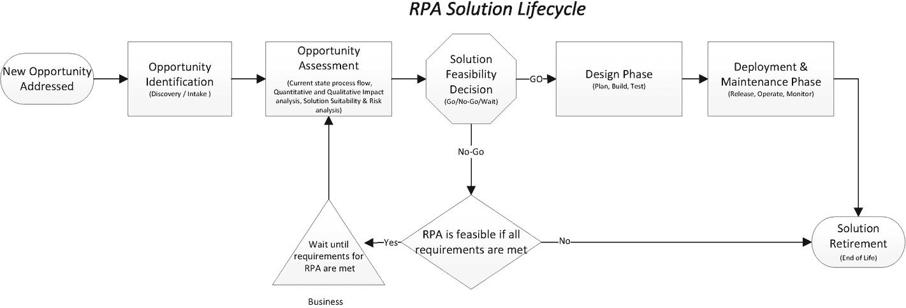

# 3. 运营模式 – 治理、赞助与框架

治理、赞助和框架将是成功的关键因素。我们将描述典型组织中应涉及的各个角色及其职责。

James Chen 在 *Investopedia* 中撰文这样描述`治理`：“公司治理是指指导和管控公司的[`规则、实践和流程体系`](https://www.investopedia.com/terms/m/mckinsey-7s-model.asp)。公司治理的本质是平衡公司众多[利益相关者](https://www.investopedia.com/terms/s/stakeholder.asp)（如股东、高级管理人员、客户、供应商、融资方、政府和社区）的利益。”^(²) 对于 RPA 而言，治理的范围没有那么广泛，我们将描述它为实现 RPA 成功所需完成的任务。

Project Smart 网站这样描述`项目赞助`：“项目赞助是一种积极的高级管理层角色，负责识别业务需求、问题或机遇。赞助人确保项目始终保持可行性，并确保实现收益，解决项目经理控制范围之外的任何问题。”^(³) 赞助人通常是负责提出 RPA 项目的领域预算的人。

`框架`是一个松散但不完整的结构，它为容纳其他实践和工具留有空间，但提供了所需的大部分流程。”^(⁴)

这三个概念之间的关系清晰可见。治理由规则和流程构成，赞助是确保其存续和演进所需的权威，而这一切都在框架内执行。

## 暂停思考

您所在的组织目前是否存在有效的治理和赞助？您是否在现任或前任公司中看到过其中一种或两种都行之有效？您可能（甚至很可能）没有见过。在开始 RPA 实施之旅时，切勿低估良好治理和有效赞助的重要性。否则，项目从一开始就注定失败。

## 治理

RPA 解决方案生命周期包含以下内容；请注意，具体组织可能因个别需求而存在一些差异。

### 申请表

这是以不同方式发生的基本请求；它可能是一次非正式的走廊谈话，随后召开会议以获取推进请求所需的详细信息，或者请求者可能提交了一份包含所有必要信息的申请表（参见附录 1）。

申请表上的信息代表了对此机会的初步审视，因此，此时存在许多未知信息。

通常，此时会捕获以下信息：
- 流程的高级描述
- 受影响的业务领域（上游和下游流程）以及系统或工具
- 业务驱动因素和关键程度
- 节约量估算（FTE 工时等）和收益估算（改进质量、改善服务等）
- 机会识别（详见第 4 章）

> **提示**
> 虽然初始请求可能以电子邮件甚至非正式的走廊谈话形式出现，但将申请表标准化并鼓励使用将非常有益。

然而，在某些情况下，申请表上提供的信息就足以断定在当前情况下自动化不可行，原因可能是流程复杂性、RPA 能力有限，甚至解决方案的生命周期可能很短。应告知请求者这一情况，并尽可能提供有助于克服自动化本应解决的问题的任何建议。

一旦提交的初始请求未引发任何可行性问题，就可以进入下一步。

> **提示**
> 请记住，这是对请求的初步审视；尚无太多细节可用。如果在此未提出可行性问题，并且请求获得批准继续进行，这并不意味着在后续阶段不会发现此类问题而导致项目取消。如果发生这种情况，绝不能认为是失败。这意味着迭代流程按预期发挥了作用。

### 流程发现

在此阶段，会对所提及的机会进行详细评估，以捕获以下内容：
- 端到端（E2E）流程步骤
- 流程中涉及的角色和用户
- 所用系统和工具列表
- 作业量（每小时、每天、每周等）
- 每个步骤的流程时间以及有助于准确估算节省和收益的其他流程绩效指标
- 流程约束
- 建议自动化的流程步骤
- 申请表触发的任何其他信息

需要所有这些信息才能进入下一步——机会评估，该步骤将评估 RPA 价值以及 RPA 作为解决方案的可行性。

### 机会评估（详见第 5 章）

此阶段需完成若干事项：

1. **了解当前流程**
在机会识别阶段已经对流程进行了高层次审视。现在，需要将其细化，并记录输入、活动、输出以及负责的角色。

2. **影响分析**
为什么要做这个？在接收阶段，可能已经对节省的时间、合规性等做出了一些初步估计。现在，需要对这些进行更精确的研究。
    - 创建一个 Bot 来自动化该流程需要投入多少时间和资源？投资回报率（`ROI`）是否足以证明支出的合理性？虽然这需要指导委员会做决定，但 RPA 团队会提出建议。

3. **适用性分析**
在此，我们必须评估所申请的流程是否是自动化的良好候选对象。它是否足够重复？需要做出的决策中是否只有少数可以转交人工处理？将回答这些问题以及其他问题以确定其适用性。

4. **风险分析**
自动化该流程涉及哪些风险？不自动化该流程涉及哪些风险？

### 解决方案可行性决策流程

所有汇总信息都会提交给决策者进行评估，以确保 RPA 解决方案能够带来足够的`ROI`，并且预期收益与整个企业的战略保持一致。

在决定继续进行 RPA 解决方案开发之后，该机会进入解决方案设计阶段。

### 解决方案设计阶段（详见第 6 章）

1. 规划
2. 构建
3. 测试

每个阶段均根据公司标准执行，使用 `Waterfall` 方法、`Agile` 或其他常用方法。

在成功测试并通过业务验收后，RPA 解决方案将发布到生产环境，进入运营阶段。

### 解决方案退役

1. 日落（生命周期终止）策略或计划

### 解决方案部署与维护阶段（详见第 7 章）

1. 发布
2. 运营
3. 监控

前面提供的信息以流程图格式显示在图 3-1 中。

**图 3-1** RPA 解决方案生命周期

有效治理的组成部分可能看起来复杂，但这种结构的需求已反复得到证明。识别和评估机会，并拥有可重复的流程和工具，将大大有助于确保您新的 RPA 计划取得成功。

## 赞助支持

RPA 赞助人无需亲自执行这些任务，但需确保项目成果与全企业战略方向保持一致，并为其创造价值。他/她需要确立项目愿景、目的与目标，清除障碍，并确保为项目成功分配必要的资源。通常，RPA 赞助人是高管团队成员，负责监督引入 RPA 项目的业务领域。由业务部门或 IT 部门主导项目均可。然而，重要的是要记住，RPA 团队必须是跨职能的，并应包括以下角色：
- 业务部门
- IT 部门
- 安全部门
- 风险与合规部门
- 财务部门
- 人力资源部门
- 市场部门（适用时）

来自这些领域的利益相关者/主题专家必须参与创建协作环境，因为正如文章《[成功实施机器人流程自动化的蓝图](https://medium.com/%2540cfb_bots/a-blueprint-for-implementing-robotic-process-automation-successfully-88e5f7ff7400)》^(⁵) 所述，RPA 有潜力成为推动真正且有影响力的数字化转型的颠覆性变革力量。

另一方面，RPA 倡导者将负责推广 RPA 技术以应对业务挑战，并负责在所引入项目的业务领域中推动 RPA 的采纳。理想情况下，RPA 倡导者应深入了解业务运营，并具备必要的影响力来推广 RPA，同时通过及时解决任何障碍来克服对采纳 RPA 的阻力。^(⁶) 最佳实践是拥有多位代表不同业务领域的 RPA 倡导者，以最大化 RPA 项目的回报价值并确保全企业范围的采纳。

### 暂停与思考

赞助人和倡导者应对 RPA 项目的成功充满热情并拥有既得利益。你是否已采取必要措施，确保你希望成为赞助人或倡导者的人相信 RPA？不要选择那些只是应经理/领导要求参与，或者你明知其对 RPA 潜力持怀疑态度的人。

确保有一位高级管理者为 RPA 项目的成功投入并负责，是项目成功的关键。他们应有一个令人信服的理由来确保项目成功。

## 框架

当我们提到框架时，指的是项目如何构建的总体概览。这并非一成不变；它会因公司而异，甚至在同一公司的不同业务部门之间也会有所不同。但存在一些基本的基础组成部分。

正如我们之前提到的，RPA 项目团队必须是跨职能和多学科的，并且应包括来自业务运营和控制支持职能中所有受影响领域的代表。一个功能齐全的核心 RPA 交付团队应包括以下角色：
- 流程分析师/设计师
- RPA 解决方案架构师
- RPA 开发人员
- RPA 管理与支持

### 流程分析师/设计师

此角色需要理解需要自动化的流程，检查自动化该特定流程的可行性，如果合理的话，则设计并开发该流程的未来状态。流程分析师/设计师应具备业务流程经验，并能够定义所需流程的愿景。由于此角色可能由一人或多人担任，因此非常重要的是要记住，流程分析师/设计师必须与当前流程的执行者密切合作，以准确捕捉其细节。流程分析师/设计师必须理解并评估这些细节，以判断该流程是否适合 RPA，并且部署的解决方案（机器人）不会使运营面临任何风险，并能带来足够的收益。为此，流程分析师/设计师还需要熟悉 RPA 工具的功能和局限性，并能够为流程负责人提供基础概览培训。流程分析师/设计师是 RPA 解决方案规范的驱动者，同时负责所有其他相关文档，如可行性、影响和风险评估，以及业务验收交接等。此外，他们还应负责将在开发和测试阶段产生的任何反馈和更改整合回规范中。

## RPA 解决方案架构师

RPA 解决方案架构师通常具有软件开发或自动化背景。RPA 领域发展非常迅速，并且得益于可执行重复性、基于规则任务的简单任务机器人。这些机器人的构建很容易，如今已演进到新一代的 IQ 机器人，它增加了认知处理能力，使流程能够处理非结构化数据。此外，市面上还有许多打包的企业软件产品，例如 AutomationAnywhere、BluePrism、UIPath 等。RPA 解决方案架构师不仅需要熟悉当前可用的 RPA 功能，还必须了解以下方面：

- 自动化策略
- 数字解决方案交付模型和框架（敏捷、DAD、DevOps 等）
- IT 基础设施和业务运营
- 将在 RPA 项目中涉及的产品或服务

需要这些专业知识来帮助和指导组织在整个 RPA 旅程中构建可持续、有效（有影响力）且可扩展的解决方案。

## RPA 开发人员

RPA 开发人员的主要职责是使用 RPA 工具设计、开发和维护自动化解决方案。根据所使用的工具，此角色需要一定程度的开发人员专业技能。如果你希望自动化一个包含规则和逻辑（如循环、`if/else` 语句、变量和异常）的流程，则需要编程能力，并且 RPA 开发人员应具备该领域的必要经验。请记住，自动化一个流程有多种方法；因此，具备良好的自动化工具技术知识是一笔巨大的财富。

RPA 开发人员是跨职能设计团队的一员，这意味着他们与 RPA 解决方案架构师和流程分析师/设计师密切合作，以寻找最有效和最高效的方式来开发、测试，并在流程负责人成功验收后，将自动化解决方案部署到生产环境。重要的是要记住，发布到生产环境的解决方案应附有支持性文档，以帮助开发人员和运维人员理解自动化解决方案的逻辑和内容。

## RPA 管理与支持

### 部署 RPA 解决方案

一旦 RPA 解决方案（机器人）部署完成，就需要分配专门的资源来监控其执行情况，并及时处理错误、修复问题以及进行小幅增强。这些资源还将管理流程的执行计划。此外，RPA 管理和支持团队将负责通过监控和确保系统健康、最大化运行时许可证利用率、引入新的自动化能力等方式，来维护和推进整个 RPA 生态系统。根据部署的机器人数量以及 RPA 生态系统的复杂程度，可能需要不止一个人来负责处理上述某些职能。同时，将那些高层职能分解成更小的模块也是有益的，以避免把事情过度复杂化。请记住，战术支持的主要目标是保持速度和敏捷性，而不是制造过多的官僚层级。

**暂停与思考**

各组织的职位名称可能有所不同。然而，头衔并不重要；关键是之前讨论的职责描述。你所在组织中有谁能执行这些任务？他们熟悉 RPA 吗？他们认为 RPA 有价值吗？

### 选择部署模式

在开启 RPA 之路前，组织应决定 RPA 计划是由内部资源主导，还是外包给外部第三方 RPA 提供商。此外，组织也可以选择混合模式，即与外部提供商和内部资源建立协作框架。例如，外部合作伙伴可以专注于解决方案的识别、开发和部署，而内部团队则负责提供支持与维护。

在选择合适的路径之前，组织必须明确以下几个方面：

- 是否有足够的流程来证明 RPA 投资（ROI）的合理性？
- 组织是否承诺对 RPA 计划进行长期投资？
- 组织是否拥有启动 RPA 计划所需的内部技能和能力？
- RPA 是否是运营及 IT 基础设施或生态系统数字化转型的长期（即五到十年）战略的一部分？

为 RPA 计划选择正确的路径，将决定其成功与否，否则可能导致结果不佳且成本高昂。这很可能会招致高层的撤资，并最终切断对 RPA 的财务投入。

**提示**

如果不满足这些条件，就不要启动 RPA 计划。没有这些条件，RPA 计划失败的可能性远大于成功。

### RPA 的组织模式

RPA 计划的组织模式为在企业层面部署 RPA 提供了结构框架。有三种模式可供考虑^(⁷)：

**集中式**
这通常被设计为一个卓越中心（COE；关于 COE 的更多信息，请参见第 7 章），设立在一个高管办公室（业务领域）内，负责管理 RPA 计划的整个生命周期，包括制定标准、从构思到部署交付 RPA 解决方案、维护 RPA 基础设施，并确保有适当的控制、风险管理和合规性。

**中心辐射式或联合式**
COE 设立在一个高管办公室内，通常作为分散型辐射点的中心。在这种情况下，COE 负责制定标准、制定政策、提供培训，并专注于创新和 RPA 计划战略。辐射点（即 RPA 交付团队）则主要专注于为其所分配或服务的业务领域开发和部署 RPA 解决方案。这种模式要求中心（COE）与辐射点（RPA 交付团队）之间紧密协作。

**分散式**
在企业内部设立多个独立的 RPA 计划，各个 RPA 框架在不同的执行分支或业务单元下运作。这可以被视为多个自主运作的次级 COE 办公室。

最佳的组织模式将取决于各个 RPA 计划的策略、服务人群的规模、业务复杂性、管理文化、组织设计、风险承受能力以及许多其他因素。在接下来的章节中，我们将更详细地讨论为你的企业 RPA 计划实施有效运营模式的收益、适用性因素及方法。此外，我们还将讨论随着计划日益成熟，这些模式可能会如何变化。

**暂停与思考**

哪种模式适合你的组织？你将如何确定哪种模式最佳？你的组织目前是否设有卓越中心？如果有，它是如何运作的？你需要与 COE 中的谁讨论 RPA 事宜？如果你的组织中没有 COE，是否有兴趣建立一个？

### RPA 的开发方法论

有多种数字产品开发方法论可供选择。这些方法定义了必要的步骤、决策过程、沟通以及不同利益相关者需要执行的操作，以便成功交付数字产品——即 RPA 解决方案。

最常见的包括：

**瀑布模型**
这是一种顺序式框架，流程以线性方式执行，产品按照预定义或计划的顺序从一个阶段进入下一个阶段。这种方法可以实现高质量的产品设计，但其僵化的结构不允许有高度的灵活性来应对变化，并且在早期阶段犯下、后期才发现的问题，解决起来代价可能非常高昂。

**敏捷开发**
这种方法论被软件开发公司广泛采用，尤其是初创公司，其核心思想是迭代开发和交付。该方法允许团队频繁地以小模块方式开发和发布产品功能、增强或变更。这可以实现快速的价值交付，对客户需求变化具有高度适应性或灵活性，并能快速识别错误和问题。

**瀑布-敏捷混合模式**
这种方法最初是顺序式的，然后在开发和交付阶段转变为迭代过程。这种混合模式创建了一种严谨的方法，允许在开始开发之前就深入调查和理解客户需求及产品规格，同时在开发和部署阶段又保持了足够的灵活性以进行迭代和调整。

**精益开发**
这种方法论依赖于简单的理念，比如交付从客户角度定义的价值。它采用了最初在制造业中确立的精益概念。在软件开发中，它首先定义最小可行产品，然后通过迭代周期，不断增加其价值——要么通过添加新功能，要么通过提高其质量。

在这场竞争中，没有绝对的赢家；这完全取决于许多因素，类似于前面讨论的选择合适运营模式时需要考虑的因素。理解你所处的环境，以及每种方法论在该环境下的优势和潜在陷阱，至关重要。

### 框架的重要性

一个结构良好的框架对于 RPA 计划的成功至关重要。随着需求变化或发现框架中的缺陷，可以随着时间的推移对其进行修改，但从一个稳固的框架开始运作将极大地促进成功。

**暂停与思考**

框架在你所在的领域可能会是什么样子？一些基本的结构要求（如角色等）是什么？哪些角色可能适合担任治理团队的成员？哪些角色适合作为决策机构，来决定是否继续推进某个请求？应该包含哪些文档？报告工作将如何开展？当你着手开展 RPA 计划时，必须回答这些问题以及其他相关考量。

一个灵活的框架，包含必要的角色和流程，是确保`RPA`计划内的成功并非“一次性成果”，而是可以重复实现的关键。

`治理`——用于控制和监控`RPA`计划的规则、实践和流程——将是成功的关键。拥有有效的`项目发起人`——负责确保`RPA`获得必要支持并实现预期收益的高级管理层——也是`RPA`成功的“必备条件”。确保存在一个广泛的`框架`，能够让参与`RPA`计划的人员在其中拥有灵活的工作结构，确保他们知道预期目标，同时仍能适应不断变化的需求和情况。

脚注 1 2 3 4 5 6