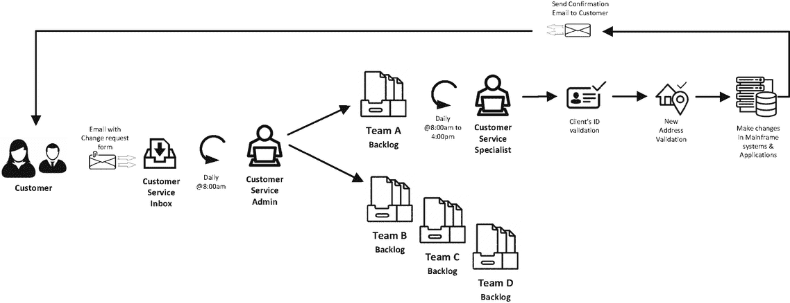
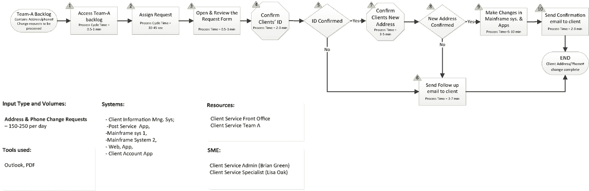

## 4. 机会识别

机器人流程自动化（`RPA`）正迅速流行起来。然而，主要问题之一在于了解哪些流程适合自动化。

在`RPA`计划中，最关键的决策之一就是确定哪些流程是应用`RPA`的候选对象。

尽管组织对`RPA`非常了解，但他们仍在努力寻找`RPA`实施的“神奇公式”。实际上并不存在这样的公式，但本书中的信息将有助于您在贵公司成功实施`RPA`计划。

*Sagacity Software* 的一篇文章简洁地阐述了这一困境：*实施`RPA`技术的公司必须确保选择正确的流程进行改造。通常情况下，公司无法实现所有流程的自动化。选择合适的流程可能是一项重大挑战。如果一个组织选择在过多的流程中实施该技术，则可能造成大量混乱。同时，若在数量不足的流程中实施`RPA`，又会削弱其有效性。因此，公司在实施时必须找到恰当的平衡点。*^(⁸)

建立初始商业案例并识别适合自动化的流程可能很复杂。尝试对不合适的流程进行自动化，是组织未能充分发挥`RPA`能力以重塑其业务运营并推动数字化转型的主要原因之一。

### 暂停思考

您在您的组织中看到了哪些`RPA`挑战？您将如何应对这些挑战？您将如何管理预期，使其不将`RPA`视为解决所有问题的“银弹”，而是将其视为节省时间和减少错误的重要一步？

正如我们在前一章中提到的，`RPA`解决方案生命周期始于如何识别`RPA`候选流程。

请注意，一旦您在组织内建立了`RPA`计划，将会出现另外两个相关事件，要求您遵循本章及后续章节中的步骤：增强和缺陷。当要求改进或更改处理某个流程的`Bot`以使其能够执行更多手动任务时，就会发生增强。此外，有时会提出将第二个与第一个相似的流程进行自动化，这种情况下，可能只需要增强现有的`Bot`。在这两种情况下，请求都会被识别、评估等。

关于缺陷，小缺陷将在不经过完整流程的情况下被纠正，但重大缺陷应遵循流程，以确保在时间和成本方面进行修复是合理的。

基本请求可以通过不同方式提出：一次非正式走廊谈话后通过会议来获取推进请求所需的详细信息，或者请求者可能已经提交了包含所需信息的请求表单。

请求表单上的信息代表着对机会的初步审视，因此，此时存在大量未知信息。

请求表单提供了请求的基本要素。它用于决定是进入下一步，还是项目此时应就此终止。

此时，所需的信息不足以决定是否完成项目，但足以做出前述决策之一。如果获批进入下一步，将收集更多信息，并在该步骤完成后，再次就推进事宜做出决定。

项目可以在任何时候被取消；最初批准一个项目后来又取消它，存在许多合理的理由。例如，对节省金额的初步估算，可能在后续阶段收集到更多信息后被证明是夸大的。更准确的估算可能会排除花钱自动化该流程的收益。或者，一个最初看似相当简单的自动化，在后续阶段仔细审视后，可能被证明复杂得多。随着新信息的获得，项目发起人必须判断自动化是否仍能带来足够的投资回报率（`ROI`）。如果不能，项目将被取消，并通知相关利益方这一事实及原因。

一个最初被接受但后来被取消的请求并不代表失败。在一个看似可行的项目上投入一些资源（时间、金钱等），然后在项目进行到某个阶段时及时止损并取消它，远比将项目进行到底，却发现它未能满足需求、严重超预算等要好得多。

另外，一个请求被拒绝或在启动后被取消，并不意味着它永远不会被执行。应告知请求者，由于当前的优先级以及他们的请求不符合某些标准（例如，节省不足、复杂性高等），该项目目前不会是高优先级事项，但未来会重新评估。

### 申请表

这是一份申请表样例；你也可以在附录 1 中找到它。

*RPA* 机会 *– 申请表*

| **倡议名称** |  |
| :--- | :--- |
| **发起人** |  |
| **负责人** |  |
| **当前流程如何运作？** |  |
| **目标是什么？** |  |
| **常见业务驱动因素/业务关键性** |  |
| **受影响的业务领域** | **受影响的系统/工具** |
| **机会类型** | **解决方案的持续时间？** | **预估运营效益（FTE 工时）** |
| **优先级** | **期望交付日期** |
| **表格填写日期：** | | **编制人：** | |

申请表通常包含以下组成部分：

- **项目名称**
- **发起人：** 通常为高层领导，负责该自动化项目所在组织的预算。
- **负责人：** 直接负责拟自动化流程的领导者。他们还负责排除可能出现的障碍，并在自动化开发、测试及部署阶段分配所需资源。
- **当前流程描述：** 对当前流程进行充分详细的总结，使阅读者能够全面了解其目的、流程流转、重复性特征，以及该流程适合自动化的原因。
- **实施目标：** 说明拟将流程的哪一部分或整个流程实现自动化，并简要列举自动化带来的益处。
- **业务关键性：** 此部分阐述为何当前必须或应该对该流程实施自动化，以及该自动化如何与战略业务目标保持一致。是否存在竞争需求？是否面临高风险？客户是否在投诉某些可通过自动化解决的问题？等等。
- **常见业务驱动因素：** 一些可能的示例（包括但不限于）如下。
  - 缩短周期时间
  - 提高工作的一致性和质量
  - 允许员工从事更高价值的活动
  - 等等。
- **受影响的业务领域：** 列出将受此自动化影响的业务单元。
- **受影响的系统/工具：** 可能涉及已购买或已开发的特定系统并将受到影响，应在此列出。此外，任何工具，包括`Excel`、`Outlook`、`Word`等，也应在此列出。
- **机会类型：** 在此注明这是否是一次性自动化（可能用于清理数月或数年的积压工作），还是将持续进行的自动化。
- **存续期预估：** 如果该流程预计在特定时间范围内被淘汰，或者预期在例如第三季度购买的新工具将解决此问题，请在此说明。
- **期望交付日期：** 指明自动化的最佳期望交付时间。
- **预估运营效益：** 这通常是指时间和成本的节省，但并非每个申请自动化的项目都能显著节省时间和成本。有些是为了满足监管或竞争要求，有些是为了降低人为错误的风险。如果自动化能带来时间成本节约或收入增长，应在此详细说明。
  - 例如：
    - 5 名员工每周花 3 小时处理此流程
    - 5 X 3 = 每周 15 小时
    - 每周 15 小时 X 52 周 = 每年 780 小时
如果为了节省时间和金钱而实施流程自动化，可能需要每年节省约 1,500 个工时（或一个全职岗位），才能证明解决方案开发和维护成本的合理性。然而，这在不同的组织中会有所不同，因此为你的组织建立正确的标准至关重要。
- **表格填写日期：** 顾名思义。
- **编制人：** 顾名思义。

### 提示
尽管最初的请求可能以邮件甚至非正式的走廊交谈形式提出，但将申请表标准化并鼓励使用将非常有益。

### 暂停并思考
根据这些信息，你所在组织的申请表可能会是什么样子？是否还应收集其他信息？上述信息及附录 1 中的模板是我们发现作为基础比较有用的内容，但不同组织可能需要略微不同的组成部分。不过，此处展示的信息已包含基本要素。

如前所述，此阶段可能的结果之一是请求被拒绝。可能存在以下情况：申请表上提供的信息足以断定在当前环境下自动化不可行，原因可能包括流程复杂性、`RPA`能力有限，或者解决方案的存续期过短。应告知请求者这一情况，并给出任何可行的建议，以帮助解决原本拟通过自动化来解决的问题。

一旦初始请求提交且未引发任何可行性问题，即可进入下一步骤。

# 流程发现阶段

评估每个候选流程以确保 RPA 是当前情况的正确解决方案至关重要。这也能确保自动化举措在你的组织中取得成功。为了让 RPA 团队和治理委员会能够就是否继续进行自动化开发做出明智决策，他们必须掌握关于候选流程的充分信息。流程发现阶段是机会评估阶段（请参阅第 5 章）的前置步骤，所有用于做出关键决策的信息都在此阶段收集。正确执行此阶段非常重要，以避免对不适合自动化的流程启动自动化开发。

流程发现可以通过查阅流程相关文档并提取所需信息来为决策者提供摘要。这种方法简单快捷；然而，由于参考文档中可能存在不准确的假设或过时信息，容易产生错误。如果没有合适的流程文档该怎么办？

正如 `BPM` 资源中心所指出的：*在许多组织中，日常活动可能已根深蒂固且成为例行公事，以至于某个给定流程的确切步骤并不总是清晰明确。组织中的不同成员可能不知道某个事项一旦离开他们手中后会发生什么。你可能会在公司运营或政策指南中找到的官方流程文件，可能无法映射实际执行的操作。*^(⁹)

所有这些都可能导致很高的风险：当解决方案设计阶段开始时，`RPA` 团队可能会发现极端的复杂性、运营风险，以及/或对流程自动化可能带来的收益的夸大。

因此，推荐的流程发现方法可以简单到：将团队聚集在一起（实体或虚拟形式），讨论并记录（绘制流程图并包含相应的书面描述）某个特定流程的实际执行方式。通过与直接相关人员的讨论和访谈，你通常可以发现跨团队、部门、事业部等的流程端到端步骤。在此协作过程中，你还可以提取关键指标（数量、成本及其他衡量标准），这些指标有助于判断改进投资是否能产生实现战略目标所需的结果。

有许多 `BPMS`（业务流程管理软件）工具可以促进甚至部分自动化流程发现阶段。通过挖掘现有信息系统并分析事件和事务日志，你可以记录实际完成的工作（谁做了什么、何时做的、持续了多久）。如今，新兴技术工具能够从各种系统读取数据，并以流程图、图表及其他方式呈现这些信息，帮助你理解流程步骤、瓶颈等更多内容。

然而，这类工具往往不可用，因此识别正确的 `SME`（主题专家）并与他们会面是成功的关键。

> **提示**

如果自动化工具（事件和事务日志等）不易获得，请不要气馁。通过与 `SME` 的会议即可轻松识别适合自动化的流程。自动化工具是优势，但并非绝对必需。

由于每个组织的流程都存在一些固有的低效问题，因此它们需要像流程发现这样的方法，来帮助获取任务级数据以及人与系统之间交互的各种细微差别。虽然所有公司都制定了标准操作程序，但现实中这些程序往往被忽视。除非这些程序被完全锁定，否则许多员工会自行发明操作方法。这就是为什么任何流程的现有文档可能不可靠；有必要了解工作的实际执行方式，这往往与预期的方式（根据现有文档）大相径庭。此外，许多公司将流程外包给其他 `BPM` 供应商，导致其领导者不熟悉自身流程的执行情况。

在大多数情况下，尤其是在 `RPA` 的初期引入阶段，业务流程是通过手动流程映射来记录的。这包括一个高级流程图（通常使用`Visio`或类似软件绘制），然后在一个单独的 `Word` 文档中更详细地描述每个任务。

通过包含以下信息来完善这两份文档：如前所述，关于系统和工具、数量、流程步骤耗时、自动化的潜在限制（如果此时已知），以及请求表中注明的任何其他相关细节。

然后，这些信息将被汇编并提交给治理委员会。

> **暂停思考**

随着项目的成熟，机会识别、接收和流程发现应从 `RPA` 解决方案的最优设计演变为业务流程的最优再设计。一套强大的流程改进能力能使高性能的 `RPA` 项目解决全组织的业务挑战，并在运营绩效和客户体验方面实现全面、变革性的影响。^((10))

请记住，流程图用于设计人员、开发人员、治理委员会成员及其他利益相关者理解流程步骤。它是关于输入、输出以及中间流程步骤的高级视图。它有助于理解哪些步骤最适合自动化，以及每个步骤手动执行需要多长时间，从而确定时间/成本节省。

创建流程图有多种方法。你可以依靠 `SME` 知识。采用这种方法时，请与实际执行该流程的人员安排时间。我们怎么强调都不为过：流程既有预期的工作方式，也有实际的工作方式。了解实际的工作方式至关重要——人们执行流程时具体做了哪些步骤？这才是将要自动化的内容。

在白板或`Visio`、`iGraphix`等工具上绘制流程图。

首先，记录步骤，例如：`"开始"`、`"查找账号"`、`"验证账号"`、`"更改客户地址"`、`"通知客户"`、`"通知顾问"`、`"结束"`。

然后，针对每个步骤，询问当前所需时间。例如，查找账号可能意味着搜索数据库，然后复制号码以便在另一个数据库中验证。这需要多长时间？30 秒？两分钟？根据任务的不同，完成时间可能存在很大差异。在这种情况下，请包含一个范围（例如，`"步骤 5：30 秒到 2 分钟"`）。

在地图上，在每个任务下方标注其所需时间。

另一个映射流程的优秀方法是对其进行**视频录制**。为此，需要安排时间与一位实际执行该流程的人员一起，在他们操作时录制其执行流程中的任务。当他们在点击应用程序和下拉菜单，或输入信息时，应详细讲解他们正在做什么以及为什么这样做。例如：

```
“在这个标记为‘描述’的文本框中，我将触发此请求的邮件正文中的信息复制粘贴到这里。”
```

完成此步骤后，你可以回顾视频，并据此创建流程映射图。

**提示**

如果项目进入设计阶段（参见第 6 章），该视频将对记录功能需求非常有帮助。

如果因故无法录制流程视频，与执行该流程的人员坐在一起是记录流程的另一种方法（请注意，所有这些都可以远程完成）。记录下每个屏幕及其上执行的操作，然后按照前面所述的方法映射流程。

创建初稿后，将其呈现给一组 `SME`（即实际执行该流程的人员）进行验证，以确保其反映实际情况，这非常有益。请注意，发现某些人可能会调整流程（无论是执行顺序上的调整、插入额外步骤还是省略某些步骤）是正常现象。确保没有遗漏关键步骤，并确保按照映射的流程执行能够获得期望的结果。

创建并验证映射图后，最好在另一份文档中提供一些描述性的、更详细的信息。请记住，在任何流程映射图中，每个步骤都只有寥寥几个词，例如：`"识别账号"`、`"收集需求"`等。详细的解释有助于读者更好地理解流程。

对于流程中的每个步骤，将以表格形式提供以下信息：

*   **输入**：什么触发了该步骤？对于除第一步外的所有步骤，输入通常是上一步的输出。

*   **活动**：该步骤实际做了什么？这里会包含访问特定系统的相关信息。

*   **输出**：该步骤的结果是什么？使用前面引用的例子，结果可能是`"账号已定位"`。

*   **角色**：谁通常执行此活动？这里不是填写姓名的地方，而是填写角色。示例包括但不限于`"客服代表"`、`"业务分析师"`、`"新业务经理"`等。

*   **度量指标**：在此步骤中收集（或应收集）哪些数字？示例可能包括定位账号所需时间、从初次请求到客户回复的时间等。

*   **备注**：在此处包含步骤其他部分未记录的任何相关信息。这可能包括使用的系统、应用程序或工具、可能出现的异常解释、预期数量等。

**提示**

请记住，尽管此文档提供了关于映射图的额外信息，但它仍然是一份早期阶段的文档，因此不需要过度详细的细节。

在某些情况下，则不需要此文档。对于非常简单直接的流程，映射图可能就足够了。输入和输出清晰明了，并且明确指出了每个步骤所需的时间。此外，如果在关于请求的初始讨论中，发现此请求不适合进行 `RPA`，那么花时间创建此文档就毫无意义。

总而言之，在此阶段，被提及的机会已得到详细评估，你现在对端到端流程、流程中涉及的角色和用户、流程使用的系统及工具列表，以及通过流程处理量的合理估算（可以是每小时、每天、每周等）有了清晰的了解。你还知道了流程中每个步骤所需的时间，以及任何其他可能相关的绩效指标。你还识别出了自动化该流程的任何已知约束和风险。此外，通过与 `SME` 和业务合作伙伴的讨论，你知道了业务方希望自动化的流程步骤，这可能是流程的全部或部分。通过讨论，你可能还掌握了其他重要信息。

所有这些信息都是进入下一步（即机会评估）所必需的，该步骤将评估 `RPA` 的价值和 `RPA` 作为解决方案的可行性。

你会注意到，在此流程阶段中，你已与许多不同的人进行了接触。业务方代表提出了初始请求；你与他们进行了一次（可能多次）互动；随后你联系了 `SME`，并可能联系了风险与合规部门的人员。在此阶段，如果你的组织有 `COE`（卓越中心），则应联系他们。如果没有，谁将负责部署 `Bot`？应让那个人或部门了解所提议的内容以及一个非常粗略的部署日期。尽早让这些人参与进来，将有助于你顺利推进项目启动和开发的流程。你将在后续章节中看到具体方法。

接下来，让我们通过一个案例研究中的实用（尽管是虚构的）例子来审视这些概念。

### 案例研究：客户地址和电话号码更新

对于任何面向客户的组织来说，拥有客户最新的联系信息至关重要，以便及时提供客户服务（例如，发送发票、账单或服务变更更新，以及促销活动、新服务或新产品等营销材料）。在这种假设情况下，客户通过电子邮件将`"地址变更"`表格提交到假设的`"MyRPA"`公司的客服邮件收件箱。可能有不同类型的邮件到达该收件箱；因此，客服人员会查看邮件并将其分派到相应的团队队列进行处理。

在此案例中，请求被发送到`团队 A`，该团队专门负责客户档案管理任务。`团队 A` 由六名客服专员组成，他们每天早上访问团队的待办文件夹，并按照先进先出的顺序处理请求。

成功变更后，客服专员（CSS）会向客户发送确认邮件。

经过一次流程质量审计，团队管理层发现，由于人为错误，大量地址变更请求处理不当，这导致了大量的客户投诉，以及因后续调查和纠正这些错误所需的返工而产生的高昂运营成本。管理层希望探索自动化该流程的机会，以提高整体流程质量，并将其资源重新分配到其他需要人工干预的领域。

### 流程图与流程映射图

为清晰起见，我们需要区分流程流程图（process flow）和流程映射图（process map）。

以下是描述案例研究流程的高层次流程流程图：



以下是针对该案例研究的高层次流程映射图（模板见附录 2）：



### RPA 机会 – 申请表

此示例的申请表可能如下所示：

| 背景 |  |
| --- | --- |
| 举措名称 | 地址和电话号码变更流程 |
| 发起人 | Mary Smith |
| 项目负责人 | John Doe |
| **当前流程如何运作？** | 包含新客户信息（地址和/或电话号码）的客户变更请求邮件，由客户服务专员（CSS）转交给 A 组处理。该组有五名全职员工负责处理这些请求。如果地址无误，每位 CSS 处理一个请求大约需要 10-15 分钟；如果需要调查或与客户进一步跟进，则大约需要 20 分钟。该组领导看到了至少部分自动化该流程的机会，并将部分 CSS 调至其他服务时间更长、加班率更高的领域。此外，审核流程请求后发现，电话号码中存在大量人为错误，例如更改了错误的客户地址、新地址出错，或未在所有必需的系统和应用程序中更新客户信息。这会引起客户的不满，并增加客户服务的整体运营成本，因为我们需要进一步调查，且不容易联系到客户。 |
| **目标是什么？** | 我们希望提高流程质量并减少处理这些任务的 CSS 数量。要求是自动化端到端的地址和/或电话号码变更流程。自动化系统应能够验证客户凭证、更改电话号码，以及/或者验证并在大型机系统中用新地址更新信息。 |
| **常见业务驱动因素/业务关键性** | 运营成本、质量、改善客户体验、公司形象与声誉 |
| **受影响的业务领域** | **受影响的系统/工具** |
| 客户服务团队 | Outlook、PDF 表单、客户信息管理系统、大型机系统 |
| **机会类型** | **解决方案持续时间？** | **预估运营效益（FTE 工时）** |
| 年度 | 5 年 | 7 个全职等效员工，约 11,830 FTE 工时 |
| **优先级** | **期望交付日期** |
| 必须执行 | 20xx 年 10 月 1 日 |
| **表单填写完成日期** | 20xx 年 5 月 24 日 | **编制人：** | Judith Wilson |

### 详细流程描述

在发现阶段，流程分析师与主题专家（SME）接洽，并成功捕获了端到端（E2E）流程，识别出关键信息，包括：

- 输入类型和数量、流程中涉及的工具和系统，以及执行工作的资源

所有这些信息都被汇编到上方的流程图中。

除了流程图之外，还创建了流程步骤的详细描述（模板请参见附录 3）。该文档的好处在于，它能提供后续步骤中可能对决策者和开发人员至关重要的任何必要细节。

#### 客户地址与电话号码更新

| **输入** | 此为流程的起始点。 |
| **活动** | A 组成员访问待办请求列表。 |
| **输出** | 待办请求列表已被访问。 |
| **角色** | A 组的数据更新文员。 |
| **备注** | 此处无单独的“输入”。这是启动该流程的触发器，每日早晨执行。 |
| **指标** | 每日新增请求数量。 |

1. **访问 A 组待办请求列表**

| **输入** | 待办请求列表已被访问。 |
| **活动** | 每个请求被转发给一名文员进行处理。 |
| **输出** | 请求已被转发。 |
| **角色** | A 组的数据更新文员。 |
| **备注** | 必须对工作量有一定了解。 |
| **指标** | 每日分配请求数量。 |

1. **分配请求**

| **输入** | 请求已被转发。 |
| **活动** | 打开请求表单并理解请求内容（地址变更、电话号码变更等）。 |
| **输出** | 已知该请求所需完成的工作。 |
| **角色** | A 组的数据更新文员。 |
| **备注** | |
| **指标** | |

1. **打开并审阅请求表单**

| **输入** | 已知该请求所需完成的工作。 |
| **活动** | 查询账户以确保请求上的号码与请求人的姓名相符。 |
| **输出** | 已知请求中的信息是否属于该请求人（例如，账号和姓名匹配）。 |
| **角色** | A 组的数据更新文员。 |
| **备注** | |
| **指标** | |

1. **身份已确认？**

| **输入** | 两种可能的输入：身份未确认（来自步骤 4 的“否”决定）。新地址未确认（来自步骤 6 的“否”决定）。 |
| **活动** | 向客户发送电子邮件，请求澄清。 |
| **输出** | 已向客户发送电子邮件。 |
| **角色** | A 组的数据更新文员。 |
| **备注** | 使用模板：一个用于未确认身份，另一个用于未确认地址。 |
| **指标** | 每日必须发送的电子邮件数量。 |

1. **向客户发送跟进邮件**

| **输入** | 客户身份已确认（来自步骤 4 的“是”决定）。 |
| **活动** | 采取必要步骤以确保客户的新地址准确无误。 |
| **输出** | 已知请求中的信息是否属于该请求人（例如，账号和姓名匹配）。 |
| **角色** | A 组的数据更新文员。 |
| **备注** | |
| **指标** | 每日未确认地址的百分比。 |

1. **确认客户的新地址**

| **输入** | 新地址已确认。 |
| **活动** | 所有访问客户信息的系统和应用程序均使用新信息更新。 |
| **输出** | 系统和应用程序已更新。 |
| **角色** | A 组的数据更新文员。 |
| **备注** | |
| **指标** | |

1. **在大型机系统和应用程序中进行更改**

| **输入** | 系统和应用程序已更新。 |
| **活动** | 使用模板，向客户发送电子邮件，确认提交的信息已更新。 |
| **输出** | 确认更新已发送。 |
| **角色** | A 组的数据更新文员。 |
| **备注** | |
| **指标** | 每日发送的确认邮件数量。 |

1. **向客户发送确认邮件**

在此信息填写完毕后，您将安排治理委员会会议。如果项目在此阶段获得批准，您就可以准备进入机会评估环节。在此步骤中，您将详细审视该请求。下一章将描述此步骤。

脚注 1 2 3

