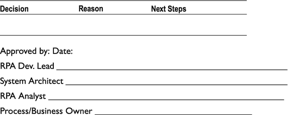
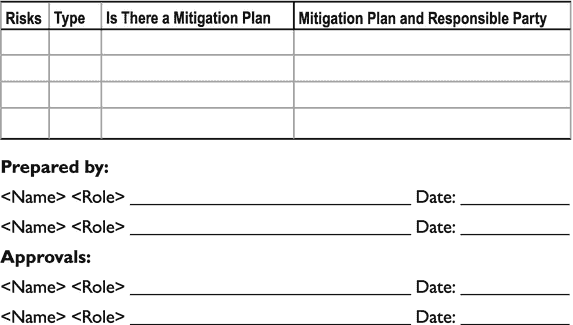
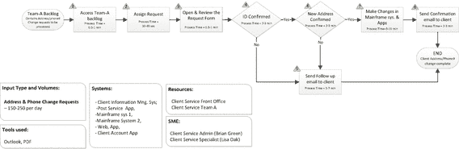

# 5. 机会评估

企业领导者必须认识到，RPA 无法实现所有流程的自动化。因此，选择合适的流程来应用 RPA 可能是一项复杂的任务。机会评估的目标是帮助决策者挑选出适合 RPA 的流程。选择不符合标准的流程将导致不必要的开支，并因将团队资源消耗在无增值活动上而拖累团队。另一方面，适合自动化的流程能最大限度地发挥现有技术的潜力，并带来更高的投资回报率。

> **提示**  
> 请记住，RPA 是一个分阶段、迭代式的项目。在“机会识别”阶段看似适合 RPA 的请求，并不意味着该请求一定能顺利推进到部署阶段。

一旦收到并理解了最初的自动化请求，机会评估阶段内的任务就开始了。正是在这个阶段，会对该请求进行一定深度的探索，获取并审查各种信息。

有时提交的想法所附带的信息非常少；在这种情况下，会在机会评估之前执行第 4 章所述的发现阶段。请注意，是否执行发现阶段取决于初始请求所附带的信息量。

同时请注意，一个请求引入了一个 RPA 机会；这个机会可能会也可能不会成为一个项目。

在机会识别（可能包含也可能不包含发现阶段）结束时，第 3 章所述的管理机构会审查相关文档，然后开会讨论是否在当前时间点推进该请求。如果做出“批准”决定，则该请求被批准进入机会评估阶段。

以下是关卡决策模板（见附录 7）：

“批准/驳回/暂缓”关卡决策

**目的：**  
为所有关键利益相关者提供一个互动机会，以审查机会评估尽职调查工作的成果，并根据 RPA 机会的优缺点做出“推进/不推进”或“等待特定条件满足后再决定”的决策。

**表格详情：**

- **决策：** 可以是“批准”、“驳回”或“暂缓”。“批准”表示治理机构认为进入下一阶段是有益的；“驳回”表示由于各种原因（例如，投资回报率不足、复杂性过高等），项目将不会继续；“暂缓”表示在做出“批准”或“驳回”决策之前，还需要一些额外的信息。这将在下一列中描述。
- **理由：** 说明做出该决策的原因，如果是“暂缓”决策，则说明缺少什么信息。
- **下一步行动：** 对于“批准”决策，此处指明下一阶段；对于“驳回”决策，此处指明需通知请求方以及具体由谁负责通知。

> **提示**  
> 在整个生命周期中，会多次获得推进的批准。机会评估的批准并不意味着部署的批准。

在本章中，我们将介绍所需的概念，并提供现实世界的示例来加以阐明。

在此步骤中，会获得对请求的高层次理解。在发现、分析并记录了一些初步信息后，团队会将其连同建议一同提交给治理委员会。我们将详细说明哪些应被视为收益，包括潜在的投资回报率（ROI）、该项目是否为应对竞争对手的举措所必需、是否将满足新的政府法规、是否为提升客户体验所需，或其他诸多收益。

如前所述，在某些情况下，即使从这一初步评估来看，也可能因各种原因确定该请求并非 RPA 的良好候选对象。

在此阶段结束时，治理委员会将开会决定该请求是否应进入下一阶段（解决方案设计——见第 6 章）。

该决策将基于多种因素，包括节省时间/成本、竞争需求、监管要求、提高质量、增强客户服务，以及根据请求和组织需求而定的其他因素。

在本章中，我们将讨论在此阶段产生的以下工件（模板见附录）：

- **机会概览**，包含当前情况摘要、目标、期望状态（说明建议自动化的流程步骤）以及收益估算。此时，仅获得成本与收益的高层次估算。
- **端到端的当前状态流程图**，如我们在第 4 章中所讨论的，描绘了实际的流程流以及当前所需的详细程度（例如，流程量、涉及的系统/应用程序、角色等）。如果在“批准/驳回”决策时点，项目被批准推进，则需要更详细的和未来状态的流程图。但这将在后续章节中讨论。我们还提供了一个流程图的模板。
- **流程中每个步骤的更详细说明**。也提供了相应的模板。这并非总是必要的，我们将讨论如何判断是否需要。
- **可行性评估**。
- **风险评估**。

## 机会概览

机会评估的一个主要组成部分是机会概览。这是一份对请求的快速浏览，包含诸如需求概述、期望的解决方案状态以及自动化的预估收益（例如，投资回报率，收益可以是定性和/或定量的）等信息，这些收益可能是财务上的，或者可能包括保持竞争优势、满足法律要求或其他若干因素。其中包含的大部分信息都来自请求表单，并可在探索阶段获取。请参考附录 6 获取模板。

换句话说，机会概览是一份执行摘要，它向治理委员会成员提供了关于该机会、可能的解决方案及其复杂性、风险和收益的全面但高层次的概述。

**提示**

请始终记住，所提供的模板可以根据组织的需求进行调整。

以下是典型机会概览的组成部分和细节：

- **项目名称**：不言自明。请记住，此请求尚未成为一个项目，但这将是赋予该工作的标题，该工作可能会产生以此为名的项目。

- **编制人**：通常是指业务流程分析师以及任何可能参与的主题专家，以及他们的职务和部门。

- **机会描述**：以请求表单中的“当前流程描述”信息为基础。在机会概览中，信息是从请求表单上的基本记录提炼而来，以对当前状况和当前存在的问题形成更连贯的描述。

- **机会陈述**：应该简短，一句话即可。此处需对问题进行简明扼要的总结。例如：“当前手动执行的流程会导致不可接受的延迟以及因错误而反复、耗时地返工。”

- **目标**：用简单的语言写出请求者希望达成的目标；这应是对机器人应执行的操作的总体描述。用你自己的话表达你希望机器人做什么。例如：“机器人将扫描订单并生成包含客户地址的发票……”或“机器人将读取客户电子邮件并提取信息，以便在系统中进行必要的更新。”

- **假设与约束**：在本节中，简要包含任何你认为属实且与项目相关的事项。例如，“假设：系统 123 和系统 ABC 能够通信。”关于约束，列出任何你认为可能妨碍机器人轻松构建的事项。例如，“目前，系统 XYZ 无法读取以 L 结尾的账户。”此处无需进一步解释。

- **当前状态**：在此处放置足以显示待自动化步骤的流程图。请参考附录 2 获取模板。

- **运营收益估算**：请求表单上列出了一些初步收益，但更具体的信息要在本阶段详细说明。它应清晰（但无需非常详细）地展示所请求的自动化的优势。节省的成本（投资回报率）是否足以证明自动化成本的合理性？所请求的自动化是否将解决重要的竞争或监管问题？这些考虑因素必须包含在内。

- **提议的解决方案/流程变更**：此处明确说明要自动化的具体内容。例如，“对前文引用的流程图中的步骤 3–7 进行自动化。”它也可以是描述性的；例如，“自动化识别逾期超过 90 天的账户、发送通知以及通知客户代表已发送逾期信函的过程。”

**暂停与思考**

机会概览是对流程自动化请求的高层次评估。管理层将审查机会概览并就请求做出决定，他们不需要也不想获得与分析人员、开发人员、测试人员等相同级别的信息。添加额外信息似乎是一种“覆盖所有方面”的好方法，但将机会概览限制在做出决定所需的最低限度的关键信息上，效果会好得多。

### 当前状态流程图

自动化一个流程意味着使用现有的流程步骤，并简单地将它们从手动执行转变为自动执行（注意：在某些情况下，可能需要在自动化之前优化流程）。为了使治理委员会能够就流程自动化做出决定，并使开发人员能够创建解决方案，必须理解该流程。当前状态流程图是实现这一目标的主要工具之一。

在此阶段，流程图应该保持相当高的层次；没有必要详述，例如：

- “访问屏幕 X；找到‘账号’下拉菜单；点击下拉按钮；选择‘个人保险’；点击确定；输入客户姓氏；点击确定；输入客户名字；等等。”
- 该步骤可能只是简单地说“查找客户账号”。这些步骤的细节将在项目后期阶段确定，可能是通过录制某人实际执行流程中的步骤的视频来实现。现在需要的是对端到端流程有一个高层次且扎实的理解。

#### 可行性评估

机会评估的另一个主要因素是可行性。在此阶段，“可行性”仅涉及我们当前拥有的高层视图。基于目前可用的有限信息，所提议的流程是否适合自动化？换句话说，RPA 是否是应对所呈现机会的合理解决方案？可行性评估的目标是尽早识别出不适合 RPA 的请求，并避免花费不必要的资源工时。可行性评估及其 RPA 团队的建议，将成为治理委员会就所请求的自动化做出决策过程的主要部分。

请记住，如果项目获批进入下一阶段，将在该阶段获取更多信息，并且会设立另一个治理委员会的检查点，届时将对新信息进行评估。一个在信息极少时被视为“可行”的项目，在获得更多信息后可能会被重新评估并取消。反思并学习那些导致 RPA 开发被取消的信息或细节，并将其纳入可行性评估工具，以最大程度降低 RPA 取消率，这一点非常重要。通过实现较低的取消率，您可以降低运营成本（提高技术投资回报率），提升交付速度，并改善业务运营部门的信任度和用户满意度。此外，随着数字自动化能力的不断发展，一些以前无法实现的解决方案可能会变得可行；因此，随着您在 RPA 方面积累更多经验，需要随着时间的推移对可行性评估工具进行适当调整。

### 暂停与思考

为什么在后期阶段取消不算“失败”？请记住，治理委员会的存在是为了评估当前的信息。在“机会识别”或“机会评估”阶段，只知道基本信息，治理委员会并非批准整个项目，而只是批准下一阶段，以便发现更多信息。随后，治理委员会将对这些信息进行评估。

在此阶段，需要提出六个基本问题。

#### 可行性评估

`<项目名称>`

|   | **问题** | **回答** |
| --- | --- | --- |
| 1 | 流程是否定义明确？ |   |
| 2 | 流程是否稳定（“例外”情况极少）？ |   |
| 3 | 例外情况能否手动处理？ |   |
| 4 | 输入是否为数字格式？ |   |
| 5 | 所需数据能否无需人工干预即可输入？ |   |
| 6 | 管理层是否接受对角色和流程的潜在变更？ |   |

**批准人：**

`<姓名>` `<职务>` _______________________________ 日期：____________

`<姓名>` `<职务>` _______________________________ 日期：____________

`<姓名>` `<职务>` _______________________________ 日期：____________

`<姓名>` `<职务>` _______________________________ 日期：____________

（模板参见附录 4。）

1.  **流程是否定义明确？** 在此，您需要确定流程的重复性。基本上，每次执行该流程时，是否都执行完全相同的步骤？这些步骤是否为众所周知的？例外情况是否有限？这是使流程成为自动化良好候选者的特征之一。

2.  **流程是否稳定（“例外”情况极少）？** 当流程被调用时，所采取的步骤是否基于明确制定的规则？流程内的步骤是否一致？

3.  **例外情况能否手动处理？** 对于任何流程，一定数量的有限交易可能需要一些额外步骤。也许某个账号输入错误，必须通过姓氏来查找该账号。客户可能在某个更常见的请求中提出特殊要求。如果这些交易发生在自动化流程中，能否将它们发送到邮箱进行手动处理？目前是否有处理这些例外情况的流程？

4.  **输入是否为数字格式？** 输入是否通过电子邮箱进入流程？或者它们是否来自客户或其他人的电话，必须由接听电话者输入？如果是这样，接听电话者创建的信息能否输入到 Bot 可以访问的系统中？

另外，所有输入都是 Excel 文件吗？Word 文档？PDF？等等。Bot 读取它们的难易程度如何？

5.  **所需数据能否无需人工干预即可输入？** Bot 不会思考；它只会寻找被明确告知要寻找的内容，并相应地处理找到的内容。如果输入需要人工判断，而不仅仅是判断是否可由 Bot 处理的简单决策，那么该流程就不是一个好的自动化候选者。那些几乎不需要判断且异常率低的任务是 RPA 的良好候选者。

例如，一个电子邮箱每天可能收到 300 封邮件，其中 100 封可以遵循标准流程。可能需要一个人手动检查这 300 封邮件，并将那 100 封可以遵循标准流程的邮件转发给 Bot。但一旦邮件到达 Bot 那里，它就可以接管处理。

然而，如果该邮箱每天收到 300 封邮件，并且每封邮件都需要有人阅读并查找各种不同的信息，而这些信息可能来自各种不同且不断变化的来源，那么此流程就不是一个好的自动化候选者。

6.  **管理层是否接受对角色和流程的潜在变更？** 自动化流程的一个优点是可以将员工解放出来承担其他职责，从而改变他们的角色。此外，在调查流程是否适合自动化时，可能会发现一些可以提高效率的方法，从而在流程自动化之前就对其进行更改。为了能让项目推进，这些变更及相关变更必须得到流程负责人的认可。

### 暂停与思考

您的组织中是否有其他考量因素应添加到“可行性评估”模板中？请记住，这些基本问题相当标准，但不存在“一刀切”的方案。您可以先使用这些模板进行前几个 RPA 项目，但您的“可行性评估”模板以及本文包含的所有其他模板，可能会随着时间的推移而演变，以满足您组织的特定需求。

## 风险评估

对于任何新的 RPA 机会，都必须执行初步的风险评估。大多数项目负责人对风险评估活动非常熟悉，但有一些风险是 RPA 特有的，我们将在本节中详细说明。需要明确的是，与任何项目一样，在此阶段（机会评估）仅能识别出初步风险，如果项目继续进行，会发现更多风险。尽早让您所在组织的风险与合规团队（在贵公司可能名称不同）参与进来是有益的。该团队可以帮助尽早识别风险。如果风险后来才被识别，则可能需要进行代价高昂的返工，甚至导致项目取消。这将造成不必要的时间和金钱浪费。

总体而言，风险评估的目的是列出在机器人创建或实施过程中可能出现的问题。例如，某些机器人必须访问的应用程序是否难以访问？如果是，这会增加多少解决方案开发时间？再举一个例子：机器人误读信息的可能性有多大？这些类型的风险必须尽早识别，以帮助治理委员会做出明智的决策。

2019 年 6 月 18 日，[纳文·乔希](https://www.forbes.com/sites/naveenjoshi/)在福布斯撰文指出了以下四 (4) 项主要风险：

1. 流程选择错误
2. 技术问题
3. 缺乏沟通
4. 安全性^(¹¹)

设计师和开发人员将使用风险评估文档来创建能够减轻这些风险的自动化程序。虽然需要进行彻底的风险评估，但必须记住，此时关于项目的信息仍然有限，对解决方案几乎一无所知。我们只清楚地了解目标是什么以及“要求”是什么（请求者实际想要什么）。换句话说，我们知道做什么和在哪里做，但不知道怎么做。随着解决方案开发的进展，将识别出其他风险。

从这份表格开始（附录 5 中有一个模板）。每个类别的说明紧随模板之后。

### 风险评估检查表

<项目名称>

（参见附录 5 的模板。）

1. **风险**：在此区域，简要且简洁地识别风险。RPA 项目的一个标准风险如下：“机器人无法运行。”
2. **类型**：通常，“风险类型”属于以下类别之一。
   - 合规性
   - 错误
   - 财务
   - 运营
   - 声誉
   - 资源
   - 系统
   - 技术
   - 安全性

根据您目前掌握的最佳信息填写此区域。请记住，这是项目非常早期的阶段，随着获得更多关于业务需求、技术等信息，将识别出其他风险。

> **提示**
> 
> 征求多位主题专家的意见，以确保您评估并识别出 RPA 可能暴露或产生的潜在风险。请您的“风险与合规”团队参与其中。

3. **是否有缓解计划？** 这可以是“是”、“否”或“不适用”。“是”表示针对此特定风险有缓解计划。对于之前提到的标准风险，这将是“是”。
   
   “否”表示针对此特定风险没有缓解计划，但必须创建一个。
   
   “不适用”表示没有缓解计划，但决定直接接受该风险。这可能包括接受维护成本、产生技术债务，或接受 X% 的异常情况需要手动处理等事项。

4. **缓解计划和责任方**：在此框中，您将简要说明必须对该风险采取的措施。如果有缓解计划（来自“是否有缓解计划”列的“是”），请简要说明。例如，对于之前提到的标准风险，“缓解计划”通常是：“在机器人修复之前，恢复人工处理。”
   
   如果没有计划（来自“是否有缓解计划”列的“否”），请简要说明创建计划所需的步骤。这可能包括以下任何一项（以及其他项）：“与公司风险管理协商”；“获取 SMEs 的意见”；“研究行业期刊。”
   
   同样在此部分，填写负责处理该风险的人员的职位（而非姓名）。对于标准风险，这是 RPA 团队负责人，以及负责该流程的人员的职位。

在页面底部，包含您的姓名和任何参与风险评估工作的人员姓名、文档完成日期，然后是批准人的姓名和职位以及批准日期（批准通常通过电子邮件提供，以保留“书面”记录）。

> **暂停并思考**
> 
> 在 RPA 过渡到生产阶段时，所有已识别的风险都必须有一个指定负责人的缓解计划。该计划可能仅仅是接受风险，但这必须记录在案，并且该接受必须有负责人。您将如何确定风险负责人并记录他们对风险和/或缓解计划的接受？

请记住，机会评估的目的是在投入资源进行解决方案开发之前，评估请求或 RPA 候选项目的适用性和价值。人的天性是想直接进入执行模式，这看起来可能是一种更快、更高效的方式，但对 RPA 候选项目进行适当的评估或评价更有效、更高效，尤其是在 RPA 引入组织的早期阶段。随着 RPA 文化和技术架构环境的成熟，前期花费的时间会减少。但在组织中引入 RPA 时，绝不是偷工减料的时候。

一旦机会评估阶段所需的所有文件都完成，您就可以准备参加下一次治理委员会会议了。

> **提示**
> 
> 如果某个特定工件对您的组织没有价值，就不要使用它。但在 RPA 计划的早期阶段，在取消某个步骤之前要谨慎。让经验引导您。

## 机会评估结束后的治理委员会会议

在通过填写前文所述文件更仔细地审视该项请求后，治理委员会需要判断是否仍有可能推进至下一步骤。RPA 团队的建议将在治理委员会的决策中发挥重要作用。无论是决定推进至项目的下一阶段（解决方案设计；请参见第 6 章）、暂缓项目，还是彻底取消项目，都不能轻率做出。这些选择中的任何一个都会带来广泛的影响。

如前所述，在项目生命周期中，治理委员会将多次评估某个阶段（例如机会评估、解决方案设计）所获得的发现，并判断其可行性。RPA 团队会将之前引用的文件整合为一个文档，安排会议时间，并在会议邀请中附上该文档的链接（如果治理委员会并非所有成员都能访问文档的存储位置，则直接将其作为电子邮件附件发送）。

在治理委员会会议召开前，委员会成员应已阅读该文档，并应做好准备提出疑问。实际上，情况往往并非如此；委员会成员可能未在会议前审阅文档。流程分析师/设计师或另一位 RPA 团队成员必须准备好对该请求进行非常简短、高层次的概述。该概述将包括对当前流程的高层次描述。演示者还将讨论自动化旨在解决的问题以及自动化流程带来的好处；也就是说，它是否能实现所要求的效益？此外，他们还将讨论实施的可行性：从成本、复杂性等方面来看，人工流程是否看起来是自动化的良好候选对象？最后，他们将呈现自动化流程的风险以及不自动化流程可能带来的任何风险。这可能包括失去竞争优势的可能性。

这份简短摘要的所有信息都可以从已准备的文件中获取，其中大部分信息来自机会概述。

基于治理委员会成员的审阅或所提供的简短摘要，存在三种可能的结果：

1. 项目获批进入下一阶段（解决方案设计）。
2. 项目暂缓，等待获取一些额外信息。根据所需额外信息的不同，可能需要也可能不需要召开第二次治理委员会会议。如果信息是次要的，并且通过电子邮件告知治理委员会成员就足够了，则无需召开第二次会议。如果只需要电子邮件沟通，治理委员会的每位成员都必须通过回复邮件表明他们的决定（批准、获取更多信息，或“暂缓”）。

您会发现，随着文化的成熟，需要额外信息的情况会越来越少。随着 RPA 团队了解治理委员会需要哪些信息，这些信息将在向委员会提交机会之前就准备好。

在某些情况下，有些请求目前不可行，但可以使其变得可行。例如，可能所有输入都是手动的，而这正是阻止该流程成为 RPA 良好候选对象的唯一因素。但如果流程负责人能够将这些输入电子化，那么该流程就可以实现自动化。治理委员会会议结束后，流程相关方将被告知任何此类情况，以便他们决定是否要进行必要的更改以符合自动化条件。

2. 项目被“暂停”。这可能是因为虽然自动化会使部门受益，但自动化的成本远远超过继续手动执行的成本。也可能是因为极端复杂性或各种其他原因。

未来某个时候，由于工作量减轻、优先级变化或其他情况，该项目可能会继续推进。每个 RPA 团队必须自行决定所有“暂停”项目是每年、每半年还是每季度进行一次审查。

3. 项目被取消。有时，一个项目根本不适合使用 RPA。业务相关方可能确实对某个手动流程有意见，但 RPA 并非解决方案。在这种情况下，应尽可能将业务相关方引导至其他可能的解决方案。大多数组织都有各种应用程序，这些应用程序通常能够对已识别的问题提供一些改进。

### 暂停与思考

当请求将在未来再次审查时，它们会被“暂停”。取消一个请求者及其部门一直热切期待的项目并非好事。如何最好地告知请求者其请求已被“暂停”或取消？请记住，您不希望打击请求者提交另一个流程进行自动化的积极性。

现在，让我们看看本章中的概念如何应用于我们在第 4 章中介绍的虚构案例研究。

## 案例研究示例

我们将从一份机会简报开始。该文档不应超过两页（模板请参见附录 6）。在我们的示例中，机会简报可能如下所示。

好的，作为一名高级文档工程师和翻译员，我将严格按照您提供的注意事项和示例，将给定的英文文本翻译成中文。

### 地址和电话号码变更流程

编制人：David Johnson，业务流程分析师，运营支持，业务流程自动化

| **当前状况：** 客户通过邮件通知其新地址和/或电话号码。客户服务专员 (CSS) 会审阅这些邮件。该团队由 5 名全职员工处理这些请求。如果地址没有错误，完成每个请求大约需要 10-15 分钟；如果需要调查或与客户进行后续跟进，则需要大约 20 分钟。管理层看到了将该流程至少部分自动化，并将部分 CSS 重新部署到我们服务时间更长、加班时间更多的其他领域的机会。此外，审计表明，在电话号码、更改错误的客户地址或地址本身存在大量的人为错误。 | **目标：** 实现端到端的地址和/或电话号码变更流程自动化。自动化流程应验证客户凭证，并在主机系统和相关应用程序中更改所需信息。 |
| --- | --- |
| **假设：** 自动化可以：– 从请求表单中提取信息。– 确认客户 ID。– 检查/验证新地址。– 访问主机系统和相关应用程序。– 存储执行数据，用于监控、分析和报告。 | **约束：** – 自动化恢复和积压流程的处理时间少于 48 小时。– 在需要手动处理流程时，CSS 的可用性。– 地址验证可能具有挑战性。 |
|  |
| **收益估算：** 处理请求：全职员工工时 = 9,375 小时/年（5 名全职员工），可重新部署到其他地方。消除返工。消除退件成本。 | **拟议解决方案：** 机器人将访问团队的邮箱，打开表单，确认客户 ID 并验证其包含的信息。然后，它将访问主机系统和相关应用程序，进行所需的更新，并向客户发送确认邮件。如果信息无法验证，机器人将把请求转交人工处理。 |
| （模板见附录 6） |

接下来，我们来看可行性评估。文档中列出的基本条件（以及之前讨论过的）是否都满足了？请记住，并非所有条件都必须立即满足，但在此阶段（机会评估）结束时，团队必须确信这些条件是可以满足的。例如，如果流程的输入尚未数字化，则必须得到流程负责人和主题专家的确认，证明它们可以实现数字化。

#### 可行性评估

地址和名称变更流程

| | **问题** | **回答** |
| --- | --- | --- |
| 1 | 流程是否明确定义？ | 是 |
| 2 | 流程是否稳定（“异常”情况非常少）？ | 是 |
| 3 | 异常情况是否可以手动处理？ | 是 |
| 4 | 输入是否为数字格式？ | 是 |
| 5 | 所需数据是否可以无需人工干预输入？ | 是 |
| 6 | 管理层是否接受对角色和流程的潜在更改？ | 是 |

**编制人：**

`<姓名> <职务>` _John Williams，技术主管。_ 日期：202x 年 8 月 4 日

`<姓名> <职务>` Mary Davis，业务经理 日期：202x 年 8 月 4 日

**审批：**

`<姓名> <职务>` _______________________________ 日期：____________

`<姓名> <职务>` _______________________________ 日期：____________

`<姓名> <职务>` _______________________________ 日期：____________

`<姓名> <职务>` _______________________________ 日期：____________

接下来，我们来看看解决方案可能给运营带来的风险。我们之前已经讨论过这个话题，但识别出的风险对于每个请求都是独特的。请记住，要依赖主题专家，并在此阶段请“风险与合规”部门参与进来。

#### 风险评估检查清单

地址和电话号码变更

| **风险** | **类型** | **是否有缓解计划** | **缓解计划及责任方** |
| --- | --- | --- | --- |
| 自动化执行失败。 | 运营风险 | 是 | 恢复手动处理直至修复；James Morris，CSS 助理经理和 RPA 团队。 |
| 更新了错误的客户信息。 | 声誉风险 | 是 | 建立客户 ID 验证控制；Maria Mulchuk，合规经理。 |
| 客户信息无法确认。 | 技术风险 | 是 | 手动处理；James Morris，CSS 助理经理 |
| 客户信息泄露。 | 合规风险 | 否 | |

**编制人：**

`<姓名> <职务>` _John Williams，技术主管。_ 日期：202x 年 8 月 4 日

`<姓名> <职务>` Mary Davis，业务经理 日期：202x 年 8 月 4 日

**审批：**

`<姓名> <职务>` ________________________________ 日期：____________

`<姓名> <职务>` ________________________________ 日期：____________

`<姓名> <职务>` ________________________________ 日期：____________

`<姓名> <职务>` ________________________________ 日期：____________

（模板见附录 5。）

请注意，此文档仍未完成。仍存在尚未建立缓解计划的风险。在此阶段，这是可以接受的，但如果请求获批继续推进，则必须建立这些缓解计划。

创建这些文档后，将安排召开治理委员会会议进行审查，并做出是否继续开发的决定。同样，RPA 团队的建议将是此决策的关键输入。

现在，我们来回顾一下治理委员会的决策表格。

#### 治理委员会决策表

地址和电话号码变更

| **决策** | **决策理由** | **后续步骤** |
| --- | --- | --- |
| 通过 | 自动化解决方案在技术上是可行的。流程是可重复且直接的。收益满足投资回报率标准。系统架构方面无顾虑。 | 继续进行解决方案设计。 |

**审批：**

`<姓名> <职务>` Siva Khrishnak，RPA 开发主管 ____ 日期：202x 年 8 月 4 日

`<姓名> <职务>` Daniel Cook，系统架构师 ____ 日期：202x 年 8 月 4 日

`<姓名> <职务>` Ryan Walthy，运营风险与控制 ____ 日期：202x 年 8 月 4 日

`<姓名> <职务>` Andy Hamilton，业务负责人 ____ 日期：202x 年 8 月 4 日

（模板见附录 7。）

当然，这个表格在进入会议时是空白的。在会议上，治理委员会成员提出的任何问题都将得到解答。在这个假设的请求中，做出的决定是继续推进（参见“决策”列中的“通过”），决策的依据列在“理由”列中，而下一阶段——解决方案设计——则列在“后续步骤”列中。

相反，“决策”可能是“暂停”，理由列在“理由”列中，而“后续步骤”则会提供额外的解释。可能会写明“一旦流程负责人确认 90% 的输入实现数字化，将重新审查此请求”，或者对“后续步骤”的其他描述。

最后，“决策”也可能是“不通过”。其理由会在“理由”列中说明，而“后续步骤”可能会是“告知客户，当前的投资回报率不足以证明开发成本的合理性。建议客户与（姓名，职务）沟通，了解使用（应用程序名称）以提供一些改进的可能性。”当然，这需要知道是否有其他有用的替代方案。

一旦项目获得治理委员会批准继续推进，您就可以进入“解决方案设计”阶段了。

脚注 1

