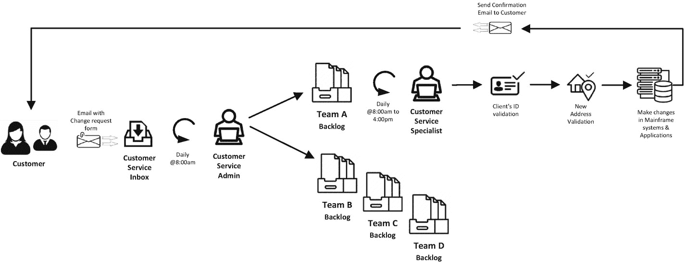
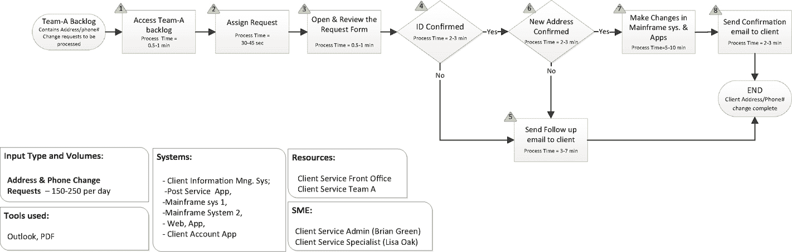
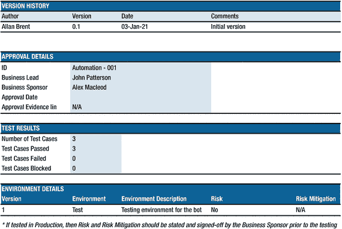

# 6. 解决方案设计

在概念设计阶段，需要收集需求（功能性和非功能性）。附录中提供了模板，本章节将给出详细说明。

概念设计可被视为解决方案蓝图。此时将对自动化解决方案进行高层级决策，包括 Bot 将执行什么任务、需要访问哪些系统、按何种计划运行等。这些内容将在后续阶段进一步细化，但本阶段将确定基本框架。

同时，本阶段需要创建一份解决方案设计文档。该文档包含流程与产出、整体结构、逻辑组件以及当前状态与潜在未来状态之间的相互关系。我们提供了模板及清晰说明（请参见附录 12）。

RPA 可以采用传统的“瀑布”方法或更敏捷的方法论引入。在“瀑布”方法中，需求与概念性解决方案设计在开发开始前便创建并归档。如今越来越多的公司采用敏捷或并行工程方法，需求与解决方案开发活动同步进行。每种方法各有优劣，部分组织会将其融合为混合方法。

无论选择何种方法论，本章所述的任务都必须完成。

概念设计完成后，需要填写就绪检查清单。这确保开发（下一阶段）所需的所有组件均已完备。附录中附带详细说明的模板。

就绪检查清单完成后，将提交给决策机构，由其决定是否进入下一阶段（开发）。决策机构通常由以下角色组成：

*   RPA 技术交付负责人
*   架构师
*   开发人员
*   其他必要人员

## 暂停与思考

各公司的角色名称不尽相同。您所在组织中有哪些对应角色？同时，考虑一下贵公司中“其他必要人员”可能包含哪些人。这可能包括总监、区域经理、系统分析师或其他人员。决策机构规模应精简，但必须包含具备决策资格的人员来判断是否进入下一阶段。

请注意，该模式的优势之一是工作逐步推进，并为决策机构（决策主体）设置了非常具体的检查节点，用以审查工作并判断任何项目的持续可行性。在机会评估阶段仅收集初步信息时，某项需求可能在 ROI、竞争优势或其他方面看似前景可观，但在概念设计阶段的深入调查后可能变得不那么理想。项目从一个阶段推进到下一阶段时皆是如此。在任何节点，决策机构都可能因更仔细的审查发现早期评估不实而取消项目。某个项目在某一阶段获得批准后又被取消，并不代表前一阶段存在失败——这正是 RPA 项目推进的本质特征。

## 暂停与思考

在许多公司里，即便利益相关方明知项目已无必要，项目仍会继续推进。取消项目被视为对已投入资金的浪费和不同决策者的失败。您将如何说服管理层，采用这种阶段性评估项目的模式是有益的？

在 RPA 中，需求文档通常被称为流程设计文档（PDD）。下文“决策机构审批”章节将对 PDD 进行说明。如果您的组织擅长需求收集与归档，请继续使用原有流程；以下将说明典型需求文档的细节。

但如果您的组织不存在高效的需求收集流程，或仅需为 RPA 捕获需求，则 PDD 是收集与记录需求的首选方式。请参见本章“决策机构审批”章节获取相关信息。

好的，作为高级文档工程师和翻译员，我将根据您提供的注意事项和示例，将给定的英文文本翻译成中文。

# 需求收集

我们将从讨论功能需求和我们推荐的模板开始。

请参考附录 9 中的模板，记住这只是一个模型。如果它对您的组织适用，那很好，但您可以根据组织的需求自由调整它。

## 1 第一层级详情

### 1.1 系统

*   在输入、处理或输出过程中，必须访问哪些系统？请在此列出。

### 1.2 目标

*   在本节中，简要但清晰地描述项目的目标。这可能包括对当前情况的简短描述及其为何存在问题，以及对项目成果及其优势的简要描述。**这里不是定义目标的地方**；那是在更早的阶段完成的。这里只是更详细地描述它。重要的是不要陷入在此处重新定义目标并偏离最初请求的陷阱。此描述必须满足流程所有者所请求的内容。他们必须批准此文档，因此描述必须准确。

### 1.3 触发事件

*   在本节中，列出导致流程开始的事件。例如，客户寻求更改受益人信息。

### 1.4 触发器

*   这是导致流程开始的特定操作。沿用第 1.3 节中的示例，事件是客户想要更改受益人信息。特定的操作（或触发器）可能是收到一封来自客户的电子邮件，通知了新的受益人信息。或者可能是来自顾问的通知，代表客户进行更改。应列出所有可能的触发器。

### 1.5 前置条件

*   为了使流程开始，机器人必须处于何种环境条件？例如，机器人可能需要访问某些软件，请求必须采用特定格式等。在此列出所有必需的前置条件。

### 1.6 后置条件

*   在此列出流程导致的所有变化或产出。在前面的示例中，后置条件可能包括以下内容：
    *   受益人信息已被更改。
    *   客户已被通知更改已完成。
    *   顾问已被通知该更改。
    *   已生成一份报告，列出最近一天内的所有更改。

**提示**

与主题专家（SME）进行沟通，以充分理解触发事件、触发器以及前置和后置条件。

## 2. 第二层级详情

### 2.1 输入参数

| 参数名称 | 描述/值 | 是否必填？ | 省略时的含义（仅在必填=否时填写） |
| --- | --- | --- | --- |
| 流程的输入是什么？可能是一封电子邮件、另一个流程的完成，或任何其他事物。 | 简要描述输入。 | 是否为必填项？ | |
| 输入参数有多少个就插入多少个。必要时可添加额外行。 | | | |

### 2.2 输出参数

| 参数名称 | 描述/值 | 是否必填？ | 省略时的含义（仅在必填=否时填写） |
| --- | --- | --- | --- |
| 流程产生什么？在此列出其名称。 | 简要描述输出。 | 是否为必填项？ | |
| 包括所有输出。必要时可添加额外行。 | | | |

## 3. 第三层级详情

### 3.1 主流程步骤

*   在本节中，列出正常流程的步骤。例如，如果在 70%的情况下，流程以一种方式流转，请在此列出这些步骤。沿用之前的同一个示例，步骤可能如下：
    1.  收到电子邮件
    2.  访问系统 ABC
    3.  找到账号
    4.  根据指示更改受益人
    5.  向客户发送电子邮件
    6.  向顾问发送电子邮件
    7.  信息被添加到每日报告

### 3.2 备选流程

*   有些输入将包含略有不同的步骤，但仍可由机器人处理。在此列出这些流程。

### 3.3 异常流程

*   可能存在一些机器人无法处理的情况。沿用前面的例子，可能是由于无法识别账号，或者当前受益人姓名错误等原因。解释在这些情况下会发生什么。沿用同一个例子，流程可能如下：
    1.  收到电子邮件
    2.  访问系统 ABC
    3.  未找到账号
    4.  向处理员发送电子邮件以进行手动处理
    5.  将信息添加到异常报告

**暂停并思考**

为了让开发人员创建高效的机器人，这些信息至关重要。您将如何获取它们？您需要与谁交谈以获取并验证它们？请记住，现在花时间把它做对，可以避免将来代价高昂的返工。

# 非功能性需求

我们现在将讨论非功能性需求（模板见附录 10）。

> “非功能性需求（NFR）定义了系统属性，如安全性、可靠性、性能、可维护性、可伸缩性和可用性。它们在不同的待办事项列表中作为对系统设计的约束或限制。”^(¹²)

1.  **自动化服务标准：** 这是一个“样板”部分，仅说明当前标准的设定日期和设定者（例如：卓越中心 COE）。如果您的组织没有既定的标准，请忽略此部分。
2.  **隐私、数据保留和清除要求：** 包含有关保护客户隐私以及在何处存储数据的信息。同时指明何时可以删除文档。

### 流程图

包括一个流程图以提供视觉清晰度。使用同一个示例，流程图可能类似于：

流程图是从头到尾对流程的一目了然的视图。它使管理层能够对流程有必要的理解，并帮助设计人员了解流程的哪些方面可以自动化以及如何最佳地设计自动化。

**提示**

“流程图”和“流程映射”这两个术语经常互换使用。请记住它们在本节中的用法。

# 屏幕截图

为了让开发人员创建机器人，他们必须确切地知道流程是如何运作的。请记住，RPA 是为了自动化现有流程。虽然在自动化过程中可能存在一些改进流程本身的机会，但不会进行重大的流程变更。如果需要重大变更，则该流程不适合采用 RPA。

**暂停并思考**

在此阶段，将更详细地审查请求。它是否仍然是 RPA 的良好候选对象？请记住，在此阶段结束时，将举行另一次管理机构会议，并将要求您提出“可行/不可行”建议。您可能在机会评估结束时建议了“可行”，但经过更深入的了解后，您可能会建议“不可行”。这完全是合理的。

为了获取屏幕截图，最有效的方法是记录一个人手动执行该流程的过程。这可以通过各种在线会议应用程序完成，或者在没有其他方法的情况下，使用手机来完成。

确定正确的主题专家（SME）后，与他们安排一次会议，并记录整个流程。会议结束后，截取屏幕截图并将它们放入 Word 文档中，使用箭头指示选项，并对每个屏幕上发生的事情进行简要描述。请记住，为了正确自动化流程，开发人员必须看到流程中的每一个步骤。

最后，包括一个典型输出的屏幕截图。流程产生的是什么？是 Excel 格式的报告吗？是给客户或顾问的信函吗？无论是什么，都截取一个屏幕截图。

**暂停并思考**

## 排版后内容

您的公司可能有一套开发必须遵守的规范。您的新 `RPA` 程序必须符合这些规范。如果公司设有卓越中心（`COE`），这些规范可能由该中心负责管理。请尽早邀请 `COE` 代表加入流程，以确保您已采取所有必要步骤来满足公司要求。

### 规划

收集需求后，正式规划便开始了。对于“瀑布”方法，这意味着从项目开始到结束，这些需求已被完整捕获、记录并验证。如果您使用的是敏捷方法，或是两者的混合，则必须确定在哪个阶段拥有足够的需求，以便开始规划。

一旦达到需求充分捕获以匹配所用方法（瀑布、敏捷或混合）的阶段，下一步就是规划。规划是自动化流程中的关键步骤。那句古老的格言“如果你不计划，就是在计划失败”对于 `RPA` 来说无疑非常正确。

在规划中，第一步是与相关利益相关者安排会议。此时，大多数利益相关者应该已通过与业务负责人和主题专家的沟通而确定下来。确保您已识别所有必要的利益相关者。这可以通过与业务负责人的简短讨论来确认。初次规划会议应包含产品（业务）负责人、主要 `SMEs`、业务分析师、开发人员及/或部署团队成员。

这第一次正式规划会议的主要目的是评估申请自动化的流程的规模与复杂性。通过与出席本次会议的关键利益相关者，您将能够确定所收集的需求细节级别是否足以开始开发，或者是否需要更多细节。这是本次会议的关键成果。

本次会议可能会审查某些信息，但如需更多需求，应首先获取这些需求。您需要确保讨论自动化将操作的应用程序，并了解这些应用程序是否已在任何现有自动化中使用。如果是，请找出哪些自动化正在使用这些应用程序。您还需要确定使用这些应用程序需要哪些访问权限。您可能需要与组织的安全团队沟通以获得正确的授权。最后，您应确定是否需要概念验证（`POC`）来判断技术可行性。

如果本次会议需要额外需求，或者这些问题无法得到解答，请勿继续。先获取缺失的信息，然后再次开会以最终确定这些问题。

对于瀑布方法，一旦需求完成、经过审查并由所需利益相关者签署，开发团队将定期开会。

如果使用敏捷方法，一旦获取了足够的信息并创建了用户故事，敏捷项目管理流程便开始。

### 暂停与思考

开发团队将“定期”开会。在您的组织中，“定期”具体指什么？对于敏捷团队，除了每日站会，还需要哪些额外的会议？如果使用“瀑布”方法，你们需要多久开一次会？很可能，您的团队在项目开始时需要更多会议，随着项目进展，会议次数会减少。

在最初的开发团队会议中，需求必须被分解为更小的任务、功能或故事。在这些会议中，团队将识别依赖关系并决定开发顺序。

一旦这些信息被整理出来，并且团队对复杂性和时间线有了清晰概念，就是时候再次与管理机构一起审查项目了。团队将简要介绍他们已识别的信息，并就项目是否继续进行提出建议。请记住，随着获取更多信息，一个项目可能会被验证可行，或者可能被发现并不具备最初看起来的潜力。

#### 提示

请记住，在此时取消项目并不意味着失败！根据您早期的知识和建议，管理机构已同意推进。如果出现了新信息让您认为项目不再可行，这恰恰证明了 `RPA` 流程本身正在按预期运行。

### 管理机构批准

#### 提示

我们称管理机构为“管理机构”，以表明它是进入下一阶段的“把关人”。请使用适合您组织的任何术语。

与所有阶段一样，如果管理机构决定不将项目推进到下一阶段，业务负责人将被告知这一决定及其原因。如果在与团队的讨论中，识别出任何其他可能的解决方案（例如，新的软件工具、对人工流程的重大改进等），也应将这些可能性告知业务负责人。

如果管理机构已批准进入下一阶段，开发团队将开始着手编制流程设计文档（`PDD`）。

正如本章前面所述，`PDD` 是记录 `RPA` 项目需求的首选方法。如果您的组织没有有效的需求收集和记录方法，请为您的 `RPA` 项目使用以下方法。

流程定义文档相当直接明了。它回答了一些基本问题，以帮助设计人员和开发人员实现其所描述流程的自动化。它传达了流程的功能、其输入和输出、当前完成该流程所执行的步骤，以及流程中的任何决策点。对于任何决策点，您需要确定它们是否可以被自动化。如果不能，它们将需要被发送至人工处理。

`PDD` 还说明了谁拥有该流程以及谁实际执行该流程。该文档还将详细说明流程执行的频率：可能是每小时、每周、每月、按需，或任何其他配置。此外，还说明了哪些系统或应用程序与之交互？哪些系统或应用程序向流程提供输入或接收其输出。

我们之前讨论过授权；`PDD` 列出了与流程交互的任何系统或应用程序所需的授权。

`PDD` 还将列出当前已知的风险。可能出现什么问题？如果出现问题怎么办？流程是否会回退至人工执行，直到问题解决？由谁负责？

最后，`PDD` 将明确说明终点。我们如何知道流程已完成？

`PDD` 可以附带一个流程图，显示当前流程，以及同一流程在自动化后将会/可能呈现的样子。它还可以详细说明人工流程以及自动化流程的终点。^(¹³)

## 技术可行性

需要验证多个组成部分，具体包括：

-   定义的逻辑

-   基于规则的步骤

-   输入和输出数据

-   复杂度分析

-   事务量

-   开发工作量

执行技术可行性分析需要以下步骤：

1.  自动化流程能否提供所需的安全性（再次参考 `PDD`）？

2.  该流程在自动化后，能否按照业务要求的速度和时间运行？

3.  是否存在任何监管要求？

4.  列出自动化将要交互或使用的所有应用程序；此信息可从流程设计文档（参见前述讨论）中获取。

    1.  确定自动化工具是否提供与这些应用程序进行抓取或交互的功能。

    2.  确定是否存在自动化流程无法与之交互的应用程序（例如，任何具有复杂 `JavaScript` 且类更新过于频繁的网站）。

**提示**

你可以看到 `PDD` 在设计阶段将被广泛使用。确保其包含的信息是完整无缺的至关重要。

## 概念验证/原型设计

在某些情况下，`RPA` 团队可能不熟悉解决方案将要交互的系统或应用程序。或者可能存在非常严重的风险，例如隐私泄露或稳定性风险。在这些情况下，进行概念验证或开发原型会非常有益。甚至可能不必为整个自动化流程创建原型或概念验证，而只需针对那些风险特别高的部分。请与你的 `SMEs` 以及“风险与合规”部门合作，确定何时需要这样做。

## 自动化解决方案设计 (机器人会是什么样子？)

我们建议采用分层设计方法。以下步骤将为你提供指导：

1.  **控制器（流程）**：这是控制机器人执行的主控制器。它可以被视为其中其他任务的“监管员”。

2.  **任务容器（业务对象）**：这是机器人的“具体组件”。这里包含机器人将反复用于执行所需步骤的各种小任务。这些步骤由控制器执行。

3.  **通信器**：每个自动化流程都必须发出某种类型的报告以显示其结果。此外，如果进入机器人的事务是它不知道如何处理的事务，则必须将这些事务发送给某人进行手动处理。顾名思义，控制器用于执行这些以及可能需要的其他通信目的。

**暂停思考**

你正在自动化的流程有哪些通信需求？如果需要，高级管理层需要多少信息？机器人无法处理的事务将被发送到哪里？将保留它们的哪些记录，以及这些记录将发送、存储到何处？流程执行报告的生成频率是多少，报告将发送、存储到何处？

让我们准备解决方案设计文档 (`SDD`)。

`eGleis Technologies` 的 `CEI` 兼董事总经理 `Hemant Joshi` 详细说明了什么是 `SDD`。^(¹⁴)

总而言之，解决方案设计文档是一份从高层角度描述项目技术解决方案的设计以及最优实施方式的文档。每个使用 `RPA` 技术自动化的业务流程都需要创建此文档。该文档由负责自动化该业务流程的 `RPA` 开发人员创建，并需征询 `RPA` 解决方案架构师的意见，后者将在文档移交给 `RPA` 运维部门之前对其进行审核。它属于 `RPA` 开发生命周期的设计阶段。

一份典型且有效的解决方案设计文档 (`SDD`) 包含以下组成部分（模板见附录 8）：

-   **高层设计**：这应包括自动化流程图和基础设施架构图。

-   **信息安全**：合规要求有哪些？这可以从流程设计文档 (`PDD`) 中获取。

-   **自动化执行前提条件**：考虑硬件、软件、许可证等。

-   **异常处理**：如何处理进入流程但无法处理的事务？每个流程都有一些“规则之外的异常”，你必须明确确定如何处理这些异常。

-   **调试技巧**：你可以包含哪些建议来帮助未来的开发人员解决问题？请记住，如果将来出现问题，最初开发自动化的开发人员可能不在。

-   **成功标准**：最后，记录自动化成功所需满足的条件。

**提示**

虽然每个自动化流程都会有所不同，但请记住可能存在可复用的组件。这将提高整个 `RPA` 计划的效率。

为任何 `RPA` 解决方案编写最合适的解决方案设计文档（有时也称为解决方案架构文档）是 `RPA` 开发过程中最关键的部分。

**提示**

确保 `PDD`（流程设计文档）完整且详尽，将极大地有助于创建一份优秀的 `SDD`（解决方案设计文档）。

以下是编写一份优秀的 `RPA` 解决方案设计文档过程中需要记住的要点。

## 开发/实施

一旦软件设计文档（`SDD`）完成、经过评审、批准并最终签署，机器人的开发工作即可启动。

# 在开发RPA解决方案时

在开发RPA解决方案时，开发或实施活动与传统的操作方式有所不同。对于新组建的 RPA 开发团队而言，工作可划分为三个阶段。首先是流程步骤的解决方案设计：自动化解决方案的具体形态是怎样的？机器人将执行哪些操作？这将确立技术解决方案的未来愿景或视图。

其次，对机器人进行详尽设计。基于已构想的解决方案，现在进入详细设计阶段。

最后，在组织所使用的自动化工具中完成机器人的实际编码与实施。当然，这首先要确定技术解决方案的愿景，然后根据已创建的设计开展实际的编码工作。

与任何开发工作一样，必须遵循编码标准。如果你的组织没有编码标准，可以由团队自行制定。

## **暂停与思考**

如果贵组织没有编码标准，引入 RPA 计划正是制定这些标准的好时机。在你的组织中如何定义这些标准由你决定，但你需要确保这些标准足够严谨，并能在各平台及业务单元间通用。

如果你的团队不确定编码标准在软件开发中的重要性，或许你可以提醒他们一些关键理由。编码标准有助于提升整个软件系统的质量。它们体现了一致的风格，仿佛由同一位开发者在同一时间段内完成所有代码。编码标准不仅仅反映了软件本身，更是组织形象的体现。此外，它们极大地提升了代码的可维护性；任何遵循既定标准的合格开发人员都能维护这些代码。拥有编码标准还有助于限制风险；由于遵循了标准，任何人都能读懂代码，从而减少了不确定性。编码标准也能提升代码质量；所有开发者都必须遵守专业、预先批准的标准。最后，这些标准有助于所有开发者熟悉代码结构。

《BOTmantra》的 Nishant Goel 和 Satyendra Shinde 提出了五（5）项关键编码标准及其子类别。以下列表展示了所有内容：

**前 5 项标准：**

1.  **可读性**

    1.  命名约定标准及合规性

2.  **零垃圾代码使用**

3.  **组件化**

4.  **简化逻辑**

5.  **可配置性**

    1.  性能参数

    2.  URL、文件及文件夹路径

    3.  电子邮件地址

    4.  凭证信息

    5.  业务规则阈值参数

    6.  日志消息

    7.  电子邮件格式

    8.  通用设计

6.  **可靠性**

    1.  异常处理

    2.  最佳交互技术

    3.  避免内存泄漏

    4.  自动恢复与自愈机制

7.  **安全性**

    1.  授权

    2.  身份验证

    3.  凭证管理

    4.  业务数据存储

    5.  数据共享

8.  **性能**

    1.  延迟管理

    2.  并行执行

    3.  交互技术运用

    4.  内存管理^(¹⁵)

现在我们将详细审视每个组件：

**1. 可读性：** 代码的易读性如何？是否存在命名约定？是否遵循了命名约定？代码是否尽可能简洁？是否有注释来解释模块，甚至在必要时解释单行代码？

> **提示**
>
> 编写代码的开发人员可能并非随时可用，一旦出现问题。任何合格的程序员都应该能够阅读并理解这些代码。

**2. 可配置性：** 创建机器人时必须考虑到后续变更的可能性。可能需要添加新参数，或者不同系统需要与机器人“通信”。你是否包含了性能参数、文件路径、文件夹路径、各种凭证和业务规则等？

> **提示**
>
> 始终要着眼于未来进行设计。

**3. 可靠性：** 需要达到怎样的精确度？请记住，我们说过，当需要从流程中移除进行人工处理的事件很少时，使用 RPA 自动化人工流程是最佳选择。对于正在处理的特定流程，可接受的异常率是多少？将如何处理这些异常？是否有自动恢复机制来避免停机？

> **提示**
>
> 有时人们认为面向客户的流程比内部流程需要更高的精确度。切勿在任何流程上偷工减料，否则会损害你的信誉。

**4. 安全性：** 严格的风险评估将大大增强安全性。如前所述，风险评估是持续进行的：在早期阶段，仅能获得有限信息，因此无法全面了解所有风险。这没问题！但随着项目的推进，会识别出更多风险。每项风险都必须加以缓解或接受，除非风险过大，以至于治理委员会决定取消项目。了解以下内容很重要：使用、更改或停止自动化需要哪些授权？机器人如何“知道”它应该运行还是停止？身份验证如何完成？流程的输入和输出数据将存储在哪里？

> **提示**
>
> 如前所述，让你的风险与合规团队尽早参与将会非常有益。请记住，该团队在你的组织中可能有不同的名称。

**5. 性能：** 你将如何优化性能？哪种交互技术最适合这个特定流程？机器人能否同时运行两个或多个进程？对于这个流程，最高效的业务逻辑配置是什么？

## **暂停与思考**

前面讨论的四个组件都会影响性能。你的性能标准是什么？你的组织有哪些要求？清晰地定义这些要求将极大地帮助你确定可读性、可配置性、可靠性和安全性方面需要达到的标准。

在这一点上，你可能会觉得在组织中引入并成功实施 RPA 计划需要完成大量工作。是的，要做的事情很多。但你正在做的事情无异于一场革新贵组织运营方式的革命。这样的举措需要时间和精力，但如果执行得当，将带来显著收益。所以，不要被所需的工作吓倒；按照我们提供的步骤去做。当一步一步来时，任何任务都并非那么令人生畏。

## **暂停与思考**

对于每一项标准，你需要确定哪些是贵组织必需的，以及每项标准的严格程度应为多少。在贵组织中，哪些可配置性组件至关重要？哪些是“锦上添花”？每项组件应详细到何种程度？这些问题的答案会因公司而异，甚至在同一公司内部的不同业务单元之间也会有所不同。而且，某个自动化项目所需的标准可能比另一个项目更多或更少。

> **提示**
>
> 随着团队经验的增长，技术可行性将融入设计活动中，但就目前而言，它应保持独立。

## 代码审查

对于许多组织而言，代码审查即便会执行，也往往以非正式方式进行。在您的开发活动或团队中建立代码审查实践非常重要。丹·拉迪根在*ATLASSIAN Agile Coach* 中写道：“代码审查有助于开发者理解代码库，并帮助他们学习能拓展技能的新技术和新方法。”^(¹⁶)

在代码审查过程中，其他开发者会审查代码以保证质量；请记住，如今已没有“意大利面条式代码”的容身之地。代码审查有助于确保代码的可读性。

代码审查还能确保我们已讨论过的编码标准得到严格遵守。

代码审查的另一个优点是，它有助于保证代码易于维护。

它还能确保遵循正在自动化的特定流程的异常处理标准。

与开发的所有方面一样，当存在特定指导方针时，代码审查会更高效、更有效。拥有清晰记录的编码标准是关键。此外，提供并遵循检查表也很有帮助；请根据您的代码审查标准创建这些检查表。

另外，提供审查前培训通常也很有益，以确保开发者熟悉他们必须遵守的标准。

拥有代码模板也大有裨益。

> **提示**
>
> 如果您将代码审查视为事后想法，变成“如果有时间就做”的事情，那就准备好迎接失败吧。代码审查是任何 RPA 项目中不可或缺的一部分。

# 测试

一旦代码审查完成，且对代码所做的任何修改均已审查并重新审查，您就可以开始测试了。

为了成功进行测试，测试团队必须完全熟悉该流程。了解并理解相关的`PDD`（流程设计文档）和`SDD`（解决方案设计文档）是成功的关键。

必须创建一份详尽的测试用例清单；这可以是一份总体测试计划。这将包含自动化所需的测试数据。

> **提示**
>
> 随着 RPA 项目的推进，您将从缺陷中学习，从而改进测试流程。即使是最全面的测试计划也不会无懈可击；测试流程需要持续微调。

出于多种原因，自动化测试可能是一项挑战。一个主要原因是，许多组织没有测试环境。此外，有时获取数据也很困难，并且机器人可能会根据提供给它的数据表现出不同的行为。

另外，机器人需要交互的应用程序越多，构建和管理并行测试环境就越困难。因为在机器人执行期间应用程序会发生更新，有时测试只能在生产环境中进行。这包括机器人需要更新某些可能包含错误数据的屏幕，或者它可能进行不正确或不完整更新的情况。

在过渡到 RPA 时，遵循既定的测试技术至关重要。我们将探讨 RPA 测试中您可能会发现与其他方法学测试不同的一些方面。

此外，请记住执行测试的人员必须经过培训。接受过最低限度培训的人或许能够执行测试（见步骤 4），但步骤 1、2 和 3 需要一定程度的知识，如果在“工作中”学习这些知识会带来很高风险。请确保执行这些步骤的人员接受过相关培训。如果经验较少的人员将执行步骤 4，请确保他们接受了关于步骤 5 所需内容的培训。

1. **了解业务流程**：执行测试的人员必须深入了解并彻底理解正在被自动化的业务流程。缺乏这种知识，他们将无法正确开发和实施有效的测试。

   理解流程的最佳方式是审查流程定义文档（`PDD`）、解决方案设计文档（`SDD`）以及在自动化设计阶段创建的任何其他文档。一旦团队理解了业务流程，就可以进入下一步：创建测试场景来实际测试代码。

   > **提示**
   >
   > 如果有不清楚的地方，请立即联系业务负责人以获取澄清。不要在理解流程上走捷径。

2. **创建测试场景**：这是另一个关键领域。审查`PDD`和`SDD`，特别关注`SDD`，如果文档编写得当，它会列出需要测试的最重要的场景。但也不要忽略`PDD`；从该文档中也能收集到对构建测试场景非常有用的信息。

## 3. 编写测试脚本
现在测试人员已经彻底理解了要自动化的流程并创建了测试场景，下一步是创建一系列测试用例。测试用例非常具体：它们列出输入、预期输出，并有一列（测试脚本通常在电子表格中编写）来指示测试通过或失败，另有一列用于记录备注信息。对于失败的测试，该列尤其有用。

> **提示**
> 为了最大化测试脚本的有效性，它们应由设计团队进行审查。这个“第二双眼睛”非常熟悉流程，能够帮助发现任何测试缺口。

## 4. 执行测试
现在您已完成所有准备工作，可以执行实际测试了。完成每个测试用例的所有工作，记录每个测试是通过还是失败，并附上任何相关评论。

## 5. 修复缺陷
不要期望所有测试用例都能通过；如果都通过了，很可能是因为你没有创建足够有效的测试用例。缺陷很常见，发现它们是测试的主要目的之一。所有失败的测试用例都应被完整记录；信息过多总比过少要好。必须为开发团队提供足够的信息，以便他们能够纠正错误。

## 暂停并思考
目前你所在组织的测试流程是什么？为了进行 RPA 测试，该流程需要如何调整？这些改变会遇到阻力吗？如果有，你将如何克服？

测试文档必须存储在一个相关人员易于访问的仓库中。请记住，需要查看文档的开发人员可能同时在进行多个项目。你需要确保他们能够快速、轻松地找到所需的信息。

## 暂停并思考
目前你所在组织的测试文档存储在哪里？它是否易于访问，足以满足你新的 RPA 计划的需求？如果不是，需要做出哪些改变？由谁来执行这些改变？

本节讨论的大部分内容都与质量保证（QA）和质量控制（QC）相关。这并非巧合！我们来看看各自的定义：

质量保证：“`质量管理`的一部分，专注于提供`质量要求`将得到满足的`信心`。”^(¹⁷)

质量控制：“`质量管理`的一部分，专注于满足`质量要求`。”^(¹⁸)

因此，质量控制可以被视为满足质量保证的需求。

## 暂停并思考
你的组织是否有正式的质量保证和质量控制职能？如果有，如何将它们最好地整合到你新的 RPA 计划中？如果需要，有什么需要做得不同的地方？如果没有正式的质量保证和质量控制职能，你如何仍然能确保在你的 RPA 项目中两者的需求都得到满足？

### 自动化测试执行
当 RPA 团队正在自动化客户或终端用户的流程时，自动化其自身的流程也将是有益的。这包括自动化机器人的测试过程。

由于所有机器人在功能上都是独特的，在决定自动化其测试之前，需要考虑几件事。确定测试自动化的使用频率。对于每个特定的机器人，创建自动化测试的简单或复杂程度如何。此外，确定你创建的测试自动化是否可以在未来用于测试其他机器人；尝试确定其可重用性。

如果确定自动化机器人测试将是有益的，那么这样做将包含三个组成部分。你首先需要执行自动化来搭建环境并创建所需的测试数据。然后执行机器人自动化。最后，你将收集机器人执行后的输出数据，并验证输出以创建测试摘要。

### 案例研究
现在让我们看看解决方案设计是如何在我们的案例研究中实施的，该案例研究在第 4 章中介绍过。我们在第 5 章中继续推进。现在我们将看到我们的假设案例将如何在解决方案设计中推进。

让我们从创建`SDD`开始。在此文档中，我们需要填充各种信息。网上有各种可用的模板；使用我们提供的模板或任何其他看起来满足你需求的模板。

#### 解决方案设计文档
##### 电话与地址变更

| **审批** | **签名** |
| --- | --- |
| Mary Brown，经理，客户服务部 | |
| | |
| **备注** | |
| --- | --- |
| **作者** | John Williams，CSS 主管 |
| **日期** | 20xx 年 7 月 28 日 |
| **版本** | 草案 0.1（初稿） |

###### 本文档目的
本文档包含电话与地址更新流程的解决方案设计。它呈现了高级别的“现状”流程步骤以及将被自动化的“未来”流程步骤。

当前流程如下：

*   变更地址和/或电话号码的请求接收自指定的邮箱。
*   CSS 验证客户 ID 并按需更新信息。
*   CSS 与客户确认更新。
*   CSS 维护更新信息的记录。

###### 流程图

###### 自动化目标
目标是创建一个机器人，它将检索邮件，读取并解析它们，按指定信息进行更新，并通知客户信息已更新。

###### 涉及的应用程序

| **名称** | **内部/外部** | **类型** | **是否需要凭据？** | **读/写** |
| --- | --- | --- | --- | --- |
| Web 应用程序 – 客户 CRM | 内部 | 网络托管应用程序 | 是 | 两者 |
| 大型机 1 | 内部 | 大型机 | 是 | 两者 |

###### 输入

| **名称** | **描述** | **初始值** |
| --- | --- | --- |
| `AddressUpdate_ClientID` | 一封包含客户 ID 和新电话号码和/或地址的邮件 | 地址和/或电话信息 |

###### 流程步骤
**第一子流程**

| **步骤编号** | **描述** |
| --- | --- |
| 1 | 机器人启动。 |
| 2 | 机器人登录邮箱账户。 |
| 3 | 机器人读取邮件。 |
| 4 | 机器人提取客户信息。 |
| 5 | 当所有邮件已读取完毕，机器人发送完成消息。 |

**第二子流程**

| **步骤编号** | **描述** |
| --- | --- |
| 6 | 机器人登录 Web CRM。 |
| 7 | 机器人使用客户 ID 进行搜索。 |
| 8 | 机器人未找到客户 ID – 发送“未找到”消息。 |
| 9 | 机器人找到客户 ID。 |
| 10 | 机器人将客户信息填入相应字段。 |
| 11 | 机器人激活更新。 |
| 12 | 机器人发送完成消息。 |

**第三子流程**

| **步骤编号** | **描述** |
| --- | --- |
| 13 | 机器人登录大型机。 |
| 14 | 机器人使用客户 ID 进行搜索。 |
| 15 | 机器人未找到客户 ID – 发送“未找到”消息 |
| 16 | 机器人找到客户 ID。 |
| 17 | 机器人将客户信息填入相应字段。 |
| 18 | 机器人激活更新。 |
| 19 | 机器人发送完成消息。 |

**第四子流程**

| **步骤编号** | **描述** |
| --- | --- |
| 20 | 机器人向客户发送邮件。 |

###### 异常

*   业务异常
    *   邮件中缺少客户 ID：发送异常消息 `EmailMissingClientID`。
    *   邮件中缺少姓氏或名字：发送异常消息 `EmailMissingFirstOrLastName`。

*   技术异常
    *   Web CRM URL 无法访问：发送异常消息 `CRMInReachable`。
    *   登录密码失败 – Web CRM：发送异常消息 `LoginFailedPWDExpired`。

###### 成功标准
当机器人每天（时间待定）发送作业完成通知时，流程结束。

###### 调试技巧
如果机器人无法登录电子邮件，请运行电子邮件子任务。如果在 Web 应用程序中更新地址或电话号码时出现错误，请运行 Web 应用程序系列任务，并检查机器人是否成功完成更新。可以遵循相同的过程来检查并确保主机系统已更新。

##### 维护
此机器人具有正常优先级。如果机器人失败或出错，请运行数据库脚本以重置机器人并重新启动机器人。

##### 机器人调度
机器人将在每周一至周五的上午 11:00 运行。

##### 灾难恢复
如果机器人完全故障，团队将需要恢复手动流程：

*   运营团队将手动执行该流程，直至收到问题已解决的通知。
*   RPA 团队将负责运营跟踪、监控和维护。如遇任何临时中断或计划性停机，COE 将提前充分通知业务部门，并加速恢复服务。
*   流程负责人应系统地审查和审计结果，以确保实现功能价值。
*   主机系统的任何变更都将提前足够时间主动通知 RPA 团队成员，以确保他们能够进行必要的调整。
*   流程负责人将收到所有故障的通知邮件。

##### 术语表

| **术语** | **描述** |
| --- | --- |
| **RPA** | **机器人流程自动化** |
| **SIT** | **系统集成测试** |
| **SLA** | **服务级别协议** |
| **SME** | **主题专家** |
| **UAT** | **用户验收测试** |

##### 附录
**附录 A**：异常消息

*   `EmailMissingClientID`
*   `EmailMissingFirstOrLastName`

让我们详细看看这些组成部分。

# 封面页

封面页包含几个组成部分：文档名称。这是`SDD`，需要指明它属于哪个项目。文档作者是负责创建文档的人。可能是架构师或设计师，但也可能是团队的其他成员。文档版本应指明它是初稿还是后续草稿、是否为最终版本以及是否已获批准。通常，草稿版本以 0 开头，并在审阅和更新时递增：0.1 是初始草稿，0.2 是更新后的草稿，等等。“注释”列用于进行任何说明。例如，草稿 0.2 可能有这样的注释：“根据与 Mary Brown 的审阅意见进行修订，她要求修改 XYZ。”

同样在封面页上，有供批准使用的空间。姓名/角色是负责批准文档的人员的姓名和角色。可能是产品负责人、业务负责人、交付经理或其他角色。“签名”在指定人员批准文档时将是电子形式的。

## 暂停并思考

请记住，版本（草稿、最终版等）和角色名称（产品负责人、业务负责人等）因公司而异。请使用您组织内使用的名称。

## “本文档的目的”

“本文档的目的”提供了流程自动化概述的非常简短的描述。这对于从高层次理解机器人将要做什么非常有帮助；更多细节包含在文档的后续部分。

## “流程图”

在 `PDD` 中开发的“流程图”包含在此处，旨在让开发者“一目了然”地了解他们将要自动化的当前手动流程。

## “自动化目标”

“自动化目标”开始深入更具体地说明机器人将做什么。

## “涉及的应用系统”

在“涉及的应用系统”中，您将列出自动化将要与之交互的应用系统。通过识别所有应用系统，您可以发现自动化需要何种访问权限才能与它们中的每一个进行交互。

## “输入”

开发者需要知道“输入”是什么。在我们的示例中，只有一个输入（来自客户的电子邮件），但这只是一个简单的案例研究。您的“实际”工作可能包含更多输入。

## “流程步骤”

虽然已经提供了流程的非常高层级的描述，但开发者无法据此进行构建。现在您需要详细列出各个“流程步骤”。在我们的案例研究中，有四个简单的子流程。如您所见，它们非常具体且处于非常低的层级。

## “异常”

任何流程都会出现异常。在我们的案例研究中，可能是电子邮件不包含客户 ID，或者客户 ID 数字过少或过多；新电话号码可能缺少一位数字，等等。这些“异常”必须由机器人处理，本部分将解释如何处理。

## “成功标准”

机器人有起点和终点，有必要确保任何监控它的人（无论是实时还是定期）都知道它已完成每个周期（如指定的每小时、每天等）的工作。必须定义这些“成功标准”。它会是机器人发送给经理的电子邮件，说明 20xx 年 7 月 29 日指定邮箱中的所有邮件都已处理完毕吗？它会是大报告或仪表板上的一个标注吗？无论是什么，都应在此处指定。

## “调试技巧”

没有哪个应用系统能一直完美运行。因此，`SDD` 应包含一些基本的“调试技巧”。这些是您可以包含在内的建议，以帮助未来的开发者解决问题。请记住，最初开发自动化的开发者可能在将来出现问题时无法提供支持。

# 维护

一旦机器人被部署到生产环境并上线运行，它便会开始按照预定的计划执行任务。此时，维护工作便提上了日程。每个机器人都有一份服务级别协议（`SLA`），用于在机器人未能按预期执行时设定业务期望。这主要涉及两个方面：一方面是技术层面，另一方面是业务层面。技术层面涵盖因服务器宕机、基础设施维护等技术原因导致机器人无法运行的情况。业务问题则可能与机器人因数据不可用，或在机器人执行时为其提供数据的输入系统尚未就绪而导致无法按要求运行有关。

对于技术原因，技术团队或卓越中心（`COE`）的主要职责是向业务部门通报中断情况，并与任何其他相关利益方共享事态信息。应确保他们随时了解进展情况和机器人预计恢复正常运行的时间。对于任何业务原因，技术团队需要与业务团队协调，以便暂停或中止机器人运行，直至业务问题得到解决；技术团队还将与业务团队和/或卓越中心团队紧密合作，确保信息同步。

## 调度

**调度：** 开发人员需要了解机器人的运行时间。这可能是每天在特定时间运行一次或多次；也可能是每周、每月等。这将在与业务的早期讨论中确定，并在此处为开发团队记录。

## 灾难恢复

**灾难恢复：** 如果机器人停止工作怎么办？要么是完全停止运行，要么是发生故障，以至于无法执行其任务。同样，这种情况下的处理方式应该在更早的时候（通常在最初创建风险评估时）就与业务部门讨论过。无论最终决定是什么，都应在此处说明。至少，在机器人修复完成之前恢复到人工流程是灾难恢复的一个方面。

完成 `SDD` 后，可根据贵组织的流程将其提交审批。

一旦 `SDD` 获得批准，您就可以开始在选定的自动化工具中开发机器人了。本书中介绍的步骤对于您使用的任何工具都将有效。

# 测试

在按照我们案例研究中的流程构建机器人以实现自动化之后，下一个关键活动是测试机器人。

为了记录所有测试、测试执行及其结果，可以创建一个测试总结文档。尽量保持测试总结文档的简单性，以便于理解。在我们假设的自动化项目中，我们将遵循一个包含三个选项卡的测试总结：

- 第一个选项卡包含关于机器人和测试结果的信息。
- 第二个选项卡包含测试场景及其结果。
- 第三个选项卡包含测试数据。

## 测试总结

**测试总结**

请注意，此选项卡包含版本历史、审批详情、测试结果和环境详情。其中需要填写的信息是不言自明的。对于“环境详情”，请包含与该环境中测试相关的任何风险。如果是在生产环境中进行测试，这一点尤其关键。

## 测试场景和结果

**测试场景和结果**

| **前置条件** | **流程步骤编号** | **测试用例描述** | **预期结果** | **实际结果** | **测试用例实际状态** |
| :--- | :--- | :--- | :--- | :--- | :--- |
| 电子邮件帐户已在邮件服务器上设置完成。 | 1 | 机器人登录到电子邮件收件箱。 | 机器人成功登录电子邮件帐户。 | 机器人能够登录 | 通过 |
| Web CRM 应用已启动并正在运行。 | 2 | 机器人登录到 Web CRM 并更新一个地址和电话号码。 | 机器人成功更新一条记录。 | 机器人能够更新记录 | 通过 |
| 大型机 1 已启动并正在运行。 | 3 | 机器人登录到大型机并更新一个地址和电话号码。 | 机器人成功更新一条记录。 | 机器人能够更新记录 | 通过 |

这部分内容也是不言自明的。

## 暂停与思考

**暂停与思考**

您会发现，通过尽可能简化流程和文档，您的 `RPA` 计划将取得更大的成功。但切记，在简化的同时不要牺牲质量。

## 测试用例

**测试用例**

| **ID** | **基于 `FRD` 的场景** |
| :--- | :--- |
| Auto-001 | 机器人成功登录电子邮件收件箱并读取电子邮件。 |
| Auto-002 | 机器人成功登录 Web CRM 并更新地址和电话号码。 |
| Auto-003 | 机器人成功登录到大型机 1 并更新了地址和电话号码。 |

此部分展示了必须执行的特定测试用例。

（出于案例研究的目的，我们仅展示用户验收测试）。

测试之后，需要业务方的签收确认。这可以通过将此测试文档转发给业务负责人，然后接收并保存他们的批准（通常通过电子邮件形式）来完成。

测试可以分多次迭代完成；也可以进行不止一次，以确保机器人能够按预期交付成果，并能根据要求处理异常情况。

此时，应通知治理委员会业务批准和解决方案设计情况；无需召开会议。如果委员会成员有任何疑问，他们会通知 `RPA` 团队。

完成测试并获得批准后，就可以开始准备打包和部署了；下一章将对此进行详细说明。

脚注 1 2 3 4 5 6 7