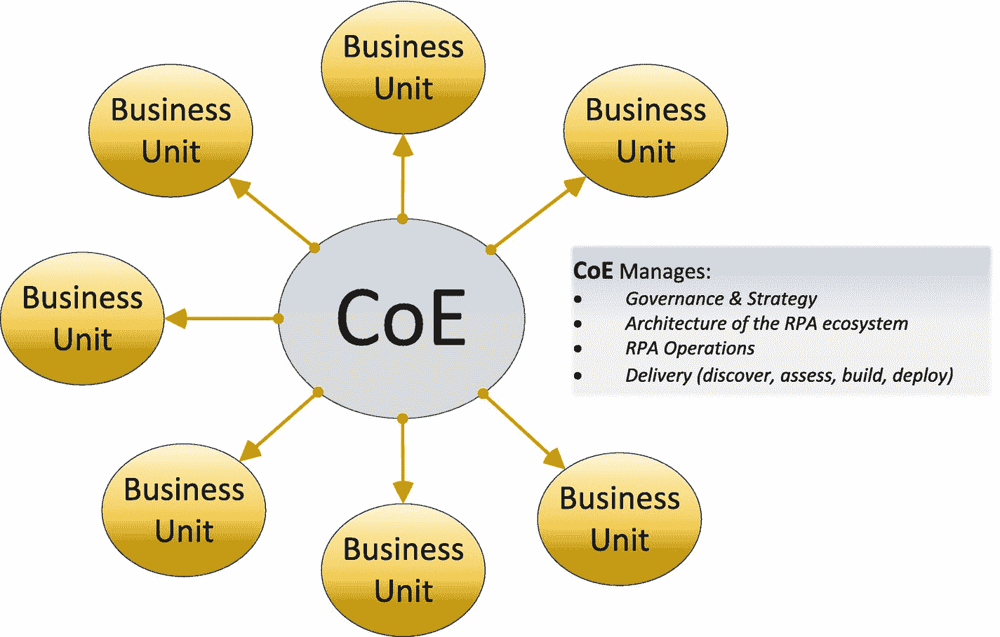
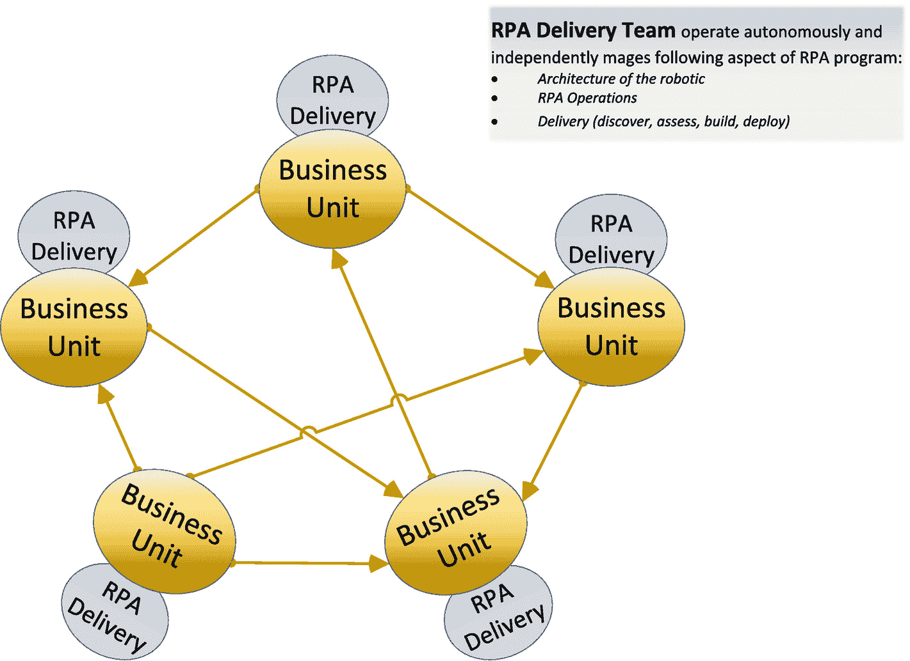
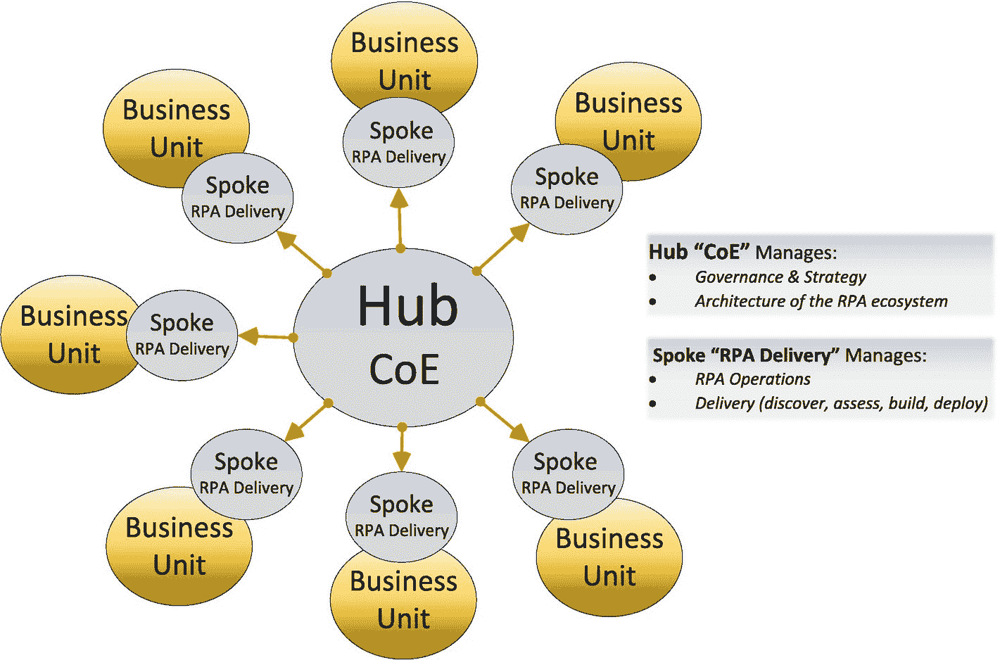

# 8. 组织结构

关于机器人流程自动化软件，需要牢记一个非常重要的方面：它并不要求企业进行全面的组织变革或大规模的 IT 转型。简而言之，无需对核心业务流程或现有后台技术进行任何根本性的改变。对于有人值守的机器人，只需安装标准桌面应用软件；对于无人值守的机器人，可以设置虚拟桌面服务器，或者将 `RPA` 集成到现有的虚拟桌面环境中。所有这些都使得在任何组织中快速实施 `RPA` 变得非常容易，无论其规模或结构如何。

在推行 `RPA` 计划时，与其专注于工具选择，不如将重点放在团队赋能（团队结构、培训等）、运营环境以及整体的 `RPA` 治理上。每个组织的需求各不相同，你需要确保新的 `RPA` 计划适合你的组织。在你确立了 `RPA` 结构之后，选择 `RPA` 软件会变得更加容易。

**暂停并思考**

你将如何构建你的 `RPA` 团队？你的组织需要哪些角色？每个人需要接受哪些培训？由谁来决定 `RPA` 工具？你将如何推荐一个工具？你会做哪些调研？认真考虑这些问题，将有助于你在组织中成功实施 `RPA` 计划。

`RPA` 计划的组织结构为在企业层面部署 `RPA` 提供了框架模型。正如我们在第 3 章中提到的，为 `RPA` 计划选择正确的路径，将决定其是走向成功，还是因结果不佳和高成本而失败。这些问题可能导致高管赞助的撤回，并最终切断对 `RPA` 的资金投入。组织中 `RPA` 相关职能的组织结构至关重要，因为它不仅关系到成本，也关系到决策——这些决策将定义长期愿景并驱动战略落地。由谁来做这些战略决策，显然是影响组织实现其业务价值程度的一个重要因素。

最佳的组织结构取决于具体的 `RPA` 计划策略、服务对象或业务运营的规模、运营复杂性、管理文化、组织设计、风险承受能力以及许多其他因素。

在本章中，我们将深入探讨第 3 章中简要介绍的三种最常见结构：集中式、分散式和中心辐射式。我们将全面描述每种模式的优点和可能的缺点。我们还将讨论哪些 `RPA` 计划职能可以外包，哪些应该保留在内部，机器人运营环境所需的架构和支持，以及它们如何融入企业的 `IT` 架构。

我们还将帮助你理解如何为自己的组织确定恰当的集中与分散程度，以及随着 `RPA` 计划的成熟，组织结构可能如何变化。

对于任何 `RPA` 计划，都需要具备以下职能：
- `机器人运营环境的架构`（基础设施支持、技术选择）
- `RPA 运营`（维护、支持、监控、新资源培训、变更管理）
- `治理与战略`（与整体组织结构的集成、对负责支持 `RPA` 计划所有功能的资源的监督、对政策和流程的合规性、安全系统访问、流程优先级排序、升级路径）
- `交付`（流程发现与评估、解决方案设计、测试、部署、标准制定）

## 集中式

在集中式模型中，上述职能属于一个集中的 `IT` 部门或单元的一部分，该部门由单一高管领导，对决策、战略制定拥有完全控制权，并拥有充足的财务资源。

这个 `IT` 部门通常被设计成一个卓越中心（`COE`），设立在某一个高管办公室内，管理 `RPA` 计划的整个生命周期：在企业层面制定 `RPA` 战略、技术选择、架构与运营基础设施、运营支持、交付 `RPA` 解决方案、制定标准，并确保适当的控制、风险管理和合规性到位。这意味着它监督 `RPA` 计划整个端到端生命周期所需的所有职能。

一个有效的 `RPA` 卓越中心远不止是建立一个由经验丰富的开发人员组成的通用 `IT` 团队那么简单。它需要创建一个由多种不同角色组成的计划，这些角色需要由合适的人员来担任，他们需要履行每个职能所需的所有关键任务。这些角色包括：`RPA` 计划发起人、运营与计划负责人、项目经理、`RPA`/业务分析师、解决方案架构师、开发人员、`IT` 基础设施工程师、运营支持与服务人员、风险与控制团队。

图 8-1 集中式模型

### 优势

集中式模型最适合那些需要在 `RPA` 战略、成本、执行和可见性方面进行更强控制的企业。这种结构将所有需要的资源集中在一个地方，从而降低了与硬件许可相关的成本。当资源分散在企业各处时，往往需要额外或重复的设备和许可，这会导致方法和工具的冗余和不一致性增加。这可能会增加技术部门的预算，并最终提高计划的整体成本。

集中式模型将成功实施 `RPA` 所需的所有集体资源和专业知识汇集于一个统一的管理之下。这使得负责人能够在集中的地方查看所有计划，并赋予他们更强的项目与优先级治理能力。它使得对流程变更的端到端视角成为可能，从而发现更有益的机会。集中式模型还提供了一套标准的评估、交付、监控和维护规章制度。

最终，以上所有属性使得计划更容易扩展。

### 劣势

与任何类型的集中化一样，该模型建立了一种决策权集中在少数领导者手中的结构，这可能导致官僚主义领导层的产生。在这种结构下，决策由高层做出，然后层层下达到较低管理层执行。这阻止了，或者至少限制了，来自不同领域的员工为计划的战略方向、持续改进和整体成熟度做出贡献。这种决策环境可能导致员工参与度降低，缺乏积极性或忠诚度，不愿提出创新想法，并导致整体表现不佳。

对于业务覆盖不同地理区域的大型组织，集中式模型需要远程控制。由于缺乏分散决策模型，领导层通常无法对执行进行有效控制，也可能没有时间管理执行。这增加了他们的大量工作，并给领导者带来快速决策的巨大压力。这可能导致决策过快过多，而对于远离决策者的员工来说，这些决策可能不恰当、被忽视或执行不力。

集中式模型适用于业务单元较少或只有一个业务部门的小型或初创企业。它带来了速度、可扩展性和成本效益。它也可作为大型企业的起点或概念验证（`POC`），帮助组织试点、学习并验证 `RPA` 的价值。这有助于高管决定是否将该能力从 `POC` 扩展到整个企业的大规模实施。然而，你可能会发现另一种模型（分散式或轮辐式）更适合你的需求。

尽管集中式模型具有吸引人的优势，但在实施之前，请注意其缺点，因为它们可能会阻碍新 `RPA` 项目的采纳，并导致 `ROI` 不佳。

**暂停思考**

根据你刚才阅读的信息，你认为集中式模型对你的组织是否适用？它是否让你有所共鸣？还是听起来很陌生？还有另外两种模型需要考虑，但请先思考一下当前这种模型。

## 分散式

在分散式模型中，企业内建立多个独立的 `RPA` 项目，这些项目拥有各自独立的 `RPA` 框架，在不同执行部门或业务单元下运行。这可以看作是多个自主运营的子 `COE` 办公室。分散式模型将其功能分布在整个组织中，不同业务单元运行着不同的能力。在这种模型中，决策和运营管理责任由本地 `RPA` 团队承担，他们负责监督所有必要职能，从定义架构、运营环境和治理，到交付和维护。

这种模式对组织内的本地业务团队约束较少，同时帮助他们获得动力和专业知识。它通过授权员工使用 `RPA` 实现业务目标，将创新需求交到员工手中。这种模式治理松散，不同的业务线条会建立自己的指南、标准、方法论和结构。

图 8-2 分散式模型

### 优势

在决策由较低层级和较小决策群体做出的条件下，创新得以蓬勃发展。更大的自主权赋予人们力量；这给他们一种重要性和主人翁感，因为他们觉得自己对引导组织方向负有责任。员工变得更加忠诚，因为他们可以在日常工作中主动采取行动，而只需极少的审批。没有什么比自己决策的成功结果更令人满足。最重要的是，它还允许他们利用自己的知识和专长，进行实验和学习：这是推动创新的关键要素。所有这些特征创造了一个自给自足、自我维持的结构，各级员工都习惯于自主工作、主动领导并在需要时做出决策，而无需等待指挥链上级的决定。

更高效的决策为组织带来了速度和敏捷性，帮助其在当今快节奏且不断变化的商业环境中取得成功。

### 劣势

虽然分散式模型是赋能员工、推动创新和业务敏捷性的好方法，但它可能成本更高。此外，由于缺乏中心控制来定义战略方向，与企业范围的 `IT` 人员协调可能变得困难。

最终，它可能导致与整体企业战略的不一致和严重脱节。多个拥有自主制定战略权限的 `RPA` 团队可能导致不同的架构结构和不同的供应商。这最终可能导致在同一企业内出现不同的技术能力、工具、运营模式、方法论和标准。它还可能造成冗余，因为相同的功能可能在整个企业中被重复，导致整体 `RPA` 项目成本更高。

此外，它可能创建孤岛，即多个团队在解决相同的问题。要保持这些孤岛之间的连接，需要领导者之间建立牢固的关系并付出努力，以创建某种"实践社区"，共享最佳实践。然而，负责支持 `RPA` 团队的员工可能忙于日常职责，很容易错过利用这些共享实践的机会。在员工看来，当面临交付压力时，与其花时间研究、理解和重用最佳实践，不如重新"造轮子"来得更容易。有时，创建新事物似乎更可取，仅仅是因为现有解决方案可能不为人知，或由于工具、开发实践甚至业务运营性质的差异而不太适用或难以转移。

由于所有这些特征，分散式模型通常运行成本更高，企业层面效率更低，并且容易产生技术债务，这些问题迟早需要解决。

对于小型企业来说，快速增长可能产生分散化的需求，以保持高效运营和业务敏捷性。尽管有其优势，但对于习惯于独自做出所有决策的企业主来说，将控制权委托给其他决策者可能很困难。

分散式模型适用于拥有多个事业部或多个业务分支的大型企业，这些企业的业务运营性质截然不同且自我维持。通常，我们可能会发现技术服务已经分散化，并归属于各自的业务分支或事业部。在这些情况下，它们很可能拥有不同的核心架构、运营和交付模型、系统和工具，其战略与所服务的特定业务需求保持一致。因此，`RPA`和业务领导者需要确保他们优先确定哪些流程将首先使用`RPA`，并根据个体需求制定转型路线图。

**暂停思考**

现在你已经了解了两种结构模型。哪一种更适合你的组织？是否有一个特别突出，还是说两者都不够优化？

## 中心辐射式模型

中心辐射式模型是一种类似于自行车轮圈球状结构的模式，其中轮毂位于中心，辐条相互连接并交汇于作为轮子中心的轮毂处。这一概念最初由交通运输行业开创，如今已被各行各业的不同公司广泛采用。

在该模型中，`COE`（卓越中心）设立于一个执行办公室内，通常充当分散式辐条的中心枢纽。交付团队可被视为辐条。

`COE`负责制定标准、开发政策、提供培训，并专注于创新和`RPA`（机器人流程自动化）项目战略。在这种情况下，你可以将卓越中心视为知识和专长的主要来源或知识库，包括最佳实践、框架、开发实践、可复用组件、培训，以及作为支持、维护和演进`RPA`技术基础设施及能力的`IT`部门。

辐条——即`RPA`交付团队——主要专注于识别机会、开发`RPA`解决方案并将其部署到所分配或支持的业务领域。该模型要求中心枢纽（`COE`）与辐条（`RPA`交付团队）之间密切协作。

在此模型中，`COE`将：

*   通过与`IT`系统/应用支持和解决方案架构团队建立协作模型，确保将`RPA`运营环境整合到整体企业`IT`生态系统中
*   定义`RPA`项目演进路线图，推动从战略到执行的落地
*   推动创新并引入新的技术能力
*   维护和支持与`RPA`相关的`IT`基础设施
*   制定标准、自动化模块或可复用组件
*   与`RPA`供应商和服务提供商互动
*   对技术和工具选择负责
*   管理和维护可复用组件及最佳实践库
*   培训并赋能交付团队人员
*   确保知识得以共享和复用
*   在高管层面汇报`RPA`项目的绩效和有效性

交付团队将：

*   评估并优先排序待自动化的选定流程
*   开发`RPA`自动化并将机器人投入生产环境
*   与`IT`团队（如系统/应用架构和支持团队）互动
*   为业务单元提供变更管理支持
*   确保现有机器人劳动力的绩效
*   维护现有的自动化流程
*   执行安全/合规职能

图 8-3 中心辐射式模型

### 优势

该模型减轻了`COE`日常业务运营的部分负担。这包括允许其报告体系之外的其他团队执行诸如识别适合`RPA`的流程、开发并监控自身机器人绩效等任务。这使得`COE`的资源能够腾出更多时间处理宏观事务，例如规划项目演进、引入新能力、研究工具、知识共享以及循环性活动（如开发最佳实践、可复用组件等）。

相比分散式模型，该模式成本更低，因为通过集中化某些职能和活动，可以避免整个组织范围内的重复浪费。例如，与其让整个组织内四个不同的人分别负责`RPA`相关的`IT`基础设施，在此模式下，两个人可能就足够了。

### 劣势

中心辐射式模型最常见的挑战在于它对完美、协调和协作的高度依赖。当整个模型——中心的枢纽和每一个辐条——协同工作时，整个`RPA`项目将变得极其高效和有效。然而，只要有一个辐条出现偏差，整个模型就可能开始出现问题。最终，更多辐条会脱落，导致整个`RPA`项目效率低下且成本高昂。可能造成中心枢纽之外问题出现的原因有多种：

*   辐条“交付团队”负责人可能不认同中心枢纽“`COE`”的战略方向或其他决策，从而不执行或落实中央指令。
*   中心枢纽“`COE`”与辐条“交付团队”之间的任何不信任都可能导致形成孤岛。
*   当前基础设施的故障，或实施、引进不佳的能力、新供应商或新工具，可能对整个`RPA`项目造成灾难性影响，波及交付团队所支持的每一个业务单元。
*   另一个可能出现的问题是，与分散式模型相比，创新速度往往较慢。

中心辐射式模型具有诸多优势，但要充分利用其潜力，需要在中心枢纽和辐条之间进行适当的职能与服务的责任分配。此外，在辐条与中心枢纽“`COE`”之间建立有效的协作环境、信任和战略透明度，对于成功至关重要。该模型并非适用于所有组织，但许多组织可能会通过根据中心枢纽（`COE`）与辐条（交付团队）模型调整其职责和角色，从而发现其某些组成部分的实用性。

### 思考与考量

现在你已经了解了中心辐射式模型。你认为它在你的组织中能取得成功吗？它的哪些组成部分看起来可行，哪些不可行？

以上每种模型如果应用得当，都能在任何组织中取得成功。没有绝对的赢家；没有任何单一模型可以被视为最有效或最无效，因为它完全取决于组织的类型、其业务、服务或产品的性质、文化、规模和报告体系。

### 思考与考量

基于你对组织的了解，并考虑到你认为管理层和一线员工对引入`RPA`项目的接受程度如何，你认为你的组织应采用怎样的组织架构？

## 选择组织结构前需考虑的因素

正如我们在第 3 章中所述，在确定采用 `RPA` 路径之前，项目领导层应决定哪些支持与执行 `RPA` 项目所需的功能将由内部资源主导，或是外包给外部第三方服务提供商。

公司对 `RPA` 技术的使用经验越丰富，就越倾向于在内部使用该技术。它们已积累了足够的知识和技术专长，因此在公司内部保留这些资源可能更高效、更有成效。另一方面，那些刚刚接触 `RPA` 能力的公司更有可能将其外包给外部的 `RPA` 合作伙伴。

这是一个非常有趣的现象，两种选择都能为各方带来不同的益处。

凯捷咨询公司与凯捷商业服务公司在 2016 年进行的一项研究指出，“虽然企业在外包合作伙伴的帮助下实施 `RPA` 会获益，但与那些自行对 `RPA` 进行技术投资的企业相比，其收益可能没那么高。”^(²⁰)

然而，从零开始启动一个 `RPA` 项目成本会更高，因为需要时间和投入才能达到足够的成熟度并实现财务收益。

尽管如此，对于那些不确定或尚未准备好自行对 `RPA` 进行技术投资，但仍希望利用 `RPA` 技术的企业而言，与外部供应商合作将大有裨益。在选择 `RPA` 合作伙伴时，它们需要牢记我们在本书前面讨论过的所需 `RPA` 功能。重要的是选择并合作一个能够提供全栈服务的供应商，该服务范围从流程发现到 `Bot` 的部署与维护。选择遵循该模式的企业无需对技术基础设施进行重大投资，也无需担心识别正确的流程以及足够数量的流程来获得足够的投资回报。现在这些顾虑都已外包，如果企业发现合作关系不合适或未能带来足够收益，可随时终止合作。

然而，正如凯捷研究中所发现的，“很明显，那些在内部实施 `RPA` 的企业将获得长期最大收益。”^(²¹)

这就是为什么在踏上 `RPA` 之旅之前，明确组织的战略方向和长期愿景至关重要。

此外，组织可以选择一种混合模式，与外部供应商和内部资源建立协作框架。例如，外部合作伙伴可以扮演交付团队的角色，专注于适合 `RPA` 的流程识别与评估、自动化解决方案（`Bots`）的开发与部署。而内部团队则提供支持与维护。

以下提示可能有助于选择一条合适的路径。

在决定遵循哪种模式之前，组织必须明确以下几点：

-   是否有足够的 `RPA` 流程来证明投资的合理性（投资回报率）？
-   组织是否致力于对 `RPA` 项目进行长期投资？
-   组织是否具备启动 `RPA` 项目所需的内部技能和能力？
-   `RPA` 是否是其运营与 `IT` 基础设施或生态系统的数字化转型长期（即五至十年）战略的一部分？

组织必须确保在为其 `RPA` 项目组织结构选择合适模式之前，已充分考虑 `RPA` 项目实施在运营文化、人员、流程和内部技术等各个方面的内容。

请记住，`RPA` 运营模式会随着组织随时间逐渐成熟而不断演进。因此，企业不必只选择一种模式并固守不变。从小处着手，例如以集中式团队结构作为概念验证，支持一个业务单元进行学习、探索和有机演进，从而带来更多收益，并在企业中慢慢发展和扩展，这甚至会更有益。另一个可能引发变革需求的因素是技术变革的快速步伐。自动化能力发展迅速，使组织成熟到更高级的自动化阶段。这种成熟度可能要求组织采用完全不同的运营模式，以最大化并充分利用该技术能力的全部潜力。我们将在第 10 章中详细讨论这一点。

脚注 1 2

