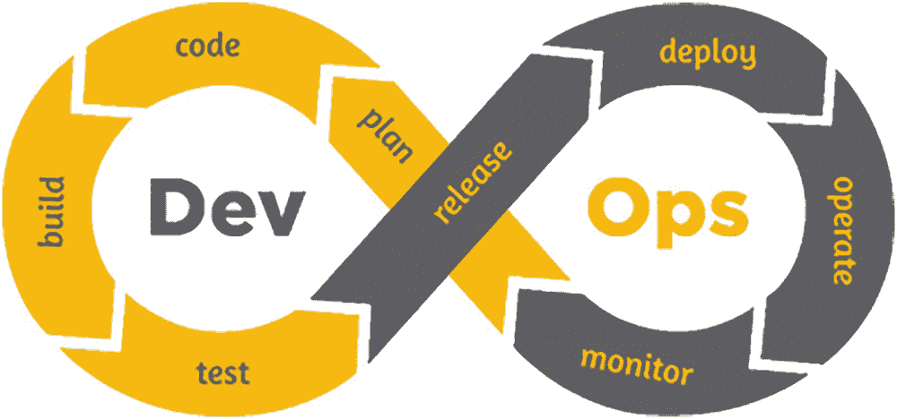

# 9. 开发方法与框架

一旦为 RPA 计划奠定了初步基础，就可以开始着手第一个项目或一系列项目了。实际如何推进将取决于组织内的许多因素。

传统的瀑布式方法、敏捷方法及其众多混合变体都能很好地与 `RPA` 相融合。具体采用何种方式，将取决于你的组织是采用敏捷还是瀑布式开发模式。

无论采用何种方法，都存在一些共性：
*   必须更新先前制定的商业案例。请记住，初步商业案例基于有限的信息。当你准备进入开发阶段时，已经获取了额外的信息。这可能会改变所需的具体内容、预期的节省、受拟议变更影响的其他系统、所使用的工具等。这些变更必须纳入更新后的商业案例中。

暂停并思考：如何最好地收集这些信息？到目前为止，举行了哪些会议，包含了可用于优化和更新商业案例的信息？

*   需要准备一份就绪检查清单。它用于确保在开发过程中将软件部署到生产环境所需的所有步骤都已完​成。就绪检查清单贯穿项目的整个生命周期，因为每个阶段都必须完成部署所需的要求。

*   角色：当 RPA 项目开始时，将需要几个角色。
    *   业务分析师：此人从项目一开始就参与其中，与业务部门合作，充分理解需求，并将该需求转化为具体要求。
    *   系统分析师：此人也从项目一开始就有所参与，与业务分析师合作，确定受拟议变更影响的系统。在项目生命周期的早期，可能只是怀疑但尚未确认具体哪些系统会受到影响。在此阶段，必须确定受影响的准确系统。
    *   架构师：架构师对项目也并不陌生，他们与业务分析师和系统分析师合作，协助确定项目的大致时间表并评估复杂程度。与业务分析师和系统分析师一样，架构师的工作现在变得更加具体，因为项目早期存在的“未知因素”逐渐变得清晰。
    *   开发者：开发者可能在早期提供过一些意见，但只要架构师已经参与，这种情况就不太可能发生。现在，开发者将阅读并理解需求，并将其转化为代码。
    *   业务负责人：业务负责人是需求方面的专家。他们了解所需的内容，并协助创建项目的迭代版本。

如果使用敏捷（或其某种混合变体），上述角色将都会参与，但不是按顺序依次参与，而是同时参与。`RPA` 非常适合采用敏捷方法，因为两者都具有迭代性。

## 不同方法带来的挑战

RPA 团队通常同时与多个业务部门合作，因为他们处理的是可能由不同业务部门拥有的不同应用程序。RPA 团队不能为每个特定客户更改自己的方法论，也不能同时使用多种方法论。如果其他业务部门使用不同的方法论，而 RPA 团队使用例如敏捷方法，就会遇到挑战：当其他业务部门使用瀑布式方法时，RPA 如何能仅使用一种方法论？

例如，在金融领域，许多业务部门使用瀑布式方法，而大多数 RPA 团队使用敏捷或精益方法。业务部门习惯于在完成的需求文档上签字确认；而敏捷和精益则使用迭代方法，即部分需求被批准后就开始开发。然后 RPA 团队必须等待所有需求都获得批准才能开始开发。如何将等待时间最小化？

业务部门不必签署整个需求文档，而是应逐步签署各个部分，并在文档中注明该签署并非针对整个需求文档，而仅针对特定部分。当所有需求都完全完成时（请注意，此时大部分开发工作可能已经完成），业务部门可以再签署整个文档。

这需要对业务部门的成员进行培训。只签署部分需求的概念对他们来说是全新的，他们可能对此感到不适应。他们可能会说，他们不可能签署“部分”需求，因为他们需要在批准任何部分之前看到整体情况。当然，对某些人来说，这是一种全新的工作方式。对于分析师和主题专家来说，他们需要考虑如何划分需求文档。他们只需要关注正在被自动化的步骤，但即便如此，他们可能仍希望在批准任何部分之前查看端到端的需求文档。部署也是如此；机器人将被逐步部署。制定一个产品 RPA 增量开发路线图或计划对于定义 RPA 的各个小块至关重要。这些是最终自动化的构建模块。这个路线图可能包含史诗、用户故事或其他工件。无论它们被称为什么，它们都构成了自动化的逐步路线图。

暂停并思考

每个需求部分都应该足够大，以便能够开发或成为 RPA 的完整功能部分，例如，访问电子邮件帐户以检索电子邮件内容，或者使用 RPA 凭据登录系统/应用程序前端等。每个需求都应该产生一个“最小可行产品”，即使这个小的“块”从未单独交付给客户。如何最好地与业务部门合作，帮助他们理解这种需求的划分或“分块”？

再次考虑我们的案例研究。客户发送一封电子邮件，通知我们他们更改了电话号码和地址。

*   第一次需求迭代：“`Bot` 将打开电子邮件，仅读取电话号码，并在 Web 应用程序中更新该电话号码。”将要求业务部门批准这第一次需求迭代。
*   第二次需求迭代：“`Bot` 将打开电子邮件，读取电话号码和地址，并在 Web 应用程序中更新电话号码和地址。”将要求业务部门批准这第二次需求迭代。
*   第三次需求迭代：“`Bot` 将打开电子邮件，读取电话号码和地址，并将电话号码和地址更新到 Web 应用程序和大型机。”

在这种情况下，第一次需求迭代一旦获得批准，就会被开发和测试。用户验收测试将在需求的所有组成部分都开发完成后才进行。这里的假设是会有增量开发，但只有在所有需求的产品都开发完成后才发布一次。

另一种选择是，第一个需求的产品可以先交付并投入生产，然后是第二个部署，以此类推。这取决于你所在组织选择的模型。

随着每次新的需求迭代，你都在扩大自动化的范围。这对业务部门来说可能是一个新概念，他们过去只习惯于批准整个需求文档。

在某些组织中，部署团队可能使用瀑布式方法，而 RPA 团队使用敏捷方法。

现在我们将讨论几种与 `RPA` 一起使用的常见方法。

## 敏捷方法论

许多 RPA 组织会选择敏捷方法论或敏捷混合模式。敏捷方法中常被新 RPA 团队采纳的核心特点，是其从始至终的迭代式开发特性。

在敏捷环境中，会批准一些初步且非常基础的需求。这便是最小可行产品，意味着功能可运行，但可能远未达到交付客户的程度——它太过简陋。以我们的案例研究为例，一个非常初步的需求可能是：“机器人将读取邮件，提取电话号码，并更新网页应用程序中的电话号码。”业务方会批准这一需求，同时明知将其交付客户毫无意义，因为这仅是客户期望和承诺功能的一部分。但这仍是一项需要完成的基础功能。一旦获批，开发团队便会着手实施。下一个需求可能是：“机器人将读取邮件，提取地址信息，并更新网页应用程序和大型机中的地址。”同样，这仅是客户要求和承诺功能的一个方面，却是绝对必要的。

显然，这与传统的瀑布方法论不同——后者要求所有需求在开展任何其他工作之前就被收集并批准。但正如前文所述，RPA 的最佳落地方式是遵循迭代流程（例如：完成部分工作→向治理委员会汇报→获得（或未获得）继续推进的批准→完成更多工作→再次汇报，以此类推），因此采用敏捷开发方法论是合乎逻辑的。

一个优势在于，可以在项目生命周期早期进行变更。例如，一旦“机器人必须能够从邮箱 XYZ 读取传入邮件”这一需求获得批准，业务方可能决定：机器人不仅应更新地址和电话号码，还应涵盖因结婚、离婚等原因导致的姓名变更。在传统的瀑布方法论中，这将构成重大需求变更，需要返工。而在敏捷环境中，由于需求是逐步获取并批准的，此类变更可以随时进行。

暂停思考

请记住，在组织中引入 RPA 可能具有革命性。如果 RPA 团队使用的方法论与组织其他部门不同，则需要就差异领域进行协商。例如，你将如何说服业务方签署批准不完整的需求？

在比较采用敏捷或瀑布方法论的 RPA 项目时，Madan Kumar Divvela 如此表示：“通常，使用 RPA 进行流程自动化从启动到上线只需几周时间。传统的瀑布方法论无法跟上 RPA 交付的节奏。”^(²²)

### 优势

使用敏捷方法论的优势之一在于，可以轻松进行变更，而不会造成昂贵的延误和返工。Dominic Whaley 在《Partnering Solutions》中撰文评论自己的经验时提到：“将工作划分为独立的数据包使我们能够定期评估进展。变更或新需求会被记录并添加到下一个冲刺中。”^(²³)

增量交付的另一个优势是：从上一增量中吸取的经验教训可以轻松融入下一组需求中，无需重写整套需求并再次经历重新审批流程。这样一来，例如在第一组需求的收集或文档编制中你认为可以做得更好的地方，可以在第二组需求的收集或文档编制中得到改进。

这带来了更高的灵活性，并缩短了开发周期的总前置时间。

此外，所有团队成员始终处于忙碌状态。一旦初始需求被文档化，开发人员和业务分析师就可以开始处理 MVP。在此项工作进行的同时，下一组需求正在被收集。

敏捷还使得估算每个需求所需的开发时间更加容易，从而使部署计划更简单高效。

另一个潜在优势在《Blueprint》杂志一篇题为《如何通过敏捷方法实现大规模 RPA 交付》的文章中有所探讨。

> 在机器人流程自动化的敏捷方法中，业务流程在开发开始之前就经过设计和优化。这使得大型组织能够完全标准化和优化端到端、复杂且多层次的业务流程——这些流程正是自动化真正投资回报率（ROI）的所在。同时，这也为它们提供了宝贵的机会，将这些流程与更广泛的业务目标、企业或监管约束、政策及控制措施联系起来。^(²⁴)

### 可能的缺点

# 在敏捷环境中工作

在敏捷环境中工作需要培训。这不仅涉及新的工作方式和全新的术语表，还包括新的思维方式。仅仅更换术语但沿用相同的方法，并不能让一个组织变得敏捷。人类天性不喜欢改变，尤其是当人们当前的工作方式已经非常高效且有效时。敏捷要求业务和技术双方的人员以截然不同的方式思考需求、开发等问题。尽管开发团队通常能迅速接受敏捷，但业务方往往犹豫得多。

## 暂停思考

如果你的组织并不熟悉敏捷，但你认为 RPA 最适合采用这种方法论来构建，你将如何说服人们接受它？你是否预见到技术团队可能接受，但业务方会有阻力？你如何让双方都看到使用敏捷的优势？

这并非暗示只有敏捷对 RPA 有效；情况绝非如此。虽然许多组织正逐渐脱离传统的瀑布方法论，但也有许多组织并未如此。RPA 同样可以使用瀑布方法论来建立。

## 瀑布方法论

在 RPA（机器人流程自动化）中采用瀑布式方法（需求、开发、测试、部署），仅仅是复制了在任何传统环境中项目执行的模式。一旦需求被捕获并批准，开发便开始了。整个过程以一种非常传统的方式进行。

让我们再次审视我们的案例，并考虑其在 RPA 中的瀑布方法背景下是如何运作的。它将遵循传统模式：收集并批准需求，随后进行开发、测试和部署。手工流程依然被自动化，所以最终结果保持不变；只是实现方式有所不同。每个阶段结束后会举行治理会议，以决定是否获得批准继续推进。

### 优势

大多数组织对这种非常传统的方法论感到熟悉和舒适。它没有意外情况；是久经考验且行之有效的（即便不是当今最高效的项目开发方式）。对于某些组织而言，这可能是将 RPA 引入组织的最安全途径；引入 RPA 会稍微撼动企业的现状——你不想再被敏捷的巨浪淹没！

瀑布方法适用于小型、简单的 RPA 项目。如果流程非常简单直接，复杂性低，那么瀑布方法流程通常会取得成功。更复杂的手工流程则更适合在敏捷环境中实现自动化。

### 可能的劣势

这可能是一个慢得多的过程。在所有需求被收集和批准之前，开发工作不会开始；在所有开发完成之前，测试不会开始。如果在测试过程中发现错误，或者业务方决定增加某个需求，就必须进行大量的返工，随之而来的是不可避免的延误。

这里有必要公平指出，大多数比较 RPA 项目中敏捷与瀑布应用的文献都强烈倾向于使用敏捷方法。虽然这意味着你确实应该考虑敏捷，但在为你的组织做决定之前，还有许多因素需要思考。

## 精益软件开发

精益软件开发是作为传统瀑布方法的一种替代方案出现的，后者采用了严格、文档驱动和传统的开发方式。精益思维原则基于丰田生产系统（TPS），并已成功应用于许多制造和产品开发组织。精益的哲学理念是通过消除所有不增加价值的浪费来缩短开发时间。

正如丰田生产系统（TPS）的主要缔造者之一大野耐一所解释的概念：“我们所做的一切，就是审视从客户下订单到我们收到现金的时间线。我们通过消除不增加价值的浪费来缩短这条时间线。”^(²⁵)

丰田花了 30 年时间来完善其方法论和实践，使其变得有效且高效，达到今日之水平。然而，直到麻省理工学院（MIT）对汽车行业进行了为期五年的研究，将精益认定为美日之间巨大生产力差异的根源后，它才获得主流的关注和认可。^(²⁶) 这项研究为生产体系定义了一个新术语——“精益”（因为通过消除浪费，它对各方面的投入需求都会减少）。精益生产方法论和思维主要描述在詹姆斯·沃麦克、丹尼尔·琼斯和丹尼尔·鲁斯合著的《改变世界的机器》一书中。

在过去几年中，精益在软件行业也变得流行起来。它主要源于玛丽·波彭代克和汤姆·波彭代克合著的《精益软件开发：软件开发经理的敏捷工具包》一书。^(²⁷) 这本书从不同的角度研究精益生产系统，并采用和裁剪了适用于软件开发的精益原则和工具。它的流行度正在迅速增长，这种增长源于其在识别和消除浪费以及快速响应变化中的客户与市场需求方面的有效性。

精益方法论成功的关键在于将实践者的思维方式转变为精益思维，而不仅仅是采纳和实践精益工具。支撑精益思维的有五个核心概念：

1.  *价值*由客户定义，是客户愿意为之付出的。清楚理解价值是什么至关重要。在 RPA 中，产品负责人可以被视为“客户”。
2.  *价值流*是对当前为将产品或服务从客户请求到交付的整个流程中所需的每个动作（包括增值和非增值的）的可视化呈现。在生命周期早期开发的过程图，是价值流的一种基础但通常也足够用的版本。
3.  *流动*代表着人员、材料或所需物品如何从一个步骤移动到下一个步骤，直到价值交付给客户。通过从价值流中消除浪费来实现持续的流动至关重要，这样开发或服务才能顺畅地流向客户。这将带来生产力和效率的提升，使流程更加精益。这将大大缩短交付给客户的时间；不再需要数月才能交付，可能缩短到数周甚至数天。你为配合过程图所创建的文档将捕获这些信息。
4.  *拉动*意味着客户可以在需要时订购产品或服务，并且这些产品或服务可以在短时间内交付。这将确保在没有需求之前不构建任何东西，从而降低客户可能不会使用的库存成本；所有创建库存的努力都将白费。你需要决定下一个要处理的工作项是什么。
5.  *完美*可能是精益思想中最重要的概念。它要求将持续流程改进作为组织文化的核心部分。追求完美是通过一个可重复的过程实现的，在此过程中，任何浪费都能被持续识别并消除。这是一段漫长的旅程，需要从员工、支持团队到领导者等各个层面付出坚持不懈的努力。正如马克·克劳福德所言：“精益专家常说，一个流程在经历至少六次价值流图分析之前，都算不上真正的精益。”^(²⁸)

精益的首要指导原则是从流程中识别并消除浪费，以最大化客户价值。请注意，浪费的概念相当宽泛，具体取决于价值交付流程和环境。让我们以软件开发领域为例。例如，浪费可定义为：

*   客户未使用的额外功能
*   设计不佳、未通过测试且需要返工的功能
*   等待需求或支持
*   未完成的工作
*   任务切换，同时处理多个开发项目
*   额外的处理步骤或代码行
*   未被利用或未被充分利用的员工知识与创造力

精益软件开发，可以看作是上述概念和原则在软件开发实践中的应用。因此，精益软件开发的主要目的和目标，是在预算内，以尽可能短的交付时间提升客户价值。

## 暂停并思考

精益源于制造业，但已演变为一种流行的软件开发方法论。它如何在你的组织中发挥作用？你认为可能的优势是什么？你认为高层管理人员是否会对其潜在的益处印象深刻？

## 与敏捷方法论的重叠

我们认为，精益和敏捷是同一种方法论的两种名称。仔细观察敏捷软件开发实践，不难发现它与精益概念的密切相似之处。

例如：

*   敏捷中的代码审查和内建质量，支持了精益方法论所基于的基石之一。该原则不是将低质量产品推向后续流程，而是在流程早期发现并修复缺陷，而不是等到整个产品准备发布时才发现问题。
*   Scrum 使用精益的“拉动”原则来平衡工作量，并实现系统内的平滑流动。团队在每个冲刺（迭代）中，根据团队能力和容量，从待办列表中拉动任务。
*   敏捷（Scrum）像精益一样，通过创建流程来识别并消除软件开发周期中的浪费，从而专注于消除浪费。
*   敏捷使用看板技术来帮助管理产品开发，并加强团队与利益相关者之间的沟通。
*   敏捷的各种仪式，如每日站会、计划会议或回顾会议，其起源都可追溯到精益。

我们观察到一个团队，该团队为多个内部客户处理繁重的应用支持任务。该团队使用 Scrum 框架来开发新功能和解决方案，但使用看板来处理战术性的、基于临时需求的支持任务，以修复问题并解决其产品中的故障。团队最初使用简单的纸笔看板来即时跟踪事项和记录新的传入请求。在这种特定情况下，需要为团队带来更高的可见性和工作量管理。随着时间的推移，看板不断发展，变得更加复杂，具备了跟踪团队绩效的能力，并能更容易地识别和量化浪费，特别是在等待开发事项和返工领域。看板从纸笔形式迁移到了数字格式，然后被拆分为两个不同的功能，一个用于开发新产品和服务，另一个用于支持现有的已发布解决方案。看板随着团队在敏捷方法论中日益成熟而共同演进。

毫无疑问，敏捷方法和精益软件开发在为客户创造价值方面是相辅相成的。然而，我们认为精益和敏捷之间存在关键差异。

敏捷在本质上似乎更具战术性，其重点多放在技术实践、仪式和技巧上，以实现高效且有效的软件开发。

在我们看来，关于需要建立怎样的企业级运营框架和程序才能使敏捷采纳成功，讨论得很少。因此，要成为一个敏捷企业组织，所需的重大变革必须从高层发起并推动。H. Smits (2007)指出：“在软件开发项目中大规模实施敏捷概念过程中积累的经验告诉我们，目前流行的敏捷软件开发方法（如 Scrum）如果不进行变革，就无法扩展到项目集、产品和组织层面。这些方法变革的基础可以在精益原则中找到……”^(²⁹) 在这一点上，组织战略成为敏捷流程能够有效运作的主要驱动力。

相反，精益是从高级管理层视角应用的，其目标是优化整个组织中所有活动的各个方面。

从这个角度看，精益可以被视为一种自上而下的方法，而敏捷则是自下而上的。

如果没有战略层面的支持，敏捷的采纳会受到抵制变革的组织力量的压制。通过从高层引入精益，在敏捷环境中工作的开发者与其利益相关者之间因实践和原则冲突而产生的紧张关系将会得到缓解。

我们认为，敏捷框架通常不关注软件开发所处的周边商业环境。它主要提供一套供开发者使用的实践，可以被视为对精益方法论的补充。另一方面，精益原则可以应用于任何范围，从具体的软件开发实践，到整个组织——软件开发只是其中一小部分。^(³⁰)

## 精益与敏捷

Poppendieck 和 Poppendieck (2003, 2006) 将精益原则视为不随时间改变的核心真理，而软件开发工具和实践则是这些原则在特定情境下的应用。这些工具和实践应根据环境进行相应调整，并随着情况的发展而变化。因此，他们建议应将精益思想视为指导原则，用以发展和调整敏捷实践。^(³¹)

踏上精益/敏捷之路可能很艰难。我们认为，为企业制定一份在其商业环境中试行精益和敏捷实践、同时最小化运营风险的采纳或扩展路线图，将非常有用。请记住，在组织内部创建一个精益/敏捷孤岛并不会带来巨大的突破。然而，它能够带来足够的证据，以便在向整个组织扩展时学习。请记住，丰田花了 30 年时间来完善其生产体系；这是一段需要毅力和大量努力的旅程。

> **暂停并思考**
>
> 关于敏捷和精益，有许多需要考虑和交叉的部分。你认为它们中哪一个更适合你的组织？在你的组织中，你可以与谁讨论敏捷和精益原则，以获取更多意见？

## DevOps

DevOps 一词将开发与运维的实践和工具整合为一个框架，旨在提升组织定义、开发和部署 IT 解决方案及服务的能力，其速度远超传统软件开发方法。

DevOps 的核心原则在于打破开发与运维团队之间的孤立壁垒，将双方工作纳入同一框架，使其在整个 IT 解决方案生命周期（从开发、测试到部署和运维）中协同合作。换言之，DevOps 将人员、流程和技术紧密结合，持续为客户创造价值。在此框架下，两个团队通过建立围绕信息共享的强文化伦理，借助一系列聊天工具、定期设计会议、问题解决会议及小组讨论，保持频繁沟通。这营造了一个信息能快速在开发者、运维及支持团队等所有相关利益方之间流动的环境。

> **提示**
>
> 信息孤岛有时因个人或经理“垄断”信息而产生。在消除它们时需谨慎行事。

为避免解决方案部署周期过长，开发者以相互独立发布的小增量形式进行工作。为此，DevOps 采用持续集成（`CI`）和持续交付（`CD`）流水线，并结合自动化技术，将代码从开发与部署的一个阶段推进到另一个阶段。对于`CI`，关键目标是尽早发现并修复缺陷，以提升交付质量和速度。`CD`实践则确保可在短时间内构建出可运行的软件，并随时准备好在无需人工干预的情况下可靠发布。为快速交付软件，DevOps 尽可能依赖自动化工具。高度自动化能确保以更快的速度和更高的频率进行生产环境发布的测试与准备工作。当`CD`得到妥善实施时，开发者始终拥有已构建、测试完毕且可进入生产环境的产物。

鉴于 DevOps 流程的持续性特点，将其视为一个无限循环（图 9-1）更容易理解。该循环包含开发侧和运维侧的各个阶段，并展示了它们在整个 DevOps 生命周期中相互关联的关系。

**图 9-1** DevOps 无限循环³²

DevOps 能够与敏捷软件开发完美共存，是大型 IT 驱动型转型项目满足业务需求的绝佳框架。DevOps 可以解决制约业务增长的挑战，包括新软件发布的延迟；有时延迟过长，以至于软件发布时已无法满足业务需求。在当今技术快速变革的快节奏环境中，收入严重依赖 IT 能力的组织必须保持灵活并能迅速调整。时间至关重要，任何延迟都可能使组织的市场地位在短短数月内从领导者沦为追随者。

因此，DevOps 的主要优势在于：

- 更高的创新速度。
- 更好地适应不断变化的市场需求。
- 快速交付价值，以建立或维持竞争优势。
- 更高的产品/服务可靠性，在更小的发布中更容易保证质量。
- 技术与运维之间更好的协作；开发与运维通过整合工作流程和共担责任，像一个团队一样工作。

此外，DevOps 在精益和敏捷实践者中日益流行，并随着人工智能驱动的解决方案在几乎我们做的所有事情中提供帮助（从审阅咨询、搜索分析数据、执行数字任务、提出决策到事件管理）而不断发展。这意味着更智能的解决方案需要更短的开发和部署周期，更高的解决方案可靠性和内建质量，以及从业务需求识别到可行 IT 解决方案的无缝过渡。

让我们重新思考我们的案例研究。客户发送一封电子邮件，通知我们他们更改了电话号码和地址。DevOps 的持续集成和交付可能如下所示：

- 第一次迭代开发与发布：“机器人将读取电子邮件、读取电话号码，并在 Web 应用程序中更新电话号码。”这些步骤将实现自动化；Web 应用程序和大型机上的地址更改以及大型机上的电话更改仍将手动处理。将要求业务方面批准并接受这第一次迭代。
- 第二次迭代：“机器人将读取电子邮件、读取地址，并在 Web 应用程序中更新地址。”大型机上的电话和地址更改仍将手动更新。将要求业务方面批准并接受这第二次迭代。
- 第三次迭代：“机器人将读取电子邮件、读取电话，并在大型机系统中更新电话号码，大型机上的地址更改仍将手动进行。”
- 第四次迭代：“机器人将读取电子邮件、读取电话号码和地址，并在大型机系统中更新电话号码和地址。”

每一次新的迭代，你都在扩大自动化的范围。无需冗长的需求收集、审批步骤、RPA 开发和测试解决方案，就能更快地从概念方案转变为实际方案。这些较短的周期可以防止需求变更和解决方案范围蔓延——这两者都是团队在处理复杂大型解决方案时常见的问题。这种增量式和持续交付的方法对于业务方来说可能是一个新概念，他们习惯了只一次性批准整个需求文档、测试并接受端到端的自动化。

> **暂停与思考**
>
> 思考混合版本。例如，RPA 可能负责开发，但由其他团队收集需求、进行部署等。这在你的组织中可行吗？如果需要，你将采取哪些步骤来确保成功？

无论你选择什么方法，RPA 的主要挑战在于，团队在组织中通常是新成立的，并且通常遵循敏捷或精益方法。现有的业务伙伴和技术团队可能仍处于瀑布模式，或正在转型中，而敏捷或精益模式及其特定的词汇、实践、规则、指南等，对他们来说可能非常陌生，因此令人生畏。你如何架设现有方法与 RPA 将引入的新方法之间的桥梁？

我们本章前面讨论了四种方法。现在我们需要看看如何将新的 RPA 方法融入到现有的公司方法中去。

首先，让我们看看一些挑战：

- RPA 团队将讨论冲刺、待办项、产品增量等业务方可能完全不熟悉的术语。
- RPA 团队将向业务方提交一份非常有限的需求文档，即前面讨论过的 `MVP`（最小可行产品）。但业务方可能期望看到完整的需求。
- 业务方可能会在项目启动一两个月后，根据项目的复杂程度，才分配资源来审阅需求，他们相信记录需求需要那么长时间。然而，在项目的大部分生命周期中，实际上都需要该资源的参与。

## RPA的实施规划

让我们考虑一下，RPA 团队更多是基于角色而非基于团队的。我们这样说的意思是，虽然有一个核心开发团队，包括一名业务分析师和一名系统分析师（根据组织的不同，可能还有其他或不同的角色），但还会有其他角色参与特定的 RPA 项目，而非所有项目。例如，在我们的案例研究中，我们需要客户服务部门的人员从头到尾参与团队。这个人（或这些人）将以互动方式帮助起草需求，因此在项目的大部分过程中都需要他们。对于不同的项目，比如一个确保商品税收符合政府法规的项目，则不需要客户服务部门的人员，但需要公司法规团队的人员。

因此，在这种模式下，固定团队成员（例如开发人员、流程分析师）留在该团队中；其他所需资源则根据需要共享。项目完成后，共享资源将返回其原始团队。

> **提示**
>
> 共享资源可能不需要全职在团队中。应根据具体项目确定需求。

一个潜在的缺点是，共享资源在全职返回其原始团队后，将无法解决出现的问题。您必须计划如何处理这些资源所擅长的领域内的问题。

> **暂停与思考**
>
> 在您的组织中，需要采取哪些具体步骤来确定引入 RPA 时的最佳方法论？您需要与谁协商？需要获得谁的支持？您将如何获得这种支持？

如上所述，有多种开发方法论可供选择。但您不必感到不知所措；审视您组织中当前的情况，确定您认为最适合新 RPA 计划的方法论，并努力实施它。但请记住，看似对您的组织有巨大潜力的方法最终可能需要进行修改。这没有问题！理想情况下，RPA 是迭代的；您在过程中学习。如果某些方法不起作用，请理解原因，然后要么消除障碍，要么朝不同的方向前进。

在下一章中，我们将讨论 RPA 如何不断演变，并提供最重要的趋势供您参考。