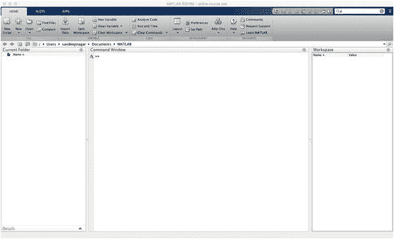
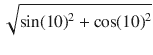
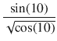
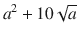
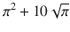

# 1\. MATLAB 简介

## 1.1 数值计算简介

随着二战后计算机的出现，利用这一新工具模拟物理问题的需求催生了数值计算的发明。分析计算需要纸、笔和人类大脑，而数值计算则额外需要计算设备。在科学与工程的许多领域，都观察到成功使用计算设备来解决涉及大量数据点的问题（尤其是包含重复性任务的问题）的案例。例如，破解敌方密码、在核爆炸前模拟核反应等。其应用范围进一步扩展到民用领域，例如设计和模拟水道、水坝、发电站、城镇规划等。所有这些应用都需要使用代表物理问题的物理模型的方程或方程组。处理这些方程有两种方法：使用分析技术和数值技术。在本书中，我们只关注使用 MATLAB 求解方程的数值方法。

随着时间的推移，为数字计算机编写了各种定义数学函数（如微分、积分、三角函数等）的方案。这涉及到数字化，而数字化必然会引入误差。了解误差并恰当地将其消除，可以比分析结果更快地获取有价值的信息。因此，它成为了科学领域研究最活跃的领域之一，并且至今仍是如此。对更快、更精确算法的追求持续推动着数值计算领域的创新，并使人类能够模拟那些原本不可能完成的任务。

## 1.2 数值计算工具

随着数值方法作为分析方法的一种替代方案不断发展，计算机编程语言越来越多地被用于将其编码，以进行模拟的程序化研究。存在多种进行数值计算的选择 [1]。诸如 FORTRAN、C、Python、Java 和 Julia 等旨在处理数学函数的编程语言，可以用来编写数值计算的算法。

### 1.2.1 对专用软件的需求

虽然所有问题都可以用编程语言编码，但当微处理器平台或操作系统发生变化时，必须改变计算方法、文件管理方式等。这阻碍了互操作性。现代编程语言解决了一些这类问题，但学术界已经感受到对数值计算专用软件的需求——在这种软件中，可以随时按需调用预定义的数值方法工具，并且可以开发自定义工具。在这方面已经进行了多次尝试。

### 1.2.2 MATLAB 的历史

MATLAB 就是这样一个程序，由克利夫·莫勒 [2] 开发。他当时是新墨西哥大学的数学教授，教授数值分析和矩阵理论。在攻读博士学位期间，他最初用 FORTRAN 编写了大量代码来解决涉及矩阵代数的联立线性方程组，他最终将其命名为 MATrixLABoratory（MATLAB）。作为一名教授，他希望他的学生能够使用这些新的软件包，而无需编写 FORTRAN 程序。

因此，在 20 世纪 70 年代末，MATLAB 的第一个版本诞生了（用 FORTRAN 编写）。它有 80 个用于执行线性代数问题计算的函数。后来，杰克·利特尔和史蒂夫·班格特用 C 语言重新编写了 MATLAB，并增加了新的特性，以制作该软件的商业版本。三人于 1984 年在加利福尼亚共同创立了 MathWorks [3]，该公司在全球范围内开发、维护和分发 MATLAB 及其相关产品。MATLAB 已被证明是用于数值方法的绝佳工具 [4]。

随着时间的推移，MATLAB 的基础软件包中添加了如此多的工具和功能，以至于连同这丰富的库集，其安装需求达到了数个 GB 的数据。MATLAB 在科学界变得极为流行。全球有超过 5000 所大学在使用它。它有时被恰当地称为“工程语言”。数字计算资源的廉价可得性极大地推动了它在工业界和学术界的应用，以至于现在几乎所有实验室都需要 MATLAB。

## 1.3 安装要求

MATLAB 应从 MathWorks [3] 的官方网站或官方经销商处购买。计算机系统要求取决于随基础 MATLAB 软件包安装的可选工具 [5] 的类型和数量。本书讨论的是基础 MATLAB 软件包的使用。因此，为了获得良好的 MATLAB 软件使用体验，请使用配备 1GB 内存以及 Windows、Linux 或 MacOSX 中任意一种操作系统的笔记本电脑或工作站。产品附带了安装说明。MATLAB 环境在所有系统上都是相似的，因此在使用本书练习时无需为此担心。本书已在 MacOSX 10.12 操作系统上的 MATLAB R2017a 版本上进行了测试。

## 1.4 工作区

在 MATLAB 中有两种工作方式。第一种方式是在命令行上一次编写一条命令。第二种方法是编写一个脚本（一个包含一系列命令的 `.m` 文件），然后通过在命令行中直接键入其名称来运行它。例如，要运行 `a.m` 脚本文件，只需在命令提示符下输入以下内容：

```
1  >>a
```

默认情况下，命令提示符由符号 `>>` 表示。你在命令提示符处输入一个命令，然后按 Enter 键执行该命令。参见图 1-1。



图 1-1

运行中的 MATLAB

### 1.4.1 REPL 原则

MATLAB 命令行基于 REPL 原则工作，REPL 代表“读取-求值-打印-循环”。当输入被送入 MATLAB 命令提示符时，Julia 语言：

*   **读取**用户输入的内容
*   **求值**它读取的内容
*   **打印**求值后的返回值
*   **循环**回去并重复整个过程

所有 MATLAB 命令都被视为需要在 REPL 中求值的表达式。许多编程环境，例如 Python 的交互式 shell 以及 Jupyter notebook 格式，都采用相同的方法。名为 Julia 的新语言也有一个 REPL，并以类似的方式工作。

### 1.4.2 计算器

从最简单的角度来看，MATLAB 就像一个计算器，使用数学运算符，如乘法 (`*`)、除法 (`/`)、加法 (`+`)、减法 (`-`) 和幂运算 (`^`)：

```
1  >> 3 + 5
2  ans = 8
3  >> 2 – 3
4  ans = –1
5  >> 3.0 * 5
6  ans = 15
7  >> 2 / 3
8  ans = 0.6667
9  >> format long
10  >> 2 / 3
11  ans = 0.666666666666667
12  >> format short
13  >> 2 / 3
14  ans = 0.6667
15  >> 2 % 3
16  ans = 2
17  >> 2 ^ 3
18  ans = 8
```

如前面的示例所示，当一条命令被送入命令提示符 `>>` 时，它会被执行，并通过在下一行显示结果为 `ans =` 来给出答案。要在结果中显示更多小数位数，可以使用 `format long` 命令。默认情况下，MATLAB 使用 `format short` 命令。

### 1.4.3 预定义常量

```
1  >> pi
2  ans = 3.1416
3  >> i
4  ans = 0.0000 + 1.0000i
5  >> j
6  ans = 0.0000 + 1.0000i
7  >> Inf/Inf
8  ans = NaN
```

定义了许多物理常量：`pi`、`e`（欧拉数）、`i` 和 `j`（虚数 `sqrt(-1)`）、`inf`（无穷大）、`NaN`（非数字，由未定义的操作产生，例如 `Inf/Inf`）。


### 1.4.4 常用数学函数

```
1  >> abs(–10.034)
2  ans = 10.034
3  >> log10(10)
4  ans = 1
5  >> sin(10)
6  ans = −0.5440
7  >> cos(10)
8  ans = −0.8391
9  >> tan(10)
10  ans = 0.6484
11  >> asin(1)
12  ans = 1.5708
13  >> asin(10)
14  ans = 1.5708 + 2.9932i
15  >> acos(1)
16  ans = 0
17  >> acos(10)
18  ans = 0.0000 - 2.9932i
19  >> atan(1)
20  ans = 0.78540
21  >> atan(10)
22  ans = 1.4711
```

MATLAB 中包含许多预定义的数学函数，包括：

*   绝对值：`abs()`
*   对数：自然对数 `log()` 和以 10 为底的对数 `log10()`
*   三角函数：`sin()`，`cos()` 和 `tan()`。参数以弧度为单位。
*   反三角函数：`asin()`，`acos()` 和 `atan()`

在命令提示符下工作时，通常希望清除屏幕，摆脱之前写下的命令。这可以使用命令 `clc` 实现，它会清除所有输入和输出，从而清屏。

可以轻松地执行涉及这些函数和运算的复杂计算，例如以下示例：



和



```
1  >> sqrt(((sin(10))²)+(cos(10))²)
2  ans = 1
3  >> sin(10)/sqrt(cos(10))
4  ans = 0.0000 + 0.5939i
```

## 1.5 自学与寻求帮助

本书（或任何其他书籍）无法涵盖 MATLAB 中所有可用的函数！要了解如何使用特定函数，可以使用 `help` 和 `doc` 命令。例如，输入 `help exp` 会提供有关如何使用此函数的详细信息，而 `doc exp` 则会打开内置函数 `exp` 的官方文档页面。

```
1  >> help exp
2  exp     Exponential.
3  exp(X) is the exponential of the elements of X, e to the X.
4  For complex Z = X+i*Y, exp(Z) = exp(X)*(COS(Y)+i*SIN(Y)).

6  See also expm1, log, log10, expm, expint.

8  Reference page for exp
```

`help` 通常被程序员用来快速了解特定内置命令的用法，而 `doc` 则用于学习 MATLAB 的结构。`doc` 提供详细的用法说明以及有用的示例。例如，在 MATLAB 命令提示符下输入 `doc exp` 会打开一个新窗口，其中显示使用 `exp` 功能的文档。

## 1.6 变量

为了临时存储值，我们使用变量，这些变量将值存储在特定的内存位置，并用一个符号或一组符号（称为字符串）来寻址。例如，你可以将 `1/10 * pi` 的值存储为变量 `a`，然后在如下公式中使用它：



要执行此计算：



```
1  >> a=1/10* pi
2  a =  0.3142
3  >> a² + 10* sqrt(a)
4  ans = 5.7037
```

因此，符号 `=` 用作赋值运算符。它将右侧的值赋给左侧命名的变量。可以使用逗号（`,`）运算符执行多重赋值。另外，如果你不想在屏幕上显示结果，可以使用 `;` 运算符来抑制输出。

```
1  >> a1 = 1, a2 = 10, a3 = 100
2  a1 = 1
3  a2 = 10
4  a3 = 100
5  >> a1 = 1, a2 = 10, a3 = 100;
6  a1 = 1
7  a2 = 10
8  >> a1 = 1; a2 = 10; a3 = 100;
9  >> a1
10  a1 = 1
11  >> a2
12  a2 = 10
13  >> a3
14  a3 = 100
```

### 1.6.1 数据类型

在为变量赋值时，理解数据可以由其数据类型定义的各种对象表示是很重要的，如下所示：

*   `logical`：此类型数据存储布尔值 `1` 或 `0`，可以通过布尔运算符（如 `AND`、`OR`、`XOR` 等）进行操作。
*   `char`：此类型数据存储字母字符和字符串（按顺序书写的字符组）。
*   `int8`、`int16`、`int32` 和 `int64`：此类型数据分别以 8 位、16 位、32 位和 64 位整数形式存储。整数的大小由其位数决定。`logical` 和 `char` 都是单字节（8 位）宽度。
*   `uint8`、`uint16`、`uint32` 和 `uint64`：此类型数据分别以 8 位、16 位、32 位和 64 位无符号整数形式存储。
*   `double` 和 `single`：此类型数据分别以双精度和单精度浮点类型存储。十进制数由浮点数据类型表示。单精度占用 4 字节（32 位），双精度占用 8 字节（64 位）来存储浮点数。在单精度系统中，23 位存储小数位（即小数点后的数字），8 位存储指数位（即小数点前的数字），第 32 位保留用于存储符号。在双精度系统中，52 位存储小数位（即小数点后的数字），11 位存储指数位（即小数点前的数字），第 64 位保留用于存储符号。当结果精度很重要时，单精度和双精度的选择就变得至关重要。在像高速飞行弹丸的 GPS 定位等情况下，为了更高的命中精度，结果必须尽可能精确。
*   `double complex` 和 `single complex`：复数具有实部和虚部，它们分别存储。可以使用这些数据类型将这些数字存储为单精度或双精度数。

### 1.6.2 变量的命名约定

变量名有一些命名约定，必须遵守以避免错误。

*   名称不应以数字开头；但是，数字可以在其后的任何位置使用。
*   变量名区分大小写。
*   关键字不能用作名称。
*   名称可以包含下划线（`_`）。

在命名变量时，如果需要首先检查给定的名称是否是关键字，可以使用名为 `iskeyword(name)` 的内置函数。直接输入 `iskeyword()` 将生成关键字列表，如下所示：

```
1  >> iskeyword()
2  ans =

4  20x1 cell array

6  'break'
7  'case'
8  'catch'
9  'classdef'
10  'continue'
11  'else'
12  'elseif'
13  'end'
14  'for'
15  'function'
16  'global'
17  'if'
18  'otherwise'
19  'parfor'
20  'persistent'
21  'return'
22  'spmd'
23  'switch'
24  'try'
25  'while'
```


### 1.6.3 变量列表

在项目开发过程中，跟踪项目中使用的所有变量有助于避免因名称重复而导致的错误。你可以使用 `who` 和 `whos` 命令获取所有变量的列表。`who` 命令仅显示工作区中的变量列表，而 `whos` 命令则以更多信息呈现相同的列表，例如变量大小、存储该变量所用的字节数以及变量类型。

```
1  >> who
2  Your variables are:

4  a    a1   a2   a3   ans

6  >> whos
7  Name       Size           Bytes  Class       Attributes

9  a          1x1                8  double
10  a1         1x1                8  double
11  a2         1x1                8  double
12  a3         1x1                8  double
13  ans       20x1             2462  cell
```

请注意，此示例中产生的变量列表代表我电脑上的当前状态。如果你一直在处理除本书练习之外的其他项目，那么当你输入 `who` 或 `whos` 时，当前会话中定义的所有变量都会显示出来。通过使用 `who` 和 `whos`，你可以跟踪内存需求。请记住，明智地使用内存资源非常重要，尤其是在基于 Raspberry Pi 的系统上。要清除存储的变量，可以使用 `clear` 命令。同样重要的是要注意，变量列表是依赖于会话的。当你通过图标或使用 `exit` 关闭 MATLAB 来退出会话时，变量列表会从内存中擦除。

### 1.6.4 全局变量和局部变量

在全局范围内（即主程序内部）声明的变量称为全局变量，而在函数内部（将在后续章节中解释）局部声明的变量称为局部变量。要定义全局变量，你需要使用 `global` 声明语句。一旦定义，无论任何新定义如何，它都保持不变，除非你发出 `clear` 命令来从内存中清除变量名和值。

如所见，`a = 1` 保持不变，不受后续定义 `a = 2` 的影响。当在命令提示符处发出 `clear` 命令时，所有变量名和值都会从内存中清除，并且该变量名可以再次使用。此时，如果它没有被定义为 `global` 变量，它的值可以被重复更改。`isglobal()` 命令允许你检查一个变量名是否已被定义为全局变量。

全局变量用于在数值计算过程中定义常量。假设你想要某些变量更改值，那么你可以通过为你选择的名字赋予全局变量的方式，使那些不变的值成为全局变量。预定义的变量，如 `pi`、`e` 等，都是以类似方式定义的。

### 1.6.5 clear 命令

如上一节所述，`clear` 命令会从内存中清除变量名及其值。它的作用远不止于此。虽然 `clear all` 与 `clear` 相同，但它也可以用于有选择地擦除变量及其值。只需输入 `help clear` 即可查看其使用的详细视图，如清单 1-1 所示。

```
1  >> help clear
2  clear Clear variables and functions from memory.
3  clear removes all variables from the workspace.
4  clear VARIABLES does the same thing.
5  clear GLOBAL removes all global variables.
6  clear FUNCTIONS removes all compiled MATLAB and MEX–functions.
7  Calling clear FUNCTIONS decreases code performance and is usually unnecessary.
8  For more information, see the clear Reference page.

10  clear ALL removes all variables, globals, functions and MEX links.
11  clear ALL at the command prompt also clears the base import list.
12  Calling clear ALL decreases code performance and is usually
unnecessary.
13  For more information, see the clear Reference page.

15  clear IMPORT clears the base import list. It can only be issued at the
16  command prompt. It cannot be used in a function or a script.

18  clear CLASSES is the same as clear ALL except that class definitions
19  are also cleared. If any objects exist outside the workspace (say in
20  userdata or persistent in a locked program file) a warning will be
21  issued and the class definition will not be cleared.
22  Calling clear CLASSES decreases code per formance and is usually unnecessary.
23  If you modify a class definition, MATLAB automatically updates it.
24  For more information, see the clear Reference page.

26  clear JAVA is the same as clear ALL except that java classes on the
27  dynamic java path (defined using JAVACLASSPATH) are also cleared.

29  clear VAR1 VAR2 ... clears the variables specified. The wildcard
30  character '*' can be used to clear variables that match a pattern. For
31  instance, clear X* clears all the variables in the current workspace
32  that start with X.

34  clear –REGEXP PAT1 PAT2 can be used to match all patterns using regular
35  expressions. This option only clears variables. For more information on
36  using regular expressions, type "doc regexp" at the command prompt.

38  If X is global, clear X removes X from the current workspace, but
39  leaves it accessible to any functions declaring it global.
40  clear GLOBAL –REGEXP PAT removes global variables that match regular
41  expression patterns.
42  Note that to clear specific global variables, the GLOBAL option must
43  come first. Otherwise, all global variables will be cleared.

45  clear FUN clears the function specified. If FUN has been locked by
46  MLOCK it will remain in memory. If FUN is a script or function that
47  is currently executing, then it is not cleared. Use a partial path
48  (see PARTIALPATH) to distinguish between different overloaded versions
49  of FUN. For instance, 'clear inline/display' clears only the INLINE
50  method for DISPLAY, leaving any other implementations in memory.

52  Examples for pattern matching:
53  clear a*                  % Clear variables starting with "a"
54  clear –regexp ^b\d2{3} $  % Clear variables starting with "b" and  %    followed by 3 digits

56  clear –regexp \d         % Clear variables containing any digits

58  See also clearvars, who, whos, mlock, munlock, persistent, import.

60  Reference page for clear
61  >>
清单 1-1
help clear 命令
```

明智地使用 `clear` 命令是管理内存密集型数值计算中内存需求的非常强大的工具。

## 1.7 总结

MATLAB 是一种用于技术计算的高性能语言。通过将 MATLAB 用作简单计算器（使用数字和基本运算）以及复杂计算器（使用具有复杂函数的变量），你可以轻松地执行数值计算。由于其简单直观的语法，MATLAB 的学习曲线相当平缓。每当你感到困惑时，可以使用 `help` 命令轻松访问特定命令的文档。MATLAB GUI（图形用户界面）也提供了一个集成环境，用于处理多种不同的计算任务，这将在后续章节中探讨。

