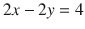
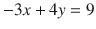
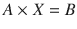
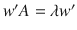
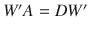
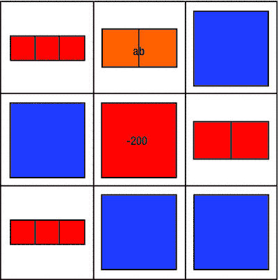

# 2. 基于数组的计算


## 2.1 引言

矩阵已成为处理大量数据的数值计算中不可或缺的一部分。对于二维矩阵，元素具有唯一的行索引和列索引，通过它们可以访问这些元素。行和列可以归属于正在研究的不同属性。例如，如果你测量正方形四个角点的温度和压力，与角点相关联的 `x`、`y` 坐标可以分配给行号和列号。现在，实验数据就可以简单地表示为一个矩阵。通过这种方式，你可以将两个属性的数据拟合成一个矩阵，然后使用这些矩阵进行数值计算。

举例来说，假设如果一种化合物是导体，则其行的一个元素定义为 `1`；如果是半导体，则为 `2`；如果是绝缘体，则为 `3`。那么，一个行向量（仅由一行组成的矩阵）`[1 0 0 3 2 1 3 0 1 0 3 2 1]` 包含了关于 13 种化合物的信息。在电导率实验中，这个行向量（一个 13×1 的矩阵）可以用作输入。这样，你需要以矩阵形式对系统进行建模，以便使用 MATLAB 求解。

MATLAB 定义了一个用于处理矩阵的数据对象，它们被称为 `数组`。通过使用该对象的不同属性，你可以定义各种类型的矩阵。用于矩阵运算的内置函数使得程序员能够更方便地处理大量数据，方法是将数据按所需格式排列成矩阵，并执行数组操作。本章探讨了定义和操作数组的各种选项。

由于 MATLAB 是为矩阵操作而设计的，它拥有大量内置函数和强大的环境来定义和处理矩阵。

## 2.2 数组与向量

变量名不仅可以指向单个数字，还可以指向一组连续的数字，这被称为`数组`。下面的示例展示了如何实现这一点：

```
>> a = [1,2,3,4,5]
a =
     1     2     3     4     5

>> a1 = [10,11,12,13,14]
a1 =
    10    11    12    13    14

>> matrix22 = [1,2;3,4]
matrix22 =
     1     2
     3     4

>> matrix33 = [1,2,3;4,5,6;7,8,9]
matrix33 =
     1     2     3
     4     5     6
     7     8     9

>> size(a)
ans =
     1     5

>> size(matrix22)
ans =
     2     2

>> size(matrix33)
ans =
     3     3
```

如示例代码所示，数组可以被理解为由行和列组成的矩阵。因此，你可以构造任意大小的矩阵。例如，`matrix22` 是一个 2×2 矩阵，`matrix33` 是一个 3×3 矩阵，而 `a` 是一个 1×5 矩阵。在定义大小时，列出的第一个数字表示行数，第二个数字表示列数。同样重要的是要注意，逗号（`,`）运算符用于定义同一行中的下一个元素，而分号（`;`）运算符则用于定义下一行/列中的元素。矩阵定义在类型为 `[]`（通常称为方括号）的括号内。

如果每行/每列中的元素数量不匹配，你会收到一条错误信息：

```
>> right33 = [1,2,3;4,5,6;7,8,9]
right33 =
     1     2     3
     4     5     6
     7     8     9

>> wrong33 = [2,3;4,5,6;7,8,9]
Dimensions of matrices being concatenated are
not consistent.

>> wrong33 = [1,2,3;4,5,6;8,9]
Dimensions of matrices being concatenated are
not consistent.
```

## 2.3 从其他数组创建数组

多维数组也可以从其他多维数组创建，如下所述：

```
>> a = [1,2,3;4,5,6]

a =
     1     2     3
     4     5     6

>> B = [(1:3);(4:6);(7:9)]

B =
     1     2     3
     4     5     6
     7     8     9

>> c = [a;B]

c =
     1     2     3
     4     5     6
     1     2     3
     4     5     6
     7     8     9

>> c = [a,B]
Error using horzcat
Dimensions of matrices being concatenated are not
consistent.
```

这里，矩阵 `a` 的第一行有元素 `1`、`2`、`3`。然后一个行分隔符（`;`）将下一行元素定义为 `4`、`5`、`6`。类似地，矩阵 `B` 的行由以下命令定义：

*   `(1 : 3)` 结果为 `(1, 2, 3)`
*   `(4 : 6)` 结果为 `(4, 5, 6)`
*   `(7 : 9)` 结果为 `(7, 8, 9)`

注意：MATLAB 变量名是区分大小写的，因此 `a` 不同于 `A`。通过垂直拼接矩阵 `a` 和 `B`，创建了一个名为 `c` 的新矩阵。结果矩阵 `c` 由 `a` 的元素堆叠在 `B` 的元素之上构成。命令 `c = [a, B]` 会产生错误，因为 `a` 和 `B` 的维度对于水平拼接来说不一致。

相反，在这个示例中，可以通过以下方式轻松执行水平拼接：

```
>> a = 1:3

a =
     1     2     3

>> A = [a,a]

A =
     1     2     3     1     2     3
```

对于多维数组，请使用以下代码：

```
>> a = 1:4

a =
     1     2     3     4

>> A = [a;a]

A =
     1     2     3     4
     1     2     3     4

>> AA = [A,A]

AA =
     1     2     3     4     1     2     3     4
     1     2     3     4     1     2     3     4
```

### 2.3.1 追加行和列

当需要追加矩阵的整行或整列时，只需考虑一件事——新矩阵的大小必须满足行和列的要求。例如，定义大小分别为 (2×2)、(1×2) 和 (2×1) 的数组 `A`、`B`、`D`。行矩阵 `B` 可以作为 `A` 的一行插入，列矩阵 `D` 可以作为 `A` 的一列插入，如下所示：

```
>> A = [1,2;3,4]

A =
     1     2
     3     4

>> B = [5,6]

B =
     5     6

>> size(A)
ans =
     2     2

>> size(B)
ans =
     1     2

>> C = [A;B]

C =
     1     2
     3     4
     5     6

>> size(C)
ans =
     3     2

>> D = [5;6]

D =
     5
     6

>> size(D)
ans =
     2     1

>> E = [A,D]

E =
     1     2     5
     3     4     6

>> size(E)
ans =
     2     3
```

### 2.3.2 删除矩阵的行和/或列

可以通过将空矩阵 `[]` 赋给它们来删除行和列。例如，`A(1,:) = []` 删除第一行，`A(:,1) = []` 删除矩阵的第一列，如下所示：

```
>> A = rand(3,3)

A =
    0.8147    0.9134    0.2785
    0.9058    0.6324    0.5469
    0.1270    0.0975    0.9575

>> A(1,:) = []

A =
    0.9058    0.6324    0.5469
    0.1270    0.0975    0.9575

>> A(:,1) = []

A =
    0.6324    0.5469
    0.0975    0.9575
```

### 2.3.3 沿某个维度拼接

可以使用 `cat(dim, A, B, ...)` 沿某个维度拼接两个矩阵，其中 `dim` 表示维度，`A` 和 `B` 是输入矩阵。其用法如下所示：

```
>> A = [1,2;3,4]
A =
     1     2
     3     4

>> B = [5,6;7,8]
B =
     5     6
     7     8

>> cat(1,A,B)
ans =
     1     2
     3     4
     5     6
     7     8

>> cat(2,A,B)
ans =
     1     2     5     6
     3     4     7     8

>> C = cat(3,A,B)
ans(:,:,1) =
     1     2
     3     4
ans(:,:,2) =
     5     6
     7     8

>> size(C)
ans =
     2     2     2
```

当在命令提示符下输入 `cat(1, A, B)` 时，`A` 和 `B` 按行拼接，而 `cat(2, A, B)` 则按列拼接。对于 `cat(3, A, B)`，会创建一个新矩阵，其第三维的第一个元素是矩阵 `A`，第二个元素是矩阵 `B`。


### 2.3.4 选择元素的数据类型

如第 1 章所述，数组的元素可以是任何数据类型。使用如下所示的命令，可以将数组的所有元素设置为特定的数据类型：

```
1  >> x = uint32([1,65535])
2  x =

4  1x2 uint32 行向量

6  1   65535

8  >> x = uint64([1,65535])
9  x =

11  1x2 uint64 行向量

13  1   65535

15  >> x = int16([1,65535])
16  x =

18  1x2 int6 行向量

20  1   32767

22  >> x = int32([1,65535])
23  x =

25  1x2 int32 行向量

27  1   65535

29  >> x = int64([1,65535])
30  x =

32  1x2 int64 行向量

34  1   65535

36  >> x = single([1,65535])
37  x =

39  1x2 single 行向量

41  1       65535

43  >> x = double([1,65535])
44  x =

46  1       65535

48  >> x = single([1.0,65535e10])
49  x =

51  1x2 single 行向量

53  1.0e+14*

55  0.0000    6.5535

57  >> x = double([1.0,65535e10])
58  x =

60  1.0e+14*

62  0.0000    6.5535
```

第 15 行显示，如果元素设置为`int16`，那么它最多能存储的最大值为 32767，即使命令要求存储更大的值也是如此。因此，预先了解元素的数据类型以避免数值计算中的错误变得至关重要。请记住，用更多位来存储非常小的数字是一种内存浪费。（第 46 行显示，数字 1 以双精度浮点数存储时，占用 64 位，其中除了最后一位，其余 63 位实际上都是零！）

## 2.4 数组的算术运算

对数组进行运算涉及两个方面：

- 对两个或多个数组进行运算
- 逐元素运算

所有算术运算符（如`+`、`-`、`*`、`/`、`%`、`^`等）在两种情况下都可以使用。当需要进行逐元素运算时，需要在运算符前加上一个`.`（点）。逐元素运算符就变成了`.+`、`.-`、`.*`、`./`、`.%`和`.^`。下面的示例会让这一点更加清晰。

```
1  >> a = [1,2;3,4]
2  a =

4  1    2
5  3    4

7  >> b = [5,6;7,8]
8  b =

10  5    6
11  7    8

13  >> a+b
14  ans =

16  6    8
17  10   12

19  >> 2.+a
20  ans =

22  3    4
23  5    6

25  >> –10.+b
26  ans =

28  –5   –4
29  –3   –2
```

当`a`和`b`是要相加/相减的矩阵时，其元素会与相同位置的元素进行相加/相减。因此，两个矩阵的大小必须相同。另一方面，当你写`2.+a`时，是将数字 2 逐一加到每个元素上。这可以忽略矩阵大小进行，并且统一应用于矩阵的所有元素。

## 2.5 内置函数

大量内置函数提供了计算数组属性以便快速计算的功能。这些包括：

- 使用`sum()`函数对所有元素求和。
- 使用`prod()`求数组所有元素的乘积。
- 使用`length()`求数组的长度。
- 使用`mean()`函数求数组元素的平均值。
- 使用数组的`max()`和`min()`查找元素中的最大值和最小值。
- 使用`find()`函数根据逻辑表达式查找特定元素。
- 取整函数如下：
  - 使用`fix()`函数将数组元素向零方向舍入为最接近的整数。
  - 使用`floor()`函数将数组元素向负无穷方向舍入为最接近的整数。
  - 使用`ceil()`函数将数组元素向正无穷方向舍入为最接近的整数。
  - 使用`round()`函数将数组元素舍入为最接近的整数。
- 使用`sort()`函数按升序或降序对数组元素进行排序。

它们的用法如下所示：

```
1  >> A = 1:5
2  A =
3  1     2     3     4     5
4  >> sum(A)
5  ans =
6  15
7  >> prod(A)
8  ans =
9  120
10  >> length(A)
11  ans =
12  5
13  >> mean(A)
14  ans =
15  3
16  >> max(A)
17  ans =
18  5
19  >> min(A)
20  ans =
21  1
22  >> find(A>4)
23  ans =
24  5
25  >> find(A> A= –1.1:0.5:1.1
29  A =
30  –1.1000   –0.6000   –0.1000   0.4000   0.9000
31  >> fix(A)
32  ans =
33  –1     0     0     0     0
34  >> floor(A)
35  ans =
36  –2    –1    –1     0     0
37  >> ceil(A)
38  ans =
39  –1    0      0     1     1
40  >> round(A)
41  ans =
42  –1   –1      0     0     1
43  >> A = [2,4.4,2,7,0,–2]
44  A =
45  2.0000    4.4000    2.0000    7.0000         0    –2.0000
46  >> sort(A,'ascend')
47  ans =
48  –2.0000        0    2.0000    2.0000    4.4000     7.0000
49  >> sort(A,'descend')
50  ans =
51  7.0000     4.4000   2.0000    2.0000         0    –2.0000
```

## 2.6 矩阵代数

矩阵的算术运算可分为两类：

- 代数运算（在第 2 章中介绍）
- 矩阵运算

### 2.6.1 矩阵的代数运算

矩阵的代数运算涉及逐元素运算。例如：

```
1  >> a = [1,2;3,4;5,6]
2  a =
3  1     2
4  3     4
5  5     6
6  >> a+2
7  ans =
8  3     4
9  5     6
10  7     8
```

注意，`a`定义了一个 3×2 矩阵，因此`a+2`命令对`a`与数字 2 进行逐元素加法。从计算角度讲，这是通过创建一个所有元素都为数字 2 的 3×2 矩阵，然后进行加法来实现的。

类似地，此处展示了其他一些运算：

```
1  >> 2*a
2  ans =
3  2     4
4  6     8
5  10    12
6  >> 2–a
7  ans =
8  1     0
9  –1    –2
10  –3    –4
11  >> a–2
12  ans =
13  –1    0
14  1     2
15  3     4
16  >> a/2
17  ans =
18  0.5000    1.0000
19  1.5000    2.0000
20  2.5000    3.0000
```

问题始于其他算术运算。例如，当我们想计算`a²`时，这意味着将`a`与自身相乘，即矩阵乘法。这要求要么矩阵是方阵，要么内部维度匹配，因为一个 n×m 维的矩阵只能与一个`m×t`维的矩阵相乘，结果矩阵的维度为`n×t`。因此，命令`a²`会导致错误信息，如下所示：

```
1  >> a²
2  使用 ^ 时出错
3  输入必须为标量和方阵。
4  要进行逐元素幂运算，请使用 POWER (.^)。
```

如果我们想要计算矩阵`a`的逐元素平方，那么`错误信息`的最后一行就派上用场了。在幂运算符（`.^`）前加一个点运算符，会指示 MATLAB 执行相同的逐元素运算。

```
1  >> a.²
2  ans =
3  1    4
4  9   16
5  25  36
```

另一方面，两个矩阵的乘法是矩阵代数的范畴，接下来讨论。

### 2.6.2 矩阵的矩阵运算

熟悉矩阵代数的人都知道，矩阵的乘法和除法并非直接了当的任务。一个`m×n`矩阵只能与一个`n×t`矩阵相乘，结果得到一个`a×c`矩阵。这是通过将行的元素与列的元素相乘来获得新元素来完成的。

```
1  >> a = rand(2,3)

3  a =

5  0.8147     0.1270    0.6324
6  0.9058     0.9134    0.0975

8  >> b = rand(3,4)

10  b =

12  0.2785     0.9649    0.9572    0.1419
13  0.5469     0.1576    0.4854    0.4218
14  0.9575     0.9706    0.8003    0.9157
15  >> c = rand(2,3)

17  c =

19  0.7922     0.6557    0.8491
20  0.9595     0.0357    0.9340

22  >> a.*c

24  ans =

26  0.6454     0.0833    0.5370
27  0.8691     0.0326    0.0911
```

这里，矩阵`a`、`b`和`c`使用`rand`函数（该函数生成 0 到 1 之间均匀分布的随机数）定义。现在，`a*b`执行矩阵乘法，而`a.*c`执行逐元素乘法。两者的要求如下：

- 对于矩阵乘法，内部维度必须匹配。
- 对于逐元素乘法，所有维度必须匹配。


好的，作为高级文档工程师和翻译员，我将遵循您提供的注意事项和示例，将给定的英文文本翻译成中文。


### 2.6.2 矩阵求逆与转置

#### 转置

单个井号标记（`'`），也称为撇号，用于转置矩阵（行变成列，列变成行）。对矩阵进行除法运算涉及矩阵求逆。

```
1  >> a

3  a =

5  1    2
6  3    4
7  5    6
8  >> pinv(a)
9  ans =

11  –1.3333    –0.3333    0.6667
12  1.0833     0.3333   –0.4167
13  >> b

15  b =

17  5    6
18  7    8
19  >> pinv(b)

21  ans =

23  –4.0000    3.0000
24  3.5000   –2.5000
```

#### 逆矩阵

矩阵 `a` 的逆矩阵，记为 `a^(-1)`，是一个满足如下条件的矩阵：

`a * a^(-1) = I`

其中 `I` 是单位矩阵。如果给定的矩阵是方阵，则可以使用函数 `inv()`；否则，使用函数 `pinv()`。示例如下：

```
1  >> a = [1,2;3,4;5,6]

3  a =

5  1     2
6  3     4
7  5     6

9  >> pinv(a)

11  ans =

13  –1.3333      –0.3333      0.6667
14  1.0833       0.3333     –0.4167

16  >> pinv(a)*a

18  ans =

20  1.0000     0.0000
21  –0.0000    1.0000

23  >> a = rand(5,5)

25  a =

27  0.9649    0.8003    0.9595    0.6787    0.1712
28  0.1576    0.1419    0.6557    0.7577    0.7060
29  0.9706    0.4218    0.0357    0.7431    0.0318
30  0.9572    0.9157    0.8491    0.3922    0.2769
31  0.4854    0.7922    0.9340    0.6555    0.0462

33  >> inv(a)

35  ans =

37   2.5545    –0.3119    –0.0173    –0.4492   –1.9962
38  –4.9167    –0.1095     0.8740     2.7919    2.5562
39   3.3797    –0.1001    –1.3938    –1.5253   –0.8910
40  –0.6203     0.4252     0.9340    –1.0120    1.2230
41  –2.0554     1.1445     0.1203     2.0420   –0.5531

43  >> a_pinv(a)

45  ans =

47   1.0000   –0.0000    0.0000   –0.0000   –0.0000
48   0.0000    1.0000   –0.0000   –0.0000    0.0000
49  –0.0000    0.0000    1.0000    0.0000    0.0000
50   0.0000   –0.0000   –0.0000    1.0000   –0.0000
51  –0.0000    0.0000    0.0000    0.0000    1.0000
```

`I` 被称为单位矩阵，因为它的所有对角元素都是 1，所有非对角元素都是 0，这使得它的行列式为 1。矩阵 `a` 的行列式使用命令 `det(a)` 计算。使用命令 `eye(a,b)` 可以自动生成单位矩阵，其中 `a` 和 `b` 分别是行数和列数的值。

```
1  >> eye(2,2)
2  ans =

4  1    0
5  0    1
6  >> det(eye(2,2))
7  ans =

9  1
10  >> eye(4,5)
11  ans =

13  1    0    0    0    0
14  0    1    0    0    0
15  0    0    1    0    0
16  0    0    0    1    0
```

#### rank()

矩阵的秩，即线性无关的行或列的数量，可以通过内置的 `rank()` 函数来确定。

```
1  a = ones(5,3)

3  a =

5  1    1    1
6  1    1    1
7  1    1    1
8  1    1    1
9  1    1    1

11  >> rank(a)

13  ans =

15  1

17  >> a = rand(3,2)

19  a =

21  0.4456    0.7547
22  0.6463    0.2760
23  0.7094    0.6797

25  >> rank(a)

27  ans =

29  2
```

### 2.6.3 trace()

矩阵对角元素之和称为矩阵的迹。这由内置的 `trace()` 函数给出，如下所示：

```
1  >> a = ones(4,4)

3  a =

5  1    1    1    1
6  1    1    1    1
7  1    1    1    1
8  1    1    1    1

10  >> trace(a)

12  ans =

14  4
```

#### norm()

`norm()` 函数计算矩阵的 2-范数，它等于向量的欧几里得长度。

```
1  >> A = [1,2;3,4;5,6]

3  A =

5  1     2
6  3     4
7  5     6

9  >> norm(A)

11  ans =

13  9.5255

15  >> A = [1,2,3]

17  A =

19  1     2     3

21  >> norm(A)

23  ans =

25  3.7417
```

#### 逻辑运算

两个矩阵可以逐元素地进行比较。

```
1  >> a = rand(2,3)

3  a =

5  0.6787    0.7431    0.6555
6  0.7577    0.3922    0.1712

8  >> b = rand(2,3)

10  b =

12  0.7060    0.2769    0.0971
13  0.0318    0.0462    0.8235

15  >> c = (a< b)

17  c =

19  1    0    0
20  0    0    1

22  >> whos
24  Name      Size            Bytes    Class     Attributes

26  a         2x3                48    double
27  b         2x3                48    double
28  c         2x3                 6    logical
29  >> a+c

31  ans =

33  1.6787   0.7431   0.6555
34  0.7577   0.3922   1.1712
```

矩阵 `c` 的元素为 1 或 0，通过判断 `a` 的对应元素是否小于 `b` 来赋值。注意，使用 `whos` 命令，我们可以探查变量 `a`、`b` 和 `c`。矩阵 `c` 包含逻辑数据类型，即 1 和 0 代表布尔量 `True` 和 `False`。但是执行 `a+c` 操作会将其视为数值。这种特性可能导致错误计算，因此一些编程语言（如 Python）明确使用 `True` 和 `False` 来表示布尔值，而不是 1 和 0。

### 2.6.4 多项式与数组

每个矩阵都有一个与之关联的特征多项式。它可以使用 `poly()` 函数找到。让我们看一个例子：

```
1  >> A1 = [–3 2 0 4]

3  A1 =

5  –3     2     0     4

7  >> B1 = poly(A1)

9  B1 =

11  1    –3    –10    24    0

13  >> A2 = [1,2;3,4]

15  A2 =

17  1    2
18  3    4

20  >> B2 = poly(A2)

22  B =

24  1.0000    –5.0000    –2.0000
```

在第一个例子中，得到的多项式（由 `B1` 给出）是 `x⁴ - 3x³ - 10x² + 24x`，而在第二个例子中（由 `B2` 给出），是 `x² - 5x - 2`。结果矩阵呈现了特征多项式的系数。

#### find()

内置函数 `find()` 返回矩阵中非零元素的行和列索引。例如，在由 `A = [1,0;0,2]` 定义的 2×2 矩阵中，非零元素位于 `A(1,1)` 和 `A(2,2)`。此处展示了作为向量的行和列信息：

```
1  >> A = [1,0;0,2]

3  A =

5  1    0
6  0    2

8  >> [row,col,v]=find(A)

10  row =

12  1
13  2

16  col =

18  1
19  2

22  v =

24  1
25  2
```

#### sort()

内置函数 `sort()` 可用于按特定顺序对每列的元素进行排序。顺序可以作为函数的第二个参数以字符串形式指定（`ascend` 或 `descend`）。

```
1  >> A = [1,–2,3;4,5,–2;0,–2,3]

3  A =

5  1    –2    3
6  4     5   –2
7  0    –2    3

9  >> sort(A)

11  ans =

13  0    –2    –2
14  1    –2     3
15  4     5     3

17  >> sort(A,'ascend')

19  ans =

21  0    –2    –2
22  1    –2     3
23  4     5     3

25  >> sort(A,'descend')

27  ans =

29  4    5    3
30  1   –2    3
31  0   –2   –2
```


```markdown

## 2.7 随机矩阵

使用随机数生成器可以创建随机矩阵。使用 `rand(a,b)` 命令：

```
>> rand(4,5)
ans =

Columns 1 through 4

0.8147    0.6324    0.9575    0.9572
0.9058    0.0975    0.9649    0.4854
0.1270    0.2785    0.1576    0.8003
0.9134    0.5469    0.9706    0.1419

Column 5

0.4218
0.9157
0.7922
0.9595
```

请注意，即使是同一台机器，每次生成的数字也会不同，因为它们本质上是随机的。默认情况下，它们均匀分布在区间 (0, 1) 内。一个向量简单来说就是一个行向量，因此可以使用 `rand(a)` 命令随机生成。`help rand` 提供了随机数生成器其他各种功能和参数的详细描述。

要创建随机整数，可以使用 `randi()` 函数。你还可以为这些随机整数指定一个范围。例如，`randi([1,10],1,5)` 将创建 5 个在 1 到 10 之间的随机整数（一个 1×5 的数组）。另一方面，`randi([1,10],5)` 将创建一个在 1 到 10 之间的随机整数数组（一个 5×5 的数组）。

```
>> randi([1,10],5)

ans =

5    3    5    8    10
5    7   10    3     6
7    7    4    6     2
8    2    6    7     2
8    2    3    9     3

>> randi([1,10],1,5)

ans =

9    3    9    3    10
```

可以使用 `rand` 命令生成一个随机复数，如下所示：

```
>> rand + i* rand

ans =

0.3500 + 0.1966i

>> rand + i* rand

ans =

0.2511 + 0.6160i
```

有时，你可能希望每次程序执行时生成相同的随机数集。这可以通过使用 `rng` 命令设置随机数函数的状态来实现，如下所示：

```
>> state1 = rng;
>> r1 = rand(2,3)

r1 =

0.4733    0.8308    0.5497
0.3517    0.5853    0.9172

>> r12 = rand(2,3)

r12 =

0.2858    0.7537    0.5678
0.7572    0.3804    0.0759

>> rng(s);
未定义函数或变量 's'。

>> rng(state1);
>> r3 = rand(2,3)

r3 =

0.4733    0.8308    0.5497
0.3517    0.5853    0.9172
```

状态被保存在 `state1` 变量中，然后 `r1` 和 `r2` 创建了两个 2×3 大小的数组。它们包含不同的元素。但是，当使用 `rng(state1)` 重置状态时，存储在 `r3` 中的相同大小的新数组与 `r1` 完全相同，而 `r1` 是在机器状态保存到 `state1` 变量时创建的。

正态分布的随机数生成器由函数 `randn()` 提供。这样生成的随机数在 0 附近呈正态分布。第 3 章的图 3-7 证实了这一事实。

可以通过为每个维度输入一个数组来生成三维随机数数组。例如，如果将数组 `A = [3,2,4]` 输入到 `rand()` 函数中，则会创建一个三维随机数数组，如下所示：

```
>> A = [3,2,4];
>> B = rand(A)

B(:,:,1) =

0.7482    0.2290
0.4505    0.9133
0.0838    0.1524

B(:,:,2) =

0.8258    0.0782
0.5383    0.4427
0.9961    0.1067

B(:,:,3) =

0.9619    0.8173
0.0046    0.8687
0.7749    0.0844

B(:,:,4) =

0.3998    0.4314
0.2599    0.9106
0.8001    0.1818

>> size(B)

ans =

3    2    4
```

### 2.7.1 矩阵操作

一些常见的矩阵操作已经以函数形式编写，这使得开发人员能够直接使用它们，而不必将时间花在编写最优代码上。

### 2.7.2 翻转矩阵

`flipud(A)` 返回矩阵 `A` 的一个副本，其行的顺序沿水平轴反转。`flipud` 代表上下翻转。`fliplr(A)` 返回矩阵 `A` 的一个副本，其行的顺序从左到右反转。`fliplr` 代表左右翻转。

```
>> a = [1 2; 3 4; 5 6]
a =

1    2
3    4
5    6

>> fliplr(a)
ans =

2    1
4    3
6    5

>> flipud(a)
ans =

5    6
3    4
1    2
```

### 2.7.3 旋转矩阵

使用命令 `rot90(a,n)`，你可以将矩阵 `a` 按 90 度旋转 `n` 次。

```
>> a = [1 2; 3 4; 5 6]
a =

1    2
3    4
5    6

>> rot90(a,1)
ans =

2    4    6
1    3    5

>> rot90(a,2)
ans =

6    5
4    3
2    1

>> rot90(a,4)
ans =

1    2
3    4
5    6
```

### 2.7.4 重塑矩阵

只要元素总数保持不变，可以更改矩阵的行数和列数。

```
>> a = [1 2; 3 4; 5 6]
a =

1    2
3    4
5    6

>> reshape(a,6,1)
ans =

1
3
5
2
4
6

>> reshape(a,4,1)
Error using reshape
要执行 RESHAPE，元素的数目必须不变。
```

### 2.7.5 排序

可以使用 `sort` 函数按升序对数字进行排序：

```
>> a = rand(1,5)
a =

0.7431    0.3922    0.6555    0.1712    0.7060

>> sort(a)
ans =

0.1712    0.3922    0.6555    0.7060    0.7431
```

### 2.7.6 上三角矩阵和下三角矩阵

上三角矩阵是指只有对角线及其上方的元素非零的矩阵。类似地，下三角矩阵是指只有对角线及其下方的元素非零的矩阵。

```
>> a = rand(3,3)
a =

0.0318    0.0971    0.3171
0.2769    0.8235    0.9502
0.0462    0.6948    0.0344

>> tril(a)
ans =

0.0318    0         0
0.2769    0.8235    0
0.0462    0.6948    0.0344

>> triu(a)
ans =

0.0318    0.0971    0.3171
0         0.8235    0.9502
0         0         0.0344
```

### 2.7.7 全 1 矩阵和全 0 矩阵

所有元素都是 1 或 0 的矩阵分别构成全 1 矩阵和全 0 矩阵：

```
>> ones(3,3)
ans =

1    1    1
1    1    1
1    1    1

>> zeros(3,3)
ans =

0    0    0
0    0    0
0    0    0
```

## 2.8 索引

矩阵的每个元素由两个数字表示：行号和列号。这用于精确定位一个元素并对其进行操作。

```
>> a = rand(2,3)
a =

0.6557    0.8491    0.6787
0.0357    0.9340    0.7577

>> a(2,3)=1
a =

0.6557    0.8491    0.6787
0.0357    0.9340    1.0000

>> a(1,1)=0
a =

0         0.8491    0.6787
0.0357    0.9340    1.0000
```

请注意，`a(2,3)=1` 将第二行第三列的元素，即数字 0.3041072 设置为 1，而 `a(1,1)=0` 将第一行第一列的元素，即数字 0.5248873 设置为 0。要对向量中的元素进行索引，只需要一个数字。

```
>> a = [1,2,3,4,5,6,7,8,9]
a =

Columns 1 through 7

1    2    3    4    5    6    7

Columns 8 through 9

8    9

>> a(1)
ans =

1

>> a(–1)
下标索引必须为正整数类型或逻辑类型。

>> a(5)
ans =

5

>> a(10)
索引超出矩阵维度。
```

需要特别注意的是，与某些从 0 开始索引的编程语言不同，MATLAB 的索引从 1 开始，并且不接受负数作为索引。

### 2.8.1 使用索引创建新向量

```
>> a = [10 20 30 40 50 60]
a =

10   20   30   40   50   60

>> b = a([1 3 6 1])
b =

10   30   60   10
```

在上一个示例中，`b` 是由向量 `a` 形成的新向量，其连续元素由取自索引向量 `[1 3 6 1]` 的元素组成。

```
>> a = [11,12,13;40,50,60;17,18,19]
a =

11    12    13
40    50    60
17    18    19

>> a([1,2], [2,3])
ans =

12    13
50    60
```

请注意，由于逗号运算符是可选的，因此我们将仅使用空格来定义向量和矩阵。

```


## 2.9 切片

通过使用索引和冒号`:`运算符，可以将矩阵切片成所需的部分。

```
1  >> a = [1 2 3 4 1 3 2 4 6 4 5]
2  a =

4  第 1 至 7 列

6  1    2    3    4    1    3    2

8  第 8 至 11 列

10  4     6     4     5

12  >> b =a(1:5)
13  b =

15  1   2   3   4   1

17  >> c = a(5:7)
18  c =

20  1    3    2
```

这是一个重要特性，因为大多数实验计算都需要对数据进行筛选。在这里，数据的一个切片会被单独存储到一个变量中，然后可以对其执行各种数学运算。

现在让我们尝试访问一个多维数组的切片。定义一个 5×5 的矩阵 `a`。

*   要访问单个元素，我们使用行和列的索引值。例如，`b = a(1,1)` 访问第一行第一列中的元素。
*   要访问某一行或某一列的所有元素，可以使用 `:` 运算符。因此，`c = a(1,:)` 访问第一行的所有元素。类似地，`>> d = a(:,1)` 访问第一列的所有元素。用语言简单记忆的方法是：将冒号 (`:`) 读作“所有元素，然后第 n 行/列”，其中 n 是一个给定值。
*   使用 `a(:)`，可以创建一个包含所有元素的新列矩阵。
*   可以通过先定义列/行的所有元素，再在方括号中定义索引来访问子矩阵。例如，`f = a(:,[1,3])` 定义了一个新矩阵，其元素由第一列和第三列的所有元素组成。类似地，`a([1,3],:)` 使用第一行和第三行的所有元素。

```
1  >> a = rand(5,5)

3  a =

5  0.6948    0.3816    0.4456    0.6797    0.9597
6  0.3171    0.7655    0.6463    0.6551    0.3404
7  0.9502    0.7952    0.7094    0.1626    0.5853
8  0.0344    0.1869    0.7547    0.1190    0.2238
9  0.4387    0.4898    0.2760    0.4984    0.7513

11  >> b = a(1,1)

13  b =

15  0.6948
16  >> c = a(1,:)

18  c =

20  0.6948    0.3816    0.4456    0.6797    0.9597

22  >> d = a(:,1)

24  d =

26  0.6948
27  0.3171
28  0.9502
29  0.0344
30  0.4387
31  >> e = a(:)

33  e =

35  0.6948
36  0.3171
37  0.9502
38  0.0344
39  0.4387
40  0.3816
41  0.7655
42  0.7952
43  0.1869
44  0.4898
45  0.4456
46  0.6463
47  0.7094
48  0.7547
49  0.2760
50  0.6797
51  0.6551
52  0.1626
53  0.1190
54  0.4984
55  0.9597
56  0.3404
57  0.5853
58  0.2238
59  0.7513
60  >> f = a(:,[1,3])

62  f =

64  0.6948    0.4456
65  0.3171    0.6463
66  0.9502    0.7094
67  0.0344    0.7547
68  0.4387    0.2760
69  >> g= a([1,3],:)

71  g =

73  0.6948    0.3816    0.4456    0.6797    0.9597
74  0.9502    0.7952    0.7094    0.1626    0.5853
```

你可以使用这种强大的方式来定义你选择的元素，从而组成复杂的子矩阵。

```
1  >> a = rand(5,6)

3  a =

5  0.3510    0.1233    0.9027    0.9001    0.2417    0.9561
6  0.5132    0.1839    0.9448    0.3692    0.4039    0.5752
7  0.4018    0.2400    0.4909    0.1112    0.0965    0.0598
8  0.0760    0.4173    0.4893    0.7803    0.1320    0.2348
9  0.2399    0.0497    0.3377    0.3897    0.9421    0.3532

11  >> b = a([2,5],1:3)

13  b =

15  0.5132    0.1839    0.9448
16  0.2399    0.0497    0.3377
17  >> c = a(2:5,[1,3])

19  c =

21  0.5132    0.9448
22  0.4018    0.4909
23  0.0760    0.4893
24  0.2399    0.3377
25  >> d = a([2,5],[1,3])

27  d =

29  0.5132    0.9448
30  0.2399    0.3377
31  >>e = a(2:5,1:3)

33  e=

35  0.5132    0.1839    0.9448
36  0.4018    0.2400    0.4909
37  0.0760    0.4173    0.4893
38  0.2399    0.0497    0.3377
```

我们定义一个新的 5×5 矩阵 `a`，然后使用 `a([2,5],1:3)` 定义该矩阵的一个子集，这表示：从第二行和第三行中，取第一列到第三列的元素。类似地，`c = a(2:5,[1,3])` 根据以下逻辑创建一个矩阵：从第一列和第五列中，取第二行到第三行的元素。现在你可以很容易地猜到 `a([2,5],[1,3])` 和 `a(2:5,1:3)` 的功能。强烈建议认真练习数组切片，因为这通常是数据清洗和数据分析中最不可或缺的技能之一。

## 2.10 数组的自动生成

MATLAB 提供了多种方法，可以根据指定规则自动生成数字数组。以下各节将讨论三种方法。

### 2.10.1 `:` 运算符

`:` 运算符是 MATLAB 中最有用的运算符之一，很容易掌握。你已经在第 2 章中看到了它在选择子矩阵时的用法。

```
1  >> help:
2  :  冒号。
3  J:K 等同于 [J,J+1,...,J+m]，其中 m = fix(K–J)。当 J 和 K 都是整数时，
4  这简化为 [J,J+1,...,K]。如果 J>K，则此语法返回一个空矩阵。

7  J:I:K 等同于 [J,J+I,...,J+m_I]，其中 m = fix((K–J)/I)。
8  当 I == 0，或 I>0 且 J>K，或 I<0 且 J<K 时，此语法返回一个空矩阵。

11  colon (J,K) 等同于 J:K，colon (J,I,K) 等同于 J:I:K。

13  冒号表示法可用于挑选出向量、矩阵和数组的选定行、列和元素。
14  A(:) 是 A 的所有元素，被视为单个列。在赋值语句的左侧，
15  A(:) 填充 A，保持其先前的形状。
16  A(:,J) 是 A 的第 J 列。
17  A(J:K) 是 [A(J),A(J+1),...,A(K)]。
18  A(:,J:K) 是 [A(:,J),A(:,J+1),...,A(:,K)]，以此类推。

20  冒号表示法可用于元胞数组以生成逗号分隔的列表。
21  C{:} 等同于 Cf1g,Cf2g,...,Cfendg。
22  逗号分隔列表语法在 ()（用于函数调用）、[]（用于连接和函数返回参数）
23  以及 {} 内（用于生成元胞数组）有效。像 S(:).name 这样的表达式会为结构体 S
24  生成逗号分隔的列表 S(1).name,S(2).name,...,S(end).name。

27  关于冒号在 FOR 语句中的使用，请参见 FOR。
28  关于冒号在逗号分隔列表中的使用，请参见 VARARGIN。

30  关于 colon 的参考页
31  其他名为 colon 的函数
```

你可以使用 `start:step:stop` 命令生成一系列数字，并将它们存储为数组。

```
1  >> a=1:1:10
2  a =

4  第 1 至 7 列

6  1    2    3    4    5    6    7

8  第 8 至 10 列

10  8    9    10

12  >> a =[1:1:10]
13  a =

15  第 1 至 7 列

17  1    2    3    4    5    6    7

19  第 8 至 10 列

21  8    9    10
```

请注意，这里的括号（`[]`）是可选的。如果未定义步长，则默认为 1。

```
1  >> a=1:10
2  a =

4  第 1 至 7 列

6  1    2    3    4    5    6    7

8  第 8 至 10 列

10  8    9    10

12  >> a=1:2:10

14  a =

16  1    3    5    7    9
```

### 2.10.2 线性间距向量

`linspace(start, stop, n)` 命令生成一个数组，从第一个数字开始，到第二个数字结束，总共包含 n 个数字。因此，它们是线性间隔的。

```
1  >> a = linspace(1,2,5)
2  a =

4  第 1 至 4 列

6  1.0000    1.2500    1.5000    1.7500

8  第 5 列

10  2.0000

12  >> a = linspace(1,2,10)
13  a =

15  第 1 至 4 列

17  1.0000    1.1111    1.2222    1.3333

19  第 5 至 8 列

21  1.4444    1.5556    1.6667    1.7778

23  第 9 至 10 列

25  1.8889    2.0000
```


好的，作为一名高级文档工程师和翻译员，我将严格遵循您提供的注意事项和示例格式，对给定的英文文本进行准确翻译。


### 2.10.3 `logspace`

与`linspace`命令类似，`logspace(start, stop, n)`从`start`到`stop`生成`n`个在数值上呈对数均匀分布的数。

```
1  >>> help logspace
2  logspace Logarithmically spaced vector.
3  logspace(X1,X2) generates a row vector of 50 logarithmically
4  equally spaced points between decades 10^X1 and 10^X2. If X2
5  is pi, then the points are between 10^X1 and pi.
6
7  logspace(X1,X2,N) generates N points.
8  For N = 1, logspace returns 10^X2.
9
10  Class support for inputs X1,X2:
11  float:double, single
12
13  See also linspace, colon.
14
15  Reference page for logspace
16  >>>logspace (1,5,10)
17
18  ans =
19
20  1.0e+05 *
21
22  Columns 1 through 4
23
24  0.0001    0.0003    0.0008    0.0022
25
26  Columns 5 through 8
27
28  0.0060    0.0167    0.0464    0.1292
29
30  Columns 9 through 10
31
32  0.3594    1.0000
```

## 2.11 求解方程组

求解一个方程组只需一行代码，使用`\`运算符。假设需要求解以下方程组：



(Equation 2-1)



(Equation 2-2)

你可以在矩阵中定义此问题，如下所示：

![ $$ \left[\begin{array}{cc}2& -2\\ {}-3& 4\end{array}\right]\times \left[\begin{array}{c}x\\ {}y\end{array}\right]=\left[\begin{array}{l}4\\ {}9\end{array}\right] $$ ](A458923_1_En_2_Chapter_Equ3.gif)

(Equation 2-3)

假设：

![ $$ A=\left[\begin{array}{cc}2& -2\\ {}-3& 4\end{array}\right] $$ ](A458923_1_En_2_Chapter_Equ4.gif)

(Equation 2-4)

![ $$ X=\left[\begin{array}{l}x\\ {}y\end{array}\right] $$ ](A458923_1_En_2_Chapter_Equ5.gif)

(Equation 2-5)

![ $$ B=\left[\begin{array}{l}4\\ {}9\end{array}\right] $$ ](A458923_1_En_2_Chapter_Equ6.gif)

(Equation 2-6)

这样，你可以写成：



(Equation 2-7)

解由`X = A^(-1)B`给出。你可以计算`A`的逆矩阵（使用`inv()`或`pinv()`函数），然后将结果矩阵与`B`给出的矩阵相乘来求解。或者，你可以仅用一个命令`A\B`完成此任务：

```
1  >> A = [2,–2;–3,4]
2
3  A =
4
5  2   –2
6  –3    4
7
8  >> B = [4;9]
9
10  B =
11
12  4   9
13
14  >> C = A/B
15
16  ans =
17
18  17.0000
19  15.0000
```

因此，解为`x = 17`和`y = 15`。由于`C`矩阵的元素就是解，这通常被称为解矩阵。

## 2.12 特征值与特征向量

特征值问题是确定方程`Av = λv`的解，其中`A`是一个`n × n`矩阵，`v`是一个长度为`n`的列向量，`λ`是一个标量。满足方程的`λ`值称为特征值。满足方程的对应`v`值称为右特征向量。左特征向量`w`满足方程。MATLAB 函数`eig()`返回特征值和特征向量。它还给出与`W`和`A`相关的对角矩阵`D`（特征值的对角矩阵），关系为：

```
1  >> A = rand(3,3)
2
3  A =
4
5  0.6551    0.4984    0.5853
6  0.1626    0.9597    0.2238
7  0.1190    0.3404    0.7513
8
9  >> [V,D,W] = eig(A)
10
11  V =
12
13  –0.7284   –0.9532   0.8945
14  –0.5300   0.2997    –0.4178
15  –0.4341   0.0411    0.1590
16
17
18  D =
19
20  1.3665        0             0
21  0             0.4732        0
22  0             0             0.5264
23
24
25  W =
26
27  –0.2724    –0.3066    –0.1266
28  –0.7915    –0.3145    –0.5186
29  –0.5471    0.8984     0.8456
```

## 2.13 结构体数组

数组存储相同数据类型的元素，而结构体数组可以存储不同数据类型的数据。结构体是按命名字段组织的数据集合。例如，一个字段可能包含文本数据，另一个包含数字，第三个可能是一个数组，等等。单个结构体是一个`1-by-1`的结构体数组。让我们通过一个示例来理解如何创建它们。让我们为这本书创建一个结构体数组，并将该数组命名为`book`。现在，可以使用点运算符添加各种字段，例如`name`、`author`、`pages`和`chapters`。`book`数组是一个`1-by-1`的结构体，包含四个字段。这里演示了这一点。

```
1  >> book.name = 'Introducing MATLAB'
2
3  book =
4
5  struct with fields:
6
7  name:'Introducing MATLAB'
8
9  >> book.author = 'Sandeep Nagar'
10
11  book =
12
13  struct with fields:
14
15  name:'Introducing MATLAB'
16  author:'Sandeep Nagar'
17
18  >> book.pages = '175'
19
20  book =
21
22  struct with fields:
23
24  name:'Introducing MATLAB'
25  author:'Sandeep Nagar'
26  pages:'175'
27
28  >> book.chapters = [1 2 3 4 5 6 7]
29
30  book =
31
32  struct with fields:
33
34  name:'Introducing MATLAB'
35  author:'Sandeep Nagar'
36  pages:'175'
37  chapters:[1 2 3 4 5 6 7]
```

### 2.13.1 在结构体数组中定义新的结构体元素

可以使用索引值在现有结构体数组（本例中为`book`）中定义一个新的结构体元素，方式如下。

```
1  >> book(2).name = 'Introducing SCILAB'
2
3  book =
4
5  1x2 struct array with fields:
6
7  name
8  author
9  pages
10  chapters
11
12  >> book(2).author = 'Sandeep Nagar'
13
14  book =
15
16  1x2 struct array with fields:
17
18  name
19  author
20  pages
21  chapters
22
23  >> book(2).pages = 175
24
25  book =
26
27  1x2 struct array with fields:
28
29  name
30  author
31  pages
32  chapters
33
34  >> book(2).chapters = [1 2 3 4 5 6 7 8 9]
35
36  book =
37
38  1x2 struct array with fields:
39
40  name
41  author
42  pages
43  chapters
```

这样，`book`现在是一个`1×2`的结构体数组。一个结构体数组中的所有结构体都具有相同数量的字段，并且所有字段都具有相同数量的字段名。当在命令提示符下输入结构体数组的名称时，会显示信息和字段的摘要。可以使用`fieldnames()`函数获取包含字段信息的元胞数组。这在以下代码中进行了演示。

```
1  >> book
2
3  book =
4
5  1x2 struct array with fields:
6
7  name
8  author
9  pages
10  chapters
11
12  >> fieldnames(book)
13
14  ans =
15
16  4x1 cell array
17
18  'name'
19  'author'
20  'pages'
21  'chapters'
```

在扩展结构体数组时，不必填写所有字段。未关联值的字段将保留为空。

### 2.13.2 添加和删除字段

可以在任何时候向单个结构体添加新字段。例如，让我们向`book`结构体添加`publisher`字段，如下所示。

```
1  >> book(2).publisher = 'Apress'
2
3  book =
4
5  1x2 struct array with fields:
6
7  name
8  author
9  pages
10  chapters
11  publisher
12
13  >> book
14
15  book =
16
17  1x2 struct array with fields:
18
19  name
20  author
21  pages
22  chapters
23  publisher
24
25  >> book = rmfield(book,'publisher')
26
27  book =
28
29  1x2 struct array with fields:
30
31  name
32  author
33  pages
34  chapters
```

要从`book`结构体中删除某个字段（例如`publisher`），可以使用`rmfield()`函数，如演示所示。


### 2.13.3 `struct()`

函数 `struct()` 也可以用来定义结构体数组，语法如下方代码所示：

```
1  >> book1 = struct('name','Introducing MATLAB','author','Sandeep Nagar','pages',175,'chapters',[1, 2, 3, 4, 5, 6, 7])

3  book1 =

5  struct with fields:

7  name:'Introducing MATLAB'
8  author:'Sandeep Nagar'
9  pages:175
10  chapters:[1 2 3 4 5 6 7]

12  >> book1(2) = struct('name','Introducing python','author',
'Sandeep Nagar','pages',175,'chapters',[1, 2, 3, 4, 5, 6, 7, 8, 9])

14  book1 =

16  1x2 struct array with fields:

18  name
19  author
20  pages
21  chapters
```

一个新结构体`book1`被创建，其中字段名和值被依次填充。可以通过类似的方式使用索引号对其进行扩展，使其成为一个`1-by-2`的结构体数组。

一个结构体数组可以包含另一个结构体，甚至是一个结构体数组作为其字段。这些被称为嵌套数组。这里演示了如何将`book1`（先前定义的结构体数组）作为新字段添加到结构体数组`book`中。

```
1  >> book(3).linked book = book1

3  book =

5  1x3 struct array with fields:

7  name
8  author
9  pages
10  chapters
11  linked_book
```

## 2.14 从结构体数组中获取数据

可以使用索引号从结构体数组中赋值数据，如下所示。这里，`info1`存储了第二个结构体（由语法`book(2)`表示）的字段`name`的值。类似地，`info2`存储了第一个结构体（由语法`book(1)`表示）的字段`name`的值。变量`info3`从结构体数组`book`的第二个结构体中提取了字段`chapter`的第三个元素。

```
1  >> info1 = book(2).name()

3  info1 =

5  'Introducing SCILAB'

7  >> info2 = book(1).name()

9  info1 =

11  'Introducing MATLAB'

13  info3 = book(2).chapters(3)

15  info3 =

17  3
```

## 2.15 元胞数组

元胞数组是由元胞组成的数组，其中每个元胞存储一个数组。在一个元胞内，元素必须是相同类型（因为元胞存储数组），但两个元胞可以有不同的类型。例如，假设你有三个数组：`array1`（存储数值）、`array2`（存储文本值）和`array3`（存储数值）。然后你可以使用这三个数组构建一个元胞数组。这个元胞数组的元素存储不同类型的数组，但每个元素只存储一种类型的数据。

### 2.15.1 创建元胞数组

函数`cell(m,n)`创建一个大小为`m`×`n`的空元胞数组。通过向这个空元胞数组赋值，可以按需一次一个元胞地构建它。首先创建一个由变量`a`引用的空元胞数组。有两种赋值数据的方法：

*   **元胞索引**：元胞索引写在圆括号`()`内，元胞内容写在花括号`{}`内，位于赋值运算符的两侧，如下所示：
    ```
    1  >> a = cell(3,3)

    3  a =

    5  3x3 cell array

    7  []    []    []
    8  []    []    []
    9  []    []    []

    11  >> a(1,1) = ([1,2,3]);
    12  >> a(1,2) = (['a','b']);
    13  >> a(1,3) = ("Sandeep");
    14  >> a(2,3) = ([1.5,–2]);
    15  >> a(2,2) = ([–200]);
    16  >> a(2,1) = (["Nagar"]);
    17  >> a(3,1) = ([–10,–15.5,5.3]);
    18  >> a(3,2) = (["Hello"]);
    19  >> a(3,3) = (["World"])

    21  a =

    23  3x3 cell array

    25  [1x3 double]    'ab'           ["Sandeep"]
    26  ["Nagar"]       [–200]         [1x2 double]
    27  [1x3 double]    ["Hello"]      ["World"]

    ```

*   **内容索引**：这里，花括号/圆括号的使用顺序相反，即`()`用于内容，`[]`用于索引。
    ```
    1  >> a = cell(3,3)

    3  a =

    5  3x3 cell array

    7  []    []    []
    8  []    []    []
    9  []    []    []

    11  >> a {1,1} = ([1,2,3]);
    12  >> a {1,2} = (['a','b']);
    13  >> a {1,3} = ("Sandeep");
    14  >> a {2,3} = ([1.5,–2]);
    15  >> a {2,2} = ([–200]);
    16  >> a {2,1} = (["Nagar"]);
    17  >> a {3,1} = ([–10,–15.5,5.3]);
    18  >> a {3,2} = (["Hello"]);
    19  >> a {3,3} = (["World"])

    21  a =

    23  3x3 cell array

    25  [1x3 double]    'ab'         ["Sandeep"]
    26  ["Nagar"]       [–200]       [1x2 double]
    27  [1x3 double]    ["Hello"]    ["World"]

    ```

### 2.15.2 `celldisp()` 和 `cellplot()` 函数

构建好的元胞数组可以通过两个函数`celldisp()`和`cellplot()`来显示。`celldisp()`命令显示完整的元胞内容，而`cellplot()`则显示元胞架构的图形化表示。见图 2-1。



图 2-1 `cellplot(a)`的输出

### 2.15.3 `cell2struct()`, `num2cell()`, 和 `struct2cell()` 函数

`cell2struct()`命令可用于将元胞数组转换为结构体。类似地，`num2cell()`可用于将数值数组转换为元胞数组，而`struct2cell()`可用于将结构体转换为元胞数组。

## 2.16 总结

基于数组的计算是现代计算技术的核心。MATLAB 提供了一个非常合适的平台来轻松执行这项技术。各种预定义函数使用户能够在原型设计问题时节省时间。拥有灵活的方法来定义多维数组并执行快速计算是我们这个时代的必需品。大多数仿真时间要么花在循环中，要么花在数组操作上。预定义的数组操作已经过算法优化，以实现可靠性、节省时间和高效的内存管理。

