# 3. 绘图

## 3.1 引言

没有可视化，数值计算难以评估。生成能够提供数值结果有意义分析的复杂图形的出版级图像，一直是全世界科学家面临的挑战。许多商业软件程序在满足这一需求方面非常成功。MATLAB 也提供了这一功能。其绘图特性包括：从各种 2D 和 3D 图形类型中选择，通过添加额外信息（如标题、带标签的坐标轴、网格和数据标签）来增强图形，以及书写关于数据的方程式和其他重要信息。最重要的特性是，图形可以以编程方式定义，即你可以使用计算机程序输入绘图数据。这与手动输入数据截然不同。

其中一个优势是，你可以使用各种函数来定义数据。另一个优势是，当数据有大量条目时，可以按照支配计算机程序的规则来输入。以下各节将详细描述这些操作。

值得一提的是，绘图能力对于机器学习实验至关重要，因为从渐进步骤中获得的视觉指引能让你直观地理解所考虑的问题。

### 3.1.1 2D 绘图

#### `plot(x, y)`

由于绘图需要两个轴的数据，因此首先需要创建图形。假设本示例中 `x` 轴有 100 个线性间隔的数据点，在其上定义了 `y = x²`。请参见图 3-1。

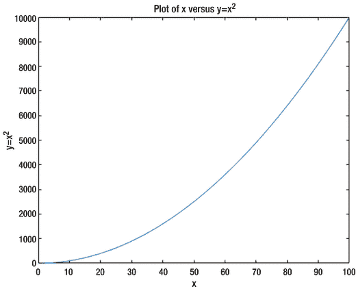

图 3-1：`y = x²` 图

```matlab
1  >> x = linspace(0,100,100);
2  >> y=x.ˆ2;
3  >> plot(x,y)
4  >> xlabel('x')
5  >> ylabel('y=xˆ{2}')
6  >> title('Plot of x versus y=xˆ{2}')
```

首先，我们定义一个变量 `x`，并将 0 到 100 之间 100 个等间距的数据点放入其中。这会创建一个 1×100 的矩阵。利用标量的指数运算，我们定义变量 `y` 为 `y = x²`。然后使用 `plot()` 函数，该函数接受两个参数，分别作为 `x` 轴和 `y` 轴的数据点。在命令提示符下输入 `help plot` 可以深入了解这个用于绘制二维数据的出色函数。

可以使用 `xlabel()` 和 `ylabel()` 函数来设置 `x` 轴和 `y` 轴标签，这两个函数接受一个字符串作为输入。该字符串可以使用 LATEX 命令进行格式化——例如，可以使用 `x^{2}` 语法来输出 `x²`。类似地，可以用适当的字符串为图形添加标题。

#### `area()`

`area()` 函数创建的图形与 `plot()` 类似，但它还会对曲线下方的区域进行着色，如图 3-2 所示。

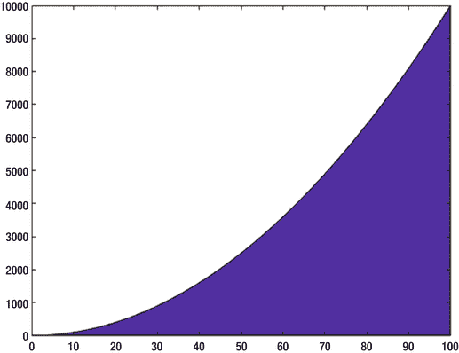

图 3-2：使用 `area()` 函数创建的 `y = x²` 图

```matlab
1  >> x = linspace(0,100,100);
2  >> y = x.ˆ2;
3  >> area(x,y)
```

#### 在同一张图上绘制多个图形

只需提供 `x` 轴和 `y` 轴的向量，就可以在同一张图上绘制多个图形，如代码 3-1 所示。图 3-3 展示了结果。

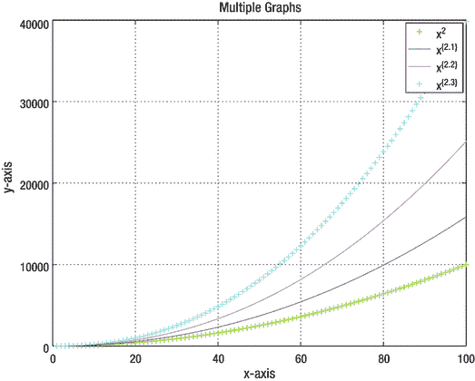

图 3-3：同一图形内的多个绘图

```matlab
1  clear all;
2  clf;
3  x = linspace(1,100,100);
4  y1 = x.ˆ2.0;
5  y2 = x.ˆ2.1;
6  y3 = x.ˆ2.2;
7  y4 = x.ˆ2.3;
8  plot (x,y1,"@12",x,y2,x,y3,"4",x,y4,"+")
9  grid on
10  legend('xˆ2','xˆ{2.1}','xˆ{2.2}','xˆ{2.3}');
11  xlabel('x−axis')
12  ylabel('y−axis')
13  title('Multiple Graphs')

15  %plot y with points of type 2 (displayed as '+')
16  %and color 1 (red), y2 with lines, y3 with lines
17  %of color 4 (magenta) and y4 with points displayed as '+'
代码 3-1：`multi.m` 程序
```

上述代码行号的解释如下：

*   按照第 15、16、17 行注释进行绘图（第 9 行）。

*   打开图形的网格线（第 10 行）。

*   `xlable` 获取字符串 `x-axis` 的值（第 11 行）。

*   `ylabel` 获取字符串 `y-axis` 的值（第 12 行）。

*   `title` 获取字符串 `Multiple Graphs` 的值（第 13 行）。

*   `clear all` 从内存中清除变量名和值（第 1 行）。

*   `clf` 清除当前图形窗口（第 2 行）。

*   `x = linspace(1,100,100)` 创建一个由 100 个在 1 到 100 之间等间距数据点组成的向量 `x`（第 3 行）。

*   `y1 = x.^(2.0)` 创建一个名为 `y1` 的新向量，其元素为向量 `x` 的平方（第 4 行）。

*   `y2 = x.^(2.1)` 创建一个名为 `y2` 的新向量，其元素为向量 `x` 的 2.1 次幂（第 5 行）。

*   `y3 = x.^(2.2)` 创建一个名为 `y3` 的新向量，其元素为向量 `x` 的 2.2 次幂（第 6 行）。

*   `y4 = x.^(2.3)` 创建一个名为 `y4` 的新向量，其元素为向量 `x` 的 2.3 次幂（第 7 行）。

*   `y5 = x.^(2.4)` 创建一个名为 `y5` 的新向量，其元素为向量 `x` 的 2.4 次幂（第 8 行）。

运行代码即可得到图 3-3。这类图形用于通过改变特定参数来检查结果的变化情况。

#### 分别绘制多个图形

`subplot(row, coloumn, index)` 命令用于在同一个图形上，但以独立的子视图形式绘制多个图形。`subplot(2,2,4)` 表示该图形将位于第二行、第二列、第四个索引位置。请参见代码 3-2。

```matlab
1  clear all;
2  clf;
3  x = linspace (1,100,100);
4  y1 = x.ˆ2.0;
5  y2 = log(x);
6  y3 = sin(x);
7  y4 = log10(x);
8  subplot(2,2,1), plot(x,y1)
9  subplot(2,2,2), plot(x,y2)
10  subplot(2,2,3), plot(x,y3)
11  subplot(2,2,4), plot(x,y4)
12  %grid on
13  %legend('xˆ2','xˆ{2.1}','xˆ{2.2}','xˆ{2.3}');
14  %xlabel('x−axis')
15  %ylabel('y−axis')
16  %title('Multiple Graphs')

18  %plot y with points of type 2 (displayed as '+')
19  %and color 1 (red), y2 with lines, y3 with lines
20  %of color 4 (magenta) and y4 with points displayed as '+'
代码 3-2：`multiSubplot.m` 程序
```

如图 3-4 所示，图形按矩阵形式组织，行数和列数决定了其位置。然后可以将图形的索引用作图形对象以进行进一步处理。有许多命令可以控制字体大小、刻度标签和字体，以及插入数学公式。你可以通过输入 `help plot` 或阅读此函数的文档来查看它们。从网上可以获得大量示例。此函数使用频繁，因此你需要熟练掌握其用法。

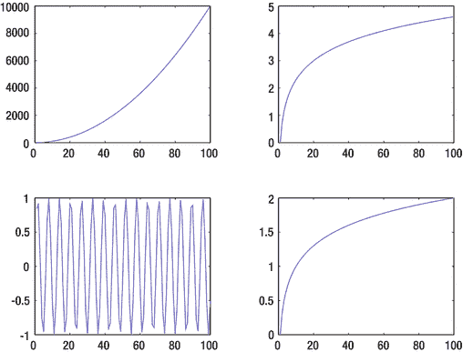

图 3-4：同一图形内独立的多个子图

### 3.1.2 `bar()`、`barh()` 和 `hist()` 命令

条形图是一种原始但非常有效的统计信息可视化方式。绘制条形图和直方图有三种选项。

```matlab
1  >> x = [1,2,3,4,5];
2  >> y = [12,5,11,9,10];
3  >> bar(x,y)
```

```matlab
1  >> x = [1,2,3,4,5];
2  >> y = [12,5,11,9,10];
3  >> barh(x,y)
```

图 3-5 显示了一个标准条形图，图 3-6 显示了一个水平条形图。

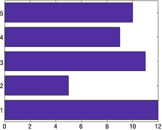

图 3-6：水平条形图

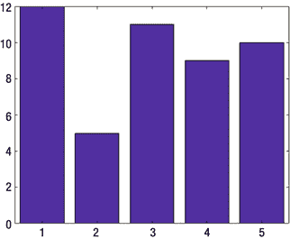

### 图 3-5：条形图

可以类似地使用 `hist()` 函数来绘制直方图。让我们看看由 `randn()` 函数生成的随机数的正态分布行为。

```
1  >> x = randn(100);
2  >> hist(x)
```

在图 3-7 中，你可以清晰地观察到包络线的钟形曲线，从而确认这些随机数确实是正态分布的。

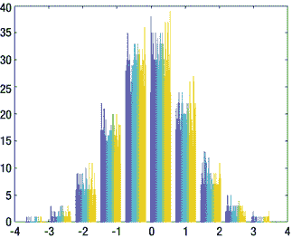

图 3-7：显示随机数正态分布的直方图

### 对数坐标图

在绘制涉及对数刻度的图形时，MATLAB 提供了三种选项：

- `semilogx()`: 绘制 x 轴为对数刻度的图形。例如，请考虑列表 3-3 中所示的代码 `log1a.m`，它生成了图 3-8 所示的图形。

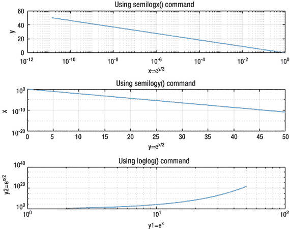

图 3-8：说明 `semilogx()` 的用法

```
1  %MATLAB program to illustrate
2  %usage of semilogx() and
3  %semilogy() and loglog() command

5  %semilogx()
6  y = 0:2:50;
7  x = exp(−y/2);
8  subplot(3,1,1)
9  semilogx(x,y)
10  grid on
11  xlabel('x=eˆ{y/2}');
12  ylabel('y');
13  title('Using semilogx() command');

15  %semilogy()
16  x1 = 0:2:50;
17  y1 = exp(−x1/2);
18  subplot (3,1,2)
19  semilogy (x1,y1)
20  grid on
21  xlabel('y=eˆ{x/2}');
22  ylabel('x');
23  title('Using semilogy() command');

25  %loglog()
26  x2 = 0:2:50;
27  y1 = exp(x2);
28  y2 = exp(x2/2);
29  subplot(3,1,3)
30  loglog(x1,y1)
31  grid on
32  xlabel('y1=eˆ{x}');
33  ylabel('y2=eˆ{x/2}');
34  title('Using loglog() command');
```

列表 3-3：`log1a.m` 程序

- `semilogy()`: 类似地，`semilogy()` 绘制 y 轴为对数刻度的图形。

- `loglog()`: 绘制两个轴均为对数刻度的图形。

### 极坐标图

有时您会更倾向于使用极坐标而非笛卡尔坐标绘图。此时，坐标不是 `x` 和 `y`，而是 `r` 和 `θ`。请参见列表 3-4。

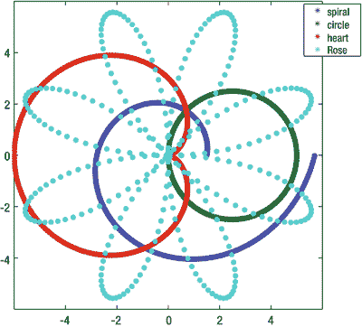

图 3-9：极坐标图

```
1  theta = 0:0.02:2*pi;
2  a1 = 0.5+1.3.ˆtheta;
3  a2 = 5*cos(theta);
4  a3 = 3*(1−cos(theta));
5  a4 = 6*sin(4*theta);
6  r = [a1;a2;a3;a4];
7  Polar Graph = polar(theta,r,"*");
8  set(Polar Graph,"LineWidth",2);
9  legend("spiral","circle","heart","Rose");
```

列表 3-4：`CoordinatesPolar.m` 程序

图 3-9 展示了针对 `CoordinatesPolar.m` 示例中给出的代码所生成的极坐标图示例。程序说明如下（按行号对应）：

- 一个名为 `theta` 的变量代表 θ，由从 0 到 2π、步长为 0.02 的点定义（第 1 行）。

- 一个名为 `a1` 的变量代表螺旋线的 r，通过以下方程计算得到（第 2 行）。

    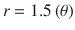

- 一个名为 `a2` 的变量代表圆的 r，通过以下方程计算得到（第 3 行）。

    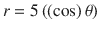

- 一个名为 `a3` 的变量代表心形的 r，通过以下方程计算得到（第 4 行）。

    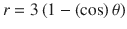

- 一个名为 `a4` 的变量代表玫瑰线的 r，通过以下方程计算得到（第 5 行）。

    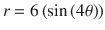

- 一个名为 `r` 的变量将使用方程计算出的所有 r 存储为一个列向量（第 6 行）。

- 一个名为 `PolarGraph` 的变量存储由函数 `polar()` 产生的值，该函数接受 θ、r 作为参数，并以 `"*"` 作为标记类型（第 7 行）。

- `set` 函数用于设置图形函数的属性值。这是一种设置图形属性并在之后进行试验的简洁方法。在此例中，属性 `LineWidth` 被设置为 2（第 8 行）。

- `legend()` 函数按照极坐标函数从向量 `r` 中获取图例的相同顺序设置四个图例（第 9 行）。

### `rose()` 函数

`rose()` 函数绘制角度直方图，即极性直方图。输入应该是一个数值向量。让我们通过使用 `randn(100,1)*pi` 构建一个包含 100 个随机数的向量，然后将其输入到 `rose()` 函数来查看其用法。生成的图形如图 3-10 所示。

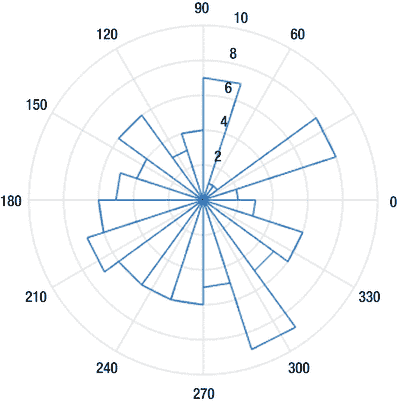

图 3-10：使用 `rose()` 函数绘制的随机数图

```
1  >> x = randn(100,1)*pi;
2  >> rose(x)
```

### `pie()`

可以使用 `pie()` 函数创建饼图。这提供了一种非常强大的工具来可视化整体的各个部分。其用法通过以下代码进行说明，图形如图 3-11 所示。该函数支持 34 个项目，这些项目按如下方式分布：`a`、`b`、`c`、`d`、`e`、`f` 分别获得 `4`、`7`、`2`、`8`、`4` 和 `9` 份。制作饼图时，首先将各部分定义为一个数组，然后将标签定义为一个数组。然后，如果直接输入 `pie()` 函数，您将看到一个彩色编码的分离式饼图，显示每个部分的百分比。当同时输入一个 `show` 数组时，它将只分离出对应元素值为 1 的那些部分。

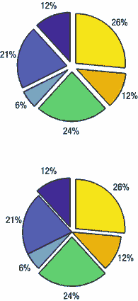

图 3-11：所有部分都分离以及部分分离的饼图

```
1  >> x = [4,7,2,8,4,9];
2  >> subplot(2,1,1)
3  >> pie(x)
4  >> subplot(2,1,2)
5  >> show = [1,0,0,1,0,1];
6  >> pie(x,show,labels)
7  >>
```

### `stairs()`

阶梯图绘制向量元素的阶梯状图形。以绘制 `y = x^(2.5)` 为例，其中 `x` 是一个包含从 −π 到 π 的 100 个元素的向量。如图 3-12 所示，数据点以阶梯方式连接。

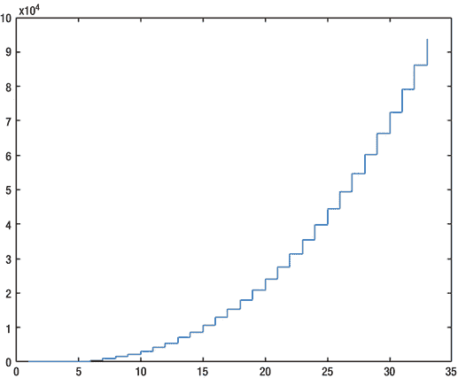

图 3-12：`y = x^(2.5)` 的阶梯图

```
1  >> x = −pi:pi:100;
2  >> y = x.ˆ(2.5);
3  >> stairs(y)
```

### `stem()`

茎秆图将数据点绘制为从等间距值延伸出来的茎秆。此处提供了绘制 `y = cos(x) ϵ (−π, π)` 的示例代码，它生成图 3-13 所示的图形。

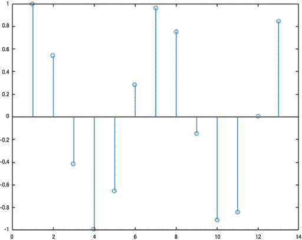

图 3-13：`y = cos(x) ϵ (−π, π)` 的茎秆图

### 3.1.3 三维绘图

MATLAB 中有多种可用于三维绘图的函数。您选择哪个函数取决于具体问题。

#### mesh

考虑使用`mesh`命令，如代码清单 3-5 所示。该命令生成的图形如图 3-14 所示。

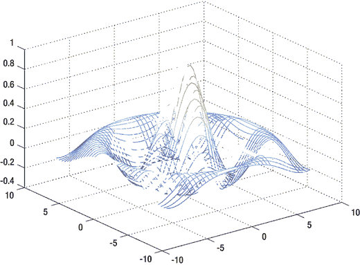

图 3-14 3D 网格

```
1  a = b = linspace(−8,8,41)';
2  [xx,yy] = meshgrid(a,b);
3  c = sqrt(xx.ˆ2+yy.ˆ2)+eps;
4  d = sin(c)./c;
5  mesh(a,b,d);
```

Listing 3-5
The ThreeDMesh.m Program

需要注意的是，这段代码使用了一个名为`meshgrid`的新函数。你可以使用`help meshgrid`快速搜索该函数。`meshgrid`的用法如下：

```
1  >> a = b = linspace(−8,8,41);
2  >> [xx,yy] = meshgrid(a,b);
```

这里创建了两个变量`a`和`b`，它们以行向量的形式存储了从-8 到 8 之间的 41 个线性间隔数据点。这两个行向量（维度均为 1×41）作为参数传递给`meshgrid`函数，该函数产生两个输出：`xx`和`yy`。它们是维度为 41×41 的矩阵，其中`xx`的行是`a`的副本，`yy`的列是`b`的副本。

`meshgrid`也可以接受第三个参数，用于构建完整的三维网格。除此之外，在这个二维基础网格上，可以为由`a`和`b`向量的副本定义的数据点定义一个函数。在这个例子中，函数定义如下：

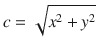（公式 3-1）和

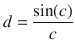（公式 3-2）

注意：函数`eps`会产生一个非常小的数字（由机器精度定义的 2.2204.10^(-16) [1]）。它在数值计算中被广泛使用，特别是在需要避免零值的情况下，尤其是在除以零的情形中。通过给大数加上一个非常小的数字，我们避免了这个问题（请记住，在第 3 步中计算的变量`c`随后在第 4 步中作为分母用于除法运算）。

现在继续绘图练习，新的数组可以通过应用 3D 绘图函数`mesh()`来绘制图形，该函数将数组`a`和`d`作为其参数，得到图 3-14。如果使用`mesh(x,y,z)`，则会创建一个由矩形构成的线框网格。矩形的顶点由函数（在本例中为公式 3-1 和 3-2）生成的数据点构成。顶点的（x, y）坐标由`xx`和`yy`矩阵给出，因为 x 坐标来自`xx`矩阵，y 坐标来自`yy`矩阵。`z`决定了每个顶点在平面上方的高度。

通过这种方式，就创建了一个 3D 图形。需要注意的是，原始的 3D“曲线”被解释为由平面矩形构成的曲面，这充其量只是一种近似。在某些情况下，这种误差可以忽略不计。为了减少误差，如果可能的话，可以使矩形更小一些。同一个函数还有其他一些变体，例如`ezmesh`、`meshc`和`meshz`。一个简单的`help`命令对于确定哪个变体最适合特定问题非常有用。网格还会根据高度（z 值）编码颜色。这是通过线性缩放 z 值以适应当前颜色映射的范围来计算的（键入`help colormap`了解更多信息）。

#### meshc

`meshc()`生成一个 3D 矩形网格以及底部的等高线图。如图 3-15 所示，除了为给定函数生成 3D 图形外，你还能得到一个等高线图。请注意，这一次，对矩阵进行运算的方程被编写为`meshc()`函数的一个参数，从而使程序更精简。参见代码清单 3-6。

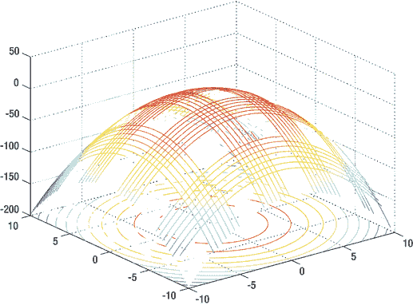

图 3-15 使用`meshc()`函数的 3D 网格

```
1  x=linspace(−10,10,50);
2  y=linspace(−10,10,50);
3  [xx,yy]=meshgrid(x,y);
4  meshc(xx,yy,2−(xx.ˆ2+yy.ˆ2))
```

Listing 3-6
The ThreeDMeshc.m Program

#### surf()

`surf()`生成一个曲面图，其中线框在空白点处被简单地填充，如图 3-16 所示。参见代码清单 3-7。

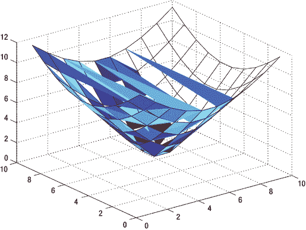

图 3-16 使用`surf()`函数的 3D 网格

```
1  a = b = linspace(−8,8,10)';
2  [xx,yy] = meshgrid(a,b);
3  c = sqrt(xx.ˆ2+yy.ˆ2)+eps;
4  d = sin(c)./c;
5  surf(c,d);
```

Listing 3-7
The ThreeDsurf.m Program

## 3.2 总结

丰富的绘图函数库使 MATLAB 成为以各种可出版格式绘制数据的合适选择。结合访问系统文件和文件夹的命令，这些图形可以被引导保存到合适的位置，以创建合适的报告。在 MATLAB 中进行 3D 绘图并从不同角度查看是相当直观的。因此，MATLAB 是一种可视化数据的合适方法。数据和执行速度的限制取决于计算机的存储器和主板上的 RAM。