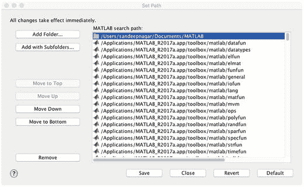

# 4. 输入与输出

## 4.1 简介

MATLAB 的基本数据类型是数组。大多数科学和工程目的数值计算都涉及处理各种文件格式的数据。科学设备和计算机程序本身会以文件形式生成数据。然后这些文件被读取并转换成数组（大多数情况下）。这些数组可以根据矩阵代数的数学要求进行操作。结果会生成一组新的数组。这些数组进一步被转换成文件用于可视化。

利用第 2 章和第 3 章（数组和绘图）的信息，你现在可以将物理问题转化为数值计算，并在数字计算机上求解。这个过程有一些要求，例如：

*   数据应为数字格式（数字文件）。

*   计算机程序应能无误地读取文件并从中创建数组。如果发生错误，应存在检查错误并向用户发出警告的机制。如果可能，还应存在修正错误的机制。

*   数据应以适当的数据类型存储为数组，并应根据需求以适当的格式显示。

*   对数据的数组操作将导致涉及在磁盘上读写数据的内存使用。系统应为此提供便利。用户应能在需要时检查内存状态。

*   后处理任务包括以各种格式显示数据——例如打印机打印、终端显示、终端或打印机/绘图仪上的图形等。

*   如果特定实验的报告包含输入参数，将处理后的数据和输出以文件或图形的形式呈现，将使用户的任务更简单。

MATLAB 为这些步骤中的每一步都提供了一些特性。本章将简要讨论这些内容。

## 4.2 键盘交互输入

用户通过键盘与 MATLAB 进行交互。键盘为特定字符生成 ASCII 或 Unicode 字符串。这些字符串被输入 MATLAB，然后由 MATLAB 解释以执行特定任务。在编程过程中与 MATLAB 进行交互式会话时，MATLAB 提供了以下几节讨论的函数。

### 4.2.1 `input()`

`input("Text")` 会在 MATLAB 提示符（默认符号为 `>>>`）处显示文本字符串 `Text`，并等待用户输入一个值后按回车键。用户可以输入任何类型的数据。输入内容会被视为 MATLAB 表达式，并在当前工作区中计算。如果使用 `input()` 函数进行赋值操作，则数据会被相应地赋给一个变量。如果用户直接按回车键而未输入任何内容，则输入会返回一个空矩阵。当用户在提示符处输入无效表达式时，提示符处会显示相关的错误信息。当需要向 `input()` 输入字符或字符向量字符串时，用户必须将其定义为字符串。否则，使用 `'s'` 作为第二个参数，此时输入会被视为字符串。其用法在以下代码中进行了演示。

```matlab
>> prompt = 'What is your name:';
>> name = input(prompt)
What is your name:Sandeep
Error using input
Undefined function or variable 'Sandeep'.

What is your name:'Sandeep'

name =

'Sandeep'

>> name = input(prompt,'s')
What is your name:Sandeep

name =

'Sandeep'
```

在处理数值时，必须使用单个值或数组，但要遵循有效的 MATLAB 语法。例如，在以下代码中，用户可以输入单个值 `r`（用于存储圆的半径）或输入多个值作为数组。然后，这些信息可用于计算周长（= 2πr）和面积（= πr²）。

```matlab
>> r = input('Enter value of radius:');
Enter value of radius:2
>> circumference = 2*pi*r

circumference =

12.5664

>> area = pi*r^2

area =

12.5664

>> r = input('Enter value of radius:');
Enter value of radius:[1 2 3]
>> r

r =

1     2     3

>> circumference = 2*pi*r

circumference =

6.2832   12.5664   18.8496

>> area = pi*r.^2

area =

3.1416   12.5664   28.2743
```

### 4.2.2 `keyboard()`

`keyboard` 关键字会在程序运行期间将控制权交给用户，以便用户可以根据需要输入数据或额外的 MATLAB 命令。用户可以有效地利用此过程来检查程序，这被称为调试。

完成此操作后，MATLAB 提示符会从 `>>>` 变为 `k>`。通过执行命令 `dbcont` 可以退出键盘模式。也可以使用 `dbquit` 退出键盘模式，但这样会终止调用它的 MATLAB 代码文件。控制权会返回给调用它的 MATLAB 代码文件。

此处必须输入有效的 MATLAB 表达式。此关键字可以非常有效地在程序运行过程中更改变量的值。其用法在清单 4-1 的示例代码中进行了展示。

```matlab
%program to demonstrate
%usage of keyboard command

x = 10;
y = 12;
keyboard %change value of x here
answer = x^2
```

**Listing 4-1**
The `keyboardCommand.m` Program

执行此代码时，你将看到以下会话：

```matlab
>> keyboardCommand
K>> x=2.5

x =

2.5000

K>> dbcont

answer =

6.2500

>> x=2.5

x =

2.5000

>> x.^2

ans =

6.2500
```

当遇到 `keyboard` 关键字时，MATLAB 会话会进入调试模式，用户随后可以将值更改为 `x=2.5`。输入 `dbcont` 将继续执行程序。计算结果将基于新的赋值。

### 4.2.3 `menu()`

一种图形化的输入值方式是通过 `menu()` 命令实现的，该命令以标题和一组选项作为输入（用逗号分隔）。这需要用户的计算机终端具备图形显示能力，否则会在命令提示符处显示一个选项列表。用户会看到一个图形窗口，并可以使用鼠标或键盘选择一个选项。这些选项会返回一个标量值，该值可以存储在一个变量中。选项内部会进行编号。

我们通过一个示例来看看它的用法。创建一个标题为“Even or Odd Numbers”（偶数或奇数）并包含两个选项——`Even`（偶数）和 `Odd`（奇数）的菜单。将此值存储在变量 `I` 中。执行此命令后，将出现图 4-1 所示的图形窗口。可能的输出如下：


**图 4-1**
菜单窗口输出

*   如果用户关闭窗口而未输入任何值，则输出为 0。
*   如果用户点击 `Even`（偶数），则输出为 1。
*   如果用户点击 `Odd`（奇数），则输出为 2。

如下代码所示：

```matlab
>> I = menu('Even or Odd Numbers','Even','Odd')

I =

0

>> I = menu('Even or Odd numbers','Even','Odd')

I =

1

>> I = menu('Even or Odd numbers','Even','Odd')

I =

2
```

*   `pause()`：如果您想临时暂停程序，可以使用 `pause()` 命令。按任意键继续执行程序。为了理解其用法，考虑一个示例。假设您有一个 3×3 的随机数矩阵。那么 MATLAB 程序 `pauseCommand.m` 将显示其秩、转置和大小。每次用户按一个键，就会显示一个项目。请参阅清单 4-2。

```
1  %程序展示 `pause` 命令的用法

4  `x = rand(3,3);`
5  `r = rank(x);`
6  `t = x';`
7  `s = size(x);`
8  `disp('Given matrix is:')`
9  `disp(x)`
10  `disp('To continue checking its rank, press any key')`
11  `pause`
12  `disp('Rank of matrix is:')`
13  `disp(r)`
14  `pause`
15  `disp('To continue checking its transpose, press any key')`
16  `pause`
17  `disp('Transpose of matrix is:')`
18  `disp(t)`
19  `pause`
20  `disp('To continue checking its size, press any key')`
21  `pause`
22  `disp('Size of matrix is:')`
23  `disp(s)`
24  `pause`
Listing 4-2
`The pauseCommand.m Program`
```

运行`pauseCommand.m`的输出如下所示：

```
1  >> pauseCommand
2  Given matrix is:
3  0.8147    0.9134    0.2785
4  0.9058    0.6324    0.5469
5  0.1270    0.0975    0.9575

7  To continue checking its rank, press any key
8  Rank of matrix is:
9  3

11  To continue checking its transpose, press any key
12  Transpose of matrix is:
13  0.8147    0.9058    0.1270
14  0.9134    0.6324    0.0975
15  0.2785    0.5469    0.9575

17  To continue checking its size, press any key
18  Size of matrix is:
19  3     3
```

## 4.3 文件路径

`MATLAB` 会话从一个默认文件夹启动，该文件夹取决于特定操作系统的安装方式。通常在安装时会创建一个专用文件夹，默认名称一般为 `MATLAB`。通过在命令提示符处输入 `pwd` 可以查看此文件夹的路径。

```
1   >> pwd

3   ans =

5   '/Users/.../MATLAB'
```

请注意，您计算机上的路径可能不同，这里使用三个点来表示路径的通用表示形式。

当您想要运行 `MATLAB` 的 `.m` 文件时，会首先在默认文件夹中搜索该文件。如果文件不在那里，您必须将工作目录更改为存储该文件的目录。这可以通过在 `MATLAB` 的命令提示符处输入 `pathtool` 来实现（见图 4-2）。



图 4-2

使用 `pathtool` 命令设置工作目录路径

您可以简单地将该目录添加到当前会话的目录列表中，或者保存它。您也可以选择将该目录设置为未来 `MATLAB` 会话的默认目录。如果您将长期在一个项目上工作，并且确定每天都会使用该目录，那么这是一个很好的选择。强烈建议您将所有文件保存在已安装 `MATLAB` 程序的默认目录中，或者将您的工作目录设置为默认目录。

## 4.4 文件操作

文件操作是计算中的一个重要组成部分。需要注意的是，文件系统依赖于操作系统 (OS)。与大多数科学程序类似，`MATLAB` 适用于类 UNIX 系统，因此它能在基于 Linux 的系统和 MacOS X 上使用相同的命令良好运行。在 Windows 系统中，你在 `MATLAB` 环境中处理文件时，使用与 Linux 版本相同的命令。本书中的代码示例是在 Windows 8、MacOSX 10.10 和 Ubuntu 14.04 系统上编写和测试的。

### 4.4.1 用户

计算系统由不同的用户访问。每个用户都定义一个工作空间，以避免损坏彼此的工作。登录后，用户的工作空间对该用户激活。工作空间由各种文件和文件夹组成。有些文件对于操作系统定义工作空间及其属性是必需的，因此不应更改。这是通过向不同用户授予权限来确保的。

读取和写入文件受到权限的限制。管理员（通常被称为`admin`）也被称为超级用户，拥有编辑任何文件/文件夹的所有特权和权限。你必须了解计算机系统定义的用户类型，然后相应地执行这些命令。如果你没有被授权访问某些文件夹，而你需要输入的数据又存放在这些文件/文件夹中，你总会收到一个错误（除非管理员更改了你的权限）。

### 4.4.2 文件路径

目录/文件夹可以包含子目录/子文件夹和文件。如果此过程不受管理员限制，则可以达到任意层级。

`pwd` 命令代表“打印工作目录”。在 `MATLAB` 终端中，输入 `pwd` 会显示当前工作目录的路径，如下例所示：

```
1  >> pwd
2  ans = /home/sandeep
```

用户的 `/home` 目录包含另一个名为 `/sandeep` 的目录。这是当前的工作空间。当在终端中输入 `pwd` 时，一个名为 `ans` 的变量会存储此数据（文件路径）。你可以分配一个自己选择的变量名来将文件名存储为字符串。

通过在终端输入文件路径来访问文件/文件夹。通过这个简短练习来理解此过程。要创建新目录，你可以像下面这样使用 `mkdir name`：

```
1  >> mkdir matlab−practice
2  ans = 1
3  >> ls
4  Downloads                           Music
5  R
6  Templates
7  matplab−practice
8  Videos
9  Desktop                             software
10  Work
11  Documents                           Library
12  Pictures
13  >> cd matplab−practice
14  >>
```

在第 1 行，`mkdir matplab-practice` 创建了一个名为 `matplab-practice` 的目录。要查看当前目录的内容，你可以使用 `ls` 命令，正如第 3 行所示，它代表“列表”（list）。要切换目录，你可以像第 13 行展示的那样使用 `cd file path` 命令。我建议你在此目录中完成本书的其余部分。

### 4.4.3 创建和保存文件

`save` 和 `load` 命令允许你向内存写入和读取数据。

```
1  >> matrix = rand(3,3);
2  >> save MyFirstFile.mat matrix
3  >> ls
4  MyFirstFile.mat
5  >> load MyFirstFile.mat
6  >> matrix
7  matrix =

9  0.467414     0.610273     0.429941
10  0.568490     0.037898     0.734682
11  0.547370     0.275421     0.539650

13  >>
```

在第 1 行，首先创建了一个名为 `matrix` 的变量，它存储了一个 3×3 的随机值矩阵。在第 2 行，此数据被存储为一个名为 `MyFirstFile.mat` 的 `.mat` 文件，并将该变量名作为参数传递。需要时，可以使用 `load MyFirstFile.mat` 命令将此文件加载到工作空间中，然后调用名为 `matrix` 的变量。保存文件时记录的随机数被加载为 3×3 矩阵的数据。请注意，此数据不一定是数字。它可以是数字计算机能够处理的任何内容，包括图片、视频、字符串和字符等等。

通过在保存时传递变量名，可以将多个变量存储在同一文件中。
```

### 4.4.3 变量保存与加载

```
1  >> matrix1 = rand(4,4);
2  >> matrix2 = rand(2,3);
3  >> matrix3 = rand(2,2);
4  >> save("SavingMultipleVariables.mat","matrix1","matrix2","matrix3")
5  >> load SavingMultipleVariables.mat
6  >> matrix1
7  matrix1 =

9     0.8598130     0.0118250     0.9803720     0.3044413
10     0.6676748     0.0056845     0.1101545     0.2183920
11     0.2547204     0.8192626     0.8056112     0.6961116
12     0.7924558     0.9130480     0.1976146     0.4635055

14  >> matrix2
15  matrix2 =

17     0.35215    0.55770    0.66650
18     0.98515    0.98677    0.45513

20  >> matrix3
21  matrix3 =

23     0.097693    0.540354
24     0.923853    0.329501

26  >>>> save −binary SavedAsBinary m*
27  >> ls
28  MyFirstFile.mat  SavedAsBinary  SavingMultipleVariables.mat
```

`help save` 和 `help load` 命令提供了关于使用 `save` 和 `load` 的非常有用的说明。使用这些选项，你可以将文件保存为特定格式。例如，在第 26 行，所有以 `m` 开头的变量名都被保存为二进制数据，存放在一个名为 `SavedAsBinary` 的二进制文件中。当基于 MATLAB 的数值计算生成的数据要在其他软件程序中使用时，这一点尤为重要。你还可以使用选项指定保存数据的精度。你也可以使用 `-zip` 命令压缩大文件。当 MATLAB 生成的数据体积庞大且需要传输时，这非常有用。

`load` 函数遵循与 `save` 函数相同的逻辑。数据可以从特定格式的文件中解压并加载为一个数组。这样填充的数组可用于计算，如果需要，可以使用 `save` 函数再次生成结果文件。复杂的计算需要连续多次重复此过程，因此这些函数已被优化，以便在短时间内定位和加载所需数据。

### 4.4.4 使用分隔符文件

可以使用 `dlmread()` 和 `dlmwrite()` 读取和写入带分隔符的数值数据文件（由分隔符分隔的数值数据）。这些函数生成 ASCII 分隔文件。为了说明这一点，以下 MATLAB 代码执行以下任务：

*   将一个 3×3 矩阵存储在变量 `A` 中。

*   使用 `dlmwrite()` 函数，写入一个名为 `randomNumbers.txt` 的文件，该文件从存储在 `A` 中的矩阵获取输入。

    *   分隔符定义为 `;`

    *   你可以在工作目录中检查该文件，并使用合适的文本编辑器或电子表格软件打开它。

*   初始化一个新变量 `B` 为空矩阵。

*   使用 `dlmread()` 函数读取此文件。定义创建文件时使用的分隔符非常重要。结果存储在 `B` 中，并且发现与 `A` 完全相同。

```
1  >> A = randn(3,3)

3  A =

5   0.3252   −1.7115      0.3192
6  −0.7549   −0.1022      0.3129
7   1.3703   −0.2414     −0.8649

9  >> dlmwrite('randomNumbers.txt',A,';')
10  >> B = []
11  >> B = dlmread('randomNumbers.txt',';')

13  B =

15   0.3252    −1.7115     0.3192
16  −0.7549    −0.1022     0.3129
17   1.3703    −0.2414    −0.8649
```

### 4.4.5 使用 Diary 和 History 命令

可以通过使用 `diary` 命令将 MATLAB 会话记录到文件中。输入 `help diary` 了解其使用信息。写入 `help filename` 可以将会话记录到具有给定文件名的文件中。此功能会持续更新命令及其输出。

你可以使用 `history` 命令来显示已执行命令的列表。有各种选项可用于查看特定格式的历史记录。

### 4.4.6 打开和关闭文件

要读写数据文件，必须先打开文件并将其定义为可读和/或可写。`fopen` 函数返回一个指向已打开文件的指针，该文件已准备好读取或写入。这由以下选项定义：`r` 表示可读，`w` 表示可写，`r+` 表示可读可写，`a` 表示追加（即在文件末尾写入新内容），`a+` 表示可读、可写和追加。打开模式可以设置为 `t` 文本模式或 `b` 二进制模式。`z` 可以打开一个 gzip 压缩文件进行读取和写入。

当所有数据读取或写入完成后，应关闭已打开的文件。`fclose` 函数用于执行此操作。

```
1  MyFile = fopen("a.dat","r");
```

创建了一个名为 `MyFile` 的变量，用于存储文件 `a.dat` 的内容。该文件以只读模式打开，这意味着它不能被编辑。如果文件的作者希望在共享信息时保持信息不变，这一点很重要。对于包含不应更改的常量或重要代码段的文件来说，这可能是必要的。

`freport()` 命令会列出已打开的文件以及它们是为读取、写入还是两者都打开。例如：

```
1  >> freport

3  number    mode    arch         name
4  −−−−−   −−−−   −−−−       −−−−
5  0         r       ieee−le     stdin
6  1         w       ieee−le     stdout
7  2         w       ieee−le     stderr

9  >>
```

### 4.4.7 读写二进制文件

二进制文件是计算机可读的文件。它们只是字节序列。它们与 C 语言函数 `fread` 和 `fwrite` 相同，可以从文件中读写二进制数据。

#### csvread 和 csvwrite 函数

`csvread` 和 `csvwrite` 函数用于读写 `.csv`（逗号分隔值）文件。假设需要将以下数据存储为 `.csv` 文件。

```
1   2   3   4
5   6   7   8
8   7   6   5
4   3   2   1
```

以下代码使用 `csvwrite` 创建一个数组，以生成名为 `csvTestData.dat` 的文件，其中包含矩阵的值。您可以通过在文本编辑器中打开这个新创建的文件来验证这一点。在第 3 行，创建了一个名为 `csvTestData1.dat` 的新文件，其偏移量定义为第 1 行和第 2 列。

```
1  >> a = [1,2,3,4;5,6,7,8;8,7,6,5;4,3,2,1];
2  >> a
3  a =

5  1   2   3   4
6  5   6   7   8
7  8   7   6   5
8  4   3   2   1
9  >> csvwrite('csvTestData.dat',a)
10  >> csvwrite('csvTestData1.dat',a,1,2)
11  >> a1 = csvread('csvTestData.dat')
12  a 1 =

14  1   2   3   4
15  5   6   7   8
16  8   7   6   5
17  4   3   2   1

19  >> a1 = csvread('csvTestData.dat',1,2)
20  a1 =

22  7   8
23  6   5
24  2   1

26  >>
```

现在，`csvread` 函数可以像 `csvwrite` 函数一样，用来创建具有所需偏移量的矩阵。

**注意**

存在许多其他用于读写文件的函数，但本节重点介绍一些最常用的函数。如果需要，您可以访问文档以了解如何使用这些专用函数。

### 4.4.8 使用 Excel 文件

互联网上有大量数据以 Excel 文件的形式呈现。请注意，在这种情况下，计算机必须连接到互联网。

`xlsopen`、`xlswrite`、`xlsclose`、`odsopen`、`odswrite` 和 `odsclose` 命令分别用于打开、写入和关闭 `.xls` 和 `.ods` 文件。`.xls` 文件由 Microsoft Excel 生成，而 `.ods` 文件由 Open/Libre Office 软件生成，它是 Microsoft Excel 的开源替代品。打开、读取和写入数据的流程如下：

*   `xlsopen('Filename.xls')`

*   `a = xlsread ('Filename.xls', '3rd_sheet', 'B3:AA10');` 将从名为 `3rd_sheet` 的 `Filename.xls` 工作表中读取从单元格 B3 到 AA10 的数值数据。此数据存储为一个名为 `a` 的数组。

*   `[Array, Text, Raw, limits] = xlsread ('a.xls', 'hello');` 从名为 `hello` 的工作表中读取文件 `a.xls`，所有数值数据被输入到名为 `Array` 的数组中。文本数据被输入到名为 `Text` 的数组中，原始单元格数据被输入到名为 `Raw` 的元胞数组中，实际数据所在的区域被保存在 `limits` 中。

*   `xlswrite('new.xls',a)` 将名为 `a` 的数组中的数据写入一个名为 `new.xls` 的 `.xls` 格式的 Excel 工作表。

*   `xlsclose`

```
1  >> a = rand(10,10);
2  >> odswrite('a.ods',a)
3  ans = 1
4  >> ls
5  a.ods
```

## 4.5 从互联网读取数据

大多数情况下，您需要访问的大型数据集都保存在某个远程服务器上。使用 `urlread()`，您可以读取远程文件。要将数据保存到本地磁盘，可以使用 `urlwrite()` 函数。

```
1  >> a = urlread('http://www.fs.fed.us/land/wfas/fdr_obs.dat');
2  >> who
3  Variables in the current scope:

5  a    ans

7  >> whos
8  Variables in the current scope:

10  Attr Name        Size              Bytes     Class
11  ==== ====        ====              =====     =====
12  a                1x147589          147589    char
13  ans              1x1               8         double

15  Total is 147590 elements using 147597 bytes

17  >> urlwrite('http://www.fs.fed.us/land/wfas/fdr_obs.dat','fire.dat')
18  >> ls
19  fire.dat
20  >>
```

这里，名为 `a` 的变量存储来自位于 `http://www.fs.fed.us/land/wfas/fdr_obs.dat` 的数据文件。或者，使用函数 `urlwrite(URL)` 将所有数据存储为名为 `a.dat` 的文件。

## 4.6 打印和保存图表

一些命令，如 `print` 和 `saveas`，用于保存由 MATLAB 程序生成的图形/图表，以便以所需的格式保存。它们将在以下部分进行讨论。

### 4.6.1 print 命令

`print` 命令可打印作业，包括使用打印机和/或绘图仪打印、打印到文件等。如果您需要以指定格式、按照所需文件名自动保存图形，此命令非常有用。

```
1  %以 svg 格式保存
2  figure(1);
3  clf();
4  peaks();
5  print -dsvg figure1.svg

7  %以 png 格式保存
8  figure(1);
9  clf();
10  sombrero();
11  print -dpng figure2.png

13  %打印到 HP DeskJet 550C
14  clf();
15  sombrero();
16  print -dcdj550
```

`clf` 函数用于清除当前图形窗口。`print` 命令还有许多其他用于保存不同格式的选项。要了解更多信息，请在 MATLAB 终端中键入 `help print`。

### 4.6.2 saveas 函数

`saveas` 函数以所需格式保存图形对象，如下所示：

```
1  clf();
2  a = sombrero();
3  saveas (a,"figure3.png");
```

`orient(a,orientation)` 函数定义图形对象 `a` 的方向。`orientation` 参数的有效值为 `portrait`、`landscape` 和 `tall`。`landscape` 选项更改方向，使绘图宽度大于绘图高度。`tall` 选项将方向设置为 `portrait`，并用绘图填充页面，同时保留 0.25 英寸的边距。`portrait` 选项（默认）更改方向，使绘图高度大于绘图宽度。

## 4.7 总结

本章介绍了各种用于读写权限以及从文件读取数据和向文件写入数据的函数。这成为数值计算练习中的一个基本部分。数据可以通过软件或硬件（仪器）以文件形式生成。MATLAB 并不关心其来源。它根据数据的类型和文件类型来处理数据。用户在使用文件时，必须根据具体情况确定合适的函数。

文件操作确实提供了修剪数据的功能，以便只将有用的部分作为数组使用。进一步的修剪可以通过切片操作来完成。掌握了文件处理的技巧，你就可以自信地着手处理复杂的数值计算了。