# 6. 数值计算形式体系

## 6.1 引言

数值计算允许您计算出数值问题的解，前提是您能够将它们构造成合适的格式。这需要一些考量。例如，如果您对连续函数进行数字化处理，那么由于以有限频率进行采样，将会引入某些误差。因此，非常精确的结果需要非常高的采样率。当需要计算大型数据集时，这将成为一项计算密集且耗时的任务。此外，您必须明白，与分析解相比，数值解充其量只是一种近似。寻找它们的物理意义和重要性的责任在于您。舍弃在现实世界场景中没有意义的解，是科学家/工程师多年来培养出的技艺。此外，计算设备的智能程度只与其操作者相当。GIGO（垃圾进，垃圾出）定律在这个领域被严格遵守。

本章试图解释一些重要步骤，您必须考虑这些步骤才能使用数值计算来解决物理问题。以恰当的术语定义问题只是第一步。建立正确的模型，然后使用正确的方法（求解器）来解决问题，是经验不足的科学家/工程师与经验丰富的科学家/工程师之间的区别。

## 6.2 物理问题

我们物理世界中的一切事物都受物理定律的支配。得益于那些在艰苦条件下辛勤工作、为我们周围发生的事情提出精妙解决方案的科学先贤们，我们获得了物理定律的数学理论。为了检验这些物理定律的数学形式体系，我们使用数值计算。如果它产生了与真实实验相同的结果，那么它们就相互验证了。数值模拟可以完全消除进行实际实验的需要，前提是您拥有经过充分测试的数学形式体系。例如，我们这个时代的核能大国不再需要真正进行核弹试验。在真实核爆炸期间获得的与核爆炸相关的数据，使科学家能够相当精确地对这些物理系统进行建模，从而消除了进行真实测试的必要性。

除了模拟真实实验等应用之外，对物理问题进行建模也是很好的教育练习。在建模过程中，动手练习使学生能够深入探究该主题，并为所研究的课题赋予恰当的意义。解决数值问题并将结果可视化，可以使学习永久化，并揭示数学理论中的任何缺陷，这最终会带来新的发现。


好的，作为高级文档工程师和翻译员，我将严格遵循您提供的注意事项和示例格式，对给定的英文文本进行专业、准确的中文翻译。


## 6.3 定义模型

建模是指为物理系统编写方程。顾名思义，方程就是将两边相等。方程使用等号（`=`）编写，左边的项等于右边的项。方程两边的项可以是数字或表达式。例如：

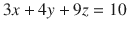

这个方程左边（LHS）是 `3x + 4y + 9z`，右边（RHS）是 `10`。注意，左边是一个代数项，而右边是一个数字。

表达式是使用函数编写的，函数本质上是两个域之间的关系。例如，`f(x) = y` 就是利用代数规则建立的从 `y` 到 `x` 的关系。数学拥有丰富的函数库，你可以使用它们来构建表达式。

选择合适的函数取决于具体问题。某些函数最能描述某些情形。例如，振荡行为可以用三角函数（如 `sin(x)`、`cos(x)` 等）进行合理描述。直线运动的物体可以用线性方程（如 `y = mx + c`）很好地描述，其中 `x` 是当前位置，`m` 是 `x` 的恒定变化率，`c` 是偏移量。沿曲线运动的物体则可以用各种非线性函数（其中因变量的幂次不为 1）来描述。

在现实生活中，你可能会遇到多种情形混合的情况。一个物体可以同时振荡和沿曲线运动。在这种情况下，你需要使用混合函数来编写表达式，或者寻找能够解释该物体行为的新函数。验证函数是通过求解描述行为的方程，并将其与对物体的观察结果进行匹配来完成的。如果它们完全匹配，你就得到了一个完美的解。在大多数情况下，获得精确解可能很困难。在这些情况下，你会得到一个“近似”解。如果获得近似解时涉及的误差在可容忍的范围内，那么该模型就是可以接受的。

如前所述，物理情形可以通过用包含因变量的函数来编写数学表达式，从而进行解析求解。最简单的问题在因变量之间具有简单的函数关系，并且只有一个方程。也可能存在需要多个方程才能解释一个物理行为的情况。在求解多个方程的情况下，矩阵理论就派上用场了。

假设下列方程定义了一个系统的物理行为：

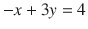

（方程 6-1）

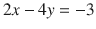

（方程 6-2）

那么这个由两个方程组成的方程组可以用一个矩阵方程表示，如下所示：

![ $$ \left[\begin{array}{cc}-1& 3\\ {}2& -4\end{array}\right]+\left[\begin{array}{c}x\\ {}y\end{array}\right]=\left[\begin{array}{c}4\\ {}3\end{array}\right] $$ ](A458923_1_En_6_Chapter_Equb.gif)

现在，通过使用矩阵代数，可以找到变量 `x` 和 `y` 的值，使它们满足这些方程。这些值被称为这些方程的根。这些根是二维空间（因为有两个因变量）中的点，在该点上，系统对于该物理问题将达到稳定状态。通过这种方式，你可以在不实际进行实验的情况下预测系统的行为。

在处理动态系统时，微分和积分的数学概念变得非常重要。当系统不断改变其因变量的值以产生某种情景时，了解这些变量的变化率就很重要。当这些变量相互独立时，你可以使用简单导数来定义它们的变化率。当它们不相互独立时，你必须为此使用偏导数。

例如，牛顿第二运动定律指出，物体速度的变化率与施加在其上的力成正比。数学表达式为：

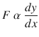

（方程 6-3）

通过代入一个乘法常数 `m`，可以将比例关系转化为相等关系，如下所示：

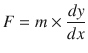

（方程 6-4）

如果你知道 `F` 的值或表达式，就可以解析求解这个方程，并找到该方程的解。但在某些情况下，解析解可能难以获得。在这些情况下，你可以将系统数字化并找到数值解。

对给定函数进行数字化和数值求解的方法有很多。用于实现特定方法以数值方式求解函数的程序被称为求解器。存在大量用于求解函数的求解器。求解器的选择对于成功获得解至关重要。例如，方程 6-4 是一个微分方程。它是一个一阶常微分方程。存在许多求解器来解决此类问题，例如欧拉法、龙格-库塔法等。特定求解器的选择取决于其解的准确性、求解所需的时间以及过程中使用的内存量。当内存不是可以随意消耗的资源时（例如，当你在内存存储容量有限的微型计算机上工作时），最后一点尤为重要。

使用 MATLAB 进行数值计算的优势在于，它拥有非常丰富的函数库来执行所需的各种任务。预定义的函数已经针对速度和准确性（在某些情况下，准确性可以预先定义）进行了优化。这使你可以快速构建问题原型，而不是专注于编写执行基本任务的函数并优化其速度、准确性和内存使用。

## 6.4 示例：多项式

多项式的系数被定义为向量的元素。通过这种方式，可以为数值计算定义系数。例如，考虑定义两个数组 `p1` 和 `p2`，如下所示：

```
>> p1 = [1 0 3 2]

p1 =

1     0     3     2

>> p2 =[3 4 0 5]

p2 =

3     4     0     5
```

`p1` 对应的多项式是 `p1 = s³ + 3s − 2 = 0`，`p2` 对应的多项式是 `p2 = 3s³ + 4s² − 5 = 0`。见图 6-1。

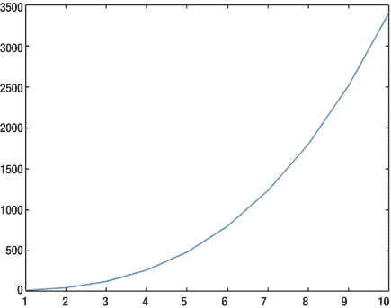

图 6-1

方程 `p2 = 3s³ + 4s² − 5 = 0` 的绘图

### 6.4.1 `polyval()`

可以使用 `polyval()` 函数对单个或多个值计算多项式的值。考虑在 `p1` 和 `p2` 中定义的多项式。让我们计算 `p1` 和 `p₂(-2)` 的值。

```
>> s = 5

s =

5

>> polyval(p1,s)

ans =

142

>> s=2

s =

2

>> polyval(p2,s)

ans =

45
```

如果需要对多个值（例如 `p[1]` 从 1 到 10）计算多项式的值，则可以将数组 `1:10` 赋给 `s` 变量，并在 `polyval()` 函数中使用它。

```
>> s = 1:10;
>> polyval(p2,s)

ans =

12    45    122    261    480    797    1230    1797    2516    3405
```

此功能可以方便地绘制多项式图形。可以将 `s` 和 `polyval()` 的输出分别作为 x 轴和 y 轴输入给 `plot()` 命令，以可视化图形。


### 6.4.2 `roots()`

多项式的根是使多项式取值为零的数值。使用 `roots()` 函数可以轻松求得根。下面是一个使用前面定义的多项式 `p1` 和 `p2` 的示例。

```
1  >> p1
3  p1 =
5  1     0     3     2
7  >> p2
9  p2 =
11  3     4     0     5
13  >> roots(p1)
15  ans =
17  0.2980 + 1.8073i
18  0.2980 − 1.8073i
19  −0.5961 + 0.0000i
21  >> roots(p2)
23  ans =
25  −1.8307 + 0.0000i
26  0.2487 + 0.9212i
27  0.2487 − 0.9212i
29  >> polyval(p1,roots(p1))
31  ans =
33  1.0e−14*
35  −0.1776 − 0.2720i
36  −0.1776 + 0.2720i
37  0.0888 + 0.0000i
39  >> polyval(p2,roots(p2))
41  ans =
43  1.0e−13*
45  −0.2753 + 0.0000i
46  −0.0089 − 0.0111i
47  −0.0089 + 0.0111i
```

根据根的定义，多项式在根处的取值应为零，但 `roots(p1,roots(p1))` 的计算结果并非零。它实际上是一个非常小的数，量级为 10^(-14)。这是由于计算根时数值近似引入的误差导致的。

### 6.4.3 多项式的加法与减法

两个多项式相加是通过将其系数相加完成的。由于它们在 MATLAB 中被定义为数组，多项式的加减法只是逐元素运算。

```
1  >> p1+p2
3  ans =
5  4     4     3     7
7  >> p1−p2
9  ans =
11  −2    −4     3     −3
```

这实际上意味着：


(公式 6-5)

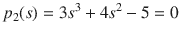
(公式 6-6)

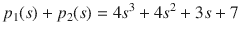
(公式 6-7)

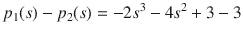
(公式 6-8)

### 6.4.4 多项式的乘法

两个多项式的乘积可以通过卷积运算求得，MATLAB 中可使用 `conv()` 函数来实现。


(公式 6-9)


(公式 6-10)

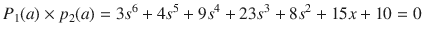
(公式 6-11)

```
1  >> p1
3  p1 =
5  1     0     3     2
7  >> p2
9  p2 =
11  3     4     0     5
13  >> conv(p1,p2)
15  ans =
17  3     4     9     23     8     15     10
```

### 6.4.5 多项式的除法

多项式除法通过解卷积运算实现，MATLAB 中可使用 `deconv()` 函数。它会返回两个输出——商和余数。

```
1  >> p1
3  p1 =
5  1     0     3     2
7  >> p2
9  p2 =
11  3     4     0     5
13  >> [q,r] = deconv(p1,p2)
15  q =
17  0.3333
20  r =
22  0     −1.3333     3.0000     0.3333
24  >> [q,r] = deconv(p2,p1)
26  q =
28  3
31  r =
33  0     4     −9     −1
```

这意味着，如果：

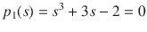
(公式 6-12)


(公式 6-13)

那么：

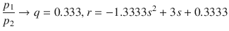
(公式 6-14)

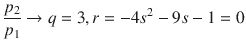
(公式 6-15)

### 6.4.6 多项式的微分

多项式微分可以使用 `polyder()` 函数完成。例如，假设你有一个多项式 `y(x) = x ³ − 2x ² + 4x − 5 = 0`。这意味着：

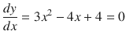

这可以通过 MATLAB 计算如下。

```
1  >> y = [1 −2 4 −5]
3  y =
5  1     −2     4     −5
7  >> dydx = polyder(y)
9  dydx =
11  3     −4     4
```

### 6.4.7 多项式的积分

与微分类似，你可以使用 `polyint()` 函数来定义多项式的积分。例如，假设你有一个多项式 `y(x) = x ³ − 2x ² + 4x − 5 = 0`。那么：

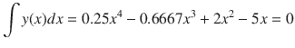

```
1  >> y = [1 −2 4 −5]
3  y =
5  1     −2     4     −5
7  >> integration = polyint(y)
9  integration =
11  0.2500     −0.6667     2.0000     −5.0000     0
```

### 6.4.8 多项式曲线拟合

假设你得到一些数据，需要找到一个能拟合这些数据的多项式。这个任务可以使用 `polyfit()` 函数完成。例如，假设你想拟合下面给出的数据：

| x | 1 | 2 | 3 | 4 | 5 | 6 |
| y | 10 | 11 | 21 | 2 | 3 | 7 |

```
1  >> x = [1,2,3,4,5,6]
3  x =
5  1     2     3     4     5     6
7  >> y = [10,11,21,2,3,7]
9  y =
11  10     11     21     2     3     7
13  >> polyfit(x,y,2)
15  ans =
17  −0.3750     0.9679     11.3000
19  >> polyfit(x,y,3)
21  ans =
23  1.0833     −11.7500     35.3095     −16.0000
```

拟合数据的二、三次多项式分别为 `−0.375x ² + 0.9679x + 11.3 = 0` 和 `1.0833x ³ − 11.75x ² + 35.3095x − 16 = 0`。

## 6.5 小结

几乎所有科学和工程分支都需要你执行数值计算。MATLAB 是实现此目的的备选工具之一。MATLAB 拥有一个针对通用计算进行优化的函数库。它还拥有多种执行专门任务的软件包。这使其成为高效原型化数值计算问题的理想选择。本章总结了与数值计算过程中产生的误差相关的各种问题，以及获取误差值或量级大小的各种方法。这些量的测量很重要，因为在现实生活中，你将需要这些值来定义最终产品的精度。

