# 7. 数值计算中的近似答案

## 7.1 数值近似

在科学研究过程中，有时可能无法找到精确答案。与其投入大量精力通过解析求解来寻找精确答案，另一种替代方法是开发产生近似答案的方法。对于涉及像 `pi` 这样的无理数的解来说尤其如此。你可以选择与 `pi` 一起使用的有效数字位数，并确定结果的精度。

所需的精度程度始终取决于目标应用。例如，在测量建筑物的长度时，我们不需要精确到原子长度（Å）。在测量人体体温时，对于大多数应用来说，我们不需要精确到两位以上的小数。在计算机更快、效率更高的时代，只要需要，就可以通过投入更多时间和内存存储来计算更高精度的结果。但这必须明智地使用。

## 7.2 容差

当用户获得一个或多个近似答案时，必须根据应用的要求从中选出一个答案。做出此决定的方法之一是定义容差限。容差可以定义为一个单一数值或一个数值范围（包含最大值和最小值）。定义容差限的规则完全取决于具体应用。例如，在测量人的身高时，我们可以将容差定义为 1 厘米；但与此同时，在测量人类头发的直径时，我们可能希望将精度提高到 1 微米。同样地，在测量红细胞的大小时，我们需要将精度进一步降低到 1 纳米。然而，在测量尺寸时定义容差相对简单——即容差比物体尺寸小一到两个数量级——但在其他应用中这可能并非易事。例如，测量用于建造建筑物的土地时，容差需要在零点几米；而将螺丝定位到孔中时，精度则需在零点几厘米以内。

在数学术语中，如果 ∈ 是容差限，`x` 代表真实值，`x^*` 代表近似值：

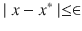

(方程 7-1)

在这种情况下，测量中的绝对误差 (`e[a]`) 和相对误差 (`e[r]`) 由下式给出：

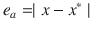

(方程 7-2)

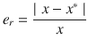

(方程 7-3)

因此，如果绝对误差小于或等于容差限，则该近似解或解集是可接受的。然而，如果已知 `x`，我们为什么还需要计算近似解呢？

当物理系统的解未知时，可以计算出 `x^*`，然后将其与物理测量值进行比较。在这种情况下，物理测量值构成了 `x` 的值。然后，通过使用方程 7-2，我们可以计算误差。接着，可以利用某些 `x^*` 与 `x` 相差不大（即误差影响不大）这一事实来确定容差。

## 7.3 泰勒级数

大多数数学函数的计算都需要许多复杂的算符——除了像 `+`、`−`、`×` 和 `÷` 这样简单的算符之外。然而，多项式只需要这些基本算符即可计算。因此，如果其他数学函数可以用多项式表示，它们就可以相对容易地被近似。

多项式定义如下：

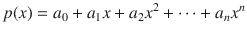

(方程 7-4) 其中 `a[n] ∈ R`（这些 a 称为系数）。对于对应 `a[n] ≠ 0` 的最大 `n`，该多项式的次数被定义为 `n`。

## 7.4 泰勒多项式

泰勒定理解释了如何定义大量数学函数，这些函数可以定义为多项式，称为泰勒多项式。泰勒多项式所示最终答案的精度取决于它的次数，即多项式中定义的项数。这提供了一种便捷的方法，可以根据期望的容差来定制多项式。

假设一个数学函数 `f(x)` 需要在 `x = a` 附近被近似。一个以 `x = a` 为中心、`n` 次的泰勒多项式 `pn` 是一个（次数至多为 `n` 的）多项式，它在 `x = a` 处的值与 `f` 的 `n` 阶导数值相同。

以下是推导泰勒多项式公式的方法：

1.  零阶多项式 `p0` 的次数至多为零。

    *   `p0` 必须是一个常数函数（图形上是水平线函数）。

    *   在 `x = a` 附近近似：`p0 = f(a)`。

2.  一阶多项式 `p1` 的次数至多为 1。

    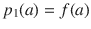

    *   `p1(x)` 必须满足两个条件：

        和

    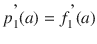

    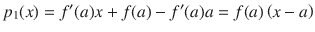

    *   `p1` 必须是 `p1 = mx + c` 的形式（一条斜率为 `m`、截距为 `c` 的直线）。

    *   由于 `p'(a) = f'(a)`，所以 `m = f'(a)`。

    *   因此我们可以写成 `c = f(a) - f'(a)a`。

    *   将 `m` 和 `c` 的值代回，我们得到上式。

3.  以类似的方式继续应用相同的论点，你可以写出 `n` 阶泰勒多项式的一般形式为：

    

    可以用西格玛记法重写如下：

    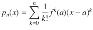

    (方程 7-5)

这个定义要求多项式必须在 `x = a` 处有 `n` 阶导数。

麦克劳林级数就是定义在 `a = 0` 时的泰勒级数。你可以使用 `sin(x)`、`cos(x)` 和 `e^x` 等基本函数的泰勒/麦克劳林级数的代数运算，来定义其他复杂函数的级数形式。这些运算可以通过简单地使用代数算符，加上代换、求导和积分来完成。这种数学上的便利性有助于为那些由复杂函数描述的物理系统制定近似解。

### 7.4.1 `sin(x)` 和 `cos(x)` 的麦克劳林级数

为了验证麦克劳林展开，让我们从三角函数 `sin(x)` 和 `cos(x)` 开始。两者在任意实数集给出的范围内都是连续且可微的。因此它们的微分在此范围内存在。它们可以展开为如下形式的麦克劳林级数。

假设 `f(x) = sin(x)` 需要在 `a = 0` 处被近似。

使用表 7-1 和方程 7.5 可以得到以下方程：

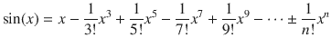

(方程 7-6)

**表 7-1** 计算 `sin(x)` 在 `x = 0` 处的麦克劳林级数的系数

| n | f(x) | f(a) |

| --- | --- | --- |

| 0 | sin(x) | 0 |

| 1 | cos(x) | 1 |

| 2 | −sin(x) | 0 |

| 3 | −cos(x) | −1 |

| 4 | sin(x) | 0 |

类似地，对于在 `a = 0` 处近似的 `f(x) = cos(x)`，使用表 7-2 和方程 7-5 可以得到以下方程：

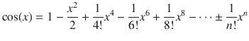

(方程 7-7)

**表 7-2** 计算 `cos(x)` 在 `x = 0` 处的麦克劳林级数的系数

| n | f(x) | f(a) |

| --- | --- | --- |

| 0 | cos(x) | 1 |

| 1 | −sin(x) | 0 |

| 2 | $-\cos(x)$ | $-1$ |
| 3 | $\sin(x)$ | $0$ |
| 4 | $\cos(x)$ | $1$ |

### 计算`cos(x)`时选择容差

程序`MaclaurinCos.m`（见代码清单 7-1）演示了随着在计算`cos(15°)`时加入更多泰勒级数项，误差如何降低多个数量级。参见图 7-1。


**图 7-1**

```matlab
%演示 cos(x)泰勒级数展开用法的程序
%假设我们要计算 cos(15)，其中 cos 函数的参数以度为单位

x = 15*pi/180; %将 15 度转换为弧度

format long %以长格式显示结果，数字保留多位小数

%计算泰勒级数的每一项

p1 = 1;
p2 = x^2/2;
p4 = x^4/factorial(4);
p6 = x^6/factorial(6);
p8 = x^8/factorial(8);
p10 = x^10/factorial(10);

approx_1 = p1-p2; %使用两项时的近似值
approx_2 = p1-p2+p4; %使用三项时的近似值
approx_3 = p1-p2+p4-p6; %使用四项时的近似值
approx_4 = p1-p2+p4-p6+p8; %使用五项时的近似值
approx_5 = p1-p2+p4-p6+p8-p10; %使用六项时的近似值

real_value = cos(x); %计算真实值以找出误差

%计算最终误差

error_1 = abs(real_value - approx_1);
error_2 = abs(real_value - approx_2);
error_3 = abs(real_value - approx_3);
error_4 = abs(real_value - approx_4);
error_5 = abs(real_value - approx_5);

%构建误差向量用于绘图

error = [error_1, error_2, error_3, error_4, error_5];

%绘制误差与项数的关系图

figure(1)
semilogy(error,'*r-')
title('使用泰勒级数计算 cos(15^{\circ})的误差变化')
xlabel('泰勒级数的项数')
ylabel('log(误差)')

%绘制 cos(x)及其各种近似值

t = 0:0.001:20;
%length(t)

figure(2)
y = cos(t);
subplot(2,3,1)
plot(t,y,t,ones(length(t)))
subplot(2,3,2)
plot(t,y,t,(1-t.^2/2))
subplot(2,3,3)
plot(t,y,t,(1-t.^2/2+t.^4/factorial(4)))
subplot(2,3,4)
plot(t,y,t,(1-t.^2/2+t.^4/factorial(4)-t.^6/factorial(6)))
subplot(2,3,5)
plot(t,y,t,(1-t.^2/2+t.^4/factorial(4)-t.^6/factorial(6)+t.^8/factorial(8)))
subplot(2,3,6)
plot(t,y,t,(1-t.^2/2+t.^4/factorial(4)-t.^6/factorial(6)+t.^8/factorial(8)-t.^10/factorial(10)))
```

**代码清单 7-1**

`MaclaurinCos.m` 程序

从图 7-1 可以看出，现在您可以根据计算`cos(x)`时给定的容差，选择插入特定数量的项。为了就项数做出明智的决策，您必须以类似的方式（如`MaclaurinCos.m`所做的那样）检查函数。在精度要求不高的情况下插入大量项，会浪费时间、精力以及资源（包括人力和计算资源）。

级数不仅可以在单个特定点附近展开，还可以针对一组点进行定义。名为`CosApprox.m`的 Octave 程序就实现了这一点，如代码清单 7-2 所示。参见图 7-2。


**图 7-2**

```matlab
%绘制 cos(x)及其各种近似值

t = -3*pi:pi/10:3*pi; %定义 x 轴的点数组
l = length(t); %用于定义 pi
y = cos(t); %余弦函数的真实值

%定义麦克劳林级数的各项
a1 = ones(l); %仅第一项
a2 = (1-t.^2/2); %第一项和第二项
a3 = (a2+t.^4/factorial(4)); %第一、二、三项
a4 = (a3-t.^6/factorial(6)); %第一、二、三、四项
a5 = (a4+t.^8/factorial(8)); %第一、二、三、四、五项
a6 = (a5-t.^10/factorial(10)); %第一、二、三、四、五、六项

%绘制 cos(x)随项数增加的拟合情况
figure(1)

subplot(3,2,1)
plot(t,y,'*r-',t,a1,'*b-')
axis([-3*pi 3*pi -1.2 1.2])
title('p_{1} 对 cos(x) 的拟合')
xlabel('t')
ylabel('cos(t)')

subplot(3,2,2)
plot(t,y,'*r-',t,a2,'*b-')
axis([-3*pi 3*pi -1.2 1.2])
title('p_{2} 对 cos(x) 的拟合')
xlabel('t')
ylabel('cos(t)')

subplot(3,2,3)
plot(t,y,'*r-',t,a3,'*b-')
axis([-3*pi 3*pi -1.2 1.2])
title('p_{3} 对 cos(x) 的拟合')
xlabel('t')
ylabel('cos(t)')

subplot(3,2,4)
plot(t,y,'*r-',t,a4,'*b-')
axis([-3*pi 3*pi -1.2 1.2])
title('p_{4} 对 cos(x) 的拟合')
xlabel('t')
ylabel('cos(t)')

subplot(3,2,5)
plot(t,y,'*r-',t,a5,'*b-')
axis([-3*pi 3*pi -1.2 1.2])
title('p_{5} 对 cos(x) 的拟合')
xlabel('t')
ylabel('cos(t)')

subplot(3,2,6)
plot(t,y,'*r-',t,a6,'*b-')
axis([-3*pi 3*pi -1.2 1.2])
title('p_{6} 对 cos(x) 的拟合')
xlabel('t')
ylabel('cos(t)')
```

**代码清单 7-2**

`CosApprox.m` 程序

从图 7-2 可以看到，当使用更高阶的项来描述`cos(x)`时，拟合精度不断提高，误差随之降低。为了达到理想拟合效果，必须使用非常多的项来描述近似的`cos(x)`函数。容差的选择由用户定义。根据容差值，可以确定具体的项数。

#### 7.4.2 `e^x` 的麦克劳林级数

让我们通过另一个关于`e^x`的麦克劳林级数的例子来探讨误差的概念：

$$ e^a = 1 + a + \frac{a^2}{2!} + \frac{a^3}{3!} + \frac{a^4}{4!} + \cdots $$

（方程 7-8）

出于编程的考虑，推导出麦克劳林级数各项之间的内在关系更为简便。第一项是数字 1，但此后，每一项都可以通过将前一项乘以以下方程得到：

$$ \frac{a}{n} $$

（方程 7-9）其中 `n` 代表第 `n` 项。这一事实在 `MaclaurinExp.m` 代码（见代码清单 7-3）中得到了应用。在该代码中，第一项在第 5 行被定义在变量 `expVal` 中，然后该变量被加到 `currentTerm` 变量上，而 `currentTerm` 仅仅是利用方程 7-9 中的公式计算得出的。

```
%exp(0.1)的麦克劳林级数

n = 5; %项数
a = 0.1; %eˆ(x) 中 x 的函数值
expVal = 1.0;
currentTerm = 1.0;
for i=1:n
  currentTerm = currentTerm*a/i;
  expVal = expVal+currentTerm
endfor

trueVal = exp(0.1);
error = abs(trueVal −expVal)
```
代码清单 7-3 `MaclaurinExp.m` 程序

输出显示如下：

```
>> MaclaurinExp
expVal = 1.1000
expVal = 1.1050
expVal = 1.1052
expVal = 1.1052
expVal = 1.1052
error = 1.4090e −09
>> format long
>> MaclaurinExp
expVal = 1.10000000000000
expVal = 1.10500000000000
expVal = 1.10516666666667
expVal = 1.10517083333333
expVal = 1.10517091666667
error  = 1.40898115397192e−09
```

请注意，虽然数值显示通常只设置为小数点后四位，但 `format long` 命令提高了这一精度（`format short` 命令则恢复为默认行为）。因此，你可以清晰地观察到，通过增加项数，误差会急剧减小，逐渐接近真实值，并且仅用五项就能达到 `10^(−9)` 量级的误差。

如果你希望将所有计算出来的值都存储在 `expVal` 变量中，必须将其定义为一个向量，如代码清单 7-4（`MaclaurinExp1.m` 程序）所示。

```
%exp(0.1)的麦克劳林级数

n = 5; %项数
a = 0.1; % eˆ(x) 中 x 的函数值
expVal = 1.0;
currentTerm = 1.0;
for i =1:n
  currentTerm = currentTerm*a/i;
  expVal(i+1) = expVal(i)+currentTerm;
endfor

trueVal = exp(0.1);
error = abs(trueVal−expVal)
```
代码清单 7-4 `MaclaurinExp1.m` 程序

在这里，第 9 行指出第 `(i+1)` 项是根据方程 7-9 并使用前一项（即第 `(i)` 项）进行修改的。还要注意，通过使用 `;` 运算符，第 9 行的打印被抑制了。输出如下所示：

```
>> MaclaurinExp1
error =

1.0517e−01   5.1709e−03   1.7092e−04   4.2514e−06 8.4742e−08   1.4090e−09
>>>plot(error,'r*−')
```

使用 `plot(error,'r*-')` 命令，你可以生成绘制误差值的图形（`'r*-'` 参数表示用规则连接的红色星号）。如图 7-3 所示。

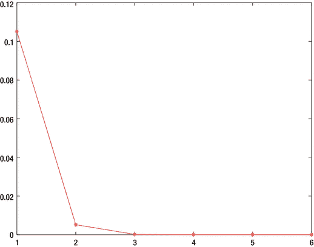
图 7-3：计算 `e^(0.1)` 时随项数增加的误差

由于每增加一项，误差都会下降几个数量级，因此在对数坐标图中可以最好地观察到这一效果。这可以通过使用 `semilogy(error,'r*-')` 命令生成。将生成图 7-4。

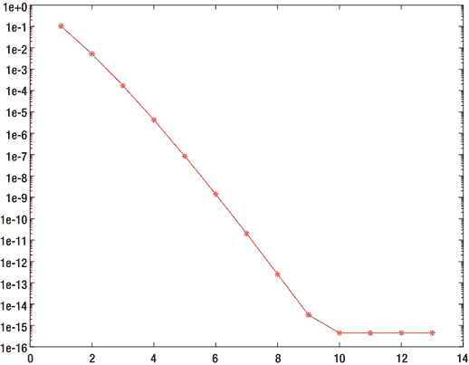
图 7-4：计算 `e^(0.1)` 时随项数增加的误差

似乎超过 10 项后，误差就趋于平稳了。但你会看到，这是一个错误的结果，因为该图形将取决于你所用计算设备的最小计数单位。

#### 需要多少项？

从图 7-4 中你可以观察到，在计算 `e^(0.1)` 时，通过增加项数，你可以将误差降低两个数量级。但是，这是否意味着要达到真实值，就必须包含无限多的项呢？毕竟，每增加一个新项，你都需要投入时间和计算资源。通常来说，当使用 `n` 项时，麦克劳林级数的精度为 `a^(n+1)`：

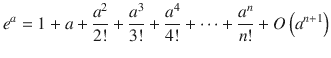
（方程 7-10）

从分析的角度，你可以选择任意大的 `n`，但在计算设备上无法做到这一点。接下来将探讨其原因。

图 7-4 显示了一个有趣的现象：超过 10 项后，误差不再按数量级变化，而是趋于平稳。这是一个具有误导性的结果。每台计算设备在存储最小浮点数方面都有极限。这可以通过发出 `eps` 命令来获取。运行该程序的系统显示以下输出。

```
>> error(9:12)
ans =

3.10862446895044e−15  4.44089209850063e−16  4.44089209850063e−16  4.44089209850063e−16
>>> eps
ans = 2.22044604925031e−16
```

你现在可以看到，当误差值非常接近 `eps` 值时，它们就无法再被可靠地存储了。命令 `error(9:12)` 输出了一个类似的观点。可以看出，尽管第 9 项产生的误差量级为 `10^(−15)`，但从第 11 项开始，数值都相似，量级为 `10^(−16)`。这样做是为了让计算机避免因超出由 `eps` 值定义的限制而导致计算崩溃。

`eps` 命令给出机器精度。`help('eps')` 命令显示了 `eps` 命令的文档及其用法。从技术上讲，`eps` 是机器浮点系统中任意两个相邻数字之间的相对间距，即计算设备的最小计数单位。这个数字显然依赖于系统，因为你可以设计专门的硬件来提升机器精度。事实上，在需要更高精度时（例如导弹制导、太空导航等）就会这样做。在支持 IEEE 浮点运算的设备上，双精度的 `eps` 约为 `2.2204 × 10^(−16)`，单精度的 `eps` 约为 `1.1921 × 10^(−7)`。

有趣的是，`2^(-25) ≈ 2.2204 × 10^(-16)`。这本质上是说，软件的双精度模式可以存储小数点后 52 位数字。你将在本章的“计算误差”部分了解更多相关内容，该部分讨论了数值计算中的机器精度方面以及了解特定数值问题所需运算精度的重要性。

`realmax`、`realmin`、`intmax` 和 `intmin` 命令显示了安装该软件的特定机器上实数和整数的最大值和最小值。

```
>> realmax
ans = 1.79769313486232e+308
>> intmax
ans = 2147483647
>> realmin
ans = 2.22507385850720e−308
>> intmin
ans = −2147483648
```

了解这些数字很有用，因为超出这些范围的数字会因为机器精度而容易产生误差。

## 7.5 计算误差

到目前为止，你已经了解了在计算数学函数时，因包含特定数量的项而产生的固有误差。事实上，还存在另一种误差，这是由于计算机只能存储有限长度的数字而引入的。

### 7.5.1 有效数字

有效数字的概念在此起着重要作用。如果计算机能够存储最终答案的所有有效数字，那么误差就无关紧要。否则，在报告最终答案时，识别这些误差并尽可能加以纠正就显得很重要。例如，在处理`pi`时，如果只需要三位有效数字，那么任何低端计算解决方案都能轻松存储。

计算机可以将数字存储为浮点数对象。浮点数对象按如下方式存储数字：

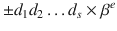
(方程 7-11)

其中 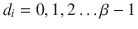 但 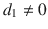 且 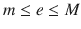 ，这里 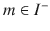 ，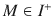。

浮点数的三个组成部分为：
- 符号（`±`）
- 尾数（`d[1]d[2]...d[s]`）
- 指数（`β`）

在 IEEE 双精度舍入标准下，MATLAB 使用二进制运算，其中：
- 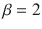
- `s = 53`
- `m = -1074`
- `M = +1023`

由于人类习惯于十进制运算系统，为了报告结果，这些二进制数会被转换为十进制数。理解以下关键点很重要：所有内部计算都以二进制形式进行，但面向人类的输入和输出则以十进制形式提供。因转换而产生的舍入误差由单位舍入量 `u` 给出，它是在将实数近似为浮点数时的最大相对误差。

MATLAB 可以处理绝对值的范围从 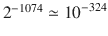 到 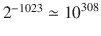 的数字，其单位舍入量为 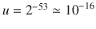。

## 7.6 实数转换为浮点数的挑战

实数 `x` 可按浮点表示法（由方程 7-11 给出）存储为：


(方程 7-12)

现在注意 `s = 53`，但上述描述并未限制浮点数的表示方式。然而，其存储过程则完全是另一回事。在存储时，数字会根据指导原则进行舍入并存储，即 `s = 53`。

### 7.6.1 上溢

根据方程 7-11 和 7-12，如果 `e > M`，则称计算发生了上溢。这意味着出现了一个比可能存储范围更大的数字，从而导致存储容器溢出。在这种情况下，MATLAB 会生成 `Inf` 或 `-Inf` 作为答案，这表示答案是一个非常大的数字。

以下在 MATLAB 终端中执行的练习清晰地说明了这一过程。当尝试计算 `e900` 时，结果显示为 `Inf`。当该数字除以一个负数时，结果显示为 `-Inf`，表明在存储负数时发生了上溢。当尝试计算 `Inf - Inf` 时，结果显示为 `NaN`（代表“非数字”），表明这些过大的数字无法产生有意义的结果。

```
1  >> format long
2  >> exp(50)

4  ans =

6  5.184705528587072e+21

8  >> exp(100)

10  ans =

12  2.688117141816136e+43

14  >> exp(500)

16  ans =

18  1.403592217852837e+217

20  >> exp(700)

22  ans =

24  1.014232054735005e+304

26  >> exp(900)

28  ans =

30  Inf

32  >> exp(900)/-2

34  ans =

36  -Inf

38  >> exp(900)-exp(900)

40  ans =

42  NaN
```

### 7.6.2 下溢

如果 `e < m`，则称发生了下溢。Octave 通过显示零和答案来表示下溢。表面上看下溢似乎不严重，但请考虑以下事实：根据指数运算的基本规则：

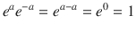

当对表示上溢和下溢的数字执行相同计算时，Octave 必须计算 `Inf * 0`，结果为 `NaN`。以下示例演示了这一点：

```
1  >> exp(900)*exp(-900)

3  ans =

5  NaN

7  >> exp(900)

9  ans =

11  Inf

13  >> exp(-900)

15  ans =

17  0
```

## 7.7 实数到浮点数的实际转换

在了解了上溢和下溢这两个极端情况后，您需要理解实数到浮点数的转换过程。回顾方程 7-11 和 7-12，一个实数可以用 `s` 位有效数字存储如下：


而它可以用浮点表示法（以 10 为基数）写成如下形式：

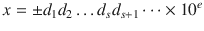

有两种方法可以实现转换：截断法和舍入法。截断法会直接丢弃 `s` 之后的所有数字，即生成以下结果：

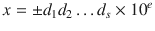

(方程 7-13)

另一方面，舍入法推荐以下过程：

1. 如果 `s_{s+1}` < 5，则执行截断并保留 `x` 的符号。
2. 如果 `s_{s+1}` > 5，则 `d[s]` 加 1。然后执行截断并保留 `x` 的符号。

这个看似简单的方案存在一个缺陷。假设 `s = 4`，您需要对 2.9345 进行舍入。答案会是 2.934，即最后一位数字 5 被直接丢弃。类似地，当对 2.9355 进行舍入时，答案可以写成 2.936，其中最后一位数字被丢弃，最后一位有效数字加 1。在这两种情况下，只有一个数字发生了变化。但假设您需要对 2.9999 进行舍入。在这种情况下，结果会是 3.000，其中有四个数值发生了变化。

## 7.8 MATLAB 的替代方案

随着计算能力的增长、数值计算机的进步以及计算资源价格的下降，MATLAB 已成为工程领域的语言。面对来自开源替代方案（如 Scilab [1]、Octave [2] 和 Python [3]）的挑战，它现在需要在新的维度上进行创新，以在商业和学术领域保持相关性。我关于 Octave、Scilab 和 Python 的书籍（可在亚马逊 [4, 5, 6] 上找到）与本书内容并行，以便于比较 [7]。我强烈建议您研究所有这些选项，以便为您的需求做出最佳决策。

## 7.9 总结

现在应该清楚的是，使用数值计算对物理系统进行数学建模，并不仅仅是输入数据然后得到输出。这必须审慎进行。在有限计算精度的离散系统上执行计算这一行为本身就会引入误差。在呈现结果时必须提及这些误差，以便其他研究者可以交叉验证。尽管数值计算编码繁琐且会引入误差，但在科学家中仍然非常流行。这是因为现代计算机提供了更高的计算速度，而且对大多数物理世界问题的解析解进行人工计算过于繁琐。预计这一趋势在不久的将来仍将持续。