# 8. 符号计算

## 8.1 引言

到目前为止，我们一直在处理数值计算，其中变量存储的是数值。在第 7 章中，你学习了数值计算涉及使用近似解。另一方面，解析解不是近似解，因为它使用符号而非数字。MATLAB 也提供了执行符号计算的方法。

## 8.2 定义符号变量

关键字 `syms` 用于定义一个或多个符号变量。符号变量的关键特性是它仅存储一个符号以执行符号计算。

```
>> syms x y z
>>
```

执行该命令后，查看工作区窗口（见图 8-1），注意已创建了三个新变量——`x`、`y` 和 `z`。

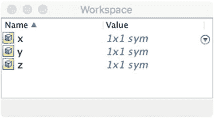

图 8-1

工作区中出现的新符号变量

## 8.3 定义符号方程

定义好变量后，就可以定义一个方程：

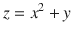

（方程 8-1）使用这些变量如下：

```
>> z = xˆ2+y
z =
xˆ2 + y
```

在本例中，`z` 被预定义为一个符号变量。输出变量由 MATLAB 创建并默认成为符号变量。其输入已被定义为符号变量。例如，假设你想定义这个方程：

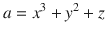

（方程 8-2）

这将创建一个新的符号变量（可以通过检查工作区窗口来验证）。以下 MATLAB 代码执行此任务：

```
>> syms x y z
>> a = xˆ3+yˆ2+z
a =
xˆ3 + yˆ2 + z
```

## 8.4 执行符号计算

符号计算与我们平时在纸上手算的方式相同。你定义一个变量，并使用代数和微积分的数学规则来执行计算。例如，一个二次方程的两个根（`r`[1] 和 `r`[2]）：

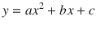

（方程 8-3）可以写成如下形式：

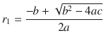

（方程 8-4）

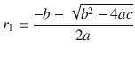

（方程 8-5）

这可以使用以下 MATLAB 代码执行：

```
>> syms a b c x
>> y = a*(xˆ2)+(b*x)+c
y =
a*xˆ2 + b*x + c
>> solve(y)
ans =
−(b + (bˆ2 − 4*a*c)ˆ(1/2))/(2*a)
−(b − (bˆ2 − 4*a*c)ˆ(1/2))/(2*a)
```

类似地，符号数学表达式可以进行积分和微分，如下所示：

```
>> syms a b c x
>> y = a*(xˆ2)+(b*x)+c
y =
a*xˆ2 + b*x + c
>> int(y)
ans =
(a*xˆ3)/3 + (b*xˆ2)/2 + c*x
>> diff(y)
ans =
b + 2*a*x
```

这可以通过手算在纸上验证，我们知道以下内容：


（方程 8-6）

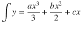

（方程 8-7）

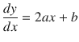

（方程 8-8）

### 8.4.1 算术表达式

简单的算术表达式可以使用符号来处理。例如，可以用两个多项式来定义一个新的多项式。

```
>> syms x y z
>> a1 = xˆ2+2*y+z
a1 =
xˆ2 + 2*y + z
>> a2 = xˆ(−2)−2*y+3*z
a2 =
3*z − 2*y + 1/xˆ2
>> a3 = a1/a2
a3 =
(xˆ2 + 2*y + z)/(3*z − 2*y + 1/xˆ2)
>> a4 = a1*a2
a4 =
(xˆ2 + 2*y + z)*(3*z − 2*y+1/xˆ2)
```

### 8.4.2 三角表达式

使用符号变量定义的三角变量也可用于数学计算，如下所示：

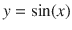

（方程 8-9）

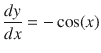

（方程 8-10）

```
>> syms a b c x
>> y = sin(x)
y =
sin(x)
>> int(y)
ans =
−cos(x)
```

甚至更复杂的计算只需一键即可完成。

```
>> z = cos(xˆ(1/2)) − (sin(y))ˆ(1/3)
z =
cos(xˆ(1/2)) − sin(y)ˆ(1/3)
>> int(z)
ans =
2*cos(xˆ(1/2)) − x*sin(y)ˆ(1/3) + 2*xˆ(1/2)*sin(xˆ(1/2))
>> diff(z)
ans =
−sin(xˆ(1/2))/(2*xˆ(1/2))
```

### 8.4.3 表达式的展开与因式分解

`expand()` 函数可用于将方程写成展开后多项式的各项形式。`expand()` 最重要的用途是应用分配律，将积的和重写为和的积。如果 `f` 代表一个符号表达式，则 `expand(f)` 通过以下规则集进行计算：

*   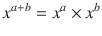

*   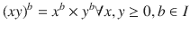

*   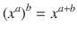

还需要注意的是，`expand()` 函数会递归地对给定表达式的子表达式进行展开。

```
>> syms x y z
>> a1 = xˆ2+2*y+z
a1 =
xˆ2 + 2*y + z
>> a2 = xˆ(−2)−2*y+3*z
a2 =
3*z − 2*y + 1/xˆ2
>> a3 = a1/a2
a3 =
(xˆ2 + 2*y + z)/(3*z − 2*y + 1/xˆ2)
>> a4 = a1*a2
a4 =
(xˆ2 + 2*y + z)*(3*z − 2*y + 1/xˆ2)
>> a5 = expand(a3)
a5 =
(2*y)/(3*z − 2*y + 1/xˆ2) + z/(3*z − 2*y + 1/xˆ2) + xˆ2/(3*z − 2*y + 1/xˆ2)
>> a6 = expand(a4)
a6 =
4*y*z + (2*y)/xˆ2 − 2*xˆ2*y + z/xˆ2 + 3*xˆ2*z − 4*yˆ2 + 3*zˆ2 + 1
```

名为 `factor` 的函数生成一个表达式的因式，使得所有因式相乘的结果等于原表达式。让我们尝试对符号变量 `a5` 和 `a6` 中存储的值进行因式分解。

```
>> a7 = factor(a5)
a7 =
[−1,x,x, xˆ2 + 2*y + z, −1/(3*xˆ2*z − 2*xˆ2*y + 1)]
>> a8 = factor(a5)
a8 =
[−1,x,x, xˆ2 + 2*y + z, −1/(3*xˆ2*z − 2*xˆ2*y + 1)]
```

这些因式以数组元素的形式存在，可以通过其索引进行访问。这在提取因式并将其用于数学分析时非常方便。

```
>> a7[2] = x
>> a7[4] = xˆ2 + 2*y + z
>> a8[3:5] = [x, xˆ2 + 2*y + z, −1/(3*xˆ2*z − 2*xˆ2*y + 1)]
```

在上一个示例中，`a7[2]` 提取变量 `a7` 的第二个元素，`a7[4]` 提取变量 `a7` 的第四个元素，而 `a8[3:5]` 提取从第三个到第五个的所有元素，并将其存储为符号表达式列表。

当一个表达式是另一个表达式的幂时，`expand()` 的作用方式与数学规则一致。例如，考虑定义了一个表达式：

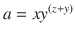

其展开形式为：

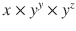

每一项显然都是该表达式的一个因式。这可以通过以下 MATLAB 代码验证：

```
>> syms x y z
>> a = x*yˆ(z+y)
a =
x*yˆ(y + z)
>> b = expand(a)
b =
x*yˆy*yˆz
>> c = factor(b)
c =
[x,yˆy,yˆz]
```

当一个表达式是另一个表达式的指数时，`expand()`函数会递归地工作。

```
>> a=((x+y)ˆ(x+z+2))
a =
(x + y)ˆ(x + z + 2)
>> expand(a)
ans =
xˆ2*(x + y)ˆx*(x + y)ˆz + yˆ2*(x + y)ˆx*(x + y)ˆz + 2*x*y*(x + y)ˆx*(x + y)ˆz
```

它可用于检验三角恒等式：

```
>> expand(sin(x+y))
ans =
cos(x)*sin(y) + cos(y)*sin(x)
>> expand(cos(x+y))
ans =
cos(x)*cos(y) − sin(x)*sin(y)
>> expand(tan(x+y))
ans =
−(tan(x) + tan(y))/(tan(x)*tan(y) − 1)
>> expand(sec(x+y))
ans =
1/(cos(x)*cos(y) − sin(x)*sin(y))
>> a = cosh(x+y)
a =
cosh(x+y)
>> expand(a)
ans =
cosh(x)*cosh(y) + sinh(x)*sinh(y)
>> a = cosh(2*x)
a =
cosh(2*x)
>> expand(a)
ans =
2*cosh(x)ˆ2 − 1
>> a = coth(x+y)
a =
coth(x + y)
>> expand(a)
ans =
(coth(x)*coth(y) + 1)/(coth(x) + coth(y))
```

## 8.5 小结

本章阐述了如何使用符号来求解数学方程。当容易出错的数值计算不被接受时，符号计算被证明非常有用，但它也有其局限性。有限的内置函数集必须由用户自定义函数来补充，这需要编写 MATLAB 程序包的经验。但这绝对是值得探索的。

本书阐述了如何使用 MATLAB 作为高效科学计算的工具。它首先通过单行命令说明了基本用法，然后阐述了如何将多行命令编写成一个`.m`文件。数组是科学计算的基础模块，因此可以使用数组进行基于矩阵的计算。绘图被简化到即使是初学者也能轻松绘制方程图形以可视化图形的程度。通过使用循环和函数，程序可以实现模块化，并且信息流可以得到有效控制。您还看到了一些数值计算的基本示例。本书应能使任何初学者轻松进入科学计算的世界。其广泛流行的用法恰如其分地印证了“MATLAB 是工程领域的语言”这一说法。