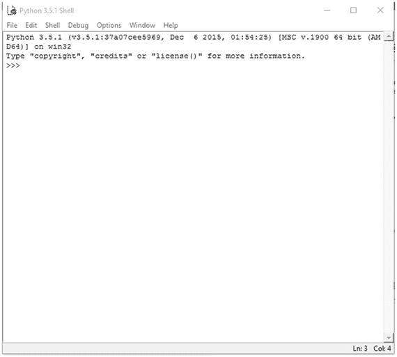
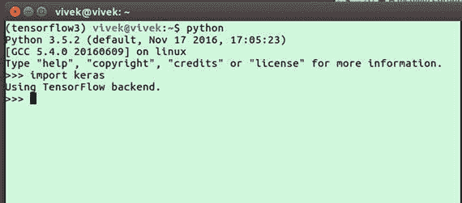
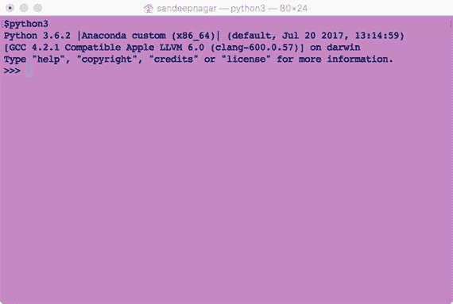
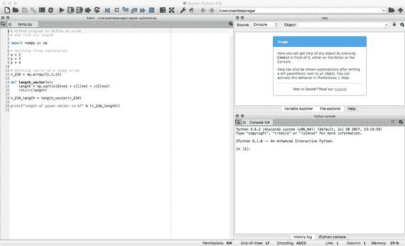
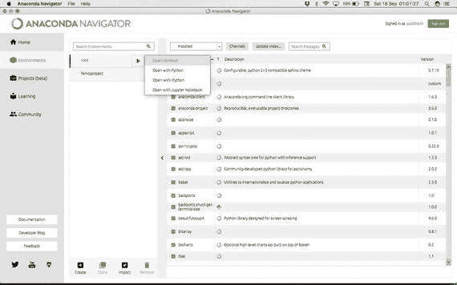
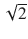

# 2. Python 基础入门

## 2.1 引言

学习 Python 的最佳方式是在 Python 解释器上尝试使用 Python。在本章中，我们将说明如何安装和使用 Python 解释器。安装可在所有主流操作系统上进行。作为示例，我们将演示在 Windows、Ubuntu（Linux）和 Mac OS X 上的安装过程。

## 2.2 安装

Python 解释器已为多种平台提供。操作系统定义了以特定方式存储文件和运行代码的方案。这些不同的方案需要不同的 Python 解释器设置，以便其能够与提供计算资源的主机兼容。最流行的三种操作系统选择是 Windows、Linux 和 Mac OS X。虽然 Linux 和 Mac OS X 预装了 Python 解释器，但 Windows 操作系统需要单独的安装软件。Python 社区网站 [1] 提供了了解该领域进展的主要途径。它还提供了用于安装的源代码的官方下载 [2]。

### 2.2.1 Windows

用户可以根据系统配置下载 32 位或 64 位安装程序文件，然后直接点击启动安装过程。安装完成后，应用程序安装目录中会出现一个图标。双击该图标即可打开 Python shell（图 2-1），这是一个运行 Python 解释器的程序。



**图 2-1** Windows 操作系统上的 Python IDLE

下载的 IDLE 还提供了一个可以运行脚本的文本编辑器选项。或者，如果你已正确将解释器路径配置到系统，可以直接打开终端并输入以下命令：

```
$python hello.py
```

这里我们假设你想运行一个名为 `hello.py` 的 Python 程序。（所有 Python 程序都以 `.py` 扩展名保存。）

我们建议学习使用 Python 终端进行交互式编程，并按照之前讨论的方式执行多行代码。此后，在 Python 提示符（`>>>`）下编写的代码将表示代码是逐行编写并以类似方式执行的，以便程序员在 Python 提示符下进行交互式工作。本书中使用的 `.py` 文件在系统终端中执行。

### 2.2.2 Ubuntu

Python 解释器几乎预装在所有的 Linux 发行版中。这里我们以 Ubuntu Linux 系统为例。可以通过在 Linux 命令终端中输入 `python3` 并按回车键来调用 Python 3 解释器。终端将进入 Python 解释器会话（图 2-2），程序员可以在其中输入 Python 表达式。



**图 2-2** 在 Ubuntu 上运行的 Python 解释器

要退出解释器，需要在 Python 解释器中输入 `exit()`。当返回 Linux 终端后，就可以输入 Linux 表达式了。

### 2.2.3 Mac OS X

Mac OS X 的工作方式与所有 Linux 发行版相同。Python 解释器已预装。只需在终端中输入 `python3` 即可启动 Python 解释器会话。（参见图 2-3。）


## 2.3 使用 Python 解释器

Python 是一种解释型语言，与 C、C++、Java 等编译型语言不同。它的每一行代码都会被解释并作为字节码执行，而不是生成一个单一的机器码文件。这使得其计算架构与传统语言截然不同。例如，假设一个多行 Python 程序的第 5 行存在语法错误。在这种情况下，程序会执行到第 4 行的所有命令，然后显示错误。而对于编译型语言，编译步骤会显示错误，并且程序根本不会运行，也就是说不会生成机器码文件。要详细了解这种差异，你首先需要理解编译和解释的过程。



**图 2-3** 在 Mac OS X 上运行的 Python 解释器

对于编译型语言，编译器会将人类可读的代码翻译成机器可读的汇编语言。机器可读的代码称为目标代码，由目标文件提供。这些目标文件可以直接在机器上运行。举个例子，假设一个 C 代码定义如下，并保存在名为 `hello.c` 的文件中：

```
1  /∗ Hello World program ∗/

3  #include 

5  main()
6  {
7  printf ("Hello World");

9  }
```

要在带有 `gcc` 编译器的类 UNIX 机器上编译这段代码，我们给出以下命令：

```
gcc hello.c -o hello
```

这会创建一个名为 `hello` 的目标代码。在编译过程中，头文件 `stdio.h` 用于理解输入输出语句，例如 `printf("Hello World")`。然后，可以通过在 UNIX 终端上输入以下命令来执行目标代码：

```
./hello
```

用户可以共享这个目标文件，如果微处理器架构与另一个用户相同，它将被统一执行。然而，如果机器架构不同，则必须首先为目标机器编译源代码，然后才能执行。

Python 的情况则不同。作为一种解释型语言，它使用解释器将代码解释为中间代码，然后再转换为机器码。解释器读取程序的源代码文本，对其进行分析，并逐行执行。这个过程很慢，因为解释器花费大量时间分析字符串以理解其含义。例如，要像 C 程序那样输出 `hello world`，Python 需要以下代码：

```
1  >>>print ("hello world")
2  >>>hello world
```

仅在一行中，解释器就会扫描单词 `print` 并查找其含义。在 Python 解释器中，它意味着向特定设备输出。设备可以是计算机终端、打印机绘图仪等。默认情况下，它是计算机终端。`print` 命令还需要参数，这些参数在第二步中被扫描为字符串 `hello world`。（Python 中的字符串可以用 `"` 或 `""` 括起来）。因此，这一行的完整解释是：在计算机终端上打印字符串 `hello world`。

当一个程序由成百上千行代码组成时，编译过程会产生更快的结果，因为目标代码只需编译一次，然后就可以直接在微处理器上运行。而解释型代码每次需要处理时都会检查解释。另一方面，即使是一个语法错误也会导致编译过程无法完成，从而产生编译错误。相反，Python 解释器会解释 Python 代码，直到遇到任何类型的错误为止。

尽管 Python 本质上较慢，但由于其拥有丰富的模块库，可用于各种计算任务，并且极其简单、直观且功能强大，它已成为科学家和工程师的最爱。

## 2.4 Anaconda IDE

Anaconda IDE（集成开发环境）是为初学者和经验丰富的开发者获取工作环境最便捷、最完整的方式之一。IDE 提供了一个 Python 命令行解释器——一个具有语法补全、关键字高亮和文件浏览器等高级功能的文本编辑器。Anaconda 以简单直观的方式提供了所有这些功能以及更多特性。可以使用其网站 [3] 上提供的图形化安装程序非常简单地安装它。


**图 2-4** Anaconda IDE

图 2-4 中的 Spyder IDE 提供了一种使用 IDE 环境开发 Python 文件的简便方法。它呈现三个窗格：

1.  **编辑器**
    *   您可以在此编写多行程序，并通过单击 `Play` 或单击主菜单栏中的 `Run` 选项来执行它。

    

    **图 2-5** Anaconda IDE

2.  **IPython 控制台**
    *   您可以在此编写 Python 表达式，并通过按 `Enter` 键来执行它们。

3.  **变量资源管理器 / 文件资源管理器 / 帮助**
    *   **变量资源管理器**
        *   变量资源管理器显示会话期间创建的所有变量（稍后解释）的详细信息及其属性（名称、类型、大小和值）。
    *   **文件资源管理器**
        *   文件资源管理器显示会话期间创建的所有文件的详细信息及其属性（名称、大小、类型和修改日期）。
    *   **帮助**
        *   此工具提供开发者查询的任何主题的有用文档。

我们是在 Mac OS X 10.12.6 系统上使用 Anaconda IDE 编写本书的。由于 Python 程序是可移植的，它们将以与任何 Python 3 解释器类似的方式运行。

## 2.5 将 Python 用作计算器

让我们开始使用 Python 解释器，以便更清楚地理解它。首先，在 Python 解释器的命令提示符 `>>>` 后输入命令，然后按键盘上的 `Enter` 键。

在最简单的形式中，Python 解释器可以用作计算器。在 Python 命令提示符下，可以检查 `2 + 4` 的以下命令：

```
1  >>>2+4
2  6
3  >>>2.+4
4  6.0
5  >>>2.0+4
6  6.0
7   >>>2.0+4.
8  6.0
9  >>>2.0+4.0
10  6.0
```

根据这些计算，`2 + 4` 得到 `6`，而 `2 + 4.` 得到 `6.0`。对于计算机来说，`6` 和 `6.0` 是两个不同的对象。`6` 是一个整数，存储空间比 `6.0` 小，而 `6.0` 是一个浮点数。就像两种数值数据一样，数据可以分为不同类型的对象（不一定是数值）。Python 将所有条目视为对象。一个对象需要用其属性/特性来定义。例如，与整数相比，浮点数在加法、减法、屏幕打印和图形表示方面有不同的规则。因此，浮点数是一种与整数截然不同的 `数据类型`。稍后将讨论数据类型的详细列表。

同样重要的是要注意，要定义浮点数 `4.0`，即使只写 `4.` 也足够了。`4.0` 和 `4.` 是等价的。类似地，`0.4` 和 `.4` 都表示数学数字 `0.4`。此外，Python 通过分析对象的值动态地为它们分配 `类型`，因此 `2` 变成了数值数据的 `int`（整数类型），而 `2.0` 变成了 `float`（浮点数类型）。我们没有显式定义对象的类型；它是由解释器动态分配的。我们也可以显式定义类型。这涉及到使用特定数据类型对应的函数。以下代码通过使用两个函数 `int()` 和 `float()` 来解释这一现象，这两个函数分别将给定的输入（括号内）转换为整数和浮点数。

```
1  >>> int (2)
2  2
3  >>> int (2.0)
4  2
5  >>> float (2)
6  2 . 0
7  >>> float (2.0)
8  2.0
```


## 2.6 模块

Python 多宇宙已扩展出数千个模块，并且由于是开源的，其中大部分都可以直接获取。模块是为完成特定任务而编写的 Python 程序集合。例如，`numpy` 提供了各种用于数值计算的功能。它进一步扩展为 `scipy`，用于通用科学计算。`matplotlib` 是数学绘图库的缩写，拥有丰富的功能，可以绘制各种达到出版质量的图表。`pandas` 是用于数据分析的库，`scikit-learn` 用于机器学习，`scikit-image` 用于图像处理，`sympy` 用于符号计算。

要使用一个模块，必须首先将其安装在机器上。安装过程包括将文件下载到合适的文件夹或目录中，解压缩，并定义正确的路径。对于 Ubuntu 用户来说，有一种更简单的方法，即基于命令行的简短程序 `pip` 可以无缝地完成这些任务。

运行简单的命令

```
sudo apt-get install python3-pip
```

首先安装 `pip` 程序。然后，只需发出以下命令，即可使用它来安装一个包，例如 `numpy`：

```
sudo pip3 install numpy
```

将包名替换为所需的包名，即可轻松完成包的安装。此外，还可以通过输入以下命令将模块升级到最新版本：

```
sudo pip install [package_name] --upgrade
```

安装 `scipy stack` [4] 对我们的目的非常有用，因为它会安装我们将要使用的各种程序。可以通过在 Ubuntu 终端上发出以下命令来安装它：

```
$ sudo apt-get install python-numpy python-scipy
python-matplotlib ipython ipython-notebook
python-pandas python-sympy python-nose
```

这个单行命令会安装以下内容：

*   `numpy`（数值 Python）
*   `scipy`（科学 Python）
*   `matplotlib`（数学绘图库）
*   `ipython`（Python 解释器的交互式环境）
*   `ipython-notebook`（基于 Web 的 `ipython` 交互式环境）
*   `pandas`（用于统计计算）
*   `sympy`（用于执行符号计算）
*   `nose`（用于测试）

Anaconda IDE 预装了本书所需的所有模块。任何额外的模块都可以使用 conda 终端以类似的方式安装。要打开 conda 终端，首先单击 `Environments`，然后单击 `root` 旁边的箭头按钮（图 2-6）。您可以选择 `Open Terminal` 选项，在任何操作系统中打开一个类似 Linux 的终端。



图 2-6

Conda 终端

`Environment` 选项还会显示已安装模块的列表。您可以通过选择所需模块并单击屏幕底部的 `Apply` 来卸载模块或将其升级到所需版本。

### 2.6.1 使用模块

要使用特定模块及其功能，首先需要使用 `import` 命令在工作区内导入它。例如：

```
import math
```

此命令导入名为 `math` 的模块，其所有对象现在都可以使用了。使用它们的过程如下：

1.  `import math`
    *   在使用模块内部定义的任何函数之前，我们需要提及模块的名称。例如，如果我们想使用 `sqrt()` 函数，我们需要编写 `math.sqrt(2)`，这将使用 `math` 模块计算 。
2.  *   `"*"` 表示所有内容（用正则表达式的语言来说）。因此，该语句意味着我们可以使用所有函数，而无需在函数名称前用 `"."`（点运算符）分隔模块名称。

    ```
    from math import *
    ```

3.  *   此语句仅导入正在使用的 `sqrt()` 函数。当您内存有限且注重能耗时，使用这种 Python 编程风格至关重要，因为您不需要导入不必要的对象。您仍然需要在函数名称前用 `"."`（点运算符）分隔模块名称。

    ```
    from math import sqrt
    ```

## 2.7 Python 环境

在 Python 项目上工作的专业方式是为特定项目建立一个专用的 Python 环境。这有几个优点。该环境与系统版本、更新和升级是隔离的。换句话说，可以维护一个独立的软件依赖项仓库（Python 包），这可以避免依赖项升级影响代码性能时出现的问题。（初学者可以暂时跳过本节，在获得更多 Python 实践经验后再回来阅读。）

Anaconda 2.4 提供了将环境定义为主窗口左侧窗格中可点击选项卡的选项，您可以在其中以图形方式创建和维护虚拟环境。您也可以使用终端执行相同操作。`virtualenv` 是一个基于命令行的工具，可以创建专用且隔离的 Python 虚拟环境。`virtualenv` 创建一个文件夹，其中包含使用 Python 项目可能需要的包所需的所有可执行文件。

### 2.7.1 安装 virtualenv

要安装 `virtualenv`，您需要一个名为 `pip` 的命令行工具（在 ?? 节中详细说明）。在基于 Ubuntu Linux 的机器上，发出以下命令来安装 `virtualenv`：

```
$pip install virtualenv
```

假设您创建了一个名为 `my_project_folder` 的文件夹。要为名为 `proj1` 的项目创建虚拟环境，您需要在 Linux 终端上发出以下命令：

```
$cd my_project_folder
$virtualenv proj1
```

第二个命令将在当前目录中创建一个文件夹。此文件夹将包含 Python 可执行文件和一个 `pip` 库的副本，您可以使用它来安装其他包。

### 2.7.2 激活 virtualenv

要使用已创建的虚拟环境，必须首先将其 `激活`。必须在 Linux 终端上发出以下命令：

```
$source proj1/bin/activate
```

如果没有出现任何错误，命令提示符前将出现虚拟环境的名称。这表明它现在已激活，可以进一步使用。在虚拟环境中，可以像在系统上通常安装包一样安装包。

您可以通过在环境中发出以下命令来生成依赖项列表及其已安装的版本号：

```
$pip freeze > requirements.txt
```

此命令创建一个名为 `requirements.txt` 的文件，其中包含依赖项列表及其版本号。当项目被共享且新用户希望安装该包时，他们可以通过发出以下命令使用此文件进行安装：

```
$pip install -r requirements.txt
```

### 2.7.3 停用虚拟环境

由于开发人员可能需要同时处理多个项目，因此为每个项目设置单独的虚拟环境会很有帮助，因为开发人员一次只能在一个虚拟环境中工作。当开发人员需要切换到虚拟环境之外的其他任务时，他们必须通过发出以下命令来停用当前的虚拟环境：

```
$deactivate
```

该命令将开发人员带回系统的默认 Python 解释器及其所有已安装的库。如果开发人员需要删除虚拟环境，他们可以通过发出以下命令来删除其文件夹：

```
$rm -rf proj1
```


## 2.8 本章小结

Python 因其解释型语言的特性而拥有极其平缓的学习曲线，可以逐行输入指令并立即执行。这种方式避免了编译过程以及随之而来的错误，而这些错误对于对编程语言内部机制了解有限的初学者来说往往是主要障碍。Python 解释器本质上是开源的，可以从互联网上免费下载。`Anaconda` IDE 为 Python 开发者提供了一个良好的集成开发环境，我们建议你使用它来练习本书中的代码。

