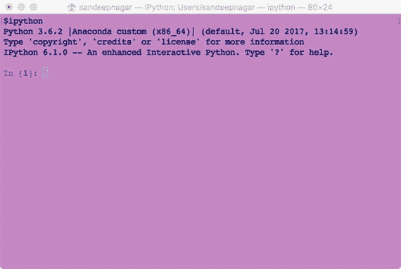

# 3. IPython

## 3.1 简介
编程语言的创造者面临的最大挑战是吸引开发者并让他们愿意学习这门语言。通常，开发者会使用文档或帮助手册来深入了解语言，但交互式环境允许开发者在学习的同时试验命令和程序。Python 的交互式 shell 已经提供了这种环境。

提供相同环境的另一个选择是`IPython` [1]。`IPython`的灵感 [2] 来源于 Maple 和 Mathematica 的笔记本环境。它于 2001 年推出，并迅速开始吸引开发者，因为它构想了一个简单直观的环境来执行 Python 代码，并具有以下特性：
- 为 Python 解释器提供交互式 shell
- 基于浏览器的笔记本，支持代码、文本、数学表达式、内联图表以及其他媒体，例如`ipython-notebook`
- 支持交互式数据可视化和 GUI 工具包的使用
- 灵活、可嵌入的解释器，可加载到项目中
- 用于并行计算的工具

自 2001 年以来，`IPython`环境得到了巨大的发展，这个流行的基于 Web 浏览器的交互式环境甚至更名为`Jupyter Notebook` [3]，以强调除了 Python 之外，它还可以运行其他内核。在撰写本文时，它支持 40 种编程语言，包括 Julia、Python、Scala、R、C 和 C++。`Jupyter`需要本地安装 Python 解释器才能工作，因此用户必须按照第 2 章所述安装 Python 解释器，然后他们就可以在`IPython`环境中工作，并将 Python 作为其内核之一。

## 3.2 安装 IPython
如果你正在使用`Anaconda` IDE（适用于所有操作系统，包括 Windows、Linux 和 Mac OS X），则`IPython`已预装。图 3-1 显示了一个`Spyder` IDE 会话的截图。其右下角运行着一个`IPython`shell。你可以像在 Python shell 中一样在此处输入 Python 表达式，并期望它被求值。

如果你更喜欢在 Ubuntu Linux 命令 shell 上工作，可以通过在终端中发出以下命令来安装`IPython`：
```
$pip3 install ipython
```

安装后，你可以通过在终端中发出以下命令来启动`IPython`会话：
```
$ipython
```
无需输入`python`来调用解释器，而是调用`ipython`应用程序，它会启动一个`IPython`会话，其中 Python 解释器被用作内核。

你可以通过在`IPython`提示符下输入`exit`来退出该会话。在 Python 提示符下，你需要将`exit`定义为一个函数并输入`exit()`，但在这里`exit`会直接执行退出函数。如图 3-1 所示，`IPython`提示符在会话开始时显示`In [1]`。这表示运行`IPython` REPL 的`IPython`提示符正在等待用户输入第一个指令。当你输入指令并按`Enter`键执行表达式时，你会得到带有提示符`Out [1]`的输出，表示这是`In [1]`处第一个 Python 表达式的输出。括号内的数字会逐一递增，这在教授 Python 以及跟踪会话期间的工作流程时非常有用。一旦会话重新启动，这些数字就会重置。


图 3-1

`IPython`会话

`IPython`shell 还支持 Unix/Linux 系统命令。一些有用的命令集如下：
- `pwd`：打印当前工作目录
  - 用户可以打印他们正在运行会话的目录。
- `cd <name1>`：将当前目录更改为`name1`
  - 如果`name2`目录位于当前工作目录内，则该命令会使`name1`成为当前工作目录。
- `rm -r <name_of_directory>`：删除目录`<name_of_directory>`
  - 用户可以删除目录的内容。如果该目录还包含其他子目录，用户必须使用`-rf`标志强制删除。
- `cd..` 和 `cd`
  - 命令`cd..`允许用户在目录树结构中后退一步。
  - 命令`cd`将用户置于主目录中。

还有许多其他 Unix/Linux 命令可以在`IPython`shell 中使用。一组称为魔法函数 [4] 的特殊命令可用于增强`IPython`会话的功能。有两种魔法函数：面向行的和面向单元格的。行魔法函数以`%`字符为前缀，其工作方式类似于操作系统命令行调用：它们将行的其余部分作为参数，参数传递时不带括号或引号。单元格魔法函数以双`%%`为前缀，它们是函数，不仅将行的其余部分作为参数，还将下面的行作为单独的参数。讨论所有魔法函数超出了本书的范围，因此这里只讨论几个有用的魔法函数。