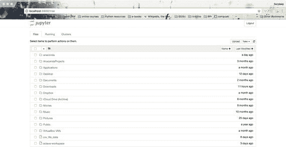
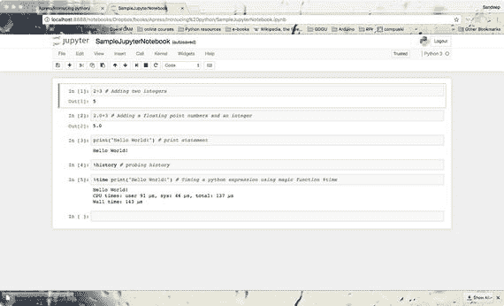
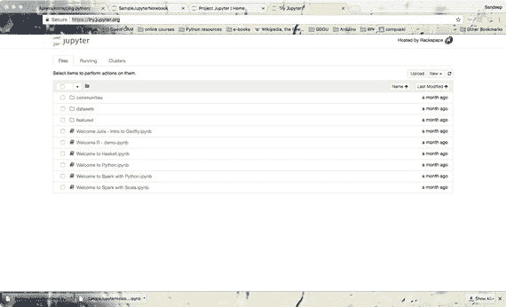

# IPython 魔法命令

- `%history`
  - 显示当前会话中的所有输入历史。

- `%logstart`、`logoff`、`logon`、`%logstop`
  - `%logstart`：在会话中的任意位置开始记录日志。
  - `logoff`：暂时停止记录日志。
  - `logon`：重新开始记录日志。
  - `%logstop`：完全停止记录日志并关闭日志文件。

- `%lsmagic`
  - 列出当前可用的魔法函数。

- `%magic`
  - 打印关于魔法函数系统的信息。

- `%run`
  - 在 IPython 中将指定文件作为程序运行。

- `%time`
  - 计时执行一条 Python 语句或表达式。

以下 IPython shell 代码将演示其用法。需要注意的是，Python 中的注释以 `#` 符号开头。`#` 符号之后的任何表达式都会被解释器忽略，因此可以为每一行代码插入信息性注释。养成插入有用注释的好习惯，以便在长时间后重新查看代码，或与他人共享项目代码时，他人能够理解给定代码文件中命令使用背后的逻辑：

```
1  In [1]: 2+3 # 两个整数相加
2  Out [1]: 5

4  In [2]: 2.0+3 # 浮点数与整数相加
5  Out [2]: 5.0

7  In [3]: %history # 探查本次会话中使用过的命令历史
8  2+3
9  2.0+3
10  %history

12  In [4]: %history # 再次探查历史，显示在 IN [3] 处使用的 history 命令
13  2+3
14  2.0+3
15  %history
16  %history

18  In [5]: %lsmagic # 列出所有可用的魔法函数
19  Out [5]:
20  可用的行魔法：
21  %alias  %alias_magic   %autocall   %autoindent   %automagic
%bookmark   %cat   %cd   %clear   %colors   %config   %cp   %cpaste        %debug   %dhist   %dirs   %doctestmode   %ed   %edit   %env   %gui
%hist   %history   %killbgscripts   %ldir   %less   %lf   %lk   %ll          %load   %load_ext   %loadpy   %logoff   %logon   %logstart
%logstate   %logstop   %ls   %lsmagic   %lx   %macro   %magic   %man         %matplotlib   %mkdir   %more   %mv   %notebook   %page   %paste
%pastebin   %pdb   %pdef   %pdoc   %pfile   %pinfo   %pinfo2   %popd         %pprint   %precision   %profile   %prun   %psearch   %psource
%pushd   %pwd   %pycat   %pylab   %quickref   %recall   %rehashx   %reload_ext   %rep   %rerun   %reset   %reset_selective   %rm   %rmdir   %run   %save   %sc   %setenv   %store   %sx   %system   %tb
%time   %timeit   %unalias   %unload_ext   %who   %who_ls   %whos         %xdel   %xmode

23  可用的单元格魔法：
24  %%!  %%HTML  %%SVG  %%bash   %%capture   %%debug   %%file   %%html   %%javascript   %%js   %%latex   %%markdown   %%perl   %%prun
%%pypy   %%python   %%python2   %%python3   %%ruby   %%script   %%sh   %%svg   %%sx   %%system   %%time   %%timeit   %%writefile

26  自动魔法已开启，行魔法无需前缀。

28  In [6]: %time print ("Hello World !") # 计时执行一条打印语句
29  Hello World!
30  CPU 时间：用户 110 微秒，系统：52 微秒，总计：
31  162 微秒 墙上时间：149 微秒

33  In [7]: %history # 再次探查历史，显示其他使用过的表达式
34  2+3
35  2.0+3
36  %history
37  %history
38  %lsmagic
39  %time print ("Hello World !")
40  %history

42  In [8]:
```

需要注意的是，Windows 操作系统版本的 Python 解释器在执行 `%time print("Hello World!")` 时不会列出 `cputime`。

## IPython Notebooks

正如 IPython 会话在终端会话中启动一样，IPython Notebook 会话在 Web 浏览器会话中启动。因此，用户只需一个 Web 浏览器即可使用 IPython Notebooks。前面章节中解释的所有命令在此处的工作方式类似，只是用户需要按下 `Shift+Enter` 组合键来执行。IPython Notebooks 已更名为 Jupyter Notebooks，因为除了 Python 之外，现在还支持 40 种编程语言。用户在使用前需要先安装 Jupyter Notebook。

### 安装 Jupyter Notebook

Anaconda IDE 已预装 Jupyter Notebook。图 3-2 显示 Jupyter Notebook 是中央面板中的首选选项之一。点击 `Launch` 将在已安装的浏览器中打开一个窗口。大多数浏览器都支持此操作。本书使用 Google Chrome（版本 60.0.3112.113（官方版本）（64 位））来测试后续使用的代码。


图 3-2：IPython Notebook 会话

Web 浏览器窗口将列出主文件夹中的目录和文件。用户可以导航到目标目录并启动一个 `Python3` 的 Jupyter 会话。他们可以点击 `New` 按钮并选择一个内核（此处为 `Python3`）。这将打开一个类似于图 3-3 的屏幕。

以下是此 Jupyter Notebook 会话的各种功能：

- **命名笔记本**
  - 新笔记本默认标题为 `Untitled`。点击此标题将打开一个图形视图，用于输入新名称，并会相应更新。

- **单元格**
  - Jupyter Notebook 由单元格组成，通过按下 `Shift+Enter` 组合键执行。
  - 有几种代码类型的单元格，如图 3-3 所示。
    - **代码**
      - 用户可以在分配给 `Code` 类型的单元格中编写 Python 代码，并通过按下 `Shift+Enter` 组合键执行单行或多行代码。
      - 用户也可以通过点击主菜单栏中的 `Cell` ⇒ `Run Cells` 按钮来运行单元格（即执行单元格）。
      - 代码单元格也存在特殊的显示格式，但此讨论超出了本书的范围。建议用户参考主要文档以了解各种显示格式 [5]。
    - **Markdown** [6]
      - 分配为 `Markdown` 类型的单元格可以填充 markdown 代码，执行后用于格式化打印。
      - 用户可以在此处使用 LaTeX 命令来定义数学方程和特殊符号。
      - 用户可以通过放置单个 `#` 来定义主标题，并使用多个符号来定义后续副标题。
    - **原始 NBConvert**
      - 笔记本创作环境不会渲染原始单元格。
      - 它们可以有不同的格式。此信息存储在笔记本元数据中。
      - 原始单元格定义为应在 `nbconvert` 输出中未经修改包含的内容。
      - 默认情况下（如果未选择单元格格式），单元格内容会（不经任何转换）包含在 HTML 和 LaTeX 输出中。
    - **标题**
      - 可以使用 `Heading` 单元格类型为文档的单独部分创建标题。

- 另一种方法是使用 `Markdown` 单元格类型，然后使用 `#` 符号创建一个或多个标题。


图 3-3：Jupyter Notebook 会话

用户通过尝试使用 Jupyter Notebook 来学习效果最佳。图 3-4 显示了一个示例笔记本。



图 3-4：一个示例 Jupyter Notebook 会话

### 3.4 保存 Jupyter Notebook

用户可以将 Jupyter Notebook 保存为 `.ipnyb` 文件，并在任何计算机上的 Jupyter Notebook 环境中打开它。这使得 Python 的教学和学习更加便捷。开发者可以通过将 Notebook 划分为多个部分、为各部分添加标题和副标题、在代码单元格中编写代码、以及在 Markdown 单元格中编写解释性细节，来演示 Python 的用法。Markdown 单元格支持使用 `LaTeX` 命令编写数学公式。

用户还可以将 Jupyter Notebook 保存为 `.py` 文件（可在 Python 解释器中执行的 Python 程序）。此时，除代码单元格外的所有单元格都会通过在开头添加 `#` 符号被转换为注释。

Jupyter Notebook 可以保存为 HTML 格式，以便嵌入到网站中使用。这对于在线课程开发非常有用。它们也可以保存为 LaTeX 文件，以构建特定格式，或直接保存为 PDF 文档。

保存后的文件可以与希望学习特定主题的人共享。用户只需在 Jupyter Notebook 环境中运行该 Notebook 即可。这一功能对课堂教学大有裨益。教师和学生可以逐单元格执行他们的 Jupyter Notebook，从而更轻松地理解概念。否则，在 Python 教学过程中，教师将不得不在演示文件和 Python 解释器之间来回切换。用户还可以利用此功能定义测试和作业。

### 3.5 在线 Jupyter 环境

Jupyter Notebook 的主网站 [7] 在远程服务器上提供了一个在线环境，具备前文所述本地安装所提供的所有功能。在这里，用户通过互联网在远程计算机上工作。每个用户都拥有有限的工作空间。该空间可以与团队共享，用户可以进行协作。Jupyter 会话的截图如图 3-5 所示。

在线会话中提供了多种语言的示例 Notebook。用户可以使用示例 Python Notebook 来学习基础知识。用户可以创建一个目录，然后有条理地将所有 Jupyter Notebook 存储在其中。这些 Notebook 可以下载到本地机器，并在本地 Jupyter Notebook 会话中使用。用户也可以执行相反的操作。换句话说，他们可以使用左上角菜单中的 `Upload` 按钮，将本地的 Jupyter Notebook 加载到在线会话中。



图 3-5

一个示例在线 Jupyter Notebook 会话

### 3.6 总结

在本章中，我们演示了如何在 IPython 和 Jupyter Notebook 环境中工作。Jupyter Notebook 正越来越多地被开发者用于向更广泛的受众传播知识，因为用户可以将代码和说明性描述打包在一个文件中。各种网站上存在成千上万个 Jupyter Notebook，使得 Python 用户数量呈指数级增长。我们建议本书的读者也为每一章创建一个独立的 Jupyter Notebook，以加深自己的理解，并将其发布到互联网上，以便他人受益。