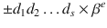
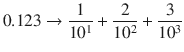
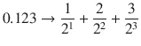
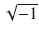

# 4. 数据类型

## 4.1 引言

充分利用本书的最佳方式是开始在 IPython 提示符下工作，向它输入代码并观察输出。你可以使用 Anaconda IDE，以避免为本书安装所需包。你可以在 IPython 会话期间使用 Spyder IDE 作为编辑器来编写多行文件。我们建议你在需要的地方编写详细的描述性注释，以增强对给定代码工作流程的理解。这种方案在所有平台上都适用。在本章中，我们将讨论 Python 中的各种数据及其分类为多种数据类型的方式。

现代计算机将数据区分为多种类型。数据可以是数字、字符、字符串（一组字符）等等。在 Python 中，你可以根据需要定义新的数据类型。有一些内置数据类型用于处理数字和字符。不同的数据类型占用不同的内存量。理解你的需求并据此选择数据类型非常重要。数据类型也决定了答案的精度。我们将在后续章节中讨论 Python 中各种内置数据类型。

## 4.2 逻辑型

这种类型的数据存储布尔值 `True` 或 `False`，并且可以通过布尔运算符（如 `AND` 和 `OR`）进行操作。大多数编程语言使用值 `1` 或 `0` 来表示布尔值，但 Python 在这方面有所不同。让我们通过一些示例来探索它们的用法。

**OR 运算符真值表（表 4-1）**

| OR | True | False |
|---|---|---|
| True | True | True |
| False | True | False |

**AND 运算符真值表（表 4-2）**

| AND | True | False |
|---|---|---|
| True | True | False |
| False | False | False |

**XOR 运算符真值表（表 4-3）**

| XOR | True | False |
|---|---|---|
| True | False | True |
| False | True | False |

**NOT 运算符真值表（表 4-4）**

| NOT | |
|---|---|
| True | False |
| False | True |

| 运算符 | Python 函数 | 符号函数 |
|---|---|---|
| AND | `and()` | `&` |
| OR | `or()` | `|` |
| XOR | `xor()` | `^` |
| NOT | `not()` | |

```
>>> True
True
>>> False
False
>>> not True
False
>>> not False
True
>>> True and False
False
>>> True or False
True
>>> True ˆ False
True
>>> True ˆ False
True
```

复杂的逻辑语句也可以被求值。例如：

```
>>> (True and True) or (not False)
True
>>> (True or True) or (True and False)
True
>>> not ((True or True) or (True and False))
False
```

重要的是要看到，使用括号使用户能够以有意义的方式将逻辑表达式组合在一起。

逻辑运算是比较运算的结果。例如：

```
>>> 2>3 # 大于运算符
False
>>> 2==2 # 等于运算符
True
>>> 2==2.0 # 等于运算符比较的是值，而不是类型
True
>>> 2==3 # 等于运算符
False
>>> (2+3)>(2-3) # 逻辑求值的复杂表达式
```

## 4.3 数值型

数值型：有四种数值数据类型：

*   `int`：整数
*   `float`：浮点数
*   `complex`：复数

### 4.3.1 整数

Python 对 `float`、`long` 和 `complex numbers` 具有任意精度。因此，这些数字的长度限制取决于可用内存。这种架构的积极方面是用户不受数字范围的限制，但他们必须始终确保在计算过程中有足够的内存可用，以避免错误结果。Python 2 将 `int` 的大小限制为字节（与 C 编程语言中的大小相同），而 Python 3 将 `int` 和 `long` 合并为 `int`。在 32 位系统上，Python 3 将 `int` 存储为 32 位。在 64 位计算机上，它将 `int` 存储为 64 位长整数。

内置函数 `type()` 显示数据类型如下：

```
>>> type(-1)
<class 'int'>
>>> type(1)
<class 'int'>
```

如这些示例所示，Python 解释器动态分配数据类型。换句话说，它根据输入的定义为其分配数据类型。这对程序员来说非常方便。`1` 自动成为整数，而 `1.0` 成为浮点数。

### 4.3.2 浮点数

在计算中，浮点表示法是一种近似表示数学实数的方案。实数通常用小数点书写。例如，`2` 是一个整数，而 `2.0` 是一个实数。这两个数字对计算机来说截然不同。`2` 会以 `int` 类型存储，而 `2.0` 则会以 `float` 类型存储：

```
>>> type(2)
>>> type(2.0)
```

实数到计算机存储系统的映射是一种公式化表示（称为浮点表示）[1]。实数由三部分组成：有效数字、基数和指数。

例如，π 的值是 `3.1415926535897…`。假设对于某个特定计算，我们只有四位有效数字，那么该值可以重写为 `3.1415`。现在这个数字表示为 `31415 × 10 ^(−4)`，其中 `31415` 称为有效数字，`10` 称为基数，`−4` 称为指数。

在给有效数字赋值时，会用到有效数字位数的信息。一个数字的有效数字是指那些对其测量分辨率有意义的数字。在这个例子中，我们根据计算/测量的要求，假设只有四位有效数字。术语“浮点”指的是数字的小数点可以“浮动”；也就是说，它可以相对于数字的有效数字放置在任何位置。这个位置由指数部分指示；因此，浮点表示可以被视为一种科学记数法。

### 4.3.3 如何存储浮点数

计算机可以将数字存储为浮点对象。浮点对象按如下方式存储数字：



(4.1) 其中 `d [i] = 0, 1, 2…β − 1`，但 `d [1] j= 0`，且 `m ≤ e ≤ M`，其中 `m ∈ I ^−` 且 `M ∈ I ^+`。

浮点数的三个部分如下：

*   符号（`±`）
*   有效数字（尾数）（`d [1] d [2] …d [s]`）
*   指数（`β`）

浮点数的每个部分都存储在不同的内存位置，并占用指定的位数。哪个部分定义了多少位？这个问题已由名为 `IEEE754` [1] 的 IEEE 标准回答。首先，让我们看看数字表示精度的概念：

1.  单精度：占用 4 字节 = 32 位。
2.  双精度：占用 8 字节 = 64 位。
3.  扩展双精度：占用 80 位。
4.  四精度：占用 16 字节 = 128 位。

这种方案可以在范围和精度之间进行权衡。虽然整数具有无限精度，但如前所述，浮点数通常使用双精度实现。关于程序运行所在机器的浮点数精度和内部表示的信息，可以在 `sys.float_info` 中找到：

```
>>>import sys # 导入 sys 模块
>>> sys.float_info # 使用 sys 的 float_info 函数
 sys.float_info(max=1.7976931348623157e+308, max_exp=1024, max_10_exp=308,
min=2.2250738585072014e-308, min_exp=-1021, min_10_exp=-307, dig=15,
mant_dig=53, epsilon=2.220446049250313e-16, radix=2, rounds=1)
>>> sys.int_info # 使用 sys 的 int_info 函数
sys.int_info(bits_per_digit=30, sizeof_digit=4)
```

在 Python 提示符下发出 `sys.int_info` 命令时，32 位 Windows 操作系统会输出 `sys.int_info(bits_per_digit=15, sizeof_digit=2)`。

# 基于浮点数的算术运算

基于浮点数的算术运算的问题在于，其结果是对实数的近似，因为实数是以 `10` 为基数定义的，而计算机处理数字时使用 `2` 作为基数。例如，`0.123` 在以 `10` 为基数的数字系统中定义为



相反，在以 `2` 为基数的数字系统中，它表示为



这个计算表明 `0.123[2] = 0.135[10]`。如果你使用更多位来存储该值，就能得到对实数更好的近似，但你始终只能使用近似值，而非真实值。正如 `sys.float_info` 所告知的，最大的浮点数是 `max = 1.7976931348623157e + 308`（`1.7976931348623157 × 10³⁰⁸`）。

要获得更高的精度，你可以使用 `decimal` 模块，它包含函数 `Decimal()`，该函数返回计算机存储的数字：

```
>>> from decimal import Decimal
>>> Decimal(0.123)
Decimal('0.1229999999999999982236431605997495353221893310546875')
>>> Decimal(1.2345)
Decimal('1.2344999999999999307220832633902318775653839111328125')
>>> type(Decimal(0.123))
```

如你所见，`0.123` 被存储为 `0.1229999999999999982236431605997495353221893310546875`，这仍然是实数 `0.123` 的一个近似值。在大多数情况下，这个误差微不足道，你可以忽略使用数字计算机（运行在二进制数字系统上）进行计算所引入的误差。但在某些情况下，这个误差是显著的，你需要采取适当措施来计算并应对这个误差。

## 4.3.4 复数

复数在科学和工程研究中被广泛使用。复数的虚部包含有关信号相位的重要信息。Python 通过创建一个名为 `complex` 的对象来支持复数的使用。虚部通过添加符号 `j` 来表示，该符号代表虚数单位（=）。因此，你可以在 Python 中将复数 `2+3i` 定义为 `2+3j`。另一种定义复数的方法是使用内置函数 `complex()`，它接受两个参数：第一个参数是复数的实部，第二个参数是复数的虚部。以下代码将提供更多关于其用法的信息：

```
>>> 2+3j
(2+3j)
>>> type(2+3j)
>>> complex(2,3)
(2+3j)
>>> type(complex(2,3))
```

## 4.4 序列

语言符号需要在计算机上存储，因此必须被定义为一个对象。这个对象被称为字符。出现在计算机屏幕和打印纸张上的每种语言的每个单独符号，在编程语言中都被视为一个字符。这包括 ASCII 和 Unicode 字符。字符的例子包括字母、数字、空白字符、标点符号、感叹号等等。通常，键盘上的所有按键都会产生字符。

为了在计算设备之间进行通信，字符被编码为定义明确、国际公认的格式（例如 ASCII 和 UTF-8），这些格式将每个字符分配给一串二进制数字。两种常见的编码示例是 ASCII 和用于 Unicode 的 UTF-8 编码。所有编程语言都必须能够解码和处理国际公认的字符。Python 也使用数据类型 `字符串`、`列表` 和 `元组` 来处理字符。

### 4.4.1 字符串

字符串仅仅是字符序列。小写和大写字符具有不同的编码；因此，字符串是区分大小写的：

```
>>> type('a')
>>> type('abba')
>>> type("a")
>>> type("abba")
```

这里，我们分别定义了一个单字符和四字符的字符串。重要的是要记住，空白字符也是一个字符。因此，`Hello world!` 有 12 个字符，即 `h`、`e`、`l`、`l`、`o`、` `、`w`、`o`、`r`、`l`、`d`、`!`。在定义字符串时，我们用 `"` 或 `""` 将字符括起来。当字符串需要跨越多行时，会使用三组引号：

```
>>> print("""Python can also print multiline strings which can span many lines instead of being printed on just one line""")
Python can also print multiline strings which can span many lines instead of
being printed on just one line
```

你可以使用特殊字符来打印字符以定义空格，并在新行上打印字符。这可以通过使用 `\t` 和 `\n` 字符来实现，它们分别打印一个制表符和一个换行符：

```
>>> print("' Python can also print multiline strings having tabs like \t and also prints in \n next line'")
Python can also print multiline strings having tabs like and also prints in
    next line
```

注意，在 `\t` 的位置打印了四个空格作为制表符，而 `\n` 之后的字符串部分打印在新的一行上，因为 `\n` 是一个换行符。

但是，为什么我们要有三种方式来定义字符串，即使用单引号、双引号和三引号？单引号可用于打印包含双引号作为字符的字符串。双引号可用于打印包含单引号作为字符的字符串。三引号可用于同时打印双引号和单引号作为字符。这种行为可以通过以下代码来研究：

```
>>> print("'Mahatma Gandhi's words, "An eye for an eye makes the whole world blind", stand true even today'")
Mahatma Gandhi's words, "An eye for an eye makes the whole world blind", stand true even today
```

### 4.4.2 列表和元组

列表是一个有序的对象集合，无论其数据类型如何。它可以通过将一组值括在方括号中来定义。例如：

```
>>> [1,2.0,'a',"Alpha"]
[1, 2.0,'a','Alpha']
>>> type([1,2.0,'a ',"Alpha"])
```

在 Python 代码中，列表的第一个元素是整数，第二个是浮点数，第三个是单字符字符串，第四个是多字符字符串。

元组使用`圆括号 ()` 而不是方括号 `[]` 来定义。例如：

```
>>> (1,2.0,'a',"Alpha")
(1,2.0,'a','Alpha')
>>> type((1,2.0,'a',"Alpha"))
```

除了使用不同的括号定义之外，列表和元组的主要区别在于元组是不可变的列表；它们的元素一旦定义，就不能被更改。列表的元素可以使用它们的索引来更改。关于如何操作的更多信息将在第 5 章中讨论，其中定义了列表的操作。在科学计算中，通用常量可以定义为一个元组，然后在程序中通过其索引进行访问。

## 4.5 集合与冻结集合

集合数据类型是数学集合的实现。它是一个无序的对象集合。与序列对象（如 `list` 和 `tuple`，其中元素是有序的）不同，集合没有这样的要求。然而，集合不允许元素重复出现，也就是说，一个元素要么出现 0 次，要么出现 1 次。`list` 和 `tuple` 对象则不是这种情况。

集合使用 `set()` 函数定义，该函数接受一个 `list` 作为其输入参数。例如：

```
# 集合与映射

## 集合

`set(['h','e','l','l','o',1,2.0,3+4j])` 的结果为 `{1, 2.0, 'h', 'o', (3+4j), 'l', 'e'}`。
`type(set(['h','e','l','l','o',1,2.0,3+4j]))` 的结果为 `set`。

`frozenset(['h','e','l','l','o',1,2.0,3+4j])` 的结果为 `frozenset({1, 2.0, 'h', 'o', (3+4j), 'l', 'e'})`。
`type(frozenset(['h','e','l','l','o',1,2.0,3+4j]))` 的结果为 `frozenset`。

请注意，由于 `l` 在定义集合时出现了两次，它只被授予了一个成员资格。集合操作将在后续章节中详细讨论。就像 `tuple` 对象是不可变的一样，`frozenset` 也是一个不可变对象，并且类似于 `set` 对象。

## 4.6 映射

映射是一种定义数据的方案，其中每个元素都由一个称为“哈希标签”的键来标识。可以通过引用该键来访问元素。此类别中的一种数据类型是字典。

字典是与键相关联的无序值对。这些值通过键而不是索引来访问。这些键必须是可哈希的，例如整数、浮点数、字符串、元组和冻结集合。列表、字典以及除冻结集合之外的集合是不可哈希的。以下是字典的一个示例：

```
>>> {'a':1, 'b':10}
{'a':1, 'b':10}
>>> type({'a':1, 'b':10})
```

在这个例子中，我们创建了一个包含两个字符 `a` 和 `b` 的字典，它们由两个键 `1` 和 `10` 标识。各种运算符可以对字典进行操作，这将在后续章节中讨论。

## 4.7 空对象

`None` 是一个空对象。在其他编程语言（包括 `C`、`Java` 和 `PHP`）中，空对象由关键字 `null` 表示，但在 Python 中，它由关键字 `None` 表示。它指的是无功能性（即，与其关联的对象没有行为）。当在 Python 提示符下输入它时，什么也不会发生：

```
>>> None
>>> type(None)
```

## 4.8 总结

面向对象编程利用了这样一个事实：所有计算实体都只是对象，它们根据其定义的行为相互交互。我们在本章中讨论了一些内置数据类型。一些数据类型在模块内部定义。用户可以定义自己的数据类型并定义其属性。在进入这些高级主题之前，了解运算符如何对各种数据进行操作将很有用。这将是第 5 章的主题。
```