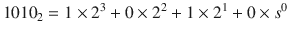
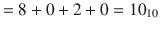

# 5. 运算符

## 5.1 引言

运算符的工作方式与数学函数类似。它们在不同域之间建立关系。例如，乘法运算符接收一对有序的操作数（运算符所操作的数据），并生成另一个数据点。这可以对任意数量的数据点进行。通过这种方式，运算符将数据从操作数域转换到结果域。

基本运算符的符号见表 5-1。

**表 5-1** 基本运算符符号

| 数学运算 | 符号 |
| --- | --- |
| 加法 | `+` |
| 减法 | `-` |
| 乘法 | `*` |
| 除法 | `\` |
| 取模 | `%` |
| 幂运算 | `**` |

这些运算符可以以复杂的方式组合起来执行算术运算。根据数据类型的不同，它们会定义各自的功能。例如，对于数值数据，`+` 执行数值加法；而对于字符串，它则执行拼接操作。类似地，乘法运算符应用于字符串时，会将字符串重复拼接相应次数。除法、取模和幂运算符对于字符串没有定义的行为。这种行为可以通过以下 Python 代码验证：

```
>>> 2+3
5
>>> 'a' + 'b'
'ab'
>>> "hello" + " " + "world" + "!"
'hello world !'
>>> 'a'*3
'aaa'
>>> 'a'/3
Traceback (most recent call last):
  File "<stdin>", line 1, in <module>
TypeError: unsupported operand type(s) for /: 'str' and 'int'
>>> 'a'%3
Traceback (most recent call last):
  File "<stdin>", line 1, in <module>
TypeError: not all arguments converted during string formatting
>>> 'a'**3
Traceback (most recent call last):
  File "<stdin>", line 1, in <module>
TypeError: unsupported operand type(s) for ** or pow(): 'str' and 'int'
```

正如第 4 章所讨论的，有多种运算符可以对数据类型进行操作。

下一节将讨论各种内置运算符，包括算术运算符和逻辑/布尔运算符。请注意，运算符的领域并不局限于本章的讨论范围。模块会定义新的数据类型，并为这些类型定义新的运算符。我们将把讨论范围限定在内置的基本运算符上。我们将说明这些内置运算符的用法，以及它们在定义数学计算中的应用。

## 5.2 变量的概念

当运算符作用于数据时，数据的值在计算过程中可能会发生变化。这种情况可能发生多次。为了临时存储值（例如，在计算过程中），我们使用变量。变量通过其地址（可视化为十六进制数）指向内存位置上的特定值。整个设置可以赋予一个符号字符串，称为变量名。

例如，我们可以将值 0.12 存储为变量 `a`，然后在方程中使用它，如

```
{1010}_2=1\times {2}^3+0\times {2}^2+1\times {2}^1+0\times {2}^0
```

```
>>> a=0.12 # 将值 0.12 赋给名为 'a' 的变量
>>> answer = (a**2) + (10 * a) # 执行计算并将结果存储在名为 'answer' 的变量中
>>> print(a)
0.12
>>> print(answer)
1.2144
>>> type(answer) # 检查存储在变量 'answer' 中的值的类型

>>> a=5 # 将不同的值重新赋给 'a'
>>> print(a) # 新值被反映出来
5
>>> print(answer) # 旧值仍然存储在 'answer' 中
1.2144
>>> answer = (a**2) + (10 * a) # 使用新值进行计算
>>> print(answer) # 打印出新值
75
```

这里，数值 0.12 存储在一个名为 `a` 的内存位置。这个变量被后续一个使用变量名 `answer` 定义的方程所调用，当打印 `answer` 时，会打印出其中存储的值。存储的值是一个浮点数。对象的类型可以通过函数 `type()` 获知，该函数以变量名作为参数。

这个变量将值更改为新值 5。然而，除非重新执行计算，否则变量 `answer` 存储的是旧的已求值结果。当使用新值 `a` 时，`answer` 的值也会改变。Python 变量不需要显式定义其类型。类型是根据它们所指向的值推断出来的。理解变量仅仅是指向内存位置的指针这一点很重要。当值改变时，这些指针会指向不同的地址。是内存存储了数据。数据可以是任何类型。在前面讨论的例子中，数据是数字，但它们可以是任何类型。

### 5.2.1 变量命名规则

由于 Python 会使用某些关键字供自身使用，因此有一些名称不应被用作变量名。此外，还有一些国际公认的规则（通常对大多数编程语言通用）：

- 必须以字母（a–z, A–Z）或下划线（`_`）开头。
- 其余字符可以是字母、数字或 `_`。
- 名称区分大小写。
- 名称长度没有限制，但建议保持简短且有意义。
- `关键字` 不能用作变量名。

使用 `keyword` 模块，可以通过函数 `keyword.kwlist` 获取关键字列表。`keyword.py` 中给出的代码提供了一个关键字列表，这些关键字不能用作变量名。（参见 清单 5-1。）

```
import keyword

print ("Python keywords:", keyword.kwlist)
```
*清单 5-1 `Keyword.py`*

运行此代码的结果如下：

```
Python keywords:   ['False', 'None', 'True', 'and', 'as', 'assert', 'break', 'class', 'continue', 'def', 'del', 'elif', 'else', 'except', 'finally', 'for', 'from', 'global', 'if', 'import', 'in', 'is', 'lambda', 'nonlocal', 'not', 'or', 'pass', 'raise', 'return', 'try', 'while', 'with', 'yield']
```

在交互式会话中，有一种便捷的方法可以检查某个名称是否在关键字列表中。要检查某个特定的变量名是否为关键字，可以使用函数 `keyword.iskeyword()`。可以将该名称作为字符串输入到此函数中。如下列代码所示，如果输入的字符串是关键字，则返回值 `True`。否则，返回 `False`：

```
>>> import keyword
>>> keyword.iskeyword('lambda')
True
>>> keyword.iskeyword('lamb')
False
```

因此，名称 `lambda` 是一个关键字，但名称 `lamb` 不是。

## 5.3 赋值运算符

变量的概念使用了符号 `=`，这与数学中的“等于”不同。相反，它是赋值运算符之一。符号 `=` 将右侧的值赋给左侧的变量名。这本质上意味着它记下右侧值的内存地址，并将其与左侧的变量名关联起来。以下 Python 代码演示了这种行为：

```
>>> a = 5 # 将值 5 赋给 a
>>> a # Python REPL 打印 a 的值
5
>>> print(a) # print() 函数打印 a 的值
5
>>> a = 10 # 将新值 10 重新赋给 a
>>> a # 打印 a 的值，并显示新值作为结果
10
>>> b = a # 将 a 指向的值赋给新变量 b
>>> b # b 现在存储 a 最后存储的值，即 10
10
>>> a = 15 # 将新值 15 重新赋给 a
>>> a # REPL 打印 a 的新赋值
15
>>> b # REPL 打印 b 的值，即上次赋的值
10
```

变量的值可以通过在 Python REPL 中直接输入变量名并按 `Enter` 键来打印。也可以使用 `print()` 函数打印，该函数将变量名作为输入（不是不带引号的字符串）。此外，打印的值对应于最后赋的值。当执行 `b=a` 时，使用的是 `a=10`。当执行 `a=15` 时，`a` 的值改变了，但 `b` 的值保持不变。这种行为可以通过以下方式理解：

- `a=10`
    - 变量 `a` 指向存储值 `10` 的内存位置。
- `b=a`
    - 变量 `b` 也指向与 `a` 相同的内存位置。

## 5.4 算术运算符

除了这个简单的赋值运算符之外，还有更多可以执行操作的运算符。表 5-2 提供了此类赋值运算符的信息。

表 5-2 赋值运算符

| 运算符 | 示例 |
| --- | --- |
| `=` | `v = a+b` |
| `+=` | `v += a => v = v + a` |
| `-=` | `v -= a => v = v - a` |
| `/=` | `v /= a => v = v / a` |
| `//=` | `v //= a => v = v // a` |
| `*=` | `v *= a => v = v * a` |
| `**=` | `v **= a => v = v ** a` |
| `%=` | `v %= a => v = v % a` |

赋值运算符是所有类型程序中最常用的特性。递增和递减运算符（如 `+=` 和 `-=`）在需要逐步进行的过程中被广泛使用。以下 Python 代码将阐明这一点：

```python
1  >>> a = 10 # 将值 10 赋给 a
2  >>> a # REPL 打印 a 的值
3  10
4  >>> b = 0 # 将值 0 赋给 b
5  >>> b # REPL 打印 b 的值，即 0
6  0
7  >>> b += a # b 的新值是 b+a，即 0+10=10
8  >>> b # REPL 打印 b 的值，即 10
9  10
10  >>> b = 1 # 将值 1 重新赋给 b
11  >>> b += a # 现在 b 被重新赋值为 b+a，即 1+10=11
12  >>> b # REPL 打印 b 的新赋值，即 11
13  11
```

类似地，我们可以测试其他运算符：

```python
1  >>> a = 10 # 将值 10 赋给 a
2  >>> b = 5 # 将值 5 赋给 b
3  >>> a # REPL 打印 a 的值
4  10
5  >>> b # REPL 打印 b 的值
6  5
7  >>> b += a # b 被重新赋值为 b+a=10+5=15
8  >>> a # a 仍然指向值 10
9  10
10  >>> b # b 指向新重新赋值的 15
11  15
12  >>> b -= a # b 被重新赋值为 b-a=15-10=5
13  >>> a # a 仍然指向值 10
14  10
15  >>> b # b 指向新重新赋值的 5
16  5
17  >>> b /= a # b 被重新赋值为 b/a=0.5，即除法运算的商
18  >>> a # a 仍然指向值 10
19  10
20  >>> b # b 指向新重新赋值的 0.5
21  0.5
22  >>> b //= a # b 被重新赋值为 b/a=0.0，即整除运算的商
23  >>> a # a 仍然指向值 10
24  10
25  >>> b # b 指向新重新赋值的 0.0
26   0.0
27  >>> a = 10 # a 被重新赋值为相同的值 10
28  >>> b = 5 # b 被重新赋值为新值 5
29  >>> a # a 仍然指向值 10
30  10
31  >>> b # b 仍然指向值 5
32  5
33  >>> a *= b # a 被重新赋值为 a*b=10*5=50
34  >>> a # a 现在指向新重新赋值的值，即 50
35  50
36  >>> b # b 仍然指向值 5
37  5
38  >>> a **= b # a 被重新赋值为 a**b，即 50 的 5 次方，即 312500000
39  >>> a # a 现在指向新赋值的值 312500000
40  312500000
41  >>> b # b 仍然指向旧值 5
42  5
43  >>> a %= b # a 被重新赋值为 a%b=312500000%5，即 312500000/5 的余数 = 0
44  >>> a # a 现在指向新重新赋值的值，即 0
45  0
46  >>> b # b 仍然指向旧值 5
47  5
```

我们还在前面的 Python 代码中了解了算术运算符 `+`、`-`、`*`、`**`、`/`、`//` 和 `%`。它们可以用于不同的数字类型，并且可以轻松执行数学计算。你唯一需要记住的是特定数据类型中可以存储的最大数字的限制，以及算术运算符是否允许将特定数据类型作为其参数之一。

可以在同一个语句中使用 `=` 运算符进行多重赋值，如下所示：

```python
1  >>> a = b = c = 10
2  >>> a
3  10
4  >>> b
5  10
6  >>> c
7  10
8  >>> c = 15
9  >>> a
10  10
11  >>> b
12  10
13  >>> c
14  15
15  >>> a = b = c = 15
16  >>> a
17  15
18  >>> b
19  15
20  >>> c
21  15
```

在前面的 Python 代码中，首先 `c = 10` 将值 10 赋给变量名 `c`，然后 `b = c` 将 `c` 中存储的值（即 10）赋给变量名 `b`。此外，`a = b` 将 `b` 的赋值赋给 `a`。实际上，所有三个变量（`a`、`b` 和 `c`）都指向存储整数 10 的同一内存位置。当 `c` 被赋予新值 15 时，变量名 `a` 和 `b` 继续指向存储值 10 的内存位置，但 `c` 现在指向存储值 15 的新内存位置。当再次对值 15 执行多重赋值时，`a`、`b` 和 `c` 指向新赋值的、指向值 15 的内存位置。

在赋值时，不需要显式定义其数据类型。Python 解释器会根据数据本身来判断。例如，`4.0` 将被视为浮点数，`4` 将被视为整数，单个字符 `'a'` 或一组字符（如 `'sandeep'`）将被视为字符串。以下示例代码展示了这一点：

```python
1  >>> a = 4.0; type(a) # a 被赋值为 4.0，其类型被确定为浮点数
2  <class 'float'>
3  >>> a = 4; type(a) # a 被赋值为 4，其类型被确定为整数
4  <class 'int'>
5  >>> a = 4e10; type(a) # a 被赋值为 4 X 10^10，其类型被确定为浮点数
6  <class 'float'>
7  >>> b = 'a'; type(a) # b 被赋值为与 a 相同的值，即 4 X 10^10，其类型被确定为浮点数
8  <class 'float'>
9  >>> b = 'sandeep'; type(b) # b 被重新赋值为字符串，其类型被确定为字符串
10  <class 'str'>
```

可以注意到，定义浮点数的另一种方法是通过工程记数法。例如，`4e10` 表示数字 4 × 10¹⁰ 的工程记数法。此外，通过使用 `;`，可以抑制在 REPL 处打印输出。赋值的值被抑制在 REPL 处打印，但 `type()` 函数的输出不会被抑制，因此它会在 REPL 处打印。

数学运算符如 `+`、`-`、`%`、`/` 和 `//` 遵循与数学中相同的逻辑。`a ^ b` 写作 `a**b`，而向下取整除法则用 `//` 符号表示。向下取整除法（使用 `//` 符号）是指将商向 −∞ 方向舍入（换句话说，向数轴上左侧最近的整数舍入）：

```python
1  >>> 4.2 % 2.3 # 输出为余数
2  1.9000000000000004
3  >>> 4.2 / 2.3 # 输出为商
4  1.8260869565217392
5  >>> 4.2 + 2.3 # 输出为加法结果
6  6.5
7  >>> 4.2 - 2.3 # 输出为减法结果
8  1.9000000000000004
9  >>> 4.2 ** 2 # 输出为幂运算结果
10  17.64
11  >>> 4.2 // 2.3 # 输出为向下取整除法结果
12  1.0
```

某些算术运算符也适用于 `string` 和 `list` 对象。例如，`+` 在字符串上充当连接运算符；它将两个或多个参数从头到尾连接起来。对于列表数据类型也是如此。此外，`*` 运算符只是根据整数指定的次数重复执行 `+` 操作。如果参数是浮点数，则会遇到错误消息。如果你对字符串和列表应用其他算术运算符，同样会遇到错误消息。以下 Python 代码展示了这一行为：

```markdown
# 5.5 更改和定义数据类型

对象的数据类型可以根据其定义进行更改。函数 `int()` 通过将输入舍入到最接近的整数来将其转换为整数。类似地，`float()` 将答案的类型变为浮点数。所有整数都可以变成浮点数，就像 `4` 也可以定义为 `4.0` 一样。`str()` 函数将其参数转换为字符串对象。值得注意的是，`int()` 和 `float()` 函数无法将字符串输入转换为其数据类型。另一方面，将数字输入提供给 `str()` 函数会将其数据类型转换为字符串。它不再是一个数字，而是表现得像一个字符。以下 Python 代码演示了这一行为：

```python
>>> int(4.2345) # 舍入为整数 4
4
>>> int(4.7345) # 舍入为整数 4
4
>>> float(4) # 转换为浮点数 4.0
4.0
>>> float(0.4) # 保持为浮点数 0.4
0.4
>>> str(4) # 转换为字符串 '4'
'4'
>>> str(4.0) # 转换为字符串 '4.0'
'4.0'
>>> a = str(4)+str(4.0) # 字符串 '4' 和 '4.0' 被连接
>>> a
'44.0'
>>> float ('sandeep')
Traceback (most recent call last):
  File "<stdin>", line 1, in <module>
ValueError: could not convert string to float: 'sandeep'
>>> int('sandeep')
Traceback (most recent call last):
  File "<stdin>", line 1, in <module>
ValueError: invalid literal for int() with base 10: 'sandeep'
```

## 5.5.1 运算顺序

Python 遵循 PEMDAS（括号、指数、乘法、除法、加法、减法）运算顺序。因此，在涉及多个算术运算符的复杂计算中，实体按以下顺序计算：

1. 括号
2. 指数
3. 乘法
4. 除法
5. 加法
6. 减法

这可以通过以下 Python 代码进行测试：

```python
>>> 5 + (6−5) * (10 / (−1 / 9)**2)
815.0
>>> 5 * 5 + 5 − 4 ** 2
14
```

## 5.5.2 比较运算符

逻辑运算符对于比较对象至关重要。用于比较的运算符称为逻辑运算符。表 5-3 说明了这些运算符的行为。

逻辑运算符的结果是两个二进制对象之一，恰当地命名为 `True` 和 `False`。在某些编程语言中，二进制运算符表示为 `1` 和 `0`。它们也可以进行相等性比较：

`表 5-3` 比较运算符

| 运算符符号 | 运算符含义 | 示例 |
| --- | --- | --- |
| `==` | 等于 | `1==1` 为 `True`，`1==2` 为 `False` |
| `!=` | 不等于 | `1!=1` 为 `False`，`1!=2` 为 `True` |
| `<>` | 不等于 | `1<>1` 为 `False`，`1<>2` 为 `True` |
| `<` | 小于 | `1<2` 为 `True`，`2<1` 为 `False` |
| `>` | 大于 | `1>2` 为 `False`，`2>1` 为 `True` |
| `<=` | 小于等于 | `1<=1` 为 `True`，`1<=2` 为 `True` |
| `>=` | 大于等于 | `1>=1` 为 `True`，`1>=2` 为 `False` |

```python
>>> not True
False
>>> a = True
>>> b = False
>>> a and b
False
>>> a or b
True
>>>1 >= 2 == 2 >= 1
False
>>>1 >= 2
False
>>>2 >= 1
True
>>>False == True
False
>>>False > True
False
>>>False < True
True
```

# 5.6 成员运算符

成员运算符检查变量的一个或多个值是否是指定序列的成员。如果找到该成员，则返回布尔值 `True`；否则返回 `False`：

```python
>>> 'hello' in 'hello world'
True
>>> 'name' in 'hello world'
False
>>> a=3
>>> b=[1,2,3,4,5]
>>> a in b
True
>>> 10 in b
False
```

运算符 `in` 广泛用于检查循环条件。它是运行循环最便捷的方式之一。首先，根据定义的条件/公式构建一个列表，然后运行循环直到条件满足。这种方法将在后续章节中变得更加清晰。

# 5.7 身份运算符

为了检查两个值是否指向同一类型的对象，可以使用身份运算符。如果运算符两侧的对象相同，则返回布尔值 `True`，否则返回 `False`。
```

# 5.8 位运算符

数据在计算机中以位（bit）的形式存储。如果我们能直接对位进行操作，将拥有极大的灵活性和快速的计算能力。然而，人类很难理解这一概念，因为我们习惯于使用十进制而非二进制格式定义的数值。表 5-4 列出了位运算符。

**表 5-4 位运算符**

| 位运算符 | 描述 |
| --- | --- |
| `>>` | 按位左移 |
| `<<` | 按位右移 |
| `&` | 按位与 |
| `&#124;` | 按位或 |
| `˜` | 按位取反 |

可以使用 `bin()` 函数来显示一个 `int` 对象的二进制组成，如下所示：

```python
>>> bin(1)
'0b1'
>>> bin(10)
'0b1010'
>>> bin(100)
'0b1100100'
>>> bin(1000)
'0b1111101000'
```

当打印一个整数的二进制表示时，`0b` 表示这是一个二进制表示。现在，理解以下内容就很容易了：

 (5.1)

 (5.2)

因此，`1010[2] = 10[10]`。十进制整数 `10` 以二进制数 `1010` 的形式存储。位运算符在位的级别上对这个数进行操作。所以，按位左移运算符会将所有位的值向左移动一位。同样地，按位右移运算符会将位的值向右移动一位。这将产生一个新的二进制表示，并等同于一个新的十进制数。例如：

```python
>>> bin(100)
'0b1100100'
>>> 100 >> 1
50
>>> bin(50)
'0b110010'
>>> 100 >> 2
25
>>> bin(25)
'0b11001'
```

`<<` 将 `100[100]`（`1100100[2]`）的所有位向左移动，并用新的 `0` 填充空位，从而得到 `11001000[2]`，这等同于 `200[10]`。`>>` 将 `100[100]`（`1100100[2]`）的所有位向右移动，得到 `110010[2]`，这等同于 `50[10]`。接下来，位被移动了两位。

第 4 章中定义的逻辑运算符也可以在这里使用。Python 的布尔值 `True` 等同于 `1`，而 `0` 等同于 Python 的布尔值 `False`。因此，表 4-1、4-2、4-3 和 4-4 可以重新设计为下表：

*   仅当两个输入都为 `1` 时，**与**（AND）的结果才为 `1`；否则为 `0`。
*   只要有一个或两个输入为 `1`，**或**（OR）的结果就为 `1`；否则为 `0`。
*   仅当恰好有一个输入为 `1` 时，**异或**（XOR）的结果才为 `1`；否则为 `0`。
*   仅当输入为 `0` 时，**非**（NOT）的结果才为 `1`；否则为 `0`。

真值表有助于理解它们的操作。

通过使用表 5-5，你可以理解以下 Python 代码：

**表 5-5 AND、OR、NOT 和 XOR 运算符的真值表**

| AND | 0 | 1 |
| 0 | 0 | 0 |
| 1 | 0 | 1 |

| OR | 0 | 1 |
| 0 | 0 | 1 |
| 1 | 1 | 1 |

| XOR | 0 | 1 |
| 0 | 0 | 1 |
| 1 | 1 | 0 |

| NOT | 0 | 1 |
|  | 1 | 0 |

```python
>>> 20 and 200
200
>>> 20 or 200
20
>>> bin(20)
'0b10100'
>>> bin(200)
'0b11001000'
```

当我们写 `20` 或 `200` 以及 `20` 和 `200` 时，它们的二进制表示会被操作。结果也是二进制数，会被转换回整数并在 REPL 中显示。

### 5.8.1 使用位运算

位运算在嵌入式系统中处理硬件寄存器时很有用。每个处理器都使用一个或多个寄存器（通常是特定的内存地址）来控制中断是启用还是禁用。当中断启用时，可以传递信号。通过设置特定中断的使能位，并且最重要的是不修改寄存器中的任何其他位，来启用中断。当中断与数据流通信时，它通常会在状态寄存器中设置一个位，以便单个服务例程可以确定中断的确切原因。测试各个位可以快速解码中断源。这就是位运算派上用场的地方。移位运算符用于根据公式移动位，而 `AND` 和 `OR` 操作用于检查特定位位置的位状态。同样的概念也用于更改系统文件权限。在 Linux 文件系统中，每个文件都有一个称为其模式（mode）的数字，它指示了访问该文件的权限。可以在程序中检索这个整数以了解文件的权限状态。例如，`if ((mode & 128) != 0) {<do this>}` 将通过检查在 128 位系统中相应的位是否为 `0` 来检查模式。位运算也因其运算速度而受到青睐，因为它们直接对内存中的位进行操作。

## 5.9 总结

运算符在计算中扮演着非常重要的角色，因为它们为定义计算路径提供了基础。所有数学函数都可以通过单个运算符或它们的组合来表达。对于一个服务于科学、工程、商业和艺术等多个领域的编程语言来说，需要许多不同类型的运算符。Python 现在被应用于生活的各个方面，并且随着丰富的内置运算符和模块级运算符库而日趋成熟。