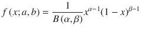
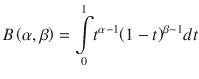
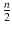

# 6. 数组

## 6.1 引言

在科学计算中，经常需要将一系列数字作为一个整体进行操作。`list` 数据类型存储一个值的序列。`list` 的所有元素都可以通过其索引访问，但单个 `list` 元素可以属于任何数据类型。因此，需要定义一种新的对象，类似于 `list`，但只存储数值。这种数据类型被称为 `array`。这种数据类型并非内置于 Python 解释器中，而是位于 `numpy` 模块中。

`numpy` 模块拥有一个名为 `array` 的独特对象类。它只包含一种数据类型的成员元素。使用数组存储数值的概念催生了基于数组计算的强大思想。这种方法可以追溯到矩阵代数。矩阵也是数字的集合。与矩阵类似，数组可以是多维的，并且可以通过与数学矩阵相同的方式定义的运算符进行操作。使用矩阵，可以一次性解决涉及方程组的问题（这些方程甚至可以相互耦合）。利用元素索引的方法，可以访问特定元素进行操作。利用切片的概念，可以根据需要改变数组的维度。通过作用于该对象的运算符，可以实现数学公式。在本章中，我们将讨论数组在数学计算中的使用。


## 6.2 numpy

`numpy`包包含各种可用于数值计算的项目——因此得名 numerical Python。NumPy 起源于`Numeric`，最初由 Jim Hugunin 创建，并有多位其他开发者的贡献。Travis Oliphant 于 2005 年创建了 NumPy，将竞争产品`Numarray`的特性整合到`Numeric`中，并进行了大量修改。`numpy`在开源许可下发布。本章代码已在 1.12.1 版本上测试通过。

与任何其他 Python 模块一样，`numpy`可以通过简单的`pip`程序在 Ubuntu 上安装：

```
pip install numpy
```

`numpy`预装在 Anaconda IDE 中，因此建议 Windows 和 Mac OS X 用户使用 Anaconda IDE 进行工作。

要使用`numpy`，可以导入它并检查版本号：

```
1  >>> import numpy
2  >>> print (numpy.version.version)
3  1.12.1
```

第 1 行导入整个名为`numpy`的模块供我们使用。第 2 行使用`version`函数，该函数进一步使用`version`函数来查找系统上安装的`numpy`版本。鼓励用户检查自己的 Python 版本。

同样重要的是要注意，导入模块是使用它的必要条件，但一旦在会话中导入，每次使用时无需再次导入。但是，如果会话重新启动，则必须重新导入。对于本章，可以导入一次，然后编写代码，但如果用户关闭 Python 会话并重新启动，则必须再次导入。

## 6.3 ndarray

`ndarray`是`numpy`的主要对象，它是同质的（其所有成员元素仅包含一种数据类型）。元素使用`numpy`的`array()`函数创建。此函数需要一个列表作为输入。元素由正整数元组索引：

```
1  >>> a = [1,2,3]
2  >>> a
3  [1, 2, 3]
4  >>> type(a)

6  >>> import numpy
7  >>> b = numpy.array([1,2,3])
8  >>> b
9  array([1, 2, 3])
10  >>> type(b)

12  >>> b.dtype
13  dtype('int64')
14  >>> c = numpy.array([1.0, 2.0, 3.0])
15  >>> c
16  array([ 1.,  2.,  3.])
17  >>> c.dtype
18  dtype('float64')
```

此示例展示了`lists`和`arrays`在`numpy`中的创建方式不同。`numpy`对象`array`接受一个列表作为输入。元素的数据类型可以由 Python 解释器在解释时以动态方式分配。或者，也可以在创建时使用`array()`函数的第二个参数定义数据类型：

```
1  >>>a1 = numpy.array([1,2,3], dtype=float)
2  >>>a1
3  array([ 1.,  2.,  3.])
4  >>>a1.dtype
5  dtype('float64')
6  >>>a2 = numpy.array([1,2,3], dtype=complex)
7  >>>a2
8  array([ 1.+0.j,  2.+0.j,  3.+0.j])
9  >>>a2.dtype
10  dtype('complex128')
```

`ndarray`也以其别名`array`而闻名。除了使用`dtype`了解数据类型外，还有多种方法可以获取有关`ndarray`各种属性的信息，如表 6-1 所示。

表 6-1

探测数组属性的各种方法

| `ndarray.dtype` | 元素的数据类型 |
| `ndarray.ndim` | 数组的维度 |
| `ndarray.shape` | 数组的形状，对于 (n, m) 数组为 (n, m) |
| `ndarray.size` | 数组的大小，n × m |
| `ndarray.itemsize` | 每个元素的字节大小 |
| `ndarray.data` | 包含实际元素的缓冲区数据 |
| `ndarray.reshape` | 保持 n × m 常数的情况下重塑形状 |

表 6-1 可以通过以下 Python 代码理解。我们首先定义一个名为`a3`的 3 数组，然后使用列出的方法探测此对象的属性：

```
1  >>> a3 = numpy.array( [ (1,2,3), (4,5,6), (2,7,8) ] ) # defining array
2  >>> a3 # REPL prints contents of a3
3  array([[1, 2, 3],
4  [4, 5, 6],
5  [2, 7, 8]])
6  >>> a3.ndim # number if dimesnions of a3-2 i.e it can be described in terms of rows and columns
7  2
8  >>> a3.size # total number of elements
9  9
10  >>> a3.shape # number of elements in each dimesnion as a tuple
11  (3, 3)
12  >>> a3.dtype # data type of member elements
13  dtype('int64')
14  >>> a3.data # address of memory location whre array is stored

16  >>> a3.itemsize # Size in bytes of each element
17  8
18  >>> a3.reshape(1,9) # reshaping 3 X 3 array as 1 X 9 array i.e 1 row and 9 columns
19  array([[1, 2, 3, 4, 5, 6, 2, 7, 8]])
20  >>> a3.reshape(9,1) # reshaping 3 X 3 array as 9 X 1 array i.e 9 row and 1 columns
21  array([[1],
22  [2],
23  [3],
24  [4],
25  [5],
26  [6],
27  [2],
28  [7],
29  [8]])
30  >>>a3.reshape(9,1) is a3.reshape(1,9)
31  False
32  # result is false because both arrays have different shapes
```

## 6.4 自动创建数组

存在多种函数可以自动创建所需维度和形状的数组。这在数学计算中非常方便，因为手动创建数组是一项繁琐的任务。

### 6.4.1 zeros( )

要创建一个所有元素都为 0 的数组，我们使用`zeros()`函数：

```
1  >>> numpy.zeros((3,4)) # arrays of float tyoe by default
2  array([[ 0.,  0.,  0.,  0.],
3  [ 0.,  0.,  0.,  0.],
4  [ 0.,  0.,  0.,  0.]])
5  >>> numpy.zeros((3,4),dtype=int) # array of int data type
6  array([[0, 0, 0, 0],
7  [0, 0, 0, 0],
8  [0, 0, 0, 0]])
9  >>> numpy.zeros((3,4),dtype=complex) # array of complex data type
10  array([[ 0.+0.j,  0.+0.j,  0.+0.j,  0.+0.j],
11  [ 0.+0.j,  0.+0.j,  0.+0.j,  0.+0.j],
12  [ 0.+0.j,  0.+0.j,  0.+0.j,  0.+0.j]])
13  >>> numpy.zeros((3,4),dtype=str) # array of empty strings
14  array([['', '', '', ''],
15  ['', '', '', ''],
16  ['', '', '', '']],
17  dtype='<U1')
```

在矩阵计算初始化为零值时，`zeros()`函数被广泛使用。

### 6.4.2 ones( )

要创建一个所有元素都为 1 的数组，我们使用`ones()`函数：

```
1  >>> numpy.ones((3,4)) # array of float values
2  array([[ 1.,  1.,  1.,  1.],
3  [ 1.,  1.,  1.,  1.],
4  [ 1.,  1.,  1.,  1.]])
5  >>> numpy.ones((3,4),dtype=int) # array of int values
6  array([[1, 1, 1, 1],
7  [1, 1, 1, 1],
8  [1, 1, 1, 1]])
9  >>> numpy.ones((3,4),dtype=complex) # array of complex number values
10  array([[ 1.+0.j,  1.+0.j,  1.+0.j,  1.+0.j],
11  [ 1.+0.j,  1.+0.j,  1.+0.j,  1.+0.j],
12  [ 1.+0.j,  1.+0.j,  1.+0.j,  1.+0.j]])
13  >>> numpy.ones((3,4),dtype=str) # array of strings
14  array([['1', '1', '1', '1'],
15  ['1', '1', '1', '1'],
16  ['1', '1', '1', '1']],
17  dtype='<U1')
```

有趣的是，复数`1+o.j`在数学上等同于`1.0`，但数据类型决定了数据在计算机内存中的存储方式以及使用运算符对其进行操作的方式。因此，应谨慎使用。

### 6.4.3 ones_like( )

`ones_like()`从现有数组获取线索，创建一个具有相似形状和类型的全 1 数组：

```
1  >>> a = numpy.array([[1.1, 2.2, 4.1],[2.5,5.2,6.4]])
2  >>> a
3  array([[ 1.1,  2.2,  4.1],
4  [ 2.5,  5.2,  6.4]])
5  >>> numpy.ones_like(a)
6  array([[ 1.,  1.,  1.],
7  [ 1.,  1.,  1.]])
8  >>> numpy.ones_like(a,dtype=int)
9  array([[1, 1, 1],
10  [1, 1, 1]])
11  >>> numpy.ones_like(a,dtype=complex)
12  array([[ 1.+0.j,  1.+0.j,  1.+0.j],
13  [ 1.+0.j,  1.+0.j,  1.+0.j]])
14  >>> numpy.ones_like(a,dtype=str)
15  array([['1', '1', '1'],
16  ['1', '1', '1']],
17  dtype='<U1')
```


### 6.4.4 `empty()`

`empty()` 返回一个包含给定形状、数据类型和顺序的未初始化（任意）数据的数组。对象数组将被初始化为 `None`。与 `zeros` 不同，它并不总是将数组值设置为 0：

```
>>> numpy.empty((2,2))
array([[ 0.,  0.],
       [ 0.,  0.]])
>>> numpy.empty((2,2),dtype=int)
array([[0, 0],
       [0, 0]])
>>> numpy.empty((2,2),dtype=complex)
array([[  3.10503618e+231 +3.10503618e+231j,
         1.23516411e-322 +0.00000000e+000j],
       [  0.00000000e+000 +2.21170104e-314j,
         2.21184108e-314 +2.25920578e-314j]])
>>> numpy.empty((2,2),dtype=str)
array([['', ''],
       ['', '']],
      dtype='<U1')
```

### 6.4.5 `empty_like()`

`empty_like()` 以一个现有数组为模板，创建一个具有相似形状和类型的 `empty` 数组：

```
>>> a = numpy.array([[1.1, 2.2, 4.1],[2.5,5.2,6.4]])
>>> a
array([[ 1.1,  2.2,  4.1],
       [ 2.5,  5.2,  6.4]])
>>> numpy.empty_like(a)
array([[ 0.,  0.,  0.],
       [ 0.,  0.,  0.]])
```

### 6.4.6 `eye()`

与单位矩阵类似，`eye()` 返回一个二维数组，其对角线元素值为 1。该函数将第二个参数作为对角线的索引。0 表示主对角线。正数表示沿垂直向上方向移动指定步数。负数表示沿垂直向下方向移动指定步数。

```
>>> numpy.eye(3, k=0)
array([[ 1.,  0.,  0.],
       [ 0.,  1.,  0.],
       [ 0.,  0.,  1.]])
>>> numpy.eye(3, k=1)
array([[ 0.,  1.,  0.],
       [ 0.,  0.,  1.],
       [ 0.,  0.,  0.]])
>>> numpy.eye(3, k=-1)
array([[ 0.,  0.,  0.],
       [ 1.,  0.,  0.],
       [ 0.,  1.,  0.]])
>>> numpy.eye(3, k=-2)
array([[ 0.,  0.,  0.],
       [ 0.,  0.,  0.],
       [ 1.,  0.,  0.]])
>>> numpy.eye(3, k=2)
array([[ 0.,  0.,  1.],
       [ 0.,  0.,  0.],
       [ 0.,  0.,  0.]])
>>> numpy.eye(3, k=1,dtype=int)
array([[0, 1, 0],
       [0, 0, 1],
       [0, 0, 0]])
>>> numpy.eye(3, k=1,dtype=complex)
array([[ 0.+0.j,  1.+0.j,  0.+0.j],
       [ 0.+0.j,  0.+0.j,  1.+0.j],
       [ 0.+0.j,  0.+0.j,  0.+0.j]])
>>> numpy.eye(3, k=1,dtype=str)
array([['', '1', ''],
       ['', '', '1'],
       ['', '', '']],
      dtype='<U1')
```

### 6.4.7 `identity()`

`identity()` 函数生成一个二维单位数组，其对角线值为 1。一个等价的矩阵其行列式为 1——因此得名单位矩阵。

```
>>> numpy.identity(4)
array([[ 1.,  0.,  0.,  0.],
       [ 0.,  1.,  0.,  0.],
       [ 0.,  0.,  1.,  0.],
       [ 0.,  0.,  0.,  1.]])
>>> numpy.identity(4,dtype=int)
array([[1, 0, 0, 0],
       [0, 1, 0, 0],
       [0, 0, 1, 0],
       [0, 0, 0, 1]])
>>> numpy.identity(4,dtype=complex)
array([[ 1.+0.j,  0.+0.j,  0.+0.j,  0.+0.j],
       [ 0.+0.j,  1.+0.j,  0.+0.j,  0.+0.j],
       [ 0.+0.j,  0.+0.j,  1.+0.j,  0.+0.j],
       [ 0.+0.j,  0.+0.j,  0.+0.j,  1.+0.j]])
>>> numpy.identity(4,dtype=str)
array([['1', '', '', ''],
       ['', '1', '', ''],
       ['', '', '1', ''],
       ['', '', '', '1']],
      dtype='<U1')
```

### 6.4.8 `full()`

`full` 将特定数据填充到所有元素位置：

```
>>> numpy.full((3,2),10.5,dtype=int)
array([[10, 10],
       [10, 10],
       [10, 10]])
>>> numpy.full((3,2),10.5)
array([[ 10.5,  10.5],
       [ 10.5,  10.5],
       [ 10.5,  10.5]])
>>> numpy.full((3,2),10.5,dtype=complex)
array([[ 10.5+0.j,  10.5+0.j],
       [ 10.5+0.j,  10.5+0.j],
       [ 10.5+0.j,  10.5+0.j]])
>>> numpy.full((3,2),10.5+2j,dtype=complex)
array([[ 10.5+2.j,  10.5+2.j],
       [ 10.5+2.j,  10.5+2.j],
       [ 10.5+2.j,  10.5+2.j]])
>>> numpy.full((3,2),'a',dtype=str)
array([['a', 'a'],
       ['a', 'a'],
       ['a', 'a']],
      dtype='<U1')
```

### 6.4.9 `full_like()`

与 `empty_like` 和 `ones_like` 类似，`full_like` 根据现有数组的形状和数据类型创建一个新矩阵：

```
>>> numpy.full_like(a,5.0)
array([[ 5.,  5.,  5.],
       [ 5.,  5.,  5.]])
>>> numpy.full_like(a,5.0,dtype=int)
array([[5, 5, 5],
       [5, 5, 5]])
>>> numpy.full_like(a,5.0+2.3j,dtype=complex)
array([[ 5.+2.3j,  5.+2.3j,  5.+2.3j],
       [ 5.+2.3j,  5.+2.3j,  5.+2.3j]])
>>> numpy.full_like(a,'a',dtype=str)
array([['a', 'a', 'a'],
       ['a', 'a', 'a']],
      dtype='<U1')
```

### 6.4.10 随机数

要创建一个随机数组（填充随机数），我们使用 `random` 函数，如下所示：

```
>>> numpy.random.rand(4)
array([ 0.60855254,  0.81713983,  0.01249653,  0.55668541])
>>> numpy.random.rand(4,4)
array([[ 0.56770136,  0.45094011,  0.50791373,  0.29436197],
       [ 0.664363  ,  0.73385773,  0.55709437,  0.84207538],
       [ 0.15050127,  0.56031549,  0.07850941,  0.0052116 ],
       [ 0.54952592,  0.66695696,  0.07617147,  0.00457323]])
```

请注意，函数 `rand()` 位于 `numpy` 的子包 `random` 中。要了解这个出色包的完整细节，我们鼓励用户在发出 `import numpy` 命令后，使用 `help(numpy.random)` 进行探索。

文档描述了一个丰富的函数库，用于按需生成随机数。这使得 `numpy` 成为模拟工作中使用的库的良好选择。分布的选择取决于所研究系统的属性。对于遵循高斯统计的系统，必须使用随机数的归一化分布。

#### 随机整数

随机整数可以通过使用 `numpy.random.random_integers()` 和 `numpy.random.randint()` 函数生成。后者需要第一个输入作为随机数的起始限制，第二个输入作为结束限制。

第三个参数可以是一个描述矩阵形状的列表：

```
>>> numpy.random.random_integers(10) # 一个不超过 10 的随机整数
5
>>> numpy.random.random_integers(10) # 一个不超过 10 的随机整数
8
>>> numpy.random.randint(0,5,3) # 一个随机整数数组：从 0 到 5，包含 3 个元素
array([1, 2, 4])
>>> numpy.random.randint(2,5,3) # 一个随机整数数组：从 2 到 5，包含 3 个元素
array([2, 4, 3])
>>> numpy.random.randint(2,50,3) # 一个随机整数数组：从 2 到 50，包含 3 个元素
array([36, 43, 29])
>>> numpy.random.randint(2,50,[2,3]) # 一个随机整数数组：从 2 到 50，形状为 2 X 3，即 2 行 3 列
array([[ 5, 22, 23],
       [36, 13, 11]])
>>> numpy.random.randint(2,50,[5,3]) # 一个随机整数数组：从 2 到 50，形状为 5 X 3，即 5 行 3 列
array([[10, 30, 34],
       [20, 26, 44],
       [30, 42, 37],
       [49, 36, 20],
       [43, 23, 37]])
```

#### 随机浮点数

随机浮点数可以通过 `numpy.random.ranf()` 函数生成，其输入参数可以是一个列表。数组的维度和大小由列表的成员决定。此外，元素属于区间 [0.0, 1.0)：

```
>>> numpy.random.ranf([2,3]) # 大小为 2 X 3 的随机数数组，即 2 行 3 列
array([[ 0.94222024,  0.75429361,  0.52951222],
       [ 0.87956205,  0.12400001,  0.78250773]])
>>> numpy.random.ranf([5,3]) # 大小为 5 X 3 的随机数数组，即 5 行 3 列
array([[ 0.45427483,  0.78061704,  0.38300021],
       [ 0.40070286,  0.2259602 ,  0.37309902],
       [ 0.18188091,  0.02052539,  0.63328754],
       [ 0.82842309,  0.95054644,  0.30800412],
       [ 0.15268755,  0.6668035 ,  0.3047649 ]])
>>> numpy.random.ranf(20) # 20 个随机数的数组，大小确定为 1 X 20
array([ 0.18816171,  0.8807835 ,  0.03181879,  0.83308999,  0.80802698,
        0.98561721,  0.40781223,  0.21523024,  0.15926338,  0.72142345,
        0.14311937,  0.50017394,  0.67017638,  0.69552528,  0.46469783,
        0.83841762,  0.81342313,  0.13859541,  0.77675513,  0.71401225])
>>> numpy.shape(numpy.random.ranf(20))
(20,)
```


### 随机选择

给定一个数组，可以使用`numpy.random.choice()`函数生成另一个由该数组元素组成的数组：

```
1  >>> a = numpy.array([1,2,3,4,5,6]) # 定义一个目标数组
2  >>> numpy.random.choice(a,3) # 从目标数组中，定义一个 3 X 1 形状的数组
3  array([3, 4, 1])
4  >>> numpy.random.choice(a,3) # 从目标数组中，定义一个 3 X 1 形状的数组
5  array([4, 2, 2])
6  >>> numpy.random.choice(a,3) # 从目标数组中，定义一个 3 X 1 形状的数组
7  array([1, 2, 3])
8  >>> numpy.random.choice(a,[2,3]) # 从目标数组中，定义一个 2 X 3 形状的数组
9  array([[4, 3, 4],
10  [6, 1, 5]])
11  >>> numpy.random.choice(a,[2,3]) # 从目标数组中，定义一个 2 X 3 形状的数组
12  array([[5, 5, 2],
13  [6, 4, 4]])
```

另一个函数`numpy.random.shuffle()`用于打乱数组的内容。需要注意的是，它只打乱行：

```
1  >>> a = numpy.random.randint(0,10,[10,10]) # 一个形状为 10 X 10、元素为 0 到 10 随机整数的数组
2  >>> a
3  array([[1, 0, 5, 7, 6, 7, 6, 7, 3, 3],
4  [0, 8, 3, 4, 8, 1, 9, 0, 6, 2],
5  [5, 7, 6, 7, 1, 1, 0, 9, 6, 8],
6  [3, 3, 1, 9, 4, 4, 1, 2, 8, 6],
7  [5, 6, 8, 4, 3, 6, 8, 9, 3, 4],
8  [3, 7, 0, 4, 4, 2, 2, 9, 6, 8],
9  [1, 6, 4, 8, 8, 6, 9, 2, 3, 2],
10  [8, 4, 0, 2, 4, 0, 4, 5, 2, 9],
11  [5, 8, 2, 1, 4, 8, 8, 3, 2, 6],
12  [8, 4, 0, 1, 9, 1, 7, 0, 9, 9]])
13  >>> numpy.random.shuffle(a) # 打乱 a 的内容
14  >>> a # a 的内容确实已被打乱
15  array([[1, 6, 4, 8, 8, 6, 9, 2, 3, 2],
16  [1, 0, 5, 7, 6, 7, 6, 7, 3, 3],
17  [3, 3, 1, 9, 4, 4, 1, 2, 8, 6],
18  [3, 7, 0, 4, 4, 2, 2, 9, 6, 8],
19  [5, 6, 8, 4, 3, 6, 8, 9, 3, 4],
20  [0, 8, 3, 4, 8, 1, 9, 0, 6, 2],
21  [8, 4, 0, 2, 4, 0, 4, 5, 2, 9],
22  [8, 4, 0, 1, 9, 1, 7, 0, 9, 9],
23  [5, 7, 6, 7, 1, 1, 0, 9, 6, 8],
24  [5, 8, 2, 1, 4, 8, 8, 3, 2, 6]])
```

`numpy.random.permutation()`函数用于随机排列一个序列：

```
1  >>> a = numpy.random.randint(0,10,[10,10])
2  >>> a
3  array([[9, 6, 5, 0, 2, 5, 2, 6, 4, 5],
4  [6, 2, 0, 6, 9, 7, 5, 1, 6, 4],
5  [9, 3, 2, 6, 6, 7, 3, 1, 8, 8],
6  [9, 6, 4, 8, 2, 8, 7, 7, 4, 7],
7  [2, 6, 1, 1, 3, 0, 8, 5, 3, 5],
8  [8, 8, 7, 3, 4, 3, 5, 5, 0, 2],
9  [3, 5, 6, 8, 6, 6, 0, 7, 9, 2],
10  [8, 9, 6, 9, 4, 4, 5, 8, 1, 9],
11  [6, 0, 1, 8, 8, 7, 2, 7, 2, 1],
12  [1, 3, 4, 8, 9, 6, 4, 1, 9, 4]])
13  >>> numpy.random.permutation(a)
14  array([[8, 8, 7, 3, 4, 3, 5, 5, 0, 2],
15  [9, 6, 4, 8, 2, 8, 7, 7, 4, 7],
16  [3, 5, 6, 8, 6, 6, 0, 7, 9, 2],
17  [2, 6, 1, 1, 3, 0, 8, 5, 3, 5],
18  [9, 3, 2, 6, 6, 7, 3, 1, 8, 8],
19  [1, 3, 4, 8, 9, 6, 4, 1, 9, 4],
20  [6, 0, 1, 8, 8, 7, 2, 7, 2, 1],
21  [6, 2, 0, 6, 9, 7, 5, 1, 6, 4],
22  [8, 9, 6, 9, 4, 4, 5, 8, 1, 9],
23  [9, 6, 5, 0, 2, 5, 2, 6, 4, 5]])
```

### 贝塔分布

函数`numpy.random.beta()`返回一个服从贝塔分布的数组，该分布常用于贝叶斯推断和顺序统计量：



(6.1)



(6.2)

```
1  >>> a = numpy.random.beta(2,10,10)
2  >>> a
3  array([ 0.06604658,  0.21840079,  0.04368817,  0.08380568,  0.12769291,
4  0.06450275,  0.04227899,  0.04637705,  0.19960681,  0.24094982])
5  >>> a = numpy.random.beta(2,10,[3,3])
6  >>> a
7  array([[ 0.03500157,  0.15174638,  0.19104822],
8  [ 0.09989465,  0.0410233 ,  0.10818969],
9  [ 0.05473703,  0.53414904,  0.09791452]])
```

### 二项分布

函数`numpy.random.binomial(n,p,size=)`返回一个服从二项分布的数组[1]。样本从具有指定参数（`n`次试验，`p`为成功概率）的二项分布中抽取，其中`n`是大于等于 0 的整数，`p`在区间[0, 1]内。考虑一个场景：我们有 50 次试验，成功概率为 80%：

```
1  >>> n, p = 50, .8
2  >>> a = numpy.random.binomial(n,p,10)
3  >>> a
4  array([41, 35, 42, 42, 34, 38, 38, 42, 40, 43])
5  >>> a = numpy.random.binomial(n,p,[3,3])
6  >>> a
7  array([[39, 36, 41],
8  [42, 38, 38],
9  [40, 43, 40]])
```

### 正态分布

可以使用`numpy.random.normal(a,b,size=)`生成具有固定均值（`a`）和标准差（`b`）的正态（高斯）分布随机数：

```
1  >>> numpy.random.normal(2,1,20) # mean=2, SD=1, 20 numbers
2  array([ 1.8625696 ,  0.80712566,  2.24495879,  3.14961488,  1.38803327,
3  2.59744647,  0.99560626,  2.79150258,  2.87579258,  2.01958405,
4  2.33145923,  2.81541595,  2.25550088,  2.13514339,  0.89957839,
5  0.95178737,  1.16911591,  4.32423549,  3.3398163 ,  1.35927406])
6  >>> numpy.random.normal(2,1,[2,3]) # mean=2, SD=1, 2 X 3 array
7  array([[ 4.6907596 ,  0.47341209,  2.09379377],
8  [ 3.44982049,  1.1475949 ,  3.03557547]])
```

### 其他分布

`numpy.random`子包中还可以使用许多其他分布[2]。特定分布的选择取决于所研究的模拟场景。在特定条件下，物理系统遵循特定的分布集合。

## 6.5 数值范围

创建数字序列是数值计算中不可或缺的一部分。存在多种函数可以根据定义的规则自动创建所需的数字序列。

### 6.5.1 数字范围

从起始点到终点按步长自动生成数字范围的语法如下：

```
numpy.arange([start, ]stop, [step, ]dtype=)
1  >>> numpy.arange(1,10,0.5) # start=1,stop=10,step=0.5
2  array([ 1\. ,  1.5,  2\. ,  2.5,  3\. ,  3.5,  4\. ,  4.5,  5\. , 5.5,  6\. ,
3  6.5,  7\. ,  7.5,  8\. ,  8.5,  9\. ,  9.5])
4  >>> numpy.arange(1,10,1) # start=1,stop=10,step=1
5  array([1, 2, 3, 4, 5, 6, 7, 8, 9])
6  >>> numpy.arange(10) # start=0 (defualt),stop=10,step=1 (default)
7  array([0, 1, 2, 3, 4, 5, 6, 7, 8, 9])
8  >>> numpy.arange(1+2j,10+3j,0.1,dtype=complex) # start=1+2j, stop=10+3j, step=0.1
9  array([ 1.0+2.j,  1.1+2.j,  1.2+2.j,  1.3+2.j,  1.4+2.j, 1.5+2.j,
10  1.6+2.j,  1.7+2.j,  1.8+2.j,  1.9+2.j])
```

### 6.5.2 线性间隔数字

`arange()`虽然能很好地控制步长，但无法指定数组中的元素数量。为了解决这个问题，`linspace()`函数被定义，其语法如下：

```
linspace(start, stop, num, endpoint, dtype)
1  >>> numpy.linspace(1,10,5) # start=1,stop=10,number of points=5
2  array([  1\.  ,   3.25,   5.5 ,   7.75,  10\.  ])
3  >>> numpy.linspace(1,10,10) # start=1,stop=10,number of points=10
4  array([  1.,   2.,   3.,   4.,   5.,   6.,   7.,   8.,   9.,  10.])
5  >>> numpy.linspace(1,10,10,endpoint=False) # start=1,stop=10,number of points=10 without including end point
6  array([ 1\. ,  1.9,  2.8,  3.7,  4.6,  5.5,  6.4,  7.3,  8.2,  9.1])
7  >>> numpy.linspace(1,10,10,endpoint=True) # start=1,stop=10,number of points=10 including the end point
8  array([  1.,   2.,   3.,   4.,   5.,   6.,   7.,   8.,   9.,  10.])
```


### 6.5.3 对数间隔数值

与 `linspace()` 生成线性间隔点类似，`logspace()` 在对数轴上生成线性间隔的点：

```
logspace(start, stop, num, endpoint=, base=, dtype=)
1  >>> numpy.logspace(1,10, num=3) # 在 1 到 10 之间生成 3 个对数间隔的点
2  array([  1.00000000e+01,   3.16227766e+05,   1.00000000e+10])
3  >>> numpy.logspace(1,10, num=5) # 在 1 到 10 之间生成 5 个对数间隔的点
4  array([  1.00000000e+01,   1.77827941e+03,   3.16227766e+05,
5  5.62341325e+07,   1.00000000e+10])
6  >>> numpy.logspace(1,10, num=5,endpoint=False) # 在 1 到 10 之间生成 5 个对数间隔的点，不包含终点
7  array([  1.00000000e+01,   6.30957344e+02,   3.98107171e+04,
8  2.51188643e+06,   1.58489319e+08])
```

### 6.5.4 meshgrid( )

`meshgrid` 函数模仿了 MATLAB 中的 `meshgrid` 命令。要理解 `meshgrid` 的工作原理，最好按如下方式使用一次：

```
1  >>> xx = numpy.linspace(1,3,3)
2  >>> xx
3  array([ 1.,  2.,  3.])
4  >>> yy = numpy.linspace(2,4,3)
5  >>> yy
6  array([ 2.,  3.,  4.])
7  >>> (a,b) = numpy.meshgrid(xx,yy)
8  >>> a
9  array([[ 1.,  2.,  3.],
10  [ 1.,  2.,  3.],
11  [ 1.,  2.,  3.]])
12  >>> b
13  array([[ 2.,  2.,  2.],
14  [ 3.,  3.,  3.],
15  [ 4.,  4.,  4.]])
```

`meshgrid()` 创建一个二维坐标系，其中 x 轴由第一个参数（此处为 `xx`）给出，y 轴由第二个参数（此处为 `yy`）给出。该函数在绘制三维图形或定义二元函数时使用。

### 6.5.5 mgrid() 和 ogrid()

`mgrid` 和 `ogrid` 用于直接创建网格（即无需使用 `linspace`、`arange` 等）。像下面这样简单的语句：

```
mgrid[a:b , c:d]
```

构建了一个网格，其中 x 轴包含从 `a` 到 `b` 的点，y 轴包含从 `c` 到 `d` 的点。

`mgrid` 构建一个多维的 `meshgrid`。以下示例演示了其用法：

```
1  >>> (a,b) = numpy.mgrid[1:10 , 2:5]
2  >>> a
3  array([[1, 1, 1],
4  [2, 2, 2],
5  [3, 3, 3],
6  [4, 4, 4],
7  [5, 5, 5],
8  [6, 6, 6],
9  [7, 7, 7],
10  [8, 8, 8],
11  [9, 9, 9]])
12  >>> b
13  array([[2, 3, 4],
14  [2, 3, 4],
15  [2, 3, 4],
16  [2, 3, 4],
17  [2, 3, 4],
18  [2, 3, 4],
19  [2, 3, 4],
20  [2, 3, 4],
21  [2, 3, 4]])

23  >>> x, y = numpy.ogrid[0:5, 0:5]
24  >>> x
25  array([[0],
26  [1],
27  [2],
28  [3],
29  [4]])
30  >>> y
31  array([[0, 1, 2, 3, 4]])
```

## 6.6 tile( )

可以使用 `tile()` 函数从一个较小的目标数组构建一个更大的数组。`tile()` 通过按所需次数复制现有数组来生成新数组：

```
1  >>> a = numpy.array([1,2,3])
2  >>> a
3  array([1, 2, 3])
4  >>> b = numpy.tile(a,3) # 数组 a 被重复 3 次以生成新数组 b
5  >>> b
6  array([1, 2, 3, 1, 2, 3, 1, 2, 3])
7  >>># 另一个对二维数组执行相同操作的示例
8  >>> a1 = numpy.eye(4)
9  >>> a1
10  array([[ 1.,  0.,  0.,  0.],
11  [ 0.,  1.,  0.,  0.],
12  [ 0.,  0.,  1.,  0.],
13  [ 0.,  0.,  0.,  1.]])
14  >>> a2=numpy.tile(a1,2) # 仅在第一个维度（即行方向）重复 a1
15  >>> a2
16  array([[ 1.,  0.,  0.,  0.,  1.,  0.,  0.,  0.],
17  [ 0.,  1.,  0.,  0.,  0.,  1.,  0.,  0.],
18  [ 0.,  0.,  1.,  0.,  0.,  0.,  1.,  0.],
19  [ 0.,  0.,  0.,  1.,  0.,  0.,  0.,  1.]])
20  >>> a2 = numpy.tile(a1,(2,2)) # 在两个维度上各重复 a1 2 次
21  >>> a2
22  array([[ 1.,  0.,  0.,  0.,  1.,  0.,  0.,  0.],
23  [ 0.,  1.,  0.,  0.,  0.,  1.,  0.,  0.],
24  [ 0.,  0.,  1.,  0.,  0.,  0.,  1.,  0.],
25  [ 0.,  0.,  0.,  1.,  0.,  0.,  0.,  1.],
26  [ 1.,  0.,  0.,  0.,  1.,  0.,  0.,  0.],
27  [ 0.,  1.,  0.,  0.,  0.,  1.,  0.,  0.],
28  [ 0.,  0.,  1.,  0.,  0.,  0.,  1.,  0.],
29  [ 0.,  0.,  0.,  1.,  0.,  0.,  0.,  1.]])
```

## 6.7 广播

`numpy` 数组的基本运算是逐元素进行的。这意味着数组的维度对于所需操作应该是兼容的。例如，一个 2 列数组和一个 3 列数组是不兼容的，因为第一个数组比第二个数组少一列。

```
1  >>>a = numpy.eye(4)
2  >>>b = numpy.array([1,2,3,4])
3  >>>c = a + b
4  >>>c

6  array([[ 2.,  2.,  3.,  4.],
7      [ 1.,  3.,  3.,  4.],
8      [ 1.,  2.,  4.,  4.],
9      [ 1.,  2.,  3.,  5.]])

11  >>>a.shape
12  (4L, 4L)

14  >>>b.shape
15  (4L,)

17  >>>c.shape
18  (4L, 4L)

20  # 广播使得数组 a (4 X 4) 可以与 b (4 X 1) 相加，生成数组 c (4 X 4)

22  # 另一个示例
23  >>>a = numpy.eye(4)
24  >>>a

26  array([[ 1.,  0.,  0.,  0.],
27      [ 0.,  1.,  0.,  0.],
28      [ 0.,  0.,  1.,  0.],
29      [ 0.,  0.,  0.,  1.]])

31  >>>b = numpy.array([10, 10, 10, 10])
32  >>>c = a + b
33  >>>c

35  array([[ 11.,  10.,  10.,  10.],
36      [ 10.,  11.,  10.,  10.],
37      [ 10.,  10.,  11.,  10.],
38      [ 10.,  10.,  10.,  11.]])

40  # 一个 4 X 4 矩阵可以通过将“不可见”元素视为零来与 4 X 1 矩阵进行运算。
```

## 6.8 提取对角线

可以使用 `diag()` 函数获取给定数组/矩阵的对角线元素。你可以通过第二个参数选择对角线。默认值为 0，表示主对角线。正值表示向上方向移动。负值表示向下方向移动。

```
1  >>> a = numpy.eye(5) # 创建一个单位矩阵
2  >>> a
3  array([[ 1.,  0.,  0.,  0.,  0.],
4  [ 0.,  1.,  0.,  0.,  0.],
5  [ 0.,  0.,  1.,  0.,  0.],
6  [ 0.,  0.,  0.,  1.,  0.],
7  [ 0.,  0.,  0.,  0.,  1.]])
8  >>> numpy.diag(a) # 提取主对角线元素
9  array([ 1.,  1.,  1.,  1.,  1.])
10  >>> numpy.diag(a,1) # 提取向上方向的对角线元素
11  array([ 0.,  0.,  0.,  0.])
12  >>> numpy.diag(a,-1) # 提取向下方向的对角线元素
13  array([ 0.,  0.,  0.,  0.])
```

## 6.9 索引

在 Python 中，数组或列表的元素从 0 开始；第一个元素的索引为 0。所有元素都可以通过其索引访问：

```
1  >>>a =[1,2,3,4,5,6] # 创建一个列表并存储在变量名 'a' 中
2  >>> type(a) # a 存储了一个 'list' 对象

4  >>> b = numpy.array(a) # 数组 'b' 引用了由列表 'a' 引用的内容
5  >>> b
6  array([1, 2, 3, 4, 5, 6])
7  >>> type(b)

9  >>>a[1] # 访问列表 'a' 中左侧第二个元素
10  2
11  >>>b[0] # 访问数组 'b' 中左侧第一个元素
12  1
13  >>>a[-1] # 访问列表 'a' 中右侧第一个元素
14  6
15  >>>b[-2] # 访问数组 'b' 中右侧第二个元素
16  5
```

这些示例清楚地表明，数组与列表类似，并遵循相同的索引规则。多维数组也遵循相同的索引模式。对于二维数组，第一个数字表示行，第二个数字表示列：

```
1  >>>a1 = numpy.array([[1,2,3],[3,2,1]]) # 使用两组列表创建二维数组
2  >>>a1
3  array([[1, 2, 3],
4      [3, 2, 1]])
5  >>>a1[1,2] # 选择行索引为 1、列索引为 2 的元素，即第二行第三列，右下角最后一个元素
6  1
7  >>>a1[1,1] # 选择行索引为 1、列索引为 1 的元素，即第二行第二列
8  2
9  >>>a1[1] # 选择索引为 1 的行，即第二行
10  array([3, 2, 1])
```

索引也可用于给特定元素赋值。这里使用了前面讨论过的赋值运算符：

```
1  >>>a1 = numpy.array([[1,2,3],[3,2,1]]) # 使用两组列表创建二维数组
2  >>>a1
3  array([[1, 2, 3],
4      [3, 2, 1]])
5  >>>a1[1,1] = 0 # 将行索引=1、列索引=1 的元素设置为 0
6  >>>a1 # 第二行第二列的元素，即 2，被改为 0
7  array([[1, 2, 3],
8      [3, 0, 1]])
```


## 6.10 切片

对数组执行的首要操作之一就是切片。切片使用运算符 `:`，它用于分隔行上的数据：

```
1  >>>a1 = numpy.arange(10) # 一个从 1 到 10 的数组
2  >>>a1
3  array([0, 1, 2, 3, 4, 5, 6, 7, 8, 9])
4  >>>a1[0:5] # [0:5] 选择'从'索引 0 开始'直到'索引 5，即排除索引 5
5  array([0, 1, 2, 3, 4])
6  >>>a1[:5] # [:5] 选择'从'开头开始'直到'索引 5，即排除索引 5
7  array([0, 1, 2, 3, 4])
8  >>>a1[2:5] # [2:5] 选择'从'索引 2 开始'直到'索引 5，即排除索引 5
9  array([2, 3, 4])
10  >>>a1[2:-2] # [2:-2] 选择'从'索引 2 开始'直到'索引-2（从右侧开始计数，从-1 开始），即排除索引-2
11  array([2, 3, 4, 5, 6, 7])
12  >>>a1[2:] # [2:] 选择'从'索引 2 开始'直到'最后一个索引
13  array([2, 3, 4, 5, 6, 7, 8, 9])
14  >>>a1[0:5:2] # [start:stop:step] =[0:5:2] 因此在选择索引 0 到 5 时，步长为 2
15  array([0, 2, 4])
```

切片操作也可以在多维数组上完成。这里需要传递一个元组来为每个所需的维度定义切片。以下 Python 代码将演示这一点：

```
1  >>>a = [1,2,3,4,5] # 'a' 引用一个列表
2  >>>b = [5,6,7,8,9] # 'b' 引用一个列表
3  a1 = numpy.array([a,b]) # 'a' 和 'b' 用于创建一个形状为 2 X 5 的二维数组
4  >>>a1
5  array([[1, 2, 3, 4, 5],
6      [5, 6, 7, 8, 9]])
7  >>>a1.ndim # 数组 a1 的维度
8  2
9  >>>a1[0:2,0:2] # 开始从行索引 0 和列索引 2 收集元素
10  array([[1, 2],
11      [5, 6]])
12  >>>a1[0:2,0:4] # 第一个切片表示只收集前两个元素，第二个切片表示收集前四个元素，因此通过广播实现结果
13  array([[1, 2, 3, 4],
14      [5, 6, 7, 8]])
15  >>>a1[1:2,-1:] # 因为第二个切片表示收集最后一个元素
16  array([[9]])
```

类似的逻辑可以应用于任何维度的数组。切片成为数据过滤中极其重要的工具。在某些情况下，我们可能只想处理特定的行和/或列数据。在这种情况下，可以根据需要切片数据。

## 6.11 副本与视图

从内存使用的角度来看，切片操作仅创建原始数组的一个视图。使用 `numpy.may_share_memory()`，我们可以验证这一说法：

```
1  >>>a = numpy.arange(10)
2  >>>a
3  array([0, 1, 2, 3, 4, 5, 6, 7, 8, 9])
4  >>>b = a[2:5]
5  >>>b
6  array([2, 3, 4])
7  >>>numpy.may_share_memory(a,b) # 数组 'a' 和 'b' 共享相同的内存空间
8  True
9  >>># 现在，如果我们更改 'b' 的第一个元素，数组 'a' 的元素也会改变，因为 'b' 只是 'a' 的一个"视图"
10  >>> b[0]=10 # 'b' 的第一个元素被设置为值 10
11  >>> b # 此处反映了值的更改
12  array([10,  3,  4])
13  >>> a # 元素值的更改也反映在 'a' 中
14  array([ 0,  1, 10,  3,  4,  5,  6,  7,  8,  9])
```

由于它只是一个视图，如果修改了切片的某个元素，原始数组也会被修改。尽管这个特性可能很受欢迎，但在某些问题中它可能会造成麻烦。因此，函数 `copy()` 提供了一种解决方法，它复制原始数组而不是提供视图：

```
1  >>>a = numpy.arange(10) # 定义数组 'a'
2  >>>c = a[2:5].copy() # 数组 'c' 使用 'a' 的一个切片创建
3  >>> a # 检查数组 'a' 的元素
4  array([0, 1, 2, 3, 4, 5, 6, 7, 8, 9])
5  >>>c # 检查数组 'c' 的元素
6  array([2, 3, 4])
7  >>>c[0] = 10 # 将第一个元素更改为 10
8  >>>c # 检查更改
9  array([10,  3,  4])
10  >>>a # 数组 'a' 保持不变
11  array([0, 1, 2, 3, 4, 5, 6, 7, 8, 9])
12  >>>numpy.may_share_memory(a,c) # 'a' 保持不变，因为 'a' 和 'c' 不共享它们的内存
13  False
```

## 6.12 掩码

可以使用掩码方法对数组进行索引。掩码是一种将索引定义为一个独立对象，然后使用该掩码作为规则从原始数组生成新数组的方法。有两种方法可以对数组进行掩码：花式索引和使用布尔值进行索引。需要注意的是，掩码方法生成的是副本而不是视图。这两种方法将在以下小节中讨论。

### 6.12.1 花式索引

`numpy` 提供了相当独特的索引功能。其中之一是花式索引，它可以使用一个索引数组来生成一个元素数组：

```
1  >>>a = numpy.arange(1000)**3# 生成前 1000 个数的立方
2  >>>i = numpy.array(numpy.arange(10)) # 生成一个包含前 10 个数字（从 0 到 9）的数组
3  >>> i
4  array([0, 1, 2, 3, 4, 5, 6, 7, 8, 9])
5  >>>a[i] # 数组 'a' 中索引为数组 'i' 元素值的那些元素
6  array([  0,   1,   8,  27,  64, 125, 216, 343, 512, 729])
7  >>>j = numpy.array(numpy.arange(0,50,10)) # j 是一个从 0 到 50、步长为 10 的数字数组
8  >>>j
9  array([ 0, 10, 20, 30, 40])
10  >>>a[j] # a[j] 是由索引数组 j 索引的立方数组
11  array([    0,  1000,  8000, 27000, 64000])
12  >>>k = numpy.array( [ [ 1, 2], [ 11, 12 ] ] ) # k 是一个二维索引数组，包含索引 1,2,11,12
13  >>>a[k] # a[k] 是由 k 给出的索引位置上的元素组成的数组
14  array([[   1,    8],
15        [1331, 1728]])
```

### 6.12.2 使用布尔数组进行索引

使用整数进行索引指定了元素的位置。通过使用花式索引，我们可以挑选出那些特定的元素。当使用布尔数据类型进行索引时，这遵循了不同的理念。这里，布尔值 `True` 表示该数组应成为最终数组的一部分，而值 `False` 表示该元素不应成为数组的一部分：

```
1  >>>a = numpy.arange(100).reshape(10,10) # a 是一个包含前一百个数字的 10 X 10 矩阵。我们的目标是创建一个偶数数组并形成一个 5 X 10 矩阵
2  >>> a
3  array([[ 0,  1,  2,  3,  4,  5,  6,  7,  8,  9],
4  [10, 11, 12, 13, 14, 15, 16, 17, 18, 19],
5  [20, 21, 22, 23, 24, 25, 26, 27, 28, 29],
6  [30, 31, 32, 33, 34, 35, 36, 37, 38, 39],
7  [40, 41, 42, 43, 44, 45, 46, 47, 48, 49],
8  [50, 51, 52, 53, 54, 55, 56, 57, 58, 59],
9  [60, 61, 62, 63, 64, 65, 66, 67, 68, 69],
10  [70, 71, 72, 73, 74, 75, 76, 77, 78, 79],
11  [80, 81, 82, 83, 84, 85, 86, 87, 88, 89],
12  [90, 91, 92, 93, 94, 95, 96, 97, 98, 99]])
13  >>>b = (a % 2 ==0) # b 现在存储一个布尔值矩阵，当 a 的元素能被 2 整除时值为 'True'，当 a 的元素不能被 2 整除时值为 'False'。
14  >>>a[b].reshape(5,10)
15  array([[ 0,  2,  4,  6,  8, 10, 12, 14, 16, 18],
16  [20, 22, 24, 26, 28, 30, 32, 34, 36, 38],
17  [40, 42, 44, 46, 48, 50, 52, 54, 56, 58],
18  [60, 62, 64, 66, 68, 70, 72, 74, 76, 78],
19  [80, 82, 84, 86, 88, 90, 92, 94, 96, 98]])
```


## 6.13 数组并非矩阵

尽管 Python 对象 `ndarray`（或简称为 `arrays`）看起来像是定义了矩阵，但它们并不相同。数组能很好地执行逐元素运算，但并不能反映线性代数中定义的矩阵运算的行为。

矩阵对象可以使用 `numpy.matrix` 来定义。`numpy.matrix` 是一种专门的二维数组，它在运算过程中会保持其二维特性。某些特殊的运算符，例如 `*`（矩阵乘法）和 `**`（矩阵幂），是为它们定义的。以下 Python 代码将演示这一行为：

```
1  >>>a = numpy.arange(10).reshape(2,5) # 定义一个由前十个数字组成的 2 X 5 数组
2  >>>a
3  array([[0, 1, 2, 3, 4],
4      [5, 6, 7, 8, 9]])
5  >>>type(a) # 'a' 是一个 numpy.ndarray

7  >>># 现在我们将使用这个数组创建一个矩阵
8  >>>b = numpy.matrix(a) # 'b' 引用一个矩阵对象
9  >>> type(b) # 'b' 是一个矩阵，与 'a'（数组）不同

11  >>>b
12  matrix([[0, 1, 2, 3, 4],
13      [5, 6, 7, 8, 9]])
```

诸如标量乘法、矩阵乘法（点积和叉积）以及矩阵幂等数学运算都是为此数据类型定义的：

```
1  >>>a_array = numpy.arange(12).reshape(3,4)
2  >>>a_array # 'a_array' 存储一个 3 X 4 的数字数组
3  array([[ 0,  1,  2,  3],
4      [ 4,  5,  6,  7],
5      [ 8,  9, 10, 11]])
6  >>>a_array_1 = a_array.copy # 'a_array_1' 是 'a_array' 的一个副本
7  >>>sum_array = a_array + a_array # 两个数组相加生成一个新数组，其中执行逐元素运算（此处为加法）
8  >>>sum_array
9  array([[ 0,  2,  4,  6],
10      [ 8, 10, 12, 14],
11      [16, 18, 20, 22]])
12  >>>scalar_product = 3 * a_array # 数组与数字的标量乘法就是简单的逐元素相乘
13  >>>scalar_product
14  array([[ 0,  3,  6,  9],
15      [12, 15, 18, 21],
16      [24, 27, 30, 33]])
17  >>>a_matrix = numpy.matrix (a_array) # 使用数组 'a_array' 创建一个矩阵 'a_matrix'
18  >>>a_matrix
19  matrix([[ 0,  1,  2,  3],
20      [ 4,  5,  6,  7],
21      [ 8,  9, 10, 11]])
22  >>>sum_matrix = a_matrix + a_matrix
23  >>>sum_matrix
24  matrix([[ 0,  2,  4,  6],
25      [ 8, 10, 12, 14],
26      [16, 18, 20, 22]])
27  >>>scalar_mul_matrix = 3 * a
28  >>>scalar_mul_matrix = 3 * a_matrix
29  >>>scalar_mul_matrix
30  matrix([[ 0,  3,  6,  9],
31      [12, 15, 18, 21],
32      [24, 27, 30, 33]])
33  >>># 检查转置
34  >>>a_array_T = a_array.T # 数组的转置，即行和列互换
35  >>>a_array_T
36  array([[ 0,  4,  8],
37      [ 1,  5,  9],
38      [ 2,  6, 10],
39      [ 3,  7, 11]])
40  >>>a_matrix_T = a_matrix.T # 矩阵对象的转置
41  >>>a_matrix_T
42  matrix([[ 0,  4,  8],
43      [ 1,  5,  9],
44      [ 2,  6, 10],
45      [ 3,  7, 11]])
46  >>># 检查数组和矩阵的点积
47  >>>dot_array = numpy.dot(a_array, a_array_T)
48  >>>dot_array
49  array([[ 14,  38,  62],
50      [ 38, 126, 214],
51      [ 62, 214, 366]])
52  >>>dot_matrix = numpy.dot(a_matrix, a_matrix_T)
53  >>>dot_matrix
54  matrix([[ 14,  38,  62],
55      [ 38, 126, 214],
56      [ 62, 214, 366]])
```

到目前为止，矩阵的行为与数组完全相同。程序员心中常出现的一个问题是，既然已经有了 `array` 对象，为什么还需要 `matrix`？

答案相当复杂。虽然 `array` 能满足矩阵代数的大部分通用目的，但 `matrix` 是为了方便线性代数功能而编写的。线性代数是通过 `numpy` 的一个子模块 `numpy.linalg` 来执行的。执行命令 `help(numpy.linalg)` 可以了解此模块的用途。以下是从矩阵代数角度来看一些有用的函数：

*   `solve()`：求解线性方程组
*   `norm()`：计算矩阵的范数
*   `inv()`：计算方阵的逆矩阵
*   `pinv()`：计算任意矩阵（也包括非方阵）的伪逆矩阵
*   `matrix_power()`：计算方阵的整数次幂

为了使用矩阵进行线性代数计算，建议使用 `matrix` 对象以避免错误。

关于 `matrix` 对象的更多信息，可以通过执行命令 `help(numpy.matrix)` 或访问参考文献 [3] 来获取。

## 6.14 一些基本运算

`array` 提供了一些基本的内置运算，在进行计算时非常方便。这些函数的编写旨在优化代码运行时间并最小化错误。因此，用户可以专注于使用它们进行计算，而不是自己编写函数然后再进行优化。以下小节将讨论其中一些函数。

### 6.14.1 sum

`sum()` 计算数组中所有元素的总和（如果是一维数组），否则计算每一列元素的总和：

```
1  >>>a = numpy.arange(25) # 创建了一个由前 25 个数字组成的数组 'a'
2  >>>a
3  array([ 0,  1,  2,  3,  4,  5,  6,  7,  8,  9, 10, 11, 12, 13, 14, 15, 16,
4  17, 18, 19, 20, 21, 22, 23, 24])
5  >>>sum(a) # 所有元素的总和
6  300
7  >>> b = a.reshape(5,5)
8  >>> b
9  array([[ 0,  1,  2,  3,  4],
10         [ 5,  6,  7,  8,  9],
11         [10, 11, 12, 13, 14],
12         [15, 16, 17, 18, 19],
13         [20, 21, 22, 23, 24]])
14  >>> sum(b)
15  array([50, 55, 60, 65, 70])
```

### 6.14.2 最小值和最大值

`min()` 和 `max()` 给出元素值中的最小值和最大值：

```
1  >>>a = numpy.arange(10).reshape(2,5)
2  >>>a
3  array([[0, 1, 2, 3, 4],
4      [5, 6, 7, 8, 9]])
5  >>>a.min()
6  0
7  >>>a.max()
8  9
9  >>>a.max(axis=0) # 每一列的最大值
10  array([5, 6, 7, 8, 9])
11  >>>a.max(axis=1) # 每一行的最大值
12  array([4, 9])
```

### 6.14.3 统计：均值、中位数和标准差

`mean()`、`median()` 和 `std()` 用于计算数组中存储数据的均值、中位数和标准差：

```
1  >>>a = numpy.arange(10).reshape(2,5)
2  >>>a
3  array([[0, 1, 2, 3, 4],
4      [5, 6, 7, 8, 9]])
5  >>>numpy.mean(a) # 所有值的均值
6  4.5
7  >>>numpy.median(a) # 所有值的中位数
8  4.5
9  >>>numpy.std(a) # 所有值的标准差
10  2.8722813232690143
```


### 6.14.4 `sort()`

`sort()` 将数组值从最大值到最小值进行排序：

```
1  >>> a = numpy.random.rand(3,4)
2  >>> a
3  array([[ 0.51389165,  0.65372872,  0.22264919,  0.41722141],
4  [ 0.19754059,  0.78218154,  0.0830597 ,  0.44351731],
5  [ 0.54915984,  0.49219332,  0.24111783,  0.5021453 ]])
6  >>> numpy.sort(a)
7  array([[ 0.22264919,  0.41722141,  0.51389165,  0.65372872],
8  [ 0.0830597 ,  0.19754059,  0.44351731,  0.78218154],
9  [ 0.24111783,  0.49219332,  0.5021453 ,  0.54915984]])
10  >>> numpy.sort(a, axis=1) # 沿列排序
11  array([[ 0.22264919,  0.41722141,  0.51389165,  0.65372872],
12  [ 0.0830597 ,  0.19754059,  0.44351731,  0.78218154],
13  [ 0.24111783,  0.49219332,  0.5021453 ,  0.54915984]])
14  >>> numpy.sort(a, axis=0) # 沿行排序
15  array([[ 0.19754059,  0.49219332,  0.0830597 ,  0.41722141],
16  [ 0.51389165,  0.65372872,  0.22264919,  0.44351731],
17  [ 0.54915984,  0.78218154,  0.24111783,  0.5021453 ]])
```

存在多种排序算法。算法的选择取决于对平均速度、最坏情况、工作空间大小和稳定性的要求。`numpy` 文档在 [4] 中列出了以下三种选择：

对复数数组的排序通过 `sort_complex()` 完成。（参见表 6-2。）

**表 6-2** 排序算法

| 种类 | 速度 | 最坏情况 | 工作空间 | 稳定 |
| --- | --- | --- | --- | --- |
| ‘quicksort’ | 1 | O(n ²) | 0 | 否 |
| ‘mergesort’ | 2 | O(n × log(n)) |  | 是 |
| ‘heapsort’ | 3 | O(n × log(n)) | 0 | 否 |

```
1  >>> a = numpy.array([4-3j, 4+5j, 3-8j])
2  >>> a
3  array([ 4.-3.j,  4.+5.j,  3.-8.j])
4  >>> numpy.sort_complex(a)
5  array([ 3.-8.j,  4.-3.j,  4.+5.j])
```

### 6.14.5 四舍五入

数字的四舍五入由函数 `around()` 执行，其逻辑与数学中的四舍五入相同。（如果数字为 5 或更大，则前一位数字加 1。）

```
1  >>> a = numpy.random.rand(10)
2  >>> a
3  array([ 0.15342238,  0.90475845,  0.90006375,  0.68768342, 0.14153903,
4  0.07962712,  0.59819738,  0.76087737,  0.97013725,  0.1560855 ])
5  >>> numpy.around(a)
6  array([ 0.,  1.,  1.,  1.,  0.,  0.,  1.,  1.,  1.,  0.])
7  >>> numpy.around(a).astype(int)
8  array([0, 1, 1, 1, 0, 0, 1, 1, 1, 0])
```

## 6.15 `asarray()` 和 `asmatrix()`

各种变量并非都定义为数组，但如果在计算的某个时刻需要将它们视为数组或矩阵，则可以使用 `asarray()` 和 `asmatrix()`：

```
1  >>> (a,b,c,d) = (1,2,3,4)
2  >>> array1 = numpy.asarray([a,b,c,d]) # 定义为数组
3  >>> array1
4  array([1, 2, 3, 4])
5  >>> matrix1 = numpy.asmatrix([a,b,c,d]) # 定义为矩阵
6  >>> matrix1
7  matrix([[1, 2, 3, 4]])
8  >>> string = 'Hello world'
9  >>> string
10  'Hello world'
11  >>> array2 = numpy.asarray(string) # 定义为数组
12  >>> array2 # 表明数据类型为包含 11 个字符的强类型
13  array('Hello world',
14  dtype='<U11')
```

## 6.16 总结

基于数组的计算是求解方程和方程组的主要力量。通过使用切片和索引操作，它提供了强大的工具来使用程序操作数据。由于本书是一本关于 Python 的交互式文本，因此讨论所有用于索引和切片的函数超出了其范围。

讨论 `numpy` 中所有数组操作的功能超出了任何教科书的范围。此外，每个新版本都会添加新的功能。然而，本章已经讨论了一些非常重要的函数。

Python 灵活创建各种数组以及使用各种数学函数进行计算的能力，使其成为计算物理和数学领域最受欢迎的语言之一。另一个使其成为科学界成员首选编程语言的事实是，它能够相对轻松地绘制出达到出版质量的图形，我们将在第 7 章中讨论这一点。

