# 7. 绘图

## 7.1 引言

数据绘图是数值计算中最基本的部分之一。在预处理、计算过程中和后处理中，能够在不同类型的图形上绘制数据是至关重要的。以方便的格式可视化数据有助于更好地理解过程。视觉线索能产生大量关于生成特定数据的过程的信息。您可以轻松地查找错误，并进行简单和复杂的解释。一个好的编程语言必须包含轻松绘制数据的功能。绘制二维（2-D）和三维（3-D）图形对于创建良好的可视化产品至关重要。Python 用户在这方面有多种选择。

在本章中，我们将讨论其中一些选择。选择绘图库时的基本要求取决于数据的需求，例如：

*   在二维或三维图形上绘图
*   绘制实时数据或静态数据
*   快速绘制大量数据
*   以多种格式保存图形
*   以选定的分辨率绘制数据以控制文件大小

本章使用的绘图库称为 `matplotlib`。就像任何其他模块一样，它可以在 Ubuntu 系统上使用 `pip` 安装。对于使用 Anaconda IDE 的 Windows 和 Mac OS X 用户，该库已预装在系统中。

## 7.2 `matplotlib`

`matplotlib` 的创建者 John Hunter [1] 曾正确地指出：“`matplotlib` 试图让简单的事情变得容易，让困难的事情成为可能 [2]。”

在某些情况下，只需一行代码，您就可以生成高质量、可随时出版的图形可视化结果。在 Python 之前，`gnuplot` 用于绘制由 Python 脚本传递的数据。有了 `matplotlib`，这一操作变得非常灵活。`matplotlib` 是仿照 MATLAB 的图形功能建模的，这对于已经精通 MATLAB 的程序员来说是一大福音。与其他绘图库相比，使用 `matplotlib` 的一些主要优势如下：

*   它与 LaTeX 标记集成。
*   它是跨平台且可移植的。
*   它是开源的，因此用户无需担心许可费用。
*   作为 Python 的一部分，它是可编程的。

`matplotlib` 代表数学绘图库。它是程序员中最流行的绘图库之一，这得益于其简单直观的命令以及生成可以多种格式保存的高质量图形的能力。它支持交互式和非交互式绘图模式，并且可以以多种格式保存图像，包括 JPEG、PS、PDF 和 PNG。它可以利用多种窗口工具包，如 GTK+、wxWidgets 和 QT。最吸引人的特点是它具有多种绘图样式，例如折线图、散点图、条形图以及直方图等等。它还可以与 IPython 交互使用。`numpy` 是使用 `matplotlib` 所必需的。因此，在使用 `matplotlib` 之前，必须将其安装在系统上。

`matplotlib` 依赖于一组特定的程序才能正确执行。必须首先安装这些依赖项 [3]。当使用 `pip` 时，此安装会自动完成，但希望从源代码构建它的用户必须手动执行。本书面向初学者，因此此处不对此主题进行说明。


### 7.2.1 `pylab` 与 `pyplot` 对比

在 `matplotlib` 中，`pyplot` 和 `pylab` 是 `matplotlib` 内部讨论最多的两个模块，它们提供的功能几乎相同，因此在使用上容易造成混淆。因此，在此处区分它们非常重要。

在 `matplotlib` 包中，存在两个子包，即 `matplotlib.pylab` 和 `matplotlib.pyplot`。由于绘图可以从简单的练习开始，然后变得相当复杂，因此 `matplotlib` 采用分层模式设计，默认情况下，简单函数在 `matplotlib.pylab` 环境中实现。随着复杂度的增加，会实现像 `matplotlib.pyplot` 这样更复杂的环境。

`matplotlib.pyplot` 是一种更面向对象的方法，其中像 `figures()`、`axes()` 和 `axes()` 这样的函数被定义为对象，以动态跟踪其属性。对于更复杂的任务，例如制作图形用户界面（GUI），可以完全放弃使用 `pyplot`，而采用面向对象的方法来创建图形。此外，当图形大多是非交互式时，可以使用 `pyplot` 环境。`pylab` 则用于交互式研究。

## 7.3 绘制基本图形

我们将首先探索 `matplotlib.pyplot` 提供的工作环境。`pyplot` 内部的函数控制图形的特定特征，例如添加标题、标注 x 轴和 y 轴的标签、在图形主体上的所需位置放置数学公式、定义刻度标签、定义绘制图形的标记类型等等。`pyplot` 是有状态的；一旦定义，它会持续更新图形状态的变化。这使得在将代码包含到程序中之前，可以更容易地修改图形，直到达到所需的水平。`plot()` 函数用于绘制简单的二维图形。它接受许多参数，这些参数填充数据和其它特征信息以绘制图形。在最简单的形式中，它可以绘制一个数字列表。（参见 7-1 清单。）

```
1  # 用于绘制数字的 Python 代码
2  import numpy as np
3  import matplotlib.pyplot as plt
4  a = np.arange(10)
5  plt.plot(a)
6  plt.show()
清单 7-1
sqPlot0.py
```

需要注意的是，库/模块 `numpy` 和 `matplotlib.pyplot` 使用了别名：`np` 和 `plt`。程序员通常更喜欢这样做，以避免在每次需要使用其函数时都编写库的名称。本章将采用此约定。

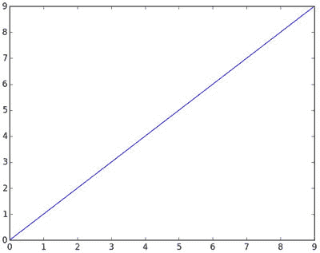

图 7-1

使用 `plot()` 函数绘制前 10 个整数

结果如图 7-1 所示。一个图形需要两个轴，通常称为 x 轴和 y 轴。当 `plot()` 命令只提供一个列表或数组时，它会假定这些是 y 轴的值，并根据列表的长度自动生成相应的 x 值。我们有 10 个数字。因此，x 轴有从 0 到 9 的 10 个数字。`plot()` 可以将两个轴都作为输入向量来生成图形，如 7-2 清单中的代码所示。此代码使用 `pylab` 库而不是 `pyplot`。

```
1  # 使用 pylab 绘制数字
2  import numpy as np
3  from matplotlib import pylab as pl
4  x = np.linspace(0,100)
5  y = x ** 2
6  pl.plot(x,y)
7  pl.show()
清单 7-2
sqPlot1.py
```

结果如图 7-2 所示。只需几行代码就可以绘制一个非常基本的图形：首先导入相关库（第 1 行和第 2 行），然后定义 x 轴和 y 轴，最后使用 `plot` 命令，该命令提供 x 轴和 y 轴的参数。这些命令可以在 Python 命令提示符下逐条发出，也可以保存为 Python 文件。（使用文本编辑器，编写代码，并以 `sqPlot1.py` 保存。）

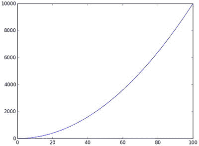

图 7-2

使用 `plot()` 函数绘制前 10 个整数

这些轴被定义为 `numpy` 数组。它们可以通过所有可用的方法生成，包括手动创建、使用公式（如代码 `sqPlot1.py` 中——通过对数组 `x` 进行逐元素平方生成名为 `y` 的数组）、使用数据文件、通过互联网或局域网从远程/本地服务器实时获取数据等等。后续章节将介绍文件输入/输出功能。本章仅使用自身生成或使用公式生成的数组。

值得一提的是一个看似简单但功能强大的函数：`show()`。在命令提示符下简单搜索（输入 `matplotlib.pyplot.show`）即可了解其用途。它会在具有图形功能的计算机终端上显示图形，大多数现代计算机都具备此功能。在 `IPython` 控制台的非交互模式下，它会先显示所有图形并阻塞控制台，直到图形被关闭。相反，在交互模式下，它不会阻塞控制台。两种模式各有优点。交互模式用于检查特征的变化。当重点更多地放在生成图形的代码上时，使用非交互模式。通常，程序员先使用交互模式优化视图，然后使用非交互模式，并采用在交互模式实验期间生成的相同设置。

### 7.3.1 在同一坐标轴上绘制多个图形

只需发出两个 plot 命令，就可以在同一图形的同一坐标轴上绘制多个图形，如 7-3 清单所示。

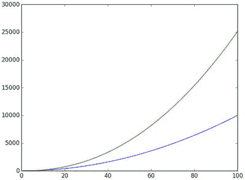

图 7-3

在同一坐标轴上绘制多个图形

```
1  import numpy as np
2  from matplotlib import pylab as pl
3  x = np.linspace(0,100)
4  y1 = x ** 2 # y 是 x 的平方
5  y2 = x ** 2.2 # y 是 x 的 2.2 次方
6  pl.plot(x,y1)
7  pl.plot(x,y2)
8  pl.show()
清单 7-3
sqPlot2.py
```


### 7.3.2 图形的各种特征

图形具有多种特征。以下是图形特征列表：

**表 7-2** 绘图线型

| 样式缩写 | 样式 |
| --- | --- |
| - | 实线 |
| – | 虚线 |
| -. | 点划线 |
| : | 点线 |

**表 7-1** 绘图特征

| 标记缩写 | 标记样式 |
| --- | --- |
| . | 点 |
| , | 像素 |
| o | 圆圈 |
| v | 下三角 |
| < | 左三角 |
| > | 右三角 |
| 1 | 下三脚架 |
| 2 | 上三脚架 |
| 3 | 左三脚架 |
| 4 | 右三脚架 |
| s | 正方形 |
| p | 五边形 |
| ∗ | 星形 |
| h | 六边形 |
| H | 旋转六边形 |
| + | 加号 |
| x | 叉号 |
| D | 菱形 |
| d | 细菱形 |
| - | 水平线 |

- **标题**：标题简要介绍图形的用途。`title()` 对象用于设置当前坐标轴的标题，位于坐标轴上方并居中。它接受一个字符串作为输入。
- **坐标轴标签**：坐标轴标签标明图形坐标轴的用途。`xlabel()` 和 `ylabel()` 对象分别用于设置 x 轴和 y 轴的标签。它们接受的文本字符串位于坐标轴上方并居中。
- **刻度**：坐标轴上的刻度显示数据点在轴上的划分，有助于判断图形上数据点的信息。`xticks` 和 `yticks` 用于设置刻度的频率和位置。例如，

```
xticks( arange(5), ('a', 'b', 'c', 'd', 'e') )
```

表示五个名为 `a`、`b`、`c`、`d` 和 `e` 的刻度等距放置。`linspace` 和 `logspace` 也可用于相同目的。
- **标记**：标记是在每个数据点处绘制的符号。可以通过区分标记的大小和类型来显示属于两个或多个不同数据集的数据点。在 `plot()` 函数中，对于每一对 x, y，都有一个可选的第三个参数作为格式字符串，用于指示绘图的颜色和线型。标记列表见 [`http://matplotlib.org/api/markers_api.html#module-matplotlib.markers`](http://matplotlib.org/api/markers_api.html%23module-matplotlib.markers)。例如：`plot(x,y,'r+')` 表示每个数据点将放置红色加号 (+)。它们列于表 7-1 中。
- **线宽**：线宽定义标记的宽度。`linewidth=n` 其中 `n` 可设置为整数，将标记大小设置为所需尺寸。
- **线型**：线型定义连接标记的线条样式。当数据点不需要连接时，可以关闭线型。`linestyle = '.'` 将线型设置为两个数据点之间的连接点。类似地，还存在许多其他线型，如表 7-2 所示。
- **颜色**：标记的颜色也可用于区分属于两个或多个不同数据集的数据点，但此方法不适用于需要以黑白配色方案发布数据的情况。

以下命令将线型设置为 `--`，标记设置为 `+`，颜色为绿色：

```
plot(arange(10,100,1), linestyle="--", marker='+', color="g")
```

快捷命令如下：

```
plot(range(10), '--g+')
```

表 7-3 列出了选择特定颜色的代码。

**表 7-3** 绘图颜色

| 颜色缩写 | 颜色名称 |
| --- | --- |
| b | 蓝色 |
| c | 青色 |
| g | 绿色 |
| k | 黑色 |
| m | 品红色 |
| r | 红色 |
| w | 白色 |
| y | 黄色 |

除了使用预定义的颜色符号外，您还可以使用十六进制字符串（如 `#FF00FF`）或 RGBA 元组（如 `(1,0,1,1)`）。您可以将灰度强度设置为字符串，例如 `'0.6'`。

- **网格**：可以使用以下语法打开或关闭图形的网格：

```
grid(True)
```

- **图例**：图例用于通过显示数据类型的符号并打印相应文本来区分同一图形中来自多个图形的数据类型。

其用法在 [`http://matplotlib.org/api/pyplot_api.html#matplotlib.pyplot`](http://matplotlib.org/api/pyplot_api.html%23matplotlib.pyplot.legend) `.` [`legend`](http://matplotlib.org/api/pyplot_api.html#matplotlib.pyplot.legend) 中有说明。

默认情况下，`legend()` 接受在 `plot()` 函数中通过标志 `label=""` 提供的字符串作为输入。默认位置设置为右上角。可以通过设置 `loc=` 参数根据需要更改位置。

针对二维 `plot()` 函数设置线条属性，提供了多种选项 [4]。代码 `sqPlot3.py` 展示了使用多种格式化参数绘制格式化图形的方法，如代码清单 7-4 和图 7-4 所示。

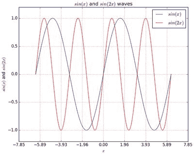

**图 7-4** 绘制 sin(x) 和 sin(2x)

```
1  # 导入 pylab 和 numpy
2  from matplotlib import pylab as pl
3  import numpy as np

5  # 创建一个大小为 9x7 英寸、100 点每英寸的图形
6  pl.figure(figsize=(9, 7), dpi=100)

8  # 从 1x1 网格创建一个新的子图
9  pl.subplot(1, 1, 1)

11  # 我们希望绘制 sin(x) 和 sin(2x)

13  # 首先我们以 pi 为单位定义 x 轴

15  X = np.linspace(-np.pi * 2, np.pi *2, 10e4, endpoint=True)

17  ''' x 轴定义为从 -2pi 到 2pi，包含 10000 个点
18  其中最后一个点也被包含在内'''

20  S, S2 = np.sin(X), np.sin(2*X)

22  # 用宽度为 1（像素）的蓝色连续线绘制 sin(x)
23  # 标签为 sin(x)
24  pl.plot(X, S, color="blue", linewidth=1.0, linestyle="-", label = "$sin(x)$")

26  # 用宽度为 1（像素）的红色连续线绘制 sin(2x)
27  # 标签为 sin(2x)
28  pl.plot(X, S2, color="red", linewidth=1.0, linestyle="-", label = "$sin(2x)$")

30  # 设置 x 轴范围从 -2pi 到 2.5*pi
31  pl.xlim(-2* np.pi, 2.5* np.pi)

33  # 设置 x 轴刻度
34  pl.xticks(np.linspace(-2.5 * np.pi, 2.5 * np.pi, 9, endpoint =True))

36  # 设置 y 轴范围从 1.2 到 -1.2
37  pl.ylim(-1.2, 1.2)

39  # 设置 y 轴刻度
40  pl.yticks(np.linspace(-1, 1, 5, endpoint=True))

42  # 设置标题为 '正弦波'
43  pl.title('$sin(x)$ and $sin(2x)$ waves')

45  # 设置 x 轴和 y 轴的标签

47  pl.ylabel('$sin(x)$ and $sin(2x)$')
48  pl.xlabel('$x$')

50  # 打开网格
51  pl.grid(True)

53  # 在角落显示图例以区分两条曲线
54  pl.legend()

56  # 在屏幕上显示结果
57  pl.show()
```

**代码清单 7-4** `sqPlot3.py`

## 7.4 设置属性

`setup()` 和 `getup()` 对象允许我们设置和获取对象的属性。它们与 `matplotlib` 对象配合良好。对于 `plot()` 对象，可以使用 `setup()` 来设置属性。目前，初学者可以忽略这一点。


## 7.5 直方图

直方图使用垂直条形来绘制特定频率范围（称为组距）内发生的事件。可以使用 `hist()` 函数简单绘制，如代码清单 7-5 所示。

```
1  import matplotlib.pyplot as pt
2  import numpy as np

4  a = np.random.rand(50)
5  pt.hist(a)
6  pt.show()
代码清单 7-5
plotHistogram.py
```

结果如图 7-5 所示。需要注意的是，由于我们使用随机数作为 `hist()` 函数的输入，每次运行都会生成不同的图形。

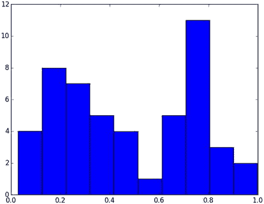

图 7-5

50 个随机数的直方图

组距的数量可以设置为一个数值，并与输入变量一起传入，如代码清单 7-6 所示。

```
1  import matplotlib.pyplot as pt
2  import numpy as np

4  a = np.random.rand(50)
5  pt.hist(a,25) # 将组距数量设置为 25
6  pt.show()
代码清单 7-6
plotHistogramBins.py
```

结果如图 7-6 所示。

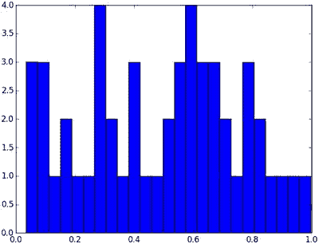

图 7-6

50 个随机数的直方图

## 7.6 条形图

最简单的图表之一使用矩形条（水平或垂直），矩形的高度与数据值成正比。这种图形称为条形图。条形图由 `bar()` 函数生成，该函数需要两个输入来定义 x 轴和 y 轴，而 `hist()` 函数只需要一个输入。代码清单 7-7 展示了一个示例代码，其中定义了 `x` 和 `y` 数组。

```
1  import matplotlib.pyplot as pl
2  import numpy as np
3  x = np.array([1,2,3,4,5,6,7,8,9,0])
4  y = np.array([1,4,2,3,4,5,7,6,8,7])
5  pl.bar(x, y)
6  pl.title('垂直条形图')
7  pl.xlabel('$x$')
8  pl.ylabel('$y$')
9  pl.show()
代码清单 7-7
bar.py
```

结果如图 7-7 所示。

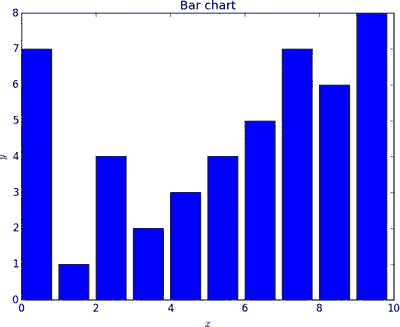

图 7-7

垂直条形图

条形图和直方图看起来非常相似。区别在于它们的定义方式。`bar()` 需要 x 轴和 y 轴两个参数，而 `hist()` 只需要一个 y 轴参数。`barh()` 函数用于绘制水平条形图。（参见代码清单 7-8。）

```
1  import matplotlib.pyplot as pl
2  import numpy as np
3  x = np.array([1,2,3,4,5,6,7,8,9,0])
4  y = np.array([1,4,2,3,4,5,7,6,8,7])
5  pl.barh(x, y)
6  pl.title('水平条形图')
7  pl.xlabel('$x$')
8  pl.ylabel('$y$')
9  pl.show()
代码清单 7-8
barh.py
```

结果如图 7-8 所示。

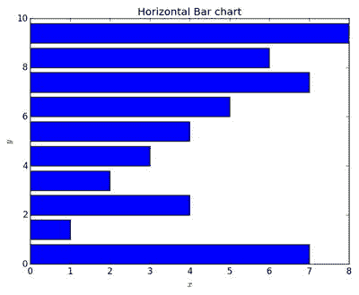

图 7-8

水平条形图

## 7.7 误差条形图

所有科学实验工作都涉及误差，出于多种原因，将误差与数据一起绘制非常重要。必须绘制误差，以便判断数据质量，并了解误差巨大或微小的数据区域。在 `matplotlib` 中，`errorbar()` 函数使您能够创建此类图形，称为误差条形图。数据值分布的表示方法是通过绘制单个数据点（通常是数据集的平均值）和一个误差条来表示数据的整体分布。为此，代码清单 7-9 中的 `ploterror.py` 代码定义了一个 x 轴数组，然后使用公式 `y = x2` 定义了一个 y 轴数组。误差存储在第三个数组中，变量名为 `err`。这些变量名作为参数传递给 `errorbar()` 函数；因此，它按顺序接收三个变量：`x`、`y` 和 `err`。该文件生成的图形如图 7-9 所示。

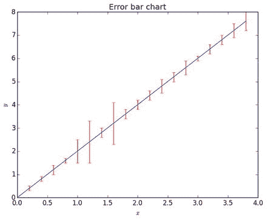

图 7-9

对称误差条形图

```
1  import matplotlib.pyplot as pl
2  import numpy as np
3  x = np.arange(0, 4, 0.2) # 生成从 0 到 4 的数据点，步长为 0.2
4  y = x*2 # y = e^(-x)
5  err = np.array([0,.1,.1,.2,.1,.5,.9,.2,.9,.2,.2,.2,.3,.2,.3,.1,.2,.2,.3,.4])
6  pl.errorbar(x, y, yerr=err, ecolor="r")
7  pl.title('具有对称误差的误差条形图')
8  pl.xlabel('$x$')
9  pl.ylabel('$y$')
10  pl.show()
代码清单 7-9
ploterror.py
```

`ecolor` 设置误差条的颜色。就像可以设置 `yerr` 关键字的值一样，您也可以设置 `xerr` 以在 x 轴上生成误差条。

在代码清单 7-10 中，误差条是对称的——即正负误差相等。要绘制非对称误差条，`errorbar()` 将需要两个数组来定义误差。

```
1  import matplotlib.pyplot as pl
2  import numpy as np
3  x = np.arange(0, 4, 0.2) # 生成从 0 到 4 的数据点，步长为 0.2
4  y = x*2 # y = e^(-x)
5  err_positive = np.array([0.5,.1,.1,.2,.1,.5,.9,.2,.9,.2,.2,.2,.3,.2,.3,.1,.2,.2,.3,.4])
6  err_negative = np.array([0.2,.4,.3,.1,.4,.3,.1,.9,.1,.3,.5,.0,.5,.1,.2,.6,.3,.4,.1,.1])
7  pl.errorbar(x, y, yerr=[err_positive, err_negative], ecolor="r")
8  pl.title('具有非对称误差的误差条形图')
9  pl.xlabel('$x$')
10  pl.ylabel('$y$')
11  pl.show()
代码清单 7-10
ploterror1.py
```

该文件生成的图形如图 7-10 所示。

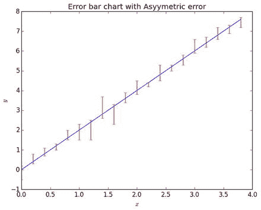

图 7-10

非对称误差条形图

## 7.8 散点图

散点图由绘制在二维网格（由两个轴组成，例如 x 和 y）上的点组成。数据点之间没有用线连接；因此，它们看起来是分散且不连续的！

这些图由 `scatter()` 函数实现，该函数接受两个数组作为参数。散点图用于获取两个变量之间的相关性。绘制时，数据簇显示出特定数据范围之间的强相关性。这是回归分析所需的关键操作之一。（参见代码清单 7-11。）

```
1  import matplotlib.pyplot as pl
2  import numpy as np
3  x = np.random.rand(1000)
4  y = np.random.rand(1000)
5  pl.scatter(x,y)
6  pl.title('散点图')
7  pl.xlabel('$x$')
8  pl.ylabel('$y$')
9  pl.show()
代码清单 7-11
scatter.py
```

该文件生成的图形如图 7-11 所示。

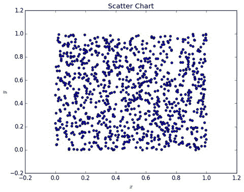

图 7-11

散点图

## 7.9 饼图

当需要将特定范围内的事件数据分类到不同扇区时，饼图就派上用场了。饼图是圆形的，为不同的数据范围划分出扇区/楔形块。楔形块的大小与数据值成正比。`pie()` 函数用于此目的，如代码清单 7-12 所示。

```
1  import matplotlib.pyplot as pl
2  import numpy as np
3  x = np.array([1,2,3,4,5,6,7,8,9,0])
4  label = ['a','b','c','d','e','f','g','h','i','j']
5  explode = [0.2, 0.1, 0.5, 0, 0, 0.3, 0.3, 0.2, 0.1,0]
6  pl.pie(x, labels=label, explode = explode, shadow=True, autopct ='%2.2f%%')
7  pl.title('饼图')
8  pl.show()
代码清单 7-12
pie.py
```

该文件生成的图形如图 7-12 所示。

当未定义 `explode` 标签时，您将得到一个未分离的饼图。`autopct` 设置特定部分的权重百分比，可以通过格式说明符设置。`%2.2f%%` 将权重百分比的显示设置为保留两位小数和两位有效数字。`shadow` 为楔形块下方提供阴影，使其看起来像一个真正的馅饼！

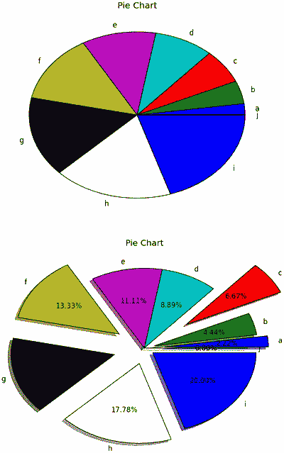

图 7-12

未分离和分离的饼图


## 7.10 极坐标图

到目前为止，我们讨论的所有图表都是处理在笛卡尔坐标系中定义的数据。对于在极坐标系中定义的数据——使用 (`r`, `θ`) 而非 (`x`, `y`)——可以通过 `plot()` 函数获得极坐标图，如代码清单 7-13 所示。

```
1  import matplotlib.pyplot as pl
2  import numpy as np

4  r = np.arange(0, 10.0, 0.1)
5  theta = 2* np.pi * r

7  pl.polar(theta, r, color ='g')
8  pl.show()
代码清单 7-13
polar.py
```

该文件生成的图形如图 7-13 所示。

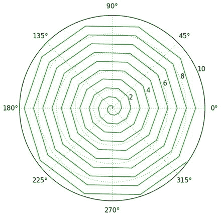

图 7-13

极坐标图

## 7.11 使用文本、箭头和注释装饰图表

有时，您需要在图表的特定位置（例如坐标 (`x`, `y`)）放置文本。`text()` 函数用于放置文本，如代码清单 7-14 所示。

```
1  import matplotlib.pyplot as pl
2  import numpy as np
3  x = np.arange(0, 2*np.pi, .01)
4  y = np.sin(x)
5  pl.plot(x, y, color = 'r');
6  pl.text(0.1, -0.04, '$sin(0) = 0$')
7  pl.text(1.5, 0.9, '$sin(90) = 1$')
8  pl.text(2.0, 0, '$sin(180) = 0$')
9  pl.text(4.5, -0.9, '$sin(270) = -1$')
10  pl.text(6.0, 0.0, '$sin(360) = 1$')
11  pl.annotate('$sin(theta)=0$', xy=(3, 0.1), xytext=(5, 0.7),
arrowprops=dict(facecolor='green', shrink=0.05))
12  pl.title('在图表中插入文本和注释')
13  pl.xlabel('$theta$')
14  pl.ylabel('$y = sin( theta)$')
15  pl.show()
代码清单 7-14
```

该文件生成的图形如图 7-14 所示。

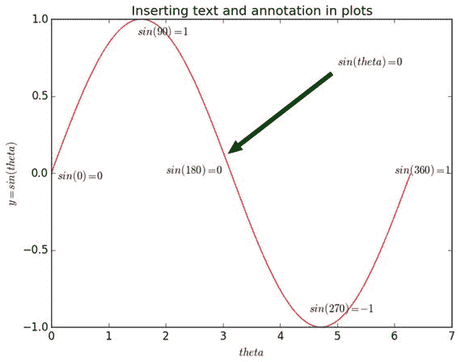

图 7-14

在图表中插入文本

如代码清单 7-14 所示，可以通过为文本、箭头和注释定义坐标轴点，将它们放置在适当的位置。识别合适坐标的一个便捷方法是将鼠标悬停在图表主体上，并查看图形左下角显示当前鼠标坐标的位置。`help(matplotlib.pyplot.annotate)` 提供了使用此函数的有用输入。

## 7.12 子图

可以使用子图选项绘制多个图表，其中不同的图表被视为一个图形矩阵。就像常规矩阵一样，元素通过索引来标识。如代码清单 7-15 所示，子图使用诸如 (`222`) 之类的索引来定位，这本质上意味着矩阵是 2 × 2 的，并且正在访问第二个位置来放置基于 `scatter()` 函数的图表。类似地，(`221`) 在第一个位置使用 `plot()` 函数，(`223`) 在第三个位置使用 `hist()` 函数绘制直方图，而 (`224`) 是第四个图表，使用 `barh()` 生成水平条形图。

```
1  import matplotlib.pyplot as pl
2  import numpy as np

4  x = np.arange(10)
5  y1 = np.random.rand(10)
6  y2 = np.random.rand(10)

8  fig = pl.figure()

11  ax1 = fig.add_subplot(221)
12  ax1.plot(x,y1)

14  ax2 = fig.add_subplot(222)
15  ax2.scatter(x,y2)

17  ax3 = fig.add_subplot(223)
18  ax3.hist(y1)

20  ax4 = fig.add_subplot(224)
21  ax4.barh(x,y2)

23  pl.show()
代码清单 7-15
subplot1.py
```

该文件生成的图形如图 7-15 所示。

## 7.13 将图表保存到文件

大多数情况下，使用 `matplotlib` 绘制的图表需要保存以供将来参考和使用。在这些情况下，使用 `savefig()` 函数来指定图形的文件名、权限、文件类型等。例如，代码清单 7-16 会在工作文件夹中生成一个名为 `plot1.png` 的文件。（使用 IPython 的用户可以通过输入 `pwd` 来查找当前工作目录）。如果您在 `savefig()` 函数的字符串参数中提供了正确的路径，并且您拥有在该路径下创建文件的适当权限，则会在该路径下创建文件。

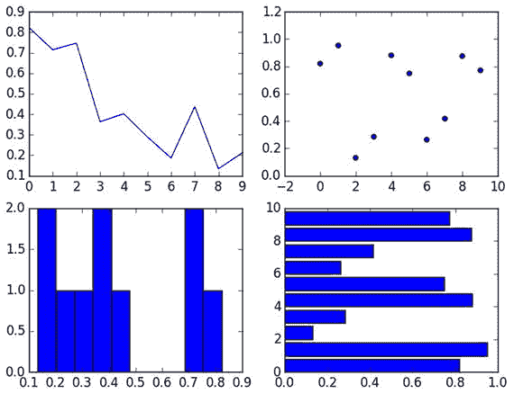

图 7-15

子图

```
1  import matplotlib.pyplot as pt
2  import numpy as np
3  pt.plot (np.arange (10))
4  pt.savefig ('plot1.png')
代码清单 7-16
sqPlot4.py
```

该文件生成的图形如图 7-16 所示。

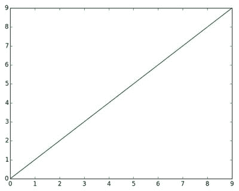

图 7-16

绘制 sin(x) 和 sin(2x)

了解文件大小和图形分辨率对于在离线/打印和在线媒体上发布非常重要。当程序中没有设置用于设定图形分辨率和文件大小的参数时，将使用默认值。这些默认值可以通过以下代码获知：

```
1  >>>import matplotlib as ml
2  >>>ml.rcParams['figure.figsize']
3  [8.0, 6.0]
4  # 默认图形大小为 8 X 6 英寸
5  >>>ml.rcParams['savefig.dpi']
6  100.0
7  # 默认图形分辨率为 100 dpi
```

由于创建了一个 8 × 6 英寸、100 dpi（每英寸点数/像素）的图形，因此使用 `savefig()` 默认会保存一个 800 × 600 像素的图像。当此文件被定向到计算机图形终端进行显示时，长度单位将被忽略，直接显示像素。如果文件被定向到打印介质（如打印机或绘图仪），则长度参数和 DPI 将决定图形大小和分辨率。


## 7.14 在 Web 应用服务器上显示图表

在互联网连接的时代，许多问题需要在网页上绘制交互式图表。这需要将不同类型的图表绘制在用不同语言编写、在不同环境下运行的网页上。需要注意的是，`matplotlib` 需要图形用户界面，而这又需要 X11 连接。因此，在动态更新由 `matplotlib` 生成的图表之前，必须在 Web 应用服务器上开启此功能。通常，在计算机上绘制图表涉及两个方面。使用一组命令编写脚本被称为前端任务，这需要后端工作的支持。后端负责与系统的图形功能进行交互，以生成所需格式的图表。图表可以使用诸如 `pygtk`、`wxpython`、`tkinter`、`qt4` 和 `macosx` 等后端进行交互式绘制，也可以使用诸如 `PNG`、`SVG`、`PS` 和 `PDF` 等后端进行非交互式绘制（永久保存为计算机上的文件）。后者也称为硬拷贝后端。

配置后端有两种途径：

1.  可以编辑安装目录下的 `matplotlibrc` 文件，将 `backend` 参数设置为特定值，例如以下示例：

    ```
    1  backend : WXAgg   # 使用带有 antigrain (agg) 渲染的 wxpython
    ```

    在 LINUX 系统上，`matplotlibrc` 位于 `/etc/matplotlibrc`。
2.  使用 `use()` 临时设置特定后端：

    ```
    1  >>>import matplotlib
    2  >>>matplotlib.use('PDF')   # 默认生成 PDF 文件作为输出
    ```

选择哪种方式来设置后端取决于程序的应用场景。如果程序旨在临时将图表保存为非交互式的 `PDF` 文件，可以使用方法二，该方法会一直生效，直到另一个程序更改了后端设置。设置后端必须在 `import matplotlib.pyplot` 或 `import matplotlib.pylab` 之前完成。有关为各种应用使用不同后端的更多信息，请访问 [`http://matplotlib.org/faq/usage_faq.html#what-is-a-backend`](http://matplotlib.org/faq/usage_faq.html%23what-is-a-backend)。对于 Web 应用服务器，将后端设置为 `WXAgg`、`GTKAgg`、`QT4Agg` 和 `TkAgg` 即可工作。

与默认保存为白色背景的图形不同，保存透明图形的一种方法是设置 `transparent=TRUE`。当图形需要嵌入到具有预定义背景颜色/图像的网页中时，这一点尤其重要。

另一种将交互模式设置为 `ON` 或 `OFF` 的方法是分别包含命令 `matplotlib.pyplot.ion()` 和 `matplotlib.pyplot.ioff()`。

### 7.14.1 IPython 和 Jupyter Notebook

在使用 `IPython` 时，如果你希望通过在 `IPython` 命令提示符下发出命令来动态更改图表，只需在 UNIX 终端上发出一个命令：

```
1  $ ipython −pylab
```

这会在 `IPython` 中启用一种特殊的 `matplotlib` 支持模式，该模式会查找配置文件以确定后端，并在需要时激活适当的 GUI 线程模型。它还会设置 `Matplotlib` 交互模式，以便 `show()` 命令不会阻塞交互式 `IPython` shell。

在 `Jupyter Notebook` 环境中工作时，发出以下命令：

```
1  $ jupyter notebook −−pylab=inline
```

此命令会内联生成图形，即在调用绘图命令的代码行之间的代码主体内生成图形。否则，图形会弹出到单独的窗口中。内联模式在设计教学材料时非常有用。但是，在与相关人员共享之前，应确保用户的计算机上安装了编码所需的后端和依赖项。

或者，你可以将 `%matplotlib inline` 作为魔法命令之一写在第一个单元格中，以便所有绘图都定向显示在 Web 浏览器界面的框架内。在大多数情况下，这是首选方法，尤其是在教授基于 Python 的绘图时。

## 7.15 在对象模式下使用 matplotlib

使用 `matplotlib` 的 Pythonic 方式是在对象模式下使用它，在这种模式下，显式定义对象可以实现终极定制。为此，你必须将图形的每个元素定义为一个对象，并使用其属性进行定制。用于此目的的三个基本对象的层次结构如下：

1.  `FigureCanvas`：`Figure` 实例的容器类
2.  `Figure`：`axes` 实例的容器类
3.  `Axes`：坐标轴是用于容纳各种绘图特征（如线条、刻度、曲线和文本）的矩形区域。

在以面向对象模式使用 `matplotlib` 时，需要指定一个 `FigureCanvas`，它包含 `figure(s)`，而 `figure(s)` 又包含 `axes`，可以在 `axes` 上实现各种绘图功能。整个过程允许进行任何可以想象到的定制。清单 7-17 解释了这一概念。

```
1  import matplotlib.pyplot as plt
2  fig = plt.figure()
3  # 变量 fig 存储 "figure" 实例
4  ax1 = fig.add_subplot(221)
5  # 变量 ax1 存储位于 2 x 1 矩阵中第一个位置的 figure 的子图
6  ax1.plot([-1, 1, 4], [-2, -3, 4]);
7  # 调用 ax1 并为其赋予 plot 函数。
8  # plot 函数携带两个列表，分别提供图形的 x 轴和 y 轴点
9  ax2 = fig.add_subplot(222)
10  ax2.plot([1, -2, 2], [0, 0, 2]);
11  # 与 ax1 逻辑相同
12  ax3 = fig.add_subplot(223)
13  ax3.plot([10, 20, 30], [10, 20, 30]);
14  ax4 = fig.add_subplot(224)
15  ax4.plot([-1, -2, -3], [-10, -20, -30]);
16  plt.show()
17  # 在计算机终端上显示图形
清单 7-17
objPlot.py
```

生成的图形如图 7-17 所示。


## 7.16 对数坐标图

许多工程数据会使用对数刻度，尤其是当数据变化导致观测变量值出现数量级变化时。Python 提供了绘制对数坐标图的功能，如代码清单 7-18 所示。

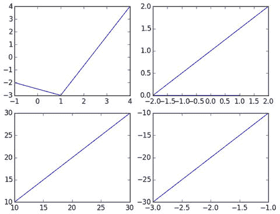

图 7-17

使用对象模式绘图

```
1  import matplotlib.pyplot as plt
2  import numpy as np

4  x = np.arange(0., 10, 0.01)

6  fig = plt.figure()

8  ax1 = fig.add_subplot(221)
9  y1 = np.log(x)
10  ax1.plot(x, y1);
11  ax1.grid(True)
12  ax1.set_ylabel('$y = log(x)$');
13  ax1.set_title('y-axis in log scale')

15  ax2 = fig.add_subplot(222)
16  y2 = np.sin(np.pi*x/2.)
17  ax2.semilogx(x, y2, basex = 3);
18  ax2.grid(True)
19  ax2.set_title('x-axis in log scale')

21  ax3 = fig.add_subplot(223)
22  y3 = np.sin(np.pi*x/3.)
23  ax3.loglog(x, y3, basex=2);
24  ax3.grid(True)
25  ax3.set_ylabel('both axes in log');

27  ax4 = fig.add_subplot(224)
28  y4 = np.cos(2*x)
29  ax4.loglog(x, y3, basex=10);
30  ax4.grid(True)

32  plt.show()
代码清单 7-18
log.py
```

定义了以下坐标轴实例：

1. `ax1` 使用 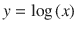 [。]
2. `ax2` 使用 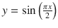 [。]
3. `ax3` 使用 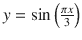 [。]
4. `ax4` 使用 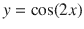 [。]

生成的图形如图 7-18 所示。

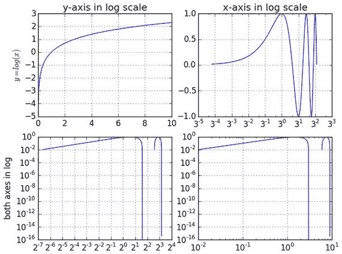

图 7-18

使用对象模式绘图

如程序 `log.py` 所示，对数值可以直接传递给 `plot()` 函数。当某个特定坐标轴需要以对数值绘制时，可以使用 `semilog()` 和 `semilogy()` 函数，并且可以定义底数索引。该特定坐标轴的值会被转换为对数刻度，然后进行绘制。当两个坐标轴都需要绘制对数值时，则需要调用 `loglog()` 函数。

对数坐标图在信号处理和热力学等多个领域都有应用。本质上，只要数据发生数量级变化，使用对数坐标图就更容易观察。对数刻度是一种非线性刻度。能够改变对数函数的底数，为开发者提供了强大的工具，以便得出最有意义的结论。

## 7.17 在同一图形上绘制两个图，且至少有一个坐标轴不同

使用 `twinx()` 和 `twiny()` 函数，可以在同一图形上使用两个 x 轴或 y 轴来绘制两组数据点。代码清单 7-19 中给出了一个使用 `twinx()` 的示例，其中 x 轴被孪生，以生成共享相同 x 轴数据点的两个数据集的图形。

```
1  import matplotlib.pyplot as plt
2  import numpy as np

4  x = np.arange(0., 100, 1);
5  y1 = x**2;
6  # y1 定义为 x 值的平方
7  y2 = np.sqrt(x);
8  # y2 定义为 x 值的平方根

10  fig = plt.figure()
11  ax1 = fig.add_subplot(111)
12  ax1.plot(x, y1, 'bo');
13  ax1.set_ylabel('$x^{2}$');
14  ax2 = ax1.twinx() # 使用 twinx() 函数显示孪生的 x 轴
15  ax2.plot(x, y2, 'k+');
16  ax2.set_ylabel('$\sqrt{x}$');
17  ax2.set_title('Same x axis for both y values');
18  plt.show()
代码清单 7-19
twinx.py
```

值得注意的是，两个不同的坐标轴实例 `ax1` 和 `ax2` 相互叠加，其中来自 `y1` 的数据分配给坐标轴实例 `ax1`，来自 `y2` 的数据分配给坐标轴实例 `ax2`。这也说明了以对象模式定义图形的强大之处。相应的图形如图 7-19 所示。

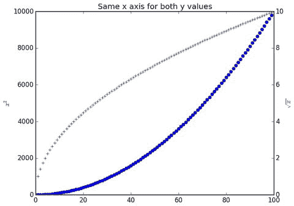

图 7-19

使用 `twinx()` 变量

## 7.18 等高线图

在某些工程应用中，等高线图成为解释说明的重要组成部分，因为它们可以根据某些相似性将数据划分为不同的区域。例如，想象从山顶俯瞰一座山，你可以用闭合的环线来定义海拔相似的区域。因此，一座山将表现为一系列环线。类似地，一个非均匀加热区域的二维地图可以看作是描绘相同温度区域的等高线。一个降雨区域可以看作是描绘不同雨滴大小区域的等高线。

因此，等高线也被称为等值线或等位线。术语“iso”附加在具有恒定值的数据点上，这些数据点的区域由等高线分隔。

对于等高线图，你需要 x 轴、y 轴和 z 轴，其中 z 轴定义高度。具有相同高度的数据在等值线内被组合在一起。（参见代码清单 7-20。）

```
1  import matplotlib.pyplot as plt
2  import numpy as np

4  # 定义 x、y、z 轴的数据
5  x = np.linspace(0,1,100)
6  y = np.linspace(1,2,100)
7  (X,Y) = np.meshgrid(x,y)
8  z = np.sin(X)-np.sin(Y)

10  # 绘制等高线
11  fig = plt.figure()

13  ax1 = fig.add_subplot(211)
14  c1 = ax1.contour(x,y,z)
15  l1 = ax1.clabel(c1)
16  lx1 = ax1.set_xlabel("x")
17  ly1 = ax1.set_ylabel("y")

20  # 绘制填充等高线
21  ax2 = fig.add_subplot(212)
22  c2 = ax2.contourf(x,y,z)
23  l2 = ax2.clabel(c2)
24  lx2 = ax2.set_xlabel("x")
25  ly2 = ax2.set_ylabel("y")

27  plt.show()

29  # 绘制填充等高线
代码清单 7-20
contour.py
```

相应的图形如图 7-20 所示。

`contour()` 和 `contourf()` 函数可用于绘制未填充和已填充的等高线。简单的命令 `help(contour)` 可以提供关于设置等高线图各种参数的详细信息。

## 7.19 matplotlib 中的 3D 绘图

随着软件和硬件端先进计算技术的发展，在图形终端上生成交互式 3D 图形变得更加容易。`matplotlib` 在这方面提供了相当多的选项，将在以下小节中讨论。

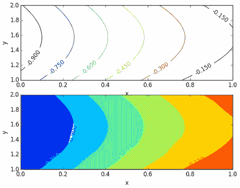

图 7-20

等高线图


### 7.19.1 折线图与散点图

`matplotlib` 的 `toolkits` 中包含 `mplot3D` 类，该类提供了 `Axes3D` 对象。通过使用 `projection='3D'` 关键字，可以创建一个 `Axes3D` 对象，该对象提供了显示三维图形的屏幕区域。然后可以将 `Axes3D` 传递给一个 `figure` 对象，以将其显示为图形。如清单 7-21 所示，只需向 `plot()` 函数传递三个参数即可创建折线图。

```
1  import matplotlib as mpl
2  from mpl_toolkits.mplot3d import Axes3D
3  import numpy as np
4  import matplotlib.pyplot as plt

6  fig = plt.figure()
7  ax = fig.gca(projection='3d')

9  x = np.linspace(-10*(np.pi),10*(np.pi),10e4)
10  y = np.sin(x)
11  z = np.cos(x)

13  ax.plot(x, y, z, label='$y=sin(x)$ and $z = cos(x)$')
14  ax.legend()
15  ax.set_title('3D line curve')
16  ax.set_xlabel('$x$')
17  ax.set_ylabel('$y = sin(x)$')
18  ax.set_zlabel('$z = cos(x)$')
19  plt.show()
Listing 7-21
3Dline.py
```

对应的图形如图 7-21 所示。

三维散点图的绘制方式与折线图类似。这在 Python 脚本清单 7-22 中进行了说明，对应的图形如图 7-21 所示。

```
1  import numpy as np
2  from mpl_toolkits.mplot3d import Axes3D
3  import matplotlib.pyplot as plt

5  fig = plt.figure()
6  ax = fig.add_subplot(111, projection="3d")

8  x = np.linspace(-5*(np.pi), 5*(np.pi),200)
9  y =np.sin(x)
10  z =np.cos(x)

12  ax.scatter(x, y, z, marker='*')

14  ax.set_xlabel('$x$')
15  ax.set_ylabel('$y = sin(x)$')
16  ax.set_zlabel('$z = cos(x)$')
17  ax.set_title('Scatter plot in 3D')

19  plt.show()
Listing 7-22
3Dscatter.py
```

### 7.19.2 线框图与曲面图

在使用离散值进行计算时，有时绘制`线框图`会很有用，如图 7-22 所示。如清单 7-23 所示，使用 `meshgrid` 函数根据 `x` 和 `y` 值生成一个点网格。在此网格之上生成函数，并使用 `wiremesh` 函数进行绘制。`rstride` 和 `cstride` 定义了行和列的步长：

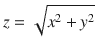

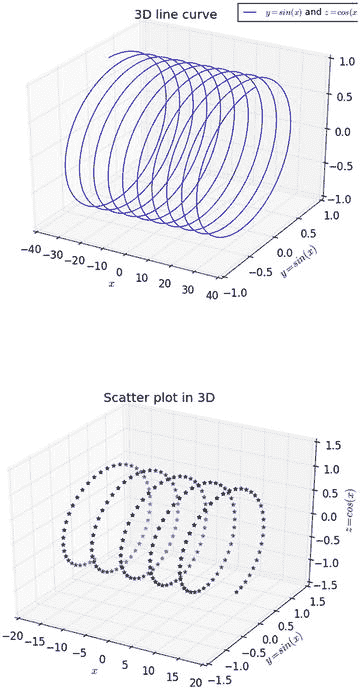

图 7-21
三维折线图与散点图

```
1  from mpl_toolkits.mplot3d import axes3d
2  import matplotlib.pyplot as plt
3  import numpy as np

5  fig = plt.figure()
6  ax = fig.add_subplot(111, projection="3d")

8  a = np.arange(-5, 5, 0.25)
9  b = np.arange(-5, 5, 0.25)
10  x, y = np.meshgrid(a, b)
11  z = np.sqrt(x**2 + y**2)

13  ax.plot_wireframe(x, y, z, rstride=2, cstride=2)

15  ax.set_xlabel('$x$')
16  ax.set_ylabel('$y$')
17  ax.set_zlabel('$z = \sqrt{x^{2}+y^{2}}$')
18  ax.set_title('Wiremesh type of 3D plot')

20  plt.show()
Listing 7-23
3Dwiremesh.py
```

曲面图与`线框图`类似，区别在于曲面图是连续填充的。因此，使用 `surface()` 函数代替 `wiremesh()` 函数。（参见清单 7-24。）

```
1  from mpl_toolkits.mplot3d import axes3d
2  import matplotlib.pyplot as plt
3  import numpy as np

5  fig = plt.figure()
6  ax = fig.add_subplot(111, projection="3d")

8  a = np.arange(-5, 5, 0.25)
9  b = np.arange(-5, 5, 0.25)
10  x, y = np.meshgrid(a, b)
11  z = np.sqrt(x**2 + y**2)

13  ax.plot_surface(x, y, z, rstride=2, cstride=2)

15  ax.set_xlabel('x')
16  ax.set_ylabel('$y$')
17  ax.set_zlabel('$z = \sqrt{x^{2}+y^{2}}$')
18  ax.set_title('Surface type of 3D plot')

20  plt.show()
Listing 7-24
3Dsurface.py
```

对应的图形如图 7-22 所示。

### 7.19.3 三维等高线图

与二维等高线图类似，三维等高线图使用等值面（高度相等的曲面）。使用 `contour()` 和 `contourf()` 函数，可以绘制未填充和已填充的等高线图，如清单 7-25 所示。

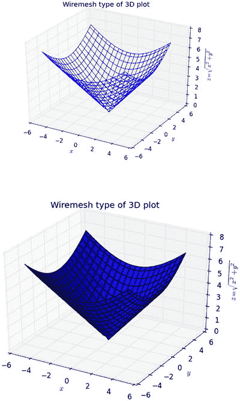

图 7-22
线框图与曲面图

```
1  from mpl_toolkits.mplot3d import axes3d
2  import matplotlib.pyplot as plt
3  from matplotlib import cm
4  import numpy as np

6  fig = plt.figure()
7  ax1 = fig.add_subplot(121, projection="3d")
8  x = np.linspace(2*np.pi,-2*(np.pi),1000)
9  y = np.linspace(2*np.pi,-2*(np.pi),1000)
10  X,Y = np.meshgrid(x,y)
11  Z = np.sin(X) + np.sin(Y)

13  cont = ax1.contour(X, Y, Z)
14  ax1.clabel(cont, fontsize=9, inline=1)
15  ax1.set_xlabel('$x$')
16  ax1.set_ylabel('$y$')
17  ax1.set_title('Contour for $z=sin(x)+sin(y)$')

19  ax2 = fig.add_subplot(122, projection="3d")
20  Z = np.sin(X) + np.sin(Y)
21  cont = ax2.contourf(X, Y, Z)
22  ax2.clabel(cont, fontsize=9, inline=1)
23  ax2.set_xlabel('$x$')
24  ax2.set_ylabel('$y$')
25  ax2.set_title('Filled Contour for $z=sin(x)+sin(y)$')

29  plt.show()
Listing 7-25
3Dcontour.py
```

对应的图形如图 7-23 所示。

### 7.19.4 矢量场图

```
1  from mpl_toolkits.mplot3d import axes3d
2  import matplotlib.pyplot as plt
3  import numpy as np

5  x = np.linspace(np.pi,-(np.pi),10)
6  y = np.linspace(np.pi,-(np.pi),10)
7  (X,Y) = np.meshgrid(x,y)
8  u = -15*X
9  v = 5*Y
10  q = plt.quiver(X,Y,u,v,angles='xy',scale=1000,color='b')
11  #p = plt.quiverkey(q,1,16.5,50,"50 m/s",coordinates='data',color='r')
12  xl = plt.xlabel("x (km)")
13  yl = plt.ylabel("y (km)")
14  plt.show()
Listing 7-26
3Dquiver.py
```

对应的图形如图 7-24 所示。

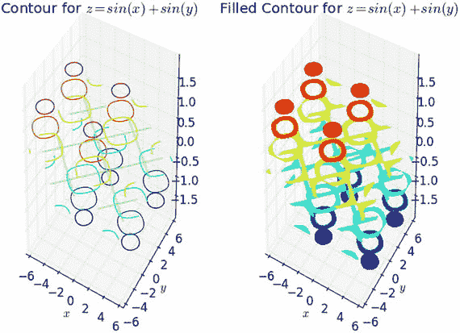

图 7-23
使用 contour 和 contourf 函数绘制的等高线图

## 7.20 其他数据绘图库

`matplotlib` 的使用如此广泛，以至于新的开发者可能没有意识到还有其他绘制数据的选项。在其他模块中，有多种绘制数据的方法，根据上下文，这些方法可能具有更强大的绘图能力。其中包括 `plotly`、`mayavi` 和 `gnuplot`（仅举几例）。下面简要讨论如何使用 `plotly`，有趣的是，它可以在 Web 上绘制数据。这对于那些需要将传感器数据实时绘制在 Web 上的工程应用来说尤其有趣。


### 7.20.1 `plotly`

`plotly` 是一款在线分析与数据可视化工具。除了 Python 之外，`plotly` 还可以绘制 Perl、Julia、Arduino、R 和 MATLAB 中使用的数据。网页链接 [5] 很好地展示了 `plotly` 的功能。本质上，`plotly` 允许在线绘制和发布图表以促进协作。因此，在使用 `plotly` 库之前，你必须连接到互联网。

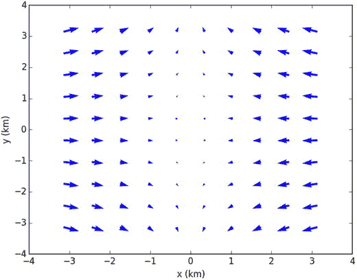

图 7-24

箭袋图

首先，你需要在 `plotly` 网站 [5] 上创建一个用户账户。该账户将提供一个用户名和 API 密钥，这些需要在程序中使用。然后，你可以编写代码，既可以在 Python 终端上一次一条命令地执行，也可以编写成 Python 脚本。（参见代码清单 7-27。）

```
1  import numpy as np
2  import plotly.plotly as py
3  from plotly.graph_objs import *
4  py.sign_in('username','APIkey')
5  data = Data([Scatter(x=np.arange(100),y=np.random.randn(100), name='trace 0')])
6  fig = Figure(data=data)
7  plot_url = py.plot(fig)
代码清单 7-27
plotly.py
```

你需要在代码清单 7-27 的脚本中提供用户名和 API 密钥。该脚本会在用户账户的工作区中在线生成一个散点图。使用 `plotly` 提供的函数，可以非常交互式地绘制这些图表。当数据从连接实时传感器的设备流式传输时，实时数据会被实时绘制出来。这些图表还可以进一步嵌入到网站中。

## 7.21 总结

在本章中，我们讨论了使用 Python 时可用的各种绘图选项。绘制数据的便捷性是 Python 最吸引人的特性之一。仅需几行代码就能以多种方式实现数据的可视化。可视化是数据呈现和分析的支柱，因为它能使对数据的理解更加清晰。除了简单的可视化之外，`matplotlib` 还提供了丰富的功能，能够以期望的方式用有用的信息来装饰图表。

