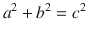

# 8. 函数与循环

## 8.1 引言

函数是计算机程序的一部分，它将许多编程语句组合成一个代码块。它可以在需要时被调用。这使得编程任务可以采用模块化方法，并且由于模块易于编辑，如今在程序员中非常流行。函数接收输入参数并返回输出参数。当使用函数时，会调用函数名并传入输入参数的值。执行后，会返回一组输出参数。Python 函数可以在程序中的任何位置定义，无论它们被调用的位置在哪里。它们甚至可以单独或组合地定义在单独的文件中。此外，根据用户的需求，它们可以被调用任意次数，或者根本不被调用。

## 8.2 定义函数

与其他任何语言一样，Python 有其自己的定义函数的方式。以下是 Python 函数的结构：

```
1  def function_name(parameter_1, parameter_2, ...):
2    """描述性字符串"""
3    # 关于下面语句的注释
4    语句
5    return 返回参数
```

如你所见，一个 Python 函数由三部分组成：

1.  头部：以关键字（`def`）开头，以冒号（`:`）结尾
2.  描述性字符串：描述函数用途的字符串，可以通过 `help()` 函数访问
3.  主体：头部下方一组缩进（通常为四个空格）的 Python 语句

### 8.2.1 函数名

函数名遵循与 Python 中变量名相同的规则。给函数起一个与其描述相关且简短的名字是一个好主意。

### 8.2.2 描述性字符串

定义函数的一个基本部分是以字符串形式定义其内部工作细节。当使用 `help()` 时，这个描述性字符串会显示给用户，以便用户理解函数及其用法。使用描述性字符串不是强制功能，但作为良好的编程实践，建议使用。由于描述应尽可能详细，因此它构成了一个多行字符串。多行字符串可以用三引号括起来书写。即使描述只有一行，也可能需要打印单引号或双引号来强调某个单词或短语。因此，在定义描述性字符串时，强制要求使用三引号。

### 8.2.3 缩进的语句块

为了定义属于函数一部分的语句块，使用缩进作为标记。在定义函数的第一条语句之后缩进的语句，属于该函数将要执行的语句体。当一条语句没有缩进时，函数就结束了。

定义函数名的规则与定义变量名的规则相同。重要的是要用功能相关的名称来命名它们，以便在需要时易于回忆。

例如，如代码清单 8-1 所示的 `fn-hello.py`，它不接受任何输入参数，仅执行打印字符串 `Hello world` 的语句。

```
1  def greet():
2      '''
3      greet() 每次被调用时，
4      仅用字符串 "Hello World!" 打招呼
5      '''
6      print("Hello world!")

8  greet()
代码清单 8-1
fn–hello.py
```

运行文件 `fn-hello.py` 会产生以下输出：

```
1  >>>python fn−hello.py
2  >>>Hello World!
```

### 8.2.4 返回语句

当函数返回参数时，它并不总是需要打印该参数。返回可以是除了简单地在屏幕上打印之外的许多其他类型的操作。返回可以包括将变量或其值传递给另一个函数和/或变量、生成代码/数据文件、生成图表和/或将函数以图形格式存储为文件。Python 文件 `fn-sq.py` 打印前 10 个整数的平方，如代码清单 8-2 所示。

```
1  def square(x):
2      '''
3      square() 对输入值求平方
4      必须只使用数值数据类型
5      以避免出错
6      '''
7      return x*x

9  for i in range(10):
10      squared_i= square(i)
11      print(i, squared_i)
代码清单 8-2
fn–sq.py
```

以下是运行该程序的结果：

```
1  >>>0 0
2  1 1
3  2 4
4  3 9
5  4 16
6  5 25
7  6 36
8  7 49
9  8 64
10  9 81
```

这里，函数 `square` 在一个“for 循环”内部被调用，该循环将变量 `i` 的值从 1 递增到 10（由内置函数 `range()` 生成）。`for` 循环结构将在第 8.6 节讨论。

## 8.3 多输入与多输出函数

一个函数可以输入并返回任意数量的参数，如代码清单 8-3 所示。

```
1  def sum(a,b):
2      '''
3      sum() 接收两个输入并生成
4      一个包含输入及其和的元组
5      '''
6      c = a+b
7      return a,b,c

9   results = sum(100,102)
10  print(results)
代码清单 8-3
def–multi.py
```

执行结果如下：

```
1  >>>(100, 102, 202)
```

## 8.4 命名空间

当我们在程序中调用一个函数时，Python 会创建一个命名空间来在该函数内工作。命名空间是存储名称到对象映射信息的容器。由于可以在主程序中定义多个函数，因此多个命名空间可以同时独立存在。它们可以包含相同的变量名。因此，必须定义一个层次结构来解决冲突。这由作用域规则定义。


### 8.4.1 作用域规则

`作用域`决定了对象的工作范围——换句话说，即对象在何处可以被访问以进行计算，在何处不能。目前已经清楚，在函数内部定义的变量被定义为局部变量，而在主程序中定义的变量是全局变量，可以在任何地方被访问。Python 代码 `namespace.py` 更好地展示了这一概念，如代码清单 8-4 所示。

```
1  # Python 代码，用于演示命名空间和作用域的概念
2  # namespace and scope
3  i = 1

5  def my_function1():
6      i = 2
7      print("my_function()1 作用域中 i 的值是", i )

9  def my_function2():
10      i = 3
11      print("my_function()2 作用域中 i 的值是", i )

13  print('全局作用域中 i 的值是', i )
14  my_function1()
15  print('全局作用域中 i 的值是', i )
16  my_function2()
17  print('全局作用域中 i 的值是', i )
代码清单 8-4
namespace.py
```

结果如下：

```
1  value of i in global scope is’, 1
2  value of i in my function()1 scope is’, 2
3  value of i in global scope is’, 1
4  value of i in my function()2 scope is’, 3
5  value of i in global scope is’, 1
```

在代码 `namespace.py` 中，名为 `i` 的变量被赋予了三个值：

1.  `i=1` 在主程序中
    *   此变量的作用域是全局的。（即使调用了其他函数，它在整个程序中也保持不变。）
2.  `i=2` 在名为 `my_function1` 的函数内
    *   此变量的作用域是局部的，即在函数 `my_function1` 内部。在函数外部，它将失去定义。
3.  `i=3` 在名为 `my_function2` 的函数内
    *   此变量的作用域是局部的，即在函数 `my_function2` 内部。在函数外部，它将失去定义。

作用域的层级结构遵循 LEGB 规则。LEGB 代表 局部→闭包→全局→内建。

这本质上规定了 Python 解释器在找到名称到对象的映射之前，搜索不同层级命名空间的顺序。以下是四个层级的命名空间：

*   **局部**：在用户定义的函数或类方法内部。
*   **闭包**：在封闭函数内部，即当一个函数被包裹在另一个函数内部时。
*   **全局**：表示最顶层，即解释器正在执行的主 Python 程序。
*   **内建**：这些是 Python 解释器为自己保留的特殊名称。

如果在任何命名空间中都找不到某个名称，则会引发 `NameError`。

## 8.5 循环的概念

在执行重复性任务时，使用计算机进行计算的主要优势在于它们比人类计算得更快。术语“循环”与重复计算相关联，因为用户定义的变量为值命名，并且计算机重复地按照由条件生成的指定序列来变换变量值。例如，用户可能想要计算前 10 个整数的平方根。要执行此计算，用户需要对前 10 个整数的列表（可以通过 `range()` 函数生成）运行 `sqrt()` 函数。整数列表可以存储在一个变量中，并且可以将此变量放入循环中，以逐个执行查找列表中每个成员的平方根的操作。

## 8.6 for 循环

当需要对给定的数据集执行相同的操作时，`for` 循环是一个不错的选择。例如，假设我们只想打印列表中的各个成员。可以使用代码清单 8-5 中的 Python 代码。

```
1  #Python 程序，用于说明 for 循环的用法
2  #of for loop
3  a = ['a',1,3.14,'name']

5  for item in a:
6      print("当前项目是: ",item)
代码清单 8-5
ListMembers.py
```

输出打印在终端上，如下所示：

```
1  当前项目是: a
2  当前项目是: 1
3  当前项目是: 3.14
4  当前项目是: name
```

值得注意的是，大多数编程语言使用逻辑语句来定义运行代码的初始化、条件和增量。Python 程序采用了一种不同的策略，即数组使用一个条件，而循环只是简单地遍历数组的每个成员。这对 Python 程序很重要，因为 Python 是一种解释型语言，本质上运行速度较慢。每次循环想要前进一步时都花时间检查条件，在计算上是代价高昂的。因此，Python 以这样一种方式设计计算：一旦根据定义的条件形成了列表/数组，循环就可以遍历列表/数组的成员。通过这种方式，可以减少总体计算时间。

作为一个理解 `for` 循环在数值计算中使用的例子，假设我们想要找到偶数勾股数，使得



这可以使用 `for` 循环来完成，如代码清单 8-6 中所示的 Python 代码 `pytha.py`。在这段 Python 代码中，用户输入一个数字，表示执行此计算的最大数字。这确保了计算有一个适当的结束条件（无需显式定义）。

```
1  # 生成偶数勾股数的程序
2  # 勾股数是那些满足勾股定理方程的数

4  from numpy import sqrt
5  n = input("请输入一个最大数字:") # 要求用户输入一个数字
6  n = int(n)+1 # 将变量 n 中存储的值转换为整数数据类型并加 1，以便在用户输入 0 时也能进行计算

8  # 两个循环用于定义 a 和 b 的数组，以便计算 c
9  for a in range(1,n):
10      for b in range(a,n):
11          c_square = a**2 + b**2
12          c = int(sqrt(c_square)) # c 被转换为整数
13          if ((c_square - c**2) == 0): # 如果 a 的平方加 b 的平方等于 c 的平方，则结果为零
14              if (c%2 ==0): # 检查 c 是否为偶数
15                  print(a, b, c)
代码清单 8-6
pytha.py
```

```
1  请输入一个最大数字:200
2  6 8 10
3  10 24 26
4  12 16 20
5  14 48 50
6  16 30 34
7  18 24 30
8  18 80 82
9  20 48 52
10  22 120 122
11  24 32 40
12  24 70 74
13  26 168 170
14  28 96 100
15  30 40 50
16  30 72 78
17  32 60 68
18  32 126 130
19  36 48 60
20  36 160 164
21  40 42 58
22  40 96 104
23  40 198 202
24  42 56 70
25  42 144 150
26  48 64 80
27  48 90 102
28  48 140 148
29  50 120 130
30  54 72 90
31  56 90 106
32  56 192 200
33  60 80 100
34  60 144 156
35  64 120 136
36  66 88 110
37  66 112 130
38  70 168 182
39  72 96 120
40  72 154 170
41  78 104 130
42  78 160 178
43  80 84 116
44  80 150 170
45  80 192 208
46  84 112 140
47  90 120 150
48  96 110 146
49  96 128 160
50  96 180 204
51  102 136 170
52  108 144 180
53  112 180 212
54  114 152 190
55  120 126 174
56  120 160 200
57  120 182 218
58  126 168 210
59  130 144 194
60  132 176 220
61  138 184 230
62  144 192 240
63  150 200 250
64  160 168 232
```

作为练习，你可以再写几行代码来检查是否存在任何质数三元组作为勾股数。


## 8.7 `if-else` 循环

在示例 Python 代码 `pytha.py` 中，已经使用了 `if` 语句。它简单地检查一个条件，如果条件结果为布尔值 `True`，则执行循环；如果条件结果为布尔值 `False`，则退出循环。当需要按顺序检查多个条件时，会使用 `if-else` 循环，其中 `if` 条件结果为布尔值 `True` 时执行语句。否则，检查下一个条件并递归执行类似操作。此操作会一直执行，直到所有条件的结果都返回布尔值 `False`。（参见清单 8-7。）

```
1  # 根据消费金额和地点计算运费的程序

3  total = int(input('您的网购总金额是多少？\n'))
4  area = input('''如果您在印度境内购物，请输入 "I"...
5  如果您在印度境外购物，请输入 "O"\n''')

7  if area == "I":
8      if total <= 500:
9          print("运费为 20.00 印度卢比")
10      elif total <= 1000:
11              print("运费为 100.00 印度卢比")
12      elif total <= 1500:
13              print("运费为 250.00 印度卢比")
14      else:
15          print("免费")

17  if area == "O":
18      if total <= 500:
19          print("运费为 75.00 印度卢比")
20      elif total <= 1000:
21          print("运费为 200.00 印度卢比")
22      elif total <= 1500:
23          print("运费为 500.00 印度卢比")
24      else:
25          print("免费")
清单 8-7
ifelif.py
```

```
1  >>>您的网购总金额是多少？
2  2001

4  如果您在印度境内购物，请输入 "I"...
5  如果您在印度境外购物，请输入 "O"
6  I
7  免费

9  >>>您的网购总金额是多少？
10  300

12  如果您在印度境内购物，请输入 "I"...
13  如果您在印度境外购物，请输入 "O"
14  I
15  运费为 20.00 印度卢比
```

## 8.8 `while` 循环

`while` 循环的语法如下：

```
1  while 表达式:
2  语句
```

请注意，`语句`通过缩进进行分组。`语句`可以是单个或多个操作。`条件`是一个逻辑表达式。循环会一直迭代，直到逻辑表达式的值为 `True`。一旦其值变为 `False`，程序控制权将传递给下一行。`while` 循环在条件不满足时必须跳过循环的情况下扮演着重要角色，因为如果逻辑表达式的值为 `False`，则不会执行任何语句。

程序 `while.py` 提供了一个示例代码，演示了 `while` 循环的工作原理。（参见清单 8-8。）这里使用了另一个模块 `time` 来计算两行代码的执行时间。输入 `help(time)` 可以获取关于其用法的重要文档。函数 `time.clock()` 返回一个浮点数，表示自进程开始或首次调用此函数以来的 CPU 时间。通过将两者相减，可以得到一个表示执行语句所花费秒数的数字。

```
1  # 演示 while 循环用法的程序

3  # 计算步数及其执行时间的程序

5  import time # 此模块用于对代码行进行计时
6  import numpy as np

8  i = 0 # 初始化计数器
9  while(i<10): # 计数器条件
10      start = time.clock() # 定义存储 time.clock() 值的变量
11      print("%d 的平方根 = %3.2f:"%(i,np.sqrt(i))) # 打印数字及其平方根
12      i=i+1 # 递增计数器
13      timing = time.clock() - start # 打印执行上面两行代码所花费的时间
14      print("执行时间 = %e 秒 \n" % timing)

16  print("结束") # 表示条件满足后退出循环
清单 8-8
while.py
```

结果如下所示：

```
1  >>>0 的平方根 = 0.00:
2  执行时间 = 0.000158652234404 秒

4  1 的平方根 = 1.00:
5  执行时间 = 3.97699673158e-05 秒

7  2 的平方根 = 1.41:
8  执行时间 = 4.19081375185e-05 秒

10  3 的平方根 = 1.73:
11  执行时间 = 2.77962135442e-05 秒

13  4 的平方根 = 2.00:
14  执行时间 = 2.22369708354e-05 秒

16  5 的平方根 = 2.24:
17  执行时间 = 2.18093368858e-05 秒

19  6 的平方根 = 2.45:
20  执行时间 = 2.13817029362e-05 秒

22  7 的平方根 = 2.65:
23  执行时间 = 2.1809336431e-05 秒

25  8 的平方根 = 2.83:
26  执行时间 = 2.22369708354e-05 秒

28  9 的平方根 = 3.00:
29  执行时间 = 2.43751414928e-05 秒

31  结束
```

请注意，即使在相同的计算机上，每次执行的输出时间也可能不同，因为处理一行代码所需的时间取决于该特定时刻 CPU 的状态。

## 8.9 无限循环

如果逻辑表达式始终输出布尔值 `True`，程序将永远不会停止。这些循环被称为无限循环，因为它们将花费无限的时间来执行。清单 8-9 中所示的 Python 代码 `infinite.py` 给出了一个最简单的示例。

```
1  # 定义无限循环的程序
2  # 按 Ctrl+C 中断 Python REPL 的执行
3  i=1
4  while i==1:
5      print(i)
6  print("再见")
清单 8-9
infinite–loop.py
```

由于条件始终为真，程序将永远不会停止显示 `i` 的值（即 1）。它永远不会打印代码的最后一行。在 Linux 机器上，您需要按 `CTRL+C` 来中断执行并返回命令行。

## 8.10 `while-else`

在 `while` 循环中，如果条件产生布尔值 `True`，则执行语句。在此结构中使用 `else` 语句允许用户在条件返回布尔值 `False` 时引导程序流程，如清单 8-10 所示。

```
1  # 解释 while-else 循环用法的 Python 程序
2  i=0

4  while i<=5:
5      print(i)
6      i=i+1
7  else:
8      print("该值现在超过 5")
清单 8-10
while–else.py
```

结果如下：

```
1  0
2  1
3  2
4  3
5  4
6  该值现在超过 5
```

一旦递增后的值变为 5，流程将由 `else` 条件下的语句处理。

## 8.11 总结

函数使程序具有模块化结构。此外，控制信息流和迭代已成为大多数应用程序中计算工作的基础。这两个操作由循环执行。它们共同使 Python 成为适用于各种应用程序的强大工具。模块化结构使其更易于测试和调试。掌握编写函数的技能以及选择合适循环结构的技能已成为衡量程序员使用 Python 代码解决问题能力的关键指标。因此，本章对程序员来说非常重要。

