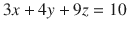
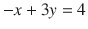
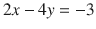
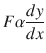
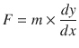

# 10. 数值计算形式体系

## 10.1 引言

数值计算使我们能够计算数值问题的解，前提是我们能将其转化为合适的格式。这需要一些考量。例如，如果我们将连续函数数字化，由于以有限频率采样，将会引入某些误差。因此，非常精确的结果需要非常高的采样率。当需要计算大型数据集时，这将变成一项计算密集且耗时的任务。此外，用户必须理解，与解析解相比，数值解充其量只是一种近似。寻找其物理意义和重要性的责任在于我们自身。丢弃那些在现实场景中没有意义的解，是科学家/工程师多年积累的艺术。此外，计算设备的智能程度与其操作者相当。GIGO（垃圾进，垃圾出）法则在该领域被严格遵循。

在本章中，我们将考虑使用数值计算解决物理问题的一些重要步骤。用恰当的术语定义问题只是第一步。建立正确的模型，然后使用正确的方法（求解器）来解决问题，是区分经验丰富的科学家/工程师与新手的标志。

## 10.2 物理问题

我们物理世界中的一切皆受物理定律支配。由于科学工作者们在艰苦条件下努力为我们周围发生的自然现象提出精妙解决方案，我们才获得了物理定律的数学理论。为了检验这些物理定律的数学形式体系，我们使用数值计算。如果它产生的结果与真实实验相同，则两者相互验证。只要我们拥有经过充分检验的数学形式体系，数值模拟就可以完全消除进行实验的必要。例如，当今的核大国已无需再测试真实的核弹。在真实核爆炸期间获得的核爆炸数据，使科学家能够相当精确地建模这些物理系统，从而消除了真实测试的需求。

除了模拟真实实验等应用外，对物理问题进行建模也是一种很好的教育练习。在建模过程中，动手实践使学生能够深入探索该主题，并对所研究的课题赋予恰当的意义。解决数值问题并将结果可视化，能使学习效果持久，并激发对数学理论缺陷的相关研究，最终带来新的发现。


## 10.3 定义模型

建模被定义为为物理系统编写方程。顾名思义，方程涉及等式两边的相等。方程使用 `=` 符号编写，其中左侧的项等于右侧的项。方程两边的项可以是数字或表达式。例如：



这是一个方程，左侧（LHS）有一个表达式 `3x + 4y + 9z`，右侧（RHS）有一个项 `10`。请注意，左侧是一个代数项，而右侧是一个数字。

表达式是使用函数编写的，这些函数展示了两个域之间的关系。例如，`f(x) = y` 通过代数规则说明了 `y` 与 `x` 的关系。数学拥有丰富的函数库，可用于构建表达式。选择合适的函数取决于具体问题。某些函数能比其他函数更好地描述某些情况。例如，振荡行为可以使用三角函数（如 `sin(x)` 和 `cos(x)`）以合理的方式描述。沿直线运动的物体可以用线性方程描述，例如 `y = mx + c`，其中 `x` 是当前位置，`m` 是 `x` 相对于 `y` 的恒定变化率，`c` 是偏移位置。沿曲线运动的物体可以用各种非线性函数描述，其中因变量（如前一句中的 `x`）的幂次不为 `1`。

在现实生活中，我们可能会遇到这些场景混合的情况。例如，一个物体可以同时振荡并沿曲线运动。在这种情况下，我们使用混合函数编写表达式，或者寻找能够解释该物体行为的新函数。验证函数的方法是为描述该行为的方程找到解，并将其与对物体的观测结果进行匹配。如果完全匹配，我们就得到了精确解。在大多数情况下，可能难以获得精确解。在这些情况下，我们得到的是“近似”解。如果获得近似解时涉及的误差在容许范围内，那么模型是可以接受的。

如前所述，物理情况可以通过用涉及因变量的函数编写数学表达式来解析求解。最简单的问题在因变量之间具有简单的函数关系，并且只有一个方程。也可能存在需要多个方程才能解释一种物理行为的情况。在求解多个方程的情况下，矩阵理论就派上了用场。

假设以下方程定义了一个系统的物理行为：



(10.1)



(10.2)

这个由两个方程组成的方程组可以用一个矩阵方程表示，如下所示：

![$$ \left[\begin{array}{cc}-1& 3\\ {}2& -4\end{array}\right]+\left[\begin{array}{c}x\\ {}y\end{array}\right]=\left[\begin{array}{c}4\\ {}3\end{array}\right] $$](A458920_1_En_10_Chapter_Equb.gif)

现在，利用矩阵代数，可以找到变量 `x` 和 `y` 的值，使得它们满足这些方程。这些值被称为这些方程的根。这些根是二维空间（因为我们有两个因变量）中的点，在该点上，系统将为该物理问题找到稳定状态。通过这种方式，我们无需实际进行实验就能预测系统的行为。

当我们处理动态系统时，微分和积分的数学概念变得非常重要。当系统不断改变因变量的值以产生某种场景时，了解这些变量的变化率至关重要。当这些变量彼此独立时，我们使用简单导数来定义它们的变化率。当它们彼此不独立时，我们使用偏导数。

例如，牛顿第二运动定律指出，物体速度的变化率与施加在其上的力成正比。我们可以用数学方式展示这个概念：



(10.3)

通过代入一个乘法常数 `m`，可以将比例关系转化为等式，使得下式成立：



(10.4)

如果我们知道 `F` 的值或表达式，这个方程可以解析求解，并找到该方程的解。然而，在某些情况下，解析解可能过于难以获得。在这种情况下，我们将系统数字化并寻找数值解。

有许多方法可以对给定函数进行数字化和数值求解。实现特定方法来数值求解函数的程序称为求解器。存在许多求解器来求解函数。求解器的选择对于成功获得解至关重要。例如，方程 10.4 是一个微分方程。它是一个一阶常微分方程。存在许多求解器可以求解它，包括欧拉法和龙格-库塔法。选择特定求解器取决于其解的精度、获得解所需的时间以及过程中使用的内存量。后者在内存不是可以随意消耗的资源时（例如在使用内存存储有限的微型计算机时）非常重要。

使用 Python 进行数值计算的优势在于，它拥有非常丰富的模块库来执行所需的各种任务。预定义的函数已经针对速度和精度进行了优化（在某些情况下，精度可以预先定义）。这使得用户能够快速构建问题原型，而不是专注于编写执行基本任务的函数并针对速度、精度和内存使用进行优化。

## 10.4 Python 包

存在许多用于在特定科学领域进行数值计算的包。网站 [1] 列出了这些包。可以通过在 LINUX 命令行中编写以下命令来安装包：

```
>> pip install
```

鼓励用户查看以下用于科学计算的包：

*   `numpy`：用于数值计算
*   `scipy`：`numpy` 的超集，除了 `numpy` 中的通用数学函数外，还包含针对物理学的特定函数
*   `scikit-learn`：机器学习
*   `tensorflow`：机器学习
*   `Pandas`：统计数据分析
*   `scikit-image`：图像处理
*   `bokeh`：交互式绘图


## 10.5 用于科学与工程的 Python

计算机在科学与工程的理论研究和实验研究中均有应用。在理论研究中，计算机主要用于解决那些需要在现实问题模型内对大量相似或不同数据点进行迭代操作的问题。实验研究则利用计算机进行仪器仪表与控制。因此，理想的科学研究编程语言必须高效地完成这些任务。这里的效率包含以下几个方面：

-   能够以简单、直观且极简的语法编写问题
-   最短的执行时间
-   能够以无差错的方式存储和检索大量数据
-   能够利用并行处理范式处理数据
-   能够处理海量类型的数据集
-   面向对象编程
-   广泛的图形处理能力
-   架构无关性
-   适用于多种平台的仪器仪表与控制系统
-   网络功能
-   安全性
-   问题原型开发时间短

让我们根据这些参数来评估 Python，以判断其适用于各种科学任务的程度。这项评估将为用户在将 Python 用于科学问题之前提供重要线索。

## 10.6 问题原型开发

Python 是一种解释型语言。解释过程省去了在生成机器码之前编译代码的步骤。Python 逐行读取代码，一旦某一行被正确解释，便立即输出机器码。解释型语言在问题原型开发方面具有巨大优势，但其执行速度却出了名的慢。

### 10.6.1 什么是原型开发？

问题原型开发包括为现实问题构建数学模型，然后使用特定编程语言的语法对该数学模型进行编码。数学建模包含以下步骤：

-   定义变量
-   标记其本质上是因变量还是自变量
-   通过将已知数学函数作为假设，设计它们之间的函数关系

一旦数学模型设计完成，就需要通过计算机程序进行测试以产生输出，然后针对所研究的现实问题，从有意义的预测和/或结论的角度对输出进行分析。原型开发涉及重复建模和测试的过程，以便在决定选择某个特定模型并构建完整模型之前，对其进行可行性分析。在此原型开发阶段，用户可以选择忽略其他与效率相关的参数，例如更快的执行速度。

将数学模型转换为计算机程序的过程，涉及用编程语言的语法来表达数学架构。这可以针对模型的一部分进行，也可以整体进行。分部分建模需要各部分之间的兼容性。Python 在这方面提供了一系列优势。

### 10.6.2 Python 用于快速原型开发

解释型架构的优势在于减少了调试时间。由于代码是逐行解释的，代码在遇到问题之前都能正常运行。这有助于识别和隔离代码中的问题部分，从而实现更快的调试。总体结果是，原型解决方案的开发时间显著缩短，因为解决方案设计的大部分时间都花在了调试上。除此之外，Python 被设计为具有简单、直观且极简的语法，这进一步加速了原型开发过程，为参与解决科学问题的人员节省了时间。借助诸如 `matplotlib` 和 `mayavi` 等强大的图形库轻松可视化问题的能力，提升了编码过程的质量，因为错误更容易被发现，并且可以以更好的方式呈现。

Python 具有开源和模块化的结构，通过使用现有代码而不是重新发明轮子，能够更快地进行分部分模型开发。在相同版本的 Python（Python 2 或 Python 3）中，模块是兼容的。Python 还允许某些语言的代码在 Python 代码中本地运行。使用 `Cython` 包，您可以在 Python 程序中嵌入 C 代码。类似地，使用 `Jython` 包，您可以在 Python 程序中嵌入 Java 代码。这使得程序员可以根据自身能力选择不同的编程语言，同时仍然利用 Python 开发他们的模型，从而弥补他们所用编程语言的不足。这也使程序员能够使用遗留代码，而无需用 Python 重新编写。

## 10.7 大型数据集处理

`h5py` 包使开发人员能够处理 HDF5 二进制数据格式，该格式主要用于高效存储大量数据。然后，可以使用像 `numpy` 和 `scipy` 这样的 Python 包，以向量化的方式对这些数据点进行数值计算。用于 `numpy` 和 `scipy` 的基于数组的计算范式在此处变得有利，因为通过 `h5py` 接口连接的大型数据集可以像数组一样进行操作。数千个数据集可以被分类、标记，然后保存到单个文件中。

在互联网时代，用户可能希望从数据库服务器获取数据，每次处理一小部分数据，然后将结果发送回应用服务器进行进一步处理和报告生成。为此，Python 提供了多种包。Python 有一个用于访问数据库的标准机制，称为数据库 API（DB-API）。Python DB-API 指定了连接到数据库并向其发出命令的方式。Python DB-API 能很好地融入现有的 Python 代码，并允许 Python 程序员轻松地从数据库存储和检索数据 [2]。

DB-API 包括以下内容：

-   连接：包含关于如何连接到数据库的指南
-   执行语句和存储过程：使用游标查询、更新、插入和删除数据
    -   游标是一个 Python 对象，指向数据库中的特定位置。
    -   一旦获得游标，就可以执行各种方法，例如插入、更新和删除数据以及查询数据。
-   事务：支持提交或回滚事务
    -   事务是作为一个单一逻辑工作单元执行的一系列操作，具有四个不同的属性（ACID：原子性、一致性、隔离性和持久性）。
    -   回滚事务的可能性对于保护非常重要的数据至关重要。
-   检查元数据：检查数据库模块以及数据库和表结构的元数据
    -   与数据库关联的元数据描述了该数据库的特性。
    -   访问元数据的能力使开发人员能够明智地使用数据库。
-   定义错误类型：并使用 Python 提供异常处理

DB-API 列表中包含了大量的数据库，这使得开发人员能够在单个代码中与多个数据库进行交互。

像 `pandas` 这样的专用包旨在高效地对大型数据集执行向量化操作。这些包如今在大数据领域被广泛使用。数据集通常需要进行统计分析。`pandas` 包提供了基础及高级统计分析所需的大部分统计函数。结合像 `matplotlib` 这样简单的绘图库，可以快速验证分析结果，并能够生成达到出版质量的图表，这为开发人员提供了极大的帮助。


## 10.8 仪器仪表与控制

除非硬件设备搭载了安装有 Python 的操作系统（OS），否则 Python 无法直接连接硬件。像树莓派（RPi）这样的微型计算机可以实现这一点。因此，Python 代码可以直接与连接传感器和执行器的接口进行交互。由于 Python 是一种开源语言，在开源硬件上运行给开发者带来了诸多优势，因为在大多数情况下都可以找到现成的解决方案。这极大地缩短了总的开发时间。运行 Linux 操作系统的树莓派通过使用 `rpi.gpio` 库来支持 Python，从而在 GPIO（通用输入/输出）引脚上执行读取和写入操作。因此，开发者可以使用 Python 代码读取连接到树莓派的传感器发出的电信号。开发者还可以通过 Python 编程来驱动连接到 GPIO 引脚上的电机等执行器，从而设计复杂的电气系统。在大多数情况下，科学输入以反馈回路配置工作，其中传感器读取某些物理参数，然后利用这些值驱动执行器执行任务。Python 可以轻松完成这项任务。由于整个软件包都是在开源许可下定义的，开发者可以自由地以任何所需的方式重新配置它。这使得科学家能够根据实验需要开发定制化的设备。

对于未运行操作系统的硬件，Python 无法直接访问底层硬件。它也无法直接与大多数硬件供应商提供的软件库模块进行交互。在这些情况下，可以编写 Python 代码来利用所谓的虚拟串行端口，在串行端口或 USB 设备上进行通信。此时，开发者有两种选择：编写 DLL（动态链接库）形式的 C 扩展，或者使用 `ctypes` 库，该库提供了直接访问外部 DLL 中函数的方法。如果供应商已经提供了 DLL，那么 `ctypes` 可以在 Python 代码中访问其功能。

另一个出色的模块是 `PyVisa`[3]。`PyVisa` 是一个 Python 包，它使开发者能够独立于接口（例如 GPIB、RS232、USB 和以太网）来控制各种测量设备。这对于复杂的机器来说是一个巨大的福音，因为需要通过许多不同的接口和总线系统（例如 GPIB、RS232、USB 和以太网）使用多种不同的协议来发送数据。有时，开发者希望使用的编程语言可能没有同时支持设备和其总线系统的库。因此，虚拟仪器软件架构（VISA）应运而生。VISA 是一个用于配置、编程和故障排除包含 GPIB、VXI、PXI、串行、以太网和/或 USB 接口的仪器系统的标准。

在任何情况下，理解电子设备信号输出以及管理数据流的责任都在于开发者。这些开发者必须精通电子学、数据通信、Python 编程以及 C/C++ 编程。开发者必须清楚了解传输介质及其在数据传输速率、信号配置和数据块方面的限制。他们还必须理解连接的类型，无论是串行还是并行。

## 10.9 并行处理

与串行处理范式中执行单个任务相反，并行处理设计了同时执行两个或多个进程的方法。进程是处理器上执行计算的最小单元。单核处理器传统上只能执行串行处理。如今，多核处理器价格实惠，并且在大多数硬件中都能找到，这些硬件中的 CPU 拥有不止一个核心。Python 提供了许多支持多核处理的模块。

构成大多数并行编程框架的两个重要概念是：线程和进程。简单来说，进程是一个正在执行的程序。一个或多个线程在一个进程内运行。线程是操作系统为其分配处理器时间的基本单元。现在，可以采用两种方法进行并行编程：

*   通过线程运行代码
*   通过多进程运行代码

多个“任务”可以被提交给不同的线程。任务可以被视为单个进程的“子任务”。线程通常可以访问相同的内存区域（即共享内存）。这种方法需要适当的同步以避免冲突。例如，如果两个进程同时希望写入同一个内存位置，冲突将导致错误。因此，一种更安全的方法是将多个进程提交到完全独立的内存位置（即分布式内存）。在这种情况下，每个进程完全独立于其他进程运行。`multiprocessing` 模块（`https://docs.python.org/2/library/multiprocessing.html`）提供了一种简单的方法，将进程分配给执行类似任务的代码部分，以便它们可以以并行方式执行。例如，对大型数据集进行排序操作可以以并行方式执行以减少时间。对不同数据点进行的类似数学计算也可以以并行方式执行。

## 10.10 总结

我们讨论的 Python 的各种特性证明，它是科学任务一体化解决方案的一个有价值的选择。由于 Python 是开源的，大量的库有助于减少开发时间和成本。能够连接到各种类型的数据库、不同配置的硬件以及互联网上的资源，使得 Python 成为科学计算的首选方案。在本章中，我们并没有逐一说明用于数值计算和一般科学工作的各个模块的用法，而是由于一本书的篇幅限制，涵盖了各种功能。

在本书中，我们向初学者（特别是针对工程师和科学家）说明了 Python3 编程语言的用法。几乎所有的科学和工程分支都需要数值计算。Python 是执行数值计算的一种选择。Python 拥有一个用于通用计算的优化函数库。此外，它还有各种用于执行专门任务的包。这使得它成为高效原型化数值计算问题的理想选择。此外，它有数千个用于特定科学任务的库，既有面向软件的，也有面向硬件的。因此，大多数大学都在向工程和科学专业的学生教授 Python。开发者社区正在呈指数级增长。在不久的将来，如果 Python 接管了世界，请不要感到惊讶！
