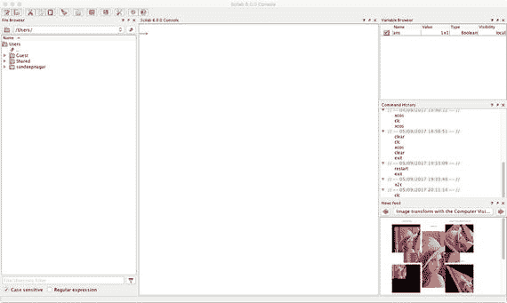
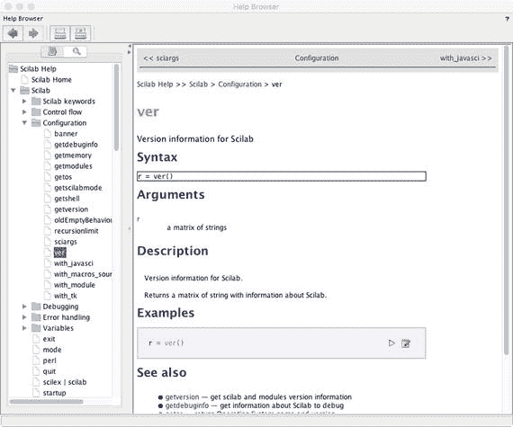
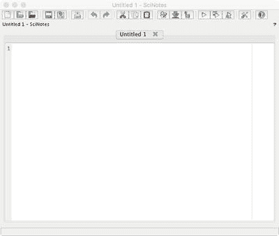

# 1. Scilab 简介

## 1.1 数值计算简介
数值计算是数学领域的一个分支，其目标是在计算设备上解决问题。为此，存在多种软件工具。事实上，`MATLAB`、`Mathematica`、`Octave` 和 `Scilab` 都是专门用于此目的的软件。开发者也可以使用通用编程语言（例如 `C`、`C++`、`Python` 和 `Julia`）来定义数学问题，但专业软件提供了预定义的库，这些库要么针对稳定性进行了优化，要么针对速度进行了优化，有时甚至两者兼顾。它们还可以针对所选的硬件平台在目标硬件上生成。因此，使用专业软件是轻松学习物理问题数值方法的好方法。但首要的问题是，我们究竟为什么要寻求数值解法。

战后时代见证了计算技术以及用于特定目的的配套软件开发取得了巨大进步。成本效益高的计算资源使得模拟几乎所有物理问题成为可能。因此，数值计算已发展成为数学的一个独立领域，它不断从数学的其他领域汲取养分并做出贡献，为基于模型的物理现实模拟创造了一个计算资源生态系统。

对数值计算的需求源于推导问题解析解的困难性。解析解始于一个超级简化的物理现实版本。然后通过增加复杂性并为控制方程定义附加参数来完善此类解。但大多数情况下，仅仅定义问题的努力就会呈指数级增长，以至于即使拥有一个团队也难以应对，更不用说单个人了。因此，对替代方法的需求变得显而易见，数值计算应运而生。

虽然解析计算只需要铅笔、纸和人脑，但数值计算则需要计算设备或计算机。成功利用计算设备解决涉及大量数据点的问题（尤其是涉及重复性任务的问题）最早出现在许多科学和工程领域，例如破译敌方密码以及在核爆炸前模拟核反应。数值计算的应用范围进一步扩展到民用领域。设计模拟水道、水坝、发电站和城市道路只是应用了类似技术的工程领域的几个例子。所有这些应用都需要为表示物理问题的物理模型求解一个或多个方程。

我们有两种方法可以求解这些方程——即使用解析方法和实施数值技术。本书中，我们将只专注于求解方程的数值方法。

随着时间的推移，各种定义解析函数（如微分、积分和三角函数）的方案被编写出来用于数字计算机。这涉及它们的数字化，这必然会引入一些误差。了解引入的误差及其适当的消除方法，能够比解析结果更快地提供有价值的信息。因此，它成为科学研究中最活跃的领域之一，并且至今仍是如此。对更快、更精确算法的追求持续推动着数值计算领域的创新，使人类能够模拟原本不可能完成的任务。

## 1.2 各种软件替代方案
执行数值计算有多种选择。为处理数学函数而编写的编程语言，如 `FORTRAN`、`C`、`Python` 和 `Java`，可用于编写数值计算的算法。还存在一套专业软件，包括 `MATLAB`、`Scilab` 和 `Mathematica`。它们丰富的库现在已占用数 GB 的数据。自 1984 年以来，`MATLAB` 在科学界一直非常受欢迎。数字计算资源的廉价可用性，使其在工业界和学术界的应用达到了几乎每个实验室都需要 `MATLAB` 的程度。尽管对于相对富裕的西方世界来说，它并不非常昂贵，但对于世界其他地区，特别是第三世界国家来说，它却是一款昂贵的软件。而世界这片土地拥有丰富的科学家资源，需要 `MATLAB` 的开源替代品。`Octave` 和 `Scilab` 的出现解决了这个问题。`Scilab` 非常强大，但其语法设计并不完全与 `MATLAB` 相同。另一方面，`Octave` 的开发目标是使 `MATLAB` 的 `.m` 文件可以直接在 `Octave` 上运行。`Scilab` 现在正为那些希望将工作完全迁移到开源平台，但不介意在必要时编辑其 `MATLAB` 文件的开发者而开发。

与包含各个工程领域专业包和用于图形化编程范式的 `Simulink` 的 `MATLAB` 软件包相比，`Octave` 提供的解决方案种类有限。它包含了 `MATLAB` 基本包和某些专业包中几乎所有的函数，但并未提供与 `Simulink` 等价的功能。另一方面，`Scilab` 被证明是一个完整的替代方案，因为 `Scilab` 的 `XCOS` 提供了与 `Simulink` 等价的功能，并且 `Scilab` 的专业包可以与 `MATLAB` 提供的功能相媲美。本书中，我们将介绍它们的基本用法。

其他替代方案包括诸如 `Python`、`C`、`C++` 和 `Java` 等编程语言。它们各有优缺点，因此我们建议用户根据自己的需求进行选择。`Scilab` 是快速构建问题原型并检查结果的不错选择。而在处理基于 Web 的数据收集、分析和可视化，以及在物理计算平台（如 `FPGA` 板、微控制器等）上实现物理问题时，通用编程语言则是更好的选择。`Scilab` 是一种高级语言，主要用于数值计算，拥有丰富的工具库，可用于解决数值线性代数问题、求非线性方程的根、积分普通函数、处理多项式以及求解常微分方程、偏微分方程和微分代数方程。这使得它适用于大多数基本的数值计算工作。

## 1.3 历史
Scilab 的创建历史始于 20 世纪 80 年代。其灵感来源于克利夫·莫勒（Cleve Moler）开发的 `MATLAB` Fortran 代码。莫勒后来与约翰·利特尔（John Little）共同创立了 `MathWorks` 公司。Scilab 最初以 Blaise 之名起步，是一款 CACSD（计算机辅助控制系统设计）软件。它由弗朗索瓦·德勒贝克（François Delebecque）和塞尔日·斯蒂尔（Serge Steer）在 IRIA（法国信息与自动化研究所）创建。1984 年，Blaise 更名为 Basile，并由 Simulog（法国国家信息与自动化研究所的首家初创公司）分发数年。

20 世纪 90 年代，Simulog 停止分发 Basile。法国国家信息与自动化研究所将软件更名为 Scilab，并仅由六名研究人员继续开发。Scilab 1.1 于 1994 年 1 月 2 日以开源许可证发布。直到 2.7 版本，Scilab 社区规模已相当庞大。在企业和机构的支持下，法国国家信息与自动化研究所于 2003 年成立了 Scilab 联盟。2017 年 6 月，Scilab Enterprises 成立并负责开发工作。基于经典的开源商业模式，Scilab Enterprises 还提供与 Scilab 相关的专业服务和支持。Scilab Enterprises 于 2017 年加入 ESI 集团，目前继续开发和提供与 Scilab 相关的服务。Scilab 广泛应用于科学、工业和服务业的各个战略领域，包括航天、航空、汽车、能源、国防、金融和交通。

## 1.4 安装
Scilab 是一款根据 CeCILL 许可证分发的开源软件，该许可证是 GNU-GPL 兼容许可证的一个版本，适用于自由软件。请注意，以下说明已在 6.0.0 版本上测试通过。用户可根据操作系统的要求从其官方网站下载。安装过程非常简单，用户论坛和简单的谷歌搜索即可解答用户遇到的常见问题。Scilab 包含一个基于图形用户界面的控制台，便于用户操作。

该软件的在线版本可在印度的一个网站上使用。在这种情况下，用户无需在自己的系统上安装软件。他们只需通过网页浏览器连接到远程服务器，即可像本地安装一样运行 Scilab 程序。当然，这需要相当快的网络连接。（鼓励用户尝试这项功能。）就本书而言，我们推荐在本地进行安装并使用。

在 Windows 操作系统上正确安装后，用户可以在已安装程序列表中看到 Scilab 图标。双击该图标即可打开一个 Scilab 会话。MacOSX 系统也是如此。对于基于 Linux 的操作系统发行版，您可以选择点击桌面图标，或者直接在命令行输入 `scilab`。

## 1.5 工作区
图 1-1 展示了已安装的 Scilab 6.0.0 版本的屏幕截图。您可以在主窗口中看到不同的分区：


图 1-1
Scilab 截图

*   文件浏览器
*   SCILAB 6.0.0 控制台
*   变量浏览器
*   命令历史
*   新闻订阅

所有这些分区都具有取消停靠（从主窗口分离并在另一个窗口中打开）和根据需要关闭的选项。我们建议目前保持所有这些分区打开，以便初次使用的用户能够以交互方式观察计算及其结果。

为了检查所选下载版本的安装是否完成，我们可以在 Scilab 命令提示符（在 Scilab 控制台窗口中显示为 `-->`）处输入一个简单的命令 `ver`。在撰写本文时，显示如下输出：

```
1   −−>ver
2   ans =

5   column 1

7   ! Scilab Version:                   !
8   !                                   !
9   ! Operating System:                 !
10  !                                   !
11  ! Java version:                     !
12  !                                   !
13  ! Java runtime information:         !
14  !                                   !
15  ! Java Virtual Machine information: !
16  !                                   !
17  ! Vendor specification:             !

19  column 2

21  ! 6.0.0.1487071837
!
22  !
!
23  ! Mac OS X 10.12.6
!
24  !
!
25  ! 1.8.0_51
!
26  !
!
27  ! Java(TM) SE Runtime Environment (build 1.8.0_51−b16)
!
28  !
!
29  ! Java HotSpot (TM) 64−Bit Server VM (build 25.51−b03, mixed mode)
!
30  !
!
31  ! Oracle Corporation
!
```

该输出显示 Scilab 版本为`6.0.0.1487071837`，操作系统为`MacOSX 10.12.6`。

## 1.6 命令提示符

Scilab 提供了一个功能齐全、交互式的命令行 REPL（读取-求值-打印循环）。Scilab 编程语言的交互式 shell 通常被称为 REPL，因为它执行以下操作：

- 读取用户输入的内容
- 求值读取的内容
- 打印求值后的返回值
- 循环并重复以上所有步骤

这种交互式工作环境对于交互式编码和调试都非常有用。你可以在写完特定代码后立即检查其结果。使用 Scilab REPL 的方式是：编写代码、分析结果，并持续此过程直到计算出最终结果。除了允许快速简便地求值 Scilab 语句外，它还具备以下特点：

- 可搜索的历史记录
- Tab 补全
- 许多有用的快捷键绑定
- 帮助和文档

Scilab 窗口左侧的一部分显示了命令`history`，其中列出了在命令提示符下使用过的所有命令。单击某个特定命令即可在 Scilab 命令提示符下执行它。这是一种快速重复执行命令的方法。或者，用户也可以使用计算机传统键盘上的`上`和`下`箭头键来浏览这些命令。

Tab 补全功能允许用户为某个命令仅键入几个字符，然后按 Tab 键，如果存在多个选项，则会获得一个可供选择的选项列表，否则它会自动补全命令的正确语法。此功能非常有用，因为它可以避免语法错误，而语法错误是导致程序错误的常见原因之一。

快捷键绑定取决于操作系统。当你单击菜单栏（Scilab 主窗口的顶部）上的各个项目时，可以在选项名称旁边看到对应的快捷键绑定。

在 Scilab 中，获取关于各种主题的帮助和查找文档也非常容易。你可以简单地将任何参数作为字符串（用双引号`" "`括起来的字符）传递给内置函数`help()`。例如，我们之前使用了`ver`函数。假设你想了解其正确用法并查看完整的文档。你可以在 Scilab 命令提示符下键入以下内容：

```
1   −−>help("ver")
```

这将打开一个`帮助浏览器`窗口，如图 1-2 所示。



图 1-2 帮助浏览器窗口

帮助浏览器包含了所有内置函数以及其他主题。你可以使用此浏览器窗口学习 Scilab，并且如果在开发过程中出现任何问题，都可以查阅此窗口。Scilab 社区维护着非常高质量的文档，这帮助 Scilab 变得流行起来。

另一种获取主题帮助的方法是单击菜单栏中的`?`符号，这将打开`Scilab 帮助`作为其中一个选项。这需要使用鼠标来定位并单击该符号。

有时用户需要获取一个干净的屏幕。为此，他们可以使用`clc`命令。此命令会呈现一个全新的命令提示符，就像第一次打开 Scilab 时一样。值得注意的是，Scilab 在此过程中不会重新启动。它会存储所有变量及其各自的值；它只是清除屏幕上之前的所有内容。用户也可以将此命令作为函数使用，通过键入`clc(n)`，其中`n`可以是一个整数，这样该命令将清除上次会话中相应行数的内容。如果用户键入的是`clc()`，则会清除屏幕上的所有行。

用于此 Scilab 命令的符号是`-->`，以区别于 MATLAB 或 Octave 的命令提示符。此信息存储在`prompt`变量中，可以通过以下方式查看：

```
1   −−>prompt
2   ans =

4   −−>
```

REPL 回复的值为`-->`，即 Scilab 提示符的符号。

## 1.7 变量浏览器

变量浏览器列出了所使用的变量（将在后面解释）、它们的大小、类型和可见性。在屏幕上显示这些信息有助于用户跟踪内存使用情况，并避免混淆变量名。当用户添加新变量或从计算中移除已有变量时，变量浏览器会添加新信息。变量列表可以通过`clear`命令清空，该命令会从计算机内存中移除这些变量。此操作可以通过变量浏览器的内容为空来验证。

在变量浏览器中进行任何操作后，Scilab 会话中至少会创建一个名为`ans`的变量，该变量存储了在命令提示符下最后求值的表达式的结果，如下代码所示：

```
1   −−>2+2
2   ans =

4   4.

7   −−>ans
8   ans =

10  4.
```

## 1.8 SciNotes

SciNotes 是 Scilab 内置的文本编辑器。`SciNotes`窗口可用于编写多行程序，可以通过菜单栏中的`应用程序 -> SciNotes`打开。（见图 1-3。）



图 1-3 SciNotes 窗口

它也可以使用命令提示符打开，只需键入`scinotes`或`editor`即可。该编辑器具有创建新窗口、保存当前会话、剪切、复制、粘贴以及运行程序（换句话说，就是执行程序）的功能。代码的输出可以在 Scilab 的命令提示符中看到。命令`scinote()`使用了内置函数。当给定文件名或文件路径作为参数时，该特定文件将在`SciNotes`环境中打开。文件名必须以字符串形式给出。如果添加了额外的选项`'readonly'`，则文件将以只读模式打开，无法进行编辑。这可以防止对代码进行不必要的修改。

## 1.9 本章小结

Scilab 为数值计算提供了一种开源替代方案。尽管用户需要转换 MATLAB 代码以使其与 Scilab 兼容，但这有时是一项值得的工作，因为 Scilab 提供了丰富的工程模块生态系统来执行复杂的数学计算。如有疑问，可以使用`help`命令轻松获取特定命令的文档。在本章中，我们概述了使用 Scilab 的重要性。后续章节将解释其在科学计算中的用法。