# 3. 使用数组

## 3.1 引言

数学问题的矩阵化表述能够实现更快的数值计算。对于二维矩阵，元素具有唯一的行索引和列索引，用户可以通过它们来访问元素。行和列可以归因于研究中不同的属性。这样，用户可以将两个属性的数据拟合成一个矩阵，然后使用这些矩阵进行数值计算。例如，假设行中的一个元素定义为：如果某化合物是导体则为 1，如果是半导体则为 2，如果是绝缘体则为 3。那么，行向量（仅由一行组成的矩阵）`[1 0 0 3 2 1 3 0 1 0 3 2 1]` 就包含了 13 种化合物的信息。在涉及化合物导电性质的数值计算中，可以利用这个行向量（一个 13×1 矩阵），从而可以在数学上同时对 13 种化合物进行扫描。

名为 `arrays` 的 Scilab 对象用于定义矩阵。利用该对象的不同属性，用户可以定义各种类型的矩阵。用于矩阵运算的内置函数使得程序员能够通过将大量数据按照所需格式排列成矩阵并执行数组操作，从而更容易地处理这些数据。

## 3.2 数组与向量

数组特别有趣，因为它们常用于定义科学计算中的向量、表格和矩阵：
*   一维数组作为向量或列表。
*   二维数组可作为表格或矩阵。
*   三维及更高维数组可表示多维矩阵。

这样一来，变量名不再是仅仅指向一个单一数值，而是可以指向一个连续的数值集合。定义数组的语法规定，它们必须在方括号 `[]` 内定义：

```
1  −−>a = [1 2 3 4 5] // 用空格分隔
2  a =
3  1\.    2\.    3\.    4\.    5.
4  −−>b = [1, 2, 3, 4, 5] // 用逗号分隔
5  b =
6  1\.    2\.    3\.    4\.    5.
7  −−>c = [1.0 2.0 3.0 4.0 5.0] // 浮点数数组
8  c =
9  1\.    2\.    3\.    4\.    5.
10  −−>matrix22 = [1 2; 3 4] // ; 操作符定义新行
11  matrix22 =
12  1\.    2.
13  3\.    4.
14  −−>matrix33 = [1 2 3;4 5 6;7 8 9] // 三行数组
15  matrix33 =
16  1\.    2\.    3.
17  4\.    5\.    6.
18  7\.    8\.    9.
19  −−>size(matrix22) // 数组的大小，即行数和列数
20  ans =
21  2\.    2.
22  −−>size(matrix33)
23  ans =
24  3\.    3.
25  −−>matrix32 = [1 2;3 4;5 6]
26  matrix32 =
27  1\.    2.
28  3\.    4.
29  5\.    6.
30  −−>size(matrix32)
31  ans =
32  3\.    2.
33  −−>size(size(matrix33)) // size 也会输出一个数组
34  ans =
35  1\.    2.
```

如示例代码所示，数组可以理解为一个由行和列组成的矩阵。因此，用户可以创建所需大小的矩阵。例如，`matrix22`是一个 2×2 矩阵，`matrix33`是一个 3×3 矩阵，而`a`是一个 1×5 矩阵。定义大小时，第一个数字指定行数，第二个数字指定列数。逗号`,`操作符用于在同一行内定义下一个元素，而分号`;`操作符用于定义下一行/下一行的元素。逗号操作符是可选的，若省略，则必须用空格代替。内置函数`size()`会输出一个 2×1 数组，其中第一个数字表示行数，第二个数字表示列数。

如果每行/每列的元素数量不匹配，用户将收到一条错误信息：

```
1  >> right33 = [1, 2, 3; 4, 5, 6; 7, 8, 9]
2  right33 =
3  1   2   3
4  4   5   6
5  7   8   9
6  −−>wrong33 = [2, 3; 4, 5, 6; 7, 8, 9]
7  !−−error 6
8  行/列维度不一致。
9  wrong33 = [1, 2, 3; 4, 5, 6; 8, 9]
10  !−−error 6
11  行/列维度不一致。
```

数组的元素可以是第二章第 2.11 节中定义的任何数据类型。内置函数`type()`可用于确定存储值的数据类型。可以通过以下命令将所有数组元素设置为特定的数据类型：

```
1  −−>a = uint8([1 2 3])
2  a  =
3  1  2  3
4  −−>b = uint16([1 2 3])
5  b  =
6  1  2  3
7  −−>c = uint32([1 2 3])
8  c  =
9  1  2  3
10  −−>type(a)
11  ans  =
12  8.
13  −−>type(b)
14  ans  =
15  8.
16  −−>type(c)
17  ans  =
18  8.
```

## 3.3 数组与向量的运算

对数组进行运算包含两个方面：
*   对两个或多个数组进行运算
*   逐元素运算

### 3.3.1 逐元素运算

所有算术运算符——如`+`、`-`、`*`、`/`、`^`等——都可以用于这两种情况。当需要进行逐元素运算时，需在运算符前加上`.`，这样逐元素运算符就变成了`.+`、`.-`、`.*`、`./`和`.^`。这一点在下面的例子中会更清楚：

```
1  −−>a = [1 2 3; 4 5 6; 7 8 9]
2  a  =
3  1\.    2\.    3.
4  4\.    5\.    6.
5  7\.    8\.    9.
6  −−>b = a
7  b  =
8  1\.    2\.    3.
9  4\.    5\.    6.
10  7\.    8\.    9.
11  −−>a. / b
12  ans   =
13  1\.    1\.    1.
14  1\.    1\.    1.
15  1\.    1\.    1.
16  −−>a^b
17  !−−error 43
18  Scilab 中未实现 ...
19  在函数 %s_pow 的第 61 行调用:
20  a^b
21  −−>a.^b // 逐元素运算
22  ans =

24  1\.     4\.     27.
25  256\.   3.0 D+03   4.0 D+04
26  8.0 D+05   1.0 D+07   3.0 D+08
```

### 3.3.2 矩阵乘法

一个维度为 a×b 的矩阵只能与一个维度为 b×c 的矩阵相乘，其结果是一个维度为 a×c 的矩阵。这是通过将行的元素与列的元素相乘得到新元素来完成的。

以下代码将说明这种矩阵乘法方法：

```
1  −−>a = [1, 2; 3, 4; 5, 6] // 定义一个 3 X 3 矩阵
2  a =
3  1\.   2.
4  3\.   4.
5  5\.   6.
6  −−>size(a) // 发现大小为 3 X 2
7  ans =
8  3\.   2.
9  −−>a_t = a' // 定义转置
10  a_t =
11  1\.   3\.   5.
12  2\.   4\.   6.
13  −−>size(a_t) // 转置的大小为 2 X 3
14  ans =
15  2\.   3.
16  −−>mul=a∗a_t // 两个矩阵相乘
17  ans =
18  5\.    11\.   17.
19  11\.   25\.   39.
20  17\.   39\.   61.
21  −−>size(mul) // 乘法结果矩阵的大小为 3 X 3
22  ans =
23  3\.   3.
```

`a'` 给出矩阵的转置（行变为列，反之亦然）。这使得一个 3×2 矩阵变成了一个 2×3 矩阵。当它们相乘时，你得到一个 3×3 矩阵。

### 3.3.3 矩阵的逆

矩阵的除法涉及到矩阵求逆。逆矩阵是这样一个矩阵，它与原矩阵相乘可得到单位矩阵（行列式为 1 的矩阵），即对角线元素为 1，其余元素为 0 的矩阵：

```
1  −−>a = [2 5 4;−4 6 −3;4 7 −1] // 定义一个 3 X 3 矩阵
2  a =
3  2\.   5\.  4.
4  −4\.  6\.  −3.
5  4\.   7\.  −1.
6  −−>inverse = inv(a) // 计算矩阵 a 的逆
7  inverse =
8  −0.06   −0.13   0.15
9  0.06    0.07    0.04
10  0.2    −0.02    −0.12
11  −−>a∗inverse // 矩阵乘以其逆矩阵得到单位矩阵
12  ans =
13  1\.   0\.   0.
14  0\.   1\.   0.
15  0\.   0\.   1.
```

## 矩阵函数

如果输入矩阵是一个非方阵（即行数和列数不相等），则使用函数`pinv()`。`pinv()`函数给出矩阵的伪逆，满足：如果 `X=pinv(a)`，则 `a × X × a = a`，`X × a × X = X`，并且 `a × X` 和 `X × a` 都是埃尔米特矩阵：
```
−−>a = [1,2,3; −5 4 −7]
a =
 1.   2.   3.
-5.   4.  -7.
−−>inverse = pinv(a)
inverse =
 0.    −0.06
 0.27   0.1
 0.15  −0.05
−−>a∗inverse
ans =
 1.   0.
 0.   1.
```
`I` 被称为单位矩阵，因为其所有对角线元素都是 1，所有非对角线元素都是 0，这使得它的行列式为 1。

### 3.3.4 `det()`
矩阵 `a` 的行列式可通过命令 `det(a)` 计算：
```
−−>a = [1 2 3;4 5 6;7 8 9]
a =
 1.   2.   3.
 4.   5.   6.
 7.   8.   9.
−−>det(a)
ans =
 -9.0 D−16
```

### 3.3.5 `rank()`
矩阵的秩（线性无关的行或列的数量）可以通过内置函数`rank()`来确定：
```
−−>a = eye(3,3)
a =
 1.   0.   0.
 0.   1.   0.
 0.   0.   1.
−−>rank(a) // 所有行都线性无关
ans =
 3.
−−>a = [1, 2, 3;2, 4, 6;4, 6, 3] // 第二行只是第一行乘以 2
a =
 1.   2.   3.
 2.   4.   6.
 4.   6.   3.
−−>rank(a)
ans =
 2.
−−>a = [1, 2, 3;2, 4, 6;3, 6, 9] // 第二行和第三行分别只是第一行乘以 2 和 3
a =
 1.   2.   3.
 2.   4.   6.
 3.   6.   9.
−−>rank(a)
ans =
 1.
```

### 3.3.6 `trace()`
矩阵对角线元素之和称为矩阵的迹。这由内置函数`trace()`给出，如下所示：
```
−−>a = [1, 2, 3;2, 4, 6;3, 6, 9]
a =
 1.   2.   3.
 2.   4.   6.
 3.   6.   9.
−−>trace(a)
ans =
 14.
```
单位矩阵的自动生成是通过使用命令`eye(a,b)`完成的，其中`a`和`b`是行数和列数的值：
```
−−>eye(2,3)
ans =
 1.     0.     0.
 0.     1.     0.
−−>a = eye(4,4)
a =
 1.    0.    0.    0.
 0.    1.    0.    0.
 0.    0.    1.    0.
 0.    0.    0.    1.
−−>det(a)
ans =
 1.
```

### 3.3.7 向量模
一个数学向量可以被定义为一个 1 × 3 的数组。内置函数`norm()`给出向量的模（大小）。这是从原点到向量的欧几里得距离。因此，如果一个向量定义如下：
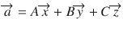
其模可以定义为：
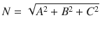
一个向量的单位向量是通过将该向量除以其模/大小得到的。在 Scilab 中可以轻松执行此操作：
```
−−>a = [1 2 3]
a =
 1.    2.    3.
−−>norm(a)
ans =
 3.74166
−−>a = [1 2 3]/norm(a)
a =
 0.26726    0.53452    0.80178
```

### 3.3.8 随机矩阵
使用随机数生成器，可以通过命令`rand(a,b)`创建一个随机矩阵：
```
−−>rand(4,5)
ans =
 0.21132      0.66538      0.87822      0.72635      0.23122
 0.75604      0.62839      0.06837      0.19851      0.21646
 0.00022      0.84975      0.56085      0.54426      0.88339
 0.33033      0.68573      0.66236      0.23207      0.65251
−−>rand(4,5)
ans =
 0.30761      0.36164      0.33217      0.26931      0.04373
 0.93296      0.29223      0.59351      0.63257      0.48185
 0.21460      0.56642      0.50153      0.40520      0.26396
 0.31264      0.48265      0.43686      0.91847      0.41481
−−>rand(1)
ans =
 0.28065
−−>rand(4,1)
ans =
 0.12801
 0.77831
 0.21190
 0.11214
−−>rand(1,4)
ans =
 0.68569      0.15312      0.69709      0.84155
```
请注意，上一个示例中生成的数字每次都会不同，即使在同一台机器上也是如此，因为它们本质上是随机的。默认情况下，它们均匀分布在区间 (0, 1) 内。向量就是一个行向量，因此可以通过命令`rand(a)`随机生成。`help("rand")`提供了关于随机数生成器的各种其他特性和参数的详细描述：
```
−−>rand(4,5, 'uniform')
ans =
 0.11384      0.68540      0.38738      0.37601      0.26386
 0.19983      0.89062      0.92229      0.73409      0.52536
 0.56187      0.50422      0.94882      0.26158      0.53762
 0.58962      0.34936      0.34353      0.49935      0.11999
−−>rand(4,5, 'normal')
ans =
 -1.28586   -0.37782   -0.45753    0.01164     1.74874
  0.59712     1.14562     0.56232    0.22327     1.86518
  0.61078     2.57491   -0.64533  -1.43445     0.16459
 -1.05679   -0.50056   -0.36478    1.73638    -1.03589
```
`'normal'`和`'uniform'`函数提供正态分布和均匀分布的随机数。正态分布的均值为 0，方差为 1。所有随机数遵循高斯分布，其均值为 0，分布在 -1 和 1 之间。另一方面，默认的随机数分布是`'uniform'`，这些数字在 0 和 1 之间生成。
一个更精细的内置函数叫做`grand()`，它提供了多种选择分布和设置数字集限制的选项。只需输入`help("grand")`即可获得其用法的详细文档。

### 3.3.9 索引
矩阵的每个元素由两个数字表征：行号和列号。这些数字用于精确定位一个元素并对其进行操作。它们被称为元素的索引。赋值运算符可用于设置特定索引处的值，以生成具有更新值的新矩阵。以下示例说明了这些概念：

# Scilab 矩阵操作指南

## 3.3.10 使用索引创建新向量

在以下示例中，`b`是由向量`a`形成的新向量，其连续元素由取自`a`的索引向量`[2 4 2 4]`的元素组成：

```
1  −−>a = [1 4 1 3 1 4 1 4 2 4 5]
2  a =
3  1\.   4\.   1\.   3\.   1\.   4\.   1\.   4\.   2\.   4\.   5.
4  −−>b = a([2 4 2 4])
5  b =
6  4\.   3\.   4\.   3.
```

相同的方法可以用于二维和更高维度的矩阵：

```
1  −−>a
2  a =
3  0.61618   0.38019   0.76251   0.40089
4  0.63517   0.35260   0.7284    0.55388
5  0.15988   0.91202   0.27883   0.27174
6  −−>a([1, 2], [2, 3])
7  ans =
8  0.38019   0.76251
9  0.35260   0.7284
```

请注意，由于逗号运算符（`,`）的使用是可选的，向量和矩阵将通过简单地插入一个空白来定义。

## 3.3.11 切片

通过对矩阵使用索引和冒号`:`运算符，可以将其切片成所需的部分。如果提供了`n:m`进行切片，则会生成一个新矩阵，其中放置了索引从`n`到`m`的元素。此外，`;`运算符在切片时用于定义新列。下面的一些示例将使方法更加清晰：

```
1  −−>a = [1,2,3;4,5,6]
2  a =
3  1\.   2\.   3.
4  4\.   5\.   6.
5  −−>B = [(1:3);(4:6);(7:9)]
6  B =
7  1\.   2\.   3.
8  4\.   5\.   6.
9  7\.   8\.   9.
10  −−>c = [a;B]
11  c =
12  1\.   2\.   3.
13  4\.   5\.   6.
14  1\.   2\.   3.
15  4\.   5\.   6.
16  7\.   8\.   9.
17  −−>c = [a,B]
18  行/列维度不一致
```

这里，矩阵`a`第一行的元素为 1, 2, 3，行分隔符`;`定义了下一行的元素 4, 5, 6。类似地，矩阵`B`由以下命令定义的行构成：
*   `(1 : 3)`，结果为`(1, 2, 3)`
*   `(4 : 6)`，结果为`(4, 5, 6)`
*   `(7 : 9)`，结果为`(7, 8, 9)`

请注意，Scilab 变量名是区分大小写的，因此`a`与`A`不同。现在，通过垂直拼接矩阵`a`和`B`，创建一个名为`c`的新矩阵。因此，结果矩阵`c`由`a`的元素堆叠在`B`的元素之上构成。命令`c=[a,B]`会产生错误，因为`a`和`B`的维度对于水平拼接不一致。

在我们的案例中，可以通过以下方式轻松执行水平拼接：

```
1  −−>a = 1:3 // 数组，其元素从 1 开始，到 3 结束
2  a =
3  1\.   2\.   3.
4  −−>A = [a,a] // 新数组，将旧数组作为其行中的两个元素
5  A =
6  1\.   2\.   3\.   1\.   2\.   3.
7  −−>A = [a;a] // 新数组，将旧数组作为其列中的两个元素
8  A =
9
10  1\.   2\.   3.
11  1\.   2\.   3.
```

值得注意的是，逗号运算符（`,`）用于分隔行内的元素，而分号运算符（`;`）用于分隔列。这一事实也适用于多维数组的情况：

```
1  −−>a = 2:7
2  a =
3  2\.   3\.   4\.   5\.   6\.   7.
4  −−>A = [a;a]
5  A =
6  2\.   3\.   4\.   5\.   6\.   7.
7  2\.   3\.   4\.   5\.   6\.   7.
8  −−>AA = [A,A]
9  AA =
10  2\.   3\.   4\.   5\.   6\.   7\.   2\.   3\.   4\.   5\.   6\.   7.
11  2\.   3\.   4\.   5\.   6\.   7\.   2\.   3\.   4\.   5\.   6\.   7.
```

## 3.3.12 添加行和列

当需要添加矩阵的整行或整列时，只需要考虑一件事。用于此目的的新矩阵的大小必须满足行和列的要求。例如，我们定义大小分别为 2 × 2、1 × 2 和 2 × 1 的数组`A`、`B`、`D`。行矩阵`B`可以作为一行插入到`A`中，列矩阵`D`可以作为一列插入到`A`中：

```
1  −−>A = [4,−3;5,−5]
2  A =
3  4\.   −3.
4  5\.   −5.
5  −−>B = [−9,1]
6  B =
7  −9\.   1.
8  −−>size(A)
9  ans =
10  2\.   2.
11  −−>size(B)
12  ans =
13  1\.   2.
14  −−>C = [A;B]
15  C =
16  4\.   −3.
17  5\.   −5.
18  −9\.   1.
19  −−>size(C)
20  ans =
21  3\.   2.
22  −−>D = [5;6]
23  D =
24  5.
25  6.
26  −−>size(D)
27  ans =
28  2\.   1.
29  −−>E = [A,D]
30  E =
31  4\.   −3\.   5.
32  5\.   −5\.   6.
33  −−>size(E)
34  ans =
35  2\.   3.
```

## 3.3.13 删除矩阵的某行和/或某列

可以通过将空矩阵`[]`赋值给行或列来删除它们。例如，`A(1,:)=[]`删除第一行，`A(:,1)=[]`删除矩阵的第一列：

```
1  −−>A = rand(3,3)
2  A =
3  0.88   0.93   0.36
4  0.65   0.21   0.29
5  0.31   0.31   0.57
6  −−>A(1,:)=[]
7  A =
8  0.65   0.21   0.29
9  0.31   0.31   0.57
10  −−>A(:,1)=[]
11  A =
12  0.21   0.29
13  0.31   0.57
```

## 3.3.14 沿维度拼接

可以使用`cat(dim, A, B, ...)`实现两个矩阵沿某一维度的拼接，其中`dim`表示维度，`A`和`B`是输入矩阵。以下示例演示了其用法：

```
1  −−>A = rand(2,3)
2  A =
3  0.82   0.32   0.62
4  0.96   0.45   0.66
5  −−>B = rand(2,3)
6  B =
7  0.28   0.56   0.21
8  0.09   0.85   0.96
9  −−>C = cat(1, A, B) // 沿第一维（行）拼接
10  C =
11  0.82   0.32   0.62
12  0.96   0.45   0.66
13  0.28   0.56   0.21
14  0.09   0.85   0.96
15  −−>D = cat(2, A, B) // 沿第二维（列）拼接
16  D =
17  0.82   0.32   0.62   0.28   0.56   0.21
18  0.96   0.45   0.66   0.09   0.85   0.96
```

需要注意的是，与某些编程语言中索引从 0 开始不同，在 Scilab 中索引从 1 开始，并且 Scilab 不接受负数作为索引。

# 矩阵和数组操作

## 矩阵拼接

在命令提示符中输入`cat(1,A,B)`时，`A`和`B`按行拼接，而`cat(2,A,B)`则按列拼接。对于`cat(3,A,B)`，会创建一个新矩阵，其第三维的第一个元素是矩阵`A`，第二个元素是矩阵`B`。

```
1  −−>A = rand(2,2) // 定义 2X2 矩阵
2  A =
3  0.48   0.59
4  0.33   0.5
5  −−>B = rand(2,2)
6  B =
7  0.44   0.63
8  0.27   0.41
9  −−>cat(1,A,B) // A 和 B 沿行拼接（维度=1）
10  ans =
11  0.48   0.59
12  0.33   0.5
13  0.44   0.63
14  0.27   0.41
15  −−>cat(2,A,B) // A 和 B 沿列拼接（维度=2）
16  ans =
17  0.48   0.59   0.44   0.63
18  0.33   0.5    0.27   0.41
19  −−>C = cat(3,A,B) // A 和 B 沿第三维度拼接，其中第一个元素是 A，第二个是 B
20  C =
21
22  (:,:,1)
23
24  0.48   0.59
25  0.33   0.5
26
27  (:,:,2)
28
29  0.44   0.63
30  0.27   0.41
31  −−>size(C) // 新矩阵有 3 个维度，即其大小为 2X2X2
32  ans =
33  2\.   2\.   2.
```

## 3.4 数组的逻辑运算

逻辑运算是逐元素执行的。它们主要用于比较。假设我们想找出两个数组的所有元素是否都相同。这里使用`==`。类似地，也可以使用`<`、`>`、`<=`和`>=`运算符。需要注意的是，这些逐元素运算会生成一个布尔值数组。换句话说，每个元素的结果要么是`%T`，要么是`%F`，表示比较结果为`真`或`假`：

```
1  −−>a = [1,2,3;4,5,6]
2  a =
3  1\.   2\.   3.
4  4\.   5\.   6.
5  −−>a == a // 所有元素值都相同
6  ans =
7  T T T
8  T T T
9  −−>b = [1,2,3;4,5,8]
10  b =
11  1\.   2\.   3.
12  4\.   5\.   8.
13  −−>a == b // 除了第 2 行第 3 列外的所有元素都不相同
14  ans =
15  T T T
16  T T F
17  −−>b > a // b 中除了第 2 行第 3 列外的所有元素都不大于 a 中的元素
18  ans =
19  F F F
20  F F T
21  −−>b >= a // 所有元素要么等于，要么大于对应的元素
22  ans =
23  T T T
24  T T T
```

## 3.5 向量的自动生成

大多数情况下，用户希望生成一长串连续数字作为数组的元素。这称为向量的自动生成。您可以使用以下命令生成一系列数字并将其存储为数组：

```
start:step:stop
1  −−>a = 1:1:10 // 从 1 开始，步长为 1，到 10 结束
2  a =
3  1\.    2\.    3\.    4\.    5\.    6\.    7\.    8\.    9\.    10.
4  −−>a = [1:1:10]
5  a =
6  1\.    2\.    3\.    4\.    5\.    6\.    7\.    8\.    9\.    10.
7  −−>a = 1:2:10 // 从 1 开始，步长为 2，到 10 结束
8  a =
9  1\.    3\.    5\.    7\.    9.
```

请注意，括号`[]`在此处是可选的。另外，如果未定义步长，则采用其默认值 (1)：

```
1  −−>a = 1:10 // 从 1 开始，到 10 结束（默认步长为 1）
2  a =
3  1\.    2\.    3\.    4\.    5\.    6\.    7\.    8\.    9\.    10.
```

### 3.5.1 线性间隔向量

命令 `linspace(start, stop, n)` 生成一个数组，从第一个数字开始，到第二个数字停止，总共包含 `n` 个数字。因此，它们是线性间隔的：

```
1  −−>a = linspace(1,2,5)
2  a =
3  1\.    1.25    1.5    1.75    2.
4  −−>a = linspace(1,10,10)
5  a =
6  1\.    2\.    3\.    4\.    5\.    6\.    7\.    8\.    9\.    10.
```

### 3.5.2 对数间隔向量

与 `linspace` 类似，`logspace(start, stop, n)` 从 start 到 stop 生成 `n` 个数字，这些数字在对数尺度上是线性间隔的：

```
1  −−>a = logspace(1,10,5)
2  a =
3  10\.    1778.28    316228\.    5.6D+07    1.0D+10
```

### `meshgrid`

内置函数`linspace`和`logspace`用于在图形上获取线段上的点。如果我们希望获取等间距网格点组成的曲面，可以使用内置函数`meshgrid`，如下所示：

```
1  −−>a = 1:0.1:100;
2  −−>b = 1:0.1:100;
3  −−>[X, Y]= meshgrid(a,b);
```

这里`[X,Y]`是一个二维数组，每个元素包含两个数。其中一个数取自数组`a`，另一个数取自数组`b`。

### `ndgrid`

内置函数`meshgrid`提供了一个二维网格点，可以在其上定义三维函数以构建三维曲面。内置函数`ndgrid`以类似方式提供 n 维网格：

```
1  −−>a = 1:0.1:10;
2  −−>b = 1:0.1:10;
3  −−>c = 1:0.1:10;
4  −−>[X Y Z] = ndgrid(a,b,c);
```

## 矩阵操作

一些常见的矩阵操作已经以函数形式编写，这使得开发者可以直接使用它们，而无需花时间编写最优代码。

### 矩阵缩放

矩阵的标量乘法可以通过简单地将标量与矩阵相乘来实现。可以认为标量是一个 1 × 1 维的矩阵。如果是这样，它如何对 m × n 矩阵进行操作？在这种情况下，标量会被投影到 m × n 维度，然后执行逐元素操作：

```
1  −−>a = [1 2 3; 4 5 6; 7 8 9]
2  a =
3  1\.    2\.    3.
4  4\.    5\.    6.
5  7\.    8\.    9.
6  −−>a2 = 2∗a
7  a2 =
8  2\.    4\.      6.
9  8 .    10\.    12.
10  14\.    16\.    18.
11  −−>a3 = a/2
12  a3 =
13  0.5    1\.    1.5
14  2\.     2.5   3.
15  3.5    4\.    4.5
```

### 矩阵重塑

只要元素总数保持不变，可以改变行数和列数。为此，可以使用`matrix()`函数。其用法在`help("matrix")`中有很好的说明。

```
1  −−>a = [1 2 3; 4 5 6; 7 8 9] // 3X3 matrix of 9 elements
2  a =
3  1\.    2\.    3.
4  4\.    5\.    6.
5  7\.    8\.    9.
6  −−>a1 = matrix(a,1,9) // 1X9 matrix of 9 elements
7  a1 =
8  1\.    4\.    7\.    2\.    5\.    8\.    3\.    6\.    9.
9  −−>a1 = matrix(a,2,5) // cant make a 2X5 matrix with 9 elements
10  错误的大小参数：维度不兼容。
```

## 特殊矩阵

矩阵代数定义了一些具有特殊性质的矩阵，它们在解决某些问题时很有用。Octave 提供了一些函数来创建这些矩阵。

### 上三角矩阵和下三角矩阵

上三角矩阵是指只有对角线及以上元素非零的矩阵。类似地，下三角矩阵是指对角线及以下元素非零的矩阵。`tril`和`triu`分别用于生成下三角矩阵和上三角矩阵：

# Scilab 矩阵操作与数学函数

### 创建与基本操作

```
1  −−>a = rand(3,3)
2  a =
3  0.40409    0.31513    0.02929
4  0.41941    0.78735    0.18410
5  0.24369    0.63817    0.26223
6  −−>tril(a)
7  ans =
8  0.40409    0\.         0.
9  0.41941    0.78735    0.
10  0.24369    0.63817    0.26223
11  −−>triu(a)
12  ans =
13  0.40409  0.31513     0.02929
14  0\.       0.78735     0.18410
15  0\.       0\.          0.26223
```

### 全 1 矩阵和全 0 矩阵

所有元素都是 1 或 0 的矩阵分别称为全 1 矩阵和全 0 矩阵：

```
1  −−>ones(3,3)
2  ans =
3  1\.    1\.    1.
4  1\.    1\.    1.
5  1\.    1\.    1.
6  −−>zeros(3,3)
7  ans =
8  0\.    0\.    0.
9  0\.    0\.    0.
10  0\.    0\.    0.
```

### 对角矩阵

可以使用`diag()`命令创建具有预定义对角线元素的对角矩阵：

```
1  −−>diag([1 3])
2  ans =
3  1\.    0.
4  0\.    3.
5  −−>diag([1 3 4 6 7])
6  ans =
7  1\.    0\.    0\.    0\.    0.
8  0\.    3\.    0\.    0\.    0.
9  0\.    0\.    4\.    0\.    0.
10  0\.    0\.    0\.    6\.    0.
11  0\.    0\.    0\.    0\.    7.
```

### 特殊矩阵

内置函数`testmatrix()`可以生成特殊矩阵，例如幻方矩阵、弗朗克矩阵和 n × n 希尔伯特矩阵的逆矩阵，使用时需要传入字符串参数`'magi'`、`'frk'`和`'hilb'`：

```
1  −−>testmatrix('magi',3)
2  ans =

4  8\.    1\.    6.
5  3\.    5\.    7.
6  4\.    9\.    2.

8  −−>testmatrix('frk',4)
9  ans =

11  4\.    3\.    2\.    1.
12  3\.    3\.    2\.    1.
13  0\.    2\.    2\.    1.
14  0\.    0\.    1\.    1.

16  −−>testmatrix('hilb',4)
17  ans =

19    16\.    −120\.     240\.    −140.
20     −120\.     1200\.     −2700\.     1680.
21    240\.   −2700\.    6480\.   −4200.
22     −140\.     1680\.     −4200\.     2800.
```

## 数学矩阵运算

矩阵代数中存在多种矩阵运算，例如点积、叉积等。这些操作可以使用相应的代码在 Scilab 中执行。

### 点积

两个向量的点积产生一个标量，如下所示：

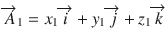

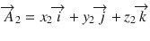

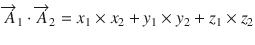

此操作可以使用以下代码执行，其中向量点积定义为`a`乘以`b`的转置：

```
1  −−>a1=[1 2 3];
2  −−>a2=[2 3 4];
3  −−>a1∗a2'
4  ans =
5  20.
```

### 叉积

内置函数`cross()`返回两个输入向量的叉积：

```
1  −−>a=[1 2 3];
2  −−>b=[2 3 4];
3  −−>cross(a,b)
4  ans =
5  − 1\.    2\.    −1.
6  −−>a1=[%t,%t,%f];
7  // 也可以使用布尔值定义向量
8  −−>a2=[%f,%f,%f];
9  −−>cross(a1,a2)
10  ans =
11  0\.    0\.    0.
12  −−>cross(a1,a) // 布尔向量与实数向量的叉积
13  ans =
14  3\.   − 3\.    1.
```

## 离散数学

Scilab 提供了一组有限但实用的内置函数来处理离散数学，如下所示：

1.  `primes` 输出直到给定数字的所有质数

    ```
    1  −−>x = 30;
    2  −−>y = primes(x)
    3  y =
    4  2\.  3\.  5\.  7\.  11\.  13\.  17\.  19\.  23\.  29.
    ```

2.  `factor` 分解给定数字的因子——如果 n 是给定数字，则`factor`生成一个由质数 a, b, c, ... z 组成的数组，使得

    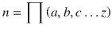

    ```
    1  −−>x=3∗10e4;
    2  −−>y=factor(x)
    3  y =
    4  2\.  2\.  2\.  2\.  2\.  3\.  5\.  5\.  5\.  5\.  5.
    5  −−>x=79867858;
    6  −−>y=factor(x)
    7  y =
    8  2\.    7\.    5704847.
    9  −−>x=9999;

    11  −−>y=factor(x)
    12  y =
    13  3\.    3\.    11\.    101.
    ```

3.  `rat()` 给出一个给定数字的浮点数有理数表示。`help rat` 给出了关于输入参数的详细用法。

    ```
    1   −−>[n,d]=rat(%pi)
    2   d =
    3   113.
    4   n =
    5   355.
    6   −−>[n,d]=rat(%e)
    7   d =
    8   465.
    9   n =
    10   1264.
    11   −−>[n,d]=rat(500)
    12   d =
    13   1.
    14   n =
    15   500.
    16   −−>[n,d]=rat(500.5)
    17   d =
    18   2.
    19   n =
    20   1001.
    ```

4.  `factorial` 输出给定数字的阶乘

    ```
    1   −−>x = 87;
    2   −−>y=factorial(x)
    3   y =
    4   2.10D+132
    5   −−>x = 7;
    6   −−>y=factorial(x)
    7   y =
    8   5040.
    9   −−>x=0;
    10   −−>y=factorial(x)
    11   y =
    12   1.
    ```

5.  `perm` 输出给定数字集合的排列

## 3.10 求解线性方程组的根

作为将数组实际应用于解决现实问题的一个例子，我们使用数组来求解线性方程组的根。假设我们有如下方程：

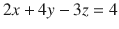 (3.1)

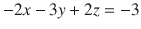 (3.2)

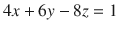 (3.3)

我们希望找到使这三个方程同时成立的 `x`、`y` 和 `z` 的值。为此，这些方程的第一种矩阵形式可以写成如下：

![ $$ \left[\begin{array}{ccc}2& 4& -4\\ {}-2& -3& 2\\ {}4& 6& -8\end{array}\right]\times \left[\begin{array}{c}x\\ {}y\\ {}z\end{array}\right]=\left[\begin{array}{c}4\\ {}-3\\ {}1\end{array}\right] $$ ](A458922_1_En_3_Chapter_Equ4.gif) (3.4)

如果我们假设

![ $$ A=\left[\begin{array}{ccc}2& 4& -4\\ {}-2& -3& 2\\ {}4& 6& -8\end{array}\right] $$ ](A458922_1_En_3_Chapter_Equ5.gif) (3.5)

![ $$ X=\left[\begin{array}{c}x\\ {}y\\ {}z\end{array}\right] $$ ](A458922_1_En_3_Chapter_Equ6.gif) (3.6)

![ $$ B=\left[\begin{array}{c}4\\ {}-3\\ {}1\end{array}\right] $$ ](A458922_1_En_3_Chapter_Equ7.gif) (3.7)

那么我们可以写成

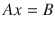 (3.8)

其解为

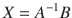 (3.9)

在 `Scilab` 中，只需一行命令即可轻松实现：

```
1  −−>A = [2,4,−4;−2,−3,2;4,6,−8]
2  A =

4  2\.    4\.    −4.
5  −2\.   −3\.    2.
6  4\.    6\.    −8.

9  −−>B = [4; − 3;1]
10  B =

12  4.
13  −3.
14  1.

16  −−>A\B
17  ans =

19  −2.5
20  3.5
21  1.25
```

因此，`x = -2.5`、`y = 3.5` 和 `z = 1.25` 满足这些方程。通过这种方式，`Scilab` 可以轻松地帮助执行复杂的矩阵计算。

## 3.11 总结

基于数组的计算是现代计算技术的核心。`Scilab` 为轻松执行这些技术提供了一个非常合适的平台。各种预定义函数使用户能够在原型设计问题时节省时间。灵活定义多维数组和执行快速计算的方法是我们这个时代的主要需求。模拟过程中大部分时间要么花在循环中，要么花在数组操作上。预定义的数组操作已经过算法优化，确保了可靠性、时间效率和有效的内存管理。