# 4. 绘图

## 4.1 引言

没有可视化，数值计算就难以理解并最终做出判断。生成能够对数值结果进行有意义分析的复杂图形的出版级图像，一直是全世界科学家面临的挑战。许多商业软件满足了这一需求。Scilab 也非常高效地提供了这一功能。其绘图功能包括从二维和三维的各种图形类型中进行选择；使用标题、带标签的坐标轴、网格和数据标签等附加信息装饰图形；以及编写方程和其他有关数据的重要信息。以下各节将详细描述这些操作。值得一提的是，绘图能力对于某些数值分析实验至关重要，因为渐进步骤的可视化指导能让人直观地理解所研究的问题。

## 4.2 二维绘图

### 4.2.1 plot(x,y)

由于我们需要在两个坐标轴上绘制数据，首先需要创建它们。假设 `x` 轴有 100 个线性间隔的数据点，`y` 轴上的点由方程定义，如图 4-1 所示：

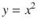

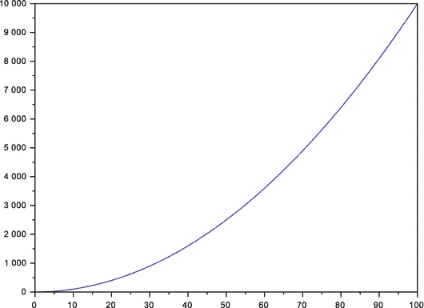

**图 4-1** `y = x²`

```
1  >> x = linspace(0,100,100);
2  >> y = x.ˆ2
3  >> plot(x,y)
```

首先，我们定义一个变量 `x`，并放置从 0 到 100 的 100 个等间隔数据点。这构成了一个 1 x 100 的矩阵。通过指数运算的标量操作，我们定义一个变量 `y` 为 `x²`。需要注意，此操作是使用逐元素运算符定义的，以便矩阵 `x` 的每个元素都进行该运算。如果不这样，数组就需要进行平方运算，即自身相乘。这将产生错误，因为一个 n x m 矩阵只能与 m x n 矩阵相乘。最后，可以使用函数 `plot()`，它接受两个参数作为 x 轴和 y 轴的数据点。

在命令提示符下输入 `help plot` 或 `help 'plot'` 可以深入了解这个用于绘制二维数据的强大函数。默认情况下，后续的绘图会叠加。要清除之前的绘图，请使用 `clf()`。此外，`plot` 函数可以计算输入参数：

```
1  −−>plot(x = linspace(0,100,100),x.ˆ2.5,'r∗')
```

这行代码的结果如图 4-2 所示。请注意，第三个参数，即字符串 `"r*"`，会在输入数组的每个数据点处用 `*` 来绘制数据。

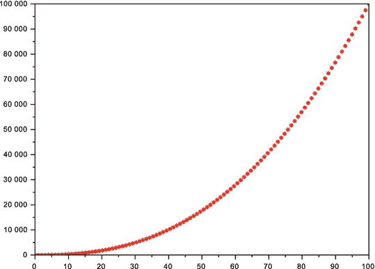

**图 4-2** `y = x²`

可以使用 `plot()` 命令绘制多个图形。例如，让我们在 `-π` 和 `π` 之间绘制 `sin(x)` 和 `cos(x)` 函数。以下是代码的第一个版本：

```
1  −−>x = linspace(−%pi,%pi,100);
2  −−>plot(x,sin(x),'r∗',x,cos(x),'b−')
```

以下是代码的第二个版本：

```
1  −−>x = linspace(−%pi,%pi,100);
2  −−>plot(x,sin(x),'r∗')
3  −−>plot(x,cos(x),'b−')
```

两个代码产生相似的图形，因为在第二个版本中，第二个图形覆盖在第一个图形之上，从而在同一个图形窗口上生成多个图形。图 4-3 显示了结果，其中 `sin(x)` 和 `cos(x)` 分别用 `*` 和 `-` 标记绘制。

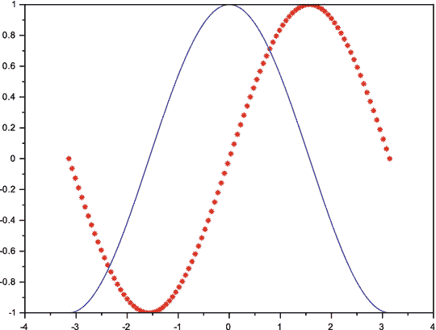

**图 4-3** `sin(x)` 和 `cos(x)`

### 4.2.2 plot2d(), plot2d2(), plot2d3(), 和 plot2d4()

`plot2d` 命令的工作方式与 `plot` 命令类似。此外，这些函数还存在一些其他的变体，与绘图的具体方式有关：

1.  `plot2d2` 与 `plot2d` 相同，但曲线被假定为分段常数  
2.  `plot2d3` 与 `plot2d` 相同，但曲线用垂直条绘制  
3.  `plot2d4` 与 `plot2d` 相同，但曲线用箭头绘制  

代码清单 4-1、4-2、4-3 和 4-4 说明了它们的用法。图 4-4 和图 4-5 展示了它们如何在图形中表示。

```
1  // 使用 plot2d 函数绘图的程序
2  x = linspace(−%pi,%pi,20)
3  plot2d(x,sin(x))
4  xtitle('使用 plot2d 绘制 sin(x) 的图形')
5  xlabel('角度')
6  ylabel('sin(x)')
代码清单 4-1
plot2d.sce
```

```
1  // 使用 plot2d2 函数绘图的程序
2  x = linspace(−%pi,%pi,20)
3  plot2d2(x,sin(x))
4  xtitle('使用 plot2d2 绘制 sin(x) 的图形')
5  xlabel('角度')
6  ylabel('sin(x)')
代码清单 4-2
plot2d2.sce
```

```
1  // 使用 plot2d3 函数绘图的程序
2  x = linspace(−%pi,%pi,20)
3  plot2d3(x,sin(x))
4  xtitle('使用 plot2d3 绘制 sin(x) 的图形')
5  xlabel('角度')
6  ylabel('sin(x)')
代码清单 4-3
plot2d3.sce
```

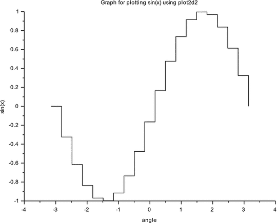

**图 4-5** `sin(x)` 和 `cos(x)`

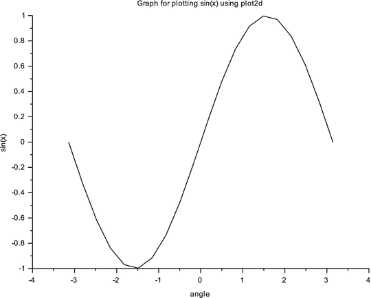

**图 4-4** `sin(x)` 和 `cos(x)`

```
1  // 使用 plot2d4 函数绘图的程序
2  x = linspace(−%pi,%pi,20)
3  plot2d4(x,sin(x))
4  xtitle('使用 plot2d4 绘制 sin(x) 的图形')
5  xlabel('角度')
6  ylabel('sin(x)')
代码清单 4-4
plot2d4.sce
```


好的，作为高级文档工程师和翻译员，我将遵循您提供的注意事项和示例，将给定的英文文本翻译成中文。


### 4.2.3 `polarplot()`

在数学分析中，当某些情况在笛卡尔坐标系中不表现出对称性，但在极坐标系中却表现出对称性时，极坐标就变得重要起来。在这些情况下，我们更倾向于使用极坐标而非笛卡尔坐标进行绘图。因此，我们的坐标不再是 `x`、`y`，而是 `r`、`θ`，它们通过方程相互关联，如图 4-6 和 4-7 所示。

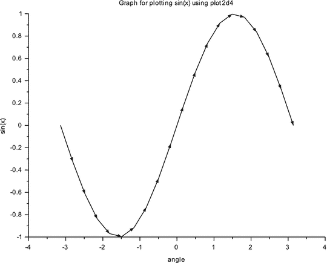

图 4-7
`sin(x)` 和 `cos(x)`

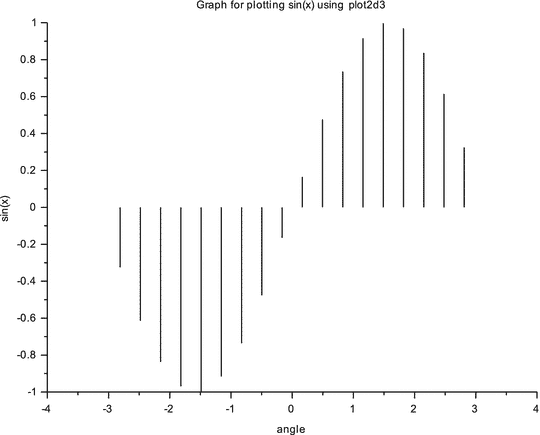

图 4-6
`sin(x)` 和 `cos(x)`

`x = r × cos(θ)`
`y = r × sin(θ)`

由 `polarplot.sce` 提供的代码绘制了这样一个示例，如代码清单 4-5 所示。结果如图 4-8 所示。

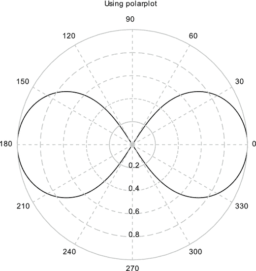

图 4-8
极坐标图

```
1  // 使用 polarplot 函数绘图的程序
2  theta= 0:.01:3∗%pi;
3  polarplot(sin(2∗theta), cos((2∗theta)))
4  xtitle('使用 polarplot 函数')
代码清单 4-5
polarplot.sce
```

## 4.3 特殊图表

### 4.3.1 直方图

直方图传统上用于可视化不同范围内发生的事件数量。Scilab 为此提供了一个有用的函数 `histplot()`，它接收表示区间数量的输入和以数组形式提供的数据。例如，在代码清单 4-6 中名为 `hist.sce` 的代码中，随机数的归一化分布图如图 4-9 所示。

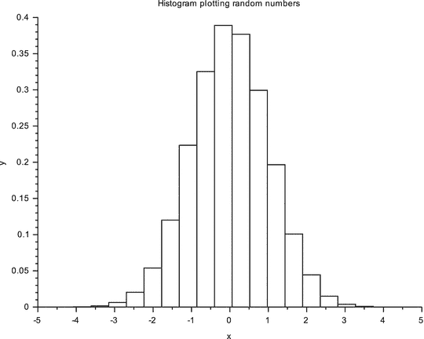

图 4-9
直方图

```
1  // 绘制直方图的程序
2  n = rand(1,10e4,'normal');   // 归一化高斯随机样本
3  bins=20
4  histplot(bins,n)
5  title('绘制随机数的直方图')
6  xlabel('x')
7  ylabel('y')
代码清单 4-6
hist.sce
```

直方图用于展示采样数据。从数据集中，我们可以根据数据点的值将其划分到指定数量的区间中，并可视化哪些值域占主导地位。这提供了关于系统的有用信息。例如，遵循正态分布的值代表了那些总是遵循某种统计规律的系统。在图 4-9 所示的当前示例中，大部分数据事件发生在中间区域。如果此图表示在两个原子之间找到电子的概率，那么我们可以得出结论，电子主要被发现于两个原子的中间。如果此图表示班级学生获得的成绩，那么我们可以推断，获得非常好或非常差（图的两端）成绩的学生很少，而大多数学生的成绩接近 50%。

### 4.3.2 `matplot`

为了绘制代表特定值的颜色，使用 `matplot` 命令，如代码清单 4-7 所示，并在图 4-10 中加以说明。

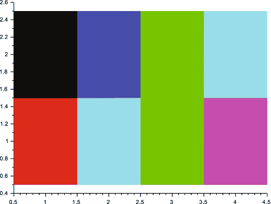

图 4-10
矩阵 `[1 2 3 4;5 4 3 6]` 的 `matplot` 图

```
1  // 使用 Matplot 函数绘图的程序
2  x = [1 2 3 4;5 4 3 6]
3  Matplot(x)
4  grayplot(x,y,m)
5  xtitle('使用 Matplot')
6  xlabel('x')
7  ylabel('y')
代码清单 4-7
matplot.sce
```

### 4.3.3 `grayplot`

有时，我们需要在二维图上观察一个二维函数的值。这通过可视化函数值 `z` 在 `x` 和 `y` 坐标上的分量来实现。`grayplot` 在由 `x` 和 `y` 定义的网格上，绘制一个由 `z` 给出的表面的二维图。网格上的每个矩形根据矩形四个角上 `z` 的平均值，填充以灰度或颜色级别。（参见代码清单 4-8 和图 4-11。）

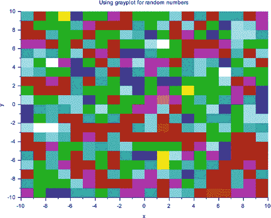

图 4-11
随机数的 `grayplot` 图

```
1  // 使用 grayplot 函数绘图的程序
2  x = −10:10;
3  y = −10:10;
4  m = rand(21,21);
5  grayplot(x,y,m)
6  xtitle('对随机数使用 grayplot')
7  xlabel('x')
8  ylabel('y')
代码清单 4-8
grayplot.sce
```

图 4-11 显示了根据 `z` 值（在此例中由随机数给出）的颜色值。每次运行该图时，都会得到不同的结果，因为 `z` 值是由随机数给出的。实际上，随机数生成算法的效果可以通过 `grayplot` 检查两种颜色是否临近分布来进行可视化检验。

### 4.3.4 `champ`

科学和工程研究涉及矢量场的理论研究。在理论和实践研究中，根据给定的方程绘制矢量场有时非常重要。矢量最好用箭头来描述。为了提供此功能，`champ` 绘制二维矢量场。箭头的长度与场强成正比。（参见代码清单 4-9 和图 4-12。）

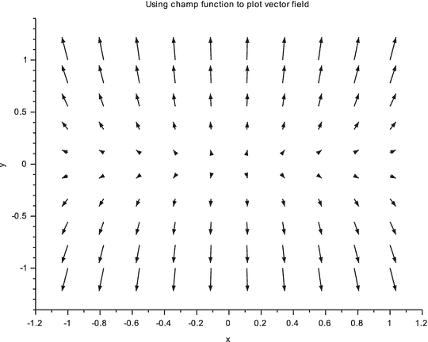

图 4-12
使用 `champ` 绘制矢量场

```
1  // 使用 champ 函数绘制矢量场的程序
2  x = linspace(−1,1,10);
3  y = linspace(−1,1,10);
4  [X,Y] = meshgrid(x,y);
5  fy = 3.∗Y;
6  fx = 0.5.∗X;
7  champ(x,y,fx',fy')
8  xtitle('使用 champ 函数绘制矢量场')
9  xlabel('x')
10  ylabel('y')
代码清单 4-9
champ.sce
```

复数多项式可用于表示矢量场的水平和垂直分量，这些分量通常是测量得到的。`champ` 提供了一种简单的方法来可视化矢量场，然后对由此产生的力进行推断。（参见代码清单 4-10 和图 4-13。）

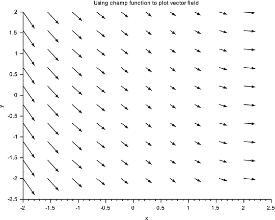

图 4-13
使用 `champ` 绘制矢量场

```
1  // 使用 champ 函数绘制矢量场的程序
2  x = linspace(−2,2,10);
3  y = linspace(−2,2,10);
4  [X,Y] = meshgrid(x,y);
5  fy = X.ˆ3−2.∗X.ˆ2+4.∗X−10;
6  fx = X.ˆ3+2.∗X.ˆ2−4.∗X+10;
7  champ(x,y,fx',fy')
8  xtitle('使用 champ 函数绘制矢量场')
9  xlabel('x')
10  ylabel('y')
代码清单 4-10
champ1.sce
```

为箭头添加颜色（指示场强）可以提供更有意义的视觉呈现，如代码清单 4-11 和图 4-14 所示。

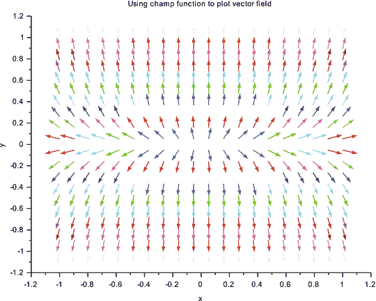

图 4-14
使用 `champ` 绘制矢量场

```
1  // 使用 champ 函数绘制矢量场的程序
2  x = linspace(−1,1,20);
3  y = linspace(−1,1,20);
4  [X,Y] = meshgrid(x,y);
5  fy = 3.∗Y;
6  fx = 0.5.∗X;
7  champ1(x,y,fx',fy')
8  xtitle('使用 champ 函数绘制矢量场')
9  xlabel('x')
10  ylabel('y')
代码清单 4-11
champcolor.sce
```


### 4.3.5 等高线图

等高线图常用于可视化函数在二维平面上的投影。它们广泛应用于科学和工程的各个领域，特别是地球物理学中，将温度、压力和湿度等测量参数的信息投影到地图上。此外，等高线图也用于可视化二维数学在平面上的投影。

Scilab 为此提供了内置函数 `contour2d()`。其用法在清单 4-12 的示例代码中进行了说明。该函数的详细用法可通过命令 `help contour2d` 学习。本质上，该函数接收 x、y 和 z 值以及层级数量作为参数。代码生成随机数，并根据其在二维矩阵中的值进行绘制。

```
1  // 绘制二维等高线的程序
2  x = 1:10;
3  y = 1:10;
4  z = rand(10,10);
5  level_number = 8;
6  contour2d(x,y,z, level_number)
7  title('绘制等高线图')
8  xlabel('x')
9  ylabel('y')
清单 4-12
contour.sce
```

图 4-15 展示了代码的运行结果。

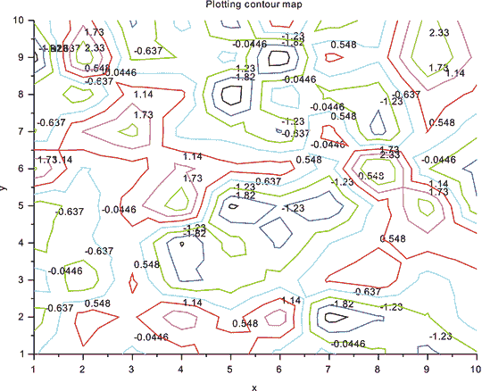

图 4-15

使用 champ 函数绘制向量场

除了等高线轮廓外，还可以使用内置函数 `contourf()` 获取填充等高线图。其语法与 `contour2d()` 函数类似。（参见清单 4-13 和图 4-16。）

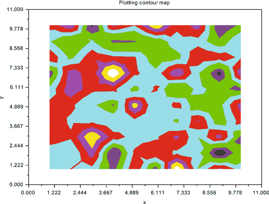

图 4-16

使用 champ 函数绘制向量场

```
1  // 绘制二维填充等高线的程序
2  x = 1:10;
3  y = 1:10;
4  z = rand(10,10);
5  level_number = 8;
6  contourf(x,y,z, level_number)
7  title('绘制填充等高线图')
8  xlabel('x')
9  ylabel('y')
清单 4-13
contourf.sce
```

图 4-16 中颜色编码的区域处于相同层级。由于 z 值取自随机数生成器函数 `rand()`，因此每次运行代码 `contourf.sce` 时，生成的图形都会不同。

等高线图是可视化二维数据平滑度的简单方法。平滑的数据变化很小，因此会落在同一个层级内。层级范围的选择将定义平滑度。例如，假设红外摄像机测量房间的温度，并且数据被颜色编码用于视觉显示。等高线将由不同的温度范围层级定义。如果某个区域的温度是均匀的，它将被编码为相似的颜色。该区域的温差将在定义的范围内，因此范围的定义变得至关重要。如果温度的最小值和最大值分别为 T[1] 和 T[2]，层级数量为 n，则一个区域的温度范围由下式给出：

```
|T_2 - T_1| / n
```

## 4.4 二维动画

在仿真过程中，有时通过动画形式展示方程以理解其演变过程会非常有用。Scilab 包含一些对此非常有用的函数。请注意，提供的图形是动画结束时的快照。用户应按照讨论编写代码并在自己的电脑上测试，以在显示器上看到动画效果。动画在向学生教授概念时尤其有用。

### 4.4.1 comet 函数

`comet()` 函数在这种情况下非常有用。在清单 4-14 中，我们使用 `comet` 函数对方程 `x⁵ - x³ + x + 5` 进行了动画演示。

```
1  // 演示 comet 用法的程序

3  x = linspace(−%pi,%pi,500);
4  comet(x,%sˆ5−%sˆ3+%s+5)
5  xtitle('使用 comet 函数对方程进行动画演示')
6  xlabel('x')
7  ylabel('y')
清单 4-14
comet.sce
```

### 4.4.2 paramfplot2d() 函数

函数在多点的时间演变可以通过 `paramfplot2d()` 函数来表示。让我们考虑函数 `y = sin(x) + sin(2x) + sin(4x)`（一个信号与其双倍及四倍频率信号的混合）的演变过程。得到的信号是由这三个基本波（`sin(x)`、`sin(2x)` 和 `sin(4x)`）组合而成的复杂波，如图 4-17 和清单 4-15 所示。

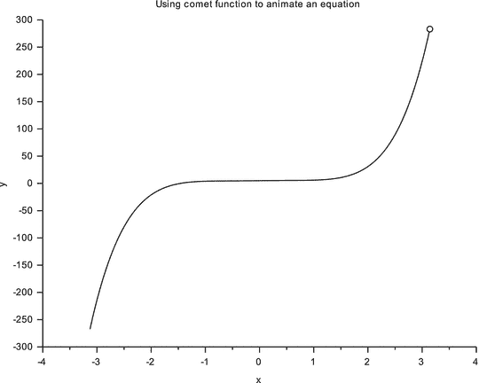

图 4-17

使用 comet 函数绘图

```
1  deff('y=f(x,t)','y=t∗sin(x)+sin(2∗x)+sin(4∗x)') // 定义方程
2  x = linspace(−4∗%pi,4∗%pi,10e3); // 定义空间步长
3  t = 100;
4  time_speed = 0:0.05:1; // 步长决定动画速度
5  paramfplot2d(f,x,time_speed);
6  xtitle('使用 paramfplot2d 函数对方程进行动画演示')
7  xlabel('x')
8  ylabel('y')
清单 4-15
paramfplot2d.sce
```

请注意，`deff` 用于定义函数。其用法可以通过 `help deff` 查看。其详细用法将在关于 Scilab 函数定义的章节中讨论。

## 4.5 在同一个图形中绘制多个图表

只需提供 x 轴和 y 轴向量，即可在同一个图形中绘制多个图表，如清单 4-16 和图 4-18 所示。

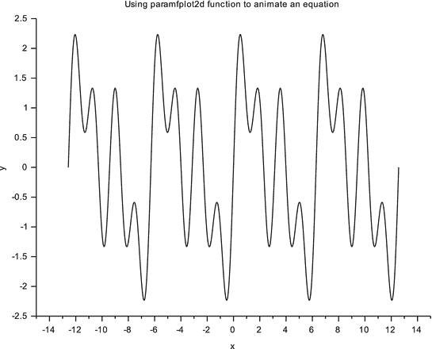

图 4-18

使用 paramfplot2d 函数绘图

```
1  // 绘制带有图例的多个图表的程序

3  x = linspace(1,10,30);
4  plot(x,x.ˆ2,'k∗')
5  plot(x,x.ˆ2.5,'r−')
6  plot(x,x.ˆ3,'b−−')
7  legend(['xˆ2';'xˆ3';'xˆ4']);
8  title('在同一个窗口中绘制多个图表')
9  xlabel('x')
10  ylabel('y')
清单 4-16
multi.sce
```

图 4-18 是通过运行清单 4-16 中的代码获得的。这类图表通常用于通过改变特定参数来检查结果的变化情况。


### 4.5.1 分别绘制多个图形

`subplot(行,列,索引)` 命令用于在同一图形窗口中分别绘制多个图形。`subplot(2,2,4)` 表示该图形将位于第二行、第二列、第四个索引位置。（参见清单 4-17 和图 4-19。）

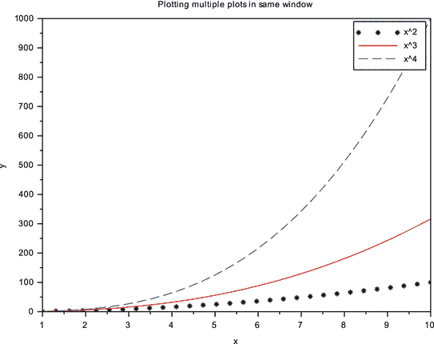

图 4-19
同一图形窗口中的多个图形

```
1  // Program to show usage of subplot function
2  // subplot function produces a f igure as a matrix

4  x = linspace(−2∗%pi,2∗%pi,1000);
5  //1st f igure of a 2X2 f igure matrix
6  subplot(221)
7  plot(x,sin(x),'r∗')
8  title('Plot for sin(x)')
9  xlabel('x')
10  ylabel('sin(x)')

12  //2nd f igure of a 2X2 f igure matrix
13  subplot(222)
14  plot(x,sin(x)+sin(2.∗x),'b∗')
15  title('Plot for sin(x) + sin(2x)')
16  xlabel('x')
17  ylabel('sin(x) + sin(2x)')

19  //3rd f igure of a 2X2 f igure matrix
20  subplot(2,2,3)
21  plot(x,sin(x) + sin(3.∗ x),'g∗')
22  title('Plot for sin(x) + sin(3x)')
23  xlabel('x')
24  ylabel('sin(x) + sin(3x)')

26  //4th f igure of a 2X2 f igure matrix
27  subplot(2,2,4)
28  plot(x,sin(x) + sin(4.∗x),'k∗')
29  title('Plot for sin(x) + sin(4x)')
30  xlabel('x')
31  ylabel('sin(x) + sin(4x)')
清单 4-17
subplot.sce
```

如图 4-20 所示，图形按矩阵方式组织，行号和列号决定了其位置。然后，可以使用图形的索引将其视为一个对象，以便在图形对象上进行进一步处理。理论上，行数和列数的限制取决于计算机的内存，但在打印时，用户必须了解，根据图形的大小，其中一些图形可能会超出打印区域。因此，建议明智地使用此命令。可以通过使用循环生成图形索引来实现图形矩阵的自动生成。

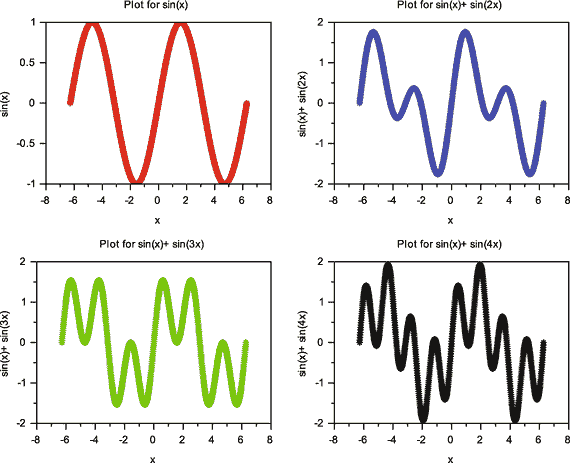

图 4-20
使用子图在同一图形窗口中分别绘制多个图形

## 4.6 3D 图形

Scilab 中有多种可用于 3D 绘图的函数。选择其中哪一个取决于您的具体问题。

### 4.6.1 plot3d

内置函数 `plot3d()` 根据给定的定义为数组的 x、y 和 z 值绘制 3D 图形。其用途之一如清单 4-18 所示，其中绘制了公式 4.1。

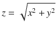
(4.1)

```
1  // Program to plot 3D graph using plot3d

3  a = linspace(−8,8,41)';
4  b = linspace(−8,8,41)'
5  [xx, yy] = meshgrid(a,b);
6  c = sqrt(xx.ˆ2 + yy.ˆ2)+%eps;
7  plot3d(a,b,c)
清单 4-18
plot3d.sce
```

### 4.6.2 plot3d1()

内置函数 `plot3d1()` 根据给定的定义为数组的 x、y 和 z 值绘制彩色 3D 图形。单元格的颜色指示 z 值的范围。其用法如清单 4-19 和图 4-21 所示，其中绘制了公式 4.1。

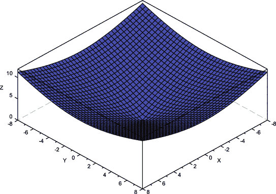

图 4-21
公式的 3D 图形

```
1  // Program to plot 3D graph using plot3d1

3  a = linspace(−8,8,41)';
4  b = linspace(−8,8,41)'
5  [xx, yy] = meshgrid(a,b);
6  c = sqrt(xx.ˆ2 + yy.ˆ2)+%eps;
7  plot3d1(a,b,c)
清单 4-19
plot3d1.sce
```

`plot3d1()` 提供的颜色编码在某些关键分析中成为了一个附加特性。3D 图形中的等高线给出了测量系统值相同的投影区域的形状。例如，假设图 4-22 表示一个位于其中心的带电粒子附近的电场。颜色表示在 3D 空间中该带电粒子受到的力在某个范围内的区域。

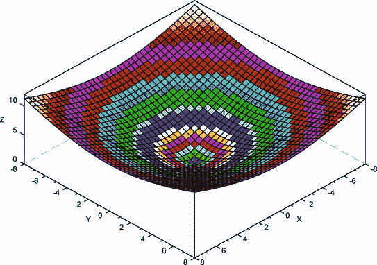

图 4-22
公式的 3D 图形

### 4.6.3 plot3d2()

另一个内置函数 `plot3d2()` 使用矩形面片构建 3D 图形。示例如清单 4-20 所示。

```
1  // Program to plot 3D graph using plot3d2

3  u = linspace(−%pi/2,%pi/2,40);
4  v = linspace(0,2∗%pi,20);
5  X = cos(u)'∗cos(v);
6  Y = cos(u)'∗sin(v);
7  Z = sin(u)'∗ones(v);
8  plot3d2(X,Y,Z);
清单 4-20
plot3d2.sce
```

结果如图 4-23 所示。需要注意的是，更精细的网格将使图形具有更好的 3D 特征分辨率。为了获得更精细的网格，`linspace()` 参数应使用更小的步长来定义。然而，同时，使用更精细的网格会增加计算时间。因此，3D 渲染是一项计算密集型任务，但有时又是必要的。参数的选择取决于数据分析的要求。当需要更精细的 3D 表面特征分辨率时，用户必须选择更高的渲染能力（这直接导致对高计算能力的需求）。

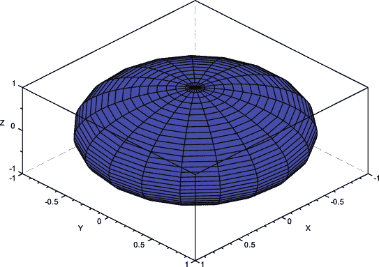

图 4-23
公式的 3D 图形

### 4.6.4 plot3d3()

另一个内置函数 `plot3d3()` 使用矩形面片构建 3D 网格图。`plot3d2` 和 `plot3d3` 之间的唯一区别在于，前者生成表面图，而后者在矩形面片上生成网格图。示例如清单 4-21 所示。

```
1  // Program to plot 3D graph using plot3d3

3  u = linspace(−%pi/2,%pi/2,40);
4  v = linspace(0,2∗%pi,20);
5  X = cos(u)'∗cos(v);
6  Y = cos(u)'∗sin(v);
7  Z = sin(u)'∗ones(v);
8  plot3d3(X,Y,Z);
清单 4-21
plot3d3.sce
```

关于网格分辨率，其参数选择与表面图相同。然而，需要注意的是，渲染网格的计算强度略低于渲染表面。

### 4.6.5 表面图

表面图通过使用内置函数 `surf()` 获得，该函数接受网格点高度作为单个参数。通过连接这些网格点，可以创建一个表面。默认情况下，表面面片使用不同的颜色编码以便区分。这可以在清单 4-22 和图 4-24 所示的代码中查看。

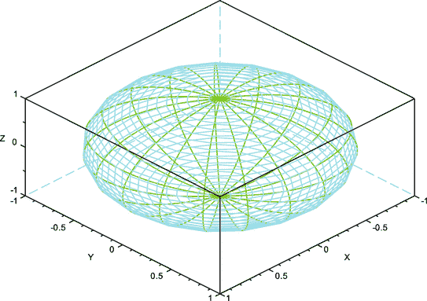

图 4-24
公式的 3D 图形

```
1  // Program to plot 3D graph using surf
2  subplot(2,2,1)
3  z = rand(10,10);
4  surf(z)
5  title('surf')

7  subplot(2,2,2)
8  surf(z,'facecol','red','edgecol','blu')
9  title('surf function with face and edge color')

11  subplot(2,2,3)
12  surf(z,'facecol','interp')
13  title('surf function interpolated')

15  subplot(2,2,4)
16  x=rand(10,10);
17  y=rand(10,10);
18  z=rand(10,10);
19  surf(z,'facecol','red','edgecol','blu')
20  title('surf function with each coordinated def ined seperately')
清单 4-22
surf.sce
```

注意，当提供关于面颜色为红色、边颜色为蓝色的额外参数时，图形会绘制成具有蓝色边缘的红色表面，如图 4-25 所示。`surf()` 命令的输入是一个数组。本例中由内置函数 `rand()` 创建，但它也可以从外部创建并输入到 `surf()` 函数中。

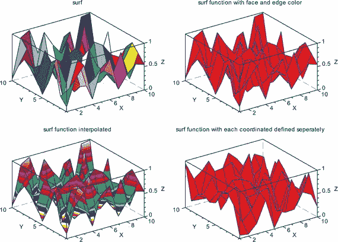

图 4-25
公式的 3D 图形

在第三个子图中，随机网格值由 `rand()` 函数定义，但两个网格点之间的中间值被插值。这导致了等高线的颜色编码。在第四个子图中，从 `rand()` 函数中获取的 x、y、z 各个笛卡尔坐标被分别输入到 `surf` 函数中。


