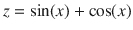
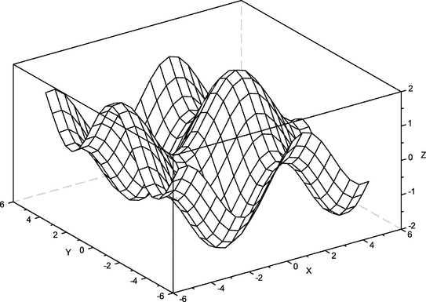

# 网格图

网格图是通过连接由坐标定义的网格点生成的。例如，请考虑清单 4-23 中的代码。

```
// 用于解释网格函数用法的程序

[X,Y] = meshgrid(−5:0.5:5, −5:.5:5);
Z = sin(X)+cos(Y);
mesh(X,Y,Z);
清单 4-23
mesh.sce
```

这里，生成了一个二维坐标系，并存放在两个名为 `X` 和 `Y` 的数组中。对于这些定义 x 和 y 的点，定义了一个方程如下：



(4.2)

这三个值（分别来自数组 `x`、`y` 和 `z`）被输入到 `mesh` 函数中。

结果如图 4-26 所示。这三个坐标（`x`、`y` 和 `z`）由向量 `X`、`Y` 和 `Z` 的对应元素定义。这些点用于创建网格图。



图 4-26

方程的 3D 图

