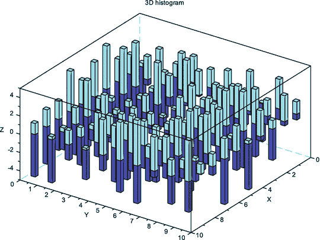

# 3D 直方图

与二维直方图类似，三维直方图提供了关于具有二维依赖关系的数据分组的直观线索。3D 可视化以垂直实心条的形式呈现，如清单 4-24 所示。

### 清单 4-24 hist3d.sce

```
// 制作 3D 直方图的程序
hist3d(5*rand(10,10));
hist3d(-5*rand(10,10));
title('3D 直方图')
```

在`hist3d.sce`中，随机数被放大并绘制在一个二维矩阵上。这些随机数生成了条柱的高度。生成了两个直方图，一个位于正象限，一个位于负象限。结果如图 4-27 所示。



图 4-27 3D 直方图