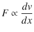
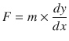

# 动态系统中的微分与积分

在处理动态系统时，微分和积分的数学概念变得至关重要。当系统持续变化因变量的值以生成某种场景时，了解这些变量的变化率就很重要。当这些变量相互独立时，我们使用简单导数来定义它们的变化率；当它们相互依赖时，我们则使用偏导数。

例如，牛顿第二运动定律表明，物体速度的变化率与其所受的力成正比。方程 7.3 从数学上演示了这一概念：



(7.3)

通过代入乘法常数 `m`，可以将比例关系转化为等式，即：



(7.4)

如果我们知道 `F` 的值或表达式，这个方程可以通过解析方法求解并找到其解。但在某些情况下，解析解可能难以获得。此时，我们将系统离散化，并寻求数值解。

有多种方法可以对给定函数进行离散化和数值求解。用于实现特定方法来数值求解函数的程序被称为求解器。存在许多求解器用于求解一个函数。求解器的选择对于成功求解至关重要。例如，方程 7.4 是一个微分方程，它是一个一阶常微分方程。存在多种求解器可以求解它，包括欧拉法和龙格-库塔法。特定求解器的选择取决于其解的精度、求解所需的时间以及过程中使用的内存量。在内存并非可自由挥霍的资源（例如内存存储有限的微型计算机，如 RaspberryPi）的情况下，后者尤为重要。

使用 Scilab 进行数值计算的优势在于，它拥有非常丰富的函数库，可以执行所需的各种任务。预定义的函数在速度和精度方面都经过了优化（在某些情况下，精度可以预设）。这使得用户可以快速构建问题原型，而无需专注于编写执行基本任务的函数，也不必为速度、精度和内存使用而优化这些函数。

## Scilab 软件包

存在大量用于在特定科学领域执行数值计算的软件包。Scilab 使用 `Atoms` 包管理器来管理（安装、删除和更新）Scilab 软件包。网站 [`https://wiki.scilab.org/ATOMS`](https://wiki.scilab.org/ATOMS) 描述了其用法。

点击菜单项 `Applications -> Module Manager ATOMS` 即可打开 `Atoms`（Scilab 自动模块管理）包管理器。它列出了 Scilab 的各种专用模块。该列表会随着新的开发成果而频繁更新。您可以通过点击名称选择软件包，并使用 `Install` 按钮进行安装。类似地，您也可以卸载软件包。您还可以通过 Scilab 命令行执行这些操作。

### 搜索软件包

如果您知道软件包的名称，可以使用以下命令进行搜索：

```
1  −−>atomsSearch("coselica")
2  ans =
3  !coselica Standard Open Modelica Blocks   !
4  −−>atomsSearch("arduino")
5  ans =
6  !arduino Arduino Communication through Serial   !
7  −−>atomsSearch("raspberrypi")
8  ans  =
9  []
```

虽然可以找到名为 `coselica` 和 `arduino` 的模块，但名为 `raspberrypi` 的模块返回了一个空字符串。（换句话说，它没有被找到。）

### 安装软件包

安装模块的命令使用了内置函数 `atomInstall()`，如下所示：

```
1  −−>atomsInstall("scidemo")
2  ans =

4  !scidemo 0.2.2  allusers    SCI/contrib/scidemo/0.2.2  I   !
5  !                                                          !
6  !apifun  0.4.2  allusers    SCI/contrib/apifun/0.4.2   A   !
```

返回的参数显示了模块的版本号及其存储路径。该模块会在下次启动 Scilab 时自动加载。要手动加载模块，可以使用命令 `atomsLoad("scidemo")`。

### 移除软件包

内置函数 `atomsRemove("scidemo")` 可用于移除软件包 `arduino`：

```
1  −−>atomsRemove("scidemo")
2  ans =

4  !scidemo 0.2.2  allusers    SCI/contrib/scidemo/0.2.2   I    !
5  !                                                          !
6  !apifun  0.4.2  allusers    SCI/contrib/apifun/0.4.2    A    !
```

### 列出软件包

可以在命令行发出内置函数 `atomsList()`，以获取按字母顺序排序的详细软件包列表。例如，在编写本文时输出如下：

```
1  −−>atomsList
2  apifun − Check input arguments in macros
3  assert − A collection of predicate functions
4  condnb − Evaluates the condition number of functions.
5  coselica − Standard Open Modelica Blocks
6  CPGE − CPGE dedicated Xcos blocks
7  dbldbl − Double−Double floating point numbers
8  diffcode − Automatic differentiation
9  dispmat − Display matrices graphically
10  Dynpeak − Scilab toolbox for the detection of pulses in hormonal signals
11  FACT − a toolbox for chemometric applications, e.g. regressions, discriminant analysis, multiway analysis
12  floatingpoint − Functions to manage floating point numbers
13  guibuilder − A Graphic User Interface Builder
14  helptbx − Update the help of a module automatically .
15  iodelay − manipulation and frequency analysis of linear dynamical systems with input or output delays
16  makematrix − A collection of test matrices .
17  Mathieu − Solve Mathieu equations, calculate Mathieu functions
18  mingw − Dynamic link with MinGW for Scilab on Windows
19  neuralnetwork − This is a Scilab Neural Network Module which covers supervised and unsupervised training algorithms
20  number − Integers algorithms
21  optkelley − Scilab software for Iterative Methods for Optimization
22  removed − All pages of functions removed from Scilab 4.1.2 to 6.0 gathered in a single place
23  scibench − A collection of benchmarks
24  scicv − Interface to the Computer Vision library OpenCV
25  scidemo − A collection of demonstrations
26  serial − A toolbox for communication over a Serial Port in Scilab
27  specfun − A collection of special functions
28  stixbox − Statistics toolbox
29  uman − User MANual in console + online + browser, easy languages switch, related bugs, comb mailing lists ...
30  uncprb − Provide 35 unconstrained optimization problems
```

## XCOS

Scilab 最吸引人的特性之一（在 MATLAB 和 Octave 中均无此特性）是 XCOS 图形化编程环境。它类似于 MATLAB 的图形化编程环境 Simulink。关于 XCOS 的详细讨论是第 8 章的主题。

## 总结

几乎所有科学与工程分支都需要执行数值计算。Scilab 是进行此类计算的备选方案之一。Scilab 拥有丰富的通用计算优化函数库，并且随着全球开发者的持续贡献，该库正在日益壮大。此外，它还有多种用于执行专业化任务的软件包。这使得 Scilab 成为高效原型化数值计算问题的理想选择。

